# Security control panel "FLEXi" SP5

!!! warning "Draft for internal review, not published"
    This page is a working draft. It is built from the SP5 specification, the firmware designer's terminal notes, the test log, the Protegus app (beta front-end, firmware 1.00, hardware revision 1E7LWB.0), the settings read from a test panel, and the test team's answers and board photo.
    Items marked **[to confirm]** come from the specification or are inferred, and need a check against a production board before publishing. The product name may change to SP10.

## About the control panel

The "FLEXi" SP5 is an intrusion alarm control panel for small and medium sites: shops, offices, warehouses, service centres, schools and gyms. It has a built-in 4G LTE modem, a LAN port and a 2.4 GHz WiFi module. It reports events to monitoring stations (CMS) and to the Protegus cloud, and it is configured in the Protegus app.

The panel has 10 on-board input/output terminals, a keypad bus and an RS485 bus. With keypads, RS485 expanders and wireless devices it supports up to 192 zones in 16 areas.

### What is new compared with "FLEXi" SP3

| | "FLEXi" SP3 | "FLEXi" SP5 |
|---|---|---|
| Zones | up to 64 | up to 192 |
| Areas (partitions) | 8 | 16 |
| Keypads | up to 8 | up to 16 |
| Devices on the RS485 bus | up to 8 | up to 64 |
| Users | 40 | up to 1000 |
| Event log | 1000 events | 5000 events |
| Event buffer | 60 events | 256 events |
| LAN | with the E485 module | built in |
| Temperature sensors | 1-Wire (Dallas) | NTC 10K on any I/O terminal, RS485 and wireless sensors |
| Relay output on the board | no | yes (REL) |
| Configuration | TrikdisConfig | Protegus app |

### Specifications

| Parameter | Value |
|---|---|
| Power supply voltage [AC / DC] | 16 V AC or 16–24 V DC, 2.5 A. At 12 V DC the panel can't charge the battery |
| Current consumption | **[to confirm: not measured yet]** |
| Backup power source [BAT] | 12 V lead-acid battery, usually 7 Ah; choose the capacity for the connected equipment (see [Power budget](#power-budget)) |
| Battery charge current | Up to 500 mA |
| Power output for external devices [AUX] | 12 V DC, up to 2 A |
| Siren output [BELL] | 1 A |
| Open-collector output on an I/O terminal | 0.1 A |
| Relay output [REL] | Changeover contacts NC, C, NO; up to 1 A at 30 V DC or 0.3 A at 125 V AC, resistive load |
| Cellular modem | 4G LTE, EU version (EG915) **[bands to confirm]** |
| SIM card | 1, nano-SIM |
| WiFi | 2.4 GHz; DHCP or manual IP |
| LAN | Built in; DHCP or manual IP |
| Event reporting channels | LTE, LAN, WiFi, SMS |
| Report destinations | Two monitoring stations (primary and parallel), each with a backup channel and an SMS fallback; Protegus cloud and app; SMS to users |
| Protocols to the CMS | TRK, TRK8, SIA DC-09 (also its IPcom variant), TL150; TCP/IP, UDP/IP; SMS |
| Event encoding | Contact ID, SIA |
| Report encryption | TRK8 AES 128, SIA DC-09 AES 128 |
| Account (object) number | Up to 6 characters, hexadecimal |
| Internal clock | Yes, with time synchronization (SIM, LAN, NTP server) |
| Event buffer | 256 events |
| Event log | Up to 5000 events; the oldest are deleted automatically |
| Users | Up to 1000 |
| On-board I/O terminals | 10 (IO1–IO10, marked IN1–IN10 on the board) |
| Areas | 16 |
| Zones | Up to 192 |
| PGM outputs | Up to 64 |
| Keypads | Up to 16 |
| Temperature, voltage and resistance inputs | Up to 20 sensors |
| Devices on the RS485 bus | Up to 64 |
| Cable length | RS485 bus and keypad bus: up to 100 m each |
| Wireless devices | Up to 42 |
| Operating environment | −10 °C to +50 °C, relative humidity up to 80 % at +20 °C, no condensation |
| Board dimensions, weight | 161 × 75 × 30 mm, 0.12 kg |

### System limits in the Protegus app

The app enforces these maximums:

| Item | Maximum |
|---|---|
| On-board I/O terminals | 10 |
| Zones | 192 |
| Areas | 16 |
| Keypads | 16 |
| RS485 expanders | 64 |
| Wireless devices | 42 |
| Sensors (temperature, voltage, resistance) | 20 |
| Thermostats | 8 |
| Users | 1000 |
| Supervisors | 8 |
| User groups | 32 |
| Schedules | 64 |
| Blacklisted numbers | 40 |

### Board and terminals

![Photo of the SP5 board from above. Along the bottom edge, left to right: the 12V −BAT+ battery plug, then the screw terminals + DC − (marked 2,5A, 16V/AC, 16-24V/DC), +BELL−, +AUX−, GRN YEL, A 485 B, IN1 IN2 C IN3 IN4 C IN5 IN6 C IN7 IN8 C IN9 IN10 and AUX + −, with HIN marked above IN8 and FL1 and FL2 above IN9 and IN10. The LAN port is at the bottom right. Along the top edge, left to right: the ANT GSM antenna connector, the USB connector, five LEDs marked SIM, ETH, WIFI, DAT and PWR, the ANT WIFI antenna connector, a push button, and the relay with its NC, C, NO screw terminals. The SIM card holder is on the left.](./sp5-board.webp)

| Marked on the board | Purpose |
|---|---|
| + DC − | Power supply input: 16 V AC or 16–24 V DC, 2.5 A |
| 12V −BAT+ | 12 V backup battery (plug-in lead) |
| +BELL− | Siren output. BELL+ is the siren supply, always on. BELL− is switched; its default function is **Siren** and it can be changed, for example to **Remote control** |
| +AUX− | 12 V DC output for external devices, up to 2 A. A second AUX pair is at the right end of the terminal strip |
| GRN, YEL | Keypad data bus |
| A 485 B | RS485 data bus for expanders and wireless receivers |
| IN1–IN10 | Input/output terminals, called IO1–IO10 in this manual and **SP5 1 I/O** to **SP5 10 I/O** in the app. Each can be a zone input, a PGM output (open collector), a temperature input (NTC 10K), a voltage input or a resistance input |
| C | Common terminals for IN1–IN10, one after each pair |
| NC, C, NO | Relay contacts, at the top right. The app calls this output **REL**; its function can be changed |

Additional markings on the I/O terminals:

| Terminals | Additional function |
|---|---|
| IO9 (FL1), IO10 (FL2) | 2-wire fire loop. Both can be used at the same time; they work independently |
| IO8 (HIN) | Voltage input up to 30 V; the other terminals measure 0–12 V |

Other parts of the board:

- **ANT GSM** and **ANT WIFI:** connectors for the cellular and WiFi antennas.
- **SIM:** the nano-SIM card holder.
- **LAN:** the Ethernet port.
- **USB:** USB-C connector for configuring the panel and updating its firmware over a cable with the Protegus app (**USB Device Configuration**), in a desktop browser such as Chrome or Edge or in the Android app. The **Dashboard** then shows the connection **Via USB**. **[how to open the USB configuration in the app: to confirm]**
- **SIM, ETH, WIFI, DAT, PWR:** LEDs (see [LED indication](#led-indication)).
- **F1 button** next to the relay: turns on the WiFi setup mode, for setting the WiFi network name (SSID). **[how the setup mode is used, and how to restore the factory settings: to confirm]**

A terminal can have only one function at a time. When you assign a terminal as a zone, it is removed from the output and sensor lists, and the other way round. The exception is resistance measurement: a terminal used as a zone can also be measured as a resistance sensor.

### LED indication

The board has five LEDs along the top edge, marked **SIM**, **ETH**, **WIFI**, **DAT** and **PWR**.

!!! question "To confirm"
    What each LED's colour and blink pattern means. The test team will send it.

## Planning the system

### How the devices connect

- **On-board terminals (IO1–IO10):** wired detectors, sirens, relays and sensors.
- **Keypad bus (GRN, YEL):** up to 16 keypads. Each keypad also gives one zone input.
- **RS485 bus (A, B):** up to 64 devices: input/output expanders and wireless receivers.
- **Wireless:** detectors, sirens and key fobs through an RF-S8 (HEYI) or RF-SH (Crow) receiver on the RS485 bus, up to 42 devices.
- **Reporting:** 4G LTE (nano-SIM), LAN and WiFi to monitoring stations and to the Protegus cloud.

### Where zones come from

The panel has up to 192 logical zones. Each zone takes its input from one of these sources:

| Zone source | Number of inputs | Zone types allowed |
|---|---|---|
| On-board terminals IO1–IO10 | 10, or 20 with ATZ | All |
| RS485 expanders (iO, iO-8, iO-LORA, iO8-LORA) | 1 or 8 per expander; ATZ on iO-8 doubles them | All on iO-8 |
| Keypad inputs | 1 per keypad, up to 16 | NO, NC, EOL; also EOL_T on keypads with serial numbers starting 1D, 1E, 51 or 52 |
| Wireless devices | 1 per device, up to 42 | Set by the device |
| 2-wire fire loops | IO9, IO10 or both | Fire |

### Supported keypads

Protegus SK232 LED W (SK-LED TouchPad), FLEXi SK232 LCD (SK-LCD TouchPad), SK LCD Button, SK LED Button, and Paradox K636, K10H(V), K32 LED, K32+ LED, K32LCD+, K35, TM50 and TM70. Paradox keypads work with limitations: they don't show all zones, users and areas.

### Supported RS485 modules

iO-8, iO-LO and iO8-LORA expanders, the RF-LORA receiver for the LoRa expanders, RF-S8 (HEYI) and RF-SH (Crow) wireless receivers, and T16 and T16v2 **[PB-LORA and other modules: to confirm]**. Only one of RF-LORA, RF-S8, T16 and T16v2 can be connected. The panel recognises connected RS485 modules automatically.

### Power budget

The 12 V AUX output supplies up to 2 A to keypads, expanders, receivers, detectors and sirens. Add up the current of everything connected to AUX and BELL, both in standby and in alarm, and check that it stays below the limit.

The backup battery must keep the system running after a mains failure. EN 50131 requires at least 12 hours for Grade 2 and 60 hours for Grade 3 (30 hours if the mains failure is reported to the monitoring station).

Battery capacity (Ah) ≥ standby current (A) × required hours + alarm current (A) × alarm time (h)

A 7 Ah battery is the usual choice; a system with many devices on AUX may need a larger one.

!!! question "To confirm"
    The panel's own current in standby and while transmitting. It has not been measured yet.

### Choosing the installation site

- Install the panel indoors, in a dry place, within −10 °C to +50 °C and up to 80 % relative humidity.
- Check the cellular signal where the antenna will be before fixing the enclosure.
- Keep the panel and its cables away from mains cables and strong sources of interference.
- Plan the cable routes for the keypad bus and the RS485 bus before mounting. Each bus can be up to 100 m long.

## Installation and wiring

!!! warning
    Make all connections with the power and the backup battery disconnected.

### Recommended order of work

1. Mount the enclosure and fit the panel.
2. Connect the zones, outputs, keypads and RS485 modules.
3. Insert the nano-SIM card and connect the antennas and the LAN cable.
4. Connect the backup battery, then the main power supply.
5. Add the panel to the Protegus app and configure it.
6. Test every zone and the reporting to the monitoring station.

### Connecting detectors

Any of the terminals IO1–IO10 (marked IN1–IN10 on the board) can be a zone input. Set the circuit type of each zone in the app (**Areas and zones → Zones**, column **Type**). With the ATZ types, one terminal carries two zones.

  <figure style="margin: 0;">
    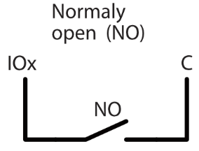
  </figure>
  <figure style="margin: 0;">
    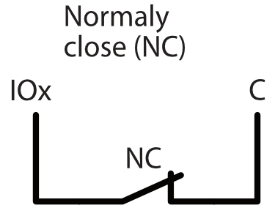
  </figure>
  <figure style="margin: 0;">
    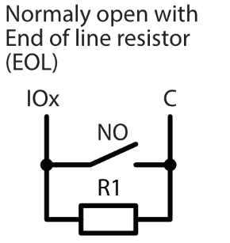
  </figure>
  <figure style="margin: 0;">
    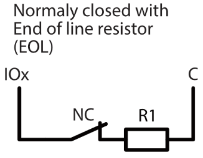
  </figure>

  <figure style="margin: 0;">
    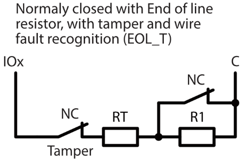
  </figure>
  <figure style="margin: 0;">
    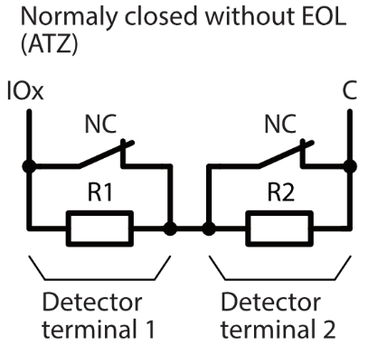
  </figure>

  <figure style="margin: 0;">
    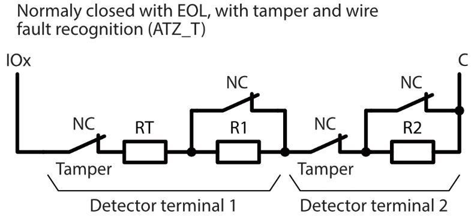
  </figure>
  <figure style="margin: 0;">
    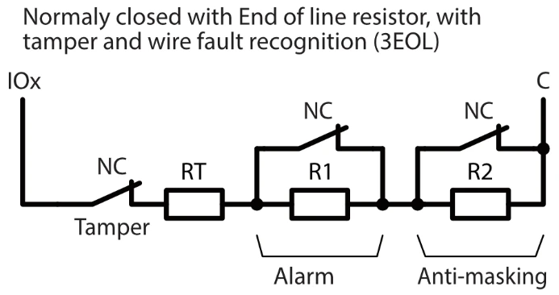
  </figure>

| Type in the app | Circuit |
|---|---|
| NO | Normally open contact, no resistor |
| NC | Normally closed contact, no resistor |
| EOL | One end-of-line resistor (R1) |
| EOL_T | End-of-line resistor with tamper and wire fault recognition (RT, R1) |
| ATZ | Two zones on one terminal, no tamper recognition (R1, R2) |
| ATZ_T | Two zones on one terminal, with tamper and wire fault recognition (RT, R1, R2) |
| 3EOL | Alarm, anti-masking and tamper on one terminal (RT, R1, R2) |

#### Resistor values

Choose the resistor set in **System options → Wired Zone Resistor Values (EOL Type) → EOL Resistor Configuration**. It applies to all wired zones. When you replace an older panel, choose the set that matches the resistors already installed, and you won't need to change them in the detectors.

| Setting in the app | RT | R1 | R2 |
|---|---|---|---|
| 2k2+2k2+4k7 | 2.2 kΩ | 2.2 kΩ | 4.7 kΩ |
| 1k+1k+2k2 | 1 kΩ | 1 kΩ | 2.2 kΩ |
| 5k6+5k6+3k3 | 5.6 kΩ | 5.6 kΩ | 3.3 kΩ |
| 5k6+3k3+5k6 | 5.6 kΩ | 3.3 kΩ | 5.6 kΩ |
| 3k3+6k8+3k3 | 3.3 kΩ | 6.8 kΩ | 3.3 kΩ |
| 2k2+4k7+8k2 | 2.2 kΩ | 4.7 kΩ | 8.2 kΩ |
| 10k+10k+5k6 | 10 kΩ | 10 kΩ | 5.6 kΩ |
| 4k7+4k7+2k2 | 4.7 kΩ | 4.7 kΩ | 2.2 kΩ |

The setting names list the resistors in the order RT + R1 + R2, as on "FLEXi" SP3.

**Tamper triggers trouble only (zone not activated).** When this is on, a tamper alarm on a zone reports a trouble but does not also trigger the zone. Use it so that a tamper on a fire zone is not reported as a fire.

### Connecting fire detectors

A 2-wire fire loop can be connected to IO9, IO10 or both (marked FL1 and FL2 on the board); the two loops work independently. Wire it as on "FLEXi" SP3: connect **AUX+** to the first detector's **+ IN** and **IO9** (or **IO10**) to its **− IN**, connect each detector's **+ OUT** and **− OUT** to the next detector's inputs, and fit a 2.2 kΩ end-of-line resistor between the + and − wires after the last detector.

Turn on **2-wire fire on IO9**, **2-wire fire on IO10** or both in **System options → System Behavior**. The terminal then becomes a Fire zone and can't be used for anything else. A zone set to **Fire** gets a response time of 2000 ms.

Wire 4-wire detectors as on "FLEXi" SP3: the alarm contacts to a zone with the **Fire** definition, and the detectors' power through an output with the **Fire sensor reset** definition, which cuts their power to reset them.

### Connecting a siren

Connect the siren between **BELL+** and **BELL−**. The BELL output is supervised: the panel reports **Bell missing** and **BELL+ overcurrent**.

### Connecting outputs

- **Relay (NC, C, NO; REL in the app):** changeover contacts, up to 1 A at 30 V DC or 0.3 A at 125 V AC (resistive load), for example for a door lock or a gate controller input. Don't switch 230 V mains with it: use an external relay or contactor.
- **IO1–IO10 as outputs:** open-collector outputs, up to 0.1 A each. Use an external relay for larger loads.

### Connecting keypads

Connect keypads in parallel to **AUX+**, **AUX−**, **GRN** and **YEL**. Up to 16 keypads; the bus can be up to 100 m long. Each keypad has one zone input; set its type in **Zones** (NO, NC or EOL).

### Connecting RS485 expanders and wireless receivers

Connect RS485 devices in parallel to **AUX+**, **AUX−**, **A** and **B**; the bus can be up to 100 m long. Each device must have a unique RS485 address (1–64). The panel recognises the modules; you then configure them in **Devices & Interfaces → Expanders** or **Wireless**.

### Connecting temperature, voltage and resistance sensors

Any terminal IO1–IO10 can measure:

- **Temperature:** an NTC 10K resistive sensor.
- **Voltage:** an external DC voltage, 0–12 V; up to 30 V on IO8 (marked HIN).
- **Resistance:** the resistance of an external element.

Assign the function in **Terminals** and set the alarm limits in **Devices & Interfaces → Sensors**.

### SIM card, antennas and LAN

Insert an activated nano-SIM card with the PIN code disabled, or enter the PIN in **Communication → Connection → SIM**. Connect the cellular antenna to **ANT GSM** and the WiFi antenna to **ANT WIFI**, at the top edge of the board, and, if used, the LAN cable.

## First power-up and adding the panel to Protegus

### Turning on the panel

Connect the backup battery, then switch on the main power supply.

!!! question "To confirm"
    The LED indication after power-up and how to read the cellular signal level.

### Adding the panel to Protegus

1.  Open the Protegus app and sign in with your installer account.
2.  Tap **Add new system** and enter the panel's **Unique ID/IMEI** (on the packaging sticker), or scan its QR code.
3.  Follow the steps to name the system and finish.

### Opening the configurator

1.  Open the system and go to **Settings → Advanced settings**.
2.  The first time, the app shows **Proceed with Caution**. Tap **Accept the risk and continue**.

    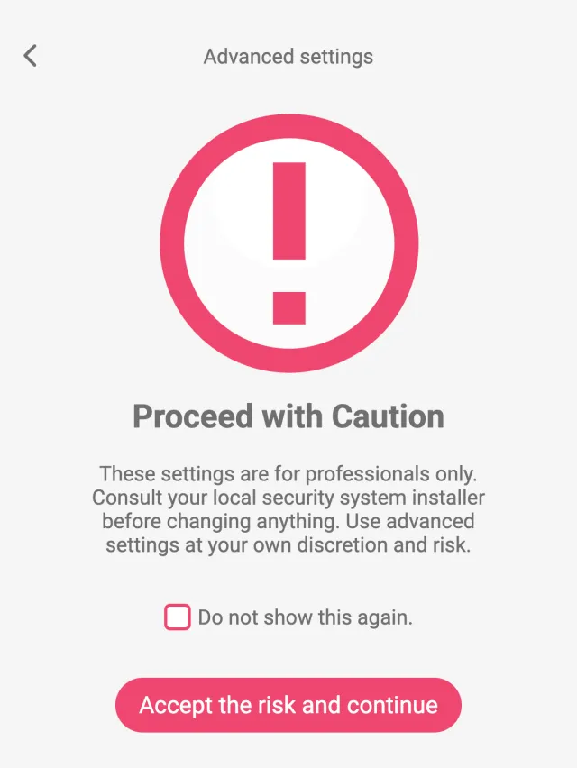{ .trik-mob-img }

3.  In a desktop browser the configurator reads the panel's settings by itself and opens the **Dashboard**. On a phone, tap **Read**.

    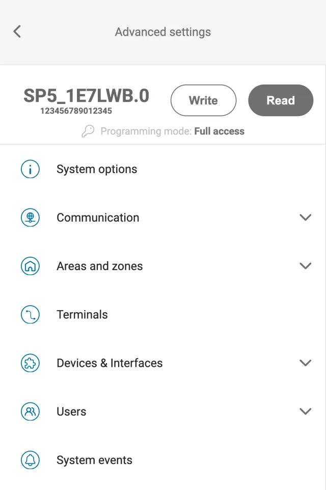{ .trik-mob-img }

4.  Change the settings, then tap **Write** to save them to the panel.

Every page of the configurator is described in [Settings in the Protegus app](#settings-in-the-protegus-app).

### If the panel does not connect

The **Dashboard → Connectivity** card shows the state of each connection.

| What you see | What to check |
|---|---|
| SIM: no SIM card | The nano-SIM is inserted the right way and is activated |
| SIM: PIN error | Disable the SIM PIN, or enter it in **Communication → Connection → SIM** |
| SIM: cannot register on the network | Signal strength and antenna; operator coverage |
| SIM: no mobile data | The APN in **Communication → Connection → SIM**; the data plan |
| LAN: no cable | The LAN cable and the switch port |
| LAN: DHCP problem | DHCP on the router, or set a static IP address |
| LAN: DNS problem | The DNS servers in the LAN settings |
| WiFi: not connected | SSID and password in **Communication → Connection → WiFi**; 2.4 GHz network |

## Common tasks

Each task below is a complete procedure in the Protegus app. Do the tasks you need in this order: the first one on every new system, then the others as the site requires. All settings are saved to the panel only when you tap **Write**. Every setting mentioned is explained in [Settings in the Protegus app](#settings-in-the-protegus-app).

### First start-up: settings to change on every new system

Do this first, before you add zones and users.

1.  Open the configurator (see [Opening the configurator](#opening-the-configurator)).
2.  In **System options → Access & Permissions**, change the **Full access** and **Limited access** codes. Give the **Limited access** code to installers and set what it allows with the **Limited access permissions**.
3.  In **System options → System Identity & Behavior**, enter the **Account ID** you got from the monitoring station and an **Object Name**. The Object Name starts every SMS the panel sends.
4.  Choose the **EOL Resistor Configuration** that matches the resistors in the detectors (see [Resistor values](#resistor-values)).
5.  In **Time Settings**, set the **Time zone**, **Daylight saving time** and the **Time synchronization** sources, or press **Set from PC**.
6.  Tap **Write**.

**Factory settings:** Account ID 0001; **Full access**, **SMS programming** and cloud access codes 123456; **Limited access** (installer) code 654321; the first user's keypad code 1234. The panel has no factory reset, so change these codes and keep the new ones.

### Reporting to a monitoring station (CMS)

**You need:** the receiver's address and port, its protocol, the encryption key and the object's account number, all from the monitoring station.

1.  In **System options**, check the **Account ID**.
2.  In **Communication → Connection → Reporting to CMS**, choose the **Main path** (Ethernet, SIM or WiFi) and a **Back up** path. If you use the SIM, enter its **APN** (and **SIM PIN**, if the card asks for one) in **SIM**.
3.  In **Communication → CMS Reporting**, turn on **Primary channel** and set:
    - **Communication method:** Network.
    - **Communication type:** TCP/IP or UDP/IP, as the receiver requires.
    - **Domain or IP** and **Port** of the receiver.
    - **Protocol**: the one the receiver uses. For **SIA DC-09_2012** or **SIA DC-09_2007**, also choose the **Message format** (CID or SIA).
    - **Encryption key**. For SIA DC-09, an empty key means no encryption; turn on **Key is HEX** if you got a 32-digit hexadecimal key.

    { .trik-popup-img }

4.  In **Receiver**, enter the **Number** and **Line**, if the monitoring station uses them.
5.  For a backup receiver, open **Backup channel**, turn on **Enable backup channel** and set it the same way. To send the reports by SMS when the network fails, turn on **Enable fallback SMS channel** and enter the station's **Phone number**.
6.  To report to a second monitoring station at the same time, set up the **Parallel channel** the same way.
7.  Under **Testing**, turn on **Periodic test** and set the **Test period** the station expects.
8.  Tap **Write**.

**Check:** the **Dashboard → Connectivity** status of the path you chose shows **CMS** or **Active**. Trigger a zone and ask the station to confirm the event and its account number.

### Adding wired zones

1.  Wire the detectors to IO1–IO10 or to an iO-8 / iO8-LORA expander (see [Connecting detectors](#connecting-detectors)).
2.  If you use an expander, connect it to the RS485 bus, then in **Devices & Interfaces → Expanders** choose **Expanders → Scan for new expanders**. Its inputs then appear as terminals, for example **RS485 Garage iO8, 1 I/O**. If the scan does not find the module, choose **Expanders → Add manually** and enter its **Device type**, **Serial number** and **Name**.

    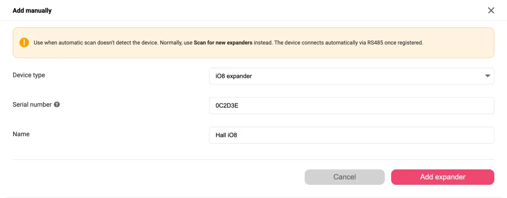{ .trik-popup-img }

3.  In **Areas and zones → Areas (Partitions)**, tap **+ Add areas** and tick the areas you need. Set their **Entry delay**, **Exit delay** and **Bell time** in the area popup.
4.  In **Areas and zones → Zones**, tap **+ Add**, then:
    - enter the zone's **Name**;
    - choose the terminal in **Assign terminal**;
    - choose the area in **Assign area**;
    - choose the **Definition**, for example **Delay** for the entrance door, **Interior** for motion detectors, **Instant** for windows;
    - choose the **Type** (circuit) that matches the wiring.

    { .trik-popup-img }

5.  For two detectors on one terminal, use the arrow next to **+ Add** and choose **Add ATZ zone**.

    { .trik-popup-img }

6.  To create many zones with the same settings, use **Add multiple zones**.
7.  Tap **Write**.

**Check:** on **Zones**, each zone shows **OK**. Open the detector or walk past it: the status changes to **Violated**, then back to **OK**.

### Adding keypads

1.  Connect the keypads to AUX and the keypad bus (GRN, YEL) (see [Connecting keypads](#connecting-keypads)).
2.  In **Devices & Interfaces → Keypads**, tap **Scan for new keypads**.
3.  For each keypad, choose the areas it controls in **Assign area**. Keypads with a serial number starting 51 or 1E control up to 2 areas.
4.  Optionally, tap **Edit** to name the keypad and assign outputs to its utility keys.

    { .trik-popup-img }

5.  Under **Global Keypad Parameters**, choose 4- or 6-digit user codes (**6-digit user code**), the lockout after wrong codes, the duress code type and the emergency key alarms.
6.  To use the keypad's own zone input, add a zone on the terminal **Keypad *n* IN** (types NO, NC or EOL).
7.  Tap **Write**.

**Check:** each keypad shows **Online**.

### Adding wireless devices

1.  Connect the wireless receiver (RF-S8 for HEYI devices, RF-SH for Crow devices) to AUX and the RS485 bus.
2.  In **Devices & Interfaces → Expanders**, choose **Expanders → Scan for new expanders**. The receiver must appear in the list.
3.  In **Devices & Interfaces → Wireless**, tap the gear button and set **Sensor lost after**: how long a silent device is reported as lost.
4.  Disarm all areas and clear any faults. Tap **Scan for new devices**.
5.  Put the device into pairing mode, as its own instructions describe. The device appears in the list marked **NEW**. Repeat for the other devices. When the scan ends, the app lists the paired devices as **Not Configured**; tap **Done**.

    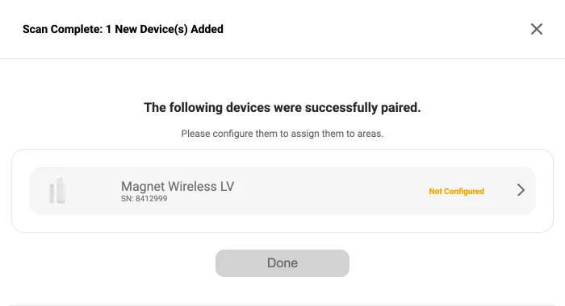{ .trik-popup-img }

6.  Tap a new device and set its zone **Name**, **Assign area** and **Definition**. The app gives detectors a free zone with the **24 Hour** definition, so change it to what the device protects.

    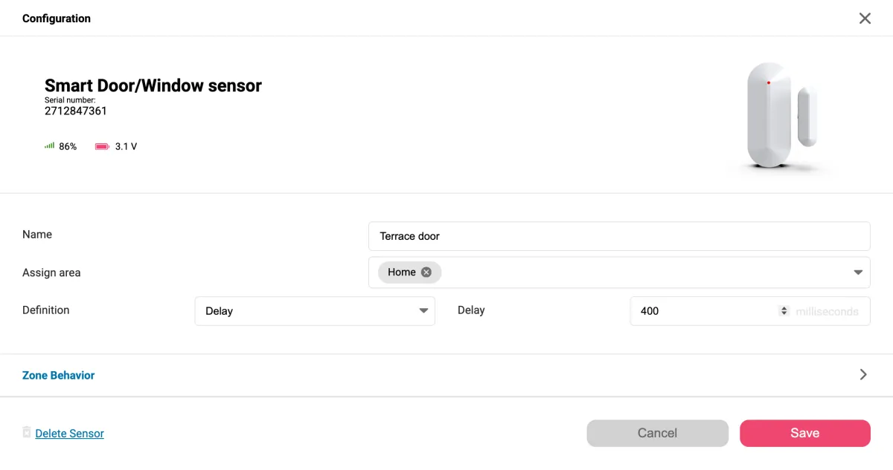{ .trik-popup-img }

7.  For a keyfob, choose its area and **Assigned user**, and what keys 3 and 4 do.
8.  Tap **Write**.

**Check:** each device shows **Online**, with its signal (**RSSI, %**) and battery voltage.

### Adding users, codes and cards

1.  In **Users → User list**, tap **+ Add user**.
2.  On the **General** tab, enter the **Name** and, as needed:
    - **Keypad code** for keypads;
    - **RFID / Card number** for a card or tag **[no card reader works with firmware 1.00 yet: keep this line?]**;
    - **Phone number** for SMS and call control;
    - **Email** for the Protegus2 app.

    { .trik-popup-img }

3.  Keep the **System profile** at **Standard** for ordinary users. Make a user **Supervisor** only if they need SMS and call control of the system and user management (up to 8).
4.  On the **Permissions** tab, turn on **Allow arm** and **Allow disarm** and choose the **Assigned areas**. To let the user open doors or gates, turn on **Allow control** and choose the outputs.

    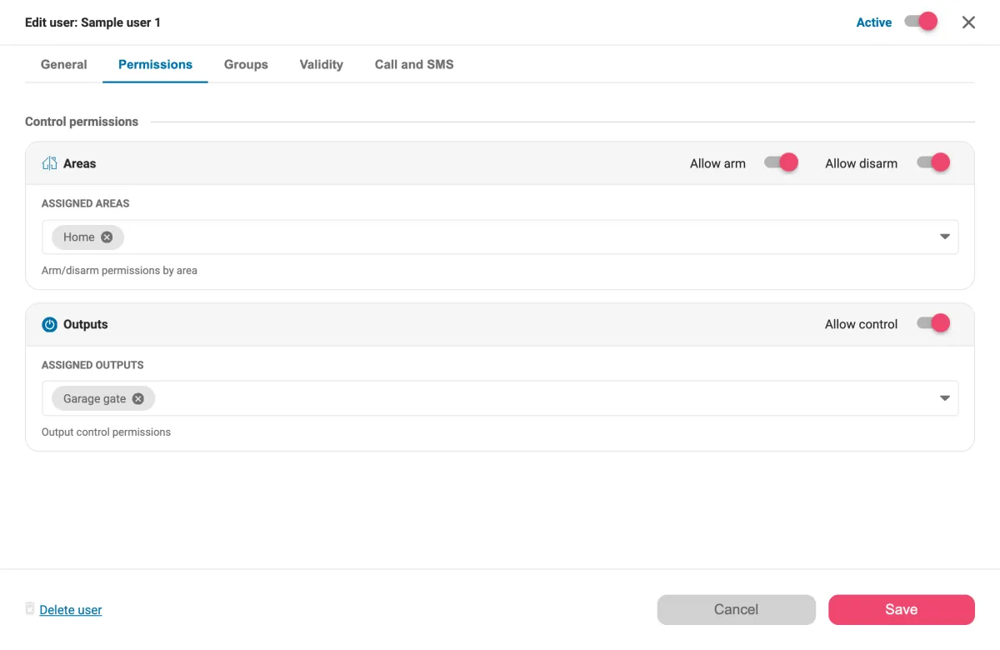{ .trik-popup-img }

5.  For a temporary user, such as a cleaner, turn on **Limit access to a time period** on the **Validity** tab.
6.  Tap **Save**, then **Write**.

For many users with the same rights, create a group in **Users → Groups** and assign users to it: the group's permissions then apply instead of the individual ones.

**Check:** the user appears in the list with status **Active** and the right **Credentials** (Code, RFID, App).

### Controlling a door lock with the relay

The relay on the board (contacts **NC**, **C**, **NO**; **REL** in the app) can drive a door lock.

1.  Connect the lock's supply through the relay contacts: **C** and **NO** for a lock that opens when powered, **C** and **NC** for a lock that holds while powered. The lock may draw up to 1 A at 30 V DC; for a larger lock, switch it through an external relay.
2.  In **Terminals**, open **Output settings** on **REL** (or **Assign function → Assign PGM output** if it is free).
3.  Set **Definition** to **Remote control**, **Type** to **Pulse** and a **Pulse time**, for example 3 seconds.
4.  Give the users who may open the door the right: **Permissions** tab → **Allow control** → choose this output.
5.  Tap **Write**.

The door can then be opened from the Protegus app and from a keypad utility key (see **Keypads**).

The panel has no access control functions yet: Wiegand readers don't work in firmware 1.00.

### Controlling a gate or lights from Protegus and by phone call

1.  Connect the device to a free I/O terminal (through an external relay; I/O outputs give up to 0.1 A) or to the relay contacts (**REL**, up to 1 A at 30 V DC). Switch mains-powered lights through an external relay or contactor.
2.  In **Terminals**, open **Assign function → Assign PGM output** on that terminal.

    { .trik-popup-img }

3.  Set **Definition** to **Remote control**. Choose **Type**: **Pulse** for a gate (one press opens or closes it) or **Level** for lights (on until switched off).

    { .trik-popup-img }

4.  Give the users the right to control it: **Permissions** tab → **Allow control**.
5.  To open the gate by calling the panel, enter the user's **Phone number** and choose the output in **Call and SMS → Automatic control targets**.

    { .trik-popup-img }

6.  Tap **Write**.

**Check:** the output appears on the system's main screen in the Protegus app and switches when you tap it.

### Setting up a fire zone

1.  Wire the 2-wire smoke detectors to IO9, IO10 or both (see [Connecting fire detectors](#connecting-fire-detectors)).
2.  In **System options → System Behavior**, turn on **2-wire fire on IO9**, **2-wire fire on IO10** or both.
3.  In **Zones**, add a zone on the terminal **SP5 9 I/O - 2-wire fire zone** (or IO10) with the **Fire** definition. The app sets **Delay** to 2000 ms.
4.  Check the zone's **CID code**. When you choose **Fire** in the zone popup, the app sets it to 110 (fire alarm) and **Delay** to 2000 ms, unless you changed them by hand. Changing the definition in the **Zones** list leaves the CID code as it was.
5.  In **System options → Arming Restrictions**, decide whether **Fire Loop Trouble** blocks arming.
6.  Tap **Write**.

### Temperature sensor and thermostat

1.  Connect an NTC 10K sensor between a free I/O terminal and a **C** terminal.
2.  In **Terminals**, open **Assign function** on that terminal and choose **Assign temperature input** (under **More functions** when the zone and output functions are offered too).
3.  In the sensor popup, enter the **Name**, the sensor's **B Constant** (usually 3950) and **NTC R0** (10000 for a 10K sensor).
4.  For an alarm on temperature, set **Min** and **Max** and turn on **Notify when below** and **Notify when above**.

    { .trik-popup-img }

5.  For heating or cooling, create an output with the **Remote control** or **Thermostat** definition for the heater, then in **Devices & Interfaces → Thermostats** tap **+ Add**: choose the sensor in **When**, the temperature, the **Mode** (**Heating** or **Cooling**) and the **Output**.

    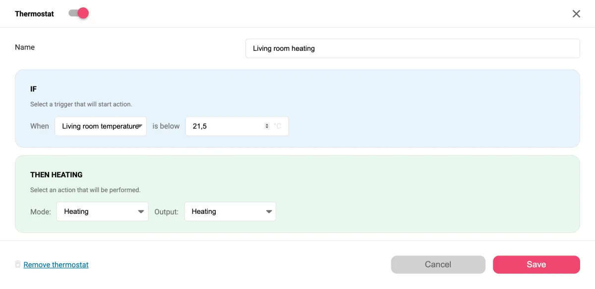{ .trik-popup-img }

6.  Tap **Write**.

**Check:** the sensor's **Live Reading** shows a plausible temperature.

### Stay and Sleep arming and entry delays

1.  In **Areas (Partitions)**, open the area and set **Entry delay 1** (main entrance), **Entry delay 2** (a second entrance), and **Exit delay**.
2.  For zones that should stay active while people are inside, use the **Instant**, **Delay** or **24 Hour** definitions. For zones that should be off in Stay mode, use **Interior Stay** or **Instant Stay**.
3.  Under **Advanced**, set **Arm mode if no exit**: if nobody leaves during the exit delay, the area arms in **Stay** or **Sleep** instead of away.

    { .trik-popup-img }

4.  Optionally turn on **Re-ARM** (after a disarm, arms the area again when the entry delay has passed, if no zone was violated) or **Auto-arm** (arms the area after the **Auto-arm time**, whatever the state of its zones).
5.  Tap **Write**.

### SMS messages to users

1.  Make the user a **Supervisor** (**General** tab) and enter their **Phone number**. Only supervisors receive event SMS (up to 8).
2.  On the **SMS reporting** tab, choose **Notify about** (all events, events only or restores only) and which zones, outputs and system events to send.
3.  On the **Call and SMS** tab, turn on **Command replies (ACK)** to confirm commands by SMS, and **Greeting SMS on new user** if wanted.
4.  In **System events → SMS texts**, check the words used in the messages. Each SMS starts with the **Object Name**.
5.  To block a phone number, email or card, add it in **Users → Black list**.
6.  Tap **Write**.

**Check:** trigger a zone and confirm the supervisor gets the SMS.

## Commissioning and handover

- Trigger every zone and check its zone number and event code at the monitoring station.
- Check the tamper of every detector, keypad and the enclosure.
- Disconnect the mains and check that **AC fault** is reported and the system keeps running on the battery.
- Send a test report and check the periodic test interval.
- Show the user how to arm and disarm, and add them to the system in the Protegus app.

## Maintenance

**Firmware updates.** The firmware can be updated from the Protegus app over USB or remotely. The panel restarts after an update over USB (in about 5 seconds) and reconnects after a remote update. **[the update function is not in the app yet: to confirm when it is released]**

The panel has no factory reset. Its factory codes are listed under **First start-up** in [Common tasks](#common-tasks).

If the access codes are lost, access will be restored from the Protegus app. **[this function is not in the app yet]**

!!! question "To confirm"
    The recommended battery replacement interval.

## Troubleshooting

| What you see | Likely cause | What to do |
|---|---|---|
| Keypad zone does not work with EOL_T, ATZ, ATZ_T or 3EOL | Keypad inputs support only NO, NC and EOL (EOL_T on some keypads) | Change the zone type |
| A tamper on a fire zone is reported as a fire | Tamper also triggers the zone | Turn on **Tamper triggers trouble only (zone not activated)** |
| A terminal can't be assigned to a zone | It is already used as an output or a sensor | Remove it from **Terminals** or **Sensors** first |
| The CMS receives no events | Channel, protocol, account number or encryption key | Check **Communication → CMS reporting**, then the connection |
| Changes are not saved | The settings were not written | Tap **Write** after changing settings |

## Settings in the Protegus app

This section describes every page of the SP5 configurator in the Protegus app, in the order of its menu. How to open it, read the settings and save them with **Write** is described in [Opening the configurator](#opening-the-configurator). Depending on your access level, pages and fields you are not allowed to change are hidden or read-only.

!!! note
    In number boxes, a value above the maximum is changed to the maximum when you leave the box, and a value below the minimum (or an empty box) to the minimum. On a phone, lists are shown as cards: use **Edit** to change an item.

### Dashboard

The Dashboard shows the panel's identity, owner and connection state at a glance. It is available in the desktop view only. You can drag the cards into a different order, and the browser remembers it.

![Protegus app, SP5 configurator in a desktop browser with the menu on the left and the Dashboard open. Panel info card: Programming mode, Connection Via Protegus2 cloud, Last configured 2026-10-06 12:30, Unique ID/IMEI, Serial number 000123, Firmware v1.00 Up to date, Bootloader 1.00. System information card: Account ID 1234, Address Sample street 1, Owner Sample Owner, a phone number and an e-mail address. Connectivity card with an Edit link: LAN Active, SIM Standby with 80 % signal, WiFi Disabled.](./protegus-app/sp5-dashboard-desktop-content.webp)

#### Panel info

| Field | Shows |
|---|---|
| Programming mode | That the configurator is connected to the panel in programming mode. |
| Connection | How the app reaches the panel: **Via Protegus2 cloud** or **Via USB**. |
| Last configured | The date and time of the last **Write**. Shown when you are signed in to Protegus and the panel holds this time. |
| Unique ID/IMEI | The panel's Unique ID. Click it to copy it. |
| Serial number | The panel's serial number. |
| Firmware v… | The firmware version, and **Up to date** or the newer version available. |
| Bootloader | The bootloader version, if the panel reports one. |

#### System information

| Field | Shows |
|---|---|
| Account ID | The CMS account number, as set in **System options**. **N/A** if it is empty. |
| Address | The system's address in Protegus. |
| Owner | The first owner's name. |
| Phone number | The first owner's phone number. |
| E-mail address | The first owner's e-mail address. |

**Address**, **Owner**, **Phone number** and **E-mail address** appear only when the system has been added to Protegus. Otherwise the card shows **This system is not added to Protegus2.**

#### Connectivity

| Field | Shows |
|---|---|
| LAN | The status of the LAN connection. |
| SIM | The status of the cellular connection and its signal strength in %. |
| WiFi | The status of the WiFi connection and its signal strength in %. |
| Edit | Opens **Communication → Connection**. |

The status is read from the panel when you open the Dashboard or the Connection page. The same status values are used on both pages:

| Status | Meaning |
|---|---|
| Disabled | The connection is switched off in the settings. |
| Fault | The connection is not working. The **Fault** column on the Connection page says why. |
| Active | Working, and carrying reports to both Protegus and the CMS. |
| CMS | Working, and carrying reports to the CMS. |
| Cloud | Working, and carrying reports to Protegus. |
| Standby | Working, but not carrying reports at the moment. |
| N/A | The status could not be read. |

### System options

System options holds the panel's identity and general behaviour, the access codes, the clock and the troubles that block arming. On desktop the page heading reads **System Options**.

![Protegus app, SP5 System Options page in a desktop browser, with four cards. System Identity & Behavior: Account ID 1234, Object Name Sample system, Clear buffer events after reboot and the two 2-wire fire switches off, Power failure delay 300, Call attempts to user 3, Text encoding English, Hang-up call after 30, Prevent event flooding on with 3 repeats within 30 s and resume after 30 min, EOL Resistor Configuration 2k2+2k2+4k7. Access & Permissions: masked Full access, Limited access and SMS programming codes, Account ID permission on, and the other Limited access permissions set to Editable. Time Settings: Time zone UTC +02:00, Time synchronization SIM and LAN, Daylight saving time on, NTP server pool.ntp.org, Panel current time 2026-10-07 12:00:00 and a Set from PC button. Arming Restrictions: 13 trouble switches, some on.](./protegus-app/sp5-systemoptions-desktop-content.webp)

#### System Identity & Behavior

| Setting | What it does | Values |
|---|---|---|
| Account ID | The object's account number at the monitoring station (CMS). For **Limited access** it is read-only unless the **Account ID** permission is on. | up to 6 characters |
| Object Name | The system's name. Every SMS from the panel starts with it. | up to 31 characters |
| Clear buffer events after reboot | When the panel restarts, it deletes the events in its buffer that have not been sent yet (as on "FLEXi" SP3). | on / off |
| 2-wire fire on IO9 | Turns terminal IO9 into a 2-wire fire loop input. IO9 can then only be a zone and is listed as **SP5 9 I/O - 2-wire fire zone**. A zone already on IO9 stays on it; if its type was ATZ, it changes to EOL and the second ATZ zone is released. An output or sensor on IO9 stays assigned: remove it before you turn this on. | on / off |
| 2-wire fire on IO10 | The same for terminal IO10 (**SP5 10 I/O - 2-wire fire zone**). Set independently of IO9. | on / off |
| Power failure delay | How long mains (AC) power must be missing before the panel reports a power failure (as on "FLEXi" SP3). | 0–999 s |
| Call attempts to user | How many times the panel calls a user about an event (as on "FLEXi" SP3). SP5 doesn't make event calls: users get event SMS only, so this setting isn't used. | 0–99 |
| Text encoding | The character set the panel uses for object, area and zone names. Choose the one that matches the language of your names. | English, Baltic, Cyrillic alphabet, Central European, Greek, Turkish, Hebrew, Arabic, Vietnamese |
| Hang-up call after | Under **Incomming Call Handling**. When a user calls to switch an output, the panel answers and holds the call for this time before it hangs up and switches the output, so the call shows in the mobile operator's call records. | 0–99 s |
| Prevent event flooding (Suspend reporting) | Stops reporting an event that repeats too often. The next two settings set the limits. | on / off |
| Suspend if the same event repeats more than … within … | Reporting of an event is suspended when it repeats more than this many times within this time. | 0–99 times; 0–99 s |
| Resume reporting automatically after | When reporting of a suspended event starts again. | 0–99 min |
| EOL Resistor Configuration | The resistor set for all wired zones with EOL types. See [Resistor values](#resistor-values) for each resistor. | 2k2+2k2+4k7, 1k+1k+2k2, 5k6+5k6+3k3, 5k6+3k3+5k6, 3k3+6k8+3k3, 2k2+4k7+8k2, 10k+10k+5k6, 4k7+4k7+2k2 |
| Tamper triggers trouble only (zone not activated) | A tamper on a zone reports a trouble but does not trigger the zone. Use it so that a tamper on a fire zone is not reported as a fire. | on / off |

#### Access & Permissions

These codes protect direct configuration of the panel over USB, Bluetooth and Protegus2. The **Limited access permissions** below them set what a user signed in with the **Limited access** code can do on each page. Only a **Full access** user can change them.

| Setting | What it does | Values |
|---|---|---|
| Full access | The administrator code. Gives access to every setting. Hidden when you are signed in with **Limited access**. | up to 6 characters |
| Limited access | The installer code. What it allows is set by the permissions below. | up to 6 characters |
| SMS programming | The code for configuring the panel by SMS commands. | up to 6 characters |
| Account ID | Lets **Limited access** change the **Account ID**. | on / off |
| Communication | Access to **Connection** and **CMS Reporting**. | Editable / Visible / Hidden |
| Areas and zones | Access to **Areas (Partitions)** and **Zones**. **Visible** also makes **Terminals** read-only. | Editable / Visible / Hidden |
| Devices & Interfaces | Access to **Keypads**, **Expanders**, **Wireless**, **Temperature sensors** and **Thermostats**. | Editable / Visible / Hidden |
| Users | Access to **User list**, **Groups** and **Black list**. | Editable / Visible / Hidden |
| System events | Access to **System events**. With **Hidden**, the **Periodic test** switch on **CMS Reporting** is not shown either. | Editable / Visible / Hidden |

!!! note
    **Editable**: the installer can change the page. **Visible**: the page is read-only. **Hidden**: the page is removed from the menu and its settings are not read.

#### Time Settings

| Setting | What it does | Values |
|---|---|---|
| Time zone | The panel's time zone. | UTC -12:00 to UTC +14:00, 38 zones including half-hour and 45-minute offsets |
| Time synchronization | Where the panel takes the time from. Select one or more sources. | WiFi, SIM, LAN, Cloud application, CMS1, CMS2 |
| Daylight saving time | Applies daylight saving time to the panel's clock. | on / off |
| NTP Server Address (LAN or WiFi) | The time server used when the time is synchronised over LAN or WiFi. | up to 31 characters |
| Panel current time | Shows the panel's clock, read when the page opens. **N/A** if it can't be read. | read-only |
| Set from PC | Sets the panel's clock to your computer's time. | button |

!!! note
    **Set from PC** sends the time to the panel immediately. It does not wait for **Write**.

#### Arming Restrictions

Turn on each trouble that should prevent the system from being armed.

| Setting | What it does | Values |
|---|---|---|
| AC Fault | Mains power failure. | on / off |
| Battery Trouble | A backup battery trouble. | on / off |
| Aux Trouble | A trouble on the AUX power output. | on / off |
| Bell Missing | No siren connected to the BELL output. | on / off |
| Bell Overcurrent | Overcurrent on the BELL output. | on / off |
| CMS Communication Trouble | The panel can't reach the monitoring station. | on / off |
| RS485 Module Fault | A module on the RS485 bus is faulty or lost. | on / off |
| Wireless Device Lost | A wireless device has sent nothing for the **Sensor lost after** time (see **Wireless**). | on / off |
| Wireless Device Low Battery | A wireless device's battery is low. | on / off |
| Fire Loop Trouble | A trouble on a fire loop. | on / off |
| Tamper Fault | An open tamper. | on / off |
| 2-Wire Fire Sensors in Alarm | A 2-wire fire loop is in alarm. | on / off |
| Antimasking fault | A detector reports masking. | on / off |

### Connection

Menu **Communication → Connection**. Here you choose which connections carry the reports to the monitoring station and to Protegus, and set up the SIM, WiFi and Ethernet connections.

![Protegus app, SP5 Connection page in a desktop browser. Status table: LAN Active, IP 192.168.1.50, DHCP Enabled, gateway 192.168.1.1; SIM Standby, IP 10.64.12.7, operator Sample Mobile, 80 % signal; WiFi Disabled. Reporting to CMS and Reporting to Cloud cards, both with Main path Ethernet, Back up SIM, Fallback back up OFF and Switch back to Main path after 10 min. Cloud settings card with Enable cloud service and Report in parallel with CMS on and a masked Cloud access code. SIM card with APN internet, an empty SIM PIN and an Advanced settings link. WiFi card with SSID Sample-WiFi, a masked password, DNS 8.8.8.8 and DHCP on. Ethernet card with DNS 1 8.8.8.8, DNS 2 1.1.1.1, Show trouble if any on and DHCP on.](./protegus-app/sp5-communication-connection-desktop-content.webp)

#### Connectivity

A read-only table, one row per connection. On a narrow screen it becomes a card with one block per connection.

| Field | Shows |
|---|---|
| Connectivity | The connection: **LAN**, **SIM** or **WiFi**. |
| Status | The connection's status. See the status values under **Dashboard**. |
| IP Address | The current IP address; 0.0.0.0 when there is none. |
| DHCP | **Enabled** (address obtained by DHCP), **No IP obtained**, or **Disabled** (static IP). |
| Gateway | The gateway address, static or obtained by DHCP. |
| Operator/SSID | The mobile operator for SIM; the network name for WiFi. |
| Signal | Signal strength in %, or **N/A**. |
| Fault | Why the connection is not working. SIM: **No SIM**, **PIN error**, **LTE issues**, **Unable to register to network**, **Unknown error**. WiFi: **No SSID**, **Not connected to SSID**, **No internet**, **Method not selected**. LAN: **No LAN cable**, **DHCP trouble**, **DNS trouble**, **No voltage**. |

#### Reporting to CMS

| Setting | What it does | Values |
|---|---|---|
| Main path | The connection the panel uses first to reach the monitoring station. | OFF / SIM / Ethernet / WiFi |
| Back up | The connection used when the main path fails. | OFF / SIM / Ethernet / WiFi |
| Fallback back up | The connection used when the backup path also fails. | OFF / SIM / Ethernet / WiFi |
| Switch back to Main path after … min. | How long the panel stays on a backup path before it returns to the main path. | 0–255 min |

#### Reporting to Cloud

The same paths for reporting to Protegus2. The card is greyed out while **Enable cloud service** is off.

| Setting | What it does | Values |
|---|---|---|
| Main path | The connection the panel uses first to reach Protegus2. | OFF / SIM / Ethernet / WiFi |
| Back up | The connection used when the main path fails. | OFF / SIM / Ethernet / WiFi |
| Fallback back up | The connection used when the backup path also fails. | OFF / SIM / Ethernet / WiFi |
| Switch back to Main path after … min. | How long the panel stays on a backup path before it returns to the main path. | as in **Reporting to CMS** |

#### Cloud settings

| Setting | What it does | Values |
|---|---|---|
| Enable cloud service | Turns on reporting to Protegus2. Off greys out **Reporting to Cloud**. | on / off |
| Cloud access code | The panel's access code for the Protegus2 cloud. | up to 8 characters |
| Report in parallel with CMS | Sends events to Protegus2 at the same time as to the CMS, not only after the CMS has received them. | on / off |

#### SIM

**APN** and **SIM PIN** are always shown; the other settings are under **Advanced settings**.

| Setting | What it does | Values |
|---|---|---|
| APN | The mobile data access point name from your operator. | up to 28 characters |
| SIM PIN | The SIM card's PIN code, if its PIN request is on. | 4 digits |
| User | The APN user name, if the operator requires one. | up to 28 characters |
| Password | The APN password. | up to 28 characters |
| DNS 1 | DNS server for the mobile connection. | IPv4 address |
| DNS 2 | Second DNS server for the mobile connection. | IPv4 address |
| SIM ICCID Lock | Locks the panel to the SIM card whose ICCID is shown below. Off removes the lock. | on / off |
| ICCID | The SIM card's ICCID. The **Edit** link to change it appears while **SIM ICCID Lock** is on. | up to 24 characters |
| Preferred network | The preferred mobile network, as MCC (country code) and MNC (network code), for example 246 and 01. The operator's name is shown beside the boxes. | MCC 0–999, MNC 0–999 |
| Network database | Opens mcc-mnc.com, where you can look up the codes. | link |
| Hide SIM warning | Turns off the SIM trouble indication. | on / off |
| Use SMS/Calls with internet | On: the panel takes SMS and call commands and sends SMS even while it has an internet connection. Off: it uses SMS and calls only when it has no internet connection (as on "FLEXi" SP3). | on / off |
| Disable SIM data | The panel does not use mobile data. | on / off |

#### WiFi

| Setting | What it does | Values |
|---|---|---|
| SSID | The WiFi network name. The panel works with 2.4 GHz networks. | up to 32 characters |
| Password | The WiFi password. | up to 55 characters |
| DNS | DNS server for WiFi. | IPv4 address |
| DHCP | On: the panel gets its address from the router. Off: enter the three settings below. | on / off |
| IP Address | The panel's static IP address. Shown when **DHCP** is off. | IPv4 address |
| Subnet mask | Shown when **DHCP** is off. | IPv4 address |
| Gateway address | Shown when **DHCP** is off. | IPv4 address |

#### Ethernet

| Setting | What it does | Values |
|---|---|---|
| DNS 1 | DNS server for the LAN connection. | IPv4 address |
| DNS 2 | Second DNS server for the LAN connection. | IPv4 address |
| Show trouble if any | Indicates LAN connection troubles. | on / off |
| DHCP | On: the panel gets its address from the router. Off: enter the three settings below. | on / off |
| IP Address | The panel's static IP address. Shown when **DHCP** is off. | IPv4 address |
| Subnet mask | Shown when **DHCP** is off. | IPv4 address |
| Gateway address | Shown when **DHCP** is off. | IPv4 address |

### CMS Reporting

Menu **Communication → CMS Reporting**. The panel can report to two monitoring stations at the same time, through the **Primary channel** and the **Parallel channel**. Each channel has its own backup channel and SMS fallback.

![Protegus app, SP5 CMS Reporting page in a desktop browser. Primary channel on: Communication method Network, Communication type TCP/IP, Domain or IP receiver.example.com, Port 55555, Protocol TRK8, a masked Encryption key and a Backup channel link. Parallel channel off and greyed out. Receiver card: Number 1, Line 1. Under Behavior, the Fallback card: Switch to backup after 3 attempts, Switch back to primary after 5 minutes. Under Testing: Periodic test on with Test period 1 day and Start test on at 12 h 0 min; Network (IP) Ping on with Period 120 seconds; SMS Ping off; Communication path test on, every 24 hours.](./protegus-app/sp5-communication-cmsreporting-desktop-content.webp)

#### Primary channel

| Setting | What it does | Values |
|---|---|---|
| (switch in the card header) | Turns the channel on or off. Off greys out the card. | on / off |
| Communication method: | How the panel reports to this CMS. **SMS** sends every report as an SMS to the station's **Phone number**, for a TRIKDIS SMS receiver. The number and key are shared with the channel's SMS fallback, and no backup channel can be set. | Network / SMS |
| Communication type | The transport. Choosing **SMS** here is the same as the SMS method. With protocol **TL150**, only **UDP/IP** is offered. | TCP/IP, UDP/IP, SMS |
| Domain or IP | The CMS receiver's address. | up to 36 characters |
| Port | The receiver's port. | 0–65535 |
| Protocol | The reporting protocol. Choosing **TL150** switches the type to UDP/IP. | TRK, SIA DC-09_2012, SIA DC-09_2007, SIA DC-09_IPcom, TL150, TRK8 |
| Message format | The event code format inside SIA DC-09 messages. Shown for **SIA DC-09_2012** and **SIA DC-09_2007** only. | CID / SIA |
| Encryption key | The key the receiver uses to decrypt the reports. For **SIA DC-09_2012** and **SIA DC-09_2007**, an empty key means no encryption. | TRK: up to 6 characters. Other protocols: up to 16 characters, or exactly 32 hex digits with **Key is HEX** |
| Key is HEX | Enter the key as hexadecimal digits (0–9, A–F). Shown for **SIA DC-09_2012** and **SIA DC-09_2007** only. | on / off |
| Phone number | SMS method only. The CMS phone number for SMS reports. It is the same number as the SMS fallback number of this channel. | digits with an optional leading +, up to 23 |
| Encryption key | SMS method only. The key for SMS reports, shared with the SMS fallback. | up to 16 characters |
| Backup channel | Opens the backup channel settings. Not available while the channel is off or set to SMS. | — |
| Enable backup channel | Turns on the backup channel, which has its own address, port and protocol. Off greys out its settings. | on / off |
| Communication method:, Communication type, Domain or IP, Port, Protocol, Message format, Encryption key, Key is HEX | The backup channel's settings. They work as described above. | as above |
| Enable fallback SMS channel | Sends the reports by SMS when the network channels fail. Shown when the backup channel's method is **Network**. | on / off |
| Phone number | The phone number for SMS fallback reports. If the backup channel's method is **SMS**, this is the backup channel's number. | digits with an optional leading +, up to 23 |
| Encryption key | The key for SMS fallback reports. | up to 16 characters |

!!! note
    When **SMS** is the primary channel's method, a backup channel is not available. SMS is one-way and can't carry the two-way traffic needed to supervise the connection.

#### Parallel channel

The parallel channel reports the same events to a second CMS, at the same time as the primary channel. It has the same settings as **Primary channel**, with its own backup channel and SMS fallback.

| Setting | What it does | Values |
|---|---|---|
| (switch in the card header) | Turns the parallel channel on or off. | on / off |
| All other settings | As in **Primary channel**, for the second CMS. The expandable section is also labelled **Backup channel**. | as in Primary channel |

#### Receiver

| Setting | What it does | Values |
|---|---|---|
| Number | The receiver number at the CMS. | up to 6 digits |
| Line | The receiver line number at the CMS. | up to 6 digits |

#### Fallback

Under **Behavior**.

| Setting | What it does | Values |
|---|---|---|
| Switch to backup after | How many failed attempts on a channel before the panel moves to its backup channel. | 0–9 attempts |
| Switch back to primary after | How long the panel stays on the backup channel before it returns to the primary. Not to be confused with **Switch back to Main path** on the Connection page, which is about SIM, Ethernet and WiFi. | 0–99 minutes |

#### Periodic test

Under **Testing**.

| Setting | What it does | Values |
|---|---|---|
| (switch in the card header) | Turns the periodic test report on or off. It is the same setting as the **Periodic test** event on **System events**. | on / off |
| Test period | How often the panel sends a test report. | 0–255 hours; with **Start test** on, 0–10 day(s) |
| Start test | Sends the test at a fixed time of day. Off: no fixed time. | on / off |
| h, min (two boxes) | The time of day for the test. Editable only with **Start test** on. | 0–23 h, 0–59 min |

!!! note
    Turning on **Start test** changes the **Test period** unit to days and rounds the period down to whole days: 30 hours becomes 1 day, and less than 24 hours becomes 0.

#### Network (IP) Ping

| Setting | What it does | Values |
|---|---|---|
| (switch in the card header) | Turns the network ping to the CMS on or off. | on / off |
| Period | How often the panel pings the CMS over the network. | 0–990 seconds, in steps of 10 |

#### SMS Ping

| Setting | What it does | Values |
|---|---|---|
| (switch in the card header) | Turns the SMS ping to the CMS on or off. | on / off |
| Period | How often the panel sends an SMS ping. | 0–4095 minutes; 1 minute is the shortest useful period |

#### Communication path test

| Setting | What it does | Values |
|---|---|---|
| (switch in the card header) | Turns the communication path test on or off. | on / off |
| Test every | How often the test runs, in the unit chosen beside it. | 0–99 |
| (unit) | The unit of **Test every**. | hours / day(s) |

### Areas (Partitions)

Menu **Areas and zones → Areas (Partitions)**. An area is a part of the site that is armed and disarmed on its own. The panel has up to 16 areas; only the enabled ones are listed.

#### Area list

| Setting | What it does | Values |
|---|---|---|
| Refresh status | Reads the area and zone states from the panel again. | button |
| + Add areas | Opens **Add areas**. | button |
| Status | The area's live state. | Armed, Staying, Sleeping, Disarmed, Arming…, Disarming…, -- |
| Number | The area number. | 01–16 |
| Area name | The area's name. Edit it in the cell. | see the area popup |
| Entry delay 1 (s) | Edit in the cell. See the area popup. | 0–999 s |
| Entry delay 2 (s) | Edit in the cell. See the area popup. | 0–999 s |
| Exit delay (s) | Edit in the cell. See the area popup. | 0–999 s |
| Bell time (s) | Edit in the cell. See the area popup. | 0–999 s |
| Zones (Violated/Total) | How many of the area's zones are violated now, and how many zones the area has. | n/m |
| Edit | Opens the area popup. | link |

#### Add areas (popup)

| Setting | What it does | Values |
|---|---|---|
| (tick box per area) | Tick an area to enable it; untick it to disable it. The list shows all 16 areas with their ID and name. | on / off |

!!! note
    If you disable or remove an area that is still in use, the app asks you to confirm. It then removes the area from every zone, output, keypad, wireless device, user, group and from other areas' **Conditional arming**. Users' rights are cleared only if the user list has been read in this session.

#### Area popup

Opens from **Edit**. The title shows the area's name and number. **Remove area** at the bottom disables the area.

| Setting | What it does | Values |
|---|---|---|
| Number | The area number. Changing it opens that area's settings and discards unsaved changes. | 1–16 |
| Area name | The area's name. Required. | up to 19 characters (the app accepts more, but longer names are cut) |
| Assigned zone | The zones in this area. Ticking a zone adds this area to that zone. **+ Add new zone** creates a zone in this area when a free zone and a free terminal exist. | zones with a terminal |
| Entry delay 1 | Time to disarm after a **Delay** zone is triggered. | 1–999 s |
| Entry delay 2 | Time to disarm after a **Delay 2** zone is triggered. | 1–999 s |
| Exit delay | Time to leave after arming. | 1–999 s |
| Tamper action | What a tamper in this area does. **No area alarm**: reports only, no siren. **Alarm when armed**: the siren sounds only while the area is armed. **Always alarm**: the siren sounds even when disarmed. | No area alarm / Alarm when armed / Always alarm |
| Keyswitch mode | Whether a **Keyswitch** zone in this area works by level or by pulse. | Level / Pulse |
| Bell time | How long the siren sounds. | 1–999 s |

#### Advanced

The collapsed section at the bottom of the area popup.

| Setting | What it does | Values |
|---|---|---|
| Re-ARM | After the area is disarmed, arms it again when the entry delay has passed, if no zone was violated. | on / off |
| Auto-arm | Arms the area automatically after the **Auto-arm time**, regardless of any conditions. If arming fails, the panel reports **Auto arm failed**. | on / off |
| Auto-arm time | The time for **Auto-arm**. Editable while **Auto-arm** is on; turning **Auto-arm** on sets it to 1 min. | 1–999 min |
| Arm mode if no exit | If nobody leaves during the exit delay, the area arms in this mode instead of away. | Arm away / Stay / Sleep |
| Intellizone delay | For zones with **Intelli zone** on: an alarm needs at least two such zones to trigger within this time. | 0–999 s **[to confirm: the firmware notes say 1–255 s; being checked]** |
| Squawk | The siren chirps briefly when the area is armed or disarmed. | on / off |
| Conditional arming | This area is armed automatically when all the selected areas are armed. If any of them isn't armed, this area stays disarmed. | the other enabled areas |

When you remove an area, the app resets it to: **Entry delay 1** 30 s, **Entry delay 2** 45 s, **Exit delay** 30 s, **Bell time** 120 s, **Intellizone delay** 20 s, **Tamper action** No area alarm, **Keyswitch mode** Level, **Arm mode if no exit** Stay, and the other options off. An area you add again starts from these values.

### Zones

Menu **Areas and zones → Zones**. A zone is one detector input with its area, definition and circuit type. The panel has up to 192 zones; only zones with a terminal are listed.

![Protegus app, SP5 Zones page in a desktop browser: a Refresh status link, a search box, a + Add button with a drop-down arrow, and a table of 12 zones, all OK. Examples: 01 Front door, area Home, definition Delay, input SP5 1 I/O, type EOL; 03 Kitchen smoke, Fire, SP5 3 I/O; 06 Garage door, area Garage, input RS485 Garage iO8, 1 I/O; 08 Back door on Keypad 1 IN; 13 Terrace door on Magnet Wireless LV ID1; 15 Outdoor siren tamper, areas Home and Garage, 24 Hour, Wireless siren tamper ID3; 16 Boiler room leak, Smart Water leakage sensor ID4. Each row has an Edit link.](./protegus-app/sp5-zones-desktop-content.webp)

#### Zone list

| Setting | What it does | Values |
|---|---|---|
| Refresh status | Reads the zone states from the panel again. | button |
| Search | Filters the list by zone name. | text |
| + Add | Opens the zone popup on the first free zone. The arrow beside it opens **Add ATZ zone** (needs two free zones) and **Add multiple zones**. | button |
| Status | The zone's live state. | OK, Trouble, Violated, Bypassed, -- |
| Number | The zone number. | 01–192 |
| Name | The zone's name. Edit it in the cell. | up to 23 characters |
| Area | The zone's areas. A zone with no area shows **Not assigned** and a list to assign one. | enabled areas |
| Definition | How the zone reacts. Edit it in the cell. See **Zone definitions** below. | 12 definitions |
| Input | The terminal the zone uses. Change it in the zone popup. | terminal name, or Disabled |
| Type | The circuit type. Edit it in the cell. **N/A** for the second zone of an ATZ pair. | the types the terminal allows |
| Edit | Opens the zone popup. | link |

!!! note
    Changing **Definition** in the list does not change the zone's **Delay** or **CID code**. Change the definition in the zone popup if you want those updated too.

#### Zone popup

Opens from **Edit**, from **+ Add**, from **Terminals → Assign function → Assign zone input**, and from **+ Add new zone** in the area popup. **Reset I/O terminal** at the bottom frees the terminal.

| Setting | What it does | Values |
|---|---|---|
| Name | The zone's name. Required. | up to 23 characters |
| Assign terminal | The input the zone uses. Only free input terminals are listed: not used by another zone, not used as an output, and not measuring temperature or voltage. If the terminal doesn't support the current **Type**, Type changes to EOL. | free input terminals |
| Assign area | The areas the zone belongs to. **+ Add new area** opens **Add areas**. | enabled areas |
| Definition | How the zone reacts. Changing it also sets **Delay** and **CID code** to the new definition's values, unless you changed them by hand. | 12 definitions |
| Type | The circuit type. See **Zone types** below. | the types the terminal allows |
| Delay | The zone's response time: how long the input must be violated before the zone triggers. | 0–9999 ms |
| Intelli zone | An alarm needs at least two zones with this option to trigger within the area's **Intellizone delay**. | on / off |
| Inactivity time | How long the zone ignores repeated triggers. Shown only if the panel supplies the value. | 0–65535 min |

#### Zone Behavior

The collapsed section at the bottom of the zone popup.

| Setting | What it does | Values |
|---|---|---|
| Chime (Entry alert) | The keypad beeps when the zone is triggered. | on / off |
| Can be bypassed | Users can bypass the zone. | on / off |
| Auto bypass on arm (force arm) | A zone that is violated when the area is armed is bypassed automatically. | on / off |
| Violation reminder | Gives a reminder while the zone stays violated. Turning it on sets **Reminder interval** to 10. | on / off |
| Reminder interval | How often the reminder repeats. 0 turns the reminder off. | 0–9999 **[the app shows seconds; the firmware notes say minutes: to confirm]** |
| CID code | The Contact ID event code the zone reports. | 3 hex characters |
| Report | Turns reporting of this zone on or off. Sets both boxes below. | on / off |
| CMS (Central monitoring station) | Reports the zone's alarm and restore to the CMS. | on / off |
| Protegus2 | Reports the zone's alarm and restore to Protegus2. | on / off |

Which supervisors receive a zone's alarms by SMS is set in **User list → Edit user → SMS reporting**.

!!! note
    To free a zone's terminal, use **Reset I/O terminal**: **Not assigned** can't be picked in **Assign terminal**. The reset also returns the zone to basic settings (name Zone *n*, **Instant**, **NO**, the first enabled area, CID code 130, **Delay** 400, **Can be bypassed** on). Press **Save** to apply it.

#### ATZ Zone properties (popup)

Opens from **+ Add → Add ATZ zone**. Sets up two zones, A and B, on one terminal. Required: both names and a terminal. After saving, each zone is edited in the normal zone popup; **Intelli zone** is set there.

| Setting | What it does | Values |
|---|---|---|
| Assign terminal | The terminal for both zones. Zone B is placed on the paired "- ATZ" terminal. | on-board IO1–IO10, and I/O 1–8 of iO8 and iO8-Lora expanders |
| Type | The circuit type, shared by both zones. | ATZ / ATZ_T |
| Name | Zone A and zone B each have their own name. Required. | up to 23 characters |
| Assign area | For each zone. | enabled areas |
| Definition | For each zone, as in the zone popup. | 12 definitions |
| Delay | For each zone, as in the zone popup. | as in the zone popup |
| Inactivity time | For each zone, as in the zone popup. | as in the zone popup |
| Zone Behavior A, Zone Behavior B | The **Zone Behavior** settings for each zone. | as in the zone popup |

#### Add multiple zones (popup)

Creates several zones at once with the same settings. When it opens, the app sets the first enabled area, **24 Hour**, **NO** and **Delay** 400. The new zones are named Zone *n* and get the CID code of the chosen definition.

| Setting | What it does | Values |
|---|---|---|
| Assign terminal | The terminals to create zones on. The counter shows how many free zones remain. | free input terminals, except the second terminal of ATZ pairs |
| Assign area | The areas of the new zones. | enabled areas |
| Definition | The definition of the new zones. Also sets **Delay**. | 12 definitions |
| Type | The circuit type. Only types that all the selected terminals support are offered. | allowed types |
| Delay | The zones' response time. | 0–9999 milliseconds |

#### Zone definitions

The descriptions follow "FLEXi" SP3, except **Delay 2** and **Mimic**, which SP3 doesn't have. The last column shows the **Delay** and **CID code** the app sets when you choose the definition in a popup.

| Definition | What it does | Delay, CID code |
|---|---|---|
| 24 Hour | Always active, armed or not. For glass-break and tamper detectors. | 400, 133 |
| Keyswitch | Arms and disarms the zone's areas from a switch. See **Keyswitch mode** in the area popup. | 400, 409 |
| Instant | Alarm at once when the area is armed. | 400, 130 |
| Fire | Always active, for fire detectors. Alarm at once. | 2000, 110 |
| Delay | Starts **Entry delay 1** when triggered while armed. For entry doors. | 400, 134 |
| Interior | Alarm at once when armed, but waits for the entry delay if a Delay zone was triggered first. For motion detectors near the entrance. | 400, 132 |
| Silent | Reports an alarm when armed, without the siren. | 400, 146 |
| Silent 24h | Reports an alarm at any time, without the siren. For panic buttons. | 400, 122 |
| Interior Stay | As **Interior**, but not protected when the area is armed in Stay mode. | 400, 132 |
| Instant Stay | As **Instant**, but not protected when the area is armed in Stay mode. | 400, 130 |
| Delay 2 | As **Delay**, using **Entry delay 2**. | 400, 134 |
| Mimic | For monitoring only: the zone's state is shown, but it raises no alarm, sends no reports and is skipped when the panel checks for open zones before arming. | 400, CID code unchanged |

#### Zone types

The wiring of each type is shown under [Connecting detectors](#connecting-detectors). The resistor values are set in **System options → EOL Resistor Configuration**.

| Zone source | Name in terminal lists | Types allowed |
|---|---|---|
| On-board terminals IO1–IO10 | SP5 1 I/O … SP5 10 I/O | NO, NC, EOL, EOL_T, ATZ, ATZ_T, 3EOL |
| Second zone of an on-board ATZ pair | SP5 *n* I/O - ATZ | the pair's ATZ type (shown as N/A) |
| IO9 or IO10 as a 2-wire fire loop | SP5 9 I/O - 2-wire fire zone, SP5 10 I/O - 2-wire fire zone | NO, NC, EOL, EOL_T, 3EOL |
| iO8 and iO8-Lora expanders, I/O 1–8 | RS485 *expander name*, *n* I/O (second ATZ zone: … - ATZ) | NO, NC, EOL, EOL_T, ATZ, ATZ_T, 3EOL |
| iO, iO-WL, iO-MO and iO-LO expanders | RS485 *expander name* IN | NO, NC, EOL, EOL_T, 3EOL |
| Wireless devices | e.g. Magnet Wireless LV ID1, Wireless siren tamper ID3, Wireless keypad tamper ID5 | NO, NC, EOL or EOL_T. The first three work the same; EOL_T also monitors the detector's tamper |
| Keypad inputs | Keypad *n* IN | NO, NC, EOL; also EOL_T on keypads with a serial starting 1D, 1E, 51 or 52 |

### Terminals

Menu **Terminals**. Lists every terminal of the panel, the RS485 expanders, the wireless devices and the keypads, and what each one is used for. Use it to give a free terminal its function: zone, output or sensor.

![Protegus app, SP5 Terminals page in a desktop browser: an Add filter link, a Terminals button with a drop-down arrow and the terminal list. SP5 1 I/O to SP5 5 I/O are zones such as Front door and Hall PIR, status OK; SP5 7 I/O Heating and SP5 8 I/O Garden lights are outputs, ON; SP5 9 I/O Living room temperature is a temperature sensor; SP5 6 I/O and SP5 10 I/O are free, with an Assign function link; BELL- Siren and REL Garage gate are outputs, OFF. Further down are group rows for the Garage iO8 expander, Wireless with an RF-S8 receiver, and the Hall and Garage keypads, all Online, each followed by its terminals and Zone settings, Output settings or Sensor settings links.](./protegus-app/sp5-terminals-desktop-content.webp)

#### Terminal list

The on-board terminals come first, then a group for each RS485 expander, the wireless devices and each keypad, with its status.

| Setting | What it does | Values |
|---|---|---|
| Add filter | Shows only terminals of the ticked kinds. You can tick several. | Inputs / Outputs / Zones / -- Available terminal -- |
| Terminals → Scan for new devices | Reads the expanders and keypads from the panel again and rebuilds the list. | menu item |
| Terminals → Print list | Prints the terminal list with the panel's Unique ID. | menu item |
| Terminal | The terminal's name. | — |
| Name | The name of the zone, output or sensor on the terminal. Edit it in the cell. **+ Add name** when it has none. | up to 20 characters |
| Type | What the terminal is used for. A second pill shows a sensor that shares the terminal. | Zone, Output, Sensor, Temperature, Voltage, Resistance, Humidity |
| Status | Zone: its state. Output: whether it is on. Otherwise --. | OK, Trouble, Violated, Bypassed; ON, OFF |
| Zone settings | Opens the zone popup (see **Zones**). | link |
| Output settings | Opens the output popup (see **Outputs (PGM)**). | link |
| Sensor settings | Opens the sensor popup (see **Temperature sensors**). | link |
| Assign function | Shown for a free terminal. Opens **Assign terminal function**. | link |

!!! note
    A terminal can have only one function: zone, output or sensor. The exception is a resistance sensor, which can measure a terminal that is also a zone. To reuse a terminal, free it first: **Reset I/O terminal** in the zone or output popup, or **Reset sensor** in the sensor popup.

#### Assign terminal function (popup)

The popup offers only the functions the terminal supports. The sensor functions are under **More functions** when a zone or output is also offered. A resistance sensor is assigned on **Temperature sensors**, because it can share a terminal with a zone.

| Setting | What it does | Values |
|---|---|---|
| Zone input | The terminal becomes a detector input. Opens the zone popup on the first free zone. | button **Assign zone input** |
| PGM output | The terminal drives an external device: a relay, lock, gate motor or indicator light. Opens the output popup on the first free output. If an on-board terminal is measured by a sensor, the app first asks to remove it from the sensor. | button **Assign PGM output** |
| Temperature | Measures temperature with an NTC 10K sensor. Opens the sensor popup. | button **Assign temperature input** |
| Voltage | Measures an external DC voltage, 0–12 V; up to 30 V on IO8. Opens the sensor popup. | button **Assign voltage input** |

#### Which terminals offer which functions

Temperature and voltage on an on-board terminal need a terminal with no zone, output or other sensor.

| Terminal | Zone input | PGM output | Temperature | Voltage |
|---|---|---|---|---|
| SP5 1 I/O … SP5 10 I/O | yes | yes | yes | yes |
| SP5 9 I/O / SP5 10 I/O - 2-wire fire zone | yes | — | — | — |
| BELL- | — | yes | — | — |
| REL | — | yes | — | — |
| RS485 *name* IN (iO, iO-WL, iO-MO, iO-LO) | yes | — | — | — |
| RS485 *name* OUT (iO, iO-WL, iO-MO, iO-LO) | — | yes | — | — |
| RS485 *name* 1W (iO, iO-LO) | — | — | yes | — |
| RS485 *name*, *n* I/O (iO8, iO8-Lora) | yes | yes | — | — |
| Wireless detectors, repeaters, siren and keypad tamper inputs | yes | — | yes, except HEYI devices | yes |
| Crow SH AC plug (… IN and … OUT) | IN | OUT | yes | yes |
| HEYI Smart Socket | — | yes | — | yes |
| Keypad *n* IN | yes | — | — | — |
| Keypad Temperature (keypads with a serial starting 1D) | — | — | yes | — |

### Keypads

Menu **Devices & Interfaces → Keypads**. Lists the keypads on the keypad bus (up to 16), their areas and utility keys, and the settings shared by all keypads.

![Protegus app, SP5 Keypads page in a desktop browser: a Refresh status link, a Scan for new keypads button and two online keypads: Hall keypad, serial 52A1C3F0, areas Home and Garage; Garage keypad, serial 51B20417, area Garage. Each has an Edit link and a bin icon. Below, Global Keypad Parameters: Security & Access with Duress code type Disabled, Lock keypad for 5 min after 5 incorrect codes, ARM without code and 6-digit user code on; Emergency Alarms with Panic Alarm Audible, Medical Alarm Silent and Fire Alarm Audible; Technical Settings with Custom Entry Beep, Enable Fingerprint Support and Do Not Change Charset off.](./protegus-app/sp5-keypads-desktop-content.webp)

#### Keypad list

| Setting | What it does | Values |
|---|---|---|
| Refresh status | Reads the keypads' online status again. | button |
| Scan for new keypads | Reads the keypads connected to the keypad bus and updates the list. | button |
| Status | The keypad's live state. | Online, Lost, Alarm, Unknown, N/A |
| Name | The keypad's name, used by the app only. Edit it in the cell. | up to 20 characters |
| Serial | The keypad's serial number. The first two characters identify the model (see **Keypad serial prefixes**). | 8 hex characters |
| Assign area | The areas the keypad controls. | enabled areas: up to 2 on keypads with a serial starting 51 or 1E, up to 16 on others |
| Edit | Opens the keypad popup. | link |
| (bin icon) | Removes the keypad at once, without asking. The zone on its input is reset, and its temperature sensor is reset and unlinked from thermostats. | button |

#### Keypad popup

Opens from **Edit**. The header shows the keypad's name and serial.

| Setting | What it does | Values |
|---|---|---|
| Name | The keypad's name. Required. | up to 20 characters |
| Assign area | As in the list. | as in the list |
| Utility key 1 | On keypads with a serial starting 1D, 1B or 52, it switches an output like keys 2–6. On all other keypads it shows **Area status (fixed)** and can't be changed. | Not assigned, or an output |
| Utility key 2 … Utility key 6 | Each key switches one output. Only outputs with the **Remote control** definition are listed, with their terminal. | Not assigned, or an output |

#### Security & Access

Under **Global Keypad Parameters**: these settings apply to all connected keypads.

| Setting | What it does | Values |
|---|---|---|
| Duress code type | How a user forms a duress code: their own code with the last digit one higher, or with 0 instead of the first digit. The panel then reports a **Duress alarm**. | Disabled / Higher last digit / Zero instead of first digit |
| Lock keypad for … min, after … incorrect codes. | Locks the keypad for this long after this many wrong codes. | 0–99 min; 0–20 codes |
| ARM without code | Users can arm without entering a code. | on / off |
| 6-digit user code | User codes have 6 digits; off, 4 digits. The **Keypad code** of each user follows this. | on / off |

#### Emergency Alarms

How the system reacts to the emergency key combinations on a keypad.

| Setting | What it does | Values |
|---|---|---|
| Panic Alarm | **Audible**: reports the alarm and sounds the siren. **Silent**: reports without sound. **Disabled**: the keys do nothing. | Disabled / Silent / Audible |
| Medical Alarm | As **Panic Alarm**, for the medical keys. | Disabled / Silent / Audible |
| Fire Alarm | As **Panic Alarm**, for the fire keys. | Disabled / Silent / Audible |

#### Technical Settings

| Setting | What it does | Values |
|---|---|---|
| Custom Entry Beep | The keypad sounds the entry delay beep intermittently (as on "FLEXi" SP3). | on / off |
| Enable Fingerprint Support | For a fingerprint reader with the Wiegand 26/34 protocol (as on "FLEXi" SP3). Wiegand readers don't work in firmware 1.00. | on / off |
| Do Not Change Charset | The panel doesn't change the character set of zone and area names sent to SK-LCD TouchPad keypads (as on "FLEXi" SP3). | on / off |

#### Keypad serial prefixes

The app shows only a keypad's serial; the first two characters decide what it allows. The model names are those the app uses for "FLEXi" SP3.

| Serial starts with | Keypad | Areas | Utility key 1 | Zone types on its input |
|---|---|---|---|---|
| 1D | K32LCD; also has a temperature sensor (**Keypad Temperature**) | up to 16 | free | NO, NC, EOL, EOL_T |
| 1B | TM50, TM70 | up to 16 | free | NO, NC, EOL |
| 52 | FLEXi LCD Button | up to 16 | free | NO, NC, EOL, EOL_T |
| 1E | Protegus 32LED | up to 2 | Area status (fixed) | NO, NC, EOL, EOL_T |
| 51 | FLEXi LED Button | up to 2 | Area status (fixed) | NO, NC, EOL, EOL_T |
| 11, 12, 13, 14, 1C, 1F | K636, K10V(H), K32LED, K32+LED, K35, Protegus 16LED | up to 16 | Area status (fixed) | NO, NC, EOL |
| other 1… and 5… | other keypads | up to 16 | Area status (fixed) | NO, NC, EOL |
| 20, 21, 3B | Crow CR16 Icon, Crow CR-LCD, RTX3 transceiver | up to 16 | Area status (fixed) | no zone input |

### Expanders

Menu **Devices & Interfaces → Expanders**. Lists the modules on the RS485 bus: input/output expanders, wireless receivers and communicators. The panel recognises connected modules; add them to the list with a scan.

#### Expander list

| Setting | What it does | Values |
|---|---|---|
| Refresh status | Reads the modules' status, signal and supply voltage again. | button |
| Expanders → Scan for new expanders | Reads the RS485 modules the panel has detected. | menu item |
| Expanders → Add manually | Opens **Add manually**. | menu item |
| Status | The module's live state. | Online, Lost, Alarm, Unknown, N/A |
| ID | The module's RS485 address. | 1–64 |
| Type | The module type. | see **RS485 module types** |
| Name | The module's name. Edit it in the cell. | up to 24 characters |
| Serial number | The module's serial number. | hex |
| Firmware | The module's firmware version. | — |
| RSSI, % | Signal strength of radio modules. | 1–100 %, or N/A |
| Voltage, V | The module's supply voltage. | volts |
| (bin icon) | Removes the module at once, without asking. | button |

#### Add manually (popup)

Use it only when the scan does not find a module. A module added here connects over RS485 once registered. Button: **Add expander**.

| Setting | What it does | Values |
|---|---|---|
| Device type | The module type. Required. RF-Lora, RF-SH, RF-S8, T16 communicator and T16v2 communicator can be added only once per system. | iO-LO expander, iO8 expander, T16 communicator, RF-Lora, RF-SH, iO8-Lora expander, PB-Lora, T16v2 communicator, RF-S8 |
| Serial number | Printed on the device label. Required. | 6 hex characters, as on the label, e.g. A3F012 |
| Name | The module's name. If left empty, the slot keeps its current name. | up to 24 characters |

#### RS485 module types

Modules marked "—" under **Add manually** are recognised when the panel reports them. Other module types the panel may report are shown by name only. **[to confirm: which modules are supported with SP5 firmware 1.00]**

| Type shown | Add manually | Once per system | Terminals it adds |
|---|---|---|---|
| iO-LO expander | yes | — | 1 input (IN), 1 output (OUT), 1 temperature input (1W) |
| iO expander | — | — | IN, OUT, 1W |
| iO-WL radio expander | — | — | IN, OUT |
| iO-MO expander | — | — | IN, OUT |
| iO8 expander | yes | — | 8 I/O, each a zone or an output; ATZ possible |
| iO8-Lora expander | yes | — | as iO8 expander |
| RF-Lora | yes | yes | none; used for the iO-LORA and iO8-LORA expanders |
| RF-Lora_PIN | — | — | none; used for the iO-LORA and iO8-LORA expanders |
| RF-SH | yes | yes | none; enables **Wireless** |
| RF-SH_PIN | — | — | none; enables **Wireless** |
| RF-S8 | yes | yes | none; enables **Wireless** |
| T16 communicator | yes | yes | none |
| T16v2 communicator | yes | yes | none |
| PB-Lora | yes | — | none |

### Wireless

Menu **Devices & Interfaces → Wireless** (page heading **Wireless devices**). Lists the wireless devices learned by the panel, up to 42. The page works only with a wireless receiver on the RS485 bus (RF-Lora, RF-SH, RF-S8, RF-SH_PIN or RF-Lora_PIN); without one it shows **There is no wireless sensor receiver in the system**.

![Protegus app, SP5 Wireless devices page in a desktop browser: a Refresh status link, a gear button, a Scan for new devices button and four online devices, each with a zone. 1 Magnet Wireless LV, Terrace door, area Home, 86 %, 3.1 V. 2 VIP Wireless LV, Living room PIR, area Home, 72 %, 3.05 V. 3 Siren Wireless LV, Outdoor siren tamper, areas Home and Garage, 64 %, 3.2 V. 4 Smart Water leakage sensor, Boiler room leak, area Home, 78 %, 2.9 V. Each row shows a serial number, a device picture and an Edit link.](./protegus-app/sp5-wireless-desktop-content.webp)

#### Wireless device list

| Setting | What it does | Values |
|---|---|---|
| Refresh status | Reads the devices' status, signal and battery again. | button |
| (gear icon) | Opens **Wireless settings**. | button |
| Scan for new devices | Puts the panel into learning mode to add devices. | button |
| Status | The device's live state. | Online, Lost, Alarm, Unknown, N/A |
| ID | The device's number, used in its terminal name (e.g. Magnet Wireless LV ID1). | number |
| Type | The device model. | see **Receivers and device families** |
| Name | The name of the zone or output assigned to the device. Edit it in the cell. | text |
| Serial number | The device's serial number. | — |
| Assign area | The areas of the device's zone and output. | read-only |
| RSSI, % | Signal strength. | 1–100 %, or N/A |
| Battery, V | Battery voltage. | volts, or N/A |
| Edit | Opens **Configuration**. | link |

#### Wireless settings (popup)

| Setting | What it does | Values |
|---|---|---|
| Sensor lost after | A wireless device that sends nothing for this long is reported lost. Applies to all wireless devices. Whether a lost device blocks arming is set in **System options → Arming Restrictions**. | 1–2880 min |

#### Scan for new devices (popup)

The panel listens for new devices. Press the device's pairing key as its instructions say, until its green light stays on for 2 seconds. All areas must be disarmed and the system must have no faults.

| Setting | What it does | Values |
|---|---|---|
| Status: Scanning | Devices found appear in the list, marked **NEW** (learned now) or **CONFIGURED** (already registered). | — |
| Scanning time | The time since learning started. | m:ss |
| Done | Stops learning and shows the result. Closing the popup also stops learning. | button |
| Scan Complete: … New Device(s) Added | The devices that were paired. Click a device to open its **Configuration**. | list |

When a device is learned, the app sets it up:

- A detector or siren gets the first free zone that is not a Fire zone. The definition is **24 Hour** for HEYI devices, **Fire** for Crow smoke detectors and **Instant** for other Crow devices. The zone gets area 1 if it had none.
- The HEYI Smart Socket and Crow SH AC plug get the first free output with the **Remote control** definition.
- Keyfobs get area 1 and user 1. The HEYI Smart SOS button also gets **Key 4 action** set to **Panic**.

#### Configuration: zone

Opens from **Edit**, or from a device in the scan result. The header shows the device type, serial number, signal and battery. Which sections appear depends on the device. **Delete Sensor** at the bottom removes the device, resets its zone and releases its output.

| Setting | What it does | Values |
|---|---|---|
| Name | The name of the device's zone. Required. | up to 23 characters |
| Assign area | The zone's areas. **+ Add new area** opens **Add areas**. | enabled areas |
| Definition | The zone definition (see **Zones**). | 12 definitions |
| Delay | The zone's response time, as on **Zones**. | 0–9999 milliseconds |
| Zone Behavior | The same settings as **Zone Behavior** on **Zones**. **Type** and **Intelli zone** are set on the Zones page only. | as on Zones |

#### Configuration: output

For the HEYI Smart Socket and the Crow SH AC plug. The settings work as in the output popup (see **Outputs (PGM)**).

| Setting | What it does | Values |
|---|---|---|
| Name | The output's name. Required. | up to 23 characters |
| Assign area | Shown for the siren, **System state**, **Flash** and **Strobe** definitions. | enabled areas |
| Definition | What drives the output. | 11 definitions |
| Mode | **Level** or **Pulse**. Shown for **Remote control** only. Same as **Type** in the output popup. | Level / Pulse |
| Pulse time | How long a pulse lasts. Shown for **Pulse**. | 0–9999 s |
| Need code in Keypad | See **Outputs (PGM)**. Shown for **Remote control** only. | on / off |
| CMS (Central monitoring station) | Under **Output Behavior**. Reports the output switching on and off to the CMS. | on / off |
| Protegus2 | Under **Output Behavior**. Reports it to Protegus2. | on / off |

#### Configuration: area, user and keys

For sirens, keyfobs, the HEYI Smart SOS button and the Crow wireless keypad.

| Setting | What it does | Values |
|---|---|---|
| Assign area | Sirens: the areas the siren serves (several). Keyfobs, SOS button and wireless keypad: the one area they arm and disarm. | enabled areas |
| Assigned user | Keyfobs only. Events from the keyfob are logged as this user. | None, or an enabled user |
| Key 3 action | Keyfobs, except the HEYI Smart SOS button: what key 3 does. | see the list below |
| Key 4 action | Keyfobs: what key 4 does. Fixed to **Panic** on the HEYI Smart SOS button. | see the list below |

Key actions: **None**; **Disarm**, **Arm**, **Stay** and **Sleep** for each enabled area; **Panic**; **Silent panic**; **Output level:** and **Output pulse:** for each output with the **Remote control** definition. **[to confirm: whether Output level toggles the output on and off]**

#### Receivers and device families

SP5 supports HEYI devices (RF-S8) and Crow devices (RF-SH). It doesn't support Maximum Security wireless devices; the RF-LORA receiver is used only for the iO-LORA and iO8-LORA expanders.

| Receiver | Device family | Devices |
|---|---|---|
| RF-S8 | HEYI | Smart Keyfob, Smart SOS button, Smart Door/Window sensor, Smart PIR detector, Smart Smoke detector, Smart Water leakage sensor, Smart Indoor siren, Smart Outdoor siren, Smart Vibration detector, Smart Socket, Smart PET PIR detector, Smart Curtain PIR detector, Smart Repeater |
| RF-SH, RF-SH_PIN | Crow / ShockSensor (SH) | PIR detector, Magnetic contact, Smoke detector, Glass detector, Flood detector, Vibration detector, SH Magnetic Gate, SH Smoke and heat detector, Smoke SFW2, SH Smoke H, SH Emergency button, SH PIR2, SH Siren2, Siren, ShockSensor siren, SH AC plug, Keyfob, Wireless keypad, SH Repeater |

### Temperature sensors

Menu **Devices & Interfaces → Temperature sensors**. Lists up to 20 sensors measuring temperature, voltage or resistance, with their alarm limits. A temperature sensor can also drive a thermostat.

#### Sensor list

| Setting | What it does | Values |
|---|---|---|
| Refresh status | Reads the live readings again. | button |
| + Add | Opens the sensor popup on the first free sensor. | button |
| Status | The sensor's state. **Alarm**: the reading is outside the limits. | Ok, Lost, Alarm, Unknown, N/A |
| Name | The sensor's name. Edit it in the cell. | up to 23 characters |
| Type | The sensor's source. | Temperature (zone), Voltage (IN), Resistance (IN), RS485 *expander name*, Wireless *zone name*, Keypad *keypad name* |
| Live Reading | The current value. | °C, V, Ω or %; -- if none |
| Assigned to | The terminal or device measured. | terminal name, or N/A |
| Edit | Opens the sensor popup. | link |

#### Sensor (popup)

**Reset sensor** at the bottom clears the sensor and unlinks it from its thermostat.

| Setting | What it does | Values |
|---|---|---|
| Type | What the sensor measures. Changing it clears **Terminal**. | Temperature / Voltage / Resistance |
| Name | The sensor's name. Required. | up to 23 characters |
| Terminal | The source to measure. A source used by another sensor is not listed. | Disabled, or a free source (see **Sensor sources**) |
| Assign thermostat | Makes this sensor the trigger of a thermostat. | Disabled, or a thermostat |
| Min | The lower limit. | one decimal **[to confirm: the unit for voltage and resistance sensors; the app shows °C for every type]** |
| Notify when below | Alarm when the value falls below **Min**. | on / off |
| Max | The upper limit. | one decimal |
| Notify when above | Alarm when the value rises above **Max**. | on / off |
| Delay | The delay before the alarm. | 0 min or more |
| B Constant | The NTC thermistor's B constant, usually 3950 or 4000. Shown for **Temperature (zone)** only. | whole number |
| NTC R0 | The NTC thermistor's nominal resistance, e.g. 10000 or 4700. Shown for **Temperature (zone)** only. | Ω, in steps of 100 |

#### Sensor sources

| Source | Name in the Terminal list | Type | Condition |
|---|---|---|---|
| On-board IO1–IO10, NTC 10K thermistor | Temperature (zone) - IN *n* | Temperature | The terminal is not a zone or an output |
| On-board IO1–IO10, voltage | Voltage (IN) - IN *n* | Voltage | The terminal is not a zone or an output |
| On-board IO1–IO10, resistance | Resistance (IN) - IN *n* | Resistance | The terminal is not an output; it can also be a zone |
| iO or iO-LO expander, 1-Wire input | RS485 *expander name* | Temperature | The expander is connected |
| Wireless device | Wireless Temperature - ID *n* | Temperature | Devices other than HEYI |
| Wireless device | Wireless Voltage - ID *n* | Voltage | Any wireless device |
| Keypad with a serial starting 1D | Keypad Temperature - *keypad name* | Temperature | — |

### Thermostats

Menu **Devices & Interfaces → Thermostats**. A thermostat switches an output when a sensor's temperature crosses a threshold. Up to 8 thermostats; only those switched on are listed.

#### Thermostat list

| Setting | What it does | Values |
|---|---|---|
| Refresh status | Reads the thermostat states again. | button |
| + Add | Opens the thermostat popup on the first free thermostat. | button |
| Name | The thermostat's name. Edit it in the cell. | up to 24 characters |
| Mode | Heating or cooling. | Heating / Cooling |
| Details | The sensor, the target temperature (< for heating, > for cooling) and the output. | — |
| Active sensor | Switches the thermostat on or off. A thermostat switched off leaves the list after the next refresh; open it again with **+ Add**. | on / off |
| Edit | Opens the thermostat popup. | link |

#### Thermostat (popup)

**Remove thermostat** at the bottom clears the thermostat. Saving the popup always switches the thermostat on; to switch it off, use **Active sensor** in the list.

| Setting | What it does | Values |
|---|---|---|
| Name | The thermostat's name. Required. | up to 24 characters |
| When | Under **IF**: the sensor that triggers the thermostat. | Not set, or a sensor |
| is below / is above | The threshold temperature. **is below** for Heating, **is above** for Cooling. | °C, one decimal |
| Mode: | Under **THEN**. **Heating**: switches the output on when the temperature falls below the threshold. **Cooling**: when it rises above it. | Heating / Cooling |
| Output: | The output to switch. Only outputs with the **Remote control** or **Thermostat** definition are listed. | Not set, or an output |

### Outputs (PGM)

Outputs have no menu page. The output popup opens from **Terminals**: **Assign function → Assign PGM output** on a free terminal, or **Output settings** on a terminal that already has an output. For a wireless output device (HEYI Smart Socket, Crow SH AC plug), the same settings are in its **Configuration** popup on **Wireless**. The panel has up to 64 outputs.

Terminals that can be outputs: IO1–IO10 (except a 2-wire fire zone), BELL-, REL, the OUT terminal of iO, iO-WL, iO-MO and iO-LO expanders, I/O 1–8 of iO8 and iO8-Lora expanders, the HEYI Smart Socket and the Crow SH AC plug.

#### Output popup

The title shows the output's name. **Reset I/O terminal** at the bottom (existing outputs only) frees the terminal. When you add an output, the app sets **Siren**, **Level**, a pulse time of 10, the first enabled area, and **CMS** and **Protegus2** on.

| Setting | What it does | Values |
|---|---|---|
| Name | The output's name. Required. | up to 23 characters |
| Definition | What drives the output. See **Output definitions** below. | 11 definitions |
| Type | **Level**: the output stays on until it is switched off. **Pulse**: it switches off after **Pulse time**. Shown for **Remote control** only; other definitions work as Level. | Level / Pulse |
| Pulse time | How long a pulse lasts. Shown for **Pulse**. | 0–9999 seconds |
| Need code in Keypad | A keypad asks for a user code before it switches this output. Shown for **Remote control** only. | on / off |
| Assign area | The areas the output follows. One area for **System state** and **Flash**; several for the sirens and **Strobe**. | enabled areas |
| Report | Turns reporting of this output on or off. Sets both boxes below. | on / off |
| CMS (Central monitoring station) | Reports the output switching on and off to the CMS. | on / off |
| Protegus2 | Reports the output switching on and off to Protegus2. | on / off |

!!! note
    Users, groups, call control, keypad utility keys and keyfob keys can switch only outputs with the **Remote control** definition. Thermostats accept **Remote control** and **Thermostat**. If you change an output's definition, the app removes it from the places where it no longer fits.

#### Output definitions

The descriptions of **Siren**, **Remote control**, **Fire sensor reset**, **System state**, **Flash**, **Thermostat** and **Buzzer** follow "FLEXi" SP3. **Fire reset (inverted)**, **Siren (security)**, **Siren (fire)** and **Strobe** are new on SP5 and described from their labels.

| Definition | What it does | Extra settings |
|---|---|---|
| Siren | For a siren. Sounds on alarms in its areas. | Assign area (several) |
| Remote control | For external devices switched by users, by phone call, by keypad utility keys, keyfob keys and thermostats. | Type, Pulse time, Need code in Keypad |
| Fire sensor reset | Resets fire detectors after an alarm. | — |
| System state | Shows whether an area is armed, for example on an indicator LED. | Assign area (one) |
| Flash | On while the area is armed, pulsing when an alarm is triggered, off when disarmed. | Assign area (one) |
| Thermostat | Switched by a thermostat. | — |
| Buzzer | Repeats the keypad's sound signals. | — |
| Fire reset (inverted) | As **Fire sensor reset**, with the output state inverted. | — |
| Siren (security) | A siren for intrusion alarms only. | Assign area (several) |
| Siren (fire) | A siren for fire alarms only. | Assign area (several) |
| Strobe | For a strobe light. | Assign area (several) |

### User list

Menu **Users → User list**. The panel's users: their codes, cards, phone numbers, permissions and SMS notifications. Up to 1000 users, of whom up to 8 can be supervisors. The users are read from the panel when the page opens.

![Protegus app, SP5 User list page in a desktop browser. Summary cards: Total users 4/1000, Supervisors 1/8 with 7 of 8 available, App users 1, Inactive users 1. Below, a search box, a + Add user button, filter chips All, Supervisor, Standard, Temporary and Inactive, and four users. 1 Admin, Supervisor, Code and App, Not assigned, All areas, Active. 2 Sample user 1, Standard, Code and RFID, group Family, All areas, Active. 3 Sample user 2, Temporary, valid until 2026-12-31 14:00, Code, group Cleaning staff, area Home, Active. 4 Sample user 3, Standard, Code, group Family, Inactive. Each row has an Edit link.](./protegus-app/sp5-users-list-desktop-content.webp)

!!! note
    The panel keeps only users who have at least one of a keypad code, an RFID card, a phone number or an email.

#### Summary cards

| Field | Shows |
|---|---|
| Total users | Users in the panel, out of 1000. |
| Supervisors | Supervisors, out of 8, and how many are still available. |
| App users | Users with an email, connected to Protegus2. |
| Inactive users | Users switched to **Inactive**. |

#### User table

| Setting | What it does | Values |
|---|---|---|
| Search | Finds users by name, email or phone number. | text |
| + Add user | Opens the user popup with the lowest free user number. | button |
| All, Supervisor, Standard, Temporary, Inactive | Shows only users of that kind. | one at a time |
| No. | The user number. | 1–1000 |
| Name | The user's name, with their email or phone number, or a note such as **Valid until** a date or **Setup pending** (no code or card yet). | — |
| Profile | The user's profile. **Temporary** when a **Valid until** date is set. | Supervisor / Standard / Temporary |
| Credentials | How the user identifies. **App** means the user has an email. | Code, App, RFID |
| Groups | The user's groups. | group names, or Not assigned |
| Permissions | The areas the user can control; taken from the groups if the user is in any. | area names, or All areas |
| Status | Whether the user is active. | Active / Inactive |
| Edit | Opens the user popup. | link |

#### Edit user: General tab

The popup title is **Edit user:** and the user's name. The switch at the top makes the user **Active** or **Inactive**. **Delete user** at the bottom removes the user from the panel at the next **Write**. While a user is in a group, the group's permissions apply and individual permissions are locked on every tab except **SMS reporting**.

| Setting | What it does | Values |
|---|---|---|
| System profile | **Supervisor**: SMS and call control and user management, up to 8 users. **Standard**: access follows the assigned permissions. When you add a user, the app sets **Standard**. | Supervisor - SMS/call & user management / Standard - Regular user |
| Name | The user's name. | up to 51 characters |
| User number | Assigned automatically. **Change number** lets you pick any free number. | 1–1000 |
| Phone number | Used for call control and SMS. | up to 19 characters |
| Email | The user's email for the Protegus2 app. A user with an email counts as an **App** user. | up to 55 characters |
| Keypad code | The user's code for keypads. | 6 digits, or 4 when **6-digit user code** is off (see **Keypads**) |
| RFID / Card number | The number of the user's card or tag. | up to 16 hex characters |

#### Edit user: Permissions tab

| Setting | What it does | Values |
|---|---|---|
| Allow arm | Under **Areas**. The user can arm the assigned areas. On for a new user. | on / off |
| Allow disarm | The user can disarm the assigned areas. On for a new user. | on / off |
| Assigned areas | The areas these permissions apply to. | enabled areas |
| Allow control | Under **Outputs**. The user can control outputs. | on / off |
| Assigned outputs | The outputs the user can control. Only outputs with the **Remote control** definition are listed. | outputs |

#### Edit user: Groups tab

| Setting | What it does | Values |
|---|---|---|
| Assigned groups | The user's groups. The permissions of all groups combine: if any group allows an action, the user has it. Remove the user from all groups to set permissions individually. | enabled groups, up to 32 |
| Base permissions | The areas and outputs combined from the groups. | read-only |
| Edit groups | Opens **Users → Groups**. The user popup closes **without saving**. | link |

#### Edit user: Validity tab

| Setting | What it does | Values |
|---|---|---|
| Limit access to a time period | Off: permanent access. On: the user is active only between the dates below. | on / off |
| Valid from | The start of the user's access. | date and time |
| Valid until | The end of the user's access. The user's profile then shows **Temporary**. | date and time |

#### Edit user: Call and SMS tab

| Setting | What it does | Values |
|---|---|---|
| Automatic control targets | Outputs switched automatically when the user calls the panel; needs the user's phone number. With none selected, the panel waits for a DTMF code. Areas can't be controlled this way. | outputs with the Remote control definition |
| Command replies (ACK) | Sends the user an SMS confirming the action after they control the system. | on / off |
| Forward unknown SMS | Supervisors only. Forwards SMS from unknown numbers to this user. | on / off |
| Greeting SMS on new user | Sends a welcome SMS when the user is added. The text is set in **System events → SMS texts → Greeting SMS**. | on / off |

#### Edit user: SMS reporting tab

Supervisors only. Choose which events this user receives by SMS. The words used in each SMS are set in **System events → SMS texts**.

| Setting | What it does | Values |
|---|---|---|
| Notify about | One choice for all groups below. **Custom** shows that the items differ; it can't be selected. | All events / Event only / Restore only / None / Custom |
| Zone alarms | **Event** and **Restore** SMS for the zones. **Customize per event** sets them per zone. | on / off |
| PGM / outputs | The same for outputs switching on and off. | on / off |
| System events | The same for system events. Events without a restore show —. | on / off |

### Groups

Menu **Users → Groups**. A group gives the same permissions to several users. Up to 32 groups.

#### Group list

| Setting | What it does | Values |
|---|---|---|
| Search | Finds groups by name or permissions. | text |
| + Add group | Opens **Add groups**. | button |
| Name | The group's name. | — |
| Permissions summary | The group's areas, outputs, **Arm**/**Disarm** rights and **Dial**. | — |
| Assigned users | How many users are in the group. | number |
| Edit | Opens the group popup. | link |

#### Add groups (popup)

| Setting | What it does | Values |
|---|---|---|
| (tick box per group) | Tick a group to enable it. Unticking disables the group but leaves its users assigned; **Delete group** in the group popup removes it from users. | groups 01–32 |

#### Edit group: Permissions tab

The popup title is **Edit group:** and the group's name. Enter the **Group name** at the top (up to 23 characters). **Delete group** at the bottom disables the group and removes it from every user, without asking.

| Setting | What it does | Values |
|---|---|---|
| Allow arm | Under **Areas**. Members can arm the assigned areas. | on / off |
| Allow disarm | Members can disarm the assigned areas. | on / off |
| Assigned areas | The areas these permissions apply to. | enabled areas |
| Allow control | Under **Outputs**. Members can control outputs and doors. | on / off |
| Assigned outputs | The outputs members can control. Only outputs with the **Remote control** definition are listed. | outputs |

#### Edit group: Validity tab

| Setting | What it does | Values |
|---|---|---|
| Limit access to a time period | Optional, for temporary groups. Off: permanent access. On: members are active only between the dates below. | on / off |
| Valid from | The start of access. A user in several groups gets the earliest start. | date and time |
| Valid until | The end of access. A user in several groups gets the latest end. | date and time |

#### Edit group: Call control tab

| Setting | What it does | Values |
|---|---|---|
| Automatic control targets | Outputs switched automatically when a member calls the panel. With none set, the panel answers and waits for a DTMF command. Areas can't be controlled this way. | outputs with the Remote control definition |

### Black list

Menu **Users → Black list**. Phone numbers, emails and RFID cards the panel rejects. Up to 40 entries.

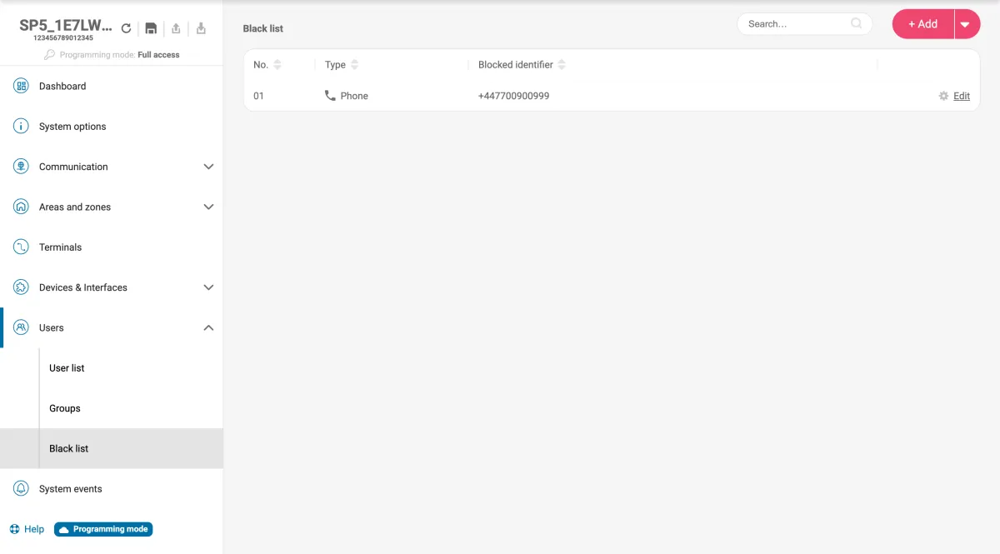

#### Black list table

| Setting | What it does | Values |
|---|---|---|
| Search | Finds entries by identifier. | text |
| + Add | Adds an entry of the type chosen from its arrow. | Email / Phone / RFID |
| No. | The entry number. | 01–40 |
| Type | The kind of identifier. | Phone / Email / RFID |
| Blocked identifier | The blocked phone number, email or card. | — |
| Edit | Opens the entry popup. | link |

#### Add to black list / Edit black list entry (popup)

**Delete entry** at the bottom clears the entry.

| Setting | What it does | Values |
|---|---|---|
| Type | The kind of identifier. The panel checks it against phone numbers, emails and cards in any case; the type only sets how the app shows it. | Phone / Email / RFID |
| Blocked identifier | The phone number, email or card number to block. | up to 35 characters |

### System events

Menu **System events**. Turn each panel event on or off, set its Contact ID code and where it is reported, and edit the words used in SMS messages.

#### Events tab

The events and their codes on a test panel are listed in the [appendix](#appendix-system-events-and-contact-id-codes). These events have no restore: Periodic test, Medical alarm, Panic alarm, Keyswitch Stay, Keyswitch Sleep, Partial Arm, Automatic Arm, STAY arm, SLEEP arm, Remote arm/disarm, Duress alarm and Auto arm failed.

| Setting | What it does | Values |
|---|---|---|
| Search | Finds events by name. | text |
| Number | The event number. | 01–37 |
| Event name | The event. | — |
| CID code | The Contact ID code reported for the event. Edit it in the cell. | 3 hex characters |
| Enable event | Turns the event on or off. | on / off |
| Report to CMS | Reports the event and its restore to the CMS. | on / off |
| Report to Protegus2 | Reports the event and its restore to Protegus2. | on / off |
| Event text | A text for the event. Firmware 1.00 doesn't use it. | up to 28 characters |

!!! note
    The **Periodic test** event is the same setting as the **Periodic test** switch on **CMS Reporting**. Which supervisors receive an event by SMS is set in **User list → Edit user → SMS reporting**.

#### SMS texts tab

The panel builds every SMS as the system name, an event word and the name of the zone, output, event or user. The name is added automatically, so there is nothing to set per zone or output.

| Setting | What it does | Values |
|---|---|---|
| System name prefix: | The **Object Name** from **System options**, added to every SMS. **Not set** if it is empty. | read-only |
| Zone alarm | The word for a zone alarm, followed by the zone's name. | up to 23 characters |
| Zone restore | The word for a zone restore, followed by the zone's name. | up to 23 characters |
| Output turned on | The word for an output switching on, followed by the output's name. | up to 23 characters |
| Output turned off | The word for an output switching off, followed by the output's name. | up to 23 characters |
| Event | The word for a system event, followed by the event's name. | up to 23 characters |
| Event restore | The word for a system event restore, followed by the event's name. | up to 23 characters |
| Disarm | The word for disarming, followed by the user's name. | up to 23 characters |
| Arm | The word for arming, followed by the user's name. | up to 23 characters |
| Greeting SMS | One message for the whole system, sent once to a new user if **Greeting SMS on new user** is on for them. No name is added. | up to 63 characters |

## Appendix: system events and Contact ID codes

Factory default event codes, from the firmware design notes; a test panel showed the same codes. Each event can be turned on or off and have its code changed in **System events**.

| Event | Contact ID |
|---|---|
| Low battery | 302 |
| Missing battery | 311 |
| AC fault | 301 |
| Periodic test | 602 |
| AUX+ overcurrent | 312 |
| BELL+ overcurrent | 321 |
| Bell missing | 321 |
| Tamper alarm | 144 |
| Zone bypassed | 570 |
| RS485 device fault | 333 |
| Communication path lost | 358 |
| Fire loop trouble | 370 |
| Fire alarm | 110 |
| Medical alarm | 100 |
| Panic alarm | 120 |
| Antimasking alarm | 389 |
| Keyswitch arm/disarm | 409 |
| Keyswitch Stay | 442 |
| Keyswitch Sleep | 442 |
| Arm/disarm | 401 |
| Partial Arm | 456 |
| Automatic Arm | 403 |
| STAY arm | 441 |
| SLEEP arm | 480 |
| Remote arm/disarm | 407 |
| Duress alarm | 121 |
| Wireless low battery | 384 |
| Wireless device lost | 381 |
| High temperature | 158 |
| Low temperature | 159 |
| Sensor fault | 380 |
| Low voltage | 784 |
| High voltage | 785 |
| Low humidity | 169 |
| High humidity | 168 |
| Auto arm failed | 455 |
| Zone/door opened | 426 |
