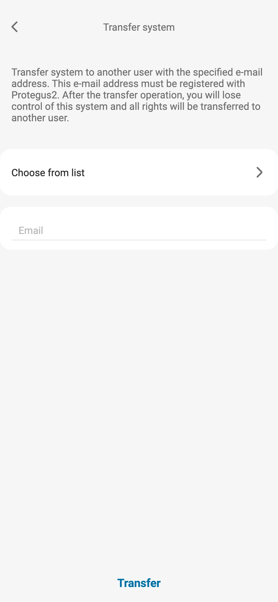
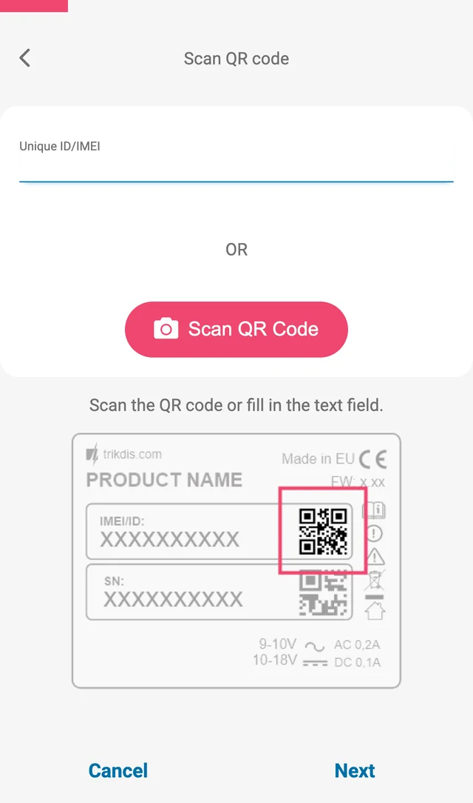
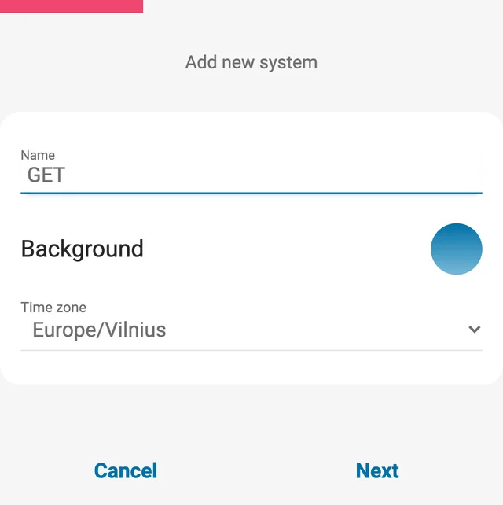
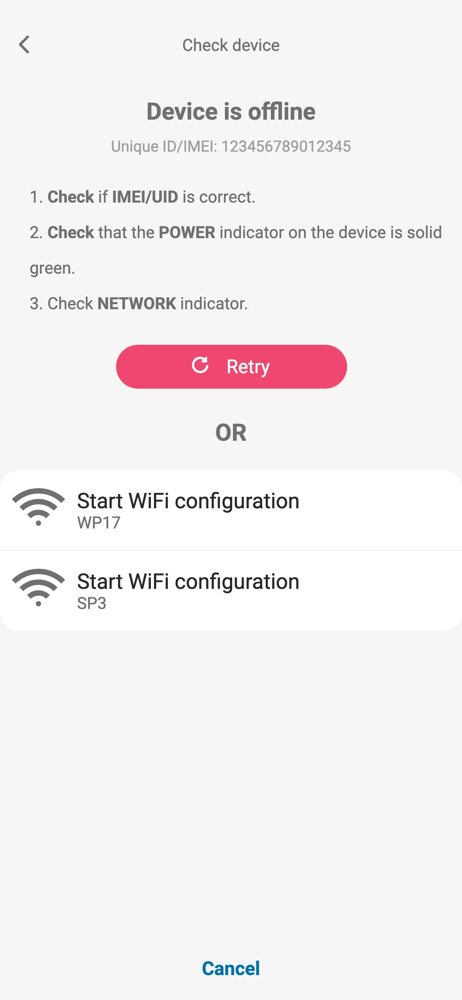
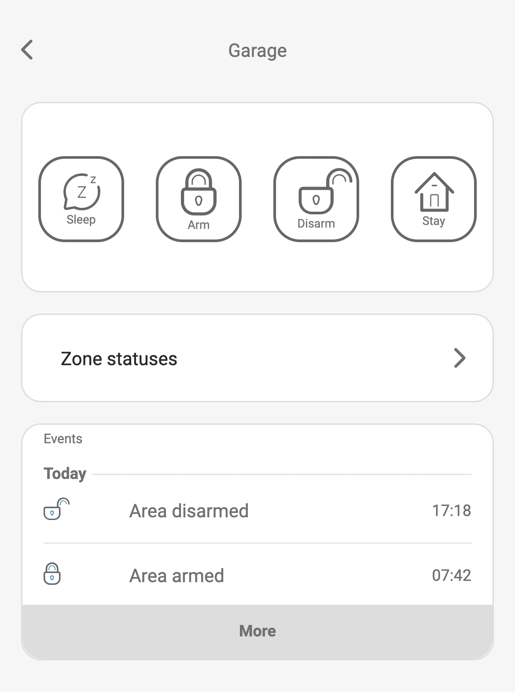
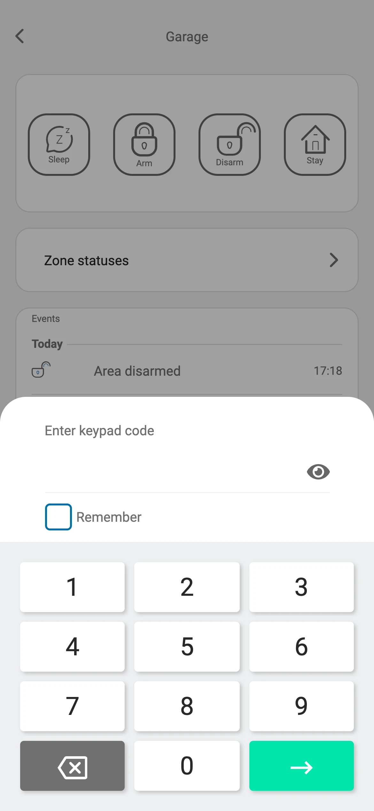
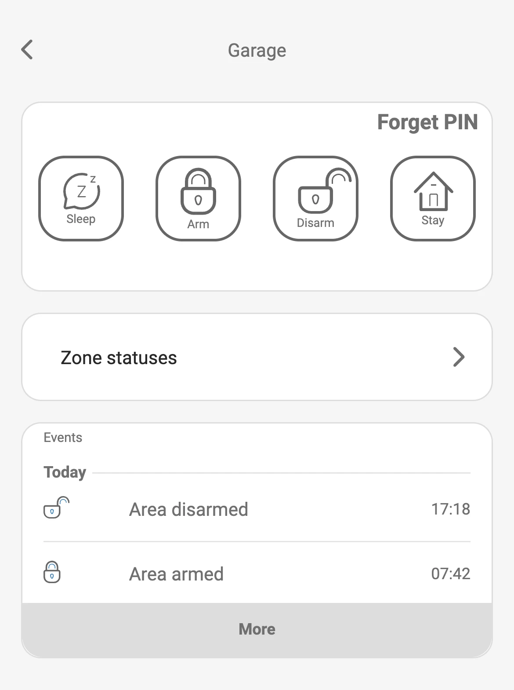
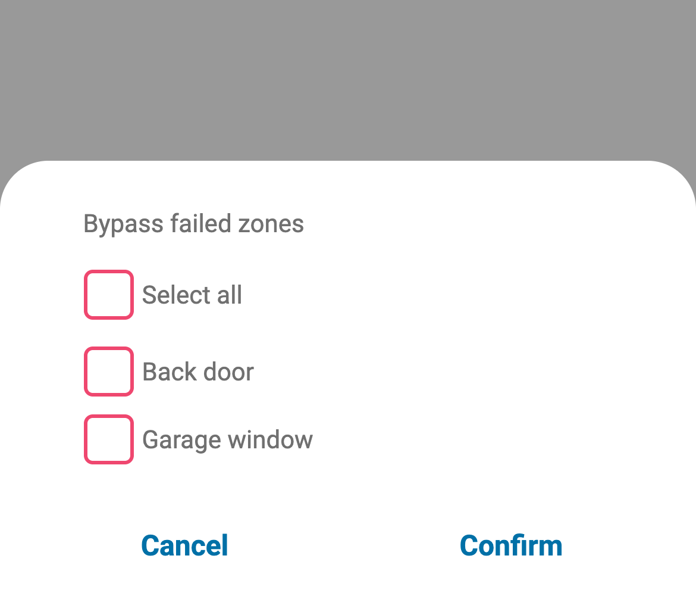
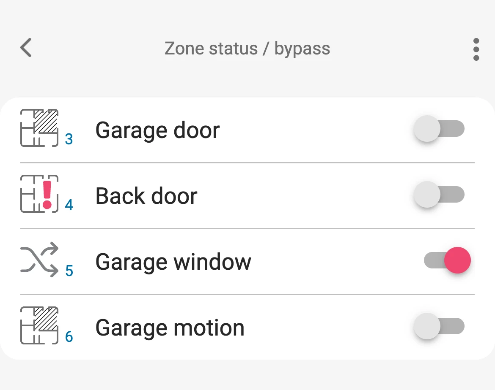

# Protegus App

The Protegus app (Protegus2) lets users control their security system remotely and get notifications about its events. Installers use the same app to add TRIKDIS devices to Protegus and set them up. It runs on Android and iPhone, and in a web browser at [web.protegus.app](https://web.protegus.app). This manual describes the phone layout. The desktop browser layout has the same functions, arranged differently.

Settings for a particular device (**Advanced settings**) are described in that device's own manual.

**Common questions**

??? question "Arming from the Protegus app fails with “Incorrect keypad code”. How do I fix it?"

    --8<-- "en/faq/index.md:protegus-incorrect-keypad-code-body"

??? question "I limited what the installer can change, but in the Protegus app I can still change every setting. Why?"

    --8<-- "en/faq/index.md:protegus-installer-restrictions-body"

Don't see your question? Contact [support@trikdis.lt](mailto:support@trikdis.lt).

## Getting started

Install the Protegus app from Google Play or the App Store, or open [web.protegus.app](https://web.protegus.app) in a browser.

### Create an account

If the system's owner invited you, use the link in the invitation email instead; see [You were invited to a system](#invited).

1. On the log-in screen, tap **Register user**.
2. Enter your email, tick **I agree to the End User License Agreement** and tap **Next**. You can also sign up with **Sign in with Google**, or **Sign in with Apple** in the iPhone app.
3. On **Confirm Your email address**, enter the 3-digit code from the email. If it doesn't arrive, check the spam folder. The code is valid for 24 hours.
4. **Create a password**: at least 8 characters, with a digit, an uppercase and a lowercase letter.
5. **Enter your name**. It is shown in the system's event and user lists.

### Log in

1. Under **Your region**, choose the region where your account was created. Enter your **Email** and tap **Next**.
2. Enter your **Password** and tap **Log in**. If you registered with Google or Apple, use **Sign in with Google** or **Sign in with Apple** instead.
3. If two-factor authentication is on, enter the 6-digit code from your authenticator app. Tick **Remember this device for 30 days** to skip this step on this phone.

The app then opens the system you used last.

| Message | What to do |
|---|---|
| This user does not exist. | Check the email address and the region, or tap **Register.** |
| This user is not activated. | Registration wasn't finished. Tap **Activate.** to get a new code. |
| There is no password set. | Tap **Set password**. |
| This user is registered with a Google account. | Log in with **Sign in with Google**. |
| This user is registered with a social account. Use social login buttons bellow. | Log in with **Sign in with Apple** or **Sign in with Google**. |
| Wrong password. | Try again, or reset the password (below). |
| Too many login attempts. Please try again in N minutes. | After 5 wrong passwords, logging in is blocked for 15 minutes, even with the right password. Wait, then try again. |

### Forgot your password

1. On the log-in screen, tap **Forgot password**, enter your email and tap **Reset password**.
2. Open the link in the email within 60 minutes. Only the newest link works, and only once.
3. Create a new password and log in.

A password reset turns off Face ID or fingerprint log-in on all your devices; turn it on again afterwards.

### Several accounts on one phone

The phone remembers every account that has logged in on it. **Choose account** lists them: tap one to switch, **Add account** to add another, or **Forget accounts** to remove one from the list. In the app's menu, **Change account** and **Log out** do the same.

### Face ID or fingerprint

After you log in with a password, the phone app offers **Log in faster next time?** You can also turn it on or off in **Profile** (**Face ID login**, or the fingerprint equivalent). **Require biometric auth. on every app activation** also asks for it each time the app opens.

Logging out, changing or resetting the password, and turning off two-factor authentication all turn biometric log-in off. If the app says "Biometric login is no longer valid. Please log in with your password.", log in with the password once and turn it on again.

### Two-factor authentication

Two-factor authentication asks for a code from an authenticator app (such as Google Authenticator) when you log in.

1. Open **Profile → Two-factor authentication** and tap **Enable two-factor authentication**.
2. Scan the QR code with the authenticator app, and enter the 6-digit code it shows.
3. Save the **Recovery codes**. If you lose the phone with the authenticator app, enter a recovery code instead of the 6-digit code.

### Change the password or delete the account

**Profile → Change password** asks for the current and the new password, then logs you out.

**Profile → Delete profile** deletes the account for good. Systems you own are deleted too, and their other users lose access to them.

## Getting a system into the app

A system gets into your Protegus app in one of three ways:

- **You were invited:** the system's owner added you as a user.
- **The system was handed over to you:** your installer transferred its ownership to you.
- **You add it yourself:** you add a new device with its Unique ID.

If an installer set up your system, you don't add it again. Ask the installer to invite you or hand it over.

### You were invited to a system

The system's owner, or a user allowed to edit the user list, adds you by your email address (**Settings → Users → +**). The owner also chooses what you may do: control areas and outputs, see events, bypass zones and so on.

- **You're new to Protegus:** you receive an email with a link. Open it within 7 days, choose **Create a password**, then **Enter your name**. The system is then in your app.
- **You already have an account:** log in as usual. The system is added to your account as soon as the owner saves you as a user.

If the link has expired, the app shows "Activation failed. This link or code is no longer valid, or your account has already been activated." Ask the owner to add you again.

### The system was handed over to you

An installer usually sets the system up under their own account and then transfers its ownership to you:

1. The installer opens the system's **Settings → Transfer system**.
2. They choose you with **Choose from list** or type your email, and tap **Transfer**.

    { .trik-mob-img }

The transfer is immediate. You don't have to accept it, and you receive an email about it. The system appears in your app with you as its owner. The previous owner loses control of the system; other users keep their access. Afterwards the installer sees the system only in their read-only **Systems History**.

Your email should already be registered in Protegus. An installer can also transfer to an email that isn't registered yet: the app asks to confirm, and you then receive an email to activate your new account.

In some cases the installer sees **Finish without transferring** instead: the system then stays accessible to the installer's company.

### Add a new system

Before you start, make sure the device is powered and connected to the internet, and find its **Unique ID/IMEI**. It is printed on the device and on its packaging, often as a QR code; see the device's manual. The pictures below show a GET communicator.

1. On the home screen, tap **+** (with no systems yet: **Click plus to add a system**), or choose **Add new system** in the menu.
2. Tap **Scan QR code** and scan the code, or type the **Unique ID/IMEI** (an IMEI has 15 or 16 digits, a MAC address 12 characters). Tap **Next**.

    { .trik-mob-img }

3. The app checks the device. If the device asks for its service access code, enter it.
4. Some communicators (GET, GT, GT+) then offer **Select the monitoring station**, to set up reporting with a template. If you only want the device in the app, choose **Add only to Protegus2**.
5. On **Add new system**, enter the system's **Name**, pick a background and check the time zone. Tap **Next**.

    { .trik-mob-img }

6. If the app can't arm and disarm the panel directly, it shows **The system is not controlled remotely**. Tap **Continue** and add the areas that a device output will control: **Area number**, **Area name**, **Control with Protegus2** and the **Assigned Output**. The output must be wired to the panel's keyswitch zone; see the device's manual (for the GET: [Additional settings to arm/disarm the system using the control panel's keyswitch zone](../alarm-communicators/cellular/get/index.md#52-additional-settings-to-armdisarm-the-system-using-the-control-panels-keyswitch-zone)).

    { .trik-mob-img }

7. At **System added successfully!**, tap **Personalize** to name the areas and zones now, or **Skip** (or **Finish**) to do it later.

For about a minute the home screen says "It may take up to 1 minute for your system to be fully operational."

#### If the app says "Device is offline"

When the device doesn't answer, the app shows **Check device** with three checks:

1. Check that the Unique ID/IMEI is correct.
2. Check that the device's **POWER** indicator is solid green.
3. Check the **NETWORK** indicator.

{ .trik-mob-img }

Then tap **Retry**. On a phone, a Wi-Fi device such as the FLEXi SP3 can be connected to Wi-Fi from here: tap **Start WiFi configuration**.

#### Messages when adding a system

| Message | What it means |
|---|---|
| Invalid Unique ID/IMEI | The ID is mistyped or too short. |
| System already exists. | The device is already registered in Protegus. Ask its owner to hand it over or invite you. |
| Access denied. Unable to add new system. Device with provided unique ID belongs to a different company. | The device belongs to a security company's account. Contact that company. |
| This device is used by system … in North America. Only the owner of that system can move it here | The device is registered in another Protegus region. Its owner must move it. |
| Invalid Protegus2 service access code. Please change it in 'System information'. | The service access code doesn't match the device's. |
| Device has no areas, please contact your installer. | The panel reported no areas. |
| Some data could not be read. Your "PC Download" code may be incorrect. | The communicator couldn't read the panel; check the PC download code in the device settings. |

## Arming and disarming

You can arm and disarm an area in three places:

- on the area's card on the home screen;
- on the area's own screen (tap the card);
- in the system list, if the system has only one area.

{ .trik-mob-img }

The buttons are **Arm**, **Disarm**, **Stay** and **Sleep**. On DSC panels, **Away** replaces **Sleep**. What **Stay** and **Sleep** protect is set in the control panel, so see the panel's own manual (for the FLEXi SP3: [FLEXi SP3 user guide](../control-panels/sp3/paradox-user-guide/index.md)).

**Stay** and **Sleep** appear only when the app controls the panel directly. If the area is controlled through one of the device's outputs (wired to the panel's keyswitch zone; see [Add a new system](#add-system)), the app shows only **Arm** and **Disarm**, and it never asks for a keypad code. If an area has neither, its screen shows **Click to assign Output** instead of the buttons.

### Arm or disarm an area

1. Tap **Arm**, **Stay**, **Sleep** or **Disarm** on the area's card or screen.

    { .trik-mob-img }

2. If the app asks for the code (**Enter keypad code**), enter a user code that the control panel accepts for this area and tap enter. To skip this step next time, tick **Remember** first.

    { .trik-mob-img }

3. While the command is on its way, the button shows loading dots and the area shows **Arming…** or **Disarming…**.
4. When the panel confirms, the area shows its new state: **Armed**, **Staying**, **Sleeping** (or **Away**), or **Disarmed**.

If the panel doesn't confirm within about two minutes, the area shows **Unknown**.

Under the area name, a disarmed area shows **Ready to arm**, or **Not ready** with the number of open zones.

### The keypad code

The code is one of the control panel's user codes, 4 to 6 digits long. It is not your Protegus password.

When you tick **Remember**, the code is saved for your account and this area after the first successful command, and the app stops asking for it. Other users of the system save their own codes. To clear a saved code, open the area and tap **Forget PIN**.

{ .trik-mob-img }

--8<-- "en/faq/index.md:protegus-incorrect-keypad-code"

### When zones are open

If a zone is open or in fault when you arm, the panel refuses. The app then opens **Bypass failed zones** with a list of the open zones.

1. Select the zones to bypass, or tick **Select all**.
2. Tap **Confirm**. The app bypasses the selected zones and sends the arm command again.

{ .trik-mob-img }

Tap **Cancel** to leave the area as it was. A bypassed zone does not cause an alarm, so bypass only zones you know are safe to leave unprotected.

You can also bypass zones before arming: on the area's screen, tap **Zone statuses** (shown only when the app controls the panel directly). The **Zone status / bypass** list shows each zone's state and a switch to bypass it.

{ .trik-mob-img }

Bypass from the list works only if the panel allows bypass and your user may control zones. It isn't available on G16T, E16T and FireCom. On DSC panels the app can't show whether a zone is bypassed, even when the bypass works.

### When an area is in alarm

For up to five minutes after an alarm, the area shows **Take action**, if the panel supports it. Tap it to choose:

- **Disarm**;
- **Silence siren**: stops the siren;
- **Cancel alarm**: clears the alarm in the panel and in the app;
- **Reset fire detectors** (fire alarms only, if the panel supports it).

### Linked areas

An area can arm or disarm other areas with it: **Autoarm this area when arming area** and **Autodisarm when disarming area** are set in the area's settings. An area with linked areas shows a chain icon. If a linked area can't change state, the app lists it under **Failed areas** with the reason.

### Why does arming or disarming fail?

The app shows the reason. The panel-side messages can differ slightly by panel.

| Message | What it means | What to do |
|---|---|---|
| Incorrect keypad code. Please try again. | The panel rejected the code. | Enter a valid user code; see [The keypad code](#arming-keypad-code). |
| **Bypass failed zones** opens | Zones are open or in fault. | Close them, or bypass them. |
| System is Offline, please try again or check connection | The device isn't connected to Protegus. | Check the device's power and connection. |
| Device could not process request, it may have been malformed | The panel refused the command. | Try again. If it repeats, contact your installer. |
| The device responded, that system status has not changed, therefore disarming has failed. | The panel answered but didn't disarm. | Try again, or disarm at the keypad. |
| Sorry, you can not change area status. Please contact your Installer. | The area is disabled or not set up in the panel. | Contact your installer. |
| You do not have permission to perform this operation. | Your user may not control this area. | Ask the system's owner for the right. |
| The operation is currently in progress. Wait for it to finish. | Another command to this system is still running. | Wait, then try again. |
| No internet connection, or Connection is unstable. Request sent 3 times but still failed. Please try again. | Your phone can't reach Protegus. | Check the phone's internet connection. |

## Controlling outputs

Outputs (PGM) switch whatever is wired to the device: a gate, a garage door, lights. They are on the home screen under **PGM Outputs**, and in the menu under **Outputs**.

### Switch an output

Tap the output's button. While the command is on its way, loading dots replace the icon, and further taps wait their turn.

- **Level** output: each tap switches it on or off. The icon then shows the state the device reported.
- **Pulse** output: a tap switches it on for its pulse time, and it switches off by itself. A circle counts down the seconds left. Tapping again during the countdown switches it off early.

The icon shows the output's state as the device reports it, not whether the gate or door really moved.

Press and hold a button for **Edit** (the output's settings) and **Resize** (the button's size on the home screen). To choose which outputs the home screen shows, open **Edit home screen** in the menu: **Select outputs you wish to see on Home screen**.

An output that arms and disarms an area is not shown as a button. You arm that area with its own buttons; see [Arming and disarming](#arming).

### Output settings

Open **Settings → Outputs** and tap the output:

- **Output name** and its icon: tap the icon to **Choose an icon**.
- **Pulse**, with **Pulse interval in seconds** (a new output starts at 3 seconds), or **Level**.

Tap **Save**. Only users allowed to edit outputs can change them. On GATOR gate controllers you can also add and delete outputs here, and their schedules are in **Advanced settings**.

### Who can control which outputs

The system's owner can control every output. For each other user, the owner chooses in that user's settings: under **Allow to control outputs** (on FLEXi panels, **Can control outputs**) there is a switch for every output.

On a GATOR with advanced gate monitoring, switching the gate while a safety input is bypassed asks for **Safety Confirmation Required**: confirm that you have checked the gate area is clear.

### Why does switching an output fail?

| Message | What it means | What to do |
|---|---|---|
| You do not have permission to perform this operation., or Access denied. You do not have permission to perform this operation. | Your user may not control this output. | Ask the system's owner for the right. |
| System is Offline, please try again or check connection | The device isn't connected to Protegus. | Check the device's power and connection. |
| Failed to change status. Make sure device is online or try again later. | The device didn't answer. | Try again in a moment. |
| There is no such user in the device, or This user does not have permission to control the device | The device itself refused the command for your user. | Ask the system's owner or installer to check your user in the device. |
| No internet connection, or Connection is unstable. Request sent 3 times but still failed. Please try again. | Your phone can't reach Protegus. | Check the phone's internet connection. |
