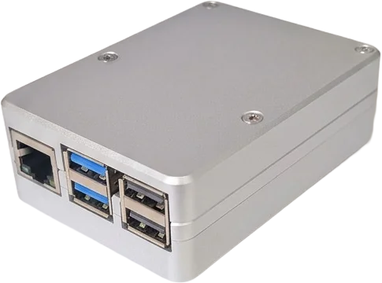
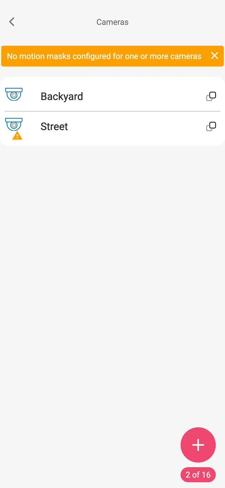
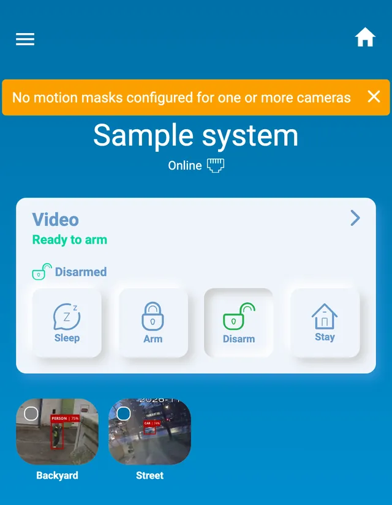
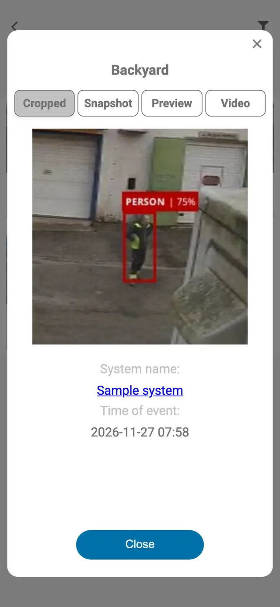
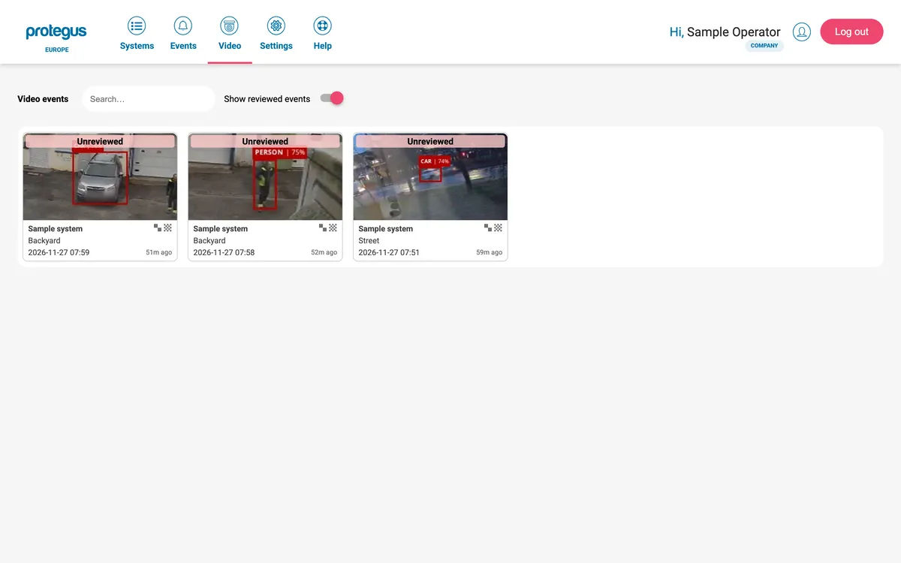
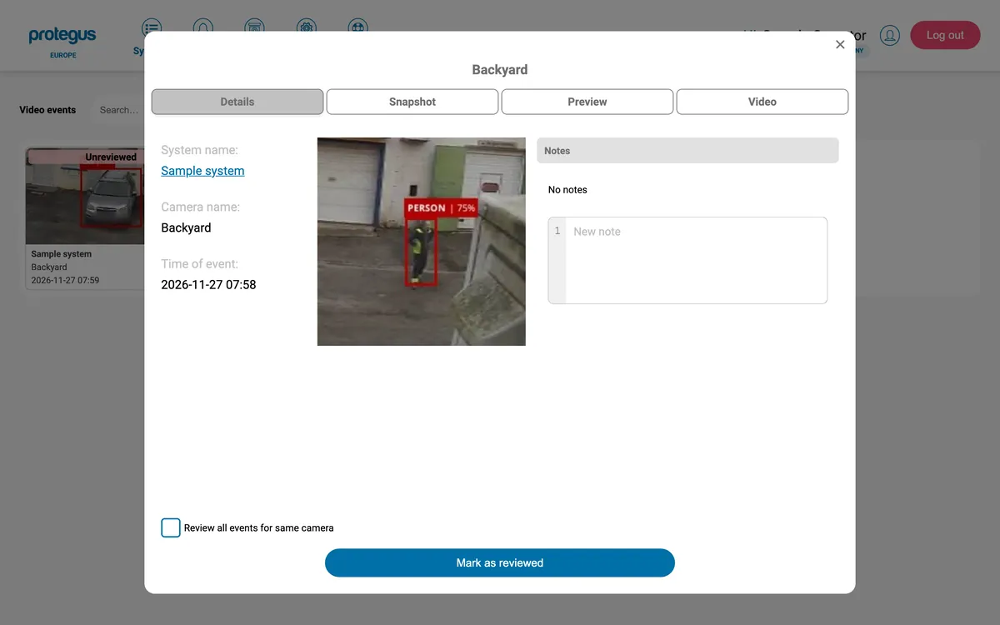
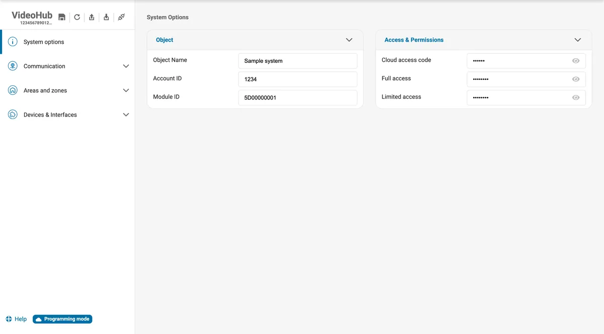
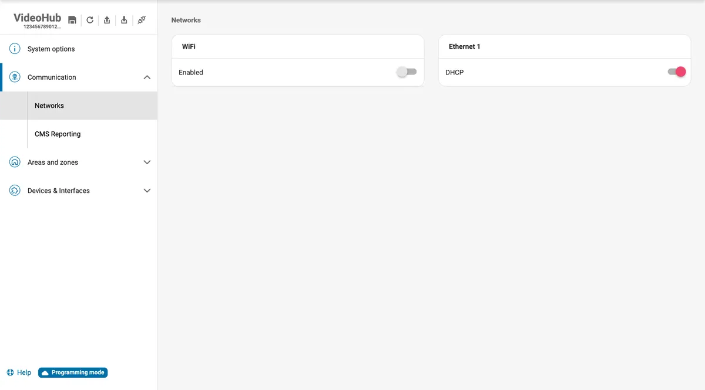
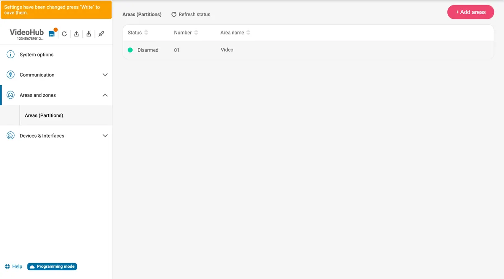
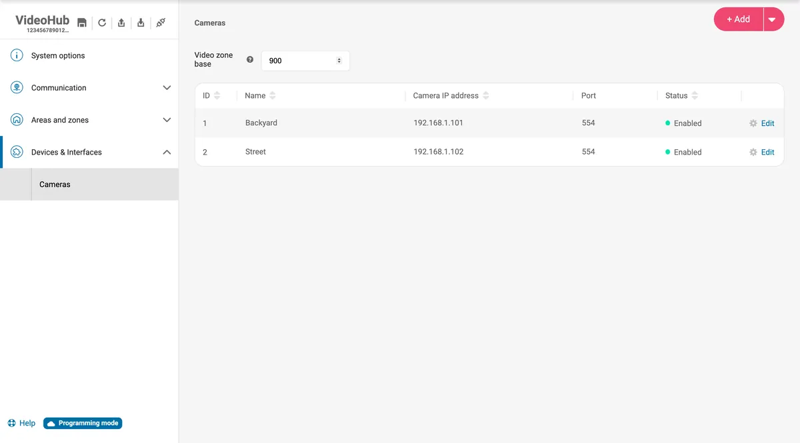

# VideoHub AI video verification hub

  

**VideoHub** connects a site's existing IP cameras to the Protegus cloud and to a monitoring station.
It watches the camera streams on the device itself, recognises **people** and **cars**, and sends an
alarm only when one of them appears where it should not. Each alarm carries a picture and a short
clip, so the operator can decide from the event itself, without opening the site's NVR.

> [!IMPORTANT]
> VideoHub is in its pilot ("early bird") phase. This page describes firmware **1.04** and the
> current Protegus app, and will be updated as the pilot goes on. Questions: [support@trikdis.lt](mailto:support@trikdis.lt).

## About VideoHub

### How it works

1. VideoHub reads each camera's video over RTSP on the local network.
2. Its built-in AI looks for people and cars in every camera's picture. Masks, alarm areas and the
   arming state decide which detections become alarms.
3. An alarm is sent to the Protegus cloud with a cropped picture of the object, the full camera
   picture, a short preview and a video clip.
4. In parallel, the alarm can be sent to the monitoring station's receiver over SIA DC-09, with a
   link to the picture and clip in the event's extra data.

Video is analysed on the device. Only alarms with their pictures and clips leave the site; the
camera streams do not. Live view, when someone opens it in the app, is a direct connection
between the app and VideoHub. Pictures and clips are stored on the Protegus servers of the site's
region.

### Models

| Model | Cameras |
|---|---|
| VideoHub 8 | up to 8 |
| VideoHub 16 | up to 16 |

In the box: VideoHub, power supply, LAN cable.

### What is in an alarm

| Item | What it is | Where it is kept |
|---|---|---|
| Cropped picture | The detected object, cut out of the frame | Protegus cloud |
| Full picture | The whole camera frame, with the object marked | Protegus cloud |
| Preview | A short low-resolution clip, quick to open on a weak connection | Protegus cloud |
| Video | The high-resolution MP4 clip (H.264, up to 1080p), about 3 to 30 seconds depending on the movement | 24 hours in the cloud; on VideoHub for the number of days set in **High resolution recording retention** (default 3) |

After the cloud copy of the video is deleted, the app fetches it from VideoHub when someone opens
it, which takes a few seconds. After the retention period only the pictures and the preview
remain.

The monitoring station receives a link to a 304 × 304 cropped picture in the DC-09 extra data.

## Planning the installation

### Network

- VideoHub needs internet access over its LAN cable or Wi-Fi. A static IP address, port forwarding
  or router changes are not needed on most networks. If VideoHub does not come online on a
  network with a strict firewall, contact support.
- VideoHub and the cameras must be on the same local network.
- **Connect VideoHub and the cameras by cable.** Over Wi-Fi VideoHub can receive about 8 camera
  streams at most.

### Cameras

- Any IP camera or NVR that provides an **RTSP** stream. Dahua, Hikvision, Uniview, Reolink and
  Axis have ready-made stream paths in the app; other makes are added with their own path.
- **The camera must send H.264.** H.265 is not supported, for detection or for live view. Change
  the camera's encoding to H.264 in its own settings.
- Use the camera's **sub-stream** for detection and its **main stream** for live view and video
  clips. Detection runs at up to 1280 × 720 and 10 frames per second, so a high-resolution stream
  only adds load.
- The camera password may contain **only letters and digits** (A–Z, a–z, 0–9). Change it in the
  camera before adding it, if it has other characters.
- Cloud-only cameras that have no RTSP stream cannot be used.

### Placement

Install VideoHub somewhere ventilated, not in a closed cabinet next to other heat sources. In a
46-hour test with 8 cameras at a room temperature of 23–25 °C the unit reached at most 60 °C,
about 20 °C below the point where it slows down. Higher room temperatures have not been tested yet.

### Firmware

Use firmware **1.04 or newer**. On older firmware alarms are not shown correctly. Alarm areas
need 1.03, and the retention setting 1.05. How to update: [Updating the firmware](#9-updating-the-firmware).

### Who adds VideoHub to Protegus

A monitoring station adds VideoHub to its **Protegus company account**, so its operators see the
events in the company's **Video events** page and pictures are not blurred. A VideoHub that is not
linked to a company shows blurred pictures to company staff.

## Connecting VideoHub

### Connecting by cable

1. Connect VideoHub's LAN port to the router with the LAN cable.
2. Plug in the power supply.
3. Wait about 1 minute for VideoHub to start.

With DHCP on the network, VideoHub needs no further setup and is ready to be
[added to Protegus](#4-adding-videohub-to-protegus).

### Connecting by Wi-Fi (Bluetooth setup)

Use this when there is no cable at the installation site, or to set a static IP address. It needs
the Protegus app on a phone with Bluetooth, or a computer browser with Web Bluetooth (Chrome or
Edge).

1. Start adding the system as in [Adding VideoHub to Protegus](#4-adding-videohub-to-protegus). When
   VideoHub is not online, the app shows **Device is offline** with **Start Bluetooth
   configuration**. Tap it.
2. Put VideoHub into Bluetooth configuration mode: **press the ON/OFF button 3 times.** The PWR/ACT
   indicator flashes red while green stays on.

    { .trik-mob-img }

3. Tap **Connect** and select the VideoHub. Its Bluetooth name is `VideoHub-` followed by part of
   its Unique ID.
4. In **Network Configuration**, enable **WiFi**, enter the **WiFi network name** and **WiFi
   password**, and save. To use a static address, turn off **DHCP** and enter the IP address,
   subnet mask and gateway.
5. The app shows each step: **WiFi connected**, **Checking server connection…**, **Server
   reachable**, **Setup complete**. Then it continues adding the system.

| Message | What to do |
|---|---|
| WiFi network not found | Check the network name and that VideoHub is within range. |
| Wrong WiFi password | Enter the password again. |
| Failed to obtain IP address | The network gave no address. Check the router's DHCP, or set a static address. |
| Server not reachable | The network has no internet access, or it blocks VideoHub. Try another network or the cable. |
| The connected device's Unique ID doesn't match the one entered | You are connected to another VideoHub. Check the Unique ID. |

## Adding VideoHub to Protegus

Video: [VideoHub – Add To Protegus 2](https://youtu.be/wnKhMq9gwRY) (TRIKDIS, YouTube).

1. Open the Protegus app, or [web.protegus.app](https://web.protegus.app) on a computer, and sign in
   with the company account.
2. Tap **+** (Add system). Scan the QR code on VideoHub, or enter its **Unique ID**.
3. If your company has device setup templates, select one. The template writes the monitoring
   station settings (receiver, line, account and protocol) to VideoHub.
4. Enter the system's name and time zone, and finish.

VideoHub appears in the systems list as a separate system.

### Pairing VideoHub with an alarm system

When the site has a TRIKDIS alarm system in Protegus (a FLEXi control panel, or a panel with a
TRIKDIS communicator), pair VideoHub with it. The cameras then appear in that system, and the
video area can arm and disarm together with the alarm area.

1. Open the alarm system and go to **Settings** → **Cameras**.
2. Tap **+**, then **Pair VideoHub to system**.
3. Enter VideoHub's Unique ID and finish adding it as above. The app links it to the alarm system
   (**Associating…**).

To link the arming state, open VideoHub's area (**Settings** → **Areas** → the area) and set:

| Setting | Value |
|---|---|
| **Autoarm this area when arming area** | the alarm system's area |
| **Autodisarm when disarming area** | on, so detection stops when the alarm area is disarmed |

Then set the cameras' **Detection mode** to **Follow video area state** ([Detection options](#61-detection-options)).

To unpair, open the alarm system's **Cameras** list and tap **×** next to the VideoHub.

## Adding cameras

Open the VideoHub system and go to **Settings** → **Cameras**.

{ .trik-mob-img }

### Finding cameras on the network

1. Tap **+** → **Detect local cameras**. VideoHub scans its network (**Camera detection in
   progress…**).
2. The cameras it finds are listed, new ones marked **(new)**. Select one.
3. Enter the camera's user name and password, choose its make and channel in **Camera streams**, and
   save.

If the camera is not found, add it manually.

### Adding a camera manually

1. Tap **+** → **Add camera**.
2. Fill in:

    | Setting | What to enter |
    |---|---|
    | **Camera name** | A name the operator will recognise, for example "Gate". |
    | **Protocol** | `rtsp` |
    | **Camera IP address** | The camera's (or NVR's) address on the local network. |
    | **Port** | RTSP port, usually 554. |
    | **Camera user name**, **Camera user password** | The camera's login. Letters and digits only. |
    | **Live stream path** | Choose from **Camera streams** (below), or type it. |

    You can also paste the camera's full RTSP link, with its login, into the address field: the
    other fields are filled in from it.

3. Set the [detection options](#61-detection-options) and save.
4. Open the camera again and set [masks and the alarm area](#62-masks-and-the-alarm-area). They can be
   drawn only after the camera is saved.

### Stream paths

Tap the stream path field to open **Camera streams**. Choose the camera's make and, for an NVR,
the channel (1–16). Both paths are filled in:

| Make | Live stream path | Detection stream path |
|---|---|---|
| Hikvision | `/Streaming/Channels/101` (channel 1) | `/Streaming/Channels/102` |
| Dahua | `/cam/realmonitor?channel=1&subtype=0` | `/cam/realmonitor?channel=1&subtype=1` |
| Uniview | `/unicast/c1/s0/live` | `/unicast/c1/s1/live` |
| Reolink | `/h264Preview_01_main` | `/h264Preview_01_sub` |
| Axis | `/axis-media/media.amp` | `/axis-media/media.amp?streamprofile=low` |
| Other/Generic RTSP | `/stream1` | `/stream2` |

For another make, find the RTSP path in the camera's manual and type it. A path starts with `/`;
do not paste the whole `rtsp://` link into the path field.

**An NVR** is found as one device. Add one camera per NVR channel: same address and login, a
different channel.

## Setting up detection

Detection is set per camera, in the camera's settings (**Settings** → **Cameras** → the camera).
Spend most of the time on the masks and the alarm area: in the pilots, most false alarms came from
things that do not move.

### Detection options

| Setting | What it does | Values |
|---|---|---|
| **Detection mode** | When the camera raises alarms. | **Off**: never. **On**: always (24 hours). **Follow video area state**: only while VideoHub's area is armed. |
| **Detect people**, **Detect cars** | Which objects raise an alarm. | on / off each |
| **Motion sensitivity** | How little movement starts a check. Lower it if there are too many alarms. | Very low, Low, Medium, High, Very high |
| **Min object size** | Objects smaller than this in the picture are ignored. Raise it to ignore distant movement. | Very small, Small, Medium, Large, Very large |
| **FPS** | Frames per second analysed. 3–5 is enough for most scenes. | Auto, 2, 3, 4, 5, 7, 10 |
| **Resolution** | Resolution used for detection. | Auto, 640x360, 960x540, 1280x720 |
| **Detection stream path** | The camera's sub-stream, used for detection. | path |
| **Improve contrast** | Enhances contrast before detection, for dark or hazy scenes. | on / off |
| **Merge simultaneous detections into one** | Several objects detected at the same moment give one alarm instead of several. | on / off |
| **Live view resolution** | Resolution of live view. | Auto, 960x540, 1280x720, 1920x1080 |

### Masks and the alarm area

Open **Motion masks** (or **Alarm area**) in the camera's settings. VideoHub takes a fresh picture
from the camera (**Requesting for snapshot…**) and you draw on it.

- **Motion mask** (exclusion zone): a part of the picture that is ignored. Use it for anything that moves or looks
  like a person or car but is not one: a road outside the site, trees, a flag, the camera's
  on-screen clock, a parking space where a car always stands. **Add mask**, then click the corners
  of the area on the picture.
- **Detection zone** (mandatory zone; shown together as **Alarm area**): when at least one zone exists, only objects
  **inside** a zone raise an alarm (**Alarms only inside zones below**). With no zone, the whole
  picture is used.
- For each zone you can choose **which objects** trigger it (people, cars, or both; none selected
  means all the camera detects), and a **Loitering time (s)**: the object must stay in the zone
  this long before the alarm (1–3600 s; off by default).

> [!WARNING]
> If a zone leaves out an object type the camera detects, the app warns, for example *Cars are not
> selected in any zone - cars will not be detected*. Check this before leaving the site.

**What caused most false alarms in the pilots, and the fix:**

| Seen | Fix |
|---|---|
| A jacket on a wall, seen in infrared at night, detected as a person | Mask it, or keep it outside the alarm area. |
| A parked car detected again and again | Mask the parking space, or use an alarm area with a loitering time. |
| Busy daytime traffic in an office | Detection mode **Follow video area state**, so alarms come only when the site is armed. |

The app marks a camera without masks with a warning: *No motion masks configured for this camera.*

## Reporting to the monitoring station

The monitoring station settings are in VideoHub's **Advanced settings** → **Communication** →
**CMS Reporting** (see [Settings in the Protegus app](#13-settings-in-the-protegus-app)). A device
setup template can fill them in when VideoHub is added.

1. In **Primary channel**, enable the channel and enter the receiver's **Domain or IP** and **Port**.
2. Choose the **Protocol**: **SIA DC-09_2012** for a third-party receiver, **SIA DC-09_IPcom** or
   **TRK8** for a TRIKDIS IPcom receiver.
3. For DC-09, turn on **Enable encryption** and enter the 16-character **Encryption key** the
   receiver uses.
4. Set **Network (IP) Ping** and **Periodic test** as the monitoring station requires.
5. Enter the account in **System options** → **Account ID**, and the receiver **Number** and
   **Line** in the **Receiver** card.
6. Press **Write**.

Use **Backup channel** for a second receiver address, and **Parallel channel** to report to a
second monitoring station at the same time.

### Zone numbers

Each camera reports to the monitoring station with its own zone number: the **Video zone base**
(Advanced settings → **Cameras**, default 900) plus the camera's ID: with the default, camera 1 is zone 901.
Choose a base that does not overlap the zone numbers of an alarm panel reporting on the same
account.

## Viewing alarms

### In the Protegus app

{ .trik-mob-img }{ .trik-mob-img }

- **Home screen**: each camera shows its last alarm picture (or a live picture, if set in the camera's
  **Home screen button snapshot**). Tap it to open **live view**.
- **Events**: video alarms appear in the system's event list with a picture. Opening one shows the
  tabs **Cropped** (**Details** for company staff), **Snapshot** (full picture), **Preview** and
  **Video**. The
  video loads when the tab is opened.
- **Push notifications** carry the picture, so the user sees what happened before opening the app.

Live view is a direct (peer-to-peer) connection between the app and VideoHub. On a network that
blocks such connections (strict corporate firewalls) it may not open.

### In the Protegus company account (operators)

The **Video** menu opens **Video events**, which lists every video alarm from the company's systems, newest first. Each
card shows the cropped picture, the system, the camera and the time; hovering over it plays the
preview.

- New alarms are marked **Unreviewed**. Open the alarm and press **Mark as reviewed**; tick **Review
  all events for same camera** to clear a burst from one camera at once.

    

- **Show reviewed events** shows or hides the ones already handled.
- Search by system name, account number, Unique ID, address, user, installer or tag.
- Operators can add notes to an alarm; an icon on the card shows that it has notes.

## Updating the firmware

1. Open the VideoHub system and go to **Settings** → **System information**.
2. Under **Firmware**, the app shows the **Current firmware** and **Firmware update available** if a
   newer one exists.
3. Tap **Update** next to the version. The progress bar shows the update; VideoHub restarts when it
   is done.

| Message | Meaning |
|---|---|
| FTP connection failed | VideoHub could not download the file. Check its internet connection and try again. |
| Corrupt firmware file | The download was damaged. Try again. |
| This firmware version is older than the supported minimum version. | Choose a newer version. |
| Internal device error | Contact support. |

## Commissioning checklist

Before leaving the site:

1. Firmware is 1.04 or newer.
2. Every camera shows a picture in live view.
3. Every camera has masks for static objects and, where useful, an alarm area.
4. Walk through each camera's view, by day and, for infrared cameras, in the dark. An alarm arrives
   in the app and at the monitoring station, with its picture and clip.
5. Arm and disarm the area: alarms come only when they should (**Follow video area state**).
6. The monitoring station received the test event and opened the picture link.

## Troubleshooting

| What you see | Possible cause | What to do |
|---|---|---|
| **Device is offline** when adding | No internet, or wrong Unique ID | Check the Unique ID and the indicators, then the cable; or use [Bluetooth setup](#32-connecting-by-wi-fi-bluetooth-setup). |
| **No cameras found** | Camera on another network, or RTSP off | Check that the camera is on VideoHub's network and RTSP is enabled; add it manually. |
| *This is not a valid URL* | A whole link pasted into the path field, or a wrong port | Enter only the path, starting with `/`. |
| *Special characters are not allowed* | The camera password has symbols | Change the password in the camera to letters and digits. |
| Live view stays black | Camera sends H.265, or the network blocks direct connections | Set the camera to H.264. Try from another network. |
| **There was an error downloading the snapshot.** | VideoHub cannot read the camera | Check the camera's address, login and stream path. |
| Too many alarms | No masks, sensitivity too high, detection always on | See [Masks and the alarm area](#62-masks-and-the-alarm-area) and the table there. |
| No alarms at all | Detection mode Off, area disarmed in Follow video area state, or a zone excludes the object | Check the detection mode, the area's state and the zone's objects. |
| Alarms in the app but not at the monitoring station | CMS Reporting off or wrong | Check the channel, account, receiver number and encryption key. |
| **There was an error downloading the video.** | The clip is no longer on VideoHub, or VideoHub is offline | Clips are kept for the retention period only; the pictures remain. |

## Known limits

- **No alarm yet when a camera stops sending video** (cable cut, camera off).
- People and cars only; no fire or smoke detection.
- Tested with 8 cameras at 1080p. The 16-camera configuration is being tested.
- Live view needs a network that allows direct connections.
- Plate recognition (LPR) is not available to installers yet.

## Settings in the Protegus app

These are VideoHub's **Advanced settings** (the configurator). Open the system, then **Settings**
→ **Advanced settings**, and press **Read**. Change what you need and press **Write**. The default
configuration access code is `12345678`.

The side menu also has **Download settings** (save the configuration to a file) and **Upload
settings** (load it into another VideoHub; the file is checked for changes before it is applied).

### System options

#### Object

| Setting | What it does | Values |
|---|---|---|
| **Object Name** | The site name stored on VideoHub. | up to 31 characters |
| **Account ID** | Account number reported to the monitoring station. | hexadecimal, up to 8 characters |
| **Module ID** | VideoHub's identifier. | hexadecimal, up to 10 characters |

#### Access & Permissions

| Setting | What it does | Values |
|---|---|---|
| **Cloud access code** | Access code for configuration through the Protegus cloud. | up to 6 characters |
| **Full access** | Configuration code with full access. | up to 8 characters; default `12345678` |
| **Limited access** | Configuration code with limited access. | up to 8 characters |

### Communication: Networks

One card per network: **Ethernet 1**, **Ethernet 2** (if the model has it) and **WiFi**.

| Setting | What it does | Values |
|---|---|---|
| **Enabled** (WiFi only) | Uses Wi-Fi. | on / off |
| **SSID**, **Password** (WiFi only) | The Wi-Fi network and its password. | up to 40 / 55 characters |
| **DHCP** | Gets the address from the network. Turn off to set **IP address**, **Subnet mask**, **Gateway address** and **DNS**. | on / off |

### Communication: CMS Reporting

Two cards, **Primary channel** and **Parallel channel**, each with an optional **Backup channel**.

| Setting | What it does | Values |
|---|---|---|
| Channel switch | Enables the channel. | on / off |
| **Domain or IP**, **Port** | The receiver's address. | up to 36 characters; 0–65535 |
| **Protocol** | Message format. | TRK8, SIA DC-09_2012, SIA DC-09_IPcom (always encrypted) |
| **Enable encryption**, **Encryption key** | DC-09 encryption. | 16 characters |
| **Switch to backup after** | Failed attempts before the backup channel is used. | attempts |
| **Switch back to primary after** (backup) | When to return to the primary channel. | minutes |
| **Network (IP) Ping** | Connection check with the receiver. | 30–86400 seconds |
| **Periodic test** | Periodic test event. | 1–10080 minutes |
| **Number**, **Line** (Receiver card) | Receiver number and line as assigned by the monitoring station. | hexadecimal, up to 6 characters |

### Areas and zones: Areas (Partitions)

The list of VideoHub's areas, with their status. **Add areas** enables more, and **Area name**
renames one. Arming links are set in the app's area settings: see
[Pairing VideoHub with an alarm system](#41-pairing-videohub-with-an-alarm-system).

### Devices & Interfaces: Cameras

| Setting | What it does | Values |
|---|---|---|
| **Video zone base** | Added to the camera's ID to make the zone number reported to the monitoring station. | 1–990; default 900 |
| **High resolution recording retention (days)** | How long VideoHub keeps the full-resolution clips. | 1–30; default 3; firmware 1.05 |

The table lists the cameras with **ID**, **Name**, **Camera IP address**, **Port** and status.
**+ Add** → **Add camera** adds one; **Edit** opens the same camera settings described in
[Adding cameras](#5-adding-cameras) and [Setting up detection](#6-setting-up-detection).
