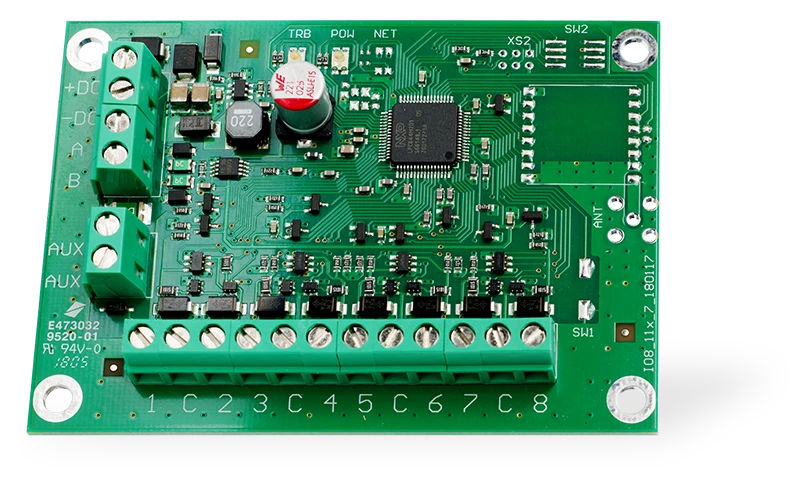
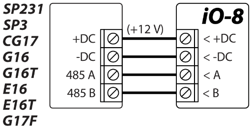
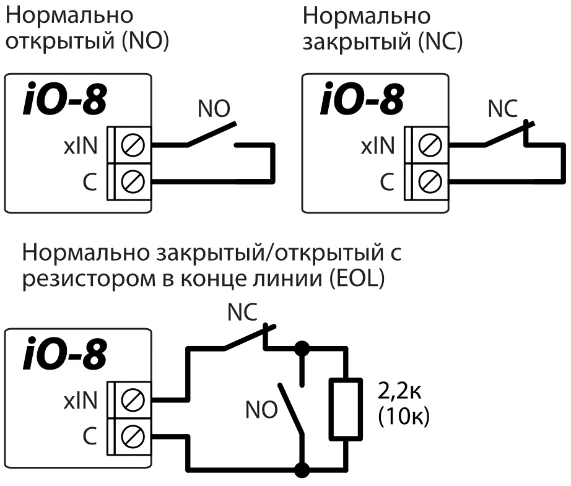
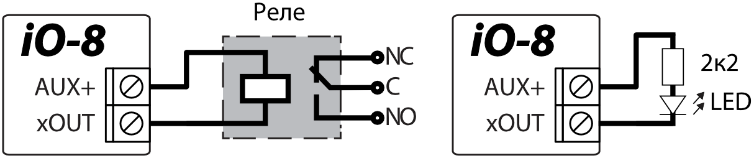
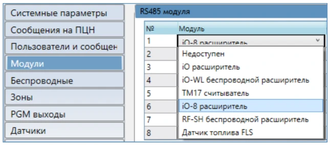
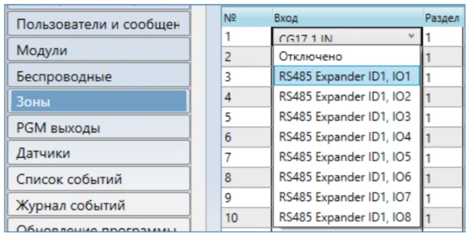

# iO-8 Расширитель входов и выходов

  

С расширителем iO-8 вы можете увеличить количество входов и выходов в совместимых устройствах **Trikdis**.

iO-8 имеет 8 клемм вход/выход, которые могут быть установлены в режиме входа, либо в режиме выхода.

Посетите страницу iO-8 на trikdis.com для получения информации о технических характеристиках устройства и обновленного списка совместимых устройств **Trikdis**.

Совместим с [SP3](../../control-panels/sp3/index.md), [CG17](../../control-panels/cg17/index.md), [GT+](../../alarm-communicators/cellular/gt-plus/index.md), [GT](../../alarm-communicators/cellular/gt/index.md), [G16](../../alarm-communicators/cellular/g16/index.md), [G16T](../../alarm-communicators/cellular/g16t/index.md), [G17F](../../alarm-communicators/fire-panels/g17f/index.md), [E16](../../alarm-communicators/e16/index.md), [E16T](../../alarm-communicators/e16t/index.md), [GATOR Cellular](../../gate-controllers/gator/index.md) и [GATOR WiFi](../../gate-controllers/gator-wifi/index.md).

**Выполните следующие шаги для настройки iO-8:**

1.  Соедините iO-8 с совместимым устройством **Trikdis**, как показано:

2.  Подсоедините входы, как показано:

Схемы подключения и номинал резистора устанавливает основной модуль, к которому подключен модуль расширения iO-8.

3.  Подсоедините выходы, как показано:

4.  Подключите USB-кабель к основному устройству **Trikdis** и откройте приложение **TrikdisConfig**. Нажмите **Считать [F4]**.

5.  Перейдите в окно **Модули** и щелкните свободную строку в области **RS485 модули**. Из списка выберите **iO-8 расширитель**, как показано:

6.  Введите серийный номер iO-8 в поле справа (ввести только цифры). Этот номер находится на наклейке iO-8.

7.  В окнах меню **Зоны** и **PGM выходы** теперь будут отображаться входы и выходы iO-8, которые вы можете включить:

    

Настройки могут отличаться в зависимости от основного устройства **Trikdis**. Настройте параметры **Зон** и **PGM выходов** в соответствии с инструкциями основного устройства.

8.  Сделайте необходимые настройки и нажмите **Записать [F5]** и отсоедините USB-кабель.

9.  Активируйте входы и включите выходы для проверки устройства.
