# G16-larmsändare med mobilanslutning

  <figure style="margin: 0;">
    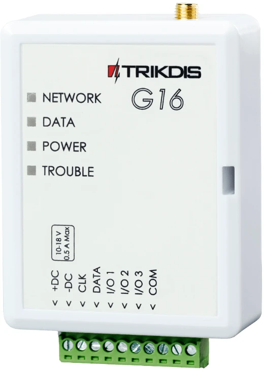
    <figcaption style="font-size: 0.9em; text-align: center; margin-top: 0.5rem;">2G</figcaption>
  </figure>
  <figure style="margin: 0;">
    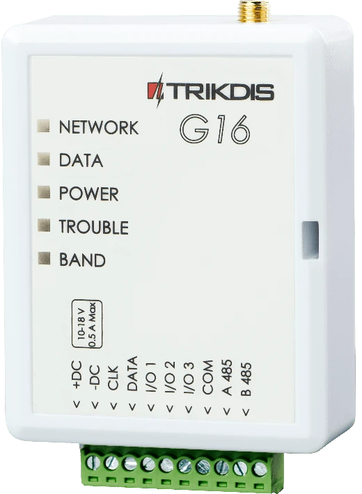
    <figcaption style="font-size: 0.9em; text-align: center; margin-top: 0.5rem;">3G, 4G</figcaption>
  </figure>

## Beskrivning 

Larmsändaren G16 med mobilanslutning kan anslutas direkt till stödda centralapparater från DSC, Paradox, UTC Interlogix (CADDX), Innerrange, Texecom, Honeywell, Crow och Pyronix.

Larmsändaren överför fullständig händelseinformation till larmcentralen.

Larmsändaren fungerar också med appen Protegus2. Med Protegus2 kan användarna styra sitt larmsystem på distans och få aviseringar om händelser i larmsystemet. Appen Protegus2 är kompatibel med alla centralapparater från olika tillverkare som stöds av G16-larmsändaren. Larmsändaren kan skicka händelseaviseringar till larmcentralen och arbeta med Protegus2 samtidigt.

Larmsändaren G16 kan anslutas direkt till centralapparater från DSC®, Paradox®, UTC Interlogix® (CADDX), Innerrange®, Texecom®, Honeywell®, Crow® och Pyronix®. För centralapparater från andra tillverkare används larmsändaren G16T.

### Funktioner

Skickar händelser till larmcentralens mottagare:

- Skickar händelser till TRIKDIS programvaru- eller maskinvarumottagare som fungerar med all programvara för larmcentraler.

- Kan skicka händelsemeddelanden till SIA DC-09-mottagare.

- Kan skicka händelsemeddelanden till SUR-GARD-mottagare. Bilagan innehåller en tabell för omvandling av Contact ID-koder till SIA-koder.

- Övervakning av anslutningen genom att IP-mottagaren pollas var 30:e sekund (eller med en period som användaren anger).

- Backupkanal som används om anslutningen via primärkanalen bryts.

- Händelser kan rapporteras till larmcentralen med SMS-meddelanden. SMS skickas även om dataanslutningen i mobiloperatörens nät slutar fungera.

- Med parallella kommunikationskanaler kan händelser skickas till två mottagare samtidigt.

- När tjänsten *Protegus* är aktiverad levereras händelserna först till larmcentralen och skickas därefter till appens användare.

**Fungerar med appen Protegus2:**

- ”*Push*”-aviseringar och särskilda ljud som informerar om händelser.

- Fjärrstyrd tillkoppling/frånkoppling av systemet.

- Fjärrstyrning av anslutna enheter (belysning, portar, ventilationssystem, värme, bevattning m.m.).

- Olika användarrättigheter för administratör, installatör och användare.

- Användarna kan också informeras om händelser med SMS-meddelanden och telefonsamtal.

**Meddelar användare:**

- Användarna kan få aviseringar om händelser inte bara via appen Protegus2 utan även via SMS-meddelanden och samtal.

**Styrbara utgångar och ingångar:**

- 3 plintar med dubbel funktion som kan ställas in antingen som ingång (IN) eller som styrbar utgång (OUT).

- Utgångarna styrs med appen Protegus2 och SMS-meddelanden.

- Lägg till fler ingångar och styrbara utgångar med utbyggnadsmodulerna iO-8. **(endast för 3G/4G-larmsändare)**.

**Snabb installation:**

- Inställningarna kan sparas i en fil och snabbt skrivas till andra larmsändare.

- Två behörighetsnivåer för konfigurering av enheten: för larmcentralens administratör och för installatören.

- Fjärrkonfigurering och firmwareuppdateringar.

### Lista över kompatibla centralapparater 

| Tillverkare | Modell |
|--------------|-------|
| DSC® | <u>PC585</u>, <u>PC1404</u>, <u>PC1565</u>, <u>PC1616</u>, <u>PC1832</u>, <u>PC1864</u>, PC5015, PC5020 |
| PARADOX® | <u>SPECTRA SP4000</u>, <u>SP5500</u>, <u>SP6000</u>, <u>SP7000</u>, <u>SP65</u>, <u>SP5500+</u>, <u>SP6000+</u>, <u>SP7000+</u> |
| PARADOX® | <u>MAGELLAN MG5000</u>, <u>MG5050</u>, MG5050E, <u>MG5050+</u> |
| PARADOX® | <u>DIGIPLEX EVO192</u>, <u>EVOHD</u>, NE96, EVO48, EVO96 |
| PARADOX® | SPECTRA 1727, 1728, 1738 |
| PARADOX® | ESPRIT E55, 728ULT, 738ULT |
| UTC Interlogix® | <u>NetworX (Caddx) NX-4v2</u>, <u>NX-6v2</u>, <u>NX-8v2</u>, <u>NX-8e</u> |
| Texecom® | Premier 412, 816, 832, 832+ /​ <u>Premier 24</u>, <u>48</u>, <u>88</u>, <u>168</u> /​ <u>Premier Elite 12</u>, <u>24</u>, <u>48</u>, <u>64</u>, <u>88</u>, <u>168</u> |
| Pyronix® | MATRIX 424, MATRIX 832, MATRIX 832+, MATRIX 6, MATRIX 816 |
| Innerrange® | Inception, Integriti |
| Honeywell® | <u>Ademco Vista-15</u>, <u>Ademco Vista-20</u>, <u>Ademco Vista-48</u> |
| Crow® | Runner 4/​8, Runner 8/​16 |

**<u>Understruket</u>** - centralapparater som G16 styr direkt. Firmware i PARADOX-centralapparater som styrs direkt måste vara V.4 eller senare.

\*Anslut centralapparater från andra tillverkare till larmsändaren G16T.

### Larmsändarens modelltyper 

Denna manual gäller 2G/3G/4G-larmsändare.

### Specifikationer 

| Parameter | Beskrivning |
|-----------|-------------|
| Plintar med dubbel funktion [IN/OUT] | 3, kan ställas in antingen som ingångar av typen NC, NO, NC/EOL, NO/EOL, NC/DEOL eller NO/DEOL (2,2 kΩ) eller som utgångar av typen öppen kollektor (OC) med en ström på upp till 0,15 A, max 30 V DC. Kan utökas med utbyggnadsmoduler iO-8 (endast för 3G/4G-larmsändare). |
| LTE FDD | B1/​B2/​B3/​B4/​B5/​B7/​B8/​B12/​B13/​B18/​B19/​B20/​B25/​B26/​B28 |
| LTE TDD | B38/​B39/​B40/​B41 |
| UMTS | B1/​B2/​B4/​B5/​B6/​B8/​B19 |
| GSM | 850/​900/​1800/​1900 MHz |
| Matningsspänning | 10–18 V DC |
| Strömförbrukning | 60–100 mA (i viloläge) / upp till 500 mA (vid dataöverföring) |
| Överföringsprotokoll | TRK, DC-09_2007, DC-09_2012, TL150 |
| Meddelandekryptering | AES 128 |
| Ändring av inställningar | Med datorprogrammet TrikdisConfig, på distans eller lokalt via USB Mini-B-porten / på distans med SMS-meddelanden |
| Driftmiljö | Temperatur från -10 °C till 50 °C, relativ luftfuktighet upp till 80 % vid +20 °C |
| Larmsändarens mått | 92 × 62 × 26 mm |
| Vikt | 80 g |

### Larmsändarens delar 

**Larmsändaren G16 med mobilanslutning (2G)**

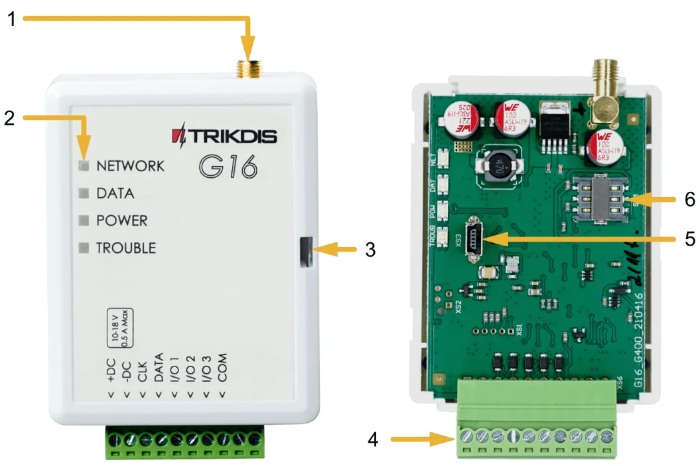

**Larmsändaren G16 med mobilanslutning (3G/4G)**

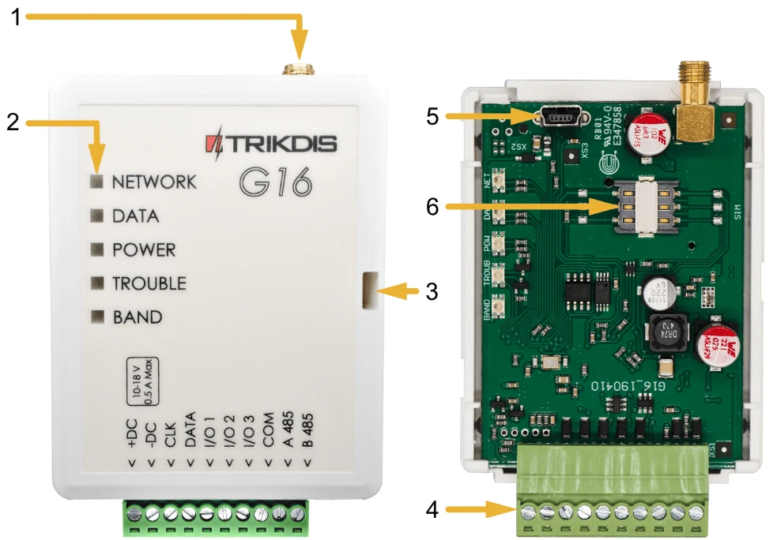

1.  SMA-kontakt för mobilantenn

2.  Lysdiodsindikeringar

3.  Spår för att öppna kapslingens framsida

4.  Plintblock för externa anslutningar

5.  USB Mini-B-port för programmering av larmsändaren

6.  Kortplats för SIM-kort

### Plintarnas funktion 

| Plint | Beskrivning |
|----------|-------------|
| +DC | Matning +10 V/+18 V |
| -DC | Matning 0 V |
| CLK | Plintar för seriell buss, för direkt anslutning till centralapparaten |
| I/O 1 | Första ingångs-/utgångsplinten (förval – OFF) |
| I/O 2 | Andra ingångs-/utgångsplinten (förval – IN, NO-krets) |
| I/O 3 | Tredje ingångs-/utgångsplinten (förval – OUT) |
| COM | Gemensam plint (minus) |
| A 485 | Plint A för RS485-bussen (endast för 3G/4G-larmsändare) |
| B 485 | Plint B för RS485-bussen (endast för 3G/4G-larmsändare) |

### Lysdiodsindikering vid drift 

| Indikator | Lysdiodens läge | Beskrivning |
|-----------|--------------|-------------|
| NETWORK | Släckt | Ingen anslutning till mobilnätet |
| NETWORK | Blinkar gult | Ansluter till mobilnätet |
| NETWORK | Fast grönt sken med gult blinkande | Larmsändaren är ansluten till mobilnätet. / Tillräcklig mobil signalstyrka är nivå 5 för 2G (fem gula blinkningar) och nivå 3 för 3G/4G (tre gula blinkningar) |
| DATA | Släckt | Inga osända händelser |
| DATA | Fast grönt sken | Osända händelser finns lagrade i bufferten |
| DATA | Blinkar grönt | (Konfigurationsläge) Data överförs till/från larmsändaren |
| POWER | Släckt | Matningen är avstängd eller bortkopplad |
| POWER | Fast grönt sken | Matningen är på med tillräcklig spänning |
| POWER | Fast gult sken | Matningsspänningen är otillräcklig (≤11,5 V) |
| POWER | Fast grönt sken och gult blinkande | (Konfigurationsläge) Larmsändaren är klar för konfigurering |
| POWER | Fast gult sken | (Konfigurationsläge) Ingen anslutning till datorn |
| TROUBLE | Släckt | Inga driftproblem |
| TROUBLE | 1 röd blinkning | SIM-kortet hittas inte |
| TROUBLE | 2 röda blinkningar | Problem med SIM-kortets PIN-kod (felaktig PIN-kod) |
| TROUBLE | 3 röda blinkningar | Programmeringsproblem (ingen APN) |
| TROUBLE | 4 röda blinkningar | Problem med registrering i mobilnätet |
| TROUBLE | 5 röda blinkningar | Problem med registrering i GPRS/UMTS-nätet |
| TROUBLE | 6 röda blinkningar | Ingen anslutning till mottagaren |
| TROUBLE | 7 röda blinkningar | Förlorad anslutning till centralapparaten |
| TROUBLE | Blinkar rött | (Konfigurationsläge) Minnesfel |
| TROUBLE | Fast rött sken | (Konfigurationsläge) Firmware är skadad |
| BAND / (endast för 3G/4G-larmsändare) | 1 grön blinkning | Ingen |
| BAND / (endast för 3G/4G-larmsändare) | 2 gröna blinkningar | GSM |
| BAND / (endast för 3G/4G-larmsändare) | 3 gröna blinkningar | GPRS |
| BAND / (endast för 3G/4G-larmsändare) | 4 gröna blinkningar | EDGE |
| BAND / (endast för 3G/4G-larmsändare) | 5 gröna blinkningar | HSDPA, HSUPA, HSPA+, WCDMA |
| BAND / (endast för 3G/4G-larmsändare) | 6 gröna blinkningar | LTE TDD, LTE FDD |

### Principschema för användning av *G16* 

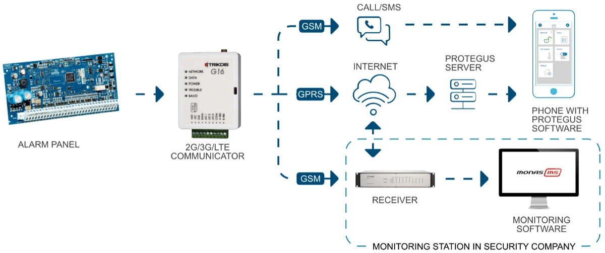

!!! note "Obs!"
    Innan du börjar, se till att du har följande:
    
    1.  USB-kabel (Mini-B) för konfigurering.
    
    2.  Minst 4-ledarkabel för att ansluta larmsändaren till centralapparaten.
    
    3.  CRP2.4-kabel för anslutning till Paradox-centralapparatens seriella port.
    
    4.  Spårskruvmejsel 2,5 mm.
    
    5.  Antenn med tillräcklig förstärkning om nättäckningen i området är dålig.
    
    6.  Aktiverat SIM-kort (PIN-kodsbegäran kan vara avstängd).
    
    7.  Installationsmanualen för den aktuella centralapparaten.
    
    Beställ nödvändiga komponenter separat från din lokala distributör.
## Snabbkonfiguration med programvaran *TrikdisConfig* 

1.  Ladda ned konfigurationsprogrammet **TrikdisConfig** från [www.trikdis.com](http://www.trikdis.com) (skriv ”TrikdisConfig” i sökfältet) och installera det.

2.  Öppna kapslingen på G16 med en spårskruvmejsel enligt bilden nedan:

    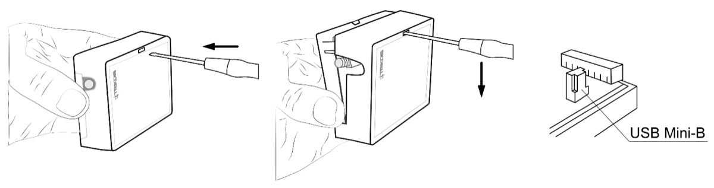

3.  Anslut G16 till datorn med en USB Mini-B-kabel.

4.  Starta TrikdisConfig. Programmet identifierar automatiskt den anslutna larmsändaren och öppnar ett fönster för konfigurering.

5.  Klicka på **Read [F4]** för att läsa larmsändarens inställningar. Om du uppmanas, ange administratörs- eller installatörskoden (6 siffror) i dialogrutan.

Nedan beskrivs vilka inställningar som behövs för att larmsändaren ska börja skicka händelser till larmcentralen och för att säkerhetssystemet ska kunna styras med appen Protegus2.

### Inställningar för anslutning till appen Protegus2 

**I fönstret ”System settings”:**

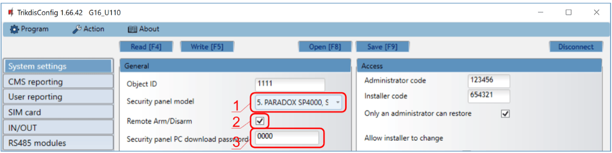

1.  Välj den **Security panel model** som ska anslutas till larmsändaren.

2.  Markera **Remote Arm/Disarm** om användarna ska kunna styra centralapparaten i appen Protegus2 med sin knappsatskod. Inställningen visas bara för centralapparater som styrs direkt.

3.  För direktstyrning av Paradox- och Texecom-centralapparater anger du **Security panel PC download password**. Det måste stämma överens med lösenordet som är angivet i centralapparaten.

!!! note "Obs!"
    För att direktstyrningen av centralapparaten ska fungera måste du ändra
    centralapparatens inställningar. Hur du gör beskrivs i avsnitt 4 ”Programmering av
    centralapparaten”. I det avsnittet finns information om hur du ändrar
    lösenordet för PC download/UDL.
**I fönstret ”User reporting”, fliken ”PROTEGUS Cloud”:**

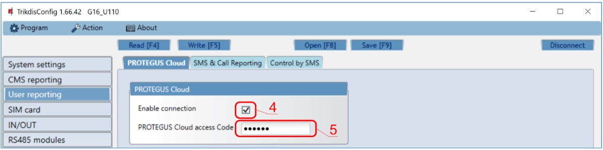

4.  Markera kryssrutan **Enable connection** till Protegus Cloud.

5.  Ändra **PROTEGUS Cloud access Code** för inloggning i Protegus2 om du vill att användarna ska behöva ange den när de lägger till systemet i appen Protegus2 (förvalt lösenord – 123456).

**I fönstret ”SIM card”:**

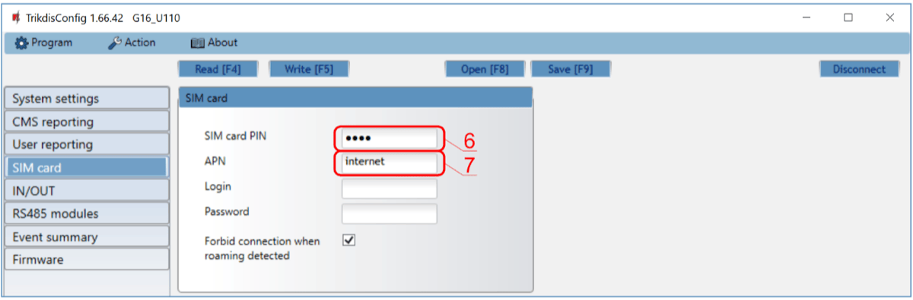

6.  Ange **SIM card PIN**-koden.

7.  Ändra namnet i **APN**. APN hittar du på SIM-kortsoperatörens webbplats (”internet” är universellt och fungerar i många operatörers nät).

När konfigureringen är klar klickar du på knappen **Write [F5]** och kopplar bort USB-kabeln.

!!! note "Obs!"
    Mer information om övriga inställningar för G16 i
    TrikdisConfig finns i avsnitt
    **[6](#6-beskrivning-av-trikdisconfig-fonstren) ”[Beskrivning av TrikdisConfig-fönstren](#6-beskrivning-av-trikdisconfig-fonstren)”**.
### Inställningar för anslutning till larmcentralen 

**I fönstret ”System settings”:**

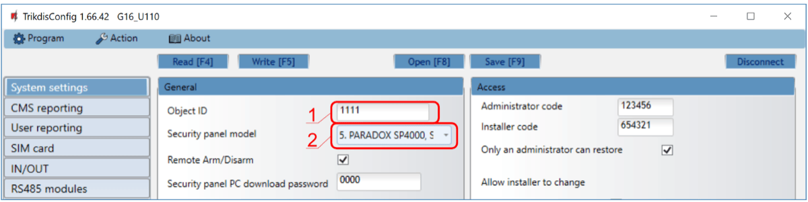

1.  Ange numret i **Object ID** (abonnentkod) som du har fått från larmcentralen (4 tecken, 0–9, A–F. **Använd inte FFFE, FFFF som Object ID**).

2.  Välj den **Security panel model** som ska anslutas till larmsändaren.

**I fönstret ”CMS reporting”, inställningar för ”Primary channel”:**

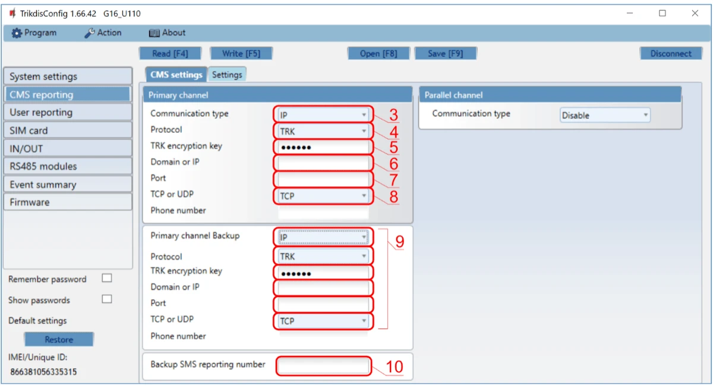

3.  **Communication type** - välj anslutningsmetoden **IP** (vi rekommenderar inte SMS som primärkanal).

4.  **Protocol** - välj protokolltyp för händelsemeddelandena: **TRK** (till TRIKDIS-mottagare), **DC-09_2007** eller **DC-09_2012** (till universella mottagare), **TL150** (till SUR-GARD-mottagare).

5.  **TRK encryption key** - ange den krypteringsnyckel som är inställd i mottagaren.

6.  **Domain or IP** - ange mottagarens domän eller IP-adress.

7.  **Port** - ange mottagarens nätverksportnummer.

8.  **TCP or UDP** - välj det överföringsprotokoll (**TCP** eller **UDP**) som händelserna ska skickas med.

!!! note "Obs!"
    Om du vill ställa in kommunikation med larmcentralen via **SMS-meddelanden** behöver du bara ange **Encryption key** och **Phone number**. SMS-meddelanden kan bara tas emot av TRIKDIS-mottagare: IP/SMS-mottagaren RL14, flerkanalsmottagaren RM14 och SMS-mottagaren GM14. / Om du har valt protokollet **DC-09** anger du dessutom objekt-, linje- och mottagarnummer på fliken **Settings** i fönstret **CMS reporting**.
9.  (Rekommenderas) Konfigurera inställningarna för **Primary channel Backup**.

10. (Rekommenderas) Ange **Backup SMS reporting number**.

**I fönstret ”SIM card”:**

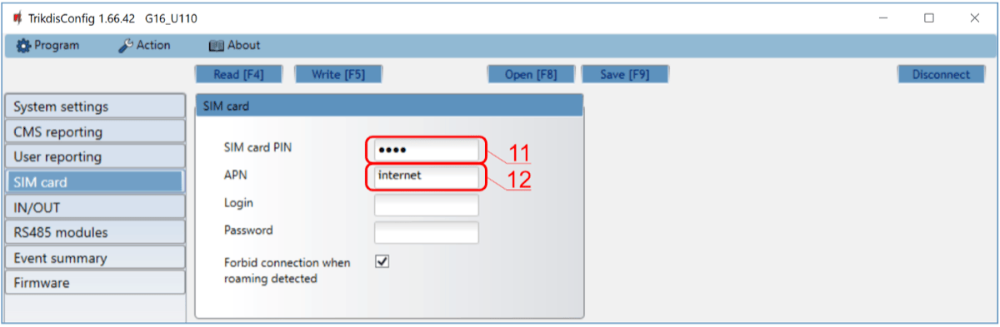

11. Ange **SIM card PIN**-koden.

12. Ändra **APN**-namnet. APN hittar du på SIM-kortsoperatörens webbplats (”internet” är universellt och fungerar i många operatörers nät).

När konfigureringen är klar klickar du på **Write [F5]** och kopplar bort USB-kabeln.

!!! note "Obs!"
    Mer information om övriga inställningar för G16 i
    TrikdisConfig finns i avsnitt
    **[6](#6-beskrivning-av-trikdisconfig-fonstren) ”[Beskrivning av TrikdisConfig-fönstren](#6-beskrivning-av-trikdisconfig-fonstren)”**.
## Installation och inkoppling 

### Installationsgång 

1.  Ta bort det övre locket och dra ut plintblocket.

2.  Sätt i SIM-kortet i hållaren.

3.  Ta ut kretskortet ur kapslingens nedre del.

4.  Fäst den nedre delen med skruvar på en lämplig plats.

5.  Sätt tillbaka kretskortet i kapslingen och sätt i plintblocket.

6.  Skruva fast mobilantennen.

7.  Stäng det övre locket.

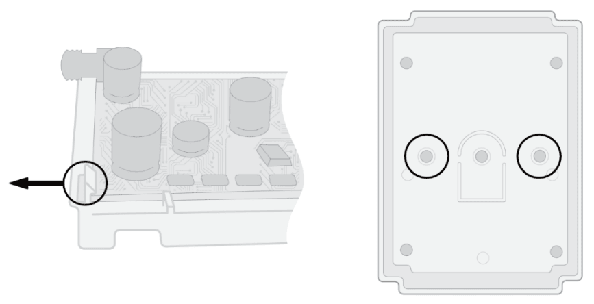

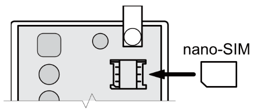

!!! note "Obs!"
    Kontrollera att SIM-kortet är aktiverat. / Kontrollera
    att mobil internettjänst (mobildata) är aktiverad om anslutningen sker via
    IP-kanal. / För att slippa ange PIN-koden i TrikdisConfig, sätt SIM-kortet i
    din mobiltelefon och stäng av PIN-kodsbegäran.
### Kopplingsscheman för inkoppling av larmsändaren till en centralapparat 

Anslut larmsändaren till centralapparaten enligt något av kopplingsschemana nedan.

1.  **Kopplingsscheman för anslutning till centralapparater:**

#### DSC

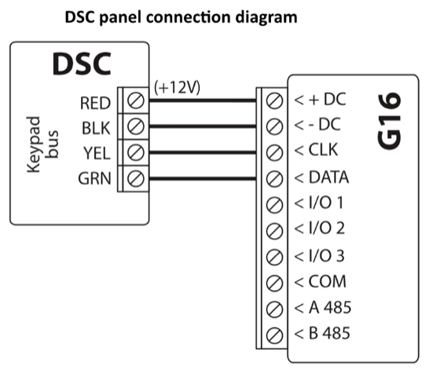

!!! note "Obs!"
    Över knappsatsbussen får larmsändaren sektionernas allmänna tillstånd från centralapparaten och kan inte avgöra sektionstypen (brand, inbrott, vattenläckage osv.). Alla larm rapporteras som ett allmänt larm, Contact ID E130, och en del larmcentraler hanterar dessa händelser på ett annat sätt än den sektionstyp som faktiskt löstes ut. G16 har inga TIP/RING-plintar. För att rapportera händelser med centralapparatens egna Contact ID-koder (till exempel E110 för brandlarm) används en larmsändare som ansluts både till knappsatsbussen och till centralapparatens TIP/RING-plintar: GT, GT+ eller GET.

#### PARADOX

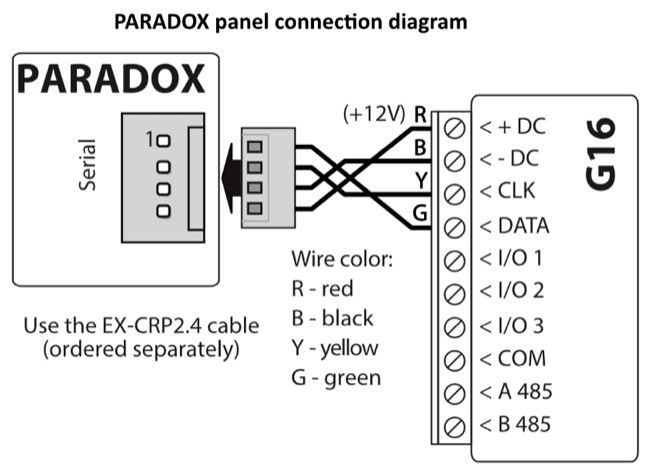

#### CADDX

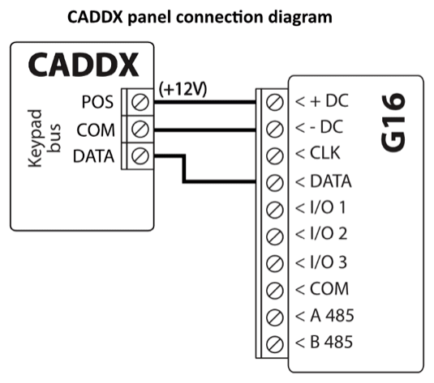

#### TEXECOM

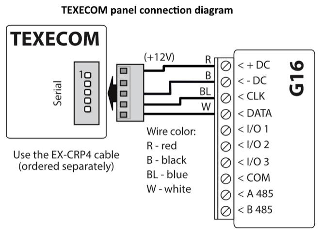

#### INNERRANGE INCEPTION

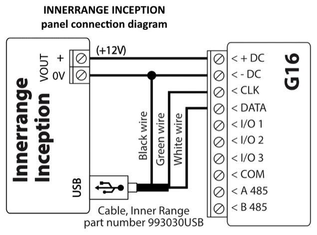

#### INNERRANGE INTEGRITI

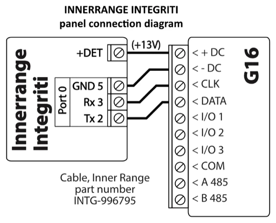

#### Crow Runner 4/8, Runner 8/16

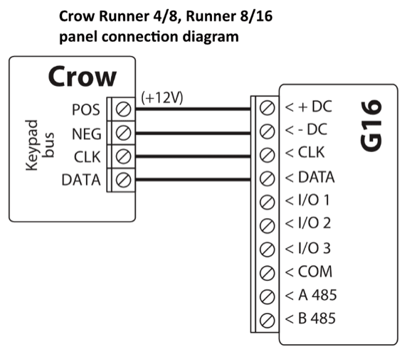

#### Pyronix

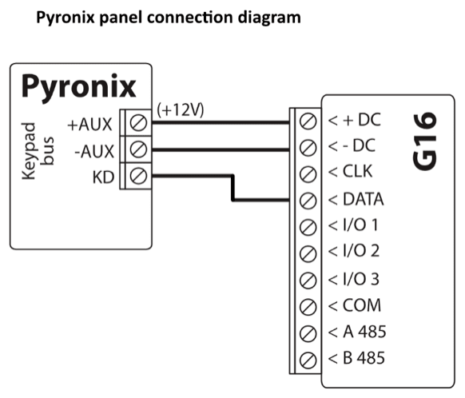

#### Honeywell Vista-15, Vista-20, Vista-48

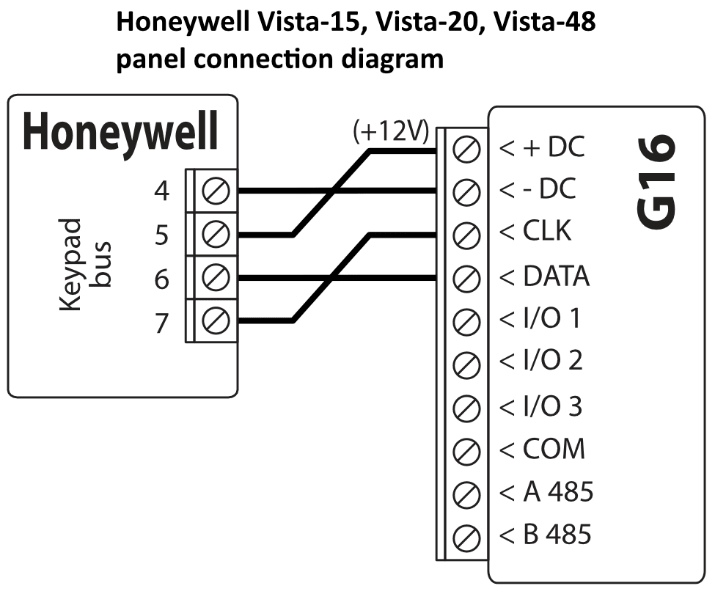

### Kopplingsschema för inkoppling av larmsändaren till centralapparatens nyckelbrytarsektion 

Följ detta schema om centralapparaten ska tillkopplas/frånkopplas med en PGM-utgång på G16 som slår på/av centralapparatens nyckelbrytarsektion.

!!! note "Obs!"
    G16-larmsändaren har 3 universella ingångs-/utgångsplintar som kan
    ställas in i driftläget OUT (PGM). Utgångarna (OUT) kan styra
    tre områden i säkerhetssystemet. Om du vill styra systemet på
    detta sätt avmarkerar du **Remote Arm/Disarm** i TrikdisConfig, i fönstret
    ”**System settings**”. Apparna Protegus2 måste
    konfigureras med de inställningar som beskrivs i avsnitt 5.2 ”Ytterligare
    inställningar för tillkoppling/frånkoppling av systemet med centralapparatens
    nyckelbrytarsektion”.
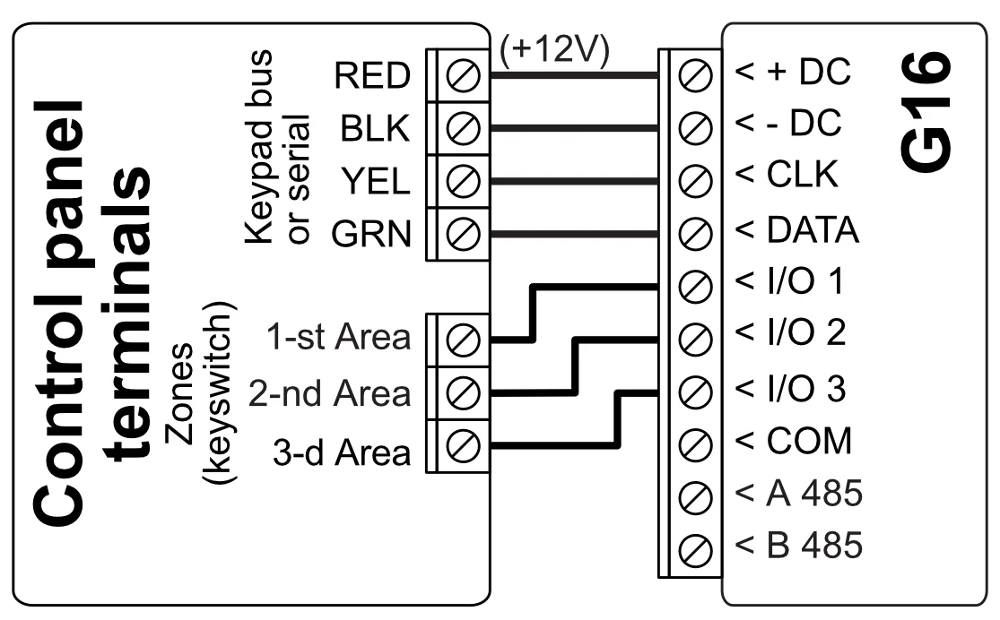

### Kopplingsscheman för anslutning av ingång 

Larmsändaren har 3 universella ingångs-/utgångsplintar som kan ställas in i ingångsläget IN. Kretsar av typerna NO, NC, NO / EOL, NC / EOL, NO / DEOL och NC / DEOL kan anslutas till ingångsplinten. Förvald inställning för ingången **I/O 2** – NO. Ingångstypen kan ändras i TrikdisConfig i fönstret **IN/OUT -> Type.**

Anslut ingången enligt den valda ingångstypen (NO, NC, NC/EOL, NO/EOL, NO/DEOL, NC/DEOL), som i schemana nedan:

#### Normalt öppen (NO)

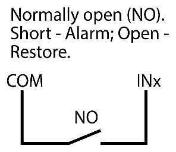

#### Normalt sluten (NC)

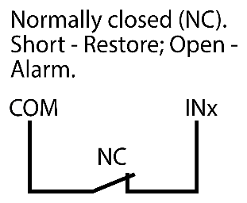

#### Normalt sluten med 2,2k slutmotstånd (EOL 2,2k)

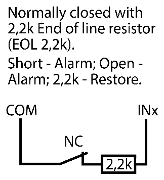

#### Normalt öppen med 2,2k slutmotstånd (EOL 2,2k)

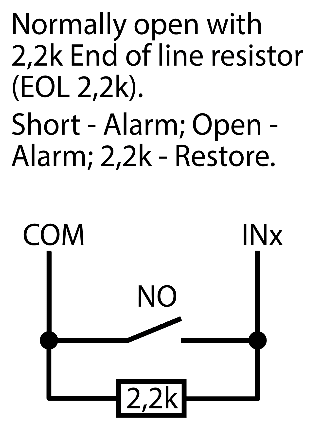

#### Normalt öppen med 2,2k slutmotstånd och sabotageavkänning (DEOL)

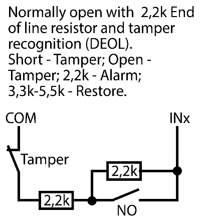

#### Normalt sluten med 2,2k slutmotstånd och sabotageavkänning (DEOL)

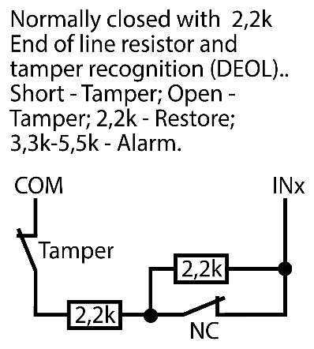

!!! note "Obs!"
    Om fler ingångar eller utgångar behöver anslutas till larmsändaren,
    anslut utbyggnadsmodulen TRIKDIS iO-8. Hur den ansluts beskrivs
    i iO-8-manualen och i avsnitt 3.6 ”Kopplingsscheman för inkoppling av iO-8-utbyggnadsmoduler”.
    **(endast för 3G/4G-larmsändare)**
### Kopplingsscheman för anslutning av ett relä 

Med reläkontakter kan du styra (slå på/av) olika elektriska apparater. Larmsändarens I/O-plint måste vara inställd på ett utgångsläge (OUT).

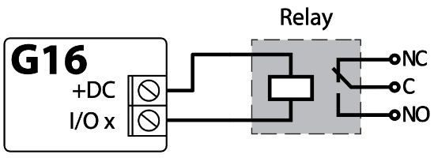

### Kopplingsscheman för inkoppling av iO-8-utbyggnadsmoduler (endast för 3G/4G-larmsändare) 

Om fler ingångar eller utgångar behöver anslutas till larmsändaren, anslut utbyggnadsmodulen TRIKDIS *iO-8*. Konfigureringen av de utbyggnadsmoduler som är anslutna till *G16* beskrivs i avsnitt 6.7 (fönstret ”RS485 modules”).

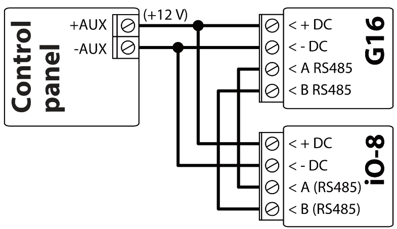

### Kopplingsschema för inkoppling av WiFi-modulen *W485* (endast för 3G/4G-larmsändare)

Modulen *W485* skickar meddelanden till larmcentralen (CMS, Central Monitoring Station) och till *Protegus2* via en WiFi-router. När WiFi-anslutning finns skickar *G16* händelsemeddelanden via modulen *W485*. Om WiFi-anslutningen bryts skickar *G16* meddelanden via GPRS. När WiFi-anslutningen är återupprättad återgår *G16* till att skicka meddelanden via *W485*. / Konfigureringen av WiFi-modulen *W485* för användning med *G16* beskrivs i avsnitt 6.7 (fönstret ”RS485 modules”). / Sätt i ett SIM-kort i larmsändaren *G16* för att *W485* ska fungera.

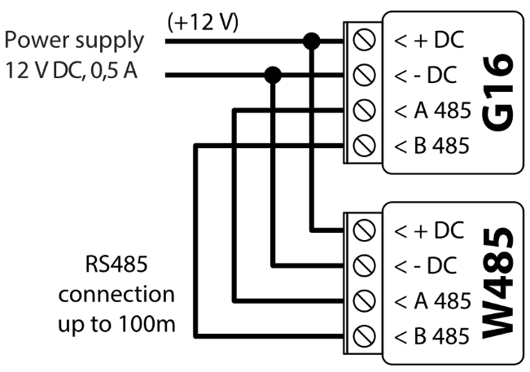

### Kopplingsschema för inkoppling av Ethernet-modulen *E485* (endast för 3G/4G-larmsändare)

Modulen *E485* skickar meddelanden till larmcentralen (CMS, Central Monitoring Station) och till *Protegus2* via en kabelansluten internetanslutning. När *E485* används med *G16* skickas meddelanden till larmcentralen och Protegus2 över kabelanslutet internet, och mobilt internet används inte. Om den kabelanslutna internetanslutningen bryts skickar *G16* meddelanden via mobilt internet. När den kabelanslutna internetanslutningen är återupprättad börjar *G16* skicka meddelanden via *E485* igen. / Konfigureringen av Ethernet-modulen *E485* för användning med *G16* beskrivs i avsnitt 6.7 (fönstret ”RS485 modules”). / Sätt i ett SIM-kort i larmsändaren *G16* för att *E485* ska fungera.

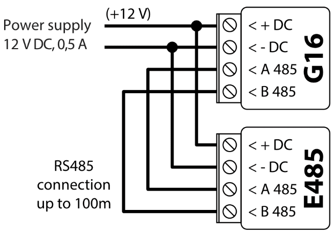

### Starta larmsändaren 

Starta larmsändaren genom att slå på centralapparatens matning. Lysdiodsindikeringen på G16-larmsändaren ska visa följande:

- Lysdioden ”POWER” lyser grönt när matningen är på;

- Lysdioden ”NETWORK” lyser grönt och blinkar gult när larmsändaren är registrerad i nätet.

!!! note "Obs!"
    Tillräcklig 2G-signalstyrka är nivå fem (fem gula blinkningar på lysdioden ”NETWORK”). Tillräcklig 3G-/4G-signalstyrka är nivå tre (tre gula blinkningar på lysdioden ”NETWORK”). / Om du räknar färre gula blinkningar på lysdioden ”NETWORK” är nätets signalstyrka otillräcklig. Vi rekommenderar att du väljer en annan plats för larmsändaren eller använder en känsligare mobilantenn. / Om du ser en annan lysdiodsindikering tyder det på ett visst fel. Felsök med hjälp av tabellen över lysdiodsindikeringar i avsnitt [1.7](#17-lysdiodsindikering-vid-drift) ”[Lysdiodsindikering vid drift](#17-lysdiodsindikering-vid-drift)”. / Om G16:s indikeringar inte lyser alls, kontrollera matningen och anslutningarna.
## Programmering av centralapparaten 

Nedan beskrivs hur du programmerar centralapparaten så att G16-larmsändaren kan läsa händelser från centralapparaten och styra den på distans.

För att aktivera fjärrstyrning av centralapparaten, kontrollera att kryssrutan **Remote Arm/Disarm** är markerad i TrikdisConfig-fönstret **”System settings”.**

### DSC

DSC-centralapparater behöver inte programmeras.

### PARADOX

Paradox-centralapparater behöver programmeras bara för direktstyrning med Protegus. Du behöver inte programmera Paradox-centralapparater för att läsa händelser.

För fjärrstyrning av Paradox-centralapparater måste du ställa in ett PC download password. Lösenordet måste stämma överens med det som angavs i TrikdisConfig-fönstret **”System settings”**, när kryssrutan vid **Remote Arm/Disarm** markerades.

Så här ställer du in lösenordet, med knappsatsen ansluten till centralapparaten:

- För serierna MAGELLAN och SPECTRA: gå till cell 911 och ange ett PC download password på 4 siffror.

- För serien DIGIPLEX EVO: gå till cell 3012 och ange ett PC download password på 4 siffror.

### TEXECOM

Texecom-centralapparater måste programmeras både för att läsa händelser och för fjärrstyrning.

Du måste ställa in Texecom-centralapparatens **UDL passcode**. Lösenordet måste stämma överens med det som angavs i TrikdisConfig-fönstret **”System settings”,** när kryssrutan vid **Remote Arm/Disarm** markerades.

Centralapparaten kan programmeras med Texecoms programvara Wintex. Ange **UDL passcode** (4-siffrig kod) i fönstret **Communication Options**, fliken **Options**.

Du kan också programmera med en knappsats ansluten till centralapparaten:

1.  Ange installatörskoden (4 siffror) och tryck på knappen [Menu] för att gå in i programmeringsmenyn.

2.  Tryck direkt därefter på tangenten [9].

3.  Tryck på [7][6] och sedan [2]. Ange den 4-siffriga **UDL passcode** (**UDL passcode** måste stämma överens med G16-larmsändarens **PC login password**).

4.  Tryck på [Yes] och lämna programmeringsläget genom att trycka på [Menu].

### UTC INTERLOGIX (CADDX)

Med knappsatsen ansluten till centralapparaten:

1.  Tryck på [\*][8] och ange installatörskoden (förval - 9713).

2.  Ange det enhetsnummer som är tilldelat den anslutna larmsändaren (förval - 0).

3.  Ställ in inställningarna nedan för varje rad. Ange i tur och ordning positionen, segmentnumret och den önskade inställningen. Om du trycker på [\*] (asterisk) kommer du tillbaka till det lokala inmatningsfältet.

| Position | Segment | Inställning |
|----------|---------|---------|
| 23 | 3 | 12345678 |
| 37 (behövs inte) | 3 | 12345678 |
| 37 (behövs inte) | 4 | 1234567* |
| 90 | 3 | 12345678 |
| 93 | 3 | 12345678 |
| 96 | 3 | 12345678 |
| 99 | 3 | 12345678 |
| 102 | 3 | 12345678 |
| 105 | 3 | 12345678 |
| 108 | 3 | 12345678 |

När alla angivna fält är programmerade, tryck två gånger på [Exit] för att lämna programmeringsläget.

### INNERRANGE

Versionen på **Innerrange Inception**-centralapparaten måste vara **2.3.0.3507-r0** eller senare.

Centralapparaten måste vara ansluten till internet. Anslut till **Innerrange Inception** genom att ange: <https://skytunnel.com.au/inception/SERIALNUMBER>, där SERIALNUMBER är numret på styrenheten, som du hittar på centralapparatens kapsling.

Öppna **Configuration > General > Alarm Reporting**. I inställningsgruppen **3rd Party Device Configuration** ska du ange:

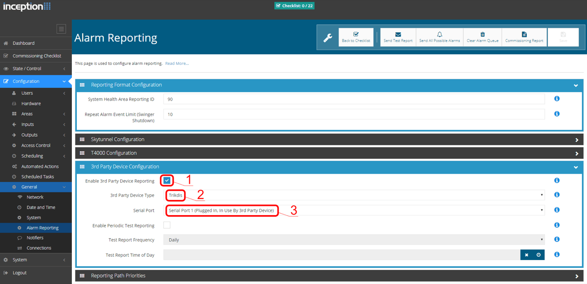

1.  **Enable 3rd Party Device Reporting** - markera denna kryssruta.

2.  **3rd Party Device Type** - ange ”Trikdis”.

3.  **Serial port** - ange ”Serial Port 1 (Plugged In, In Use By 3rd Party Device)”.

4.  Spara inställningarna och stäng programmet.

### Honeywell Ademco Vista

Följ dessa steg för centralapparaterna **Honeywell Ademco Vista-20** och **Honeywell Ademco Vista-48**. **Centralapparatens firmwareversion måste vara V5.3 eller senare.** Med en knappsats som är ansluten till centralapparaten:

1.  Gå in i programmeringsläget. Ange installatörskoden 4][1][1][2] och därefter [8][0][0] . Alternativt kan du slå på centralapparatens matning. Tryck på knapparna [\*] och [#] samtidigt inom 50 sekunder efter att matningen slagits på (den här metoden kan användas när programmeringsläget lämnades genom att trycka [\*][9][8] på knappsatsen).

2.  Aktivera sändning av Contact ID-händelser via LRR. Tryck [\*][2][9][1][#] på knappsatsen.

3.  När funktionen ”Remote Arm/Disarm” används, tillåt användning av den andra AUI-adressen. Tryck [\*][1][8][9][1][1][#] på knappsatsen.

Lämna programmeringsläget. Tryck [\*][9][9] på knappsatsen

**Crow**

Crow-centralapparaterna Runner 4/8 och Runner 8/16 behöver inte programmeras.

## Fjärrstyrning 

### Lägga till säkerhetssystemet i appen Protegus2 

Med Protegus2 kan användarna styra sitt larmsystem på distans. De ser systemets status och får aviseringar om systemhändelser.

1.  Ladda ned och starta appen Protegus2 eller använd webbversionen: [www.protegus.app](https://www.protegus.app).

    

      
      
      
    

2.  Logga in med ditt användarnamn och lösenord, eller registrera dig och skapa ett nytt konto.

!!! warning "Viktigt"
    När du lägger till G16 i Protegus2, kontrollera att:

    1.  Det isatta SIM-kortet är aktiverat och att PIN-koden antingen
        är angiven eller avstängd;

    2.  Protegus cloud är aktiverat. Se avsnitt
        **[6.4](#64-fonstret-user-reporting) ([fönstret ”User reporting”](#64-fonstret-user-reporting))**;

    3.  Matningen är ansluten (lysdioden ”POWER” lyser grönt);

    4.  Larmsändaren är registrerad i nätet (lysdioden ”NETWORK” lyser grönt och
        blinkar gult).
3.  Klicka på ”**Add new system**” och ange G16:s nummer ”*IMEI/Unique ID*”. Numret finns på enheten och på etiketten på förpackningen. Klicka på ”**Next**”.

{ .trik-mob-img }

4.  Ange systemets ”**Name**”. Klicka på ”**Next**”.

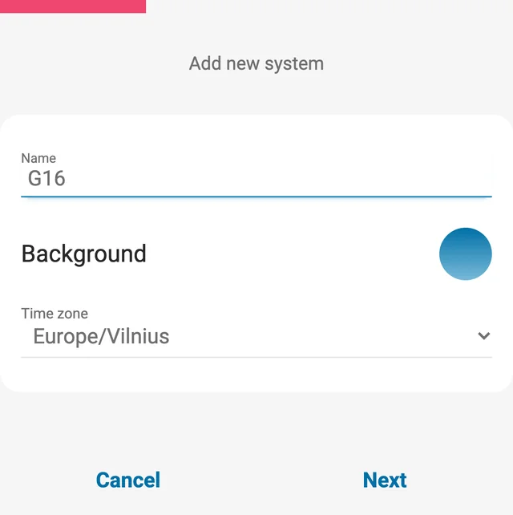{ .trik-mob-img }

### Ytterligare inställningar för tillkoppling/frånkoppling av systemet med centralapparatens nyckelbrytarsektion 

!!! warning "Viktigt"
    Den sektion i centralapparaten som G16-utgången OUT är ansluten till
    måste vara inställd på nyckelbrytarläge.
Följ anvisningarna nedan om centralapparaten ska styras med en PGM-utgång på G16 som slår på/av centralapparatens nyckelbrytarsektion.

1.  Klicka på „**Continue**“.

{ .trik-mob-img }

2.  Ange ”**Area name**”. Aktivera styrning av PGM-utgången med appen Protegus2.
3.  Välj ”**Pulse**” eller ”**Level**”, beroende på hur nyckelbrytarsektionens typ är konfigurerad. Vid behov kan du ändra intervallet för ”**Pulse**”.

4.  Klicka på „**Save**“.

{ .trik-mob-img }

5.  Om säkerhetssystemet har ett område till måste du klicka på ”**Click to add an area**”. PGM-utgången ställs in på liknande sätt som beskrivits ovan.

6.  När inställningarna är klara klickar du på knappen ”**Skip**”.

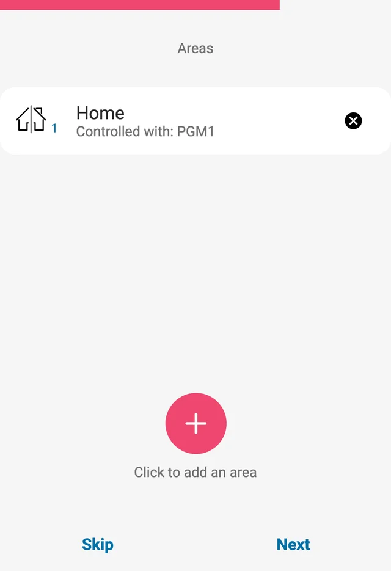{ .trik-mob-img }

### Tillkoppling/frånkoppling av larmsystemet med Protegus2 

1.  I fönstret ”System Home Screen” klickar du på statusikonen ”Disarm”.

2.  *Protegus2* får ett meddelande om att säkerhetssystemets status har ändrats och statusikonen byter läge.

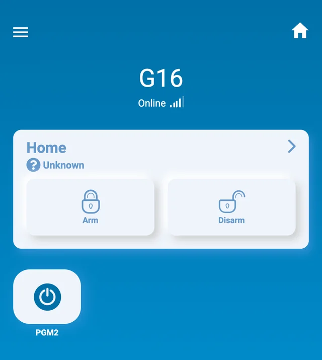{ .trik-mob-img }

### Konfigurering och styrning med SMS-meddelanden 

Du kan konfigurera och styra larmsändaren på distans med SMS-meddelanden.

Meddelandets uppbyggnad: Lösenord `[mellanslag]` Kommando `[mellanslag]` Data

Som lösenord används **Administrator code** för kommandona *INFO, RESET, OUTPUTx, CONNECT* och **Installer code** för kommandona *INFO, RESET, OUTPUTx*.

#### Lista över SMS-kommandon

| Kommando | Data | Beskrivning |
|---------|------|-------------|
| INFO |  | Begär information om enheten. Svaret innehåller: larmsändartyp, IMEI-nummer, serienummer och firmwareversion. T.ex.: 123456 INFO |
| RESET |  | Starta om enheten. T.ex.: 123456 RESET |
| OUTPUTx | ON | Slå på en utgång. x är utgångens nummer (1, 2 eller 3). T.ex.: 123456 OUTPUT1 ON |
| OUTPUTx | OFF | Stäng av en utgång. x är utgångens nummer (1, 2 eller 3). T.ex.: 123456 OUTPUT1 OFF |
| OUTPUTx | PULSE=tttt | Slå på utgången i pulsläge under det angivna tidsintervallet (sek). / ”tttt” är pulsens längd i sekunder, angiven med fyra siffror. / T.ex.: 123456 OUTPUT2 PULSE=0002 |
| CONNECT | Protegus=ON | Aktivera åtkomst till tjänsten Protegus. T.ex.: 123456 CONNECT PROTEGUS=ON |
| CONNECT | Protegus=OFF | Avaktivera åtkomst till tjänsten Protegus. T.ex.: 123456 CONNECT PROTEGUS=OFF |
| CONNECT | IP=0.0.0.0:8000 | Ange IP-adress och portnummer för primärkanalen. / T.ex.: 123456 CONNECT IP=192.120.120.255:8000 |
| CONNECT | ENC=123456 | Ange TRK-krypteringsnyckel. T.ex.: 123456 CONNECT ENC=123456 |
| CONNECT | APN=Internet | Ange APN-namn. T.ex.: 123456 CONNECT APN=INTERNET |
| CONNECT | USER=user | Ange APN-användare. T.ex.: 123456 CONNECT USER=User |
| CONNECT | PASS=password | Ange APN-lösenord. T.ex.: 123456 CONNECT PASS=Password |
| CONNECT | CP= | Välj centralapparat i en lista. |
| CONNECT | DIR= | T.ex. (tilldela G16 centralapparaten Paradox SP6000, som har nummer 4 i listan): 123456 CONNECT CP=4 |
| CONNECT |  | Direktstyrningens 4-siffriga lösenord, eller OFF för att avaktivera den. / T.ex. (ange direktstyrningens 4-siffriga lösenord 1122): 123456 CONNECT DIR=1122 |

Du kan begränsa från vilka telefonnummer larmsändaren accepterar kommandon. Se avsnitt 6.4, fönstret ”User reporting”, fliken ”Control by SMS”.

## Beskrivning av TrikdisConfig-fönstren 

### Beskrivning av statusfältet i *TrikdisConfig* 

När du har anslutit G16 och klickat på **Read [F4], *TrikdisConfig*** visar programmet information om den anslutna enheten i statusfältet:

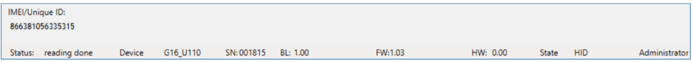

| Objekt | Beskrivning |
|----------------|----------------------------------------------------|
| IMEI/Unique ID | Enhetens IMEI-nummer |
| Status | Driftstillstånd |
| Device | Enhetstyp (G16 ska visas) |
| SN | Enhetens serienummer |
| BL             | Bootloader-version                                 |
| FW | Enhetens firmwareversion |
| HW | Enhetens maskinvaruversion |
| State | Typ av anslutning till programmet (via USB eller på distans) |
| Administrator | Behörighetsnivå (visas när åtkomstkoden har godkänts) |

När du har tryckt på **Read [F4]** läser programmet in och visar de inställningar som är gjorda i ***G16*.** Ange de inställningar som behövs enligt beskrivningarna av TrikdisConfig-fönstren nedan.

### Fönstret ”System settings” 

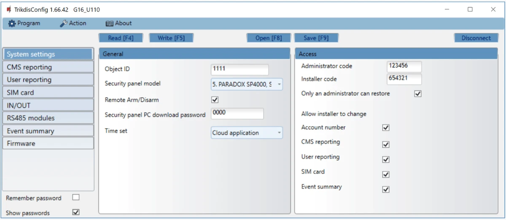

**Inställningsgruppen ”General”**

- **Object ID** – om händelserna ska skickas till larmcentralen (CMS, Central Monitoring Station), ange den abonnentkod som du har fått från larmcentralen (hexadecimalt tal med 4 tecken, 0–9, A–F. **Använd inte FFFE, FFFF som Object ID**).

- Välj den **Security panel model** som ska anslutas till larmsändaren.

- **Remote Arm/Disarm** - när kryssrutan är markerad styr G16 centralapparaten direkt på distans. Inställningen visas bara för centralapparater som styrs direkt. För direktstyrning av centralapparaterna måste du ändra centralapparatens inställningar, enligt beskrivningen i avsnitt 4 ”Programmering av centralapparaten”.

  - **Security panel PC download password** - för direktstyrning av Paradox- och Texecom-centralapparater måste du ange PC/UDL-lösenordet. Det måste stämma överens med lösenordet som är angivet i centralapparaten. Hur du ändrar lösenordet beskrivs i avsnitt 4 ”Programmering av centralapparaten”*.*

- **Time set -** välj vilken server som ska användas för tidssynkronisering.

Inställningsgruppen ”Access”

När du ställer in larmsändaren G16 finns det två behörighetsnivåer: administratör och installatör:

- **Administrator code -** ger åtkomst till alla konfigurationsfält (förvald kod - 123456).

- **Installer code** - begränsad åtkomst för konfigurering av larmsändaren (förvald kod - 654321).

- **Only an administrator can restore** - om rutan är markerad kan fabriksinställningarna bara återställas genom att administratörskoden anges.

- **Allow installer to change** – administratören kan ange vilka inställningar som installatören får ändra.

### Fönstret ”CMS reporting” 

**Fliken ”CMS settings”**

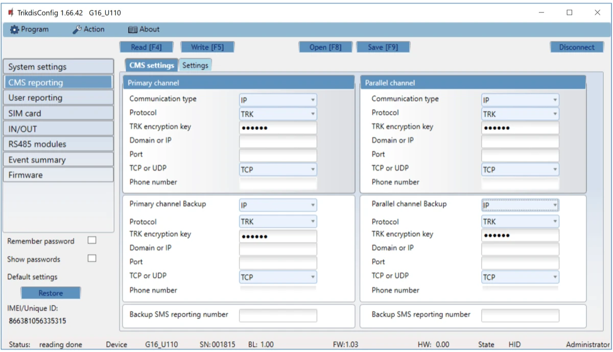

Larmsändaren skickar händelser till larmcentralen via mobilt internet (IP) eller med SMS-meddelanden.

Händelser kan skickas över flera kommunikationskanaler. Primärkanalen och den parallella kommunikationskanalen kan arbeta samtidigt, så att larmsändaren kan skicka händelser till två mottagare samtidigt. Backupkanaler kan tilldelas både primärkanalen och den parallella kanalen och används när anslutningen via primärkanalen eller den parallella kanalen bryts.

Kommunikationen är kodad och lösenordsskyddad. En TRIKDIS-mottagare krävs för att ta emot händelseinformationen och skicka den vidare till larmcentralens program:

- För anslutning över IP - programvarumottagaren IPcom för Windows/Linux, maskinvarumottagaren IP/SMS RL14 eller flerkanalsmottagaren RM14.

- För att ta emot SMS-meddelanden - maskinvarumottagaren IP/SMS RL14, flerkanalsmottagaren RM14 eller SMS-mottagaren GM14.

SMS-kommunikation är särskilt användbar som backupkanal, eftersom den fungerar även när det inte finns någon mobil internetanslutning. Vi rekommenderar inte SMS som primärkanal.

**Inställningsgruppen ”Primary channel”**

- **Communication type** - välj metod för anslutning till larmcentralens mottagare: **IP** eller **SMS**.

- **Protocol** - välj med vilken kodning händelserna ska skickas: **TRK** (till TRIKDIS-mottagare), **DC-09_2007** eller **DC-09_2012** (till universella mottagare), **TL150** (till SUR-GARD-mottagare).

- **TRK encryption key** - krypteringsnyckel för meddelandena, 6 siffror. Nyckeln som skrivs till larmsändaren måste stämma överens med mottagarens nyckel.

- **Domain or IP** - ange mottagarens domän eller IP-adress.

- **Port** - ange mottagarens nätverksportnummer.

- **TCP or UDP** - välj med vilket protokoll (TCP eller UDP) händelserna ska skickas.

- **Phone number** (bara för SMS-meddelanden) - ange telefonnumret till en TRIKDIS SMS-mottagare. Telefonnumret måste börja med landskod (t.ex. 370xxxxxxxx).

Inställningsgruppen ”Primary channel Backup”

Aktivera backupkanalläget för att skicka händelser via backupkanalen om anslutningen via primärkanalen bryts. Backupkanalens inställningar är desamma som beskrivits ovan.

Inställningsgruppen ”Parallel channel”

Händelser överförs parallellt med primärkanalen via denna kanal. När den andra kanalen är aktiverad kan händelser skickas samtidigt till två mottagare (t.ex. en lokal och en central larmcentral). Den parallella kanalens inställningar är desamma som beskrivits ovan.

Inställningen ”Backup SMS reporting number”

Backup-SMS skickas när meddelanden inte kan överföras via primärkanalen, den parallella kanalen och backupkanalerna. Det är särskilt användbart eftersom det fungerar även när det inte finns någon IP-anslutning i mobiloperatörens nät.

Den här kanalen fungerar bara när IP-läge är inställt för den första kanalen och dess backupkanal.

SMS-aviseringar skickas till larmcentralens SMS-mottagare: 1) direkt första gången larmsändaren börjar arbeta, och 2) om TCP/IP- eller UDP/IP-anslutningen i den första kanalen och dess backupkanal bryts.

- **Backup SMS reporting number** - ange telefonnumret till SMS-mottagaren hos TRIKDIS larmcentral (CMS, Central Monitoring Station). Telefonnumret måste börja med landskod (t.ex. 370xxxxxxxx).

**Fliken ”Settings”**

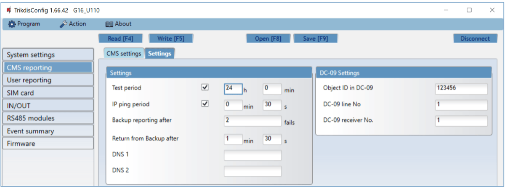

**Inställningsgruppen ”Settings”**

- **Test period** - period för TEST-händelser som testar anslutningen. Testhändelserna skickas som Contact ID-meddelanden och vidarebefordras till larmcentralens programvara.

- **IP ping period** – period för sändning av interna PING-signaler (heartbeat). Dessa meddelanden skickas bara via IP-kanal. Mottagaren vidarebefordrar inte PING-meddelanden till larmcentralens programvara, för att inte överbelasta den. Meddelanden skickas till programvaran bara om mottagaren inte får PING-meddelanden från enheten inom den inställda tiden.

  Som förval skickas meddelandet ”*Connection lost*” till larmcentralens programvara om mottagaren inte får något PING-meddelande under en tidsperiod som är tre gånger längre än den som är inställd i enheten. Om PING-perioden t.ex. är inställd på 3 minuter skickar mottagaren meddelandet *”Connection lost”* om inget PING-meddelande tas emot inom 9 minuter.

  PING-meddelanden upprätthåller den aktiva kommunikationssessionen mellan enheten och mottagaren. En aktiv session krävs för fjärranslutning, fjärrstyrning och fjärrkonfigurering av enheten. Vi rekommenderar att PING-perioden ställs in på högst 5 minuter.

- **Backup reporting after** - anger antalet misslyckade försök att skicka meddelandet via primärkanalen. Om enheten misslyckas att sända det angivna antalet gånger ansluter den för att skicka meddelandena via backupkanalen.

- **Return from backup after** - tid efter vilken G16 försöker ansluta igen och skicka meddelanden via primärkanalen.

- **DNS1, DNS2** - (Domain Name System) server som anger IP-adressen för en domän. Används när en domän är angiven i kommunikationskanalens fält **Domain or IP** (inte en IP-adress). Googles DNS-server är förinställd.

Inställningsgruppen ”DC-09 settings”

Inställningarna visas när protokollet **DC-09_2007** eller **DC-09_2012** är valt i kommunikationskanalens fält **Protocol** för att skicka händelser till universella mottagare.

- **Object ID in DC-09** - ange objektnumret. <u>Det objektnummer som anges i detta fält används om DC-09-kodning är vald</u>. Ett hexadecimalt tal med 3 till 16 tecken kan anges. Numret får du från larmcentralen (CMS, Central Monitoring Station).

- **DC-09-line No**. - ange mottagarens linjenummer.

- **DC-09 receiver No.** - ange mottagarnumret.

### Fönstret ”User reporting” 

**Fliken ”PROTEGUS cloud”**

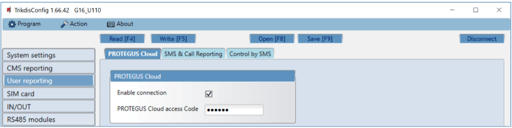

Tjänsten Protegus gör det möjligt för användarna att övervaka och styra larmsändaren på distans. Mer information om tjänsten Protegus finns på [www.protegus.app](https://www.protegus.app).

**Inställningsgruppen ”Protegus Cloud”**

- **Enable connection** – aktivera tjänsten Protegus; G16 kan då utbyta data med appen Protegus2 och konfigureras på distans via ***TrikdisConfig*.**

- **Protegus Cloud access Code -** 6-siffrig kod för anslutning till appen Protegus2 (förval - 123456).

**Fliken ”SMS & Call Reporting”**

Aviseringar om systemhändelser kan skickas till användarnas mobiltelefoner som SMS eller telefonsamtal.

- **Object name** - ange namnet på det system som larmsändaren är ansluten till. Varje SMS-avisering innehåller objektets namn.

- **SMS language** - välj språk för SMS-meddelandena (SMS kan skickas med språkspecifika tecken).

- **Tel numbers for SMS/Call reporting** - ange upp till 4 telefonnummer till användare som ska få SMS eller samtal om händelser. Telefonnumren måste börja med landskod, till exempel +370xxxxxxxx, 00370xxxxxxxx eller 370xxxxxxxx.

- **Area name, User name, Zone name tables** - varje område, användare och sektion kan ha ett namn som används i SMS-händelsemeddelandena. Ange områdets, användarens eller sektionens nummer i respektive tabell och ange namnet bredvid numret.

- **CID event table** - du kan ändra vilka telefonnummer som får SMS eller telefonsamtal med aviseringar om händelserna i listan.

  Du kan ändra texterna i SMS-meddelandena för förvalda händelser, ändra Contact ID-koderna (CID) och lägga till nya händelser med beskrivningar.

**Fliken ”Control by SMS”**

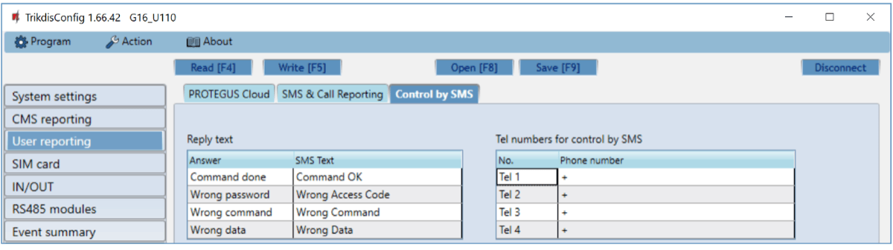

Du kan skicka SMS-kommandon till larmsändaren för att styra enhetens grundfunktioner. Kommandona finns i avsnitt [5.4](#54-konfigurering-och-styrning-med-sms-meddelanden) ”[Konfigurering och styrning med SMS-meddelanden](#54-konfigurering-och-styrning-med-sms-meddelanden)”.

- **Reply text** - SMS-text som användaren får efter att ha skickat ett SMS-kommando. SMS-texten kan redigeras.

- **Tel numbers for control by SMS** - du kan ange telefonnummer från vilka larmsändaren accepterar kommandon.

!!! note "Obs!"
    Om inget telefonnummer är angivet accepterar enheten kommandon från vilket
    telefonnummer som helst. Säkerheten garanteras ändå av kravet på att ange
    administratörs- eller installatörskod i SMS-kommandot.
### Fönstret ”SIM card” 

!!! warning "Viktigt"
    1\. Kontrollera att SIM-kortet är aktiverat och fungerar innan du använder
    det. / 2. Om mobil internetanslutning ska användas för att skicka händelser
    via IP-kanal eller till Protegus2, kontrollera att mobildatatjänsten är
    aktiverad.
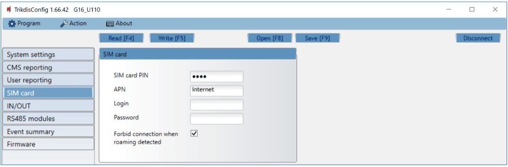

**Inställningsgruppen ”SIM card”**

- **SIM card PIN** - ange SIM-kortets PIN-kod. Koden kan avaktiveras genom att du sätter SIM-kortet i en mobiltelefon och stänger av begäran. Om du har stängt av SIM-kortets PIN-begäran, lämna förvalt värde i detta fält.

- **APN** - ange APN (Access Point Name). Det krävs för att ansluta larmsändaren till internet. APN hittar du på SIM-kortsoperatörens webbplats (”internet” är universellt och fungerar i många operatörers nät).

- **Login, Password** - ange vid behov användarnamn (login) och lösenord för anslutning till internet.
- **Forbid connection when roaming detected** - du kan använda den här funktionen när säkerhetssystemet är installerat nära en landsgräns. Funktionen hindrar larmsändaren från att arbeta i det andra landets mobilnät.

### Fönstren ”IN/OUT” 

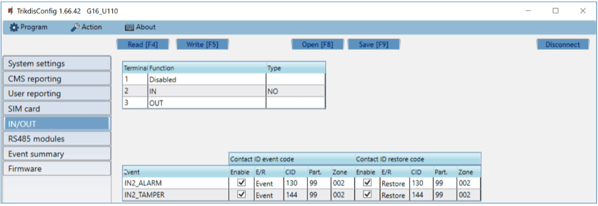

Larmsändaren har 3 universella (ingångs-/utgångs-)plintar. I tabellen kan plintens driftläge ställas in (Off, IN, OUT). För ingången måste du ange typen av krets som ska anslutas: NC, NO, NO / EOL, NC / EOL, NO / DEOL, NC / DEOL.

Ytterligare detektorer kan anslutas till larmsändarens ingångar. När detektorn löser ut skickar larmsändaren ett händelsemeddelande. Ingången tilldelas en Contact ID-kod som skickas till larmcentralen och Protegus2.

- **Enable** – markerade händelsefält för vilka meddelanden skickas till larmcentralen och Protegus2.

- **E/R** – välj vilken typ av händelse som ska skickas när ingången löser ut – **Event** eller **Restore**.

- **CID** – ange händelsekoden eller lämna förvalt värde. När händelsen inträffar skickas händelsekoden till Protegus2 och larmcentralen.

- **Part**. – ange det områdesnummer som skickas när en intern händelse inträffar och när systemet återställs.

- **Zone** - ange det sektionsnummer som skickas när en intern händelse inträffar och när systemet återställs.

### Fönstret ”RS485 modules” (endast för 3G/4G-larmsändare) 

**Fliken ”Modules list”**

Utbyggnadsmoduler iO-8 kan anslutas till larmsändaren för att lägga till fler ingångar och utgångar. Anslutna utbyggnadsmoduler måste läggas till i tabellen **Modules list**.

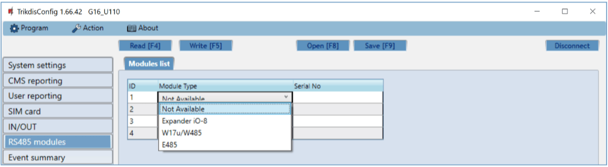

- **Module type** – välj i listan den modul som är ansluten till larmsändaren via RS485.

- **Serial No –** ange modulens serienummer (6 siffror), som anges på etiketterna på modulens kapsling och förpackning.

När du har valt den anslutna modulen och angett dess serienummer går du till **RS485 modules** → **Module.**

**Flikarna ”Module”**

När du har lagt till utbyggnadsmodulen i larmsändaren enligt ovan visas en ny flik i fönstret **RS485 modules** med modulens inställningar. Fliken får ett nummer. Nedan beskrivs inställningarna för utbyggnadsmodulerna iO-8, för WiFi-modulen W485 och för Ethernet-modulen E485.

**Inställningsfönstret för utbyggnadsmodulen iO-8 (endast för 3G/4G-larmsändare)**

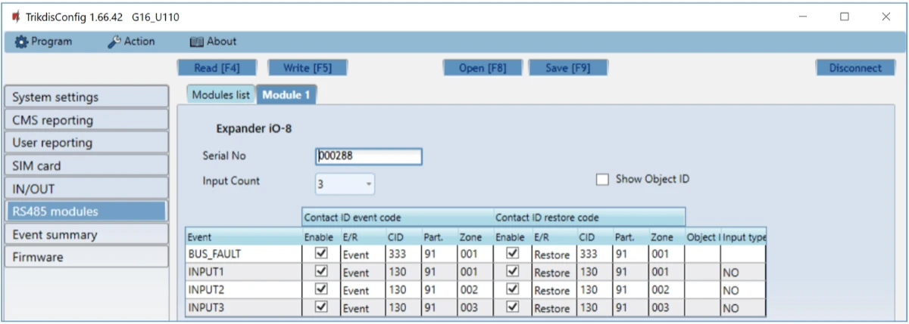

Utbyggnadsmodulen iO-8 har 8 universella (ingångs-/utgångs-)plintar. Upp till fyra iO-8 kan anslutas.

- **Input count** – välj hur många av plintarna som ska ställas in i ingångsläge (IN). Övriga plintar blir utgångar (OUT).

Inställningarna för styrbara utgångar görs direkt i appen Protegus2. Där kan du tilldela en utgång för tillkoppling/frånkoppling av larmsystemet eller för fjärrstyrning av enheter.

I tabellen kan ingångarna tilldelas Contact ID-koder för händelse och återställning. När ingången löser ut skickar larmsändaren en händelse med den inställda händelsekoden till larmcentralens mottagare, appen Protegus2 och SMS (till användarens telefonnummer).

**Contact ID-händelsekod:**

- **Enable** – tillåt sändning av meddelande när ingången löser ut.

- **E/R** – välj vilken typ av händelse som ska skickas när ingången löser ut – **Event** eller **Restore**.

- **CID** – tilldela ingången en Contact ID-händelsekod.

- **Part.** – tilldela ingången området. Det ställs in automatiskt: om modulnumret är 1 är området 91, om modulnumret är 4 är området 94.

- **Zone** – ange ingångens sektionsnummer.

****Contact ID-återställningskod**:**

- **Enable** – tillåt sändning av meddelande när ingången återställs.

- **E/R** – välj vilken typ av händelse som ska skickas när ingången återställs – **Restore** eller **Event**.

- **CID** – tilldela ingången Contact ID-återställningskoden.

- **Part.** – tilldela ingången området. Det ställs in automatiskt: om modulnumret är 1 är området 91, om modulnumret är 4 är området 94.

- **Zone** – ange ingångens sektionsnummer.

- **Object ID** - ingången (IN) kan tilldelas ett Object ID som skiljer sig från Object ID för larmsändaren G16.

- **Input type** – välj ingångens typ (NO eller NC).

För att kunderna ska få SMS-meddelanden eller samtal när en ingång löser ut anger du den Contact ID-händelsekod som är tilldelad ingången i tabellen på fliken **SMS & Call Reporting**.

#### Inställningsfönstret för WiFi-modulen W485 (endast för 3G/4G-larmsändare)

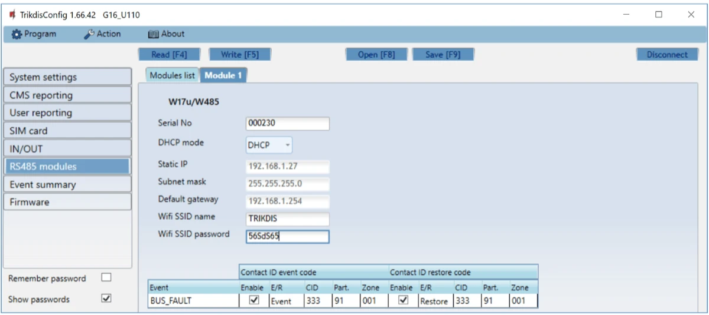

- **DHCP mode** – WiFi-modulens läge för registrering i nätverket (DHCP eller Static).

- **Static IP** – statisk IP-adress när manuellt registreringsläge är valt.

- **Subnet mask** – nätmask när manuellt registreringsläge är valt.

- **Default gateway** – gatewayadress när manuellt registreringsläge är valt.

- **Wifi SSID name** – namnet på det WiFi-nätverk som W485 ansluter till.

- **Wifi SSID password** - lösenord för WiFi-nätverket.

I tabellen kan du tilldela Contact ID-koder för händelse och återställning till händelsen fel på RS485-databussen. När anslutningen mellan W485 och G16 bryts eller återupprättas skickar G16 ett meddelande med den tilldelade CID-koden till larmcentralen och appen Protegus2.

!!! note "Obs!"
    Du måste konfigurera G16 att skicka meddelanden till larmcentralen och Protegus2, se avsnitt 2.2 ”Inställningar för anslutning till larmcentralen” och 2.1 ”Inställningar för anslutning till appen Protegus2”. / **Sätt i ett SIM-kort i larmsändaren *G16* för att *W485* ska fungera.**
#### Inställningsfönstret för Ethernet-modulen E485 (endast för 3G/4G-larmsändare)

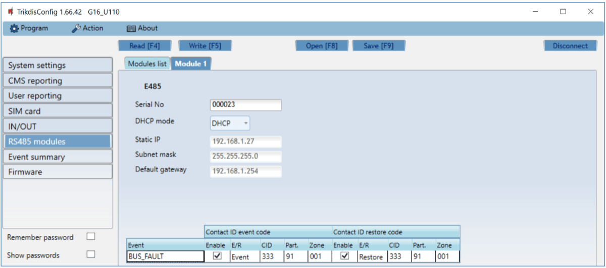

- **DHCP mode** – Ethernet-modulens läge för registrering i nätverket (DHCP eller Static).

- **Static IP** – statisk IP-adress när manuellt registreringsläge är valt.

- **Subnet mask** – nätmask när manuellt registreringsläge är valt.

- **Default gateway** – gatewayadress när manuellt registreringsläge är valt.

I tabellen kan du tilldela Contact ID-koder för händelse och återställning till händelsen fel på RS485-databussen. När anslutningen mellan E485 och G16 bryts eller återupprättas skickar G16 ett meddelande med den tilldelade CID-koden till larmcentralen och appen Protegus2.

!!! note "Obs!"
    Du måste konfigurera G16 att skicka meddelanden till larmcentralen och Protegus2, se avsnitt 2.2 ”Inställningar för anslutning till larmcentralen” och 2.1 ”Inställningar för anslutning till appen Protegus2”. / **Sätt i ett SIM-kort i larmsändaren *G16* för att *E485* ska fungera.**
### Fönstret ”Event summary” 

Här kan du aktivera, avaktivera och ändra de interna meddelanden som enheten skickar. Om du avaktiverar ett internt meddelande här skickas det inte alls, oavsett andra inställningar.

I det här fönstret kan du aktivera, avaktivera eller ändra de interna händelsemeddelanden som enheten skickar. När du har avaktiverat en intern händelse här skickas den inte, oavsett andra inställningar.

- **COMMUNICATION** – meddelande om anslutningsfel mellan centralapparaten och G16.

- **POWER** – meddelande om låg matningsspänning.

- **REMOTE_FINISHED** – meddelande om att fjärrkonfigureringen med TrikdisConfig har avslutats.

- **REMOTE_STARTED** – meddelande om fjärranslutning för att konfigurera G16 med TrikdisConfig.

- **START** – meddelande om att G16 ansluter till nätet.

- **TEST** – meddelande om periodisk testsändning.

!!! note "Obs!"
    För att aktivera periodiska TEST-meddelanden och ställa in deras period, gå
    till **CMS reporting -> Settings -> Test period**.
- **Enable** – när den är markerad är sändning av meddelandena aktiverad.

Du kan ändra Contact ID-koden för varje händelse, samt sektions- och områdesnummer.

### Återställa fabriksinställningarna 

För att återställa larmsändarens fabriksinställningar klickar du på knappen **Restore** i TrikdisConfig-fönstret.

## Fjärrkonfigurering 

!!! warning "Viktigt"
    Fjärrkonfigurering fungerar bara om:

    1.  Det isatta SIM-kortet är aktiverat och att PIN-koden antingen
        är angiven eller avstängd;

    2.  Protegus cloud är aktiverat. Hur du aktiverar molntjänsten
        beskrivs i avsnitt [6.4](#64-fonstret-user-reporting) ([fönstret ”User reporting”](#64-fonstret-user-reporting));

    3.  Matningen är ansluten (lysdioden ”POWER” lyser grönt);

    4.  Larmsändaren är registrerad i nätet (lysdioden ”NETWORK” lyser grönt och
        blinkar gult).
1.  Starta konfigurationsprogrammet TrikdisConfig.

2.  I avsnittet **Remote access** anger du larmsändarens nummer **IMEI/Unique ID**. Numret finns på enheten och på etiketten på förpackningen.

3.  (Valfritt) Ange önskat namn på G16 med detta Unique ID i fältet **System name**.

4.  Klicka på **Configure**.

5.  I det nya fönstret som öppnas klickar du på **Read [F4]**. Ange vid behov administratörs- eller installatörskoden*.* För att spara lösenordet markerar du **”Remember password”**.

6.  Ange de inställningar som behövs och klicka på **Write [F5]** när du är klar.

## Testa larmsändarens funktion 

När konfigureringen och installationen är klara, gör en systemkontroll:

1.  Generera en händelse:

    - genom att tillkoppla/frånkoppla systemet med centralapparatens knappsats;

    - genom att utlösa ett sektionslarm när säkerhetssystemet är tillkopplat.

2.  Kontrollera att händelsen kommer fram till larmcentralen (CMS, Central Monitoring Station) och/eller tas emot i appen Protegus2.

3.  För att testa larmsändarens ingång, utlös den och kontrollera att rätt händelse tas emot.

4.  För att testa larmsändarens utgångar, aktivera dem på distans och kontrollera att de fungerar.

5.  Om centralapparaten ska styras på distans, tillkoppla/frånkoppla säkerhetssystemet på distans med appen Protegus2.

## Firmwareuppdatering 

!!! note "Obs!"
    När larmsändaren är ansluten till TrikdisConfig erbjuder programmet
    automatiskt att uppdatera enhetens firmware om det finns
    uppdateringar. Uppdateringar kräver en internetanslutning. Antivirusprogram,
    brandvägg eller strikta inställningar för internetåtkomst kan blockera de automatiska
    firmwareuppdateringarna. I så fall måste du konfigurera om
    antivirusprogrammet.
Larmsändarens firmware kan också uppdateras eller bytas manuellt. Efter en uppdatering finns alla tidigare gjorda inställningar kvar oförändrade. Vid manuell skrivning av firmware kan den bytas till en nyare eller äldre version. Så här uppdaterar du:

1.  Starta ***TrikdisConfig**.*

2.  Anslut larmsändaren till datorn med USB-kabel eller anslut till larmsändaren på distans.

    - Om det finns en nyare firmwareversion erbjuder programmet att ladda ned filen med den nyare firmwareversionen.

3.  Välj menygrenen **Firmware**.

4.  Klicka på **Open firmware** och välj den firmwarefil du behöver. Om du inte har filen kan den senaste firmwarefilen laddas ned av <u>registrerade användare</u> från [www.trikdis.com](http://www.trikdis.com) , under nedladdningsavsnittet för larmsändaren G16.

5.  Klicka på **Update [F12]**.

6.  Vänta tills uppdateringen är klar.

## Säkerhetskrav

Larmsändaren ska installeras och underhållas av behörig personal.

Läs den här manualen noggrant före installationen för att undvika misstag som kan leda till funktionsfel eller till och med skador på utrustningen.

Koppla bort matningen innan du gör några elektriska anslutningar.

Ändringar, modifieringar eller reparationer som inte har godkänts av tillverkaren upphäver garantin.

Följ dina lokala bestämmelser och släng inte ett oanvändbart larmsystem eller dess komponenter bland vanligt hushållsavfall.

## Bilaga

Larmsändaren kan arbeta med en SUR-GARD-mottagare. Larmsändaren omvandlar Contact ID-koder som tas emot från centralapparaten till SIA-koder.

**Tabell för omvandling av Contact ID-koder till SIA-koder**

| **Systemhändelse** | **CID-rapportkod** | **SIA-rapportkod** |
|----|:--:|:--:|
| Medicinskt nödlarm | E100 | "MA" |
| Personligt nödlarm | E101 | "QA" |
| Brand i sektion: <z> | E110 | "FA" |
| Vattenflöde upptäckt i sektion: <z> | E113 | "SA" |
| Larm från brandlarmsknapp i sektion: <z> | E115 | "FA" |
| Överfall i sektion: <z> | E120 | "PA" |
| Överfallslarm av användare: <v> | E121 | "HA" |
| Överfallslarm i sektion: <z> | E122 | "PA" |
| Överfallslarm i sektion: <z> | E123 | "PA" |
| Överfallslarm i sektion: <z> | E124 | "HA" |
| Överfallslarm i sektion: <z> | E125 | "HA" |
| Larm aktivt i sektion: <z> | E130 | "BA" |
| Larm aktivt i sektion: <z> | E131 | "BA" |
| Larm aktivt i sektion: <z> | E132 | "BA" |
| Larm aktivt i sektion: <z> | E133 | "BA" |
| Larm aktivt i sektion: <z> | E134 | "BA" |
| Larm aktivt i sektion: <z> | E135 | "BA" |
| Sabotage aktivt i sektion: <z> | E137 | "TA" |
| Inbrott verifierat i sektion: <z> | E139 | "BV" |
| Larm aktivt i sektion: <z> | E140 | "UA" |
| Systemfel (143) | E143 | "ET" |
| Sabotage aktivt i sektion: <z> | E144 | "TA" |
| Sabotage aktivt i sektion: <z> | E145 | "TA" |
| Larm aktivt i sektion: <z> | E146 | "BA" |
| Larm aktivt i sektion: <z> | E150 | "UA" |
| Gas upptäckt i sektion: <z> | E151 | "GA" |
| Vattenläckage upptäckt i sektion: <z> | E154 | "WA" |
| Foliebrott upptäckt i sektion: <z> | E155 | "BA" |
| Hög temperatur vid givare: <n> | E158 | "KA" |
| Låg temperatur vid givare: <n> | E159 | "ZA" |
| CO upptäckt i sektion: <z> | E162 | "GA" |
| Brandfel i sektion: <z> | E200 | "FS" |
| Övervakat larm | E220 | "BA" |
| Systemfel (300) | E300 | "YP" |
| Nätfel | E301 | "AT" |
| Låg batterispänning | E302 | "YT" |
| Systemfel (304) | E304 | "YF" |
| Systemomstart i sektion: <z> | E305 | "RR" |
| Centralapparatens programmering ändrad | E306 | "YG" |
| Systemavstängning | E308 | "RR" |
| Batterifel (309) | E309 | "YT" |
| Jordfel | E310 | "US" |
| Batterifel (311) | E311 | "YM" |
| Överström i matningen (312) | E312 | "YP" |
| Installatörsåterställning av användare: <v> (313) | E313 | "RR" |
| Fel på siren/relä | E320 | "RC" |
| Systemfel (321) | E321 | "YA" |
| Systemfel (330) | E330 | "ET" |
| Systemfel (332) | E332 | "ET" |
| Systemfel (333) | E333 | "ET" |
| Systemfel (336) | E336 | "VT" |
| Systemfel (338) | E338 | "ET" |
| Systemfel (341) | E341 | "ET" |
| Systemfel (342) | E342 | "ET" |
| Systemfel (343) | E343 | "ET" |
| Systemfel (344) | E344 | "XQ" |
| Kommunikationsfel i systemet (350) | E350 | "YC" |
| Kommunikationsfel i systemet (351) | E351 | "LT" |
| Kommunikationsfel i systemet (352) | E352 | "LT" |
| Systemfel (353) | E353 | "YC" |
| Kommunikationsfel i systemet (354) | E354 | "YC" |
| Systemfel (355) | E355 | "UT" |
| Fel i brandsektion: <z> | E373 | "FT" |
| Fel i sektion: <z> | E374 | "EE" |
| Fel i sektion: <z> | E378 | "BG" |
| Fel i sektion: <z> | E380 | "UT" |
| Fel på trådlös sektion: <z> | E381 | "US" |
| Fel på trådlös modul (382) | E382 | "UY" |
| Sabotage aktivt i sektion: <z> | E383 | "TA" |
| Låg batterispänning i trådlös sektion: <z> | E384 | "XT" |
| Fel i sektion: <z> (389) | E389 | "ET" |
| Fel i sektion: <z> (391) | E391 | "NA" |
| Fel i sektion: <z> (393) | E393 | "NC" |
| Användare <v> frånkopplade systemet | E400 | "OP" |
| Användare <v> frånkopplade systemet | E401 | "OP" |
| Automatisk frånkoppling | E403 | "OA" |
| Uppskjuten frånkoppling av användare <v> | E405 | "OR" |
| Larm avbrutet av användare: <v> | E406 | "BC" |
| Användare <v> frånkopplade på distans | E407 | "OP" |
| Snabbfrånkoppling | E408 | "OP" |
| Fjärrfrånkoppling | E409 | "OS" |
| Återuppringningsbegäran från larmcentralen | E411 | "RB" |
| Lyckad nedladdning av data | E412 | "RS" |
| Inpassering nekad för användare <v> | E421 | "JA" |
| Inpassering av användare <v> | E422 | "DG" |
| Forcerad åtkomst i sektion <z> | E423 | "DF" |
| Utpassering nekad för användare <v> | E424 | "DD" |
| Utpassering av användare <v> | E425 | "DR" |
| Användare <v> frånkopplade för tidigt | E451 | "OK" |
| Användare <v> tillkopplade för sent | E452 | "OJ" |
| Användare <v> lyckades inte frånkoppla | E453 | "CT" |
| Användare <v> lyckades inte tillkoppla | E454 | "CI" |
| Automatisk tillkoppling misslyckades | E455 | "CI" |
| Delvis tillkoppling av användare: <v> | E456 | "CG" |
| Utpasseringsfel av användare: <v> | E457 | "EE" |
| Systemet frånkopplat efter larm av användare: <v> | E458 | "OR" |
| Nyligen tillkopplat av användare <v> | E459 | "CR" |
| Felaktig kod angiven | E461 | "JA" |
| Tiden för automatisk tillkoppling förlängd av användare: <v> | E464 | "CE" |
| Enhet avaktiverad (501) | E501 | "RL" |
| Enhet avaktiverad (520) | E520 | "RO" |
| Trådlös detektor avaktiverad i sektion: <z> (552) | E552 | "YS" |
| Sektion <z> förbikopplad | E570 | "UB" |
| Sektion <z> förbikopplad | E571 | "FB" |
| Sektion <z> förbikopplad | E572 | "MB" |
| Sektion <z> förbikopplad | E573 | "BB" |
| Gruppförbikoppling av användare: <v> | E574 | "CG" |
| Sektion <z> förbikopplad | E576 | "UB" |
| Förbikoppling av sektion <z> upphävd | E577 | "UB" |
| Förbikoppling av ventilationssektion | E579 | "UB" |
| Gångtest aktiverat av användare: <v> | E607 | "TS" |
| Manuell testsändning | E601 | "RX" |
| Periodisk testsändning | E602 | "RP" |
| Systemhändelse (605) | E605 | "JL" |
| Systemhändelse (606) | E606 | "LF" |
| Periodisk testsändning med fel | E608 | "RY" |
| Systemhändelse (622) | E622 | "JL" |
| Systemhändelse (623) | E623 | "JL" |
| Tid/datum omställda av användare <v> | E625 | "JT" |
| Felaktig tid/datum | E626 | "JT" |
| Systemprogrammering startad | E627 | "LB" |
| Systemprogrammering avslutad | E628 | "LS" |
| Systemhändelse (631) | E631 | "JS" |
| Systemhändelse (632) | E632 | "JS" |
| Systemet inte aktivt (654) | E654 | "CD" |
| Medicinskt nödlarm återställt | R100 | "MH" |
| Personligt nödlarm återställt | R101 | "QH" |
| Brandlarm återställt i sektion: <z> | R110 | "FH" |
| Vattenflödeslarm återställt i sektion: <z> | R113 | "SH" |
| Överfallslarm återställt i sektion: <z> | R120 | "PH" |
| Överfallslarm avbrutet av användare: <v> | R121 | "HH" |
| Överfallslarm återställt i sektion: <z> | R122 | "PH" |
| Överfallslarm återställt i sektion: <z> | R123 | "PH" |
| Överfallslarm återställt i sektion: <z> | R124 | "HH" |
| Överfallslarm återställt i sektion: <z> | R125 | "HH" |
| Larm återställt i sektion: <z> | R130 | "BH" |
| Larm återställt i sektion: <z> | R131 | "BH" |
| Larm återställt i sektion: <z> | R132 | "BH" |
| Larm återställt i sektion: <z> | R133 | "BH" |
| Larm återställt i sektion: <z> | R134 | "BH" |
| Larm återställt i sektion: <z> | R135 | "BH" |
| Sabotage återställt i sektion: <z> | R137 | "TA" |
| Larm återställt i sektion: <z> | R140 | "UH" |
| Systemfel (143) återställt | R143 | "UR" |
| Sabotage återställt i sektion: <z> | R144 | "TR" |
| Sabotage återställt i sektion: <z> | R145 | "TR" |
| Larm återställt i sektion: <z> | R146 | "BH" |
| Larm återställt i sektion: <z> | R150 | "UH" |
| Gaslarm återställt i sektion: <z> | R151 | "GH" |
| Vattenläckagelarm återställt i sektion: <z> | R154 | "WH" |
| Foliebrott återställt i sektion: <z> | R155 | "BH" |
| Temperaturen har normaliserats vid givare: <n> | R158 | "KH" |
| Temperaturen har normaliserats vid givare: <n> | R159 | "ZH" |
| CO-larm återställt i sektion: <z> | R162 | "GH" |
| Brandfel återställt i sektion: <z> | R200 | "FV" |
| Övervakat larm återställt | R220 | "BH" |
| Systemfel (300) återställt | R300 | "YA" |
| Nätspänning OK | R301 | "AR" |
| Batteri OK | R302 | "YR" |
| Systemfel (304) återställt | R304 | "YG" |
| Systemomstart återställd i sektion: <z> | R305 | "RR" |
| Batterifel (309) återställt | R309 | "YR" |
| Jordfel återställt | R310 | "UR" |
| Batterifel (311) återställt | R311 | "YR" |
| Överström i matningen (312) återställd | R312 | "YQ" |
| Fel på siren/relä återställt | R320 | "RO" |
| Systemfel (321) återställt | R321 | "YH" |
| Systemfel (330) återställt | R330 | "ER" |
| Systemfel (332) återställt | R332 | "ER" |
| Systemfel (333) återställt | R333 | "ER" |
| Systemfel (336) återställt | R336 | "VR" |
| Systemfel (338) återställt | R338 | "ER" |
| Systemfel (341) återställt | R341 | "ER" |
| Systemfel (342) återställt | R342 | "ER" |
| Systemfel (344) återställt | R344 | "XH" |
| Kommunikationsfel i systemet (350) återställt | R350 | "YK" |
| Kommunikationsfel i systemet (351) återställt | R351 | "LR" |
| Kommunikationsfel i systemet (352) återställt | R352 | "LR" |
| Systemfel (353) återställt | R353 | "YK" |
| Kommunikationsfel i systemet (354) återställt | R354 | "YK" |
| Systemfel (355) återställt | R355 | "UJ" |
| Fel i brandsektion: <z> återställt | R373 | "FJ" |
| Fel i sektion: <z> återställt | R374 | "EA" |
| Fel i sektion: <z> återställt | R380 | "UJ" |
| Fel på trådlös sektion: <z> återställt | R381 | "UR" |
| Fel på trådlös modul (382) återställt | R382 | "BR" |
| Sabotage återställt i sektion: <z> | R383 | "TR" |
| Batteri OK i trådlös sektion: <z> | R384 | "XR" |
| Fel i sektion: <z> (391) återställt | R391 | "NS" |
| Fel i sektion: <z> (393) återställt | R393 | "NS" |
| Användare <v> tillkopplade systemet | R400 | "CL" |
| Användare <v> tillkopplade systemet | R401 | "CL" |
| Automatisk tillkoppling | R403 | "CA" |
| Användare <v> tillkopplade på distans | R407 | "CL" |
| Snabbtillkoppling | R408 | "CL" |
| Fjärrtillkoppling | R409 | “CS” |
| Användare <v> tillkopplade i hemmaläge | R441 | "CG" |
| Användare <v> tillkopplade för tidigt | R451 | “CK” |
| Användare <v> frånkopplade för sent | R452 | “CJ” |
| Användare <v> lyckades inte frånkoppla | R454 | “CI” |
| Delvis tillkoppling av användare: <v> | R456 | "CG" |
| Nyligen frånkopplat av användare <v> | R459 | “CR” |
| Enhet aktiverad (501) | R501 | "RG" |
| Enhet aktiverad (520) | R520 | "RC" |
| Trådlös detektor aktiverad i sektion: <z> (552) | R552 | "YK" |
| Förbikoppling av sektion <z> upphävd | R570 | "UU" |
| Förbikoppling av sektion <z> upphävd | R571 | "FU" |
| Förbikoppling av sektion <z> upphävd | R572 | "MU" |
| Förbikoppling av sektion <z> upphävd | R573 | "BU" |
| Gruppförbikoppling av användare: <v> upphävd | R574 | "CF" |
| Förbikoppling av sektion <z> upphävd | R576 | "UU" |
| Förbikoppling av sektion <z> upphävd | R577 | "UU" |
| Förbikoppling av ventilationssektion upphävd | R579 | "UU" |
| Gångtest avaktiverat av användare <v> | R607 | "TE" |
| Tid/datum omställda av användare <v> | R625 | "JT" |
| Systemet aktivt (654) | R654 | "CD" |
