# G16T-larmsändare med mobilanslutning

  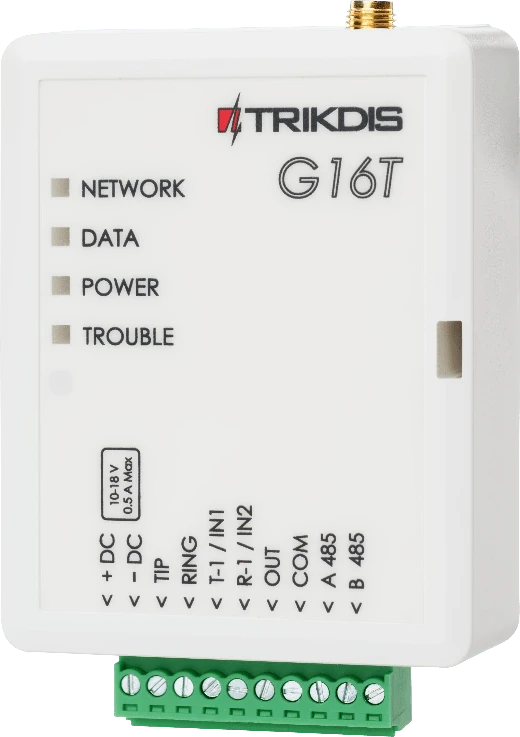

## Beskrivning 

Larmsändaren G16T med mobilanslutning kan anslutas till alla centralapparater som har en telefonuppringare och som stöder protokollet Contact ID överfört med DTMF-toner.

Larmsändaren kan överföra fullständig händelseinformation till mottagaren hos larmbolagets larmcentral.

Larmsändaren fungerar med appen Protegus. Användarna kan styra sitt larmsystem på distans och få aviseringar om händelser. Appen Protegus fungerar med alla centralapparater som larmsändaren är ansluten till, oavsett tillverkare. Larmsändaren kan skicka händelseaviseringar till larmcentralen och arbeta med Protegus samtidigt.

Larmsändarna G16T med mobilanslutning är certifierade för den högsta säkerhetsgraden enligt EN 50131 (Grade 4).

### Funktioner

**Ansluts till centralapparatens telefonuppringare:**

- Larmsändaren kan anslutas till centralapparatens telefonuppringare med 2 eller 4 ledare.

- Vid anslutning med 4 ledare övervakas telefonlinjen mellan centralapparaten och larmsändaren.

Skickar händelser till larmcentralens mottagare:

- Skickar händelser till TRIKDIS programvaru- eller maskinvarumottagare som fungerar med all programvara för larmcentraler.

- Kan skicka händelsemeddelanden till SIA DC-09-mottagare.

- Kan skicka händelsemeddelanden till SUR-GARD-mottagare. Bilagan innehåller en tabell för omvandling av Contact ID-koder till SIA-koder.

- Övervakning av anslutningen genom att IP-mottagaren pollas var 30:e sekund (eller med en period som användaren anger).

- Backupkanal som används om anslutningen via primärkanalen bryts.

- Händelser kan rapporteras till larmcentralen med SMS-meddelanden. SMS skickas även om dataanslutningen i mobiloperatörens nät slutar fungera.

- Med parallella kommunikationskanaler kan händelser skickas till två mottagare samtidigt.

- När tjänsten *Protegus* är aktiverad levereras händelserna först till larmcentralen och skickas därefter till appens användare.

**Fungerar med appen Protegus:**

- ”*Push*”-aviseringar och särskilda ljud som informerar om händelser.

- Fjärrstyrd tillkoppling/frånkoppling av systemet.

- Fjärrstyrning av anslutna enheter (belysning, portar, ventilationssystem, värme, bevattning m.m.).

- Fjärrövervakning av temperatur (med utbyggnadsmodulerna iO eller iO-WL).

- Olika användarrättigheter för administratör, installatör och användare.

- Användarna kan också informeras om händelser med SMS-meddelanden och telefonsamtal.

**Meddelar användare:**

- Användarna kan få aviseringar om händelser inte bara via appen Protegus utan även via SMS-meddelanden och samtal.

**Styrbara utgångar och ingångar:**

- 1 utgång, styrd via:

  - Appen Protegus.

  - SMS-meddelande.

    - 2 ingångar med valbar typ: NC; NO; NC/EOL; NO/EOL; NC/DEOL; NO/DEOL.

    - Lägg till fler ingångar och styrbara utgångar med trådbundna och trådlösa utbyggnadsmoduler iO.

**Snabb installation:**

- Inställningarna kan sparas i en fil och snabbt skrivas till andra larmsändare.

- Två behörighetsnivåer för konfigurering av enheten: för larmcentralens administratör och för installatören.

- Fjärrkonfigurering och firmwareuppdateringar.

### Larmsändarens modelltyper 

Denna manual gäller dessa G16T-modeller:

- G16T_321x – version 3, 2G-modem, 1 SIM.

- G16T_331x – version 3, 3G-modem, 1 SIM.

- G16T_341x – version 3, 4G-modem, 1 SIM.

- G16_3M10 – version 3, 1 SIM, modem för LTE CatM1 och EGPRS.

### Specifikationer 

| Parameter | Beskrivning |
|----|----|
| Anslutning till centralapparat | Telefonuppringare (TIP RING-plintar) |
| Ingångar | 2 ingångar med valbar typ, NC; NO; NC/EOL; NO/EOL; NC/DEOL; NO/DEOL / Kan utökas med utbyggnadsmoduler i serien iO |
| Utgång | 1, typ OC, upp till 0,15 A, max 30 V / Kan utökas med utbyggnadsmoduler i serien iO |
| Frekvenser för 2G-modem | 850 / 900 / 1800 / 1900 MHz |
| Frekvenser för 3G-modem | 800 / 850 / 900 / 1900 / 2100 MHz |
| Frekvenser för 4G-modem | Beror på region |
| Matningsspänning | 10–18 V DC |
| Strömförbrukning | 60–100 mA (i viloläge) / upp till 250 mA (vid dataöverföring) |
| Överföringsprotokoll | TRK, DC-09_2007, DC-09_2012, TL150 |
| Meddelandekryptering | AES 128 |
| Ändring av inställningar | Med datorprogrammet TrikdisConfig, på distans eller lokalt via USB Mini-B-porten / på distans med SMS-meddelanden |
| Driftmiljö | Temperatur från -10 °C till 50 °C, relativ luftfuktighet upp till 80 % vid +20 °C |
| Larmsändarens mått | 92 × 62 × 26 mm |
| Vikt | 80 g |

### Larmsändarens delar 

1.  SMA-kontakt för mobilantenn

2.  Lysdiodsindikeringar

3.  Spår för att öppna kapslingens framsida

4.  Plintblock för externa anslutningar

5.  USB Mini-B-port för programmering av larmsändaren

6.  Kortplats för SIM-kort

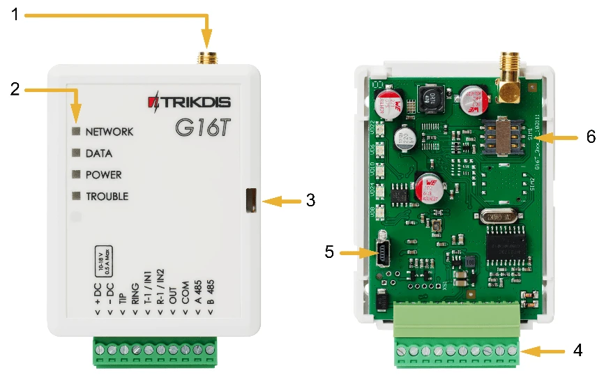

### Plintarnas funktion 

| Plint | Beskrivning |
|----|----|
| +DC | Matning +10 V/+18 V |
| -DC | Matning 0 V |
| TIP | Plint för anslutning till centralapparatens TIP-plint |
| RING | Plint för anslutning till centralapparatens RING-plint |
| T-1 / IN1 | Plint för övervakning av telefonlinjen eller ingångsplint, valbar typ: NC; NO; NC/EOL; NO/EOL; NC/DEOL; NO/DEOL |
| R-1 / IN2 | Plint för övervakning av telefonlinjen eller ingångsplint, valbar typ: NC; NO; NC/EOL; NO/EOL; NC/DEOL; NO/DEOL |
| OUT | Utgångsplint (typ OC), ström upp till 0,15 A |
| COM | Gemensam plint (minus) |
| A 485 | Plint A för *RS485*-bussen |
| B 485 | Plint B för *RS485*-bussen |

### Lysdiodsindikering vid drift 

#### NETWORK

| Lysdiodens läge | Beskrivning |
| --- | --- |
| Släckt | Ingen anslutning till mobilnätet. |
| Blinkar gult | Ansluter till mobilnätet. |
| Fast grönt sken med gult blinkande | Larmsändaren är ansluten till mobilnätet. Tillräcklig mobil signalstyrka är nivå 5 för 2G (fem gula blinkningar) och nivå 3 för 3G/4G-nät (tre gula blinkningar). |

#### DATA

| Lysdiodens läge | Beskrivning |
| --- | --- |
| Släckt | Inga osända händelser. |
| Fast grönt sken | Osända händelser finns lagrade i bufferten. |
| Blinkar grönt | *(Konfigurationsläge)* Data överförs till/från larmsändaren. |

#### POWER

| Lysdiodens läge | Beskrivning |
| --- | --- |
| Släckt | Matningen är avstängd eller bortkopplad. |
| Fast grönt sken | Matningen är på med tillräcklig spänning. |
| Fast gult sken | Matningsspänningen är otillräcklig (≤11,5 V). |
| Fast grönt sken och gult blinkande | *(Konfigurationsläge)* Larmsändaren är klar för konfigurering. |
| Fast gult sken (konfigurationsläge) | *(Konfigurationsläge)* Ingen anslutning till datorn. |

#### TROUBLE

| Lysdiodens läge | Beskrivning |
| --- | --- |
| Släckt | Inga driftproblem. |
| 1 röd blinkning | SIM-kortet hittas inte. |
| 2 röda blinkningar | Problem med SIM-kortets PIN-kod (felaktig PIN-kod). |
| 3 röda blinkningar | Programmeringsproblem (ingen APN). |
| 4 röda blinkningar | Problem med registrering i mobilnätet. |
| 5 röda blinkningar | Problem med registrering i mobildatanätet. |
| 6 röda blinkningar | Ingen anslutning till mottagaren. |
| 7 röda blinkningar | Förlorad anslutning till centralapparaten. |
| Blinkar rött | *(Konfigurationsläge)* Minnesfel. |
| Fast rött sken | *(Konfigurationsläge)* Firmware är skadad. |

### Principschema för användning av G16T 

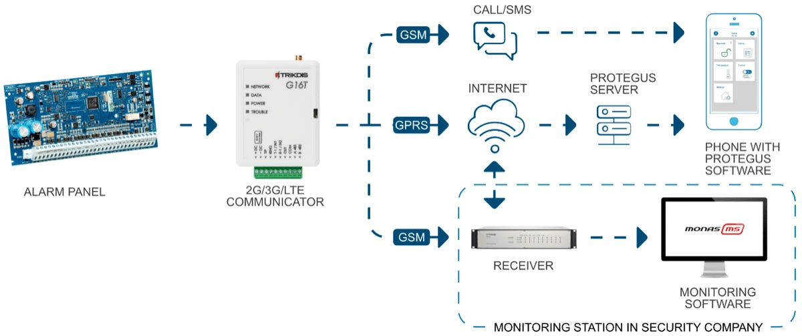

!!! note "Obs!"
    Innan du börjar, se till att du har följande:
    
    1.  USB-kabel (Mini-B) för konfigurering.
    
    2.  Minst 4-ledarkabel för att ansluta larmsändaren till centralapparaten.
    
    3.  Spårskruvmejsel 2,5 mm.
    
    4.  Antenn med tillräcklig förstärkning om nättäckningen i området är dålig.
    
    5.  Aktiverat nano-SIM-kort (PIN-kodsbegäran kan vara avstängd).
    
    6.  Installationsmanualen för den aktuella centralapparaten.
    
    Beställ nödvändiga komponenter separat från din lokala distributör.
## Snabbkonfiguration med programvaran *TrikdisConfig* 

1.  Ladda ned konfigurationsprogrammet **TrikdisConfig** från [www.trikdis.com](http://www.trikdis.com) (skriv ”TrikdisConfig” i sökfältet) och installera det.

2.  Öppna kapslingen på G16T med en spårskruvmejsel enligt bilden nedan:

    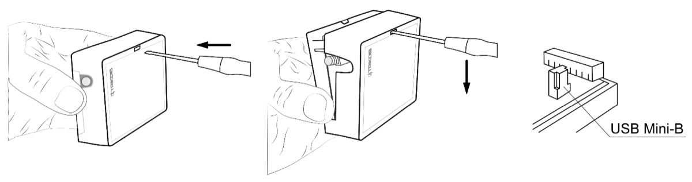

3.  Anslut G16T till datorn med en USB Mini-B-kabel.

4.  Starta TrikdisConfig. Programmet identifierar automatiskt den anslutna larmsändaren och öppnar ett fönster för konfigurering.

5.  Klicka på **Read [F4]** för att läsa larmsändarens inställningar. Om du uppmanas, ange administratörs- eller installatörskoden (6 siffror) i dialogrutan.

Nedan beskrivs vilka inställningar som behövs för att larmsändaren ska börja skicka händelser till larmcentralen och för att säkerhetssystemet ska kunna styras med appen Protegus.

### Inställningar för anslutning till appen Protegus 

**I fönstret ”User reporting”, fliken ”PROTEGUS Cloud”:**

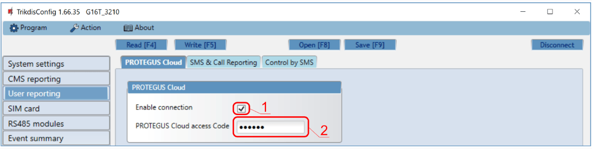

1.  Markera kryssrutan **Enable connection** till Protegus Cloud.

2.  Ändra **PROTEGUS Cloud access Code** för inloggning i Protegus om du vill att användarna ska behöva ange den när de lägger till systemet i appen Protegus (förvalt lösenord – 123456).

**I fönstret ”SIM card”:**

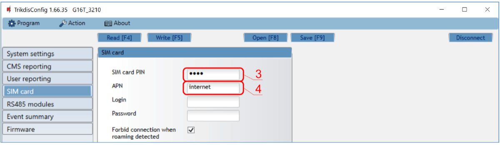

3.  Ange **SIM card PIN**-koden.

4.  Ändra namnet i **APN**. APN hittar du på SIM-kortsoperatörens webbplats (”internet” är universellt och fungerar i många operatörers nät).

När konfigureringen är klar klickar du på knappen **Write [F5]** och kopplar bort USB-kabeln.

!!! note "Obs!"
    Mer information om övriga inställningar för G16T i
    TrikdisConfig finns i avsnitt **6 ”Beskrivning av TrikdisConfig-fönstren”**.
!!! warning "Viktigt"
    Glöm inte att aktivera centralapparatens telefonuppringare och ställa in
    den korrekt, så att centralapparaten skickar händelserna. Hur centralapparaten
    ställs in beskrivs i avsnitt **4 ”Programmering av centralapparaten”**.
### Inställningar för anslutning till larmcentralen 

**I fönstret ”System settings”:**

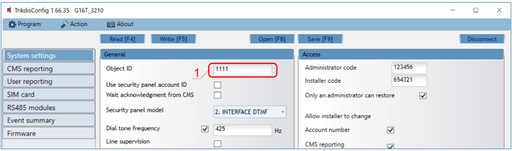

1.  Ange numret i **Object ID** (abonnentkod) som du har fått från larmcentralen (4 tecken, 0–9, A–F. **Använd inte FFFE, FFFF som Object ID**).

**I fönstret ”CMS reporting”, inställningar för ”Primary channel”:**

2.  **Communication type** - välj anslutningsmetoden **IP** (vi rekommenderar inte SMS som primärkanal).

3.  **Protocol** - välj protokolltyp för händelsemeddelandena: **TRK** (till TRIKDIS-mottagare), **DC-09_2007** eller **DC-09_2012** (till universella mottagare), **TL150** (till SUR-GARD-mottagare).

4.  **TRK encryption key** - ange den krypteringsnyckel som är inställd i mottagaren.

5.  **Domain or IP** - ange mottagarens domän eller IP-adress.

6.  **Port** - ange mottagarens nätverksportnummer.

7.  **TCP or UDP** - välj det överföringsprotokoll (**TCP** eller **UDP**) som händelserna ska skickas med.

!!! note "Obs!"
    Om du vill ställa in kommunikation med larmcentralen via **SMS-meddelanden** behöver du bara ange **Encryption key** och **Phone number**. SMS-meddelanden kan bara tas emot av TRIKDIS-mottagare: IP/SMS-mottagaren RL14, flerkanalsmottagaren RM14 och SMS-mottagaren GM14. / Om du har valt protokollet **DC-09** anger du dessutom objekt-, linje- och mottagarnummer på fliken **Settings** i fönstret **CMS reporting**.
8.  (Rekommenderas) Konfigurera inställningarna för **Primary channel Backup**.

9.  (Rekommenderas) Ange **Backup SMS reporting number**.

**I fönstret ”SIM card”:**

10. Ange **SIM card PIN**-koden.

11. Ändra **APN**-namnet. APN hittar du på SIM-kortsoperatörens webbplats (”internet” är universellt och fungerar i många operatörers nät).

När konfigureringen är klar klickar du på **Write [F5]** och kopplar bort USB-kabeln.

!!! note "Obs!"
    Mer information om övriga inställningar för G16T i
    TrikdisConfig finns i avsnitt **6 ”Beskrivning av TrikdisConfig-fönstren”**.
!!! warning "Viktigt"
    Glöm inte att aktivera centralapparatens telefonuppringare och ställa in
    den korrekt, så att centralapparaten skickar händelserna. Hur centralapparaten
    ställs in beskrivs i avsnitt **4 ”Programmering av centralapparaten”**.
## Installation och inkoppling 

### Installationsgång 

1.  Ta bort det övre locket och dra ut plintblocket.

2.  Ta ut kretskortet.

3.  Fäst den nedre delen med skruvar på en lämplig plats.

4.  Sätt tillbaka kretskortet i kapslingen och sätt i plintblocket.

5.  Skruva fast mobilantennen.

6.  Sätt i nano-SIM-kortet.

7.  Stäng det övre locket.

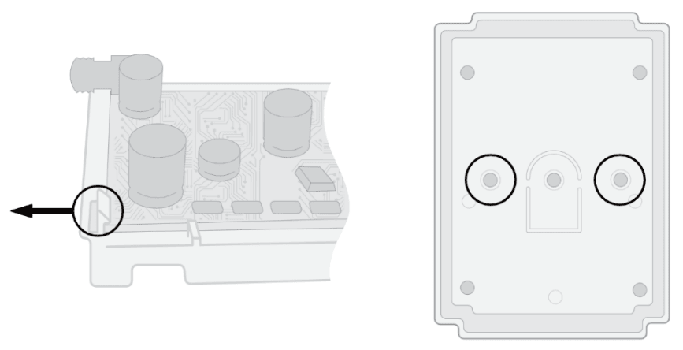

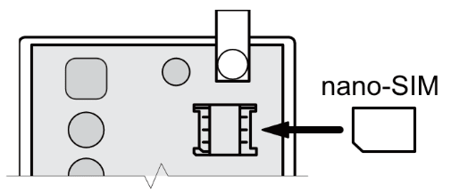

!!! note "Obs!"
    Kontrollera att SIM-kortet är aktiverat. / Kontrollera
    att mobil internettjänst (mobildata) är aktiverad om appen Protegus eller
    IP-anslutning till larmcentralen ska användas. / För att slippa ange PIN-koden i
    TrikdisConfig, sätt SIM-kortet i din mobiltelefon och stäng av PIN-kodsbegäran.
### Kopplingsscheman för inkoppling av larmsändaren till centralapparaten 

Anslut larmsändaren till centralapparaten enligt något av kopplingsschemana nedan.

#### Utan övervakning av telefonlinjen

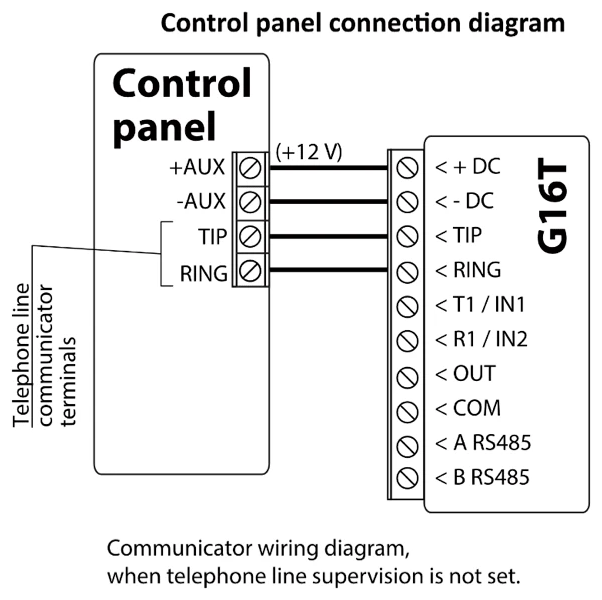

#### Med övervakning av telefonlinjen

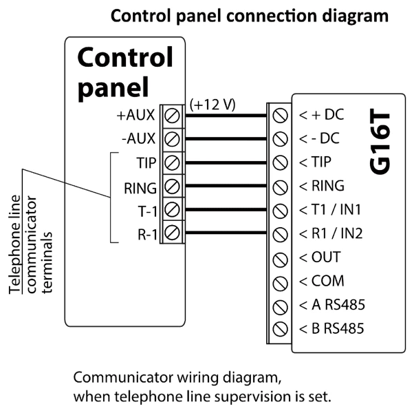

### Kopplingsscheman för anslutning till centralapparatens nyckelbrytarsektion 

#### Utan övervakning av telefonlinjen

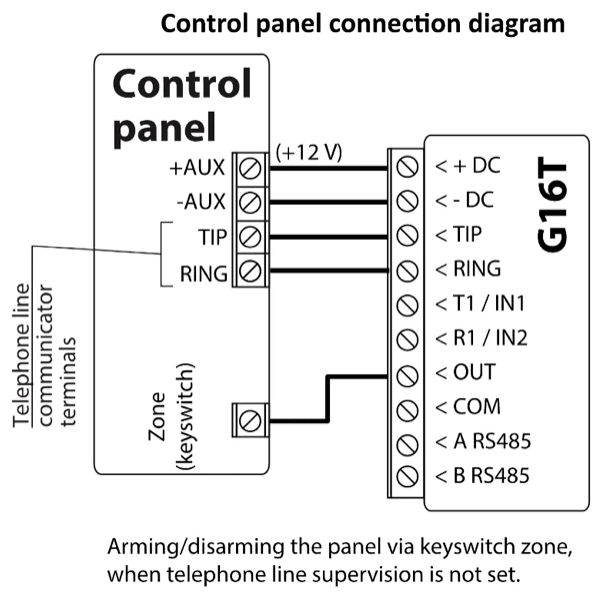

#### Med övervakning av telefonlinjen

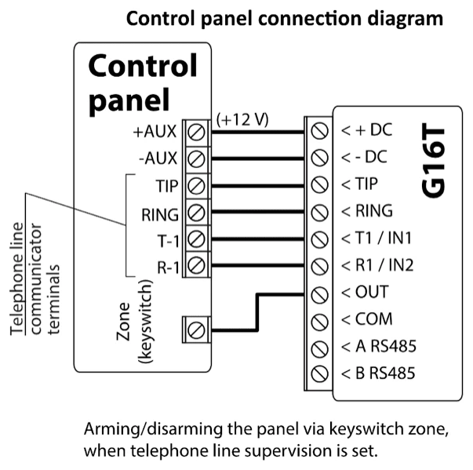

Följ dessa scheman om centralapparaten ska tillkopplas/frånkopplas med en PGM-utgång på G16T som slår på/av centralapparatens nyckelbrytarsektion.

!!! note "Obs!"
    Larmsändaren G16T har en programmerbar utgång OUT som kan
    styra ett område i larmsystemet. I TrikdisConfig, i fönstret
    ”**System settings**”, måste **Output OUT1 mode** vara inställd på **Remote control**
    (förvald inställning).
### Kopplingsscheman för anslutning av ingång 

Larmsändaren har två ingångsplintar (IN1, IN2) för anslutning av kretsar av typerna NO, NC, NO/EOL, NC/EOL, NO/DEOL och NC/DEOL. Förvald ingångsinställning – NO. Ingångstypen kan ändras i TrikdisConfig i fönstret **System settings -> Input IN1-IN2 type**.

Anslut ingången enligt den valda ingångstypen (NO, NC, NO/EOL, NC/EOL, NO/DEOL, NC/DEOL), som i schemana nedan:

#### Normalt öppen (NO)

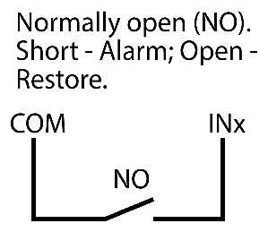

#### Normalt sluten (NC)

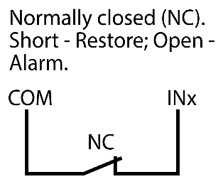

#### Normalt sluten med 10k slutmotstånd (NC/EOL)

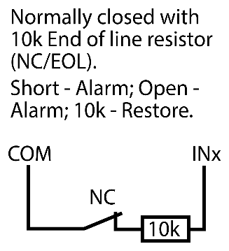

#### Normalt öppen med 10k slutmotstånd (NO/EOL)

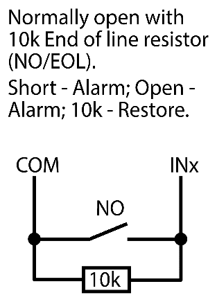

#### Normalt öppen med 10k slutmotstånd och sabotageavkänning (NO/DEOL)

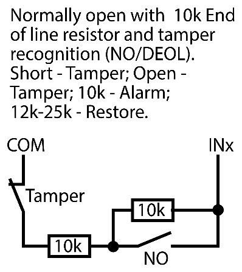

#### Normalt sluten med 10k slutmotstånd och sabotageavkänning (NC/DEOL)

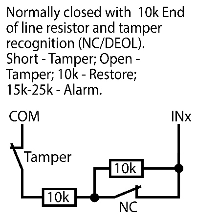

!!! note "Obs!"
    Om fler ingångar eller utgångar behöver anslutas till larmsändaren, eller
    om du vill ansluta en temperaturgivare, anslut en trådbunden eller trådlös
    utbyggnadsmodul i serien TRIKDIS iO.
### Kopplingsscheman för anslutning av ett relä 

Med reläkontakter kan du styra (slå på/av) olika elektriska apparater.

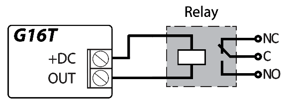

### Kopplingsscheman för inkoppling av utbyggnadsmoduler i serien iO 

Om fler ingångar eller utgångar behöver anslutas till larmsändaren, eller om du vill ansluta en temperaturgivare, anslut en trådbunden eller trådlös utbyggnadsmodul i serien TRIKDIS iO.

### Kopplingsschema för inkoppling av WiFi-modulen *W485* 

Modulen *W485* skickar meddelanden till larmcentralen (CMS, Central Monitoring Station) och till Protegus via en WiFi-router. När WiFi-anslutning finns skickar *G16T* händelsemeddelanden via modulen *W485*. Om WiFi-anslutningen bryts skickar *G16T* meddelanden via GPRS. När WiFi-anslutningen är återupprättad återgår *G16T* till att skicka meddelanden via *W485*. / Konfigureringen av WiFi-modulen *W485* för användning med *G16T* beskrivs i avsnitt 6.6 (fönstret ”RS485 modules”). / Sätt i ett SIM-kort i larmsändaren *G16T* för att *W485* ska fungera.

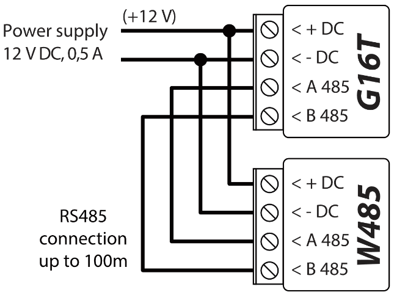

### Kopplingsschema för inkoppling av Ethernet-modulen *E485* 

Modulen *E485* skickar meddelanden till larmcentralen (CMS, Central Monitoring Station) och till Protegus via en kabelansluten internetanslutning. När *E485* används med *G16T* skickas meddelanden till larmcentralen och Protegus över kabelanslutet internet, och mobilt internet används inte. Om den kabelanslutna internetanslutningen bryts skickar *G16T* meddelanden via mobilt internet. När den kabelanslutna internetanslutningen är återupprättad börjar *G16T* skicka meddelanden via *E485* igen. / Konfigureringen av Ethernet-modulen *E485* för användning med *G16T* beskrivs i avsnitt 6.6 (fönstret ”RS485 modules”). / Sätt i ett SIM-kort i larmsändaren *G16T* för att *E485* ska fungera.

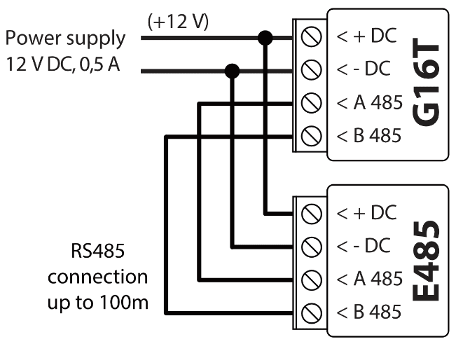

### Starta larmsändaren 

Starta larmsändaren genom att slå på centralapparatens matning. Lysdiodsindikeringen på G16T-larmsändaren ska visa följande:

- Lysdioden ”POWER” lyser grönt när matningen är på;

- Lysdioden ”NETWORK” lyser grönt och blinkar gult när larmsändaren är registrerad i nätet.

!!! note "Obs!"
    Tillräcklig 2G-signalstyrka är nivå fem (fem gula blinkningar på lysdioden ”NETWORK”). Tillräcklig 3G-/4G-signalstyrka är nivå tre (tre gula blinkningar på lysdioden ”NETWORK”). / Om du räknar färre gula blinkningar på lysdioden ”NETWORK” är nätets signalstyrka otillräcklig. Vi rekommenderar att du väljer en annan plats för larmsändaren eller använder en känsligare mobilantenn. / Om du ser en annan lysdiodsindikering tyder det på ett visst fel. Felsök med hjälp av tabellen över lysdiodsindikeringar i avsnitt **1.6 ”Lysdiodsindikering vid drift”**. / Om G16T:s indikeringar inte lyser alls, kontrollera matningen och anslutningarna.
## Programmering av centralapparaten 

För att centralapparaten ska kunna skicka händelser via telefonuppringaren måste den vara påslagen och korrekt inställd. Konfigurera centralapparatens telefonuppringare enligt centralapparatens programmeringsmanual:

1.  Aktivera centralapparatens PSTN-uppringare.

2.  Ange telefonnumret till larmcentralens mottagare (du kan använda vilket nummer som helst med fler än 2 siffror. G16T svarar när centralapparaten ringer till vilket telefonnummer som helst).

3.  Välj DTMF-läge.

4.  Välj kommunikationsprotokollet Contact ID.

5.  Ange centralapparatens abonnentkod (4 siffror).

Den sektion i centralapparaten som G16T-utgången OUT är ansluten till ska ställas in som nyckelbrytarsektion för att centralapparaten ska kunna tillkopplas/frånkopplas på distans.

!!! note "Obs!"
    Nyckelbrytarsektionen kan vara momentan (puls) eller nivåstyrd. Som förval
    är G16T:s styrbara utgång OUT inställd på pulsläge med 3 sekunders puls. Du kan
    ändra pulsens längd eller byta till nivåläge i inställningarna för Protegus.
    Se avsnitt **5.2 ”Ytterligare inställningar för tillkoppling/frånkoppling av
    systemet med centralapparatens nyckelbrytarsektion”**.
### Programmering av telefonuppringaren i Honeywell Vista 

Ange följande sekvenser på centralapparatens knappsats och ställ in dem enligt beskrivningen:

- \*41 – ange telefonnumret till larmcentralens mottagare;

- \*43 – ange centralapparatens abonnentkod;

- \*47 – ställ in Tone dial på [1] och ange antal uppringningsförsök;

- \*48 – använd förvalet, \*48 måste vara 7;

- \*49 – Split/Dual message. \*49 måste vara 5;

- \*50 – fördröjning för sändning av inbrottslarmshändelser (valfritt). Förvalet är [2,0]. Då fördröjs sändningen av händelsemeddelandet med 30 sekunder. Om du vill att meddelandet ska skickas direkt, ställ in [0,0].

### Speciella inställningar för Honeywell Vista 48 

Om du vill använda G16T-larmsändaren med en Honeywell Vista 48-centralapparat, ställ in följande sekvenser enligt beskrivningen:

| Sekvens | Data                             | Sekvens | Data | Sekvens | Data |
|:-------:|----------------------------------|:-------:|:----:|:-------:|:----:|
|  \*41   | 1111 (mottagarens telefonnummer) |  \*60   |  1   |  \*69   |  1   |
|  \*42   | 1111                             |  \*61   |  1   |  \*70   |  1   |
|  \*43   | 1234 (centralapparatens abonnentkod)      |  \*62   |  1   |  \*71   |  1   |
|  \*44   | 1234                             |  \*63   |  1   |  \*72   |  1   |
|  \*45   | 1111                             |  \*64   |  1   |  \*73   |  1   |
|  \*47   | 1                                |  \*65   |  1   |  \*74   |  1   |
|  \*48   | 7                                |  \*66   |  1   |  \*75   |  1   |
|  \*50   | 1                                |  \*67   |  1   |  \*76   |  1   |
|  \*59   | 0                                |  \*68   |  1   |         |      |

När alla nödvändiga inställningar är gjorda måste du lämna programmeringsläget. Ange \*99 på knappsatsen.

## Fjärrstyrning 

### Lägga till säkerhetssystemet i appen Protegus2 

Med Protegus2 kan användarna styra sitt larmsystem på distans. De ser systemets status och får aviseringar om systemhändelser.

1.  Ladda ned och starta appen Protegus2 eller använd webbversionen: [www.protegus.app](https://www.protegus.app).

    

      
      
      
    

2.  Logga in med ditt användarnamn och lösenord, eller registrera dig och skapa ett nytt konto.

!!! warning "Viktigt"
    När du lägger till G16T i Protegus2, kontrollera att:

    1.  Det isatta SIM-kortet är aktiverat och att PIN-koden antingen
        är angiven eller avstängd;

    2.  Protegus cloud är aktiverat. Se avsnitt
        **[6.4](#64-fonstret-user-reporting) ([fönstret ”User reporting”](#64-fonstret-user-reporting))**;

    3.  Matningen är ansluten (lysdioden ”POWER” lyser grönt);

    4.  Larmsändaren är registrerad i nätet (lysdioden ”NETWORK” lyser grönt och
        blinkar gult).
3.  Klicka på ”**Add new system**” och ange G16T:s nummer ”*IMEI/Unique ID*”. Numret finns på enheten och på etiketten på förpackningen. Klicka på ”**Next**”.

{ .trik-mob-img }

4.  Ange systemets ”**Name**”. Klicka på ”**Next**”.

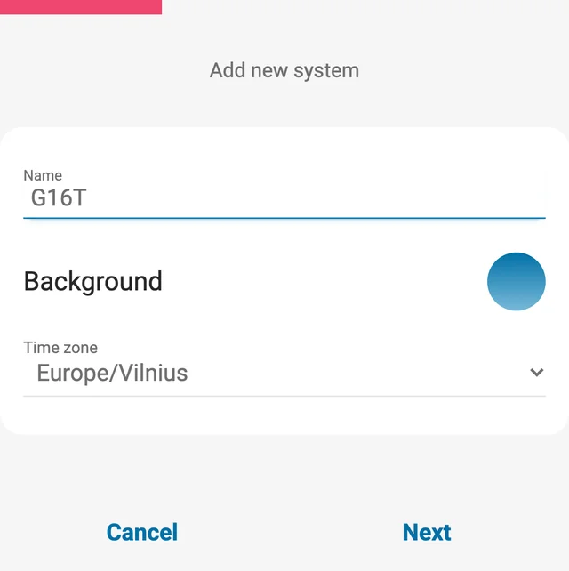{ .trik-mob-img }

### Ytterligare inställningar för tillkoppling/frånkoppling av systemet med centralapparatens nyckelbrytarsektion 

!!! warning "Viktigt"
    Den sektion i centralapparaten som G16T-utgången OUT är ansluten till
    måste vara inställd på nyckelbrytarläge.
Följ anvisningarna nedan om centralapparaten ska styras med en PGM-utgång på G16T som slår på/av centralapparatens nyckelbrytarsektion.

1.  Klicka på ”**Continue**”.

{ .trik-mob-img }

2.  Ange ”**Area name**”. Aktivera styrning av PGM-utgången med appen Protegus2.
3.  Välj ”**Pulse**” eller ”**Level**”, beroende på hur nyckelbrytarsektionens typ är konfigurerad. Vid behov kan du ändra intervallet för ”**Pulse**”.

4.  Klicka på ”**Save**”.

{ .trik-mob-img }

5.  Om säkerhetssystemet har ett område till måste du klicka på ”**Click to add an area**”. PGM-utgången ställs in på liknande sätt som beskrivits ovan.

6.  När inställningarna är klara klickar du på knappen ”**Skip**”.

{ .trik-mob-img }

### Tillkoppling/frånkoppling av larmsystemet med Protegus2 

1.  I fönstret ”System Home Screen” klickar du på statusikonen ”Disarm”.

2.  *Protegus2* får ett meddelande om att säkerhetssystemets status har ändrats och statusikonen byter läge.

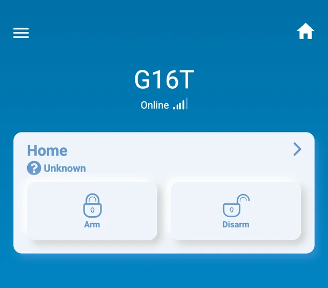{ .trik-mob-img }

### Konfigurering och styrning med SMS-meddelanden 

Du kan konfigurera och styra larmsändaren på distans med SMS-meddelanden.

Meddelandets uppbyggnad: Lösenord `[mellanslag]` Kommando `[mellanslag]` Data

Som lösenord används **Administrator code** för kommandona *INFO, RESET, OUTPUT1, CONNECT* och **Installer code** för kommandona *INFO, RESET, OUTPUT1*.

#### Lista över SMS-kommandon

| Kommando | Data | Beskrivning |
|---------|------|-------------|
| INFO |  | Begär information om enheten. Svaret innehåller: larmsändartyp, IMEI-nummer, serienummer och firmwareversion. T.ex.: 123456 INFO |
| RESET |  | Starta om enheten. T.ex.: 123456 RESET |
| OUTPUT1 | ON | Slå på OUTPUT1. T.ex.: 123456 OUTPUT1 ON |
| OUTPUT1 | OFF | Stäng av OUTPUT1. T.ex.: 123456 OUTPUT1 OFF |
| OUTPUT1 | PULSE=tttt | Slå på utgången i pulsläge under det angivna tidsintervallet (sek). / ”tttt” är pulsens längd i sekunder, angiven med fyra siffror. / T.ex.: 123456 OUTPUT2 PULSE=0002 |
| CONNECT | Protegus=ON | Aktivera åtkomst till tjänsten Protegus. T.ex.: 123456 CONNECT PROTEGUS=ON |
| CONNECT | Protegus=OFF | Avaktivera åtkomst till tjänsten Protegus. T.ex.: 123456 CONNECT PROTEGUS=OFF |
| CONNECT | IP=0.0.0.0:8000 | Ange IP-adress och portnummer för primärkanalen. / T.ex.: 123456 CONNECT IP=192.120.120.255:8000 |
| CONNECT | ENC=123456 | Ange TRK-krypteringsnyckel. T.ex.: 123456 CONNECT ENC=123456 |
| CONNECT | APN=Internet | Ange APN-namn. T.ex.: 123456 CONNECT APN=INTERNET |
| CONNECT | USER=user | Ange APN-användare. T.ex.: 123456 CONNECT USER=User |
| CONNECT | PASS=password | Ange APN-lösenord. T.ex.: 123456 CONNECT PASS=Password |
| CONNECT | CP= | Avaktivera gränssnittet för fast telefonlinje (1 – avaktiverat; 2 – aktiverat). / T.ex.: 123456 CONNECT CP=2 |

Du kan begränsa från vilka telefonnummer larmsändaren accepterar kommandon. Se avsnitt 6.4, fönstret ”User reporting”, fliken ”Control by SMS”.

## Beskrivning av TrikdisConfig-fönstren 

### Beskrivning av statusfältet i *TrikdisConfig* 

När du har anslutit G16T och klickat på **Read [F4], *TrikdisConfig*** visar programmet information om den anslutna enheten i statusfältet:

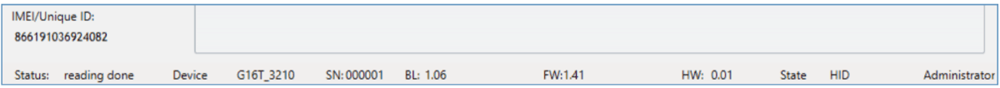

| Objekt         | Beskrivning                                        |
|----------------|----------------------------------------------------|
| IMEI/​Unique ID | Enhetens IMEI-nummer                               |
| Status         | Driftstillstånd                                    |
| Device         | Enhetstyp (G16T ska visas)           |
| SN             | Enhetens serienummer                               |
| BL             | Bootloader-version                                    |
| FW             | Enhetens firmwareversion                            |
| HW             | Enhetens maskinvaruversion                            |
| State         | Typ av anslutning till programmet (via USB eller på distans)     |
| Administrator  | Behörighetsnivå (visas när åtkomstkoden har godkänts) |

När du har tryckt på **Read [F4]** läser programmet in och visar de inställningar som är gjorda i ***G16T*.** Ange de inställningar som behövs enligt beskrivningarna av TrikdisConfig-fönstren nedan.

### Fönstret ”System settings” 

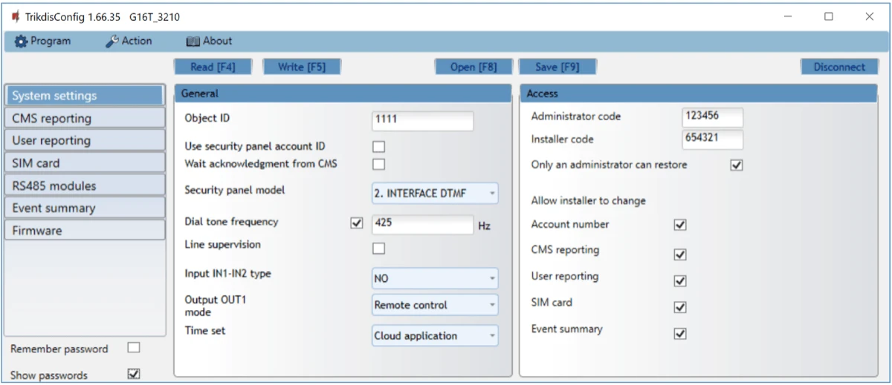

**Inställningsgruppen ”General”**

- **Object ID** – om händelserna ska skickas till larmcentralen (CMS, Central Monitoring Station), ange den abonnentkod som du har fått från larmcentralen (hexadecimalt tal med 4 tecken, 0–9, A–F. **Använd inte FFFE, FFFF som Object ID**).

- **Use security panel account ID** – om kryssrutan är markerad skickar larmsändaren händelserna med den abonnentkod som är angiven i centralapparaten i stället för värdet i fältet **Object ID**.

- **Wait acknowledgment from CMS** – om kryssrutan är markerad väntar larmsändaren efter varje skickad händelse på kvittens från IP-mottagaren om att händelsemeddelandet har tagits emot. Om larmsändaren inte får kvittensen skickar den inte signalen för avslutad kommunikation (kiss-off). När centralapparatens telefonuppringare inte får någon kiss-off sänder den händelsemeddelandet på nytt, upprepade gånger.

- **Security panel model** – aktivera/avaktivera DTMF-gränssnittet för fast telefonlinje på larmsändaren.

- **Dial tone frequency** – den frekvens som G16T använder för att kommunicera med centralapparatens telefonuppringare.

- **Line supervision** – om kryssrutan är markerad övervakas telefonlinjen mellan larmsändaren och centralapparaten. För att övervakningen ska fungera måste centralapparatens telefonuppringare vara ansluten till G16T med 4 ledare (se avsnitt **3.2 ”Kopplingsscheman för inkoppling av larmsändaren till centralapparaten”**).

- **Input IN1-IN2 type** – välj ingångstyp i listan (NO, NC, NO/EOL, NC/EOL, NO/DEOL, NC/DEOL).

- **Output OUT1 mode** – välj utgångens driftläge i listan.

- **Time set** – välj vilken server som ska användas för tidssynkronisering.

**Inställningsgruppen ”Access”**

- **Administrator code** – ger åtkomst till alla konfigurationsfält (förvald kod - 123456).

- **Installer code** – gör det möjligt att ändra bara de fält som administratören har tillåtit (förvald kod - 654321).

- **Only an administrator can restore** – om rutan är markerad kan fabriksinställningarna bara återställas genom att administratörskoden anges.

- **Allow installer to change** – administratören kan ange vilka inställningar som installatören får ändra.

### Fönstret ”CMS reporting” 

**Fliken ”CMS settings”**

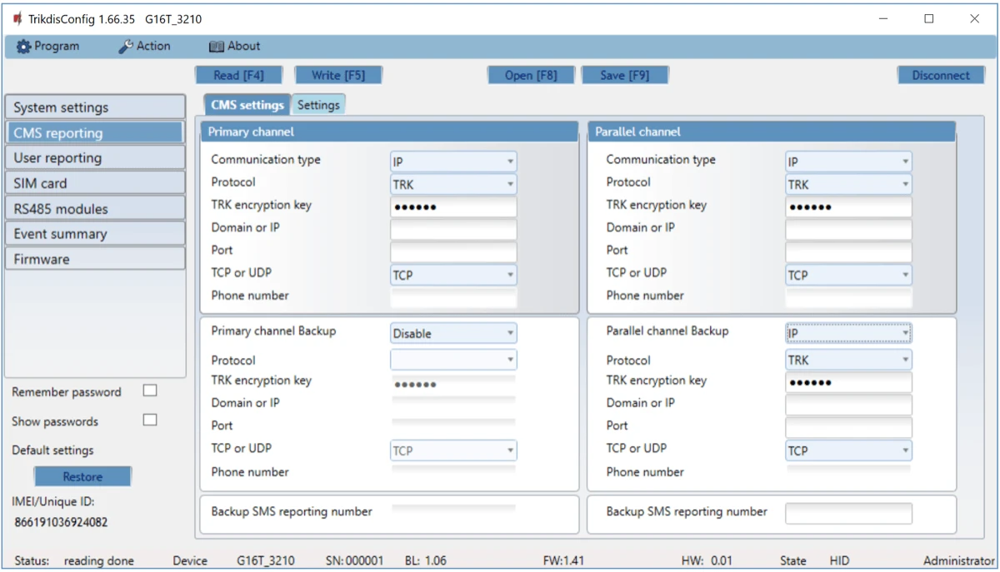

Larmsändaren skickar händelser till larmcentralen via mobilt internet (IP) eller med SMS-meddelanden.

Händelser kan skickas över flera kommunikationskanaler. Primärkanalen och den parallella kommunikationskanalen kan arbeta samtidigt, så att larmsändaren kan skicka händelser till två mottagare samtidigt. Backupkanaler kan tilldelas både primärkanalen och den parallella kanalen och används när anslutningen via primärkanalen eller den parallella kanalen bryts.

Kommunikationen är kodad och lösenordsskyddad. En TRIKDIS-mottagare krävs för att ta emot händelseinformationen och skicka den vidare till larmcentralens program:

- För anslutning över IP - programvarumottagaren IPcom för Windows/Linux, maskinvarumottagaren IP/SMS RL14 eller flerkanalsmottagaren RM14.

- För att ta emot SMS-meddelanden - maskinvarumottagaren IP/SMS RL14, flerkanalsmottagaren RM14 eller SMS-mottagaren GM14.

SMS-kommunikation är särskilt användbar som backupkanal, eftersom den fungerar även när det inte finns någon mobil internetanslutning. Vi rekommenderar inte SMS som primärkanal.

**Inställningsgruppen ”Primary channel”**

- **Communication type** - välj metod för anslutning till larmcentralens mottagare: **IP** eller **SMS**.

- **Protocol** - välj med vilken kodning händelserna ska skickas: **TRK** (till TRIKDIS-mottagare), **SIA DC-09** (till mottagare som tar emot händelser kodade i formatet SIA DC-09), **TL150** (till SUR-GARD-mottagare).

- **TRK encryption key** - krypteringsnyckel för meddelandena, 6 siffror. Nyckeln som skrivs till larmsändaren måste stämma överens med mottagarens nyckel.

- **Domain or IP** - ange mottagarens domän eller IP-adress.

- **Port** - ange mottagarens nätverksportnummer.

- **TCP or UDP** - välj med vilket protokoll (TCP eller UDP) händelserna ska skickas.

- **Phone number** (bara för SMS-meddelanden) - ange telefonnumret till en TRIKDIS SMS-mottagare. Telefonnumret måste börja med landskod (t.ex. 370xxxxxxxx).

**Inställningsgruppen ”Primary channel Backup”**

Aktivera backupkanalläget för att skicka händelser via backupkanalen om anslutningen via primärkanalen bryts. Backupkanalens inställningar är desamma som beskrivits ovan.

**Inställningsgruppen ”Parallel channel”**

Händelser överförs parallellt med primärkanalen via denna kanal. När den andra kanalen är aktiverad kan händelser skickas samtidigt till två mottagare (t.ex. en lokal och en central larmcentral). Den parallella kanalens inställningar är desamma som beskrivits ovan.

**Backup SMS reporting number**

Backup-SMS skickas när meddelanden inte kan överföras via primärkanalen, den parallella kanalen och backupkanalerna. Det är särskilt användbart eftersom det fungerar även när det inte finns någon IP-anslutning i mobiloperatörens nät.

Den här kanalen fungerar bara när IP-läge är inställt för primärkanalen och dess backupkanal.

SMS-aviseringar skickas till larmcentralens SMS-mottagare: 1) direkt första gången larmsändaren börjar arbeta, och 2) om TCP/IP- eller UDP/IP-anslutningen i den första kanalen och dess backupkanal bryts.

- **Backup SMS reporting number** - ange telefonnumret till en TRIKDIS SMS-mottagare. Telefonnumret måste börja med landskod (t.ex. 370xxxxxxxx).

**Fliken ”Settings”**

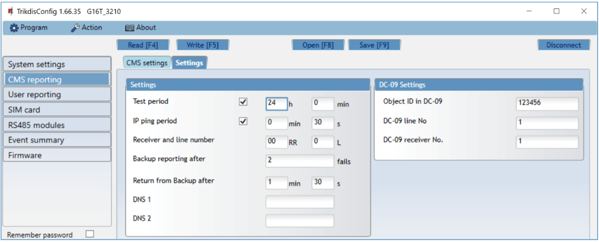

**Inställningsgruppen ”Settings”**

- **Test period** - period för TEST-händelser som testar anslutningen. Testhändelserna skickas som Contact ID-meddelanden och vidarebefordras till larmcentralens programvara.

- **IP ping period** – period för sändning av interna PING-signaler (heartbeat). Dessa meddelanden skickas bara via IP-kanal. Mottagaren vidarebefordrar inte PING-meddelanden till larmcentralens programvara, för att inte överbelasta den. Meddelanden skickas till programvaran bara om mottagaren inte får PING-meddelanden från enheten inom den inställda tiden.

  Som förval skickas meddelandet ”*Connection lost*” till larmcentralens programvara om mottagaren inte får något PING-meddelande under en tidsperiod som är tre gånger längre än den som är inställd i enheten. Om PING-perioden t.ex. är inställd på 3 minuter skickar mottagaren meddelandet *”Connection lost”* om inget PING-meddelande tas emot inom 9 minuter.

  PING-meddelanden upprätthåller den aktiva kommunikationssessionen mellan enheten och mottagaren. En aktiv session krävs för att kunna konfigurera och styra larmsändaren på distans. Vi rekommenderar att PING-perioden ställs in på högst 5 minuter.

- **Backup reporting after** - anger antalet misslyckade försök att skicka meddelandet via primärkanalen. Om enheten misslyckas att sända det angivna antalet gånger ansluter den för att skicka meddelandena via backupkanalen.

- **Return from backup after** - tid efter vilken G16T försöker ansluta igen och skicka meddelanden via primärkanalen.

- **DNS1, DNS2** - (Domain Name System) server som anger IP-adressen för en domän. Används när en domän är angiven i kommunikationskanalens fält **Domain or IP** (inte en IP-adress). Googles DNS-server är förinställd.

**Inställningsgruppen ”DC-09 settings”**

Inställningarna visas när protokollet **DC-09_2007** eller **DC-09_2012** är valt i kommunikationskanalens fält **Protocol** för att skicka händelser.

- **Object ID in DC-09** - ange objektnumret. <u>Det objektnummer som anges i detta fält används om DC-09-kodning är vald</u>. Ett hexadecimalt tal med 3 till 16 tecken kan anges. Numret får du från larmcentralen (CMS, Central Monitoring Station).

- **DC-09-line No**. - ange mottagarens linjenummer.

- **DC-09 receiver No.** - ange mottagarnumret.

### Fönstret ”User reporting” 

**Fliken ”PROTEGUS Cloud”**

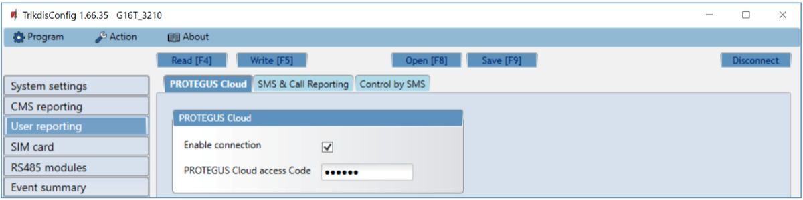

Tjänsten Protegus gör det möjligt för användarna att övervaka och styra larmsändaren på distans. Mer information om tjänsten Protegus finns på [www.protegus.app](https://www.protegus.app).

**Inställningsgruppen ”Protegus Cloud”**

- **Enable connection** - aktivera tjänsten Protegus; G16T kan då utbyta data med appen Protegus och konfigureras på distans via ***TrikdisConfig*.**

- **Protegus Cloud access Code -** 6-siffrig kod för anslutning till appen Protegus (förval - 123456).

**Fliken ”SMS & Call Reporting”**

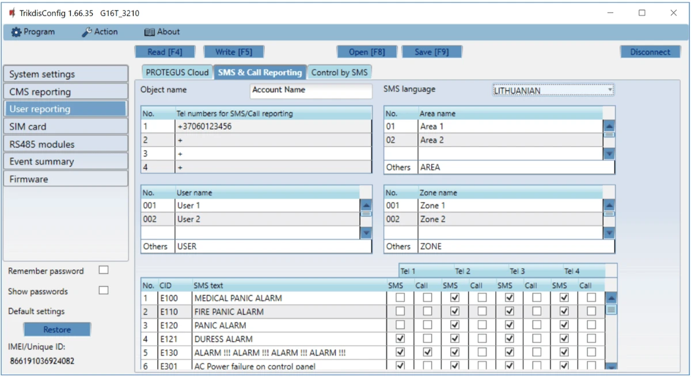

Aviseringar om systemhändelser kan skickas till användarnas mobiltelefoner som SMS eller telefonsamtal.

- **Object name** - ange namnet på det system som larmsändaren är ansluten till. Varje SMS-avisering innehåller objektets namn.

- **SMS language** - välj språk för SMS-meddelandena (SMS kan skickas med språkspecifika tecken).

- **Tel numbers for SMS/Call reporting table** - ange upp till 4 telefonnummer till användare som ska få SMS eller samtal om händelser. Telefonnumren måste börja med landskod, till exempel +370xxxxxxxx, 00370xxxxxxxx eller 370xxxxxxxx.

- **Area name, User name, Zone name tables** - varje område, användare och sektion kan ha ett namn som används i SMS-händelsemeddelandena. Ange områdets, användarens eller sektionens nummer i respektive tabell och ange namnet bredvid numret.

- **CID event table** - du kan ändra vilka telefonnummer som får SMS eller telefonsamtal med aviseringar om händelserna i listan.

  Du kan ändra texterna i SMS-meddelandena för förvalda händelser, ändra Contact ID-koderna (CID) och lägga till nya händelser med beskrivningar.

**Fliken ”Control by SMS”**

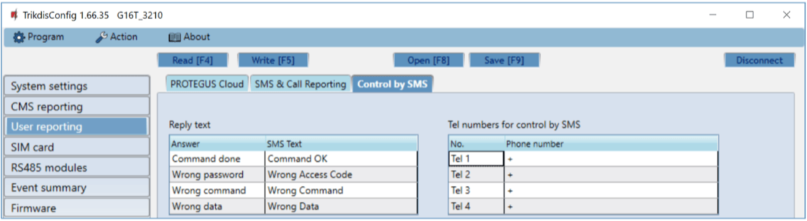

Du kan skicka SMS-kommandon till larmsändaren som styr utgången eller ändrar inställningar. Kommandona finns i avsnitt **5.4 Konfigurering och styrning med SMS-meddelanden**.

- **Reply text** - SMS-text som användaren får efter att ha skickat ett SMS-kommando. SMS-texten kan redigeras.

- **Tel numbers for remote control by SMS** - du kan ange telefonnummer från vilka larmsändaren accepterar kommandon.

!!! note "Obs!"
    Om inget telefonnummer är angivet accepterar enheten kommandon från vilket
    telefonnummer som helst. Säkerheten garanteras ändå av kravet på att ange
    administratörs- eller installatörskod i SMS-kommandot.
### Fönstret ”SIM card” 

!!! warning "Viktigt"
    1\. Kontrollera att SIM-kortet är aktiverat och fungerar innan du använder
    det. / 2. Om mobil internetanslutning ska användas för att skicka händelser
    via IP-kanal till larmcentralens mottagare eller till Protegus, kontrollera att mobildatatjänsten är
    aktiverad.
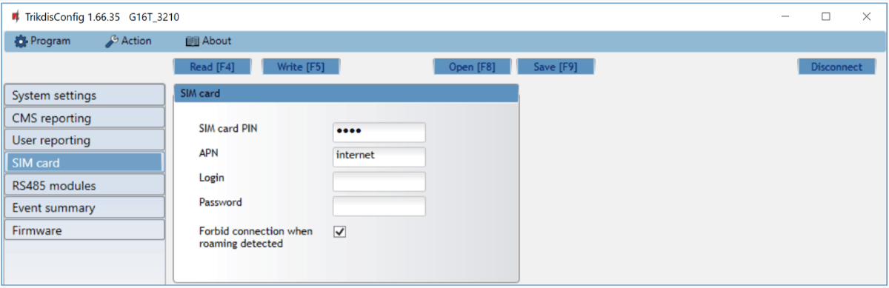

**Inställningsgruppen ”SIM card”**

- **SIM card PIN** - ange SIM-kortets PIN-kod. Koden kan avaktiveras genom att du sätter SIM-kortet i en mobiltelefon och stänger av begäran. Om du har stängt av SIM-kortets PIN-begäran, lämna förvalt värde i detta fält.

- **APN** - ange APN (Access Point Name). Det krävs för att ansluta larmsändaren till internet. APN hittar du på SIM-kortsoperatörens webbplats (”internet” är universellt och fungerar i många operatörers nät).

- **Login, Password** - ange vid behov användarnamn (login) och lösenord för anslutning till internet.

- **Forbid connection when roaming detected** - du kan använda den här funktionen när säkerhetssystemet är installerat nära en landsgräns. Funktionen hindrar larmsändaren från att arbeta i det andra landets mobilnät.

### Fönstret ”RS485 modules” 

**Fliken ”Modules list”**

Utbyggnadsmoduler i serien **iO** kan anslutas till larmsändaren för att lägga till fler ingångar, utgångar och seriella bussar för temperaturgivare. Anslutna utbyggnadsmoduler måste läggas till i tabellen **Modules list**.

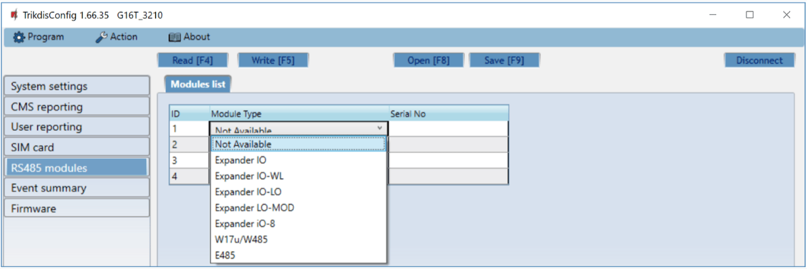

- **Module type** – välj i listan den modul som är ansluten till larmsändaren via RS485.

- **Serial No –** ange modulens serienummer (6 siffror), som anges på etiketterna på modulens kapsling och förpackning.

När du har valt den anslutna modulen och angett dess serienummer klickar du på knappen **Write [F5]**. När ändringen är skriven kopplar du bort USB Mini-B-kabeln från larmsändaren. Vänta en minut (larmsändaren måste registrera den anslutna modulen). Anslut USB Mini-B-kabeln till larmsändaren. Klicka på knappen **Read [F4]**. Gå till **RS485 modules** → **Module.**

**Flikarna ”Module”**

När du har lagt till utbyggnadsmodulen i larmsändaren enligt ovan visas en ny flik i fönstret **RS485 modules** med modulens inställningar. Fliken får ett nummer. Nedan beskrivs inställningarna för utbyggnadsmodulerna **iO-8** och **iO**, för WiFi-modulen W485 och för Ethernet-modulen E485.

**Inställningsfönstret för utbyggnadsmodulen iO-8**

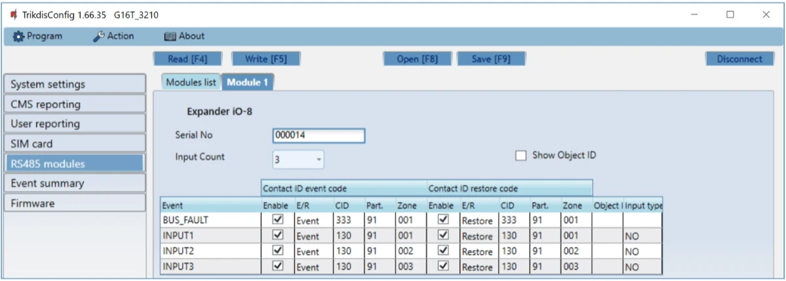

Utbyggnadsmodulen iO-8 har 8 universella (ingångs-/utgångs-)plintar. Upp till fyra utbyggnadsmoduler iO-8 kan anslutas.

- **Input Count** – välj hur många av plintarna som ska ställas in i ingångsläge (IN). Övriga plintar blir utgångar (OUT).

Utgångarna konfigureras direkt i appen Protegus.

I tabellen kan ingångarna tilldelas Contact ID-koder för händelse och återställning. När ingången löser ut skickar larmsändaren en händelse med den inställda händelsekoden till larmcentralens mottagare och till appen Protegus.

**Contact ID-händelsekod:**

- **Enable** – tillåt sändning av meddelande när ingången löser ut.

- **E/R** – välj vilken typ av händelse som ska skickas när ingången löser ut – **Event** eller **Restore**.

- **CID** – tilldela ingången en Contact ID-händelsekod.

- **Part.** – tilldela ingången området. Det ställs in automatiskt: om modulnumret är 1 är området 91, om modulnumret är 4 är området 94.

- **Zone** – ange ingångens sektionsnummer.

****Contact ID-återställningskod**:**

- **Enable** – tillåt sändning av meddelande när ingången återställs.

- **E/R** – välj vilken typ av händelse som ska skickas när ingången återställs – **Restore** eller **Event**.

- **CID** – tilldela ingången Contact ID-återställningskoden.

- **Part.** – tilldela ingången området. Det ställs in automatiskt: om modulnumret är 1 är området 91, om modulnumret är 4 är området 94.

- **Zone** – ange ingångens sektionsnummer.

- **Object ID** - ingången (IN) kan tilldelas ett Object ID som skiljer sig från Object ID för larmsändaren G16T.

- **Input type** – välj ingångens typ (NO eller NC).

För att kunderna ska få SMS-meddelanden eller samtal när en ingång löser ut anger du den Contact ID-händelsekod som är tilldelad ingången i tabellen på fliken **SMS & Call Reporting**.

**Inställningsfönstret för utbyggnadsmodulen iO**

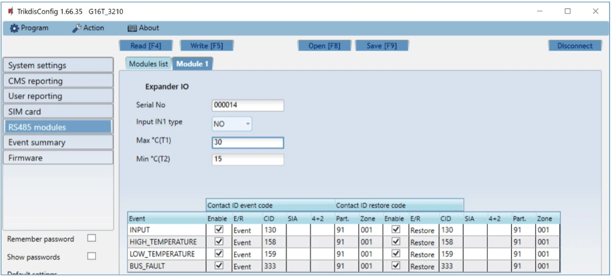

Utbyggnadsmodulen iO har plintar för 1 ingång och 1 utgång (reläkontakter) samt en seriell 1-Wire-buss för anslutning av temperaturgivare.

Reläutgången kan styras enligt logiska villkor (IF, THEN).

- **Input IN1 type** – ange ingångens typ (NO eller NC).

- **Max ◦C(T1)** – när temperaturen är högre än denna inställning genereras ett händelsemeddelande. För att ett händelsemeddelande ska genereras måste det vara aktiverat i tabellen.

- **Min ◦C(T2)** – när temperaturen är lägre än denna inställning genereras ett händelsemeddelande. För att ett händelsemeddelande ska genereras måste det vara aktiverat i tabellen.

I tabellen kan ingångarna tilldelas Contact ID-koder för händelse och återställning. När ingången löser ut skickar larmsändaren en händelse med den inställda händelsekoden till larmcentralens mottagare och till appen Protegus. Ställ in enligt beskrivningen ovan under **Inställningsfönstret för utbyggnadsmodulen iO-8**.

**Inställningsfönstret för WiFi-modulen W485**

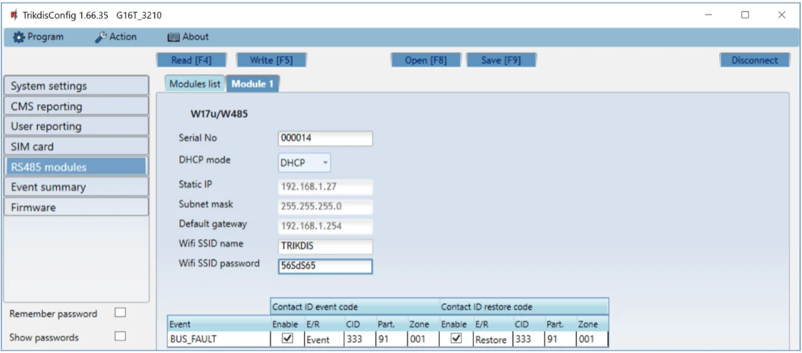

- **DHCP mode** – WiFi-modulens läge för registrering i nätverket (manuellt eller automatiskt).

- **Static IP** – statisk IP-adress när manuellt registreringsläge är valt.

- **Subnet mask** – nätmask när manuellt registreringsläge är valt.

- **Default gateway** – gatewayadress när manuellt registreringsläge är valt.

- **Wifi SSID name** – namnet på det WiFi-nätverk som W485 ansluter till.

- **Wifi SSID password** - lösenord för WiFi-nätverket.

I tabellen kan du tilldela Contact ID-koder för händelse och återställning till händelsen fel på RS485-databussen. När anslutningen mellan W485 och G16T bryts eller återupprättas skickar G16T ett meddelande med den tilldelade CID-koden till larmcentralen och appen Protegus.

!!! note "Obs!"
    Du måste konfigurera G16T att skicka meddelanden till larmcentralen och Protegus, se avsnitt 2.2 ”Inställningar för anslutning till larmcentralen” och 2.1 ”Inställningar för anslutning till appen Protegus”. / **Sätt i ett SIM-kort i larmsändaren *G16T* för att *W485* ska fungera.**
**Inställningsfönstret för Ethernet-modulen E485**

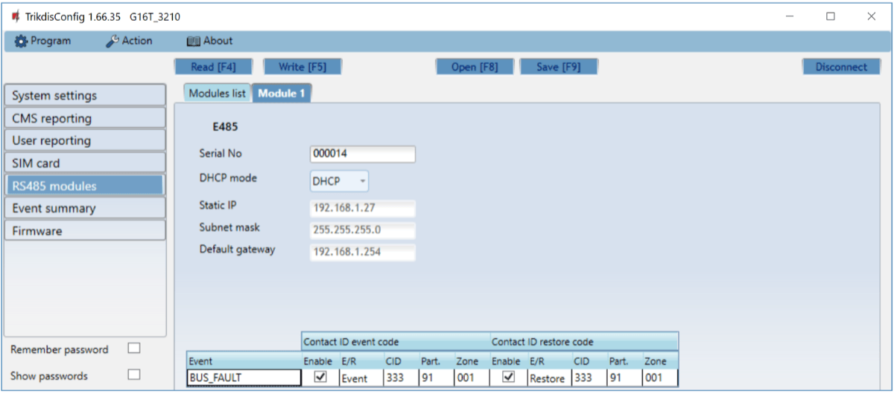

- **DHCP mode** – Ethernet-modulens läge för registrering i nätverket (manuellt eller automatiskt).

- **Static IP** – statisk IP-adress när manuellt registreringsläge är valt.

- **Subnet mask** – nätmask när manuellt registreringsläge är valt.

- **Default gateway** – gatewayadress när manuellt registreringsläge är valt.

I tabellen kan du tilldela Contact ID-koder för händelse och återställning till händelsen fel på RS485-databussen. När anslutningen mellan E485 och G16T bryts eller återupprättas skickar G16T ett meddelande med den tilldelade CID-koden till larmcentralen och appen Protegus.

!!! note "Obs!"
    Du måste konfigurera G16T att skicka meddelanden till larmcentralen och Protegus, se avsnitt 2.2 ”Inställningar för anslutning till larmcentralen” och 2.1 ”Inställningar för anslutning till appen Protegus”. / **Sätt i ett SIM-kort i larmsändaren *G16T* för att *E485* ska fungera.**
### Fönstret ”Event summary” 

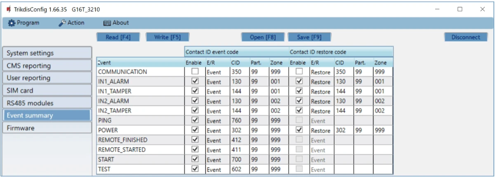

I det här fönstret kan du aktivera, avaktivera eller ändra de interna händelsemeddelanden som enheten skickar. När du har avaktiverat en intern händelse här skickas den inte, oavsett andra inställningar.

- **COMMUNICATION** – meddelande om anslutningsfel mellan centralapparaten och G16T, när övervakningen av telefonlinjen är påslagen.

- **IN1_ALARM**, **IN2_ALARM** – meddelande om att ingångskretsen (IN1 respektive IN2) löser ut.

- **IN1_TAMPER**, **IN2_TAMPER** – meddelande om att sabotagekontakten i ingångskretsen (IN1 respektive IN2) löser ut.

- **PING** – PING-signal (heartbeat).

- **POWER** – meddelande om låg matningsspänning.

- **REMOTE_STARTED** – meddelande om fjärranslutning för att konfigurera G16T med TrikdisConfig.

- **REMOTE_FINISHED** – meddelande om att fjärrkonfigureringen med TrikdisConfig har avslutats.

- **START** – meddelande om att G16T ansluter till nätet.

- **TEST** – meddelande om periodisk testsändning.

!!! note "Obs!"
    För att aktivera periodiska TEST-meddelanden och ställa in deras period, gå
    till **CMS reporting -> Settings -> Test period**.
- **Enable** – när den är markerad är sändning av meddelandena aktiverad.

Du kan ändra Contact ID-koden för varje händelse, samt sektions- och områdesnummer.

### Återställa fabriksinställningarna 

För att återställa larmsändarens fabriksinställningar klickar du på knappen **Restore** i TrikdisConfig-fönstret.

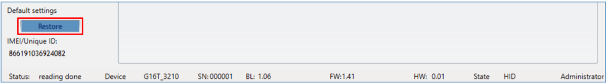

## Fjärrkonfigurering 

1.  Starta konfigurationsprogrammet TrikdisConfig.

!!! note "Obs!"
    Fjärrkonfigurering fungerar bara om:
    
    1.  Det isatta SIM-kortet är aktiverat och att PIN-koden antingen
        är angiven eller avstängd;
    
    2.  Protegus cloud är aktiverat. Hur du aktiverar molntjänsten
        beskrivs i avsnitt **6.4 Fönstret ”User reporting”**;
    
    3.  Matningen är ansluten (lysdioden ”POWER” lyser grönt);
    
    4.  Larmsändaren är registrerad i nätet (lysdioden ”NETWORK” lyser grönt och
        blinkar gult).
2.  I avsnittet **Remote access** anger du larmsändarens nummer **IMEI/Unique ID**. Numret finns på enheten och på etiketten på förpackningen.

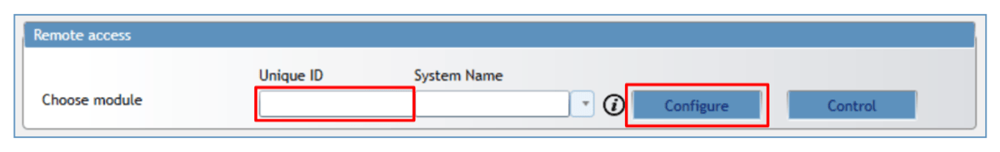

3.  (Valfritt) Ange önskat namn på G16T med detta Unique ID i fältet **System name**.

4.  Klicka på **Configure**.

5.  I det nya fönstret som öppnas klickar du på **Read [F4]**. Ange vid behov administratörs- eller installatörskoden*.*

6.  Ange de inställningar som behövs och klicka på **Write [F5]** när du är klar.

## Testa larmsändarens funktion 

När konfigureringen och installationen är klara, gör en systemkontroll:

1.  Generera en händelse:

    - genom att tillkoppla/frånkoppla systemet med centralapparatens knappsats;

    - genom att utlösa ett sektionslarm när säkerhetssystemet är tillkopplat.

2.  Kontrollera att händelsen kommer fram till larmcentralen (CMS, Central Monitoring Station) och/eller tas emot i appen Protegus.

3.  För att testa larmsändarens ingångar, utlös dem och kontrollera att rätt händelse tas emot.

4.  För att testa larmsändarens utgångar, aktivera dem på distans och kontrollera att de fungerar.

5.  Om centralapparaten ska styras på distans, tillkoppla/frånkoppla säkerhetssystemet på distans med appen Protegus.

## Firmwareuppdatering 

!!! note "Obs!"
    När larmsändaren är ansluten till TrikdisConfig erbjuder programmet
    automatiskt att uppdatera enhetens firmware om det finns
    uppdateringar. Uppdateringar kräver en internetanslutning. Antivirusprogram,
    brandvägg eller strikta inställningar för internetåtkomst kan blockera de automatiska
    firmwareuppdateringarna.
Larmsändarens firmware kan också uppdateras eller bytas manuellt. Efter en uppdatering finns alla tidigare gjorda inställningar kvar oförändrade. Vid manuell skrivning av firmware kan den bytas till en nyare eller äldre version. Så här uppdaterar du:

1.  Starta ***TrikdisConfig**.*

2.  Anslut G16T till datorn med USB Mini-B-kabel eller anslut till larmsändaren G16T på distans.

    - Om det finns en nyare firmwareversion erbjuder programmet att ladda ned filen med den nyare firmwareversionen.

3.  Välj menygrenen **Firmware**.

4.  Klicka på **Open firmware** och välj den firmwarefil du behöver. Om du inte har filen kan den senaste firmwarefilen laddas ned av <u>registrerade användare</u> från [www.trikdis.com](http://www.trikdis.com) , under nedladdningsavsnittet för larmsändaren G16T.

5.  Klicka på **Update [F12]**.

    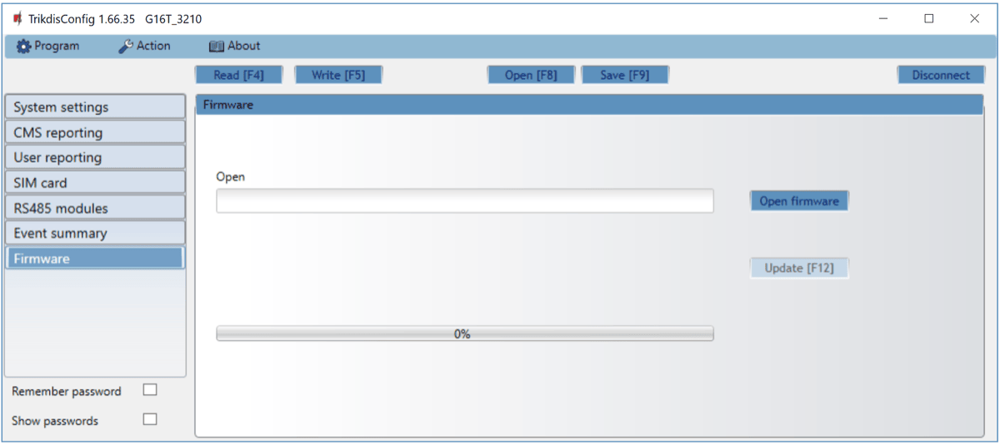

6.  Vänta tills uppdateringen är klar.

7.  Klicka på **OK** i fönstret som visas.

## Säkerhetskrav

Larmsändaren ska installeras och underhållas av behörig personal.

Läs den här manualen noggrant före installationen för att undvika misstag som kan leda till funktionsfel eller till och med skador på utrustningen.

Koppla bort matningen innan du gör några elektriska anslutningar.

Ändringar, modifieringar eller reparationer som inte har godkänts av tillverkaren upphäver garantin.

Följ dina lokala bestämmelser och släng inte ett oanvändbart larmsystem eller dess komponenter bland vanligt hushållsavfall.

## Bilaga

Larmsändaren kan arbeta med en SUR-GARD-mottagare. Larmsändaren omvandlar Contact ID-koder som tas emot från centralapparaten till SIA-koder.

**Tabell för omvandling av Contact ID-koder till SIA-koder**

| **Systemhändelse** | **CID-rapportkod** | **SIA-rapportkod** |
|----|:--:|:--:|
| Medicinskt nödlarm | E100 | "MA" |
| Personligt nödlarm | E101 | "QA" |
| Brand i sektion: <z> | E110 | "FA" |
| Vattenflöde upptäckt i sektion: <z> | E113 | "SA" |
| Larm från brandlarmsknapp i sektion: <z> | E115 | "FA" |
| Överfall i sektion: <z> | E120 | "PA" |
| Överfallslarm av användare: <v> | E121 | "HA" |
| Överfallslarm i sektion: <z> | E122 | "PA" |
| Överfallslarm i sektion: <z> | E123 | "PA" |
| Överfallslarm i sektion: <z> | E124 | "HA" |
| Överfallslarm i sektion: <z> | E125 | "HA" |
| Larm aktivt i sektion: <z> | E130 | "BA" |
| Larm aktivt i sektion: <z> | E131 | "BA" |
| Larm aktivt i sektion: <z> | E132 | "BA" |
| Larm aktivt i sektion: <z> | E133 | "BA" |
| Larm aktivt i sektion: <z> | E134 | "BA" |
| Larm aktivt i sektion: <z> | E135 | "BA" |
| Sabotage aktivt i sektion: <z> | E137 | "TA" |
| Inbrott verifierat i sektion: <z> | E139 | "BV" |
| Larm aktivt i sektion: <z> | E140 | "UA" |
| Systemfel (143) | E143 | "ET" |
| Sabotage aktivt i sektion: <z> | E144 | "TA" |
| Sabotage aktivt i sektion: <z> | E145 | "TA" |
| Larm aktivt i sektion: <z> | E146 | "BA" |
| Larm aktivt i sektion: <z> | E150 | "UA" |
| Gas upptäckt i sektion: <z> | E151 | "GA" |
| Vattenläckage upptäckt i sektion: <z> | E154 | "WA" |
| Foliebrott upptäckt i sektion: <z> | E155 | "BA" |
| Hög temperatur vid givare: <n> | E158 | "KA" |
| Låg temperatur vid givare: <n> | E159 | "ZA" |
| CO upptäckt i sektion: <z> | E162 | "GA" |
| Brandfel i sektion: <z> | E200 | "FS" |
| Övervakat larm | E220 | "BA" |
| Systemfel (300) | E300 | "YP" |
| Nätfel | E301 | "AT" |
| Låg batterispänning | E302 | "YT" |
| Systemfel (304) | E304 | "YF" |
| Systemomstart i sektion: <z> | E305 | "RR" |
| Centralapparatens programmering ändrad | E306 | "YG" |
| Systemavstängning | E308 | "RR" |
| Batterifel (309) | E309 | "YT" |
| Jordfel | E310 | "US" |
| Batterifel (311) | E311 | "YM" |
| Överström i matningen (312) | E312 | "YP" |
| Installatörsåterställning av användare: <v> (313) | E313 | "RR" |
| Fel på siren/relä | E320 | "RC" |
| Systemfel (321) | E321 | "YA" |
| Systemfel (330) | E330 | "ET" |
| Systemfel (332) | E332 | "ET" |
| Systemfel (333) | E333 | "ET" |
| Systemfel (336) | E336 | "VT" |
| Systemfel (338) | E338 | "ET" |
| Systemfel (341) | E341 | "ET" |
| Systemfel (342) | E342 | "ET" |
| Systemfel (343) | E343 | "ET" |
| Systemfel (344) | E344 | "XQ" |
| Kommunikationsfel i systemet (350) | E350 | "YC" |
| Kommunikationsfel i systemet (351) | E351 | "LT" |
| Kommunikationsfel i systemet (352) | E352 | "LT" |
| Systemfel (353) | E353 | "YC" |
| Kommunikationsfel i systemet (354) | E354 | "YC" |
| Systemfel (355) | E355 | "UT" |
| Fel i brandsektion: <z> | E373 | "FT" |
| Fel i sektion: <z> | E374 | "EE" |
| Fel i sektion: <z> | E378 | "BG" |
| Fel i sektion: <z> | E380 | "UT" |
| Fel på trådlös sektion: <z> | E381 | "US" |
| Fel på trådlös modul (382) | E382 | "UY" |
| Sabotage aktivt i sektion: <z> | E383 | "TA" |
| Låg batterispänning i trådlös sektion: <z> | E384 | "XT" |
| Fel i sektion: <z> (389) | E389 | "ET" |
| Fel i sektion: <z> (391) | E391 | "NA" |
| Fel i sektion: <z> (393) | E393 | "NC" |
| Användare <v> frånkopplade systemet | E400 | "OP" |
| Användare <v> frånkopplade systemet | E401 | "OP" |
| Automatisk frånkoppling | E403 | "OA" |
| Uppskjuten frånkoppling av användare <v> | E405 | "OR" |
| Larm avbrutet av användare: <v> | E406 | "BC" |
| Användare <v> frånkopplade på distans | E407 | "OP" |
| Snabbfrånkoppling | E408 | "OP" |
| Fjärrfrånkoppling | E409 | "OS" |
| Återuppringningsbegäran från larmcentralen | E411 | "RB" |
| Lyckad nedladdning av data | E412 | "RS" |
| Inpassering nekad för användare <v> | E421 | "JA" |
| Inpassering av användare <v> | E422 | "DG" |
| Forcerad åtkomst i sektion <z> | E423 | "DF" |
| Utpassering nekad för användare <v> | E424 | "DD" |
| Utpassering av användare <v> | E425 | "DR" |
| Användare <v> frånkopplade för tidigt | E451 | "OK" |
| Användare <v> tillkopplade för sent | E452 | "OJ" |
| Användare <v> lyckades inte frånkoppla | E453 | "CT" |
| Användare <v> lyckades inte tillkoppla | E454 | "CI" |
| Automatisk tillkoppling misslyckades | E455 | "CI" |
| Delvis tillkoppling av användare: <v> | E456 | "CG" |
| Utpasseringsfel av användare: <v> | E457 | "EE" |
| Systemet frånkopplat efter larm av användare: <v> | E458 | "OR" |
| Nyligen tillkopplat av användare <v> | E459 | "CR" |
| Felaktig kod angiven | E461 | "JA" |
| Tiden för automatisk tillkoppling förlängd av användare: <v> | E464 | "CE" |
| Enhet avaktiverad (501) | E501 | "RL" |
| Enhet avaktiverad (520) | E520 | "RO" |
| Trådlös detektor avaktiverad i sektion: <z> (552) | E552 | "YS" |
| Sektion <z> förbikopplad | E570 | "UB" |
| Sektion <z> förbikopplad | E571 | "FB" |
| Sektion <z> förbikopplad | E572 | "MB" |
| Sektion <z> förbikopplad | E573 | "BB" |
| Gruppförbikoppling av användare: <v> | E574 | "CG" |
| Sektion <z> förbikopplad | E576 | "UB" |
| Förbikoppling av sektion <z> upphävd | E577 | "UB" |
| Förbikoppling av ventilationssektion | E579 | "UB" |
| Gångtest aktiverat av användare: <v> | E607 | "TS" |
| Manuell testsändning | E601 | "RX" |
| Periodisk testsändning | E602 | "RP" |
| Systemhändelse (605) | E605 | "JL" |
| Systemhändelse (606) | E606 | "LF" |
| Periodisk testsändning med fel | E608 | "RY" |
| Systemhändelse (622) | E622 | "JL" |
| Systemhändelse (623) | E623 | "JL" |
| Tid/datum omställda av användare <v> | E625 | "JT" |
| Felaktig tid/datum | E626 | "JT" |
| Systemprogrammering startad | E627 | "LB" |
| Systemprogrammering avslutad | E628 | "LS" |
| Systemhändelse (631) | E631 | "JS" |
| Systemhändelse (632) | E632 | "JS" |
| Systemet inte aktivt (654) | E654 | "CD" |
| Medicinskt nödlarm återställt | R100 | "MH" |
| Personligt nödlarm återställt | R101 | "QH" |
| Brandlarm återställt i sektion: <z> | R110 | "FH" |
| Vattenflödeslarm återställt i sektion: <z> | R113 | "SH" |
| Överfallslarm återställt i sektion: <z> | R120 | "PH" |
| Överfallslarm avbrutet av användare: <v> | R121 | "HH" |
| Överfallslarm återställt i sektion: <z> | R122 | "PH" |
| Överfallslarm återställt i sektion: <z> | R123 | "PH" |
| Överfallslarm återställt i sektion: <z> | R124 | "HH" |
| Överfallslarm återställt i sektion: <z> | R125 | "HH" |
| Larm återställt i sektion: <z> | R130 | "BH" |
| Larm återställt i sektion: <z> | R131 | "BH" |
| Larm återställt i sektion: <z> | R132 | "BH" |
| Larm återställt i sektion: <z> | R133 | "BH" |
| Larm återställt i sektion: <z> | R134 | "BH" |
| Larm återställt i sektion: <z> | R135 | "BH" |
| Sabotage återställt i sektion: <z> | R137 | "TA" |
| Larm återställt i sektion: <z> | R140 | "UH" |
| Systemfel (143) återställt | R143 | "UR" |
| Sabotage återställt i sektion: <z> | R144 | "TR" |
| Sabotage återställt i sektion: <z> | R145 | "TR" |
| Larm återställt i sektion: <z> | R146 | "BH" |
| Larm återställt i sektion: <z> | R150 | "UH" |
| Gaslarm återställt i sektion: <z> | R151 | "GH" |
| Vattenläckagelarm återställt i sektion: <z> | R154 | "WH" |
| Foliebrott återställt i sektion: <z> | R155 | "BH" |
| Temperaturen har normaliserats vid givare: <n> | R158 | "KH" |
| Temperaturen har normaliserats vid givare: <n> | R159 | "ZH" |
| CO-larm återställt i sektion: <z> | R162 | "GH" |
| Brandfel återställt i sektion: <z> | R200 | "FV" |
| Övervakat larm återställt | R220 | "BH" |
| Systemfel (300) återställt | R300 | "YA" |
| Nätspänning OK | R301 | "AR" |
| Batteri OK | R302 | "YR" |
| Systemfel (304) återställt | R304 | "YG" |
| Systemomstart återställd i sektion: <z> | R305 | "RR" |
| Batterifel (309) återställt | R309 | "YR" |
| Jordfel återställt | R310 | "UR" |
| Batterifel (311) återställt | R311 | "YR" |
| Överström i matningen (312) återställd | R312 | "YQ" |
| Fel på siren/relä återställt | R320 | "RO" |
| Systemfel (321) återställt | R321 | "YH" |
| Systemfel (330) återställt | R330 | "ER" |
| Systemfel (332) återställt | R332 | "ER" |
| Systemfel (333) återställt | R333 | "ER" |
| Systemfel (336) återställt | R336 | "VR" |
| Systemfel (338) återställt | R338 | "ER" |
| Systemfel (341) återställt | R341 | "ER" |
| Systemfel (342) återställt | R342 | "ER" |
| Systemfel (344) återställt | R344 | "XH" |
| Kommunikationsfel i systemet (350) återställt | R350 | "YK" |
| Kommunikationsfel i systemet (351) återställt | R351 | "LR" |
| Kommunikationsfel i systemet (352) återställt | R352 | "LR" |
| Systemfel (353) återställt | R353 | "YK" |
| Kommunikationsfel i systemet (354) återställt | R354 | "YK" |
| Systemfel (355) återställt | R355 | "UJ" |
| Fel i brandsektion: <z> återställt | R373 | "FJ" |
| Fel i sektion: <z> återställt | R374 | "EA" |
| Fel i sektion: <z> återställt | R380 | "UJ" |
| Fel på trådlös sektion: <z> återställt | R381 | "UR" |
| Fel på trådlös modul (382) återställt | R382 | "BR" |
| Sabotage återställt i sektion: <z> | R383 | "TR" |
| Batteri OK i trådlös sektion: <z> | R384 | "XR" |
| Fel i sektion: <z> (391) återställt | R391 | "NS" |
| Fel i sektion: <z> (393) återställt | R393 | "NS" |
| Användare <v> tillkopplade systemet | R400 | "CL" |
| Användare <v> tillkopplade systemet | R401 | "CL" |
| Automatisk tillkoppling | R403 | "CA" |
| Användare <v> tillkopplade på distans | R407 | "CL" |
| Snabbtillkoppling | R408 | "CL" |
| Fjärrtillkoppling | R409 | “CS” |
| Användare <v> tillkopplade i hemmaläge | R441 | "CG" |
| Användare <v> tillkopplade för tidigt | R451 | “CK” |
| Användare <v> frånkopplade för sent | R452 | “CJ” |
| Användare <v> lyckades inte frånkoppla | R454 | “CI” |
| Delvis tillkoppling av användare: <v> | R456 | "CG" |
| Nyligen frånkopplat av användare <v> | R459 | “CR” |
| Enhet aktiverad (501) | R501 | "RG" |
| Enhet aktiverad (520) | R520 | "RC" |
| Trådlös detektor aktiverad i sektion: <z> (552) | R552 | "YK" |
| Förbikoppling av sektion <z> upphävd | R570 | "UU" |
| Förbikoppling av sektion <z> upphävd | R571 | "FU" |
| Förbikoppling av sektion <z> upphävd | R572 | "MU" |
| Förbikoppling av sektion <z> upphävd | R573 | "BU" |
| Gruppförbikoppling av användare: <v> upphävd | R574 | "CF" |
| Förbikoppling av sektion <z> upphävd | R576 | "UU" |
| Förbikoppling av sektion <z> upphävd | R577 | "UU" |
| Förbikoppling av ventilationssektion upphävd | R579 | "UU" |
| Gångtest avaktiverat av användare <v> | R607 | "TE" |
| Tid/datum omställda av användare <v> | R625 | "JT" |
| Systemet aktivt (654) | R654 | "CD" |
