# GET-larmsändare med mobilanslutning

  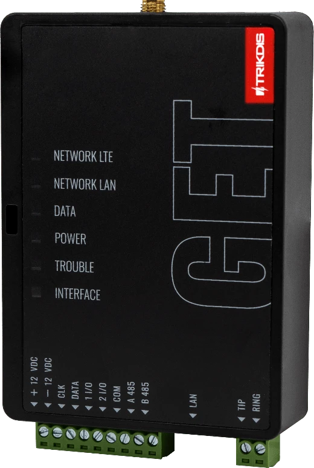

## Beskrivning 

Larmsändaren är avsedd att överföra händelsemeddelanden från centralapparaten till larmcentralen (CMS, Central Monitoring Station) och till appen Protegus2.

Larmsändaren GET med mobil- och Ethernetanslutning kan anslutas direkt till centralapparater från DSC, Paradox, UTC Interlogix (CADDX), Texecom, Innerrange och Honeywell. Larmsändaren kan också anslutas till centralapparaternas telefonuppringare (som stöder protokollet Contact ID överfört med DTMF-toner).

Larmsändaren överför fullständig händelseinformation till larmcentralen.

Larmsändaren fungerar med appen Protegus2. Med Protegus2 kan användarna styra sitt larmsystem på distans och få aviseringar om händelser i larmsystemet. Appen Protegus2 fungerar med alla centralapparater från olika tillverkare som GET-larmsändaren är ansluten till. Larmsändaren kan skicka händelseaviseringar till larmcentralen och arbeta med Protegus2 samtidigt.

### Funktioner

**Ansluts till centralapparatens seriella buss, knappsatsbuss eller telefonlinje (TIP/RING).**

DSC-centralapparater kan anslutas till knappsatsbussen och till centralapparatens TIP/RING-plintar samtidigt. Knappsatsbussen används för styrning och för centralapparatens status, och händelserna rapporteras med centralapparatens egna Contact ID-koder.

Skickar händelser till larmcentralens mottagare:

- Skickar händelser till *TRIKDIS* programvaru- eller maskinvarumottagare som fungerar med all programvara för larmcentraler.

- Kan skicka händelsemeddelanden till SIA DC-09-mottagare.

- Kan skicka händelsemeddelanden till SUR-GARD-mottagare. Bilagan innehåller en tabell för omvandling av Contact ID-koder till SIA-koder.

- Övervakning av anslutningen genom att en PING-förfrågan skickas till IP-mottagaren var 30:e sekund (eller med en period som användaren anger).

- Backupkanal som används om anslutningen via primärkanalen bryts.

- Med parallell kommunikationskanal kan händelser skickas till två mottagare samtidigt.

- När tjänsten *Protegus2* är aktiverad levereras händelserna först till larmcentralen och skickas därefter till appens användare.

**Fungerar med appen Protegus2:**

- ”*Push*”-aviseringar och särskilda ljud som informerar om händelser.

- Fjärrstyrd tillkoppling/frånkoppling av systemet.

- Fjärrstyrning av anslutna enheter (belysning, portar, ventilationssystem, värme, bevattning m.m.).

- Olika användarrättigheter för administratör, installatör och användare.

**Meddelar användare:**

- Användarna kan få aviseringar om händelser via appen Protegus2.

**Styrbara utgångar och ingångar:**

- 2 plintar med dubbel funktion som kan ställas in antingen som ingång (IN) eller som styrbar utgång (OUT).

- Utgångarna styrs med appen Protegus2.

**Snabb installation:**

- Inställningarna kan sparas i en fil och snabbt skrivas till andra larmsändare.

- Två behörighetsnivåer för konfigurering av enheten: för larmcentralens administratör och för installatören.

- Fjärrkonfigurering och firmwareuppdateringar.

### Lista över kompatibla centralapparater 

| Tillverkare | Modell |
|--------------|-------|
| DSC® | <u>PC585</u>, <u>PC1404</u>, <u>PC1565</u>, <u>PC1616</u>, <u>PC1832</u>, <u>PC1864</u>, <u>PC5020</u> |
| PARADOX® | <u>SPECTRA SP4000</u>, <u>SP5500</u>, <u>SP6000</u>, <u>SP7000</u>, <u>SP65</u>, <u>SP5500+</u>, <u>SP6000+</u>, <u>SP7000+</u> |
| PARADOX® | <u>MAGELLAN MG5000</u>, <u>MG5050</u>, <u>MG5050E</u>, <u>MG5050+</u>, <u>MG5075</u> |
| PARADOX® | <u>DIGIPLEX</u> EVO48, <u>EVO192</u>, <u>EVOHD</u>, <u>EVOHD+</u> |
| PARADOX® | SPECTRA 1727, 1728, 1738 |
| PARADOX® | ESPRIT E55 |
| UTC Interlogix® | <u>NetworX (Caddx) NX-4v2</u>, <u>NX-6v2</u>, <u>NX-8v2</u>, <u>NX-8e</u> |
| Texecom® | <u>Premier 24</u>, <u>48</u>, <u>88</u>, <u>168</u>, <u>640</u> / <u>Premier Elite 12</u>, <u>24</u>, <u>48</u>, <u>64</u>, <u>88</u>, <u>168</u>, <u>640</u> |
| Innerrange® | Inception, Integriti |
| Honeywell® | <u>Ademco Vista-15</u>, <u>Ademco Vista-20</u>, <u>Ademco Vista-48</u> |

**<u>Understruket</u>** - centralapparater som larmsändaren styr direkt***.*** Firmware i PARADOX-centralapparater som styrs direkt måste vara V.4 eller senare.

DSC-centralapparater kan anslutas enbart till knappsatsbussen, eller till knappsatsbussen och TIP/RING-plintarna samtidigt (se 3.3.1).

\* Anslut centralapparater från andra tillverkare till GET-larmsändaren via centralapparatens TIP RING-plintar.

### Larmsändarens modelltyper 

Denna manual gäller LTE-larmsändare.

### Specifikationer 

| Parameter | Beskrivning |
|-----------|-------------|
| Nätverksanslutning | LTE / Ethernet |
| Anslutning till centralapparat | Seriell buss, knappsatsbuss eller TIP RING |
| Plintar med dubbel funktion [IN/OUT] | 2, kan ställas in antingen som ingångar av typen NC, NO, NC/EOL, NO/EOL, NC/DEOL eller NO/DEOL (2,2 kΩ) eller som utgångar av typen öppen kollektor (OC) med en ström på upp till 0,15 A, max 30 V DC. |
| Modem EG915U-EU / (Europa) | LTE FDD: B1/B3/B5/B7/B8/B20/B28 |
| Modem EG915U-EU / (Europa) | GSM: B2/B3/B5/B8 |
| Modem EG915U-LA / (Latinamerika) | LTE FDD: B2/B3/B4/B5/B7/B8/B28/B66 |
| Modem EG915U-LA / (Latinamerika) | GSM: B2/B3/B5/B8 |
| Modem BG95-M5 (Cat M1) | LTE-FDD: B1/B2/B3/B4/B5/B8/B12/B13/B18/B19/B20/B25/B26/B27/B28/B66/B85 |
| Modem BG95-M5 (Cat M1) | EGPRS: 850/900/1800/1900 MHz |
| Matningsspänning | 10–18 V DC |
| Strömförbrukning | Upp till 100 mA (i viloläge) / upp till 300 mA (vid dataöverföring) |
| Överföringsprotokoll | TRK8, DC-09_2007, DC-09_2012, TL150 |
| Meddelandekryptering | AES 128 |
| Buffertminne | 60 händelser |
| Ändring av inställningar | Med datorprogrammet TrikdisConfig, på distans eller lokalt via USB-C-porten |
| Driftmiljö | Temperatur från -10 °C till 50 °C, relativ luftfuktighet upp till 80 % vid +20 °C |
| Larmsändarens mått | 113 × 70 × 25 mm |
| Vikt | 110 g |

### Larmsändarens delar 

1.  SMA-kontakt för mobilantenn

2.  Lysdiodsindikeringar

3.  Spår för att öppna kapslingens framsida

4.  Plintblock för externa anslutningar

5.  Knappen ”RESET”.

6.  Kortplats för SIM2-kort

7.  Kortplats för SIM1-kort

8.  USB-C-port för programmering av larmsändaren

9.  RJ45-uttag för Ethernetanslutning

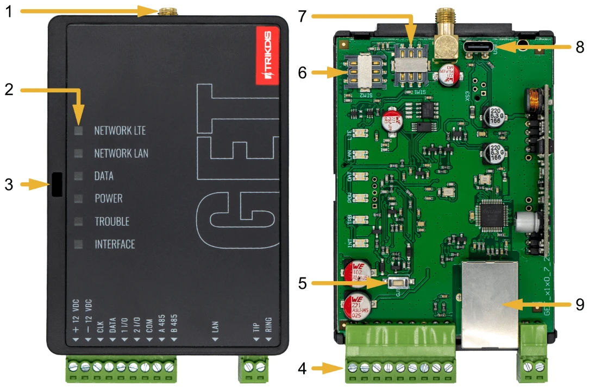

### Plintarnas funktion 

| Plint | Beskrivning |
|----------|-------------|
| +12 VDC | Matning +10 V/+18 V DC |
| -12 VDC | Matning 0 V DC |
| CLK | Plintar för seriell buss, för direkt anslutning till centralapparaten |
| I/O 1 | Första ingångs-/utgångsplinten (förval – OUT) |
| I/O 2 | Andra ingångs-/utgångsplinten (förval – OUT) |
| COM | Gemensam plint (minus) |
| A 485 | Används inte |
| LAN | RJ45-uttag för Ethernetanslutning |
| TIP | Plint för anslutning till centralapparatens TIP-plint |
| RING | Plint för anslutning till centralapparatens RING-plint |

### Lysdiodsindikering vid drift 

| Indikator | Lysdiodens läge | Beskrivning |
|-----------|--------------|-------------|
| NETWORK LTE | Släckt | Ingen anslutning till mobilnätet |
| NETWORK LTE | Blinkar gult | Ansluter till mobilnätet |
| NETWORK LTE | Fast grönt sken med gult blinkande | Larmsändaren är ansluten till mobilnätet. / Tillräcklig mobil signalstyrka för 4G nivå 3 (tre gula blinkningar) |
| NETWORK LAN | Släckt | Ingen anslutning till datornätverk |
| NETWORK LAN | Fast grönt sken | Larmsändaren är ansluten till ett datornätverk |
| DATA | Släckt | Inga osända händelser |
| DATA | Fast grönt sken | Osända händelser finns lagrade i bufferten |
| DATA | Blinkar grönt | (Konfigurationsläge) Data överförs till/från larmsändaren |
| POWER | Släckt | Matningen är avstängd eller bortkopplad |
| POWER | Fast grönt sken | Matningen är på med tillräcklig spänning |
| POWER | Fast gult sken | Matningsspänningen är otillräcklig (≤11,5 V) |
| POWER | Fast grönt sken och gult blinkande | (Konfigurationsläge) Larmsändaren är klar för konfigurering |
| POWER | Fast gult sken | (Konfigurationsläge) Ingen anslutning till datorn |
| TROUBLE | Släckt | Inga driftproblem |
| TROUBLE | 1 orange eller röd blinkning | Anslutningsfel på den fysiska nivån (PHY Link status error), kontrollera LAN-kabeln |
| TROUBLE | 2 orange eller röda blinkningar | Fel på SIM1-kortet |
| TROUBLE | 3 orange eller röda blinkningar | Fel på SIM2-kortet |
| TROUBLE | 7 orange eller röda blinkningar | Förlorad anslutning till centralapparaten (seriell buss) |
| INTERFACE | - | Används inte |

!!! note "Obs!"
    Indikeringen TROUBLE är orange på äldre GET-enheter och röd på enheter från nyare produktion. Antalet blinkningar betyder detsamma i båda fallen.

### Principschema för användning av GET-larmsändaren 

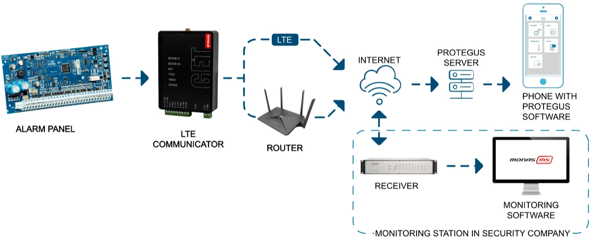

!!! note "Obs!"
    Innan du börjar, se till att du har följande:
    
    1.  USB-C-kabel för konfigurering.
    
    2.  Minst 4-ledarkabel för att ansluta larmsändaren till centralapparaten.
    
    3.  CRP2.4-kabel för anslutning till Paradox-centralapparatens seriella port.
    
    4.  Spårskruvmejsel 2,5 mm.
    
    5.  Antenn med tillräcklig förstärkning om nättäckningen i området är dålig.
    
    6.  Aktiverat SIM-kort (PIN-kodsbegäran kan vara avstängd).
    
    7.  Installationsmanualen för den aktuella centralapparaten.
    
    Beställ nödvändiga komponenter separat från din lokala distributör.
## Snabbkonfiguration

Nedan beskrivs vilka inställningar som behövs för att larmsändaren ska börja skicka händelser till larmcentralen (CMS, Central Monitoring Station) och för att säkerhetssystemet ska kunna styras med appen Protegus2.

Du kan göra inställningarna i Protegus-appen eller i TrikdisConfig. Varje avsnitt nedan visar stegen för båda.

=== "Protegus app"

    Larmsändaren måste vara online och tillagd i ditt Protegus-konto (se [Lägga till säkerhetssystemet i appen Protegus2](#51-lagga-till-sakerhetssystemet-i-appen-protegus2)). Om den ännu inte kan ansluta, till exempel för att SIM-kortet kräver PIN-kod eller en annan APN, gör först inställningarna med TrikdisConfig.

    1.  I Protegus-appen öppnar du systemet och går till **Settings → Advanced settings**.

    2.  Första gången visar appen **Proceed with Caution**. Tryck på **Accept the risk and continue**. Markera **Do not show this again.** för att slippa varningen nästa gång.

        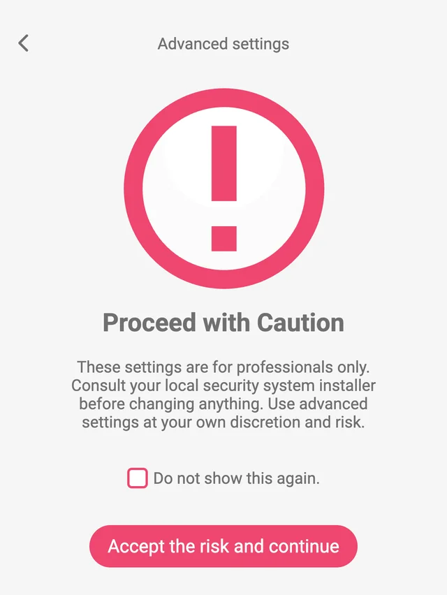{ .trik-mob-img }

    3.  Appen läser larmsändarens inställningar. Om den ber om **Service Access code**, ange larmsändarens åtkomstkod för Protegus Cloud (förval 123456).

    4.  Ändra de inställningar som beskrivs nedan och tryck sedan på **Write** för att spara dem i larmsändaren.

    !!! note "Obs!"
        Protegus-appen stöder GET med firmware 1.08 eller senare.

=== "TrikdisConfig"

    1.  Ladda ned konfigurationsprogrammet **TrikdisConfig** från [www.trikdis.com](http://www.trikdis.com) (skriv ”TrikdisConfig” i sökfältet) och installera det.

    2.  Öppna larmsändarens kapsling med en spårskruvmejsel enligt bilden nedan:

        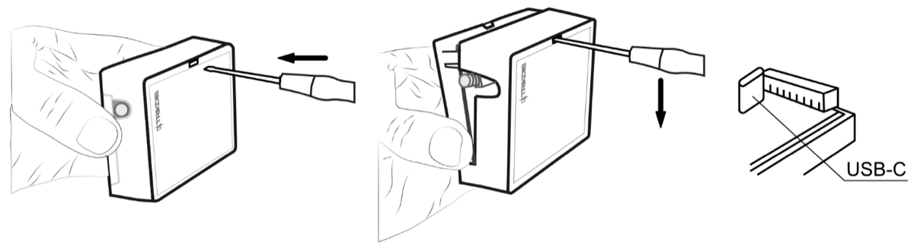

    3.  Anslut larmsändaren till datorn med en USB-C-kabel.

    4.  Starta TrikdisConfig. Programmet identifierar automatiskt den anslutna larmsändaren och öppnar ett fönster för konfigurering.

    5.  Klicka på **Read [F4]** för att läsa larmsändarens inställningar. Om du uppmanas, ange administratörs- eller installatörskoden (6 siffror) i dialogrutan.

### Inställningar för anslutning till appen Protegus2 

=== "Protegus app"

    I Protegus-appen öppnar du **Settings → Advanced settings** och ställer in:

    1.  **Panel settings → TLF** (larmsändaren ansluten till centralapparatens TIP/RING-plintar): ställ in **Security panel model** på **AUTO**.

    2.  **Panel settings → Serial Bus** (larmsändaren ansluten till knappsatsbussen eller den seriella bussen): välj **Security panel model**.

    3.  På samma skärm aktiverar du **Remote Arm/Disarm** om användarna ska styra centralapparaten i Protegus-appen med sin knappsatskod. Inställningen visas bara för centralapparater som styrs direkt.

    4.  För direktstyrning av Paradox-centralapparater anger du **PC download password**; för Texecom-centralapparater UDL-koden. Den måste stämma överens med lösenordet som är inställt i centralapparaten.

    5.  **User reporting → Cloud**: aktivera **Enabled** och ändra **Cloud access code** om användarna ska uppmanas att ange den när de lägger till systemet i Protegus-appen (förval 123456).

    6.  **Network settings → LAN** (larmsändaren ansluten till ett LAN): aktivera **Use DHCP**.

    7.  **Network settings → SIM** och **SIM2** (för varje isatt SIM-kort): ange **SIM card PIN** och **APN**. Kontrollera att **DNS1** och **DNS2** stämmer med de som din internetleverantör stöder.

    8.  **Reporting to CMS → CMS settings → Reporting mode**: ställ in **Main type**, **Backup type** och **Backup type 2**, alltså i vilken ordning larmsändaren använder **LAN**, **SIM** (SIM1) och **SIM2**.

    9.  Tryck på **Write**.

    När en DSC-centralapparat är ansluten både till knappsatsbussen och till TIP/RING-plintarna ställer du in **Panel settings → TLF → Security panel model** på **AUTO** och väljer DSC-centralapparatens modell under **Panel settings → Serial Bus**. Aktivera **Remote Arm/Disarm** för att styra centralapparaten från Protegus-appen. Se 3.3.1.2.

    !!! note "Obs!"
        För att direktstyrningen av centralapparaten ska fungera måste du ändra centralapparatens inställningar. Hur du gör beskrivs i avsnitt 4.1 ”Programmering av centralapparater när larmsändaren är ansluten till knappsatsbussen eller den seriella bussen”.

=== "TrikdisConfig"

    I TrikdisConfig ställer du in:

    **I fönstret ”Panel settings”:**

    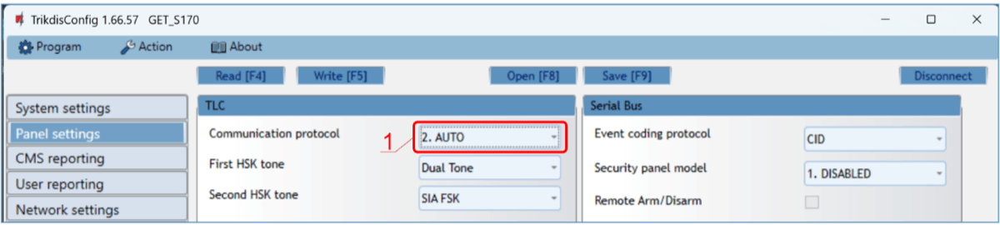

    1.  Om larmsändaren är ansluten till centralapparatens TIP/RING-plintar måste du välja inställningen ”**AUTO**”.

    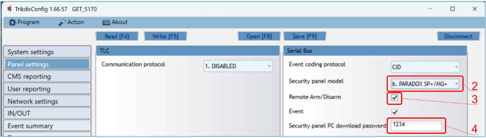

    Larmsändaren är ansluten till centralapparatens knappsatsbuss eller seriella buss.

    2. Välj den ”**Security panel model”** som ska anslutas till larmsändaren.

    2.  Markera ”**Remote Arm/Disarm”** om användarna ska kunna styra centralapparaten i appen Protegus2 med sin knappsatskod. Inställningen visas bara för centralapparater som styrs direkt.

    3.  För direktstyrning av Paradox- och Texecom-centralapparater anger du ”**Security panel PC download password”**. Det måste stämma överens med lösenordet som är angivet i centralapparaten.

    När en DSC-centralapparat är ansluten både till knappsatsbussen och till TIP/RING-plintarna ställer du in ”**Communication protocol**” på ”**AUTO**” och väljer DSC-centralapparatens modell i ”**Security panel model**”. Markera ”**Remote Arm/Disarm**” för att styra centralapparaten från Protegus2. Se 3.3.1.2.

    !!! note "Obs!"
        För att direktstyrningen av centralapparaten ska fungera måste du ändra
        centralapparatens inställningar. Hur du gör beskrivs i avsnitt 4.1 ”Programmering av
        centralapparater när larmsändaren är ansluten till knappsatsbussen eller den
        seriella bussen”. I det avsnittet finns information om hur du ändrar
        ”**PC download/UDL password**”.
    **I fönstret ”User reporting”, fliken ”PROTEGUS Cloud”:**

    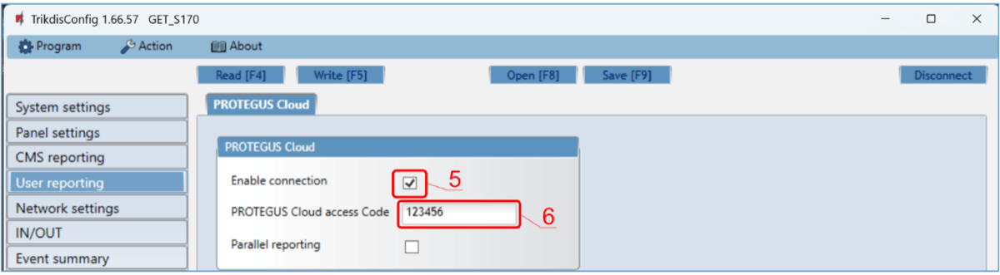

    4. Markera kryssrutan ”**Enable connection”** till Protegus Cloud.

    2.  Ändra ”**PROTEGUS Cloud access Code”** för inloggning i Protegus2 om användarna ska uppmanas att ange den när de lägger till systemet i appen Protegus2 (förvalt lösenord – 123456).

    **I fönstret ”Network settings”:**

    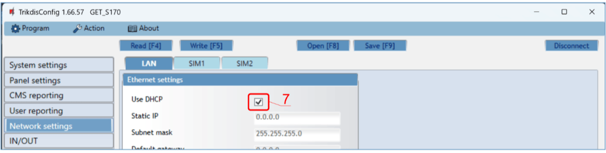

    Dessa inställningar måste göras om larmsändaren är ansluten till ett LAN.

    3. Markera kryssrutan ”**Use DHCP”** så att larmsändaren automatiskt läser datornätverkets inställningar (nätmask, gateway) och tilldelas en IP-adress.

    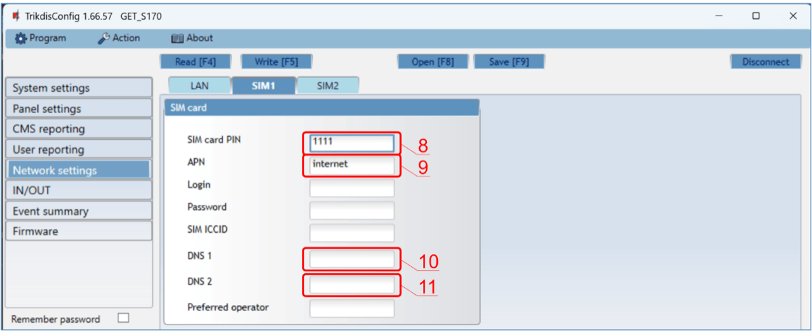

    Dessa inställningar måste göras om ett SIM-kort (eller två SIM-kort) är isatt i larmsändaren.

    4. Ange PIN-koden i ”**SIM card PIN”**.

    2.  Ändra namnet i ”**APN”**. APN hittar du på SIM-kortsoperatörens webbplats (”internet” är universellt och fungerar i många operatörers nät).

    3.  **DNS1, DNS2**: Googles DNS-server är förinställd. **Oavsett IP-inställningar, se till att DNS-adresserna stämmer med de som din internetleverantör stöder**.

    **I fönstret ”CMS reporting”:**

    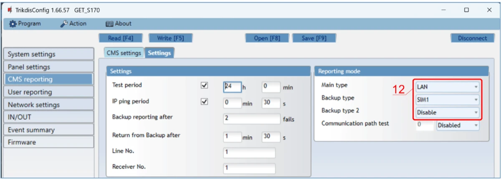

    12. I alternativgruppen ”**Reporting mode**” ställs ordningen på kommunikationskanalerna in, alltså hur larmsändaren skickar meddelanden till larmcentralen och till Protegus2. Anslutningstyperna anges i ordning. Om larmsändaren inte lyckas ansluta med anslutningstypen ”**Main type**” växlar den till ”**Backup type**” och så vidare. Om meddelandet till larmcentralen kunde överföras med backupanslutningen görs ett nytt försök att återgå till huvudanslutningstypen efter angiven tidsperiod.

    När konfigureringen är klar klickar du på knappen **Write [F5]** och kopplar bort USB-kabeln.

!!! note "Obs!"
    En beskrivning av alla inställningar för GET finns i [Larmsändarens inställningar](#6-larmsandarens-installningar).

### Inställningar för anslutning till larmcentralen 

=== "Protegus app"

    I Protegus-appen öppnar du **Settings → Advanced settings** och ställer in:

    1.  **System options → System general**: ange **Account No.** som du har fått från larmcentralen (0–9, A–F; **använd inte FFFE, FFFF**). På maskinvaruversion x1x1 med firmware 1.31 eller senare anges abonnentkoden i stället per kanal: **Reporting to CMS → CMS settings → Primary channel → Primary Account no.** Du ser det på skärmen: om **System general** bara visar **Time set**, använd inställningen för kanalen.

    2.  **Panel settings → TLF** (TIP/RING-anslutning): ställ in **Security panel model** på **AUTO**. Eller **Panel settings → Serial Bus** (anslutning till knappsatsbuss eller seriell buss): välj **Security panel model**.

    3.  **Reporting to CMS → CMS settings → Primary channel**: aktivera **Enabled** och ställ sedan in:
        - **Communication type**: **IP**.
        - **Domain or IP** och **Port** för mottagaren.
        - **TCP or UDP**.
        - **Protocol**: **TRK8** (till TRIKDIS-mottagare), **DC-09_2007** eller **DC-09_2012** (till universella mottagare), **TL150** (till SUR-GUARD-mottagare).
        - Den krypteringsnyckel som är inställd i mottagaren: **TRK encryption key** för TRK-protokoll; för DC-09 aktiverar du **Enable encryption key** och anger **DC-09 encryption key**.

    4.  (Rekommenderas) Ställ in **Backup channel** på samma sätt.

    5.  **Reporting to CMS → CMS settings → Reporting mode**: ställ in **Main type**, **Backup type** och **Backup type 2**.

    6.  **Network settings → LAN** (LAN-anslutning): aktivera **Use DHCP**. **Network settings → SIM** och **SIM2** (för varje SIM-kort): ange **SIM card PIN** och **APN** och kontrollera **DNS1** och **DNS2**.

    7.  Tryck på **Write**.

=== "TrikdisConfig"

    I TrikdisConfig ställer du in:

    **I fönstret ”System settings”:**

    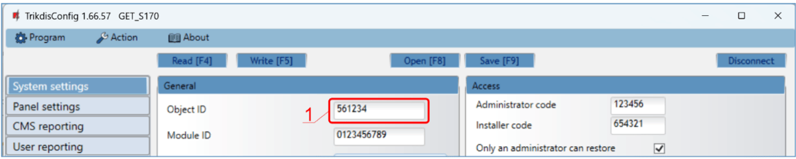

    1.  Ange numret i ”**Object ID”** (abonnentkod) som du har fått från larmcentralen (tecken 0–9, A–F. **Använd inte FFFE, FFFF som Object ID**).

    **I fönstret ”Panel settings”:**

    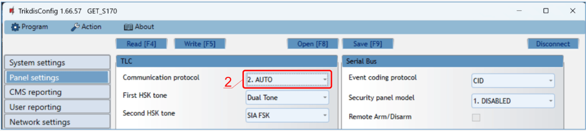

    2. Om larmsändaren är ansluten till centralapparatens TIP/RING-plintar måste du välja inställningen ”**AUTO**”.

    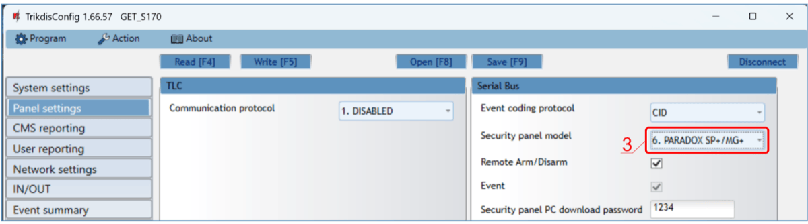

    3. Välj den ”**Security panel model”** som ska anslutas till larmsändaren.

    **I fönstret ”CMS reporting”, inställningar för ”Primary channel”:**

    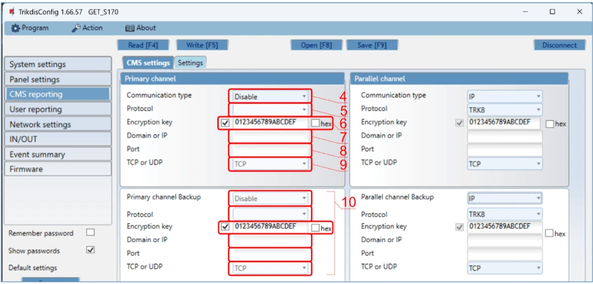

    Skärmbilden visar fönstret före konfigureringen: **Primary channel** är fortfarande avaktiverad.

    4. **Communication type** - välj anslutningsmetoden **IP**.

    2.  **Protocol** - välj protokolltyp för händelsemeddelandena: **TRK8** (till TRIKDIS-mottagare), **DC-09_2007** eller **DC-09_2012** (till universella mottagare), **TL150** (till SUR-GUARD-mottagare).

    3.  **Encryption key** - ange den krypteringsnyckel som är inställd i mottagaren.

    4.  **Domain or IP** - ange mottagarens domän eller IP-adress.

    5.  **Port** - ange mottagarens nätverksportnummer.

    6.  **TCP or UDP** - välj det överföringsprotokoll (**TCP** eller **UDP**) som händelserna ska skickas med.

    7.  (Rekommenderas) Konfigurera inställningarna för ”**Primary channel Backup”**.

    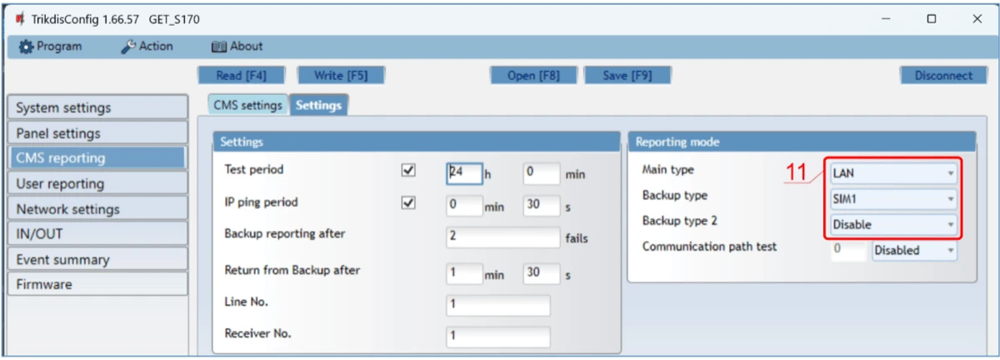

    11. I alternativgruppen ”**Reporting mode**” ställs ordningen på kommunikationskanalerna in, alltså hur larmsändaren skickar meddelanden till larmcentralen och till Protegus2. Anslutningstyperna anges i ordning. Om larmsändaren inte lyckas ansluta med anslutningstypen ”**Main type**” växlar den till ”**Backup type**” och så vidare. Om meddelandet till larmcentralen kunde överföras med backupanslutningen görs ett nytt försök att återgå till huvudanslutningstypen efter angiven tidsperiod.

    **I fönstret ”Network settings”:**

    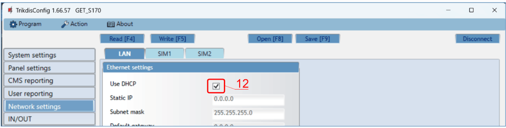

    Dessa inställningar måste göras om larmsändaren är ansluten till ett LAN.

    12. Markera kryssrutan ”**Use DHCP”** så att larmsändaren automatiskt läser datornätverkets inställningar (nätmask, gateway) och tilldelas en IP-adress.

    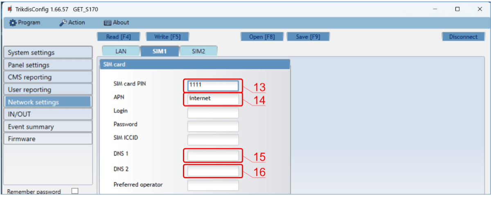

    Om ett SIM-kort (eller två SIM-kort) är isatt i larmsändaren måste följande inställningar göras.

    13. Ange PIN-koden i ”**SIM card PIN”**.

    14. Ändra namnet i ”**APN”**. APN hittar du på SIM-kortsoperatörens webbplats (”internet” är universellt och fungerar i många operatörers nät).

    15. **DNS1, DNS2**: Googles DNS-server är förinställd. **Oavsett IP-inställningar, se till att DNS-adresserna stämmer med de som din internetleverantör stöder**.

    När konfigureringen är klar klickar du på **Write [F5]** och kopplar bort USB-kabeln.

!!! note "Obs!"
    En beskrivning av alla inställningar för GET finns i [Larmsändarens inställningar](#6-larmsandarens-installningar).

## Installation och inkoppling 

### Installationsgång 

1.  Ta bort det övre locket och dra ut plintblocket.

2.  Sätt i SIM-kortet i hållaren.

3.  Ta ut kretskortet ur kapslingens nedre del.

4.  Fäst den nedre delen med skruvar på en lämplig plats.

5.  Sätt tillbaka kretskortet i kapslingen och sätt i plintblocket.

6.  Skruva fast mobilantennen.

7.  Stäng det övre locket.

8.  Om LAN ska användas för att skicka händelser till larmcentralen måste en LAN-kabel anslutas till larmsändaren.

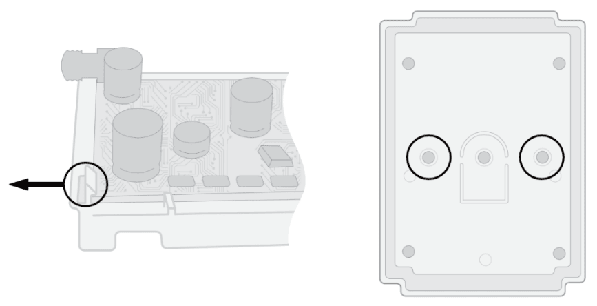

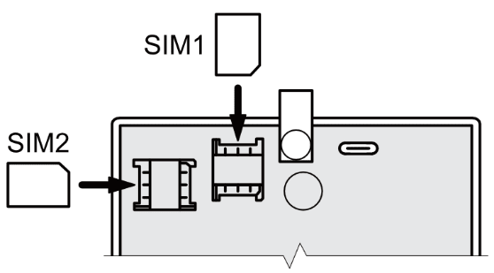

!!! note "Obs!"
    Ett eller två SIM-kort kan sättas i larmsändaren. / Kontrollera
    att SIM-kortet är aktiverat. / Kontrollera att mobil internettjänst
    (mobildata) är aktiverad om anslutningen sker via IP-kanal. / För att slippa
    ange PIN-koden i TrikdisConfig, sätt SIM-kortet i
    din mobiltelefon och stäng av PIN-kodsbegäran.
### Installation i inbrottscentralapparatens kapsling 

GET-larmsändaren ska installeras inuti inbrottscentralapparatens kapsling, som är skyddad av en sabotagekontakt på locket. Den monteras på kapslingens inre bakyta med det medföljande dubbelhäftande akrylskumtejpen av industrikvalitet. Tejpen måste appliceras på en ren och torr yta med fast tryck för att ge pålitlig vidhäftning.

Om värdkapslingen inte medger en säker installation enligt ovan kan larmsändaren installeras i en separat kapsling med sabotageskydd.

### Kopplingsscheman för inkoppling av larmsändaren till en centralapparat 

Anslut larmsändaren till centralapparaten enligt något av kopplingsschemana nedan.

<!-- terminal-label-note -->

!!! note "Obs!"
    I diagrammen nedan är **+DC** och **−DC** de plintar som på larmsändaren är märkta **+12 VDC** och **−12 VDC**, och **A RS485** / **B RS485** är de plintar som är märkta **A 485** / **B 485**.

#### DSC

##### Knappsatsbuss

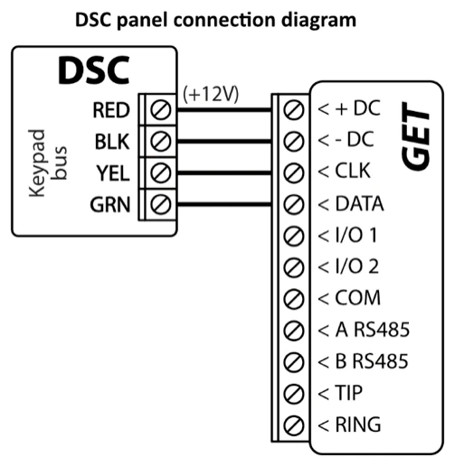

!!! note "Obs!"
    Enbart med knappsatsbussen får larmsändaren sektionernas allmänna tillstånd från centralapparaten och kan inte avgöra sektionstypen (brand, inbrott, vattenläckage osv.). Alla larm rapporteras som ett allmänt larm, Contact ID E130, och en del larmcentraler hanterar dessa händelser på ett annat sätt än den sektionstyp som faktiskt löstes ut. För att rapportera händelser med centralapparatens egna Contact ID-koder (till exempel E110 för brandlarm), anslut även TIP/RING-plintarna, se 3.3.1.2.

##### Knappsatsbuss och TIP/RING

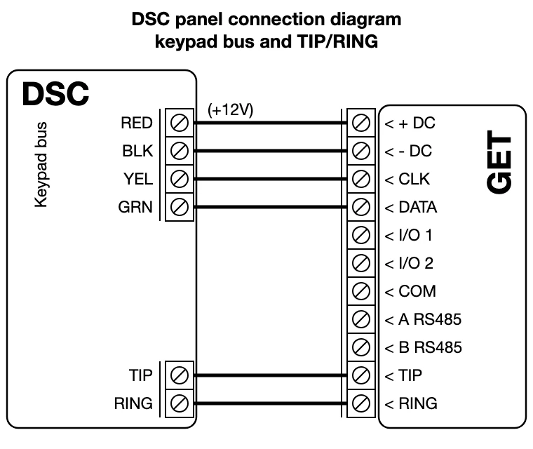

Knappsatsbussen används för styrning och för centralapparatens status: fjärrstyrd tillkoppling/frånkoppling samt tillstånd för områden och sektioner. Händelserna rapporteras via centralapparatens uppringare som är ansluten till TIP/RING-plintarna, så de skickas med centralapparatens egna Contact ID-koder. Händelser från knappsatsbussen skickas inte en andra gång så länge TIP/RING används.

När du ansluter larmsändaren både till knappsatsbussen och till centralapparatens TIP/RING-plintar måste du göra följande inställningar för GET-larmsändaren i fönstret ”**Panel settings**”:

1.  Ställ in ”**Communication protocol**” på ”**AUTO**”.

2.  Välj DSC-centralapparatens modell i ”**Security panel model**”.

3.  Markera ”**Remote Arm/Disarm**” om användarna ska kunna styra centralapparaten med appen Protegus2.

DSC-centralapparatens PSTN-uppringare måste programmeras för att skicka händelser, enligt beskrivningen i 4.1.1 ”DSC”.

#### PARADOX

##### Seriell port

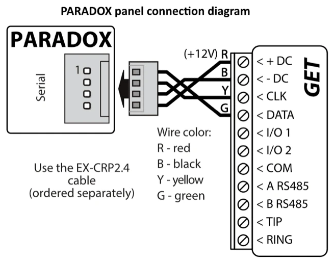

##### Knappsatsbuss och TIP/RING (SP/SP+/MG/MG+)

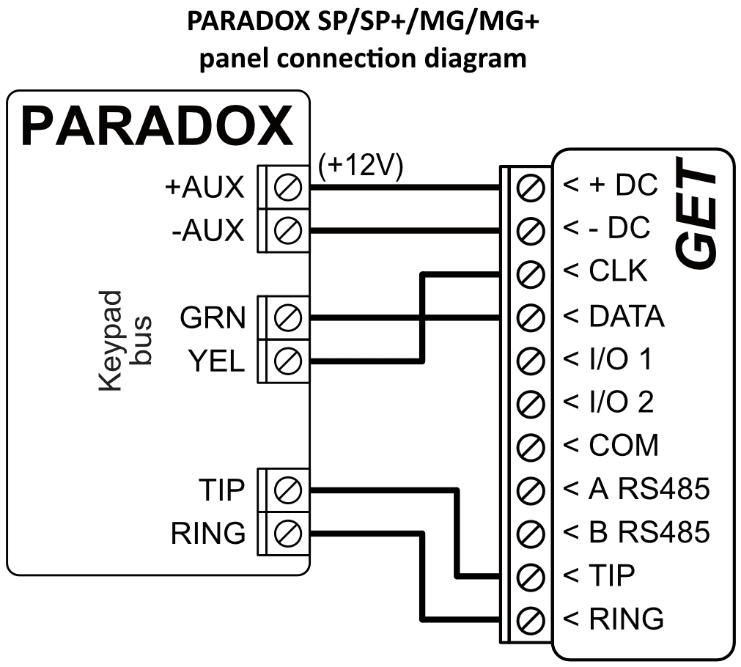

Denna anslutning använder centralapparatens knappsatsbuss i stället för den seriella porten, så den avgiftsbelagda upplåsningen av Paradox seriella port behövs inte.

!!! note "Obs!"
    Denna anslutning kräver larmsändarens firmware 1.21 eller senare.

När du ansluter larmsändaren både till knappsatsbussen och till centralapparatens TIP/RING-plintar måste du göra följande inställningar för GET-larmsändaren:

1.  Välj ”**AUTO**”.

2.  Välj centralapparatens modell ”**7. Paradox SP+/MG+ series KeyBus**”.

3.  Markera ”**Remote Arm/Disarm**” om användarna ska kunna styra centralapparaten med appen Protegus2 med sin egen knappsatskod.

4.  För att styra centralapparaten direkt, ange ”**Security panel PC download password**”. Det måste stämma överens med lösenordet som är angivet i centralapparaten.

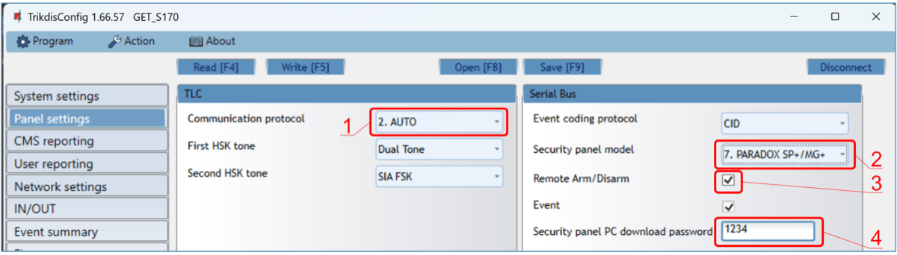

Paradox-centralapparaten måste programmeras för att skicka händelser till larmcentralen och för fjärrstyrning från appen Protegus2, enligt beskrivningen i 4.1.2 ”PARADOX”.

#### CADDX

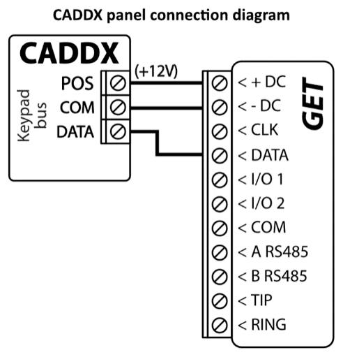

#### TEXECOM

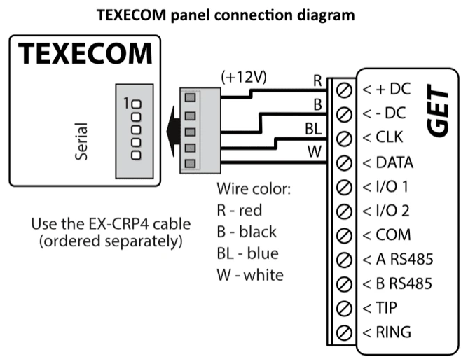

#### INNERRANGE INCEPTION

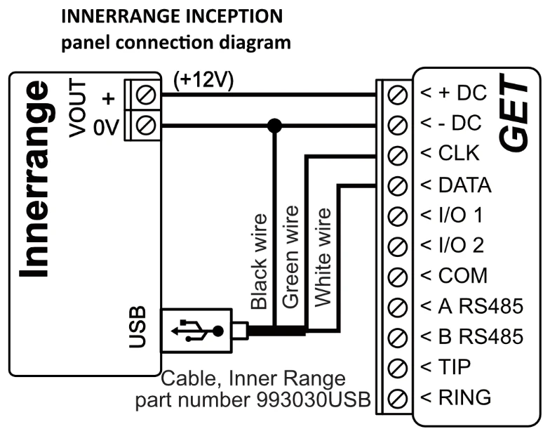

#### INNERRANGE INTEGRITI

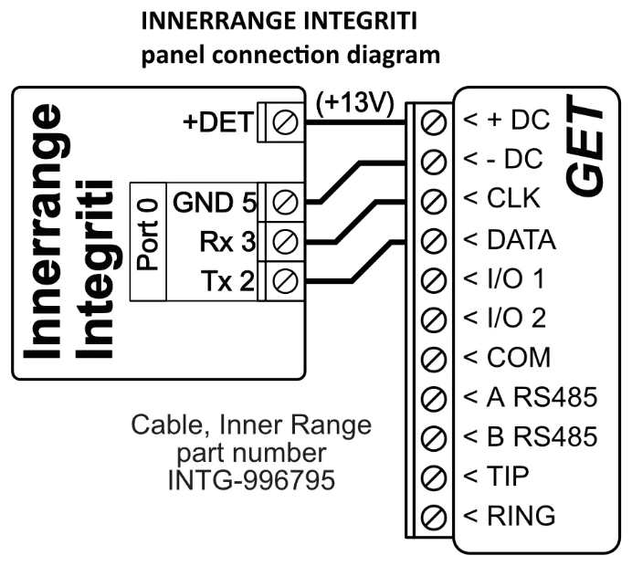

#### Honeywell Vista-15, Vista-20, Vista-48

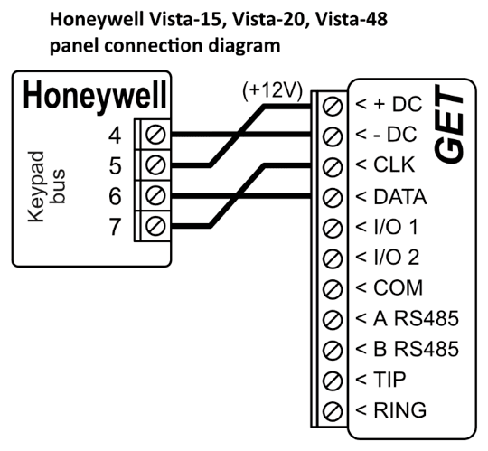

#### Centralapparat (telefonuppringare, TIP/RING)

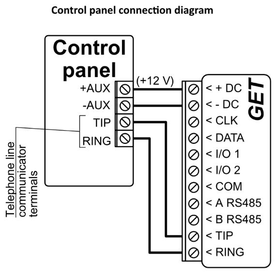

### Kopplingsschema för inkoppling av larmsändaren till centralapparatens nyckelbrytarsektion 

Följ detta schema om centralapparaten ska tillkopplas/frånkopplas med en PGM-utgång på larmsändaren som slår på/av centralapparatens nyckelbrytarsektion.

!!! note "Obs!"
    GET-larmsändaren har 2 universella ingångs-/utgångsplintar som kan
    ställas in i driftläget OUT (PGM). Utgångarna (OUT) kan styra
    två områden i säkerhetssystemet. Om du vill styra systemet på
    detta sätt avmarkerar du ”**Remote Arm/Disarm”** i TrikdisConfig, i fönstret
    ”**Panel settings**”. Apparna Protegus2 måste
    konfigureras med de inställningar som beskrivs i avsnitt 5.2 ”Ytterligare
    inställningar för tillkoppling/frånkoppling av systemet med centralapparatens
    nyckelbrytarsektion”.
Larmsändaren är ansluten till centralapparatens knappsatsbuss eller seriella buss. / Tillkoppling/frånkoppling av centralapparaten via nyckelbrytarsektion.

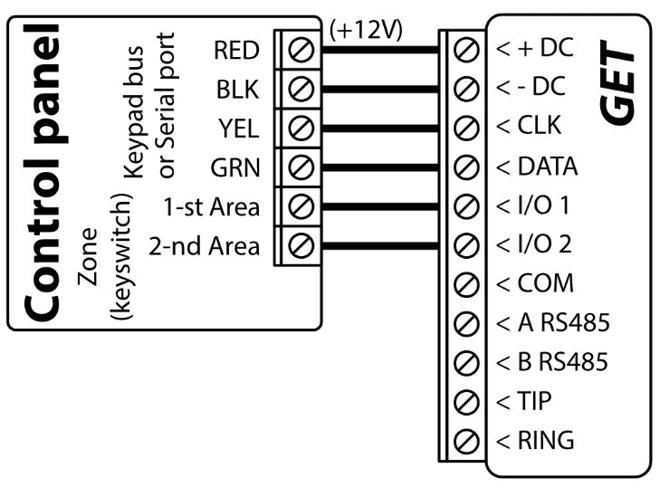

Larmsändaren är ansluten till centralapparatens telefonuppringare (TIP/RING-plintar). / Tillkoppling/frånkoppling av centralapparaten via nyckelbrytarsektionen.

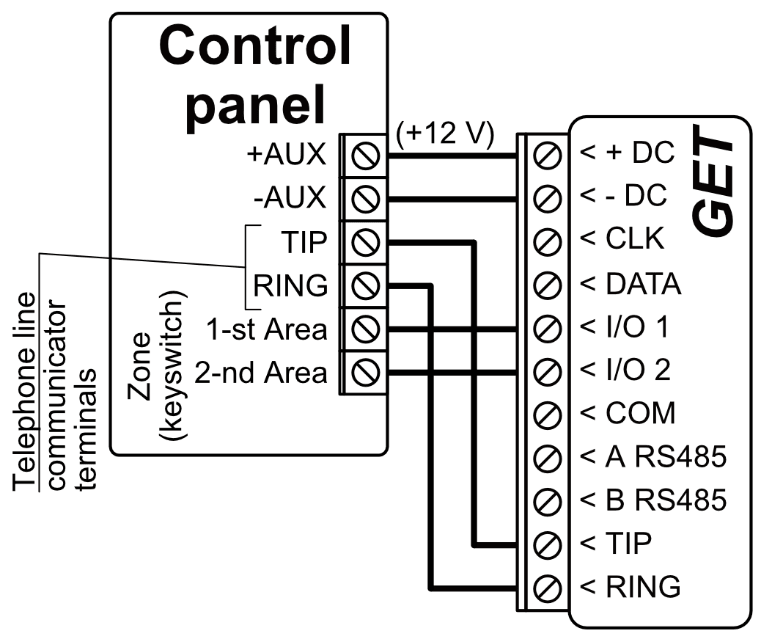

### Kopplingsscheman för anslutning av ingång 

Larmsändaren har 2 universella ingångs-/utgångsplintar som kan ställas in i ingångsläget IN. Kretsar av typerna NC, NO, NO / EOL, NC / EOL, NO / DEOL och NC / DEOL kan anslutas till ingångsplinten. Ingångstypen kan ändras i TrikdisConfig i fönstret „**IN/OUT” -> “Type”**, eller i Protegus-appen under **Advanced settings → IN/OUT**, plint **1** eller **2** **→ Type**.

Anslut ingången enligt den valda ingångstypen (NO, NC, NC/EOL, NO/EOL, NO/DEOL, NC/DEOL), som i schemana nedan:

### Kopplingsscheman för anslutning av ett relä 

Med reläkontakter kan du styra (slå på/av) olika elektriska apparater. Larmsändarens I/O-plint måste vara inställd på ett utgångsläge (OUT).

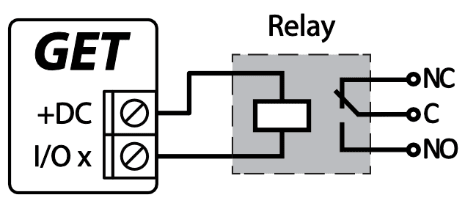

### Starta larmsändaren 

Starta larmsändaren genom att slå på centralapparatens matning. Lysdiodsindikeringen på GET-larmsändaren ska visa följande:

- Lysdioden ”POWER” lyser grönt när matningen är på;

- Lysdioden ”NETWORK LTE” lyser grönt och blinkar gult när larmsändaren är registrerad i mobilnätet.

!!! note "Obs!"
    Tillräcklig LTE-signalstyrka är nivå tre (tre gula blinkningar på
    lysdioden ”NETWORK LTE”). / Om du räknar färre gula blinkningar på
    lysdioden ”NETWORK LTE” är nätets signalstyrka otillräcklig. Vi
    rekommenderar att du väljer en annan plats för larmsändaren eller
    använder en känsligare mobilantenn. / Om du ser en annan
    lysdiodsindikering tyder det på ett visst fel. Felsök med hjälp av
    tabellen över lysdiodsindikeringar i avsnitt 1.7 ”Lysdiodsindikering
    vid drift”. / Om GET:s indikeringar inte lyser alls,
    kontrollera matningen och anslutningarna.
## Programmering av centralapparaten 

### Programmering av centralapparater när larmsändaren är ansluten till knappsatsbussen eller den seriella bussen 

Nedan beskrivs hur du programmerar centralapparaten så att GET-larmsändaren kan läsa händelser från centralapparaten och styra den på distans.

För att aktivera fjärrstyrning av centralapparaten, kontrollera att kryssrutan ”**Remote Arm/Disarm”** är markerad i TrikdisConfig-fönstret **“Panel settings”.**

#### DSC

**Knappsatsbuss.** DSC-centralapparater behöver inte programmeras.

**Knappsatsbuss och TIP/RING.** Programmera centralapparatens PSTN-uppringare så att den skickar händelserna. Tabellen gäller **DSC PowerSeries PC1616** (**PC1832, PC1864**). Med knappsatsen ansluten till centralapparaten, gå in i programmeringsläget: [\*][8][installatörskod] och ange sedan sekvensnumret.

| Sekvens | Värde |
|---------|-------|
| [301] Första telefonnumret | Valfritt nummer med fler än fyra siffror, utan D i början (till exempel 5555555). D gör att centralapparaten väntar på kopplingston; utan D slås numret snabbare. Larmsändaren besvarar alla samtal |
| [310] Systemets abonnentkod | Fyrsiffrig abonnentkod följd av FF (till exempel 1234FF). Använd HEX A i stället för varje siffra 0 |
| [311] Abonnentkod för område 1 | Fyrsiffrig abonnentkod. Använd HEX A i stället för varje siffra 0 |
| [350] Larmformat | 03 (Contact ID) för telefonnummer 1 |
| [351]–[376] Larmsändarens samtalsriktningar | Aktivera de händelsegrupper som behövs för telefonnummer 1: Larm/Återställning, Till-/Frånkoppling, Sabotagelarm/Återställning, Systemunderhåll, Testsändningar. Kontrollera särskilt Till-/Frånkoppling: på en del DSC-centralapparater är det avstängt som förval |
| [380] Första alternativet för larmsändaren | Alternativ 1 PÅ (larmsändaren aktiverad). Alternativ 3 AV (DTMF-uppringning) |
| [381] Andra alternativet för larmsändaren | Alternativ 7 AV (Contact ID-rapporteringskoderna genereras automatiskt) |
| [320]–[349] Larmkoder | Valfritt värde utom 00 för de händelser som ska rapporteras |
| [015] Tredje systemalternativet | Alternativ 7 AV (telefonlinjeövervakning, TLM, avaktiverad) |

!!! note "Obs!"
    Avaktivera telefonlinjeövervakningen. Om TLM förblir aktiverat kan centralapparaten visa ett telefonlinjefel. Fördröjningen för TLM-fel ställs in i sekvens [377].

!!! note "Obs!"
    Sekvensnumren ovan gäller PC1616, PC1832 och PC1864 (installationsguide v4.x). Andra DSC-modeller kan ha andra sekvensnummer; se centralapparatens programmeringsmanual.

#### PARADOX

Paradox-centralapparater behöver programmeras bara för direktstyrning med Protegus2. Du behöver inte programmera Paradox-centralapparater för att läsa händelser.

För fjärrstyrning av Paradox-centralapparater måste du ställa in ett PC download password. Lösenordet måste stämma överens med det som angavs i TrikdisConfig-fönstret **“Panel settings”**, när kryssrutan vid ”**Remote Arm/Disarm”** markerades.

Så här ställer du in lösenordet, med knappsatsen ansluten till centralapparaten:

- För serierna MAGELLAN och SPECTRA: gå till cell 911 och ange ett PC download password på 4 siffror.

- För serien DIGIPLEX EVO: gå till cell 3012 och ange ett PC download password på 4 siffror.

**Knappsatsbuss och TIP/RING (SP/SP+/MG/MG+).** Centralapparaten måste också programmeras för att skicka händelser till larmcentralen och för fjärrstyrning från appen Protegus2:

| **Cell** |     **Data**     | **Cell** | **Data** |
|:--------:|:----------------:|:--------:|:--------:|
|   801    | \*\*\*\*\*\*\*\* |   815    |  123456  |
|   811    |       1111       |   911    |   1234   |
|   812    |       2222       |          |          |

#### TEXECOM

Texecom-centralapparater måste programmeras både för att läsa händelser och för fjärrstyrning.

Du måste ställa in Texecom-centralapparatens ”**UDL** **passcode”**. Lösenordet måste stämma överens med det som angavs i TrikdisConfig-fönstret **“Panel settings”,** när kryssrutan vid ”**Remote Arm/Disarm”** markerades.

Centralapparaten kan programmeras med Texecoms programvara Wintex. Ange ”**UDL passcode”** (4-siffrig kod) i fönstret ”**Communication Options”**, fliken ”**Options”**.

Du kan också programmera med en knappsats ansluten till centralapparaten:

1.  Ange installatörskoden (4 siffror) och tryck på knappen [Menu] för att gå in i programmeringsmenyn.

2.  Tryck direkt därefter på tangenten [9].

3.  Tryck på [7][6] och sedan [2]. Ange den 4-siffriga ”**UDL** **passcode”** (”**UDL passcode”** måste stämma överens med GET-larmsändarens ”**PC login password”**).

4.  Tryck på [Yes] och lämna programmeringsläget genom att trycka på [Menu].

#### UTC INTERLOGIX (CADDX)

Med knappsatsen ansluten till centralapparaten:

1.  Tryck på [\*][8] och ange installatörskoden (förval - 9713).

2.  Ange det enhetsnummer som är tilldelat den anslutna larmsändaren (förval - 0).

3.  Ställ in inställningarna nedan för varje rad. Ange i tur och ordning positionen, segmentnumret och den önskade inställningen. Om du trycker på [\*] (asterisk) kommer du tillbaka till det lokala inmatningsfältet.

| Position | Segment | Inställning |
|----------|---------|---------|
| 23 | 3 | 12345678 |
| 37 (behövs inte) | 3 | 12345678 |
| 37 (behövs inte) | 4 | 1234567* |
| 90 | 3 | 12345678 |
| 93 | 3 | 12345678 |
| 96 | 3 | 12345678 |
| 99 | 3 | 12345678 |
| 102 | 3 | 12345678 |
| 105 | 3 | 12345678 |
| 108 | 3 | 12345678 |

När alla angivna fält är programmerade, tryck två gånger på [Exit] för att lämna programmeringsläget.

#### INNERRANGE

Versionen på **Innerrange Inception**-centralapparaten måste vara **2.3.0.3507-r0** eller senare.

Centralapparaten måste vara ansluten till internet. Anslut till **Innerrange Inception** genom att ange: <https://skytunnel.com.au/inception/SERIALNUMBER>, där SERIALNUMBER är numret på styrenheten, som du hittar på centralapparatens kapsling.

Öppna **Configuration > General > Alarm Reporting**. I inställningsgruppen **3rd Party Device Configuration** ska du ange:

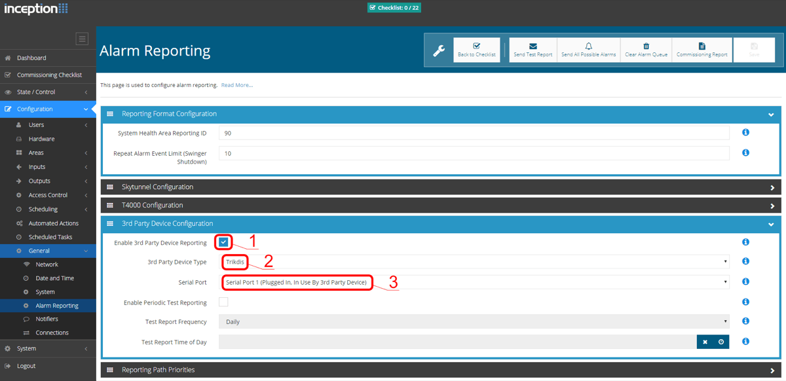

1.  **Enable 3rd Party Device Reporting** - markera denna kryssruta.

2.  **3rd Party Device Type** - ange ”Trikdis”.

3.  **Serial port** - ange ”Serial Port 1 (Plugged In, In Use By 3rd Party Device)”.

4.  Spara inställningarna och stäng programmet.

#### HONEYWELL ADEMCO VISTA

Följ dessa steg för centralapparaterna **Honeywell Ademco Vista-20** och **Honeywell Ademco Vista-48**. **Centralapparatens firmwareversion måste vara V5.3 eller senare.** Med en knappsats som är ansluten till centralapparaten:

1.  Gå in i programmeringsläget. Ange installatörskoden 4][1][1][2] och därefter [8][0][0] . Alternativt kan du slå på centralapparatens matning. Tryck på knapparna [\*] och [#] samtidigt inom 50 sekunder efter att matningen slagits på (den här metoden kan användas när programmeringsläget lämnades genom att trycka [\*][9][8] på knappsatsen).

2.  Aktivera sändning av Contact ID-händelser via LRR. Tryck [\*][2][9][1][#] på knappsatsen.

3.  När funktionen „Remote Arm/Disarm“ används, tillåt användning av den andra AUI-adressen. Tryck [\*][1][8][9][1][1][#] på knappsatsen.

Lämna programmeringsläget. Tryck [\*][9][9] på knappsatsen.

### Programmering av centralapparater när larmsändaren är ansluten till centralapparatens TIP/RING-plintar 

För att centralapparaten ska kunna skicka händelser via PSTN-uppringaren måste den vara påslagen och korrekt inställd. Konfigurera centralapparatens PSTN-uppringare enligt centralapparatens programmeringsmanual:

1.  Aktivera centralapparatens PSTN-uppringare.

2.  Ange telefonnumret till larmcentralens mottagare (du kan använda vilket nummer som helst med fler än 4 siffror. GET-larmsändaren svarar när centralapparaten ringer till vilket telefonnummer som helst).

3.  Välj DTMF-läge.

4.  Välj kommunikationsprotokollet Contact ID.

5.  Ange centralapparatens abonnentkod (4 siffror).

Den sektion i centralapparaten som GET-utgången OUT är ansluten till ska ställas in som nyckelbrytarsektion för att centralapparaten ska kunna tillkopplas/frånkopplas på distans.

!!! note "Obs!"
    Nyckelbrytarsektionen kan vara momentan (puls) eller nivåstyrd. Som förval
    är GET:s styrbara utgång OUT inställd på pulsläge med 3 sekunders puls. Du kan
    ändra pulsens längd eller byta till nivåläge i inställningarna för Protegus2.
    Se avsnitt **5**.2 ”Ytterligare inställningar för tillkoppling/frånkoppling av
    systemet med centralapparatens nyckelbrytarsektion”.
#### PROGRAMMERING AV HONEYWELL VISTA PSTN-UPPRINGARE

Ange följande sekvenser på centralapparatens knappsats och ställ in dem enligt beskrivningen:

- \*41 – ange telefonnumret till larmcentralens mottagare;

- \*43 – ange centralapparatens abonnentkod;

- \*47 – ställ in Tone dial på [1] och ange antal uppringningsförsök;

- \*48 – använd förvalet, \*48 måste vara 7;

- \*49 – Split/Dual message. \*49 måste vara 5;

- \*50 – fördröjning för sändning av inbrottslarmshändelser (valfritt). Förvalet är [2,0]. Då fördröjs sändningen av händelsemeddelandet med 30 sekunder. Om du vill att meddelandet ska skickas direkt, ställ in [0,0].

När alla nödvändiga inställningar är gjorda måste du lämna programmeringsläget. Ange \*99 på knappsatsen.

#### SPECIELLA INSTÄLLNINGAR FÖR HONEYWELL VISTA 48

Om du vill använda GET-larmsändaren med en Honeywell Vista 48-centralapparat, ställ in följande sekvenser enligt beskrivningen:

| Sekvens | Data                             | Sekvens | Data | Sekvens | Data |
|:-------:|----------------------------------|:-------:|:----:|:-------:|:----:|
|  \*41   | 1111 (mottagarens telefonnummer) |  \*60   |  1   |  \*69   |  1   |
|  \*42   | 1111                             |  \*61   |  1   |  \*70   |  1   |
|  \*43   | 1234 (centralapparatens abonnentkod) |  \*62   |  1   |  \*71   |  1   |
|  \*44   | 1234                             |  \*63   |  1   |  \*72   |  1   |
|  \*45   | 1111                             |  \*64   |  1   |  \*73   |  1   |
|  \*47   | 1                                |  \*65   |  1   |  \*74   |  1   |
|  \*48   | 7                                |  \*66   |  1   |  \*75   |  1   |
|  \*50   | 1                                |  \*67   |  1   |  \*76   |  1   |
|  \*59   | 0                                |  \*68   |  1   |         |      |

När alla nödvändiga inställningar är gjorda måste du lämna programmeringsläget. Ange \*99 på knappsatsen.

#### UTC INTERLOGIX(CADDX)

Programmering av centralapparaten **Interlogix NX-4V2** (**NX-6V2, NX-8V2**) när larmsändaren är ansluten till centralapparatens TIP/RING-plintar.

|  | Knappsatsinmatning | Beskrivning |
|--|--------------|-------------|
|  | *89713 | Gå in i programmeringsläge |
|  | 0# |  |
| Plats 0 | 0# |  |
| Plats 0 | 1*2*3*4*# |  |
| Plats 1 | 1# |  |
| Plats 1 | 1*2*3*4*# |  |
| Plats 2 | 2# |  |
| Plats 2 | 1*# |  |
| Plats 4 | 4# | Alla sektionslysdioder är tända (segment 1) |
| Plats 4 | 12345678* | Alla sektionslysdioder är tända (segment 2) |
| Plats 4 | 12345678*# |  |
| Plats 23 | 23# | Alla sektionslysdioder är tända (segment 3) |
| Plats 23 | ** | Alla sektionslysdioder är tända (segment 3) |
| Plats 23 | 12345678*# | Alla sektionslysdioder är tända (segment 3) |
| Plats 37 | 37# | Alla sektionslysdioder är tända (segment 3) |
| Plats 37 | ** | Alla sektionslysdioder är tända (segment 4) |
| Plats 37 | 12345678* |  |
| Plats 37 | 12345678*# |  |
|  | EXIT EXIT | Lämna programmeringsläget |

## Fjärrstyrning 

### Lägga till säkerhetssystemet i appen Protegus2 

Med Protegus2 kan användarna styra sitt larmsystem på distans. De ser systemets status och får aviseringar om systemhändelser.

1.  Ladda ned och starta appen Protegus2 eller använd webbversionen: [<u>web.protegus.app</u>](https://web.protegus.app).

    

      
      
      
    

2.  Logga in med ditt användarnamn och lösenord, eller registrera dig och skapa ett nytt konto.

!!! warning "Viktigt"
    När du lägger till GET-larmsändaren i Protegus2, kontrollera att:

    1.  Det isatta SIM-kortet är aktiverat och att PIN-koden antingen
        är angiven eller avstängd;

    2.  Eller att en LAN-kabel är ansluten.

    3.  ”Protegus cloud” är aktiverat. Se [Rapportering till användare](#65-rapportering-till-anvandare);

    4.  Matningen är ansluten (lysdioden ”POWER” lyser grönt);

    5.  Larmsändaren är registrerad i nätet (lysdioden ”NETWORK LTE” lyser grönt och
        blinkar gult).
3. Klicka på ”**Add new system”** och ange GET:s nummer ”*IMEI/Unique ID*”. Numret finns på enheten och på etiketten på förpackningen. Klicka på ”**Next”**.

{ .trik-mob-img }

4. Ange systemets ”**Name**”. Klicka på ”**Next**”.

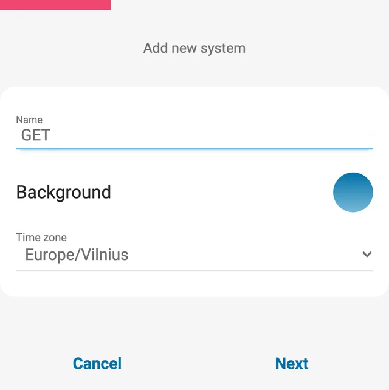{ .trik-mob-img }

### Ytterligare inställningar för tillkoppling/frånkoppling av systemet med centralapparatens nyckelbrytarsektion 

!!! warning "Viktigt"
    Den sektion i centralapparaten som GET-utgången OUT är ansluten till
    måste vara inställd på nyckelbrytarläge.
Följ anvisningarna nedan om centralapparaten ska styras med en PGM-utgång på GET som slår på/av centralapparatens nyckelbrytarsektion.

1.  Klicka på „**Continue**“.

{ .trik-mob-img }

2. Ange ”**Area name**”. Aktivera styrning av PGM-utgången med appen Protegus2.
3. Välj ”**Pulse**” eller ”**Level**”, beroende på hur nyckelbrytarsektionens typ är konfigurerad. Vid behov kan du ändra intervallet för ”**Pulse**”.

4.  Klicka på „**Save**“.

{ .trik-mob-img }

5. Om säkerhetssystemet har ett område till måste du klicka på ”**Click to add an area**”. PGM-utgången ställs in på liknande sätt som beskrivits ovan.

6.  När inställningarna är klara klickar du på knappen ”**Skip**”.

{ .trik-mob-img }

### Tillkoppling/frånkoppling av larmsystemet med Protegus2 

1.  I fönstret ”System Home Screen” klickar du på statusikonen ”Disarm”.

2.  *Protegus2* får ett meddelande om att säkerhetssystemets status har ändrats och statusikonen byter läge.

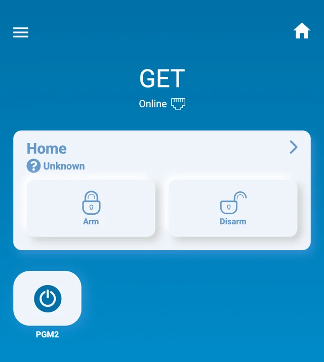{ .trik-mob-img }

## Larmsändarens inställningar

De flesta av GET:s inställningar som beskrivs nedan kan ändras i Protegus-appen eller i TrikdisConfig; inställningar och åtgärder som finns i bara ett av verktygen är markerade. Vad varje inställning gör beskrivs en gång; varje avsnitt visar var du hittar den i respektive verktyg. Namn inom parentes är Protegus-appens beteckningar där de skiljer sig från TrikdisConfigs.

### Ansluta till larmsändaren

=== "Protegus app"

    Öppna systemet i Protegus-appen och gå till **Settings → Advanced settings** (se [Snabbkonfiguration](#2-snabbkonfiguration)). Överst på varje skärm visas den anslutna enheten: **Unique ID** (IMEI), **Serial**, **Firmware** och **Boot**-version.

    Inställningarna är grupperade i menyn som **System options**, **Panel settings**, **Reporting to CMS**, **User reporting**, **Network settings**, **IN/OUT** och **System events**. När du har ändrat inställningar trycker du på **Write** för att spara dem i larmsändaren. **Read** läser in de aktuella inställningarna från larmsändaren igen.

    { .trik-mob-img }

=== "TrikdisConfig"

    När du har anslutit GET-larmsändaren och klickat på **Read [F4], *TrikdisConfig*** visar programmet information om den anslutna enheten i statusfältet:

    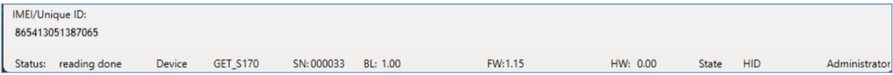

    | Objekt | Beskrivning |
    |--------|-------------|
    | IMEI/Unique ID | Enhetens IMEI-nummer |
    | Status | Driftstillstånd |
    | Device | Enhetstyp (GET ska visas) |
    | SN | Enhetens serienummer |
    | BL | Bootloader-version |
    | FW | Enhetens firmwareversion |
    | HW | Enhetens maskinvaruversion |
    | State | Typ av anslutning till programmet (via USB eller på distans) |
    | Administrator | Behörighetsnivå (visas när åtkomstkoden har godkänts) |

    När du har tryckt på **Read [F4]** läser programmet in och visar de inställningar som är gjorda i ***GET*.** Ange de inställningar som behövs enligt beskrivningarna av TrikdisConfig-fönstren nedan.

### Systeminställningar

=== "Protegus app"

    I Protegus-appen: **Advanced settings → System options → System general** (abonnentkoder, tidsinställning) och **System options → Access** (koder och installatörens behörigheter).

    Var **Account No.** och **Device account No.** finns beror på maskinvaruversion och firmware. På maskinvaruversion x1x1 med firmware 1.31 eller senare finns de i **Reporting to CMS → CMS settings → Primary channel** (**Primary Account no.**; **Parallel Account no.** på parallellkanalen) och i **Reporting to CMS → Settings** (**Device account No.**), och **System general** visar bara **Time set**. I övriga fall finns de i **System general**.

    
    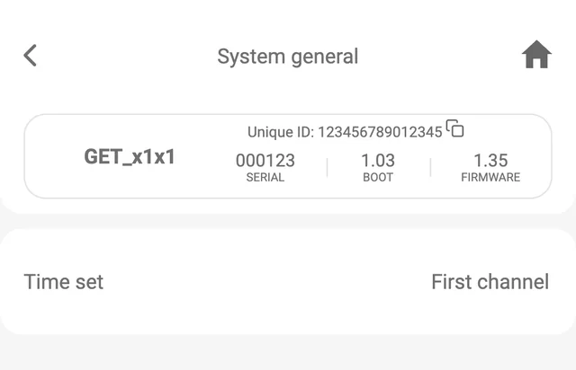Maskinvara x1x1
    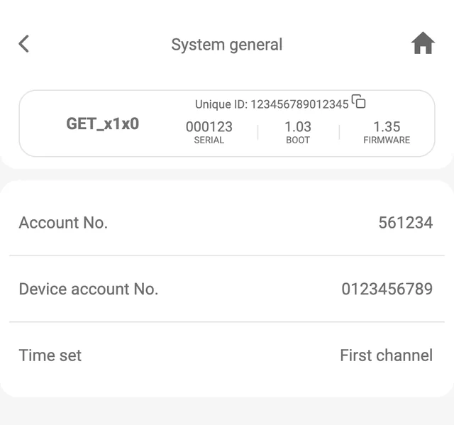Maskinvara x1x0
    

    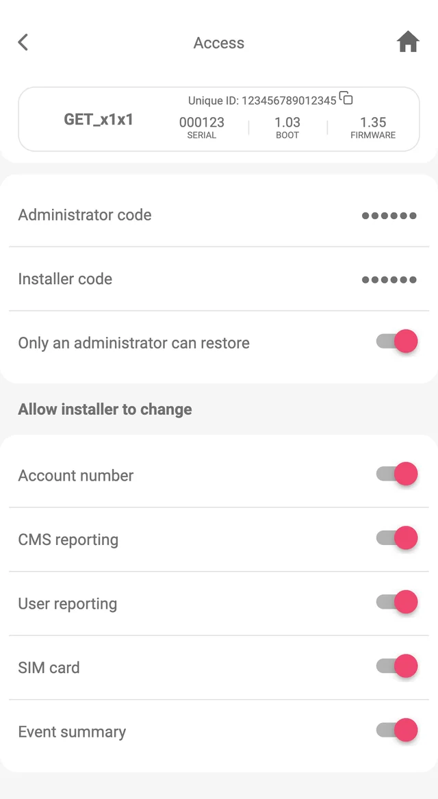{ .trik-mob-img }

=== "TrikdisConfig"

    I TrikdisConfig öppnar du fönstret **System settings**.

    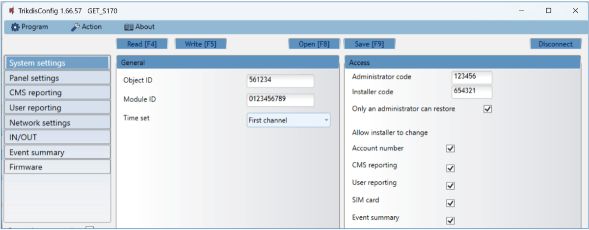

**Inställningsgruppen ”General”**

- **Object ID** (**Account No.**) – om händelserna ska skickas till larmcentralen (CMS, Central Monitoring Station), ange den abonnentkod som du har fått från larmcentralen (hexadecimalt tal med 6 tecken, 0–9, A–F. **Använd inte FFFE, FFFF som Object ID**).

- **Module ID** (**Device account No.**) – ange modulens identifieringsnummer.

- **Time set** - välj vilken server som ska användas för tidssynkronisering.

**Inställningsgruppen ”Access”**

När du ställer in larmsändaren GET finns det två behörighetsnivåer: administratör och installatör:

- **Administrator code -** ger åtkomst till alla konfigurationsfält (förvald kod - 123456).

- **Installer code** - begränsad åtkomst för konfigurering av larmsändaren (förvald kod - 654321).

- **Only an administrator can restore** - om rutan är markerad kan fabriksinställningarna bara återställas genom att administratörskoden anges.

- **Allow installer to change** – administratören kan ange vilka inställningar som installatören får ändra: **Account number**, **CMS reporting**, **User reporting**, **SIM card** och **Event summary**.

!!! note "Installatörsåtkomst i Protegus-appen"
    När larmsändaren öppnas med installatörskoden döljer Protegus-appen **Administrator code** och **Only an administrator can restore**, och visar de inställningar som administratören inte har tillåtit som skrivskyddade. I appen omfattar behörigheten **SIM card** även inställningarna för **LAN**, och där abonnentkoderna finns i CMS settings (se ovan) följer de behörigheten **CMS reporting**.

### Centralapparatens inställningar

=== "Protegus app"

    I Protegus-appen: **Advanced settings → Panel settings → TLF** (TIP/RING-anslutning) och **Panel settings → Serial Bus** (anslutning till knappsatsbuss eller seriell buss).

    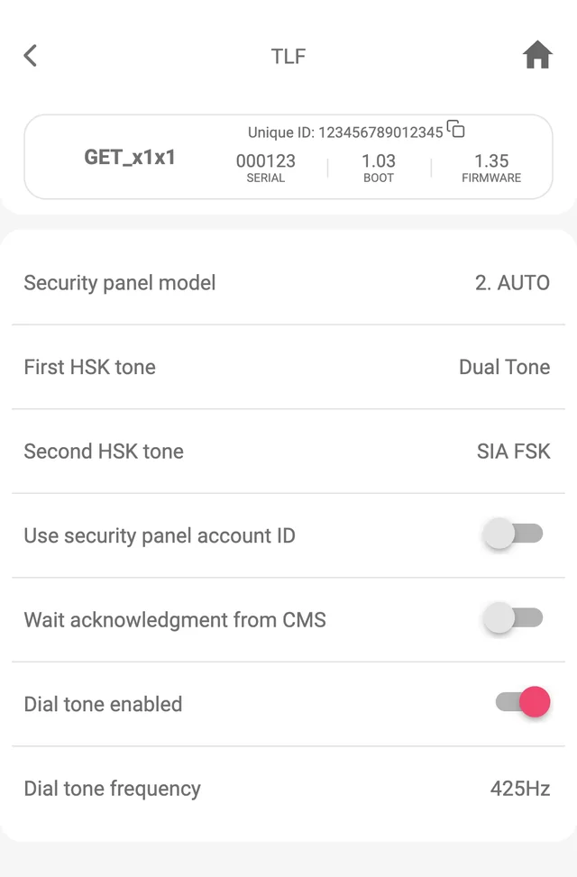{ .trik-mob-img }

    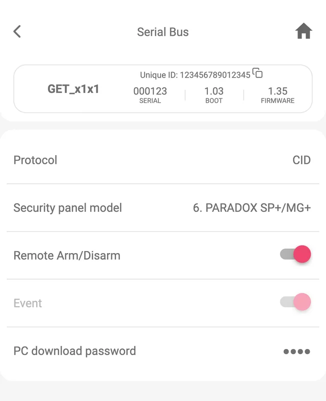{ .trik-mob-img }

=== "TrikdisConfig"

    I TrikdisConfig öppnar du fönstret **Panel settings**.

    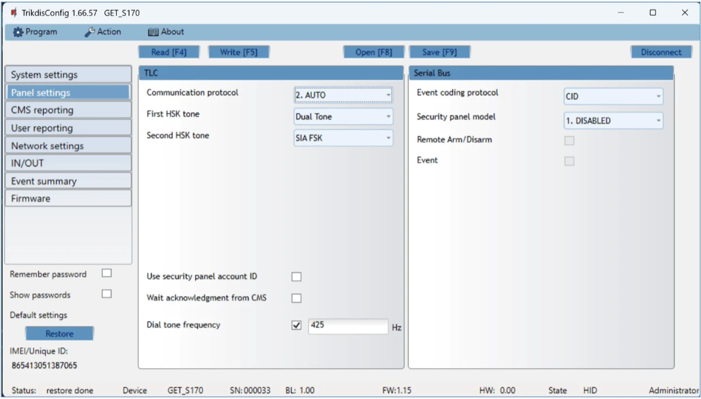

    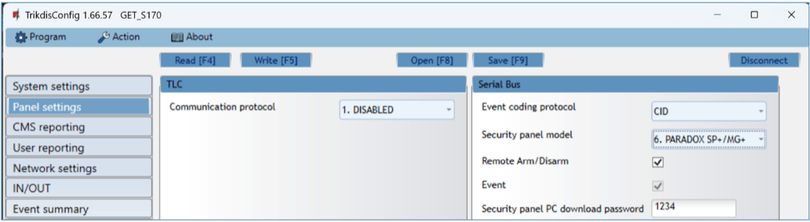

**Inställningsgruppen ”TLC”**

Larmsändaren är ansluten till TIP RING-plintarna på centralapparatens telefonuppringare.

- **Communication protocol** (**Security panel model**) – aktivera/avaktivera DTMF-gränssnittet för fast telefonlinje på larmsändaren.

- **First HSK tone / Second HSK tone** – centralapparatens handskakningston.

- **Use security panel account ID** – om rutan är markerad skickar larmsändaren inte värdet i fältet ”**Object ID**” utan det objektnummer som är angivet i centralapparaten.

- **Wait acknowledgment from CMS –** om rutan är markerad väntar larmsändaren efter varje skickat händelsemeddelande på bekräftelse från IP-mottagaren att meddelandet har tagits emot. Om larmsändaren inte får någon bekräftelsesignal genererar den ingen ”kiss-off”-signal. Om signalen för avslutad kommunikation inte tas emot upprepar centralapparatens telefonuppringare händelsemeddelandet.

- **Dial tone frequency** - den frekvens som larmsändaren använder för att kommunicera med centralapparaten via telefonuppringaren.

    I Protegus-appen har skärmen **TLF** också **Dial tone enabled**, som slår på eller av kopplingstonen; **Dial tone frequency** kan bara ändras när den är på.

**Inställningsgruppen ”Serial bus”**

Larmsändaren är ansluten till centralapparaten via en seriell buss.

- **Event coding protocol** (**Protocol**) – välj protokoll för händelserapportering (CID eller SIA).

- **Security panel model** – välj den centralapparatmodell som ska anslutas till larmsändaren.

- **Remote Arm/Disarm** – när kryssrutan är markerad styr GET centralapparaten direkt på distans. Inställningen visas bara för centralapparater som styrs direkt. För direktstyrning av centralapparaterna måste du ändra centralapparatens inställningar, enligt beskrivningen i avsnitt 4.1 ”Programmering av centralapparater när larmsändaren är ansluten till knappsatsbussen eller den seriella bussen”.

- **Event** – markera rutan så att larmsändaren skickar händelser till larmcentralen och till Protegus2. I Protegus-appen visas detta reglage men kan inte ändras.

- **Security panel PC download password** (**PC download password**; för Texecom UDL-koden) - för direktstyrning av Paradox- och Texecom-centralapparater måste du ange PC/UDL-lösenordet. Det måste stämma överens med lösenordet som är angivet i centralapparaten. Hur du ändrar lösenordet beskrivs i avsnitt 4.1 ”Programmering av centralapparater när larmsändaren är ansluten till knappsatsbussen eller den seriella bussen”*.*

### Rapportering till larmcentralen

Händelser kan skickas över flera kommunikationskanaler. Primärkanalen och den parallella kommunikationskanalen kan arbeta samtidigt, så att larmsändaren kan skicka händelser till två mottagare samtidigt. Backupkanaler kan tilldelas både primärkanalen och den parallella kanalen och används när anslutningen via primärkanalen eller den parallella kanalen bryts.

Kommunikationen är kodad och lösenordsskyddad. Med TRK-protokollen krävs en TRIKDIS-mottagare för att ta emot händelseinformationen och skicka den vidare till larmcentralens program (DC-09 och TL150 är avsedda för universella mottagare respektive SUR-GUARD-mottagare, se **Protocol** nedan):

- **För anslutning över IP** - programvarumottagaren IPcom för Windows/Linux, maskinvarumottagaren IP/SMS RL14 eller flerkanalsmottagaren RM14.

#### Mottagarkanaler

=== "Protegus app"

    I Protegus-appen: **Advanced settings → Reporting to CMS → CMS settings**, därefter **Primary channel**, **Backup channel** eller **Parallel channel** (**Parallel primary channel**, **Parallel backup channel**). Aktivera **Enabled** för att visa kanalens inställningar.

    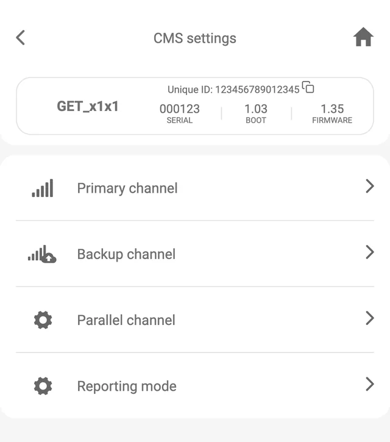{ .trik-mob-img }

    
    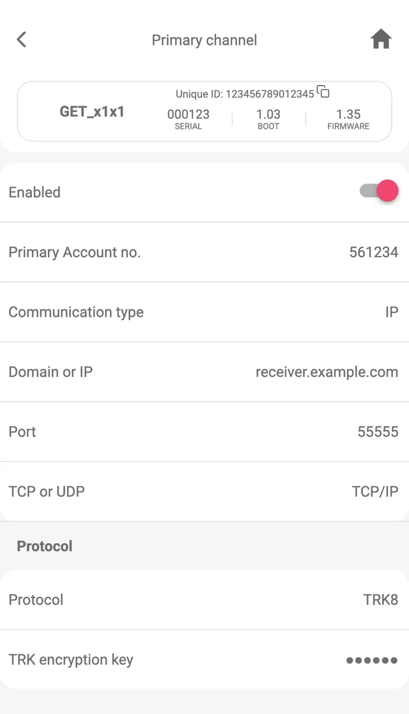Maskinvara x1x1
    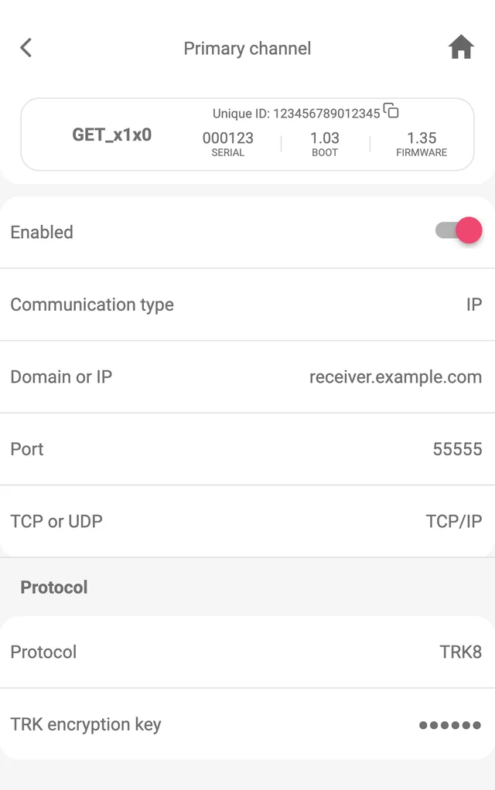Maskinvara x1x0
    

=== "TrikdisConfig"

    I TrikdisConfig öppnar du fönstret **CMS reporting**, fliken **CMS settings**.

    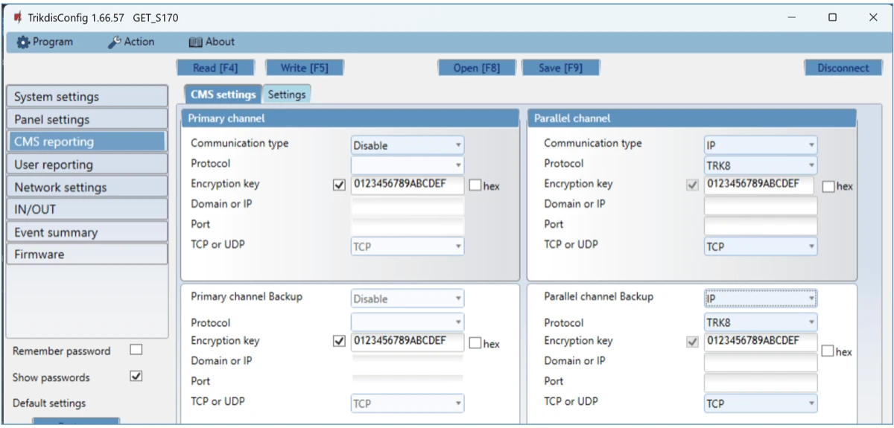

**Inställningsgruppen ”Primary channel”**

- **Communication type** - välj metod för kommunikation med larmcentralens mottagare (**IP).**

- **Protocol** - välj med vilken kodning händelserna ska skickas: **TRK8** (till TRIKDIS-mottagare), **DC-09_2007** eller **DC-09_2012** (till universella mottagare), **TL150** (till SUR-GUARD-mottagare).

- **Encryption key** (**TRK encryption key**; för DC-09-protokoll **Enable encryption key** och **DC-09 encryption key**, med **HEX** för en nyckel i hexadecimalt format) - meddelandets krypteringsnyckel. Nyckeln som skrivs till larmsändaren måste stämma överens med mottagarens nyckel. I Protegus-appen rymmer TRK encryption key upp till 6 tecken och DC-09 encryption key upp till 16 (32 i HEX).

- **Domain or IP** - ange mottagarens domän eller IP-adress.

- **Port** - ange mottagarens nätverksportnummer.

- **TCP or UDP** - välj med vilket protokoll (TCP eller UDP) händelserna ska skickas.

**Inställningsgruppen ”Primary channel Backup”**

Aktivera backupkanalläget för att skicka händelser via backupkanalen om anslutningen via primärkanalen bryts. Backupkanalens inställningar är desamma som beskrivits ovan.

**Inställningsgruppen ”Parallel channel”**

Händelser överförs parallellt med primärkanalen via denna kanal. När den andra kanalen är aktiverad kan händelser skickas samtidigt till två mottagare (t.ex. en lokal och en central larmcentral). Den parallella kanalens inställningar är desamma som beskrivits ovan.

#### Test, ping och rapporteringsläge

=== "Protegus app"

    I Protegus-appen: **Advanced settings → Reporting to CMS → Settings** (test, ping, tider för backup, mottagar- och linjenummer) och **Reporting to CMS → CMS settings → Reporting mode** (anslutningsordning).

    
    Maskinvara x1x1
    Maskinvara x1x0
    

    { .trik-mob-img }

    Appen har ett på/av-reglage bredvid varje period: **Enable test** för **Test period**, **Enable ping** för **IP ping period** och **Test enabled** för **Communication path test**. I **Reporting mode** heter anslutningstyperna **LAN**, **SIM** (SIM1) och **SIM2**.

=== "TrikdisConfig"

    I TrikdisConfig öppnar du fönstret **CMS reporting**, fliken **Settings**.

    

**Inställningsgruppen ”Settings”**

- **Test period** - period för TEST-händelser som testar anslutningen. Testhändelserna skickas som Contact ID-meddelanden och vidarebefordras till larmcentralens programvara.

- **IP ping period** – period för sändning av interna PING-signaler (heartbeat). Dessa meddelanden skickas bara via IP-kanal. Mottagaren vidarebefordrar inte PING-meddelanden till larmcentralens programvara, för att inte överbelasta den. Meddelanden skickas till programvaran bara om mottagaren inte får PING-meddelanden från enheten inom den inställda tiden.

  Som förval skickas meddelandet ”*Connection lost*” till larmcentralens programvara om mottagaren inte får något PING-meddelande under en tidsperiod som är tre gånger längre än den som är inställd i enheten. Om PING-perioden t.ex. är inställd på 3 minuter skickar mottagaren meddelandet *”Connection lost”* om inget PING-meddelande tas emot inom 9 minuter.

  PING-meddelanden upprätthåller den aktiva kommunikationssessionen mellan enheten och mottagaren. En aktiv session krävs för fjärranslutning, fjärrstyrning och fjärrkonfigurering av enheten. Vi rekommenderar att PING-perioden ställs in på högst 5 minuter.

- **Backup reporting after** - anger antalet misslyckade försök att skicka meddelandet via kanalen ”**Primary**”. Om enheten misslyckas att sända det angivna antalet gånger ansluter den för att skicka meddelandena via kanalen ”**Backup**”.

- **Return from backup after** - tid efter vilken larmsändaren GET försöker ansluta igen och skicka meddelanden via primärkanalen.

- **Line No.** - ange mottagarens linjenummer.

- **Receiver No.** - ange mottagarnumret.

**Inställningsgruppen ”Reporting mode”**

För att ställa in hur centralapparaten ska kommunicera med larmcentralens kanaler och med Protegus2. Anslutningstyperna anges i ordning. Om centralapparaten inte lyckas ansluta med anslutningstypen ”**Main type”** växlar den till ”**Backup type”** och så vidare. Om meddelandet till larmcentralen kunde överföras med backupanslutningen görs ett nytt försök med anslutningstypen ”**Return to main”** efter angiven tidsperiod.

- **Main type** – välj anslutningstyp (LAN, SIM1, SIM2) till larmcentralens mottagare och Protegus2.

- **Backup type** – välj anslutningstyp (LAN, SIM1, SIM2) till larmcentralens mottagare och Protegus2.

- **Backup type 2** – välj anslutningstyp (LAN, SIM1, SIM2) till larmcentralens mottagare och Protegus2.

- **Communication path test** – ange den tidsperiod under vilken de valda anslutningstyperna ska testas (LAN, SIM1, SIM2).

### Rapportering till användare

Tjänsten Protegus2 gör det möjligt för användarna att övervaka och styra larmsändaren på distans. Mer information om tjänsten Protegus2 finns på [web.protegus.app](https://web.protegus.app).

=== "Protegus app"

    I Protegus-appen: **Advanced settings → User reporting → Cloud**.

    { .trik-mob-img }

=== "TrikdisConfig"

    I TrikdisConfig öppnar du fönstret **User reporting**, fliken **PROTEGUS cloud**.

    

**Inställningsgruppen ”Protegus Cloud”**

- **Enable connection** (**Enabled**) – aktivera tjänsten Protegus2; GET-larmsändaren kan då utbyta data med appen Protegus2 och konfigureras på distans via ***TrikdisConfig*.**

- **Protegus Cloud access Code** (**Cloud access code**) - 6-siffrig kod för anslutning till appen Protegus2 (förval - 123456).

- **Parallel reporting** (visas i appen när firmware stöder det) – tillåt parallell sändning av rapporter via *primärkanalen* och till Protegus2. Rapporter skickas till Protegus2 och till användarna först när de har skickats till larmbolaget.

### Nätverksinställningar

#### LAN

**Dessa inställningar måste göras om larmsändaren är ansluten till ett LAN.**

=== "Protegus app"

    I Protegus-appen: **Advanced settings → Network settings → LAN**. **Static IP**, **Subnet mask**, **Default gateway**, **DNS1** och **DNS2** kan bara ändras när **Use DHCP** är av.

    { .trik-mob-img }

=== "TrikdisConfig"

    I TrikdisConfig öppnar du fönstret **Network settings**, fliken **LAN**.

    

**Inställningsgruppen ”Ethernet settings”**

- **Use DHCP** - markera rutan så att larmsändaren registrerar sig automatiskt i nätverket. Om den automatiska registreringen misslyckas måste du ange uppgifterna manuellt:
- **Static IP** – statisk IP-adress när manuellt registreringsläge är inställt.

- **Subnet mask** – nätmask när manuellt registreringsläge är inställt.

- **Default gateway** – gateway-adress när manuellt registreringsläge är inställt.
- **DNS1, DNS2** - (Domain Name System) anger den server som tar fram IP-adressen för en domän. Används när en domän är angiven i kommunikationskanalens fält ”**Domain or IP”** (inte en IP-adress). Googles DNS-server är förinställd. **Oavsett IP-inställningar, se till att DNS-adresserna stämmer med de som din internetleverantör stöder.**

#### SIM1 och SIM2

**Dessa inställningar måste göras för varje SIM-kort som sätts i larmsändaren.** Platserna SIM1 och SIM2 har samma inställningar.

!!! warning "Viktigt"
    1. Kontrollera att SIM-kortet är aktiverat och fungerar innan du använder det.
    2. Kontrollera att mobildatatjänsten är aktiverad.

=== "Protegus app"

    I Protegus-appen: **Advanced settings → Network settings → SIM** (SIM1) eller **SIM2**.

    { .trik-mob-img }

    Protegus-appen visar inte **Preferred operator** för GET; på denna skärm finns i stället ett reglage **Forbid connection when roaming detected**. På maskinvarurevision M15 med firmware 1.17 eller senare har skärmen **SIM** också **Generation** och **Bands**, som begränsar vilken mobilnätsteknik och vilka frekvensband larmsändaren använder.

=== "TrikdisConfig"

    I TrikdisConfig öppnar du fönstret **Network settings**, fliken **SIM1** eller **SIM2**.

    

    

**Inställningsgruppen ”SIM card”**

- **SIM card PIN** - ange SIM-kortets PIN-kod. Koden kan avaktiveras genom att du sätter SIM-kortet i en mobiltelefon och stänger av begäran. Om du har stängt av SIM-kortets PIN-begäran, lämna förvalt värde i detta fält.

- **APN** - ange APN (Access Point Name). Det krävs för att ansluta larmsändaren till internet. APN hittar du på SIM-kortsoperatörens webbplats (”internet” är universellt och fungerar i många operatörers nät).

- **Login, Password** - ange vid behov användarnamn (login) och lösenord för anslutning till internet.

- **SIM ICCID** - ange SIM-kortets ICCID-nummer om du vill att larmsändaren bara ska fungera med just det SIM-kortet.
- **DNS1, DNS2** - (Domain Name System) anger den server som tar fram IP-adressen för en domän. Används när en domän är angiven i kommunikationskanalens fält **Domain or IP** (inte en IP-adress). Googles DNS-server är förinställd. **Oavsett IP-inställningar, se till att DNS-adresserna stämmer med de som din internetleverantör stöder.**
- **Preferred operator** – när du har angett mobiloperatörens kod ansluter larmsändaren bara till den valda operatörens nät. Mobiloperatörens kod består av MCC- och MNS-koder. *Bara i TrikdisConfig.*

### IN/OUT

Larmsändaren har 2 universella (ingångs-/utgångs-)plintar. I tabellen kan plintens driftläge ställas in (Disabled, IN, OUT). För ingången måste du ange typen av krets som ska anslutas: NC, NO, NO / EOL, NC / EOL, NO / DEOL, NC / DEOL.

Ytterligare detektorer kan anslutas till larmsändarens ingångar. När detektorn löser ut skickar larmsändaren ett händelsemeddelande. Ingången tilldelas en Contact ID-kod (SIA-kod) som skickas till larmcentralen och Protegus2.

=== "Protegus app"

    I Protegus-appen: **Advanced settings → IN/OUT**, välj sedan plint **1** eller **2**. Ställ in **Function** (**Disabled**, **IN**, **OUT**) och, för en ingång, **Type**. Avsnitten **Alarm** och **Tamper** innehåller de händelse- och återställningsmeddelanden som skickas när ingången löser ut.

    { .trik-mob-img }

=== "TrikdisConfig"

    I TrikdisConfig öppnar du fönstret **IN/OUT**.

    

- **Enable** (**Enabled**) – markerade händelsefält för vilka meddelanden skickas till larmcentralen och Protegus2.

- **E/R** (**Classificator**) – välj vilken typ av händelse som ska skickas när ingången löser ut – ”**Event”** eller ”**Restore”**.

- **CID** (**CID code**) – ange händelsekoden eller lämna förvalt värde. När händelsen inträffar skickas händelsekoden till Protegus2 och larmcentralen.

- **SIA** (**Sia code**) – ange händelsekoden eller lämna förvalt värde. När händelsen inträffar skickas händelsekoden till Protegus2 och larmcentralen.

- **Part.** (**Partition number**) – ange det områdesnummer som skickas när en intern händelse inträffar och när systemet återställs.

- **Zone** (**Zone number**) - ange det sektionsnummer som skickas när en intern händelse inträffar och när systemet återställs.

### Händelsesammanställning

Här kan du aktivera, avaktivera och ändra de interna meddelanden som enheten skickar. Om du avaktiverar ett internt meddelande här skickas det inte alls, oavsett andra inställningar.

=== "Protegus app"

    I Protegus-appen: **Advanced settings → System events**. Händelserna visas under **Event** och **Restore**; välj en för att ändra den.

    { .trik-mob-img }

=== "TrikdisConfig"

    I TrikdisConfig öppnar du fönstret **Event summary**.

    

- **COMMUNICATION** – meddelande om anslutningsfel mellan centralapparaten och larmsändaren.

- **LAN_FAILURE** - meddelande om kommunikationsfel i LAN.

- **POWER** – meddelande om låg matningsspänning.

- **REMOTE_FINISHED** – meddelande om att fjärrkonfigureringen med TrikdisConfig har avslutats.

- **REMOTE_STARTED** – meddelande om fjärranslutning för att konfigurera GET med TrikdisConfig.

- **SIM1_FAILURE** - meddelande om fel i mobilkommunikationen.

- **SIM2_FAILURE** - meddelande om fel i mobilkommunikationen.

- **TEST** – meddelande om periodisk testsändning.

!!! note "Obs!"
    Information om hur du aktiverar periodiska TEST-meddelanden och ställer in deras period finns under **Test period** i [Test, ping och rapporteringsläge](#642-test-ping-och-rapporteringslage).
- **Enable** (**Enabled**) – när den är markerad är sändning av meddelandena aktiverad.

Du kan ändra Contact ID-koden (SIA-koden) för varje händelse, samt sektions- och områdesnummer.

### Återställa fabriksinställningarna

Protegus-appen kan inte återställa fabriksinställningar. Använd TrikdisConfig eller knappen RESET.

För att återställa larmsändarens fabriksinställningar klickar du på knappen ”**Restore”** i TrikdisConfig-fönstret.

Ett annat sätt att återställa fabriksinställningarna.

Larmsändaren ska vara ansluten till matning. Håll in knappen ”RESET” på larmsändarens kretskort. Håll knappen ”RESET” nedtryckt i 10 sekunder tills lysdioderna (”NETWORK”, ”POWER”, ”TROUBLE”) slocknar och lysdioden ”POWER” tänds. Släpp knappen ”RESET”. Larmsändarens fabriksinställningar har återställts.

## Fjärrkonfigurering 

!!! warning "Viktigt"
    Fjärrkonfigurering fungerar bara om:

    1.  Det isatta SIM-kortet är aktiverat och PIN-koden antingen
        är angiven eller avstängd;

    2.  Eller en LAN-kabel är ansluten.

    3.  ”Protegus cloud” är aktiverat. Hur du aktiverar molntjänsten
        beskrivs i avsnitt 6.5 ”Rapportering till användare”;

    4.  Matningen är ansluten (lysdioden ”POWER” lyser grönt);

    5.  Larmsändaren är registrerad i mobilnätet (lysdioden ”NETWORK LTE” lyser
        grönt och blinkar gult).
1.  Starta konfigurationsprogrammet TrikdisConfig.

2.  I avsnittet ”**Remote access”** anger du larmsändarens nummer ”**IMEI/Unique ID”**. Numret finns på enheten och på etiketten på förpackningen.

3. (Valfritt) Ange önskat namn på larmsändaren med detta Unique ID i fältet ”**System name”**.

2.  Klicka på ”**Configure”**.

3.  I det nya fönstret som öppnas klickar du på **Read [F4]**. Ange vid behov administratörs- eller installatörskoden*.* För att spara lösenordet markerar du **“Remember password”**.

4.  Ange de inställningar som behövs och klicka på **Write [F5]** när du är klar.

## Testa larmsändarens funktion 

När konfigureringen och installationen är klara, gör en systemkontroll:

1.  Generera en händelse:

    - genom att tillkoppla/frånkoppla systemet med centralapparatens knappsats;

    - genom att utlösa ett sektionslarm när säkerhetssystemet är tillkopplat.

2.  Kontrollera att händelsen kommer fram till larmcentralen (CMS, Central Monitoring Station) och/eller tas emot i appen Protegus2.

3.  För att testa larmsändarens ingång, utlös den och kontrollera att rätt händelse tas emot.

4.  För att testa larmsändarens utgångar, aktivera dem på distans och kontrollera att de fungerar.

5.  Om centralapparaten ska styras på distans, tillkoppla/frånkoppla säkerhetssystemet på distans med appen Protegus2.

6.  Om en DSC-centralapparat är ansluten till knappsatsbussen och TIP/RING-plintarna, tillkoppla systemet och utlös ett brandsektionslarm. Larmcentralen ska ta emot händelsen med Contact ID-koden för sektionstypen (till exempel E110), inte som allmänt larm E130.

## Firmwareuppdatering 

!!! note "Obs!"
    När larmsändaren är ansluten till TrikdisConfig erbjuder programmet
    automatiskt att uppdatera enhetens firmware om det finns
    uppdateringar. Uppdateringar kräver en internetanslutning. Antivirusprogram,
    brandvägg eller strikta inställningar för internetåtkomst kan blockera de automatiska
    firmwareuppdateringarna. I så fall måste du konfigurera om
    antivirusprogrammet.
Larmsändarens firmware kan också uppdateras eller bytas manuellt. Efter en uppdatering finns alla tidigare gjorda inställningar kvar oförändrade. Vid manuell skrivning av firmware kan den bytas till en nyare eller äldre version. Så här uppdaterar du:

1.  Starta ***TrikdisConfig**.*

2.  Anslut larmsändaren till datorn med USB-kabel eller anslut till larmsändaren på distans.

    - Om det finns en nyare firmwareversion erbjuder programmet att ladda ned filen med den nyare firmwareversionen.

3.  Välj menygrenen ”**Firmware”**.

4. Klicka på ”**Open firmware”** och välj den firmwarefil som behövs.

2.  Klicka på **Update [F12]**.

3.  Vänta tills uppdateringen är klar.

## Säkerhetskrav

Larmsändaren ska installeras och underhållas av behörig personal.

Läs den här manualen noggrant före installationen för att undvika misstag som kan leda till funktionsfel eller till och med skador på utrustningen.

Koppla bort matningen innan du gör några elektriska anslutningar.

Ändringar, modifieringar eller reparationer som inte har godkänts av tillverkaren upphäver garantin.

Följ dina lokala bestämmelser och släng inte ett oanvändbart larmsystem eller dess komponenter bland vanligt hushållsavfall.

## Bilaga

Larmsändaren omvandlar Contact ID-koder som tas emot från centralapparaten till SIA-koder.

**Tabell för omvandling av Contact ID-koder till SIA-koder**

| **Systemhändelse** | **CID-rapportkod** | **SIA-rapportkod** |
|----|:--:|:--:|
| Medicinskt nödlarm | E100 | "MA" |
| Personligt nödlarm | E101 | "QA" |
| Brand i sektion: <z> | E110 | "FA" |
| Vattenflöde upptäckt i sektion: <z> | E113 | "SA" |
| Larm från brandlarmsknapp i sektion: <z> | E115 | "FA" |
| Överfall i sektion: <z> | E120 | "PA" |
| Överfallslarm av användare: <v> | E121 | "HA" |
| Överfallslarm i sektion: <z> | E122 | "PA" |
| Överfallslarm i sektion: <z> | E123 | "PA" |
| Överfallslarm i sektion: <z> | E124 | "HA" |
| Överfallslarm i sektion: <z> | E125 | "HA" |
| Larm aktivt i sektion: <z> | E130 | "BA" |
| Larm aktivt i sektion: <z> | E131 | "BA" |
| Larm aktivt i sektion: <z> | E132 | "BA" |
| Larm aktivt i sektion: <z> | E133 | "BA" |
| Larm aktivt i sektion: <z> | E134 | "BA" |
| Larm aktivt i sektion: <z> | E135 | "BA" |
| Sabotage aktivt i sektion: <z> | E137 | "TA" |
| Inbrott verifierat i sektion: <z> | E139 | "BV" |
| Larm aktivt i sektion: <z> | E140 | "UA" |
| Systemfel (143) | E143 | "ET" |
| Sabotage aktivt i sektion: <z> | E144 | "TA" |
| Sabotage aktivt i sektion: <z> | E145 | "TA" |
| Larm aktivt i sektion: <z> | E146 | "BA" |
| Larm aktivt i sektion: <z> | E150 | "UA" |
| Gas upptäckt i sektion: <z> | E151 | "GA" |
| Vattenläckage upptäckt i sektion: <z> | E154 | "WA" |
| Foliebrott upptäckt i sektion: <z> | E155 | "BA" |
| Hög temperatur vid givare: <n> | E158 | "KA" |
| Låg temperatur vid givare: <n> | E159 | "ZA" |
| CO upptäckt i sektion: <z> | E162 | "GA" |
| Brandfel i sektion: <z> | E200 | "FS" |
| Övervakat larm | E220 | "BA" |
| Systemfel (300) | E300 | "YP" |
| Nätfel | E301 | "AT" |
| Låg batterispänning | E302 | "YT" |
| Systemfel (304) | E304 | "YF" |
| Systemomstart i sektion: <z> | E305 | "RR" |
| Centralapparatens programmering ändrad | E306 | "YG" |
| Systemavstängning | E308 | "RR" |
| Batterifel (309) | E309 | "YT" |
| Jordfel | E310 | "US" |
| Batterifel (311) | E311 | "YM" |
| Överström i matningen (312) | E312 | "YP" |
| Installatörsåterställning av användare: <v> (313) | E313 | "RR" |
| Fel på siren/relä | E320 | "RC" |
| Systemfel (321) | E321 | "YA" |
| Systemfel (330) | E330 | "ET" |
| Systemfel (332) | E332 | "ET" |
| Systemfel (333) | E333 | "ET" |
| Systemfel (336) | E336 | "VT" |
| Systemfel (338) | E338 | "ET" |
| Systemfel (341) | E341 | "ET" |
| Systemfel (342) | E342 | "ET" |
| Systemfel (343) | E343 | "ET" |
| Systemfel (344) | E344 | "XQ" |
| Kommunikationsfel i systemet (350) | E350 | "YC" |
| Kommunikationsfel i systemet (351) | E351 | "LT" |
| Kommunikationsfel i systemet (352) | E352 | "LT" |
| Systemfel (353) | E353 | "YC" |
| Kommunikationsfel i systemet (354) | E354 | "YC" |
| Systemfel (355) | E355 | "UT" |
| Fel i brandsektion: <z> | E373 | "FT" |
| Fel i sektion: <z> | E374 | "EE" |
| Fel i sektion: <z> | E378 | "BG" |
| Fel i sektion: <z> | E380 | "UT" |
| Fel på trådlös sektion: <z> | E381 | "US" |
| Fel på trådlös modul (382) | E382 | "UY" |
| Sabotage aktivt i sektion: <z> | E383 | "TA" |
| Låg batterispänning i trådlös sektion: <z> | E384 | "XT" |
| Fel i sektion: <z> (389) | E389 | "ET" |
| Fel i sektion: <z> (391) | E391 | "NA" |
| Fel i sektion: <z> (393) | E393 | "NC" |
| Användare <v> frånkopplade systemet | E400 | "OP" |
| Användare <v> frånkopplade systemet | E401 | "OP" |
| Automatisk frånkoppling | E403 | "OA" |
| Uppskjuten frånkoppling av användare <v> | E405 | "OR" |
| Larm avbrutet av användare: <v> | E406 | "BC" |
| Användare <v> frånkopplade på distans | E407 | "OP" |
| Snabbfrånkoppling | E408 | "OP" |
| Fjärrfrånkoppling | E409 | "OS" |
| Återuppringningsbegäran från larmcentralen | E411 | "RB" |
| Lyckad nedladdning av data | E412 | "RS" |
| Inpassering nekad för användare <v> | E421 | "JA" |
| Inpassering av användare <v> | E422 | "DG" |
| Forcerad åtkomst i sektion <z> | E423 | "DF" |
| Utpassering nekad för användare <v> | E424 | "DD" |
| Utpassering av användare <v> | E425 | "DR" |
| Användare <v> frånkopplade för tidigt | E451 | "OK" |
| Användare <v> tillkopplade för sent | E452 | "OJ" |
| Användare <v> lyckades inte frånkoppla | E453 | "CT" |
| Användare <v> lyckades inte tillkoppla | E454 | "CI" |
| Automatisk tillkoppling misslyckades | E455 | "CI" |
| Delvis tillkoppling av användare: <v> | E456 | "CG" |
| Utpasseringsfel av användare: <v> | E457 | "EE" |
| Systemet frånkopplat efter larm av användare: <v> | E458 | "OR" |
| Nyligen tillkopplat av användare <v> | E459 | "CR" |
| Felaktig kod angiven | E461 | "JA" |
| Tiden för automatisk tillkoppling förlängd av användare: <v> | E464 | "CE" |
| Enhet avaktiverad (501) | E501 | "RL" |
| Enhet avaktiverad (520) | E520 | "RO" |
| Trådlös detektor avaktiverad i sektion: <z> (552) | E552 | "YS" |
| Sektion <z> förbikopplad | E570 | "UB" |
| Sektion <z> förbikopplad | E571 | "FB" |
| Sektion <z> förbikopplad | E572 | "MB" |
| Sektion <z> förbikopplad | E573 | "BB" |
| Gruppförbikoppling av användare: <v> | E574 | "CG" |
| Sektion <z> förbikopplad | E576 | "UB" |
| Förbikoppling av sektion <z> upphävd | E577 | "UB" |
| Förbikoppling av ventilationssektion | E579 | "UB" |
| Gångtest aktiverat av användare: <v> | E607 | "TS" |
| Manuell testsändning | E601 | "RX" |
| Periodisk testsändning | E602 | "RP" |
| Systemhändelse (605) | E605 | "JL" |
| Systemhändelse (606) | E606 | "LF" |
| Periodisk testsändning med fel | E608 | "RY" |
| Systemhändelse (622) | E622 | "JL" |
| Systemhändelse (623) | E623 | "JL" |
| Tid/datum omställda av användare <v> | E625 | "JT" |
| Felaktig tid/datum | E626 | "JT" |
| Systemprogrammering startad | E627 | "LB" |
| Systemprogrammering avslutad | E628 | "LS" |
| Systemhändelse (631) | E631 | "JS" |
| Systemhändelse (632) | E632 | "JS" |
| Systemet inte aktivt (654) | E654 | "CD" |
| Medicinskt nödlarm återställt | R100 | "MH" |
| Personligt nödlarm återställt | R101 | "QH" |
| Brandlarm återställt i sektion: <z> | R110 | "FH" |
| Vattenflödeslarm återställt i sektion: <z> | R113 | "SH" |
| Överfallslarm återställt i sektion: <z> | R120 | "PH" |
| Överfallslarm avbrutet av användare: <v> | R121 | "HH" |
| Överfallslarm återställt i sektion: <z> | R122 | "PH" |
| Överfallslarm återställt i sektion: <z> | R123 | "PH" |
| Överfallslarm återställt i sektion: <z> | R124 | "HH" |
| Överfallslarm återställt i sektion: <z> | R125 | "HH" |
| Larm återställt i sektion: <z> | R130 | "BH" |
| Larm återställt i sektion: <z> | R131 | "BH" |
| Larm återställt i sektion: <z> | R132 | "BH" |
| Larm återställt i sektion: <z> | R133 | "BH" |
| Larm återställt i sektion: <z> | R134 | "BH" |
| Larm återställt i sektion: <z> | R135 | "BH" |
| Sabotage återställt i sektion: <z> | R137 | "TA" |
| Larm återställt i sektion: <z> | R140 | "UH" |
| Systemfel (143) återställt | R143 | "ER" |
| Sabotage återställt i sektion: <z> | R144 | "TR" |
| Sabotage återställt i sektion: <z> | R145 | "TR" |
| Larm återställt i sektion: <z> | R146 | "BH" |
| Larm återställt i sektion: <z> | R150 | "UH" |
| Gaslarm återställt i sektion: <z> | R151 | "GH" |
| Vattenläckagelarm återställt i sektion: <z> | R154 | "WH" |
| Foliebrott återställt i sektion: <z> | R155 | "BH" |
| Temperaturen har normaliserats vid givare: <n> | R158 | "KH" |
| Temperaturen har normaliserats vid givare: <n> | R159 | "ZH" |
| CO-larm återställt i sektion: <z> | R162 | "GH" |
| Brandfel återställt i sektion: <z> | R200 | "FV" |
| Övervakat larm återställt | R220 | "BH" |
| Systemfel (300) återställt | R300 | "YQ" |
| Nätspänning OK | R301 | "AR" |
| Batteri OK | R302 | "YR" |
| Systemfel (304) återställt | R304 | "YG" |
| Systemomstart återställd i sektion: <z> | R305 | "RR" |
| Batterifel (309) återställt | R309 | "YR" |
| Jordfel återställt | R310 | "UR" |
| Batterifel (311) återställt | R311 | "YR" |
| Överström i matningen (312) återställd | R312 | "YQ" |
| Fel på siren/relä återställt | R320 | "RO" |
| Systemfel (321) återställt | R321 | "YH" |
| Systemfel (330) återställt | R330 | "ER" |
| Systemfel (332) återställt | R332 | "ER" |
| Systemfel (333) återställt | R333 | "ER" |
| Systemfel (336) återställt | R336 | "VR" |
| Systemfel (338) återställt | R338 | "ER" |
| Systemfel (341) återställt | R341 | "ER" |
| Systemfel (342) återställt | R342 | "ER" |
| Systemfel (344) återställt | R344 | "XH" |
| Kommunikationsfel i systemet (350) återställt | R350 | "YK" |
| Kommunikationsfel i systemet (351) återställt | R351 | "LR" |
| Kommunikationsfel i systemet (352) återställt | R352 | "LR" |
| Systemfel (353) återställt | R353 | "YK" |
| Kommunikationsfel i systemet (354) återställt | R354 | "YK" |
| Systemfel (355) återställt | R355 | "UJ" |
| Fel i brandsektion: <z> återställt | R373 | "FJ" |
| Fel i sektion: <z> återställt | R374 | "EA" |
| Fel i sektion: <z> återställt | R380 | "UJ" |
| Fel på trådlös sektion: <z> återställt | R381 | "UR" |
| Fel på trådlös modul (382) återställt | R382 | "BR" |
| Sabotage återställt i sektion: <z> | R383 | "TR" |
| Batteri OK i trådlös sektion: <z> | R384 | "XR" |
| Fel i sektion: <z> (391) återställt | R391 | "NS" |
| Fel i sektion: <z> (393) återställt | R393 | "NS" |
| Användare <v> tillkopplade systemet | R400 | "CL" |
| Användare <v> tillkopplade systemet | R401 | "CL" |
| Automatisk tillkoppling | R403 | "CA" |
| Användare <v> tillkopplade på distans | R407 | "CL" |
| Snabbtillkoppling | R408 | "CL" |
| Fjärrtillkoppling | R409 | “CS” |
| Användare <v> tillkopplade i hemmaläge | R441 | "CG" |
| Användare <v> tillkopplade för tidigt | R451 | “CK” |
| Användare <v> frånkopplade för sent | R452 | “CJ” |
| Användare <v> lyckades inte frånkoppla | R454 | “CI” |
| Delvis tillkoppling av användare: <v> | R456 | "CG" |
| Nyligen frånkopplat av användare <v> | R459 | “CR” |
| Enhet aktiverad (501) | R501 | "RG" |
| Enhet aktiverad (520) | R520 | "RC" |
| Trådlös detektor aktiverad i sektion: <z> (552) | R552 | "YK" |
| Förbikoppling av sektion <z> upphävd | R570 | "UU" |
| Förbikoppling av sektion <z> upphävd | R571 | "FU" |
| Förbikoppling av sektion <z> upphävd | R572 | "MU" |
| Förbikoppling av sektion <z> upphävd | R573 | "BU" |
| Gruppförbikoppling av användare: <v> upphävd | R574 | "CF" |
| Förbikoppling av sektion <z> upphävd | R576 | "UU" |
| Förbikoppling av sektion <z> upphävd | R577 | "UU" |
| Förbikoppling av ventilationssektion upphävd | R579 | "UU" |
| Gångtest avaktiverat av användare <v> | R607 | "TE" |
| Tid/datum omställda av användare <v> | R625 | "JT" |
| Systemet aktivt (654) | R654 | "CD" |
