# GT-larmsändare med mobilanslutning

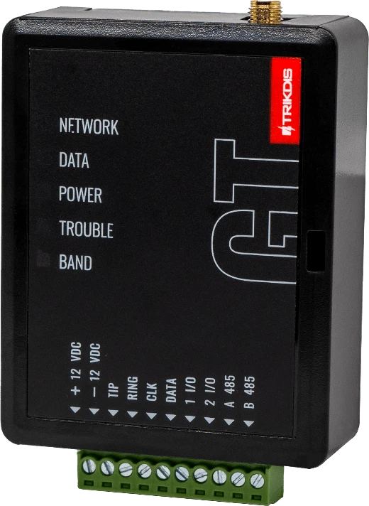

## Beskrivning 

Larmsändaren är avsedd att överföra händelsemeddelanden från centralapparaten till larmcentralen (CMS, Central Monitoring Station) och till appen Protegus2.

Larmsändaren GT med mobilanslutning kan anslutas direkt till centralapparater från DSC, Paradox, UTC Interlogix (CADDX), Texecom, Innerrange och Honeywell, eller till centralapparatens telefonuppringare (som stöder protokollet Contact ID överfört med DTMF-toner).

Larmsändaren överför fullständig händelseinformation till larmcentralen.

Larmsändaren fungerar också med appen Protegus2. Med Protegus2 kan användarna styra sitt larmsystem på distans och få aviseringar om händelser i larmsystemet. Appen Protegus2 fungerar med alla centralapparater från olika tillverkare som stöds av GT-larmsändaren. Larmsändaren kan skicka händelseaviseringar till larmcentralen och arbeta med Protegus2 samtidigt.

### Funktioner

Ansluts till centralapparatens seriella buss, knappsatsbuss eller telefonlinje (TIP/RING).

DSC-centralapparater kan anslutas till knappsatsbussen och till centralapparatens TIP/RING-plintar samtidigt. Knappsatsbussen används för styrning och för centralapparatens status, och händelserna rapporteras med centralapparatens egna Contact ID-koder.

Skickar händelser till larmcentralens mottagare:

- Skickar händelser till TRIKDIS programvaru- eller maskinvarumottagare som fungerar med all programvara för larmcentraler.

- Kan skicka händelsemeddelanden till SIA DC-09-mottagare. Bilagan innehåller en tabell för omvandling av Contact ID-koder till SIA-koder.

- Kan skicka händelsemeddelanden till SUR-GARD-mottagare.

- Övervakning av anslutningen genom att en PING-förfrågan skickas till IP-mottagaren var 30:e sekund (eller med en period som användaren anger).

- Backupkanal som används om anslutningen via primärkanalen bryts.

- Med parallell kommunikationskanal kan händelser skickas till två mottagare samtidigt.

- När tjänsten *Protegus* är aktiverad levereras händelserna först till larmcentralen och skickas därefter till appens användare.

**Fungerar med appen Protegus2:**

- ”*Push*”-aviseringar och särskilda ljud som informerar om händelser.

- Fjärrstyrd tillkoppling/frånkoppling av systemet.

- Fjärrstyrning av anslutna enheter (belysning, portar, ventilationssystem, värme, bevattning m.m.).

- Olika användarrättigheter för administratör, installatör och användare.

**Meddelar användare:**

- Användarna kan få aviseringar om händelser via appen Protegus2, SMS-meddelanden och samtal.

**Styrbara utgångar och ingångar:**

- 2 plintar med dubbel funktion som kan ställas in antingen som ingång (IN) eller som styrbar utgång (OUT).

- Utgångarna styrs med appen Protegus2 och SMS-meddelanden.

- Ytterligare ingångar och styrbara utgångar kan läggas till med utbyggnadsmodulerna iO-8.

**Snabb installation:**

- Inställningarna kan sparas i en fil och snabbt skrivas till andra larmsändare.

- Två behörighetsnivåer för konfigurering av enheten: för larmcentralens administratör och för installatören.

- Fjärrkonfigurering och firmwareuppdateringar.

### Lista över kompatibla centralapparater 

| Tillverkare | Modell |
|----|----|
| DSC® | <u>PC585</u>, <u>PC1404</u>, <u>PC1565</u>, <u>PC1616</u>, <u>PC1832</u>, <u>PC1864</u>, PC5020 |
| PARADOX® | <u>SPECTRA SP4000</u>, <u>SP5500</u>, <u>SP6000</u>, <u>SP7000</u>, <u>SP65</u>, <u>SP5500+</u>, <u>SP6000+</u>, <u>SP7000+</u> |
| PARADOX® | <u>MAGELLAN MG5000</u>, <u>MG5050</u>, <u>MG5050E</u>, <u>MG5075</u>, <u>MG5050+</u> |
| PARADOX® | <u>DIGIPLEX</u> EVO48, <u>EVO192</u>, <u>EVOHD</u>, <u>EVOHD+</u> |
| PARADOX® | SPECTRA 1727, 1728, 1738 |
| PARADOX® | ESPRIT E55 |
| UTC Interlogix® | <u>NetworX (Caddx) NX-4v2</u>, <u>NX-6v2</u>, <u>NX-8v2</u>, <u>NX-8e</u> |
| Texecom® | <u>Premier 24</u>, <u>48</u>, <u>88</u>, <u>168</u>, <u>640</u> / <u>Premier Elite 12</u>, <u>24</u>, <u>48</u>, <u>64</u>, <u>88</u>, <u>168</u>, <u>640</u> |
| Innerrange® | Inception, Integriti |
| Honeywell® | <u>Ademco Vista-15</u>, <u>Ademco Vista-20</u>, <u>Ademco Vista-48</u> |

**<u>Understruket</u>** - centralapparater som styrs direkt av GT. Firmware i PARADOX-centralapparater som styrs direkt måste vara V.4 eller senare.

DSC-centralapparater kan anslutas enbart till knappsatsbussen, eller till knappsatsbussen och TIP/RING-plintarna samtidigt (se 3.2.1).

\*Centralapparater från andra tillverkare ansluts till GT-larmsändaren via centralapparatens TIP/RING-plintar (som stöder protokollet Contact ID överfört med DTMF-toner).

### Larmsändarens modelltyper 

Denna manual gäller 4G-larmsändare.

### Specifikationer 

| Parameter | Beskrivning |
|----|----|
| Anslutning till centralapparat | Seriell buss, knappsatsbuss eller TIP RING |
| Plintar med dubbel funktion [IN/OUT] | 2, kan ställas in antingen som ingångar av typen NC, NO, NC/EOL, NO/EOL, NC/DEOL eller NO/DEOL (2,2 kΩ) eller som utgångar av typen öppen kollektor (OC) med en ström på upp till 0,15 A, max 30 V DC. Kan utökas med utbyggnadsmoduler iO-8. |
| Modem EG915U-EU / (Europa) | LTE FDD: B1/B3/B5/B7/B8/B20/B28 |
| Modem EG915U-EU / (Europa) | GSM: B2/B3/B5/B8 |
| Modem EG915U-LA / (Latinamerika) | LTE FDD: B2/B3/B4/B5/B7/B8/B28/B66 |
| Modem EG915U-LA / (Latinamerika) | GSM: B2/B3/B5/B8 |
| Modem BG95-M5 (Cat M1) | LTE-FDD: B1/B2/B3/B4/B5/B8/B12/B13/B18/B19/B20/B25/B26/B27/B28/B66/B85 |
| Modem BG95-M5 (Cat M1) | EGPRS: 850/900/1800/1900 MHz |
| Matningsspänning | 10–18 V DC |
| Strömförbrukning | Upp till 100 mA (i viloläge) / upp till 200 mA (vid dataöverföring) |
| Överföringsprotokoll | TRK8, DC-09_2007, DC-09_2012, TL150 |
| Meddelandekryptering | AES 128 |
| Ändring av inställningar | Med datorprogrammet TrikdisConfig, på distans eller lokalt via USB-C-porten |
| Driftmiljö | Temperatur från -10 °C till 50 °C, relativ luftfuktighet upp till 80 % vid +20 °C |
| Larmsändarens mått | 92 × 62 × 26 mm |
| Vikt | 80 g |

### Larmsändarens delar 

1.  SMA-kontakt för mobilantenn

2.  Lysdiodsindikeringar

3.  Spår för att öppna kapslingens framsida

4.  Plintblock för externa anslutningar

5.  USB-C-port för programmering av larmsändaren

6.  Knappen ”RESET”

7.  Kortplats för SIM-kort

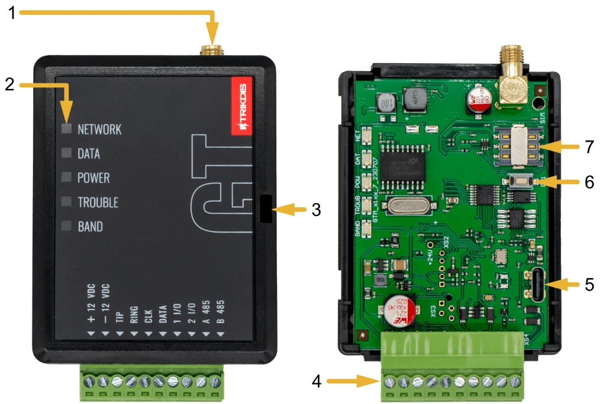

### Plintarnas funktion 

| Plint | Beskrivning |
|----|----|
| +12 VDC | Matning +10 V/+18 V DC |
| -12 VDC | Matning 0 V DC |
| TIP | Plint för anslutning till centralapparatens TIP-plint |
| RING | Plint för anslutning till centralapparatens RING-plint |
| CLK | Plintar för seriell buss eller knappsatsbuss, för direkt anslutning till centralapparaten |
| 1 I/O | Första ingångs-/utgångsplinten (förval – IN, NO-krets) |
| 2 I/O | Andra ingångs-/utgångsplinten (förval – IN, NO-krets) |
| A 485 | Plint A för RS485-bussen |
| B 485 | Plint B för RS485-bussen |

### Lysdiodsindikering vid drift 

| Indikator | Lysdiodens läge | Beskrivning |
|----|----|----|
| NETWORK | Släckt | Ingen anslutning till mobilnätet |
| NETWORK | Blinkar gult | Ansluter till mobilnätet |
| NETWORK | Fast grönt sken med gult blinkande | Larmsändaren är ansluten till mobilnätet. / Tillräcklig mobil signalstyrka för 4G nivå 3 (tre gula blinkningar) |
| DATA | Släckt | Inga osända händelser |
| DATA | Fast grönt sken | Osända händelser finns lagrade i bufferten |
| DATA | Blinkar grönt | (Konfigurationsläge) Data överförs till/från larmsändaren |
| POWER | Släckt | Matningen är avstängd eller bortkopplad |
| POWER | Fast grönt sken | Matningen är på med tillräcklig spänning |
| POWER | Fast gult sken | Matningsspänningen är otillräcklig (≤11,5 V) |
| POWER | Fast grönt sken och gult blinkande | (Konfigurationsläge) Larmsändaren är klar för konfigurering |
| POWER | Fast gult sken | (Konfigurationsläge) Ingen anslutning till datorn |
| TROUBLE | Släckt | Inga driftproblem |
| TROUBLE | 1 röd blinkning | SIM-kortet hittas inte |
| TROUBLE | 2 röda blinkningar | Problem med SIM-kortets PIN-kod (felaktig PIN-kod) |
| TROUBLE | 3 röda blinkningar | Programmeringsfel (ingen APN) |
| TROUBLE | 4 röda blinkningar | Problem med registrering i mobilnätet |
| TROUBLE | 5 röda blinkningar | Problem med registrering i GPRS/UMTS-nätet |
| TROUBLE | 6 röda blinkningar | Ingen anslutning till mottagaren |
| TROUBLE | 7 röda blinkningar | Förlorad anslutning till centralapparaten |
| TROUBLE | 8 röda blinkningar | Det angivna ICCID-numret stämmer inte med SIM-kortets ICCID-nummer |
| TROUBLE | Blinkar rött | (Konfigurationsläge) Minnesfel |
| TROUBLE | Fast rött sken | (Konfigurationsläge) Firmware är skadad |
| BAND | 1 grön blinkning | Ingen |
| BAND | 2 gröna blinkningar | GSM |
| BAND | 3 gröna blinkningar | GPRS |
| BAND | 4 gröna blinkningar | EDGE |
| BAND | 5 gröna blinkningar | HSDPA, HSUPA, HSPA+, WCDMA |
| BAND | 6 gröna blinkningar | LTE TDD, LTE FDD |

### Principschema för användning av GT-larmsändaren

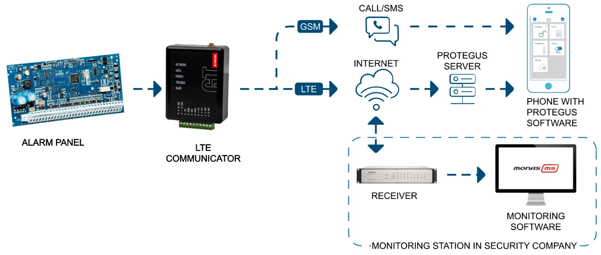

!!! note "Obs!"
    Innan du börjar, se till att du har följande:

    1.  USB-C-kabel för konfigurering.

    2.  Minst 4-ledarkabel för att ansluta larmsändaren till centralapparaten.

    3.  CRP2.4-kabel för anslutning till Paradox-centralapparatens seriella port.

    4.  Spårskruvmejsel 2,5 mm.

    5.  Antenn med tillräcklig förstärkning om nättäckningen i området är dålig.

    6.  Aktiverat SIM-kort (PIN-kodsbegäran kan vara avstängd).

    7.  Installationsmanualen för den aktuella centralapparaten.

    Beställ nödvändiga komponenter separat från din lokala distributör.

## Snabbkonfiguration med programmet *TrikdisConfig*

1.  Ladda ned konfigurationsprogrammet **TrikdisConfig** från [www.trikdis.com](http://www.trikdis.com) (skriv ”TrikdisConfig” i sökfältet) och installera det.

2.  Öppna GT:s kapsling med en spårskruvmejsel enligt bilden nedan:

    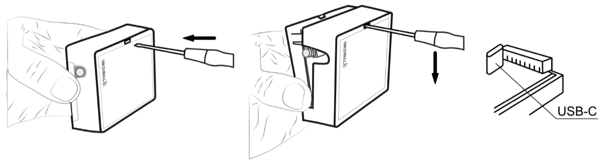

3.  Anslut GT till datorn med en USB-C-kabel.

4.  Starta TrikdisConfig. Programmet identifierar automatiskt den anslutna larmsändaren och öppnar ett fönster för konfigurering.

5.  Klicka på **Read [F4]** för att läsa larmsändarens inställningar. Om du uppmanas, ange administratörs- eller installatörskoden (6 siffror) i dialogrutan.

Nedan beskrivs vilka inställningar som behövs för att larmsändaren ska börja skicka händelser till larmcentralen och för att säkerhetssystemet ska kunna styras med appen Protegus2.

### Inställningar för anslutning till appen Protegus2 

**I fönstret ”Panel settings”:**

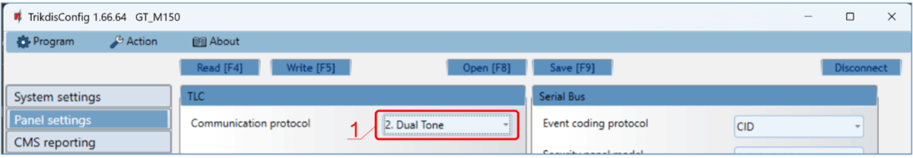

1.  Om larmsändaren är ansluten till centralapparatens TIP/RING-plintar måste du välja inställningen ”**Dual tone**”.

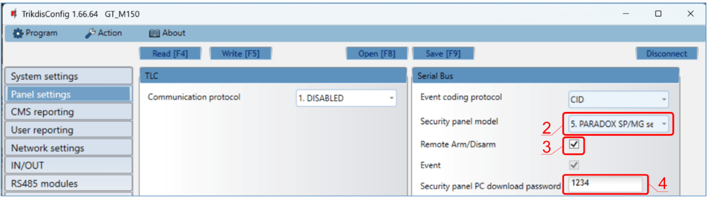

Larmsändaren är ansluten till centralapparatens knappsatsbuss eller seriella buss.

2.  Välj den ”**Security panel model”** som ska anslutas till larmsändaren.

3.  Markera ”**Remote Arm/Disarm”** om användarna ska kunna styra centralapparaten i appen Protegus2 med sin knappsatskod. Inställningen visas bara för centralapparater som styrs direkt.

4.  För direktstyrning av Paradox- och Texecom-centralapparater anger du ”**Security panel PC download password”**. Det måste stämma överens med lösenordet som är angivet i centralapparaten.

När en DSC-centralapparat är ansluten både till knappsatsbussen och till TIP/RING-plintarna ställer du in ”**Communication protocol**” på ”**Dual tone**” och väljer DSC-centralapparatens modell i ”**Security panel model**”. Markera ”**Remote Arm/Disarm**” för att styra centralapparaten från Protegus2. Se 3.2.1.2.

!!! note "Obs!"
    För att direktstyrningen av centralapparaten ska fungera måste du ändra centralapparatens inställningar. Hur du gör beskrivs i avsnitt 4 ”Programmering av centralapparaten”. I det avsnittet finns information om hur du ändrar PC download-/UDL-lösenordet. **I fönstret ”User reporting”, fliken ”PROTEGUS Cloud”:**

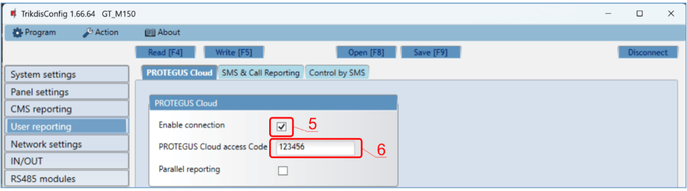

4.  Markera kryssrutan ”**Enable connection”** till Protegus Cloud.

5.  Ändra ”**PROTEGUS Cloud access Code**” för inloggning i Protegus2 om du vill att användarna ska behöva ange den när de lägger till systemet i appen Protegus2 (förvalt lösenord – 123456). Viktigt: Om du ändrar koden via TrikdisConfig måste du också ändra den i appen Protegus2.

**I fönstret ”SIM card”:**

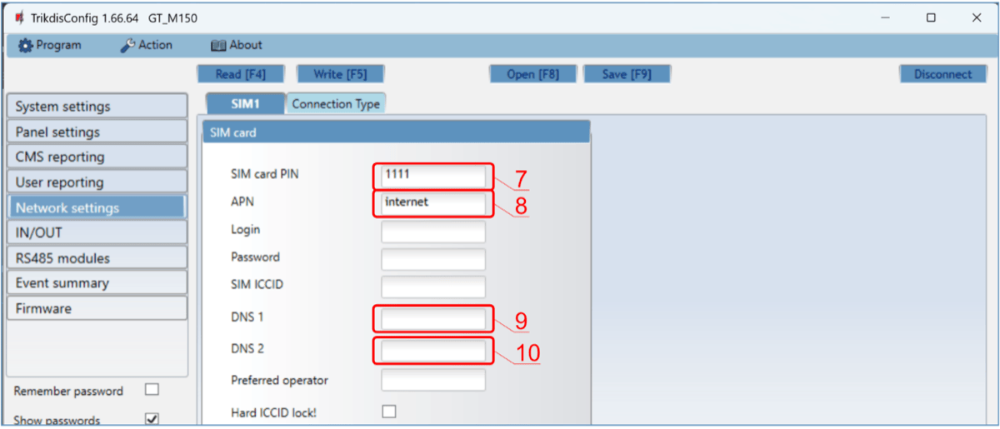

3.  Ange PIN-koden i ”**SIM card PIN”**.

4.  Ändra namnet i ”**APN”**. APN hittar du på SIM-kortsoperatörens webbplats (”internet” är universellt och fungerar i många operatörers nät).

5.  Googles DNS-server är förinställd. **Oavsett IP-inställningar, se till att DNS-adresserna stämmer med de som din internetleverantör stöder**.

6.  Googles DNS-server är förinställd. **Oavsett IP-inställningar, se till att DNS-adresserna stämmer med de som din internetleverantör stöder**.

När konfigureringen är klar klickar du på knappen **Write [F5]** och kopplar bort USB-kabeln.

!!! note "Obs!"
    Mer information om övriga inställningar för GT i TrikdisConfig finns i avsnitt 6 ”Beskrivning av TrikdisConfig-fönstren”.

### Inställningar för anslutning till larmcentralen 

**I fönstret ”System settings”:**

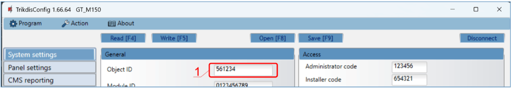

1.  Ange numret i ”**Object ID**” (abonnentkod) som du har fått från larmcentralen (6 tecken, 0–9, A–F. **Använd inte FFFE, FFFF som Object ID**).

1.  Om larmsändaren är ansluten till centralapparatens TIP/RING-plintar måste du välja inställningen ”**Dual tone**”.

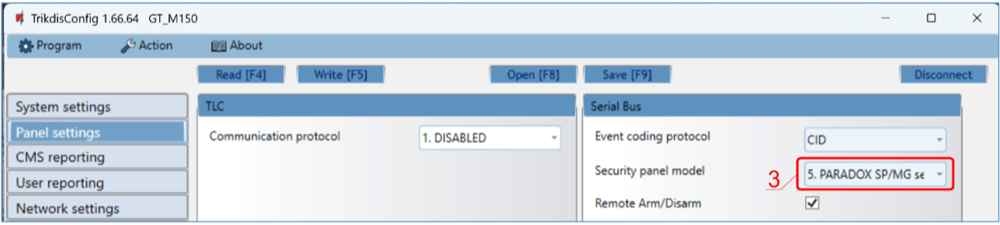

2.  Larmsändaren är ansluten till centralapparatens knappsatsbuss eller seriella buss. Välj den ”**Security panel model**” som ska anslutas till larmsändaren.

**I fönstret ”CMS reporting”, inställningar för ”Primary channel”:**

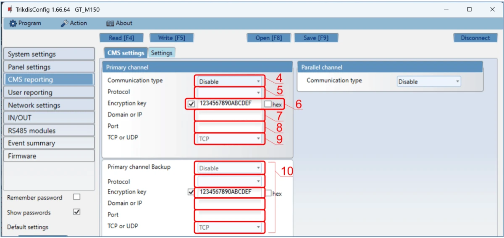

3.  **Communication type** - välj anslutningsmetoden **IP**.

4.  **Protocol** - välj protokolltyp för händelsemeddelandena: **TRK8** (till TRIKDIS-mottagare), **DC-09_2007** eller **DC-09_2012** (till universella mottagare), **TL150** (till SUR-GARD-mottagare).

5.  **Encryption key** - ange den krypteringsnyckel som är inställd i mottagaren.

6.  **Domain or IP** - ange mottagarens domän eller IP-adress.

7.  **Port** - ange mottagarens nätverksportnummer.

8.  **TCP or UDP** - välj det överföringsprotokoll (**TCP** eller **UDP**) som händelserna ska skickas med.

9.  (Rekommenderas) Konfigurera inställningarna för ”**Primary channel Backup”**.

**I fönstret ”SIM card”:**

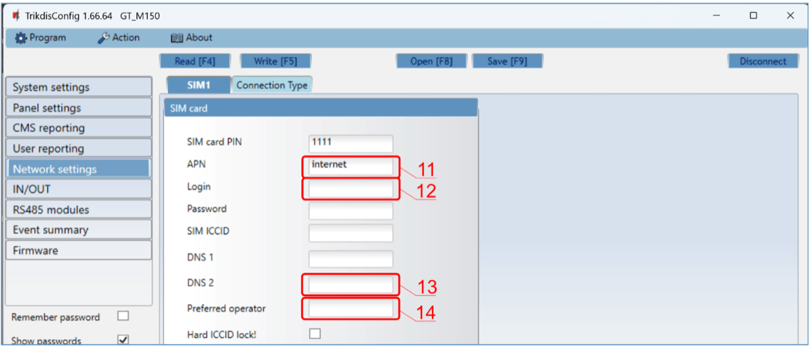

11. Ange PIN-koden i ”**SIM card PIN”**.

12. Ändra namnet i ”**APN”**. APN hittar du på SIM-kortsoperatörens webbplats (”internet” är universellt och fungerar i många operatörers nät).

13. Googles DNS-server är förinställd. **Oavsett IP-inställningar, se till att DNS-adresserna stämmer med de som din internetleverantör stöder**.

14. Googles DNS-server är förinställd. **Oavsett IP-inställningar, se till att DNS-adresserna stämmer med de som din internetleverantör stöder**.

När konfigureringen är klar klickar du på **Write [F5]** och kopplar bort USB-kabeln.

!!! note "Obs!"
    Mer information om övriga inställningar för GT i TrikdisConfig finns i avsnitt 6 ”Beskrivning av TrikdisConfig-fönstren”.

## Installation och inkoppling 

### Installationsgång 

1.  Ta bort det övre locket och dra ut plintblocket.

2.  Sätt i SIM-kortet i hållaren.

3.  Ta ut kretskortet ur kapslingens nedre del.

4.  Fäst den nedre delen med skruvar på en lämplig plats.

5.  Sätt tillbaka kretskortet i kapslingen och sätt i plintblocket.

6.  Skruva fast mobilantennen.

7.  Stäng det övre locket.

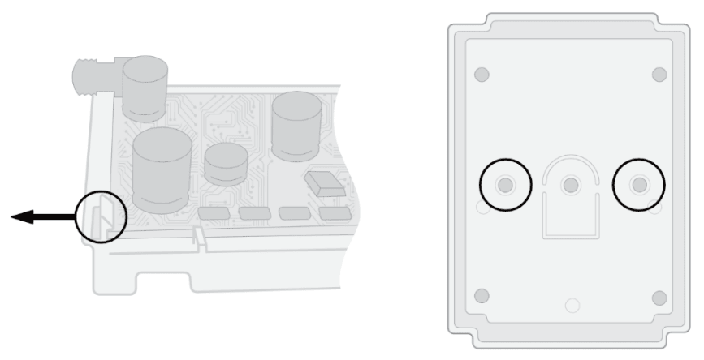

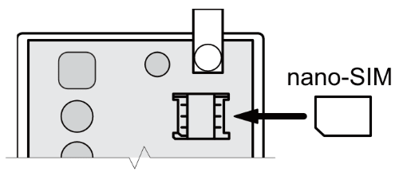

!!! note "Obs!"
    Kontrollera att SIM-kortet är aktiverat. / Kontrollera att mobil internettjänst (mobildata) är aktiverad om anslutningen sker via IP-kanal. / För att slippa ange PIN-koden i TrikdisConfig, sätt SIM-kortet i din mobiltelefon och stäng av PIN-kodsbegäran.

### Kopplingsscheman för inkoppling av larmsändaren till en centralapparat 

Anslut larmsändaren till centralapparaten enligt något av kopplingsschemana nedan.

<!-- terminal-label-note -->

!!! note "Obs!"
    I diagrammen nedan är **+DC** och **−DC** de plintar som på larmsändaren är märkta **+12 VDC** och **−12 VDC**, och **A RS485** / **B RS485** är de plintar som är märkta **A 485** / **B 485**.

#### DSC

##### Knappsatsbuss

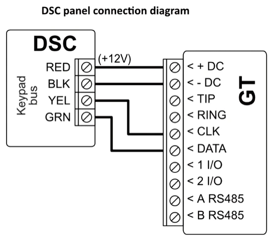

!!! note "Obs!"
    Enbart med knappsatsbussen får larmsändaren sektionernas allmänna tillstånd från centralapparaten och kan inte avgöra sektionstypen (brand, inbrott, vattenläckage osv.). Alla larm rapporteras som ett allmänt larm, Contact ID E130, och en del larmcentraler hanterar dessa händelser på ett annat sätt än den sektionstyp som faktiskt löstes ut. För att rapportera händelser med centralapparatens egna Contact ID-koder (till exempel E110 för brandlarm), anslut även TIP/RING-plintarna, se 3.2.1.2.

##### Knappsatsbuss och TIP/RING

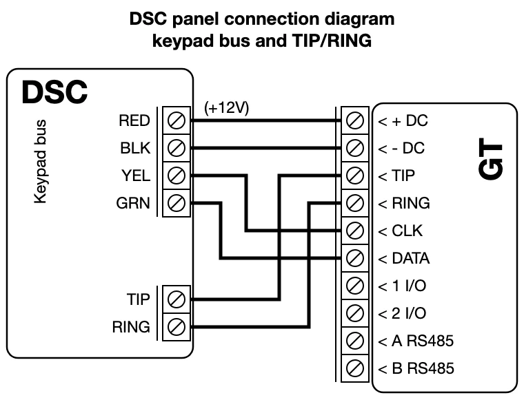

Knappsatsbussen används för styrning och för centralapparatens status: fjärrstyrd tillkoppling/frånkoppling samt tillstånd för områden och sektioner. Händelserna rapporteras via centralapparatens uppringare som är ansluten till TIP/RING-plintarna, så de skickas med centralapparatens egna Contact ID-koder. Händelser från knappsatsbussen skickas inte en andra gång så länge TIP/RING används.

När du ansluter larmsändaren både till knappsatsbussen och till centralapparatens TIP/RING-plintar måste du göra följande inställningar för GT-larmsändaren i fönstret ”**Panel settings**”:

1.  Ställ in ”**Communication protocol**” på ”**Dual tone**”.

2.  Välj DSC-centralapparatens modell i ”**Security panel model**”.

3.  Markera ”**Remote Arm/Disarm**” om användarna ska kunna styra centralapparaten med appen Protegus2.

DSC-centralapparatens PSTN-uppringare måste programmeras för att skicka händelser, enligt beskrivningen i 4.1.1 ”DSC”.

#### PARADOX

##### Seriell port

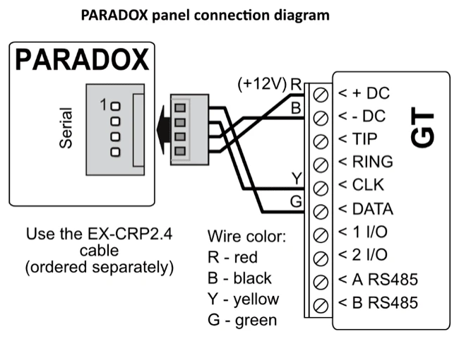

##### Knappsatsbuss och TIP/RING (SP/SP+/MG/MG+)

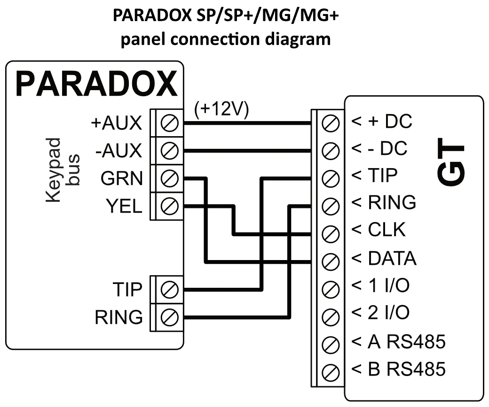

Denna anslutning använder centralapparatens knappsatsbuss i stället för den seriella porten, så den avgiftsbelagda upplåsningen av Paradox seriella port behövs inte.

!!! note "Obs!"
    Denna anslutning kräver larmsändarens firmware 1.21 eller senare.

När du ansluter larmsändaren både till knappsatsbussen och till centralapparatens TIP/RING-plintar måste du göra följande inställningar för GT-larmsändaren:

1.  Välj ”**Dual tone**”.

2.  Välj centralapparatens modell ”**7. Paradox SP+/MG+ series KeyBus**”.

3.  Markera ”**Remote Arm/Disarm**” om användarna ska kunna styra centralapparaten med appen Protegus2 med sin egen knappsatskod.

4.  För att styra centralapparaten direkt, ange ”**Security panel PC download password**”. Det måste stämma överens med lösenordet som är angivet i centralapparaten.

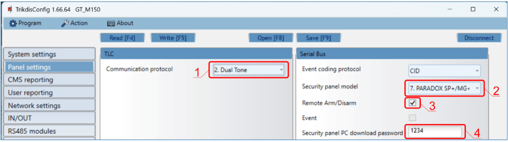

Paradox-centralapparaten måste programmeras för att skicka händelser till larmcentralen och för fjärrstyrning från appen Protegus2, enligt beskrivningen i 4.1.2 ”PARADOX”.

#### CADDX

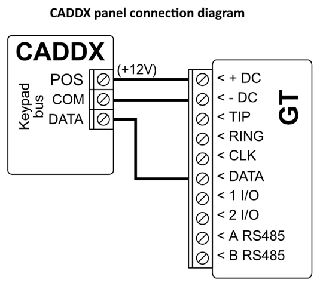

#### TEXECOM

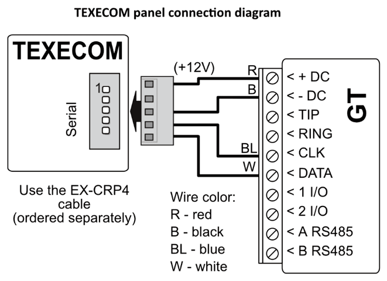

#### INNERRANGE INCEPTION

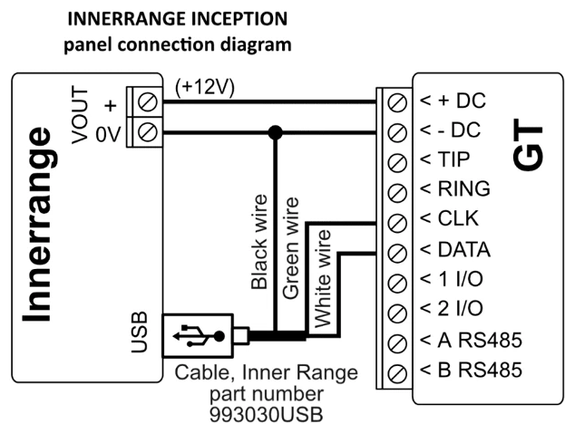

#### INNERRANGE INTEGRITI

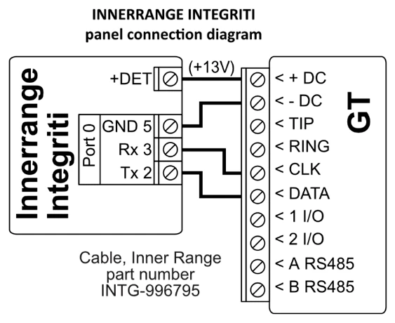

#### Honeywell Vista-15, Vista-20, Vista-48

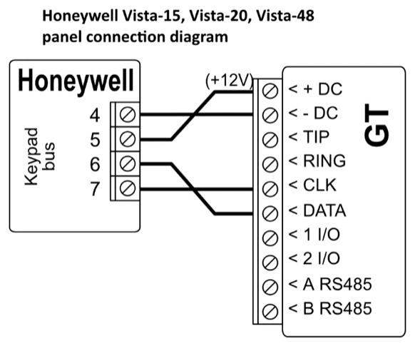

#### Centralapparat (telefonuppringare, TIP/RING)

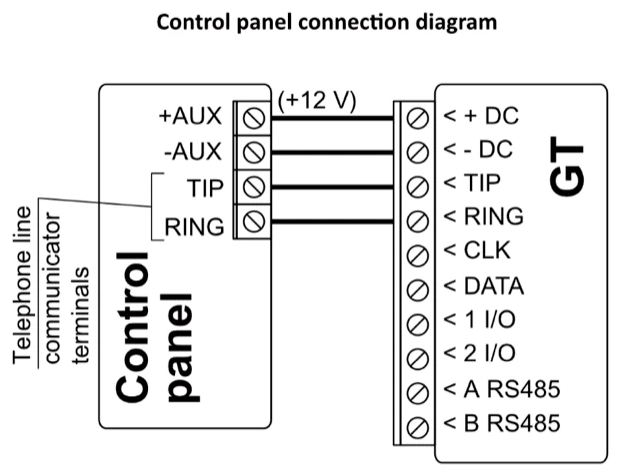

### Kopplingsschema för anslutning till centralapparatens nyckelbrytarsektion

Följ detta schema om centralapparaten ska tillkopplas/frånkopplas med en PGM-utgång på GT som slår på/av centralapparatens nyckelbrytarsektion.

!!! note "Obs!"
    GT-larmsändaren har 2 universella ingångs-/utgångsplintar som kan ställas in i driftläget OUT (PGM). Utgångarna (OUT) kan styra två områden i säkerhetssystemet. Om du vill styra systemet på detta sätt avmarkerar du ”**Remote Arm/Disarm**” i TrikdisConfig, i fönstret ”**System settings**”. Apparna Protegus2 måste konfigureras med de inställningar som beskrivs i avsnitt 5.2 ”Ytterligare inställningar för tillkoppling/frånkoppling av systemet med centralapparatens nyckelbrytarsektion”. Larmsändaren är ansluten till centralapparatens knappsatsbuss eller seriella buss. / Tillkoppling/frånkoppling av centralapparaten via nyckelbrytarsektion.

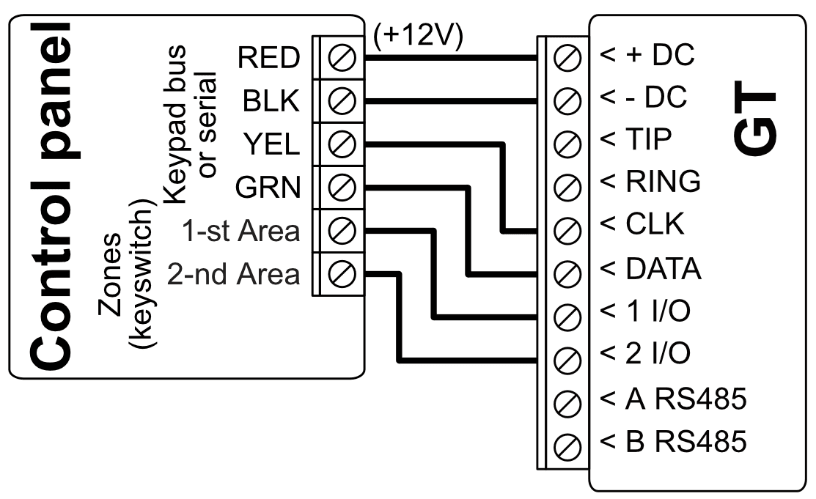

Larmsändaren är ansluten till centralapparatens telefonuppringare (TIP/RING-plintar). / Tillkoppling/frånkoppling av centralapparaten via nyckelbrytarsektionen.

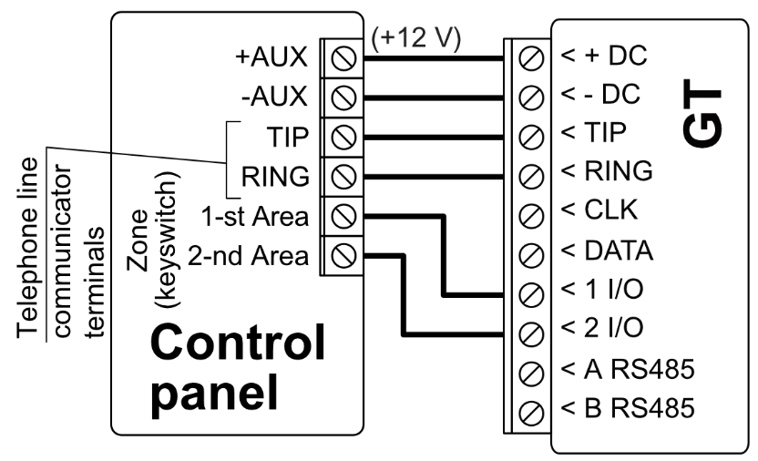

### Kopplingsscheman för anslutning av ingång 

Larmsändaren har 2 universella ingångs-/utgångsplintar som kan ställas in i ingångsläget IN. Kretsar av typerna NO, NC, NO / EOL, NC / EOL, NO / DEOL och NC / DEOL kan anslutas till ingångsplinten. Förval: ingång **1** **I/O** – NO; ingång **2** **I/O** – NO. Ingångstypen kan ändras i TrikdisConfig i fönstret **IN/OUT -\> Type.**

Anslut ingången enligt den valda ingångstypen (NO, NC, NO/EOL, NC/EOL, NO/DEOL, NC/DEOL), som i schemana nedan:

!!! note "Obs!"
    Om fler ingångar eller utgångar behöver anslutas till larmsändaren ansluter du TRIKDIS utbyggnadsmodul iO-8. Anslutningssättet beskrivs i [manualen för iO-8](../../../expanders/io-8/index.md) och i avsnitt 3.6 ”Kopplingsscheman för anslutning av utbyggnadsmoduler iO-8”.

### Kopplingsschema för anslutning av ett relä

Med reläkontakter kan du styra (slå på/av) olika elektriska apparater. Larmsändarens I/O-plint måste vara inställd på ett utgångsläge (OUT).

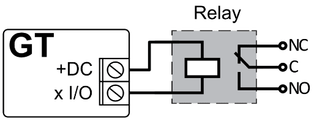

### Kopplingsscheman för anslutning av utbyggnadsmoduler iO-8

Om fler ingångar eller utgångar behöver anslutas till larmsändaren ansluter du TRIKDIS utbyggnadsmodul *iO-8*. Konfigureringen av utbyggnadsmoduler som är anslutna till *GT* beskrivs i avsnitt 6.8, fönstret ”RS485 modules”.

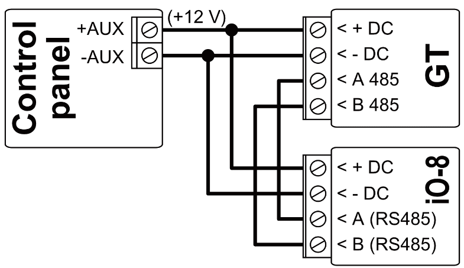

### Starta larmsändaren 

Starta larmsändaren genom att slå på centralapparatens matning. Lysdiodsindikeringen på GT-larmsändaren ska visa följande:

- Lysdioden ”POWER” lyser grönt när matningen är på;

- Lysdioden ”NETWORK” lyser grönt och blinkar gult när larmsändaren är registrerad i nätet.

!!! note "Obs!"
    Tillräcklig 4G-signalstyrka är nivå tre (tre gula blinkningar på lysdioden ”NETWORK”). / Om du räknar färre gula blinkningar på lysdioden ”NETWORK” är nätets signalstyrka otillräcklig. Vi rekommenderar att du väljer en annan plats för larmsändaren eller använder en känsligare mobilantenn. / Om du ser en annan lysdiodsindikering tyder det på ett visst fel. Felsök med hjälp av tabellen över lysdiodsindikeringar i avsnitt 1.7 ”Lysdiodsindikering vid drift”. / Om GT:s indikeringar inte lyser alls, kontrollera matningen och anslutningarna.

## Programmering av centralapparaten 

### Programmering av centralapparater när larmsändaren är ansluten till knappsatsbussen eller den seriella bussen 

Nedan beskrivs hur du programmerar centralapparaten så att GT-larmsändaren kan läsa händelser från centralapparaten och styra den på distans.

För att aktivera fjärrstyrning av centralapparaten, kontrollera att kryssrutan ”**Remote Arm/Disarm”** är markerad i TrikdisConfig-fönstret **“Panel settings”.**

#### DSC

**Knappsatsbuss.** DSC-centralapparater behöver inte programmeras.

**Knappsatsbuss och TIP/RING.** Programmera centralapparatens PSTN-uppringare så att den skickar händelserna. Tabellen gäller **DSC PowerSeries PC1616** (**PC1832, PC1864**). Med knappsatsen ansluten till centralapparaten, gå in i programmeringsläget: [\*][8][installatörskod] och ange sedan sekvensnumret.

| Sekvens | Värde |
|---------|-------|
| [301] Första telefonnumret | Valfritt nummer med fler än fyra siffror, utan D i början (till exempel 5555555). D gör att centralapparaten väntar på kopplingston; utan D slås numret snabbare. Larmsändaren besvarar alla samtal |
| [310] Systemets abonnentkod | Fyrsiffrig abonnentkod följd av FF (till exempel 1234FF). Använd HEX A i stället för varje siffra 0 |
| [311] Abonnentkod för område 1 | Fyrsiffrig abonnentkod. Använd HEX A i stället för varje siffra 0 |
| [350] Larmformat | 03 (Contact ID) för telefonnummer 1 |
| [351]–[376] Larmsändarens samtalsriktningar | Aktivera de händelsegrupper som behövs för telefonnummer 1: Larm/Återställning, Till-/Frånkoppling, Sabotagelarm/Återställning, Systemunderhåll, Testsändningar. Kontrollera särskilt Till-/Frånkoppling: på en del DSC-centralapparater är det avstängt som förval |
| [380] Första alternativet för larmsändaren | Alternativ 1 PÅ (larmsändaren aktiverad). Alternativ 3 AV (DTMF-uppringning) |
| [381] Andra alternativet för larmsändaren | Alternativ 7 AV (Contact ID-rapporteringskoderna genereras automatiskt) |
| [320]–[349] Larmkoder | Valfritt värde utom 00 för de händelser som ska rapporteras |
| [015] Tredje systemalternativet | Alternativ 7 AV (telefonlinjeövervakning, TLM, avaktiverad) |

!!! note "Obs!"
    Avaktivera telefonlinjeövervakningen. Om TLM förblir aktiverat kan centralapparaten visa ett telefonlinjefel. Fördröjningen för TLM-fel ställs in i sekvens [377].

!!! note "Obs!"
    Sekvensnumren ovan gäller PC1616, PC1832 och PC1864 (installationsguide v4.x). Andra DSC-modeller kan ha andra sekvensnummer; se centralapparatens programmeringsmanual.

#### PARADOX

Paradox-centralapparater behöver programmeras bara för direktstyrning med Protegus2. Du behöver inte programmera Paradox-centralapparater för att läsa händelser.

För fjärrstyrning av Paradox-centralapparater måste du ställa in ett PC download password. Lösenordet måste stämma överens med det som angavs i TrikdisConfig-fönstret **“Panel settings”**, när kryssrutan vid ”**Remote Arm/Disarm”** markerades.

Så här ställer du in lösenordet, med knappsatsen ansluten till centralapparaten:

- För serierna MAGELLAN och SPECTRA: gå till cell 911 och ange ett PC download password på 4 siffror.

- För serien DIGIPLEX EVO: gå till cell 3012 och ange ett PC download password på 4 siffror.

**Knappsatsbuss och TIP/RING (SP/SP+/MG/MG+).** Centralapparaten måste också programmeras för att skicka händelser till larmcentralen och för fjärrstyrning från appen Protegus2:

| **Cell** |     **Data**     | **Cell** | **Data** |
|:--------:|:----------------:|:--------:|:--------:|
|   801    | \*\*\*\*\*\*\*\* |   815    |  123456  |
|   811    |       1111       |   911    |   1234   |
|   812    |       2222       |          |          |

#### TEXECOM

Texecom-centralapparater måste programmeras både för att läsa händelser och för fjärrstyrning.

Du måste ställa in Texecom-centralapparatens ”**UDL** **passcode”**. Lösenordet måste stämma överens med det som angavs i TrikdisConfig-fönstret **“Panel settings”,** när kryssrutan vid ”**Remote Arm/Disarm”** markerades.

Centralapparaten kan programmeras med Texecoms programvara Wintex. Ange ”**UDL passcode”** (4-siffrig kod) i fönstret ”**Communication Options”**, fliken ”**Options”**.

Du kan också programmera med en knappsats ansluten till centralapparaten:

1.  Ange installatörskoden (4 siffror) och tryck på knappen [Menu] för att gå in i programmeringsmenyn.

2.  Tryck direkt därefter på tangenten [9].

3.  Tryck på [7][6] och sedan [2]. Ange den 4-siffriga ”**UDL** **passcode**” (”**UDL passcode**” måste stämma överens med GT-larmsändarens ”**PC login password**”).

4.  Tryck på [Yes] och lämna programmeringsläget genom att trycka på [Menu].

#### UTC INTERLOGIX (CADDX)

Med knappsatsen ansluten till centralapparaten:

1.  Tryck på [\*][8] och ange installatörskoden (förval - 9713).

2.  Ange det enhetsnummer som är tilldelat den anslutna larmsändaren (förval - 0).

3.  Ställ in inställningarna nedan för varje rad. Ange i tur och ordning positionen, segmentnumret och den önskade inställningen. Om du trycker på [\*] (asterisk) kommer du tillbaka till det lokala inmatningsfältet.

| Position | Segment | Inställning |
|--------------------|---------|-----------|
| 23 | 3 | 12345678 |
| 37 (behövs inte) | 3 | 12345678 |
| 37 (behövs inte) | 4 | 1234567* |
| 90 | 3 | 12345678 |
| 93 | 3 | 12345678 |
| 96 | 3 | 12345678 |
| 99 | 3 | 12345678 |
| 102 | 3 | 12345678 |
| 105 | 3 | 12345678 |
| 108 | 3 | 12345678 |

När alla angivna fält är programmerade, tryck två gånger på [Exit] för att lämna programmeringsläget.

#### INNERRANGE

Versionen på **Innerrange Inception**-centralapparaten måste vara **2.3.0.3507-r0** eller senare.

Centralapparaten måste vara ansluten till internet. Anslut till **Innerrange Inception** genom att ange: <https://skytunnel.com.au/inception/SERIALNUMBER>, där SERIALNUMBER är numret på styrenheten, som du hittar på centralapparatens kapsling.

Öppna **Configuration > General > Alarm Reporting**. I inställningsgruppen **3rd Party Device Configuration** ska du ange:

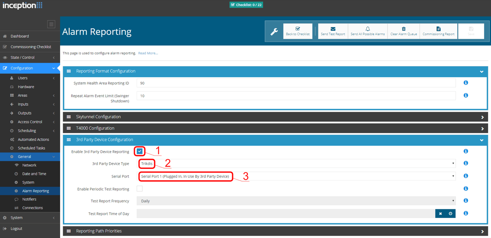

1.  **Enable 3rd Party Device Reporting** - markera denna kryssruta.

2.  **3rd Party Device Type** - ange ”Trikdis”.

3.  **Serial port** - ange ”Serial Port 1 (Plugged In, In Use By 3rd Party Device)”.

4.  Spara inställningarna och stäng programmet.

#### HONEYWELL ADEMCO VISTA

Följ dessa steg för centralapparaterna **Honeywell Ademco Vista-20** och **Honeywell Ademco Vista-48**. **Centralapparatens firmwareversion måste vara V5.3 eller senare.** Med en knappsats som är ansluten till centralapparaten:

1.  Gå in i programmeringsläget. Ange installatörskoden \[4\]\[1\]\[1\]\[2\] och därefter \[8\]\[0\]\[0\] . Alternativt kan du slå på centralapparatens matning. Tryck på knapparna \[\*\] och \[#\] samtidigt inom 50 sekunder efter att matningen slagits på (den här metoden kan användas när programmeringsläget lämnades genom att trycka \[\*\]\[9\]\[8\] på knappsatsen).

2.  Aktivera sändning av Contact ID-händelser via LRR. Tryck \[\*\]\[2\]\[9\]\[1\]\[\*\] på knappsatsen.

3.  När funktionen ”**Remote Arm/Disarm**” används, tillåt användning av den andra AUI-adressen. Tryck \[\*\]\[1\]\[8\]\[9\]\[1\]\[\*\] på knappsatsen.

Lämna programmeringsläget. Tryck \[\*\]\[9\]\[9\] på knappsatsen.

### Programmering av centralapparater när larmsändaren är ansluten till plintarna för centralapparatens telefonuppringare

För att centralapparaten ska kunna skicka händelser via PSTN-uppringaren måste den vara påslagen och korrekt inställd. Konfigurera centralapparatens PSTN-uppringare enligt centralapparatens programmeringsmanual:

1.  Aktivera centralapparatens PSTN-uppringare.

2.  Ange telefonnumret till larmcentralens mottagare (du kan använda vilket nummer som helst med fler än 4 siffror. GT svarar när centralapparaten ringer till vilket telefonnummer som helst).

3.  Välj DTMF-läge.

4.  Välj kommunikationsprotokollet Contact ID.

5.  Ange centralapparatens abonnentkod (4 siffror).

Den sektion i centralapparaten som GT-utgången OUT är ansluten till ska ställas in som nyckelbrytarsektion för att centralapparaten ska kunna tillkopplas/frånkopplas på distans.

!!! note "Obs!"
    Nyckelbrytarsektionen kan vara momentan (puls) eller bibehållen (nivå). Som förval är GT:s styrbara utgång OUT inställd på pulsläge med 3 sekunder. Du kan ändra pulstiden eller byta till nivåläge i inställningarna i Protegus2. Se avsnitt 5.2 ”Ytterligare inställningar för tillkoppling/frånkoppling av systemet med centralapparatens nyckelbrytarsektion”.

####

#### PROGRAMMERING AV HONEYWELL VISTA PSTN-UPPRINGARE

Ange följande sekvenser på centralapparatens knappsats och ställ in dem enligt beskrivningen:

- \*41 – ange telefonnumret till larmcentralens mottagare;

- \*43 – ange centralapparatens abonnentkod;

- \*47 – ställ in Tone dial på [1] och ange antal uppringningsförsök;

- \*48 – använd förvalet, \*48 måste vara 7;

- \*49 – Split/Dual message. \*49 måste vara 5;

- \*50 – fördröjning för sändning av inbrottslarmshändelser (valfritt). Förvalet är [2,0]. Då fördröjs sändningen av händelsemeddelandet med 30 sekunder. Om du vill att meddelandet ska skickas direkt, ställ in [0,0].

#### SPECIELLA INSTÄLLNINGAR FÖR HONEYWELL VISTA 48

Om du vill använda GT-larmsändaren med en Honeywell Vista 48-centralapparat, ställ in följande sekvenser enligt beskrivningen:

| **Sekvens** | **Data** | **Sekvens** | **Data** | **Sekvens** | **Data** |
|:--:|----|:--:|:--:|:--:|:--:|
|  \*41   | 1111 (mottagarens telefonnummer) |  \*60   |  1   |  \*69   |  1   |
|  \*42   | 1111                             |  \*61   |  1   |  \*70   |  1   |
|  \*43   | 1234 (centralapparatens abonnentkod) |  \*62   |  1   |  \*71   |  1   |
|  \*44   | 1234                             |  \*63   |  1   |  \*72   |  1   |
|  \*45   | 1111                             |  \*64   |  1   |  \*73   |  1   |
|  \*47   | 1                                |  \*65   |  1   |  \*74   |  1   |
|  \*48   | 7                                |  \*66   |  1   |  \*75   |  1   |
|  \*50   | 1                                |  \*67   |  1   |  \*76   |  1   |
|  \*59   | 0                                |  \*68   |  1   |         |      |

När alla nödvändiga inställningar är gjorda måste du lämna programmeringsläget. Ange \[\*\]\[9\]\[9\] på knappsatsen.

#### UTC INTERLOGIX(CADDX)

Programmering av centralapparaten **Interlogix NX-4V2** (**NX-6V2, NX-8V2**) när larmsändaren är ansluten till centralapparatens TIP/RING-plintar.

|  | Knappsatsinmatning | Beskrivning |
|-------------|--------------|-----------------------------------|
|  | *89713 | Gå in i programmeringsläge |
|  | 0# |  |
| Plats 0 | 0# |  |
| Plats 0 | 1*2*3*4*# |  |
| Plats 1 | 1# |  |
| Plats 1 | 1*2*3*4*# |  |
| Plats 2 | 2# |  |
| Plats 2 | 1*# |  |
| Plats 4 | 4# | Alla sektionslysdioder är tända (segment 1) |
| Plats 4 | 12345678* | Alla sektionslysdioder är tända (segment 2) |
| Plats 4 | 12345678*# |  |
| Plats 23 | 23# | Alla sektionslysdioder är tända (segment 3) |
| Plats 23 | ** | Alla sektionslysdioder är tända (segment 3) |
| Plats 23 | 12345678*# | Alla sektionslysdioder är tända (segment 3) |
| Plats 37 | 37# | Alla sektionslysdioder är tända (segment 3) |
| Plats 37 | ** | Alla sektionslysdioder är tända (segment 4) |
| Plats 37 | 12345678* |  |
| Plats 37 | 12345678*# |  |
|  | EXIT EXIT | Lämna programmeringsläget |

## Fjärrstyrning 

### Lägga till säkerhetssystemet i appen Protegus2 

Med Protegus2 kan användarna styra sitt larmsystem på distans. De ser systemets status och får aviseringar om systemhändelser.

1.  Ladda ned och starta appen Protegus2 eller använd webbversionen: [www.protegus.app](https://www.protegus.app).

    

      

    

2.  Logga in med ditt användarnamn och lösenord, eller registrera dig och skapa ett nytt konto.

!!! warning "Viktigt"
    När du lägger till GT i Protegus2, kontrollera att:

    1.  Det isatta SIM-kortet är aktiverat och att PIN-koden antingen
        är angiven eller avstängd;

    2.  ”**Protegus** **cloud**” är aktiverat. Se avsnitt **6.5, fönstret ”User reporting”**;

    3.  Matningen är ansluten (lysdioden ”POWER” lyser grönt);

    4.  Larmsändaren är registrerad i nätet (lysdioden ”NETWORK” lyser grönt och
        blinkar gult).

3.  Klicka på ”**Add new system”** och ange GT:s nummer ”*IMEI/Unique ID*”. Numret finns på enheten och på etiketten på förpackningen. Klicka på ”**Next”**.

{ .trik-mob-img }

4.  Ange systemets ”**Name**”. Klicka på ”**Next**”.

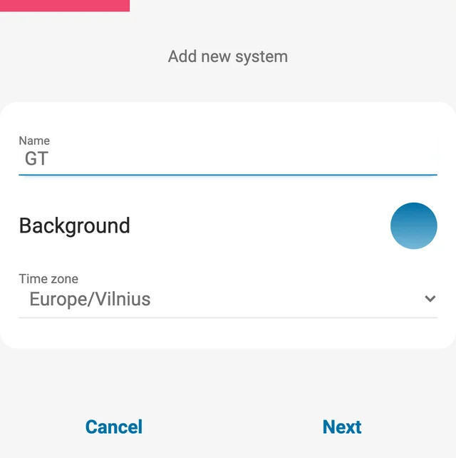{ .trik-mob-img }

### Ytterligare inställningar för tillkoppling/frånkoppling av systemet med centralapparatens nyckelbrytarsektion 

!!! warning "Viktigt"
    Den sektion i centralapparaten som GT-utgången OUT är ansluten till måste vara inställd på nyckelbrytarläge. Följ anvisningarna nedan om centralapparaten ska styras med en PGM-utgång på GT som slår på/av centralapparatens nyckelbrytarsektion.

1.  Klicka på „**Continue**“.

{ .trik-mob-img }

2.  Ange ”**Area name**”. Aktivera styrning av PGM-utgången med appen Protegus2.

3.  Välj ”**Pulse**” eller ”**Level**”, beroende på hur nyckelbrytarsektionens typ är konfigurerad. Vid behov kan du ändra intervallet för ”**Pulse**”.

4.  Klicka på „**Save**“.

{ .trik-mob-img }

5.  Om säkerhetssystemet har ett område till måste du klicka på ”**Click to add an area**”. PGM-utgången ställs in på liknande sätt som beskrivits ovan.

6.  När inställningarna är klara klickar du på knappen ”**Skip**”.

{ .trik-mob-img }

### Tillkoppling/frånkoppling av larmsystemet med Protegus2 

1.  I fönstret ”System Home Screen” klickar du på statusikonen ”Disarm”.

2.  *Protegus2* får ett meddelande om att säkerhetssystemets status har ändrats och statusikonen byter läge.

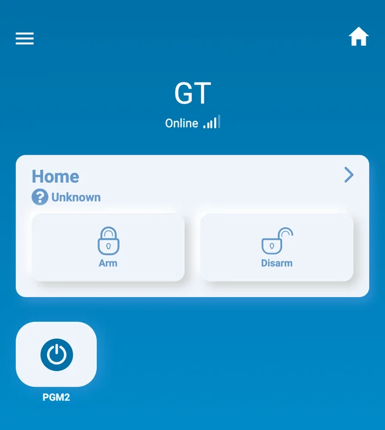{ .trik-mob-img }

### Styrning med SMS-meddelanden

Du kan styra larmsändaren på distans med SMS-meddelanden.

Meddelandets struktur är: Lösenord `[space]` Kommando `[space]` Data

Som lösenord används **Administrator code** för kommandona *INFO, RESET, OUTPUTx* och **Installer code** för kommandona *INFO, OUTPUTx*.

#### Lista över SMS-kommandon

| Kommando | Data | Beskrivning |
|----|----|----|
| INFO |  | Begär information om enheten. Svaret innehåller: larmsändarens typ, IMEI-nummer, serienummer och firmwareversion. T.ex.: 123456 INFO |
| RESET |  | Starta om enheten. T.ex.: 123456 RESET |
| OUTPUTx | ON | Slå på en utgång. x är utgångens nummer (1, 2). T.ex.: 123456 OUTPUT1 ON |
| OUTPUTx | OFF | Stäng av en utgång. x är utgångens nummer (1, 2). T.ex.: 123456 OUTPUT1 OFF |
| OUTPUTx | PULSE=tttt | Slå på utgången i pulsläge under den angivna tiden (sek). / ”tttt” är pulsens varaktighet i sekunder, angiven med fyra siffror. / T.ex.: 123456 OUTPUT2 PULSE=0002 |

Du kan begränsa från vilka telefonnummer larmsändaren accepterar kommandon. Se avsnitt 6.5, fönstret ”User reporting”, fliken ”Control by SMS”.

## Beskrivning av TrikdisConfig-fönstren

### Beskrivning av statusfältet i *TrikdisConfig*

När du har anslutit GT och klickat på **Read \[F4\], *TrikdisConfig*** visar programmet information om den anslutna enheten i statusfältet:

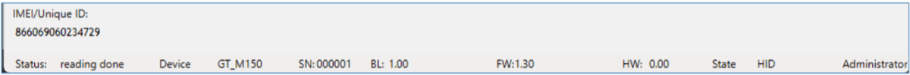

| Objekt | Beskrivning |
|----------------|----------------------------------------------------|
| IMEI/Unique ID | Enhetens IMEI-nummer |
| Status | Driftstillstånd |
| Device | Enhetstyp (GT ska visas) |
| SN | Enhetens serienummer |
| BL             | Bootloader-version                                 |
| FW | Enhetens firmwareversion |
| HW | Enhetens maskinvaruversion |
| State | Typ av anslutning till programmet (via USB eller på distans) |
| Administrator | Behörighetsnivå (visas när åtkomstkoden har godkänts) |

När du har tryckt på **Read [F4]** läser programmet in och visar de inställningar som är gjorda i ***GT*.** Ange de inställningar som behövs enligt beskrivningarna av TrikdisConfig-fönstren nedan.

### Fönstret ”System settings”

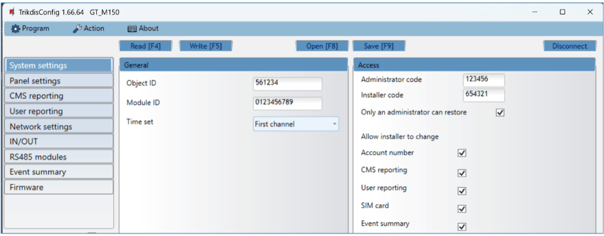

**Inställningsgruppen ”General”**

- **Object ID** – om händelserna ska skickas till larmcentralen (CMS, Central Monitoring Station), ange den abonnentkod som du har fått från larmcentralen (hexadecimalt tal med 6 tecken, 0–9, A–F. **Använd inte FFFE, FFFF som Object ID**).

- **Module ID** - ange modulens ID-nummer.

- **Time set -** välj vilken server som ska användas för tidssynkronisering.

Inställningsgruppen ”Access”

När du ställer in larmsändaren GT finns det två behörighetsnivåer: administratör och installatör:

- **Administrator code -** ger åtkomst till alla konfigurationsfält (förvald kod - 123456).

- **Installer code** - begränsad åtkomst för konfigurering av larmsändaren (förvald kod - 654321).

- **Only an administrator can restore** - om rutan är markerad kan fabriksinställningarna bara återställas genom att administratörskoden anges.

- **Allow installer to change** – administratören kan ange vilka inställningar som installatören får ändra.

### Fönstret ”Panel settings”

**Inställningsgruppen ”TLC”**

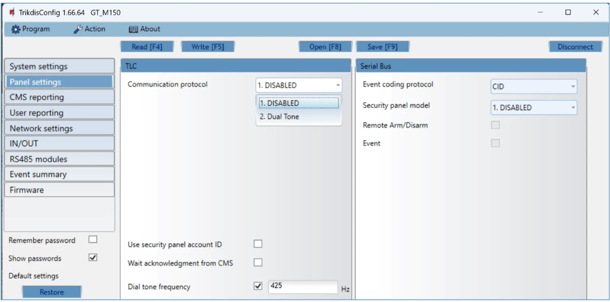

När larmsändaren är ansluten till centralapparatens TIP/RING-plintar måste följande inställningar göras.

- **Communication protocol** – aktivera/avaktivera DTMF-gränssnittet för fast telefonlinje på larmsändaren.

- **Use security panel account ID** – abonnentkoden är inställd i centralapparaten och överförs till GT.

- **Wait acknowledgment from CMS** - efter att ett meddelande har tagits emot skickar larmcentralen en kissoff-signal till larmsändaren. Om larmsändaren inte får kissoff-tonen i tid skickar den meddelandet igen.

- **Dial tone frequency** – den frekvens som GT använder för att kommunicera med centralapparatens telefonuppringare.

**Inställningsgruppen ”Serial bus”**

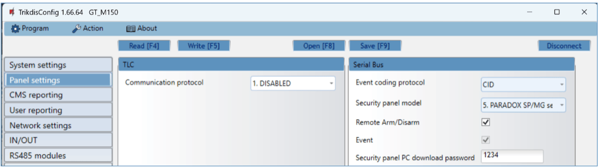

När larmsändaren är ansluten till centralapparatens knappsatsbuss eller seriella buss måste följande inställningar göras.

- **Event coding protocol** - ange dataöverföringsprotokollet.

- Välj den **Security panel type** som ska anslutas till larmsändaren.

- **Remote Arm/Disarm** - när kryssrutan är markerad styr GT centralapparaten direkt på distans. Inställningen visas bara för centralapparater som styrs direkt. För direktstyrning av centralapparaterna måste du ändra centralapparatens inställningar, enligt beskrivningen i avsnitt 4.1 ”Programmering av centralapparater när larmsändaren är ansluten till knappsatsbussen eller den seriella bussen”.

  - **PC download password** - för direktstyrning av Paradox- och Texecom-centralapparater måste du ange PC/UDL-lösenordet. Det måste stämma överens med lösenordet som är angivet i centralapparaten. Hur du ändrar lösenordet beskrivs i avsnitt 4.1 ”Programmering av centralapparater när larmsändaren är ansluten till knappsatsbussen eller den seriella bussen”*.*

### Fönstret ”CMS reporting”

**Fliken ”CMS settings”**

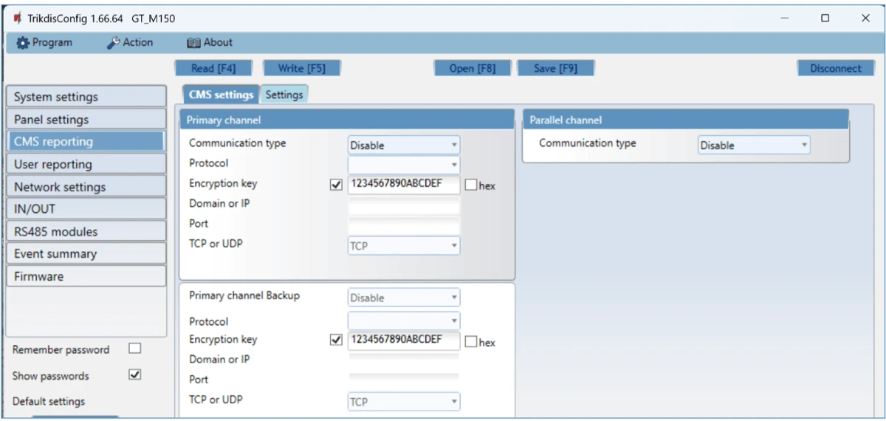

Larmsändaren skickar händelser till larmcentralen via mobilt internet (IP).

Händelser kan skickas över flera kommunikationskanaler. Primärkanalen och den parallella kommunikationskanalen kan arbeta samtidigt, så att larmsändaren kan skicka händelser till två mottagare samtidigt. Backupkanaler kan tilldelas både primärkanalen och den parallella kanalen och används när anslutningen via primärkanalen eller den parallella kanalen bryts.

Kommunikationen är kodad och lösenordsskyddad. En TRIKDIS-mottagare krävs för att ta emot och vidarebefordra händelseinformation till övervakningsprogrammen:

- För anslutning över IP - programvarumottagaren IPcom för Windows/Linux, maskinvarumottagaren IP/SMS RL14.

**Inställningsgruppen ”Primary channel”**

- **Communication type** - välj vilken metod som ska användas för att ansluta till larmcentralens mottagare: **IP**.

- **Protocol** - välj med vilken kodning händelserna ska skickas: **TRK8** (till TRIKDIS-mottagare), **DC-09_2007** eller **DC-09_2012** (till universella mottagare), **TL150** (till SUR-GARD-mottagare).

- **Encryption key** - meddelandekrypteringsnyckel. Nyckeln som skrivs till larmsändaren måste stämma överens med mottagarens nyckel.

- **Domain or IP** - ange mottagarens domän eller IP-adress.

- **Port** - ange mottagarens nätverksportnummer.

- **TCP or UDP** - välj med vilket protokoll (TCP eller UDP) händelserna ska skickas.

Inställningsgruppen ”Parallel channel”

Händelser överförs parallellt med den första kanalen via denna kanal. När den andra kanalen är aktiverad kan händelser skickas samtidigt till två mottagare (t.ex. en lokal och en central larmcentral). Inställningarna för Parallel channel är desamma som beskrivits ovan.

Inställningsgruppen ”Primary channel Backup”

Aktivera backupkanalläget för att skicka händelser via backupkanalen om anslutningen via primärkanalen bryts. Backupkanalens inställningar är desamma som beskrivits ovan.

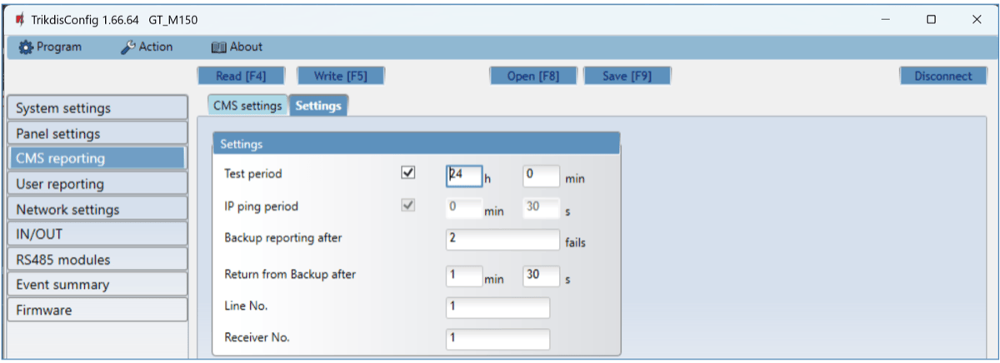

\*\*\*\*Fliken ”Settings”\*\* Inställningsgruppen ”Settings”\*\*

- **Test period** - period för TEST-händelser som testar anslutningen. Testhändelserna skickas som Contact ID-meddelanden och vidarebefordras till larmcentralens programvara.

- **IP ping period** – period för sändning av interna PING-signaler (heartbeat). Dessa meddelanden skickas bara via IP-kanal. Mottagaren vidarebefordrar inte PING-meddelanden till larmcentralens programvara, för att inte överbelasta den. Meddelanden skickas till programvaran bara om mottagaren inte får PING-meddelanden från enheten inom den inställda tiden.

  Som förval skickas meddelandet ”*Connection lost*” till larmcentralens programvara om mottagaren inte får något PING-meddelande under en tidsperiod som är tre gånger längre än den som är inställd i enheten. Om PING-perioden t.ex. är inställd på 3 minuter skickar mottagaren meddelandet *”Connection lost”* om inget PING-meddelande tas emot inom 9 minuter.

  PING-signaler upprätthåller den aktiva kommunikationssessionen mellan enheten och mottagaren. En aktiv session krävs för fjärranslutning, fjärrstyrning och fjärrkonfigurering av enheten. Vi rekommenderar att PING-perioden ställs in på högst 5 minuter.

- **Backup reporting after** - anger antalet misslyckade försök att skicka meddelandet via primärkanalen. Om enheten misslyckas att sända det angivna antalet gånger ansluter den för att skicka meddelandena via backupkanalen.

- **Return from backup after** - tid efter vilken GT försöker ansluta igen och skicka meddelanden via primärkanalen.

Inställningarna visas när protokollet **DC-09_2007** eller **DC-09_2012** är valt i kommunikationskanalens fält **Protocol** för att skicka händelser till universella mottagare.

- **Line No**. - ange mottagarens linjenummer.

- **Receiver No.** - ange mottagarnumret.

### Fönstret ”User reporting”

**Fliken ”PROTEGUS cloud”**

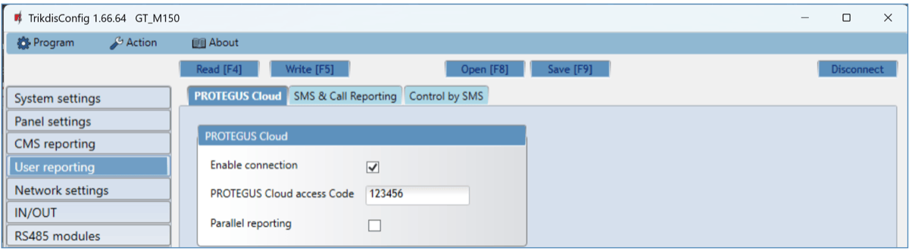

Tjänsten Protegus gör det möjligt för användarna att övervaka och styra larmsändaren på distans. Mer information om tjänsten Protegus finns på [www.protegus.app](https://www.protegus.app).

**Inställningsgruppen ”Protegus Cloud”**

- **Enable connection** – aktivera tjänsten Protegus; GT kan då utbyta data med appen Protegus2 och konfigureras på distans via ***TrikdisConfig*.**

- **Protegus Cloud access Code -** sexsiffrig kod för anslutning till appen Protegus2 (förval – 123456). Viktigt: Om du ändrar koden via TrikdisConfig måste du också ändra den i appen Protegus2.

- **Parallel reporting** – markera rutan så skickas meddelanden samtidigt via primärkanalen (till larmcentralen) och till Protegus2.

**Fliken ”SMS & Call Reporting”**

Aviseringar om systemhändelser kan skickas till användarnas mobiltelefoner via SMS-meddelanden eller telefonsamtal.

- **Object name** - ange namnet på det system som larmsändaren är ansluten till. Varje SMS-avisering innehåller objektets namn.

- **SMS language** - välj språk för SMS-meddelandena (SMS-meddelanden kan skickas med språkspecifika tecken).

- **Tel numbers for SMS/Call reporting** - ange upp till 4 telefonnummer till användare som ska få SMS-meddelanden eller samtal om händelser. Telefonnumren måste börja med landskod, till exempel +370xxxxxxxx, 00370xxxxxxxx eller 370xxxxxxxx.

- **Area name, User name, Zone name tables** - varje område, användare och sektion kan ha ett namn som används i SMS-händelsemeddelanden. Ange områdets, användarens eller sektionens nummer i motsvarande tabell och ange namnet intill numret.

- **CID event table** - här kan du ändra vilka telefonnummer som får SMS-meddelanden eller telefonsamtal om händelserna i listan.

Du kan ändra texterna i SMS-meddelandena för förvalda händelser, ändra Contact ID-koderna (CID) och lägga till nya händelser med beskrivningar.

**Fliken ”Control by SMS”**

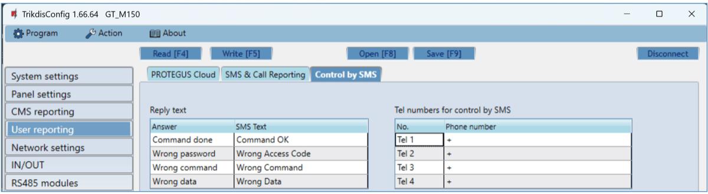

Du kan skicka ett SMS-kommando till GT-larmsändaren, som aktiverar utgången eller skickar information om larmsändaren. Styrkommandona finns i avsnitt: se det angivna avsnittet ”see the referenced section”.

- **Reply text** - SMS-text som användaren får efter att ha skickat ett SMS-kommando. SMS-texten kan redigeras.

- **Tel numbers for control by SMS** - här kan du ange de telefonnummer från vilka larmsändaren accepterar kommandon.

!!! note "Obs!"
    Om inget telefonnummer anges accepterar enheten kommandon från vilket telefonnummer som helst. Säkerheten garanteras i alla fall av kravet på att administratörs- eller installatörslösenordet anges i SMS-kommandot.

### Fönstret ”Network settings”

!!! warning "Viktigt"
    1. Kontrollera att SIM-kortet är aktiverat och fungerar innan du använder det. / 2. Om mobilt internet ska användas för att skicka händelser via IP-kanal eller till Protegus2, kontrollera att mobildatatjänsten är aktiverad. 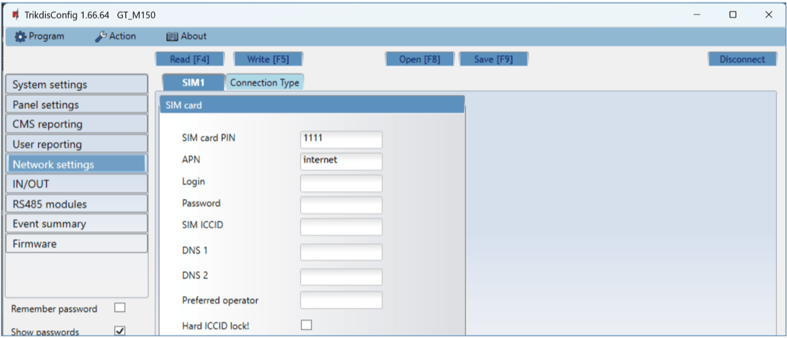

**Inställningsgruppen ”SIM card”**

- **SIM card PIN** - ange SIM-kortets PIN-kod. Koden kan avaktiveras genom att du sätter SIM-kortet i en mobiltelefon och stänger av begäran. Om du har stängt av SIM-kortets PIN-begäran, lämna förvalt värde i detta fält.

- **APN** - ange APN (Access Point Name). Det krävs för att ansluta larmsändaren till internet. APN hittar du på SIM-kortsoperatörens webbplats (”internet” är universellt och fungerar i många operatörers nät).

- **Login, Password** - ange vid behov användarnamn (login) och lösenord för anslutning till internet.

- **SIM ICCID** - ange SIM-kortets ICCID-nummer om du vill att larmsändaren bara ska fungera med just det SIM-kortet.

- **DNS1, DNS2** - (Domain Name System) server som anger IP-adressen för en domän. Används när en domän är angiven i kommunikationskanalens fält **Domain or IP** (inte en IP-adress). Googles DNS-server är förinställd. **Oavsett IP-inställningar, se till att DNS-adresserna stämmer med de som din internetleverantör stöder**.

- **Preferred operator** – när du har angett mobiloperatörens kod ansluter larmsändaren bara till den valda operatörens nät. Mobiloperatörens kod består av MCC- och MNS-koder.

- **Hard ICCID lock** - om du markerar fältet och startar om larmsändaren binds den strikt till den angivna ICCID-koden för SIM-kortet.

Fliken ”Connection Type”

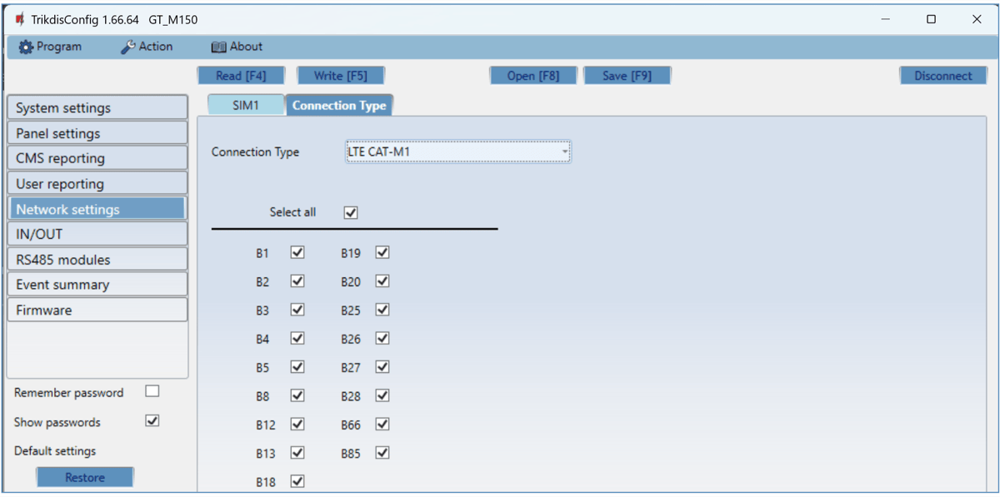

Dessa inställningar gäller för larmsändare med modem av typen CAT-M1. Du kan ange vilka frekvenser larmsändarens modem ska arbeta på.

### Fönstren ”IN/OUT”

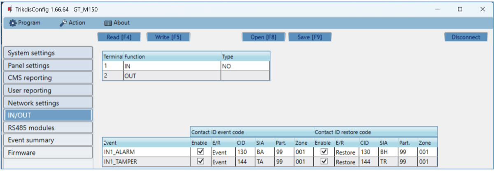

Larmsändaren har 2 universella (ingångs-/utgångs-)plintar. I tabellen kan plintens driftläge ställas in (Off, IN, OUT). För ingången måste du ange typen av krets som ska anslutas: NC, NO, NO / EOL, NC / EOL, NO / DEOL, NC / DEOL.

Ytterligare detektorer kan anslutas till larmsändarens ingångar. När detektorn löser ut skickar larmsändaren ett händelsemeddelande. Ingången tilldelas en Contact ID-kod som skickas till larmcentralen och Protegus2.

- **Enable** – markerade händelsefält för vilka meddelanden skickas till larmcentralen och Protegus2.

- **E/R** – välj vilken typ av händelse som ska skickas när ingången löser ut – **Event** eller **Restore**.

- **CID** – ange händelsekoden eller lämna förvalt värde. När händelsen inträffar skickas händelsekoden till Protegus2 och larmcentralen.

- **SIA** - ange händelsekoden eller lämna förvalt värde. När händelsen inträffar skickas händelsekoden till Protegus2 och larmcentralen.

- **Part**. – ange det områdesnummer som skickas när en intern händelse inträffar och när systemet återställs.

- **Zone** - ange det sektionsnummer som skickas när en intern händelse inträffar och när systemet återställs.

### Fönstret ”RS485 modules”

**Fliken ”Modules list”**

Utbyggnadsmoduler iO-8 kan anslutas till larmsändaren för att lägga till ytterligare ingångar och utgångar. Anslutna utbyggnadsmoduler måste läggas till i tabellen ”**Modules list**”.

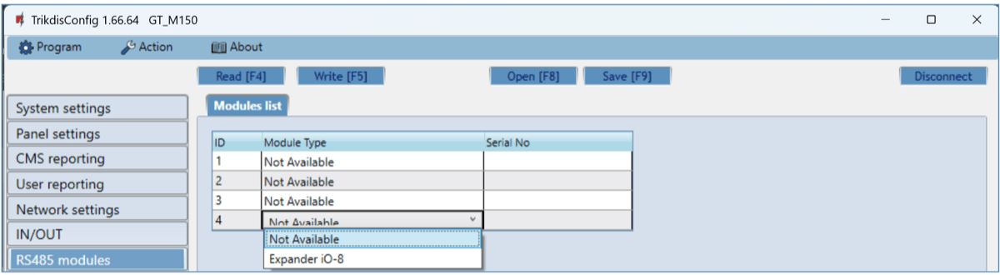

- **Module type** – välj i listan den modul som är ansluten till larmsändaren via RS485.

- **Serial No –** ange modulens serienummer (6 siffror), som anges på etiketterna på modulens kapsling och förpackning.

När du har valt den anslutna modulen och angett dess serienummer går du till **RS485 modules** → **Module.**

**Flikarna ”Module 1”**

När utbyggnadsmodulen har lagts till i larmsändaren enligt beskrivningen ovan visas en ny flik med modulens inställningar i fönstret ”**RS485 modules**”. Fliken får ett nummer. Nedan beskrivs inställningarna för utbyggnadsmodulen iO-8.

**Inställningsfönstret för utbyggnadsmodulen iO-8**

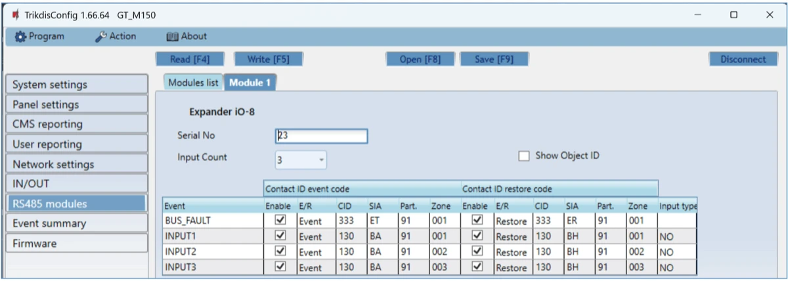

Utbyggnadsmodulen iO-8 har 8 universella (ingångs-/utgångs-)plintar. Upp till fyra iO-8 kan anslutas.

- **Input count** – välj hur många plintar som ska ställas in i ingångsläge (IN). De övriga plintarna blir utgångar (OUT).

Inställningarna för styrbara utgångar görs direkt i appen Protegus2. Där kan du tilldela en utgång för tillkoppling/frånkoppling av larmsystemet eller för fjärrstyrning av enheter.

I tabellen kan ingångarna tilldelas Contact ID-koder för händelse och återställning. När ingången löser ut skickar larmsändaren en händelse med den angivna händelsekoden till larmcentralens mottagare och appen Protegus2.

**Contact ID-händelsekod:**

- **Enable** – tillåt överföring av meddelande när ingången löser ut.

- **E/R** – välj vilken typ av händelse som ska skickas när ingången löser ut – **Event** eller **Restore**.

- **CID** – tilldela ingången en Contact ID-händelsekod.

- **SIA** - tilldela ingången en SIA-händelsekod.

- **Part.** – tilldela ingången området. Det anges automatiskt: om modulnumret är 1 är området 91; om modulnumret är 4 är området 94.

- **Zone** – ange sektionsnumret för ingången.

\*\*\*\*Contact ID-återställningskod**:**

- **Enable** – tillåt överföring av meddelande när ingången återställs.

- **E/R** – välj vilken typ av händelse som ska skickas när ingången återställs – **Restore** eller **Event**.

- **CID** – tilldela ingången Contact ID-återställningskoden.

- **SIA** - tilldela ingången en SIA-händelsekod.

- **Part.** – tilldela ingången området. Det anges automatiskt: om modulnumret är 1 är området 91; om modulnumret är 4 är området 94.

- **Zone** – ange sektionsnumret för ingången.

- **Object ID** - ingången (IN) kan tilldelas ett Object ID som skiljer sig från Object ID för larmsändaren GT.

- **Input type** – välj ingångens typ (NO, NC eller EOL).

### Fönstret ”Event summary”

I det här fönstret kan du slå på, stänga av och ändra de interna meddelanden som enheten skickar. Om du avaktiverar ett internt meddelande i det här fönstret skickas det inte alls, oavsett andra inställningar.

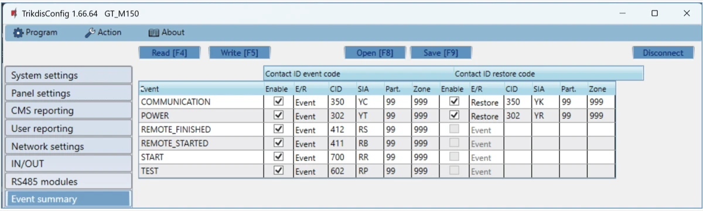

I det här fönstret kan du slå på, stänga av eller ändra de interna händelsemeddelanden som enheten skickar. När du har stängt av en intern händelse i det här fönstret skickas den inte, oavsett andra inställningar.

- **COMMUNICATION** – meddelande om anslutningsfel mellan centralapparaten och GT.

- **POWER** – meddelande om låg matningsspänning.

- **REMOTE_FINISHED** – meddelande om att fjärrkonfigureringen med TrikdisConfig har avslutats.

- **REMOTE_STARTED** – meddelande om fjärranslutning för att konfigurera GT med TrikdisConfig.

- **TEST** – meddelande om periodisk testsändning.

!!! note "Obs!"
    Om du vill aktivera periodiska TEST-meddelanden och ställa in deras period går du till **CMS reporting -\> Settings -\> Test period**. - **Enable** – när den är markerad är sändning av meddelandena aktiverad.

Du kan ändra Contact ID-koden för varje händelse, samt sektions- och områdesnummer.

### Återställa fabriksinställningarna

För att återställa larmsändarens fabriksinställningar klickar du på knappen ”**Restore”** i TrikdisConfig-fönstret.

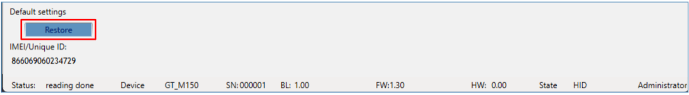

Ett annat sätt att återställa fabriksinställningarna.

Larmsändaren ska vara ansluten till matning. Håll in knappen ”RESET” på larmsändarens kretskort. Håll knappen ”RESET” nedtryckt i 10 sekunder tills lysdioderna (”NETWORK”, ”POWER”, ”TROUBLE”) slocknar och lysdioden ”POWER” tänds. Släpp knappen ”RESET”. Larmsändarens fabriksinställningar har återställts.

## Fjärrkonfigurering 

!!! warning "Viktigt"
    Fjärrkonfigurering fungerar bara om:

    1.  Det isatta SIM-kortet är aktiverat och att PIN-koden antingen
        är angiven eller avstängd;

    2.  ”**Protegus** **cloud**” är aktiverat. Hur du aktiverar molntjänsten
        beskrivs i avsnitt 6.5, fönstret ”User reporting”;

    3.  Matningen är ansluten (lysdioden ”POWER” lyser grönt);

    4.  Larmsändaren är registrerad i nätet (lysdioden ”NETWORK” lyser grönt och
        blinkar gult).

1.  Starta konfigurationsprogrammet TrikdisConfig.

2.  I avsnittet ”**Remote access”** anger du larmsändarens nummer ”**IMEI/Unique ID”**. Numret finns på enheten och på etiketten på förpackningen.

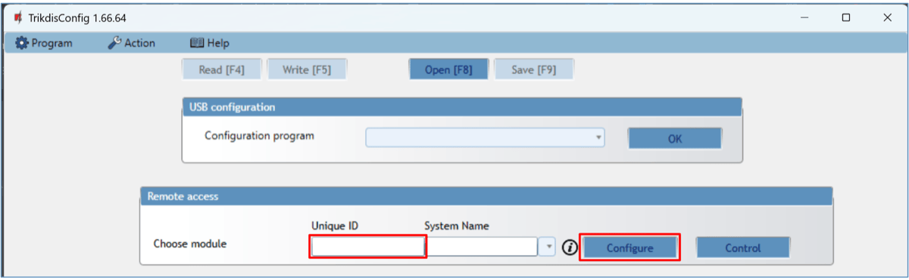

3.  (Valfritt) Ange önskat namn på GT med detta Unique ID i fältet ”**System name**”.

4.  Klicka på ”**Configure”**.

5.  I det nya fönstret som öppnas klickar du på **Read [F4]**. Ange vid behov administratörs- eller installatörskoden*.* För att spara lösenordet markerar du **“Remember password”**.

6.  Ange de inställningar som behövs och klicka på **Write [F5]** när du är klar.

## Testa larmsändarens funktion 

När konfigureringen och installationen är klara, gör en systemkontroll:

1.  Generera en händelse:

    - genom att tillkoppla/frånkoppla systemet med centralapparatens knappsats;

    - genom att utlösa ett sektionslarm när säkerhetssystemet är tillkopplat.

2.  Kontrollera att händelsen kommer fram till larmcentralen (CMS, Central Monitoring Station) och/eller tas emot i appen Protegus2.

3.  För att testa larmsändarens ingång, utlös den och kontrollera att rätt händelse tas emot.

4.  För att testa larmsändarens utgångar, aktivera dem på distans och kontrollera att de fungerar.

5.  Om centralapparaten ska styras på distans, tillkoppla/frånkoppla säkerhetssystemet på distans med appen Protegus2.

6.  Om en DSC-centralapparat är ansluten till knappsatsbussen och TIP/RING-plintarna, tillkoppla systemet och utlös ett brandsektionslarm. Larmcentralen ska ta emot händelsen med Contact ID-koden för sektionstypen (till exempel E110), inte som allmänt larm E130.

## Firmwareuppdatering 

!!! note "Obs!"
    När larmsändaren är ansluten till TrikdisConfig erbjuder programmet automatiskt att uppdatera enhetens firmware om det finns uppdateringar. Uppdateringar kräver en internetanslutning. Antivirusprogram, brandvägg eller strikta inställningar för internetåtkomst kan blockera de automatiska firmwareuppdateringarna. I så fall måste du konfigurera om antivirusprogrammet. Larmsändarens firmware kan också uppdateras eller bytas manuellt. Efter en uppdatering finns alla tidigare gjorda inställningar kvar oförändrade. Vid manuell skrivning av firmware kan den bytas till en nyare eller äldre version. Så här uppdaterar du:

1.  Starta ***TrikdisConfig**.*

2.  Anslut larmsändaren till datorn med USB-kabel eller anslut till larmsändaren på distans.

    - Om det finns en nyare firmwareversion erbjuder programmet att ladda ned filen med den nyare firmwareversionen.

3.  I TrikdisConfig väljer du ”**Firmware**”.

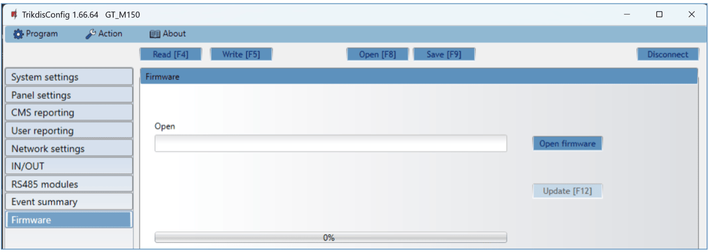

4.  Klicka på ”**Open firmware”** och välj den firmwarefil som behövs.

5.  Klicka på **Update [F12]**.

6.  Vänta tills uppdateringen är klar.

## Säkerhetskrav

Larmsändaren ska installeras och underhållas av behörig personal.

Läs den här manualen noggrant före installationen för att undvika misstag som kan leda till funktionsfel eller till och med skador på utrustningen.

Koppla bort matningen innan du gör några elektriska anslutningar.

Ändringar, modifieringar eller reparationer som inte har godkänts av tillverkaren upphäver garantin.

Följ dina lokala bestämmelser och släng inte ett oanvändbart larmsystem eller dess komponenter bland vanligt hushållsavfall.

## Bilaga

Larmsändaren omvandlar Contact ID-koder som tas emot från centralapparaten till SIA-koder.

**Tabell för omvandling av Contact ID-koder till SIA-koder**

| **Systemhändelse** | **CID-rapportkod** | **SIA-rapportkod** |
|----|:--:|:--:|
| Medicinskt nödlarm | E100 | "MA" |
| Personligt nödlarm | E101 | "QA" |
| Brand i sektion: <z> | E110 | "FA" |
| Vattenflöde upptäckt i sektion: <z> | E113 | "SA" |
| Larm från brandlarmsknapp i sektion: <z> | E115 | "FA" |
| Överfall i sektion: <z> | E120 | "PA" |
| Överfallslarm av användare: <v> | E121 | "HA" |
| Överfallslarm i sektion: <z> | E122 | "PA" |
| Överfallslarm i sektion: <z> | E123 | "PA" |
| Överfallslarm i sektion: <z> | E124 | "HA" |
| Överfallslarm i sektion: <z> | E125 | "HA" |
| Larm aktivt i sektion: <z> | E130 | "BA" |
| Larm aktivt i sektion: <z> | E131 | "BA" |
| Larm aktivt i sektion: <z> | E132 | "BA" |
| Larm aktivt i sektion: <z> | E133 | "BA" |
| Larm aktivt i sektion: <z> | E134 | "BA" |
| Larm aktivt i sektion: <z> | E135 | "BA" |
| Sabotage aktivt i sektion: <z> | E137 | "TA" |
| Inbrott verifierat i sektion: <z> | E139 | "BV" |
| Larm aktivt i sektion: <z> | E140 | "UA" |
| Systemfel (143) | E143 | "ET" |
| Sabotage aktivt i sektion: <z> | E144 | "TA" |
| Sabotage aktivt i sektion: <z> | E145 | "TA" |
| Larm aktivt i sektion: <z> | E146 | "BA" |
| Larm aktivt i sektion: <z> | E150 | "UA" |
| Gas upptäckt i sektion: <z> | E151 | "GA" |
| Vattenläckage upptäckt i sektion: <z> | E154 | "WA" |
| Foliebrott upptäckt i sektion: <z> | E155 | "BA" |
| Hög temperatur vid givare: <n> | E158 | "KA" |
| Låg temperatur vid givare: <n> | E159 | "ZA" |
| CO upptäckt i sektion: <z> | E162 | "GA" |
| Brandfel i sektion: <z> | E200 | "FS" |
| Övervakat larm | E220 | "BA" |
| Systemfel (300) | E300 | "YP" |
| Nätfel | E301 | "AT" |
| Låg batterispänning | E302 | "YT" |
| Systemfel (304) | E304 | "YF" |
| Systemomstart i sektion: <z> | E305 | "RR" |
| Centralapparatens programmering ändrad | E306 | "YG" |
| Systemavstängning | E308 | "RR" |
| Batterifel (309) | E309 | "YT" |
| Jordfel | E310 | "US" |
| Batterifel (311) | E311 | "YM" |
| Överström i matningen (312) | E312 | "YP" |
| Installatörsåterställning av användare: <v> (313) | E313 | "RR" |
| Fel på siren/relä | E320 | "RC" |
| Systemfel (321) | E321 | "YA" |
| Systemfel (330) | E330 | "ET" |
| Systemfel (332) | E332 | "ET" |
| Systemfel (333) | E333 | "ET" |
| Systemfel (336) | E336 | "VT" |
| Systemfel (338) | E338 | "ET" |
| Systemfel (341) | E341 | "ET" |
| Systemfel (342) | E342 | "ET" |
| Systemfel (343) | E343 | "ET" |
| Systemfel (344) | E344 | "XQ" |
| Kommunikationsfel i systemet (350) | E350 | "YC" |
| Kommunikationsfel i systemet (351) | E351 | "LT" |
| Kommunikationsfel i systemet (352) | E352 | "LT" |
| Systemfel (353) | E353 | "YC" |
| Kommunikationsfel i systemet (354) | E354 | "YC" |
| Systemfel (355) | E355 | "UT" |
| Fel i brandsektion: <z> | E373 | "FT" |
| Fel i sektion: <z> | E374 | "EE" |
| Fel i sektion: <z> | E378 | "BG" |
| Fel i sektion: <z> | E380 | "UT" |
| Fel på trådlös sektion: <z> | E381 | "US" |
| Fel på trådlös modul (382) | E382 | "UY" |
| Sabotage aktivt i sektion: <z> | E383 | "TA" |
| Låg batterispänning i trådlös sektion: <z> | E384 | "XT" |
| Fel i sektion: <z> (389) | E389 | "ET" |
| Fel i sektion: <z> (391) | E391 | "NA" |
| Fel i sektion: <z> (393) | E393 | "NC" |
| Användare <v> frånkopplade systemet | E400 | "OP" |
| Användare <v> frånkopplade systemet | E401 | "OP" |
| Automatisk frånkoppling | E403 | "OA" |
| Uppskjuten frånkoppling av användare <v> | E405 | "OR" |
| Larm avbrutet av användare: <v> | E406 | "BC" |
| Användare <v> frånkopplade på distans | E407 | "OP" |
| Snabbfrånkoppling | E408 | "OP" |
| Fjärrfrånkoppling | E409 | "OS" |
| Återuppringningsbegäran från larmcentralen | E411 | "RB" |
| Lyckad nedladdning av data | E412 | "RS" |
| Inpassering nekad för användare <v> | E421 | "JA" |
| Inpassering av användare <v> | E422 | "DG" |
| Forcerad åtkomst i sektion <z> | E423 | "DF" |
| Utpassering nekad för användare <v> | E424 | "DD" |
| Utpassering av användare <v> | E425 | "DR" |
| Användare <v> frånkopplade för tidigt | E451 | "OK" |
| Användare <v> tillkopplade för sent | E452 | "OJ" |
| Användare <v> lyckades inte frånkoppla | E453 | "CT" |
| Användare <v> lyckades inte tillkoppla | E454 | "CI" |
| Automatisk tillkoppling misslyckades | E455 | "CI" |
| Delvis tillkoppling av användare: <v> | E456 | "CG" |
| Utpasseringsfel av användare: <v> | E457 | "EE" |
| Systemet frånkopplat efter larm av användare: <v> | E458 | "OR" |
| Nyligen tillkopplat av användare <v> | E459 | "CR" |
| Felaktig kod angiven | E461 | "JA" |
| Tiden för automatisk tillkoppling förlängd av användare: <v> | E464 | "CE" |
| Enhet avaktiverad (501) | E501 | "RL" |
| Enhet avaktiverad (520) | E520 | "RO" |
| Trådlös detektor avaktiverad i sektion: <z> (552) | E552 | "YS" |
| Sektion <z> förbikopplad | E570 | "UB" |
| Sektion <z> förbikopplad | E571 | "FB" |
| Sektion <z> förbikopplad | E572 | "MB" |
| Sektion <z> förbikopplad | E573 | "BB" |
| Gruppförbikoppling av användare: <v> | E574 | "CG" |
| Sektion <z> förbikopplad | E576 | "UB" |
| Förbikoppling av sektion <z> upphävd | E577 | "UB" |
| Förbikoppling av ventilationssektion | E579 | "UB" |
| Gångtest aktiverat av användare: <v> | E607 | "TS" |
| Manuell testsändning | E601 | "RX" |
| Periodisk testsändning | E602 | "RP" |
| Systemhändelse (605) | E605 | "JL" |
| Systemhändelse (606) | E606 | "LF" |
| Periodisk testsändning med fel | E608 | "RY" |
| Systemhändelse (622) | E622 | "JL" |
| Systemhändelse (623) | E623 | "JL" |
| Tid/datum omställda av användare <v> | E625 | "JT" |
| Felaktig tid/datum | E626 | "JT" |
| Systemprogrammering startad | E627 | "LB" |
| Systemprogrammering avslutad | E628 | "LS" |
| Systemhändelse (631) | E631 | "JS" |
| Systemhändelse (632) | E632 | "JS" |
| Systemet inte aktivt (654) | E654 | "CD" |
| Medicinskt nödlarm återställt | R100 | "MH" |
| Personligt nödlarm återställt | R101 | "QH" |
| Brandlarm återställt i sektion: <z> | R110 | "FH" |
| Vattenflödeslarm återställt i sektion: <z> | R113 | "SH" |
| Överfallslarm återställt i sektion: <z> | R120 | "PH" |
| Överfallslarm avbrutet av användare: <v> | R121 | "HH" |
| Överfallslarm återställt i sektion: <z> | R122 | "PH" |
| Överfallslarm återställt i sektion: <z> | R123 | "PH" |
| Överfallslarm återställt i sektion: <z> | R124 | "HH" |
| Överfallslarm återställt i sektion: <z> | R125 | "HH" |
| Larm återställt i sektion: <z> | R130 | "BH" |
| Larm återställt i sektion: <z> | R131 | "BH" |
| Larm återställt i sektion: <z> | R132 | "BH" |
| Larm återställt i sektion: <z> | R133 | "BH" |
| Larm återställt i sektion: <z> | R134 | "BH" |
| Larm återställt i sektion: <z> | R135 | "BH" |
| Sabotage återställt i sektion: <z> | R137 | "TA" |
| Larm återställt i sektion: <z> | R140 | "UH" |
| Systemfel (143) återställt | R143 | "ER" |
| Sabotage återställt i sektion: <z> | R144 | "TR" |
| Sabotage återställt i sektion: <z> | R145 | "TR" |
| Larm återställt i sektion: <z> | R146 | "BH" |
| Larm återställt i sektion: <z> | R150 | "UH" |
| Gaslarm återställt i sektion: <z> | R151 | "GH" |
| Vattenläckagelarm återställt i sektion: <z> | R154 | "WH" |
| Foliebrott återställt i sektion: <z> | R155 | "BH" |
| Temperaturen har normaliserats vid givare: <n> | R158 | "KH" |
| Temperaturen har normaliserats vid givare: <n> | R159 | "ZH" |
| CO-larm återställt i sektion: <z> | R162 | "GH" |
| Brandfel återställt i sektion: <z> | R200 | "FV" |
| Övervakat larm återställt | R220 | "BH" |
| Systemfel (300) återställt | R300 | "YQ" |
| Nätspänning OK | R301 | "AR" |
| Batteri OK | R302 | "YR" |
| Systemfel (304) återställt | R304 | "YG" |
| Systemomstart återställd i sektion: <z> | R305 | "RR" |
| Batterifel (309) återställt | R309 | "YR" |
| Jordfel återställt | R310 | "UR" |
| Batterifel (311) återställt | R311 | "YR" |
| Överström i matningen (312) återställd | R312 | "YQ" |
| Fel på siren/relä återställt | R320 | "RO" |
| Systemfel (321) återställt | R321 | "YH" |
| Systemfel (330) återställt | R330 | "ER" |
| Systemfel (332) återställt | R332 | "ER" |
| Systemfel (333) återställt | R333 | "ER" |
| Systemfel (336) återställt | R336 | "VR" |
| Systemfel (338) återställt | R338 | "ER" |
| Systemfel (341) återställt | R341 | "ER" |
| Systemfel (342) återställt | R342 | "ER" |
| Systemfel (344) återställt | R344 | "XH" |
| Kommunikationsfel i systemet (350) återställt | R350 | "YK" |
| Kommunikationsfel i systemet (351) återställt | R351 | "LR" |
| Kommunikationsfel i systemet (352) återställt | R352 | "LR" |
| Systemfel (353) återställt | R353 | "YK" |
| Kommunikationsfel i systemet (354) återställt | R354 | "YK" |
| Systemfel (355) återställt | R355 | "UJ" |
| Fel i brandsektion: <z> återställt | R373 | "FJ" |
| Fel i sektion: <z> återställt | R374 | "EA" |
| Fel i sektion: <z> återställt | R380 | "UJ" |
| Fel på trådlös sektion: <z> återställt | R381 | "UR" |
| Fel på trådlös modul (382) återställt | R382 | "BR" |
| Sabotage återställt i sektion: <z> | R383 | "TR" |
| Batteri OK i trådlös sektion: <z> | R384 | "XR" |
| Fel i sektion: <z> (391) återställt | R391 | "NS" |
| Fel i sektion: <z> (393) återställt | R393 | "NS" |
| Användare <v> tillkopplade systemet | R400 | "CL" |
| Användare <v> tillkopplade systemet | R401 | "CL" |
| Automatisk tillkoppling | R403 | "CA" |
| Användare <v> tillkopplade på distans | R407 | "CL" |
| Snabbtillkoppling | R408 | "CL" |
| Fjärrtillkoppling | R409 | “CS” |
| Användare <v> tillkopplade i hemmaläge | R441 | "CG" |
| Användare <v> tillkopplade för tidigt | R451 | “CK” |
| Användare <v> frånkopplade för sent | R452 | “CJ” |
| Användare <v> lyckades inte frånkoppla | R454 | “CI” |
| Delvis tillkoppling av användare: <v> | R456 | "CG" |
| Nyligen frånkopplat av användare <v> | R459 | “CR” |
| Enhet aktiverad (501) | R501 | "RG" |
| Enhet aktiverad (520) | R520 | "RC" |
| Trådlös detektor aktiverad i sektion: <z> (552) | R552 | "YK" |
| Förbikoppling av sektion <z> upphävd | R570 | "UU" |
| Förbikoppling av sektion <z> upphävd | R571 | "FU" |
| Förbikoppling av sektion <z> upphävd | R572 | "MU" |
| Förbikoppling av sektion <z> upphävd | R573 | "BU" |
| Gruppförbikoppling av användare: <v> upphävd | R574 | "CF" |
| Förbikoppling av sektion <z> upphävd | R576 | "UU" |
| Förbikoppling av sektion <z> upphävd | R577 | "UU" |
| Förbikoppling av ventilationssektion upphävd | R579 | "UU" |
| Gångtest avaktiverat av användare <v> | R607 | "TE" |
| Tid/datum omställda av användare <v> | R625 | "JT" |
| Systemet aktivt (654) | R654 | "CD" |
