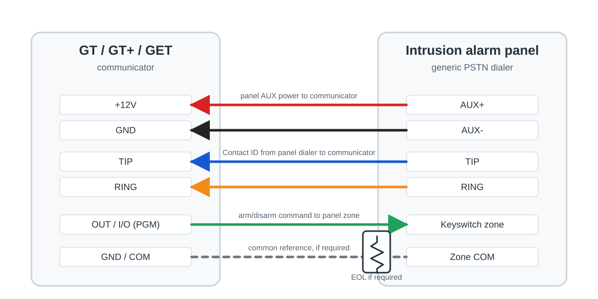

# Universell TIP/RING-anslutning av GT/GT+/GET till en centralapparat för inbrottslarm

Använd den här anvisningen när en centralapparat för inbrottslarm rapporterar händelser via sin uppringare för analog telelinje (PSTN). Larmsändaren GT/GT+/GET ansluts till centralapparatens plintar `TIP` / `RING`, fångar automatiskt upp Contact ID-händelser och kan som tillval till- och frånkoppla systemet från Protegus2 via en sektion på centralapparaten som är programmerad för nyckelbrytare. Använd anvisningen tillsammans med larmsändarens fullständiga manual och centralapparatens programmeringsmanual.

!!! caution "Försiktighet"
    Installation och service får endast utföras av behörig personal. Koppla bort matningen innan du drar ledningarna. Obehöriga ändringar upphäver garantin.

## Förutsättningar

- GT/GT+/GET med firmware 1.21, SIM-kort isatt, PIN-kodsbegäran avstängd och aktivt dataabonnemang.
- Centralapparat för inbrottslarm med uppringare för analog telelinje (PSTN) som stöder Contact ID med DTMF-toner.
- Protegus2-konto för larmbolag/installatör och larmsändarens IMEI.
- Centralapparatens installatörskod och programmeringsmanual behövs bara om centralapparaten inte redan ringer via uppringaren, om uppringarens inställningar måste ändras eller om till-/frånkoppling via en nyckelbrytarsektion ska läggas till.
- En ledig sektion på centralapparaten som kan programmeras som nyckelbrytarsektion, bara om fjärrstyrd till-/frånkoppling behövs.

!!! note "Obs!"
    Om centralapparaten tidigare har rapporterat via en analog telelinje ska uppringaren vara aktiverad och larmsändaren anslutas till centralapparatens plintar `TIP` / `RING`. Larmsändaren besvarar centralapparatens samtal och fångar automatiskt upp Contact ID-händelserna tillsammans med den abonnentkod som centralapparaten skickar. Ändra centralapparatens programmering bara om den inte ringer redan, om uppringarens inställningar är felaktiga, om abonnentkoden måste stämma med ett krav från larmcentralen (ARC/CMS) eller om en nyckelbrytarsektion måste läggas till för fjärrstyrd till-/frånkoppling.

## Inkoppling

Koppla bort matningen till både centralapparaten och larmsändaren innan du drar ledningarna. Anslut larmsändaren till centralapparatens matning, `TIP` / `RING` och nyckelbrytarsektionen enligt bilden nedan.

| Plint på GT/GT+/GET | Plint på centralapparaten | Ändamål |
| --- | --- | --- |
| `+12V` / `GND` | `AUX+` / `AUX-` | Matar larmsändaren från centralapparatens hjälputgång. |
| `TIP` / `RING` | `TIP` / `RING` | Fångar upp Contact ID-händelser från centralapparatens telefonuppringare. |
| `OUT` / `I/O` konfigurerad som PGM | Sektionsingång för nyckelbrytare | Skickar till- och frånkopplingskommandon från Protegus2. |
| `GND` / `COM` | Sektionens gemensamma plint, om det behövs | Gemensam referens för nyckelbrytarsektionens inkoppling. |

!!! warning "Varning"
    Koppla nyckelbrytarsektionen exakt enligt centralapparatens manual. Vissa centralapparater använder en normalt öppen ingång, en normalt sluten ingång, ett slutmotstånd (EOL), två slutmotstånd eller en särskild gemensam plint.

## Programmera centralapparaten

Hoppa över det här avsnittet om centralapparaten redan ringer via uppringaren för analog telelinje och fjärrstyrd till-/frånkoppling inte behövs. Programmeringskoderna skiljer sig mellan tillverkare och modeller. Använd centralapparatens programmeringsmanual bara för de punkter som måste ändras.

1. Aktivera centralapparatens uppringare för analog telelinje (PSTN).
2. Välj tonval (DTMF).
3. Välj larmformatet Contact ID.
4. Ange mottagarens telefonnummer. Om centralapparaten redan har rapporterat till en larmcentral via analog telelinje kan det befintliga numret oftast vara kvar. Vid en ny installation för uppfångning av uppringning anger du valfritt mottagarnummer med fler än 4 siffror, om inte centralapparatens manual kräver ett annat format.
5. Om rapportering till larmcentral (ARC/CMS) krävs ställer du in centralapparatens abonnentkod på det värde som larmcentralen har angett. Larmsändaren kan vidarebefordra den abonnentkod som centralapparaten skickar, så något separat Object ID i larmsändaren behövs inte för grundläggande uppfångning av uppringning.
6. Aktivera de händelser som ska rapporteras, bl.a. larm, återställningar, fel, sabotage och tillkopplingar/frånkopplingar där det krävs.
7. Programmera sektionen som är ansluten till larmsändarens utgång som nyckelbrytarsektion, bara när fjärrstyrd till-/frånkoppling från Protegus2 behövs.
8. Välj den typ av nyckelbrytare som motsvarar larmsändarens utgångsläge: momentan (puls) eller bibehållen (nivå).
9. Tilldela nyckelbrytarsektionen till rätt område, spara och lämna programmeringsläget.

!!! important "Viktigt"
    Fjärrstyrd till-/frånkoppling från Protegus2 fungerar bara när den anslutna sektionen på centralapparaten är programmerad som nyckelbrytarsektion. Statusen i appen förutsätter också att centralapparaten skickar till- och frånkopplingshändelser via uppringaren.

## Lägg till systemet i Protegus2

  

    <strong>Steg 1.</strong> Tryck på <strong>Add new system</strong>.
    
  

  

    <strong>Steg 2.</strong> Ange larmsändarens <strong>IMEI</strong> och tryck på <strong>Next</strong>.
    
  

  

    <strong>Steg 3.</strong> Välj larmcentral.
    
  

  

    <strong>Steg 4.</strong> Välj <strong>TIP RING</strong>.
    
  

  

    <strong>Steg 5.</strong> Välj <strong>Mode</strong>.
    
  

  

    <strong>Steg 6.</strong> Välj <strong>AUTO</strong>.
    
  

  

    <strong>Steg 7.</strong> Ange <strong>Object ID</strong> om guiden eller larmcentralens inställningar kräver det, ange <strong>Module ID</strong> och tryck på <strong>Next</strong>.
    
  

  

    <strong>Steg 8.</strong> Vänta medan data skrivs.
    
  

  

    <strong>Steg 9.</strong> Tryck på <strong>Add to Protegus2</strong>.
    
  

  

    <strong>Steg 10.</strong> Ange systemets <strong>Name</strong> och tryck på <strong>Next</strong>.
    
  

  

    <strong>Steg 11.</strong> Ange <strong>Area name</strong>. Aktivera <strong>Control with Protegus2</strong>.
    
  

  

    <strong>Steg 12.</strong> Välj den anslutna PGM-utgången. Välj <strong>Pulse</strong> eller <strong>Level</strong> så att det motsvarar centralapparatens nyckelbrytarsektion och tryck sedan på <strong>Save</strong>.
    
  

!!! tip "Tips"
    Om du bara behöver händelserapportering hoppar du över inkopplingen av nyckelbrytarutgången och låter fjärrstyrd till-/frånkoppling vara avaktiverad i Protegus2.

## Systemkontroll

- [ ] Tillkoppla och frånkoppla centralapparaten från knappsatsen.
- [ ] Utlös ett testlarm medan systemet är tillkopplat.
- [ ] Kontrollera att händelserna når Protegus2. Om rapportering till larmcentral (ARC/CMS) används, kontrollera att larmcentralen tar emot händelserna med förväntad abonnentkod.
- [ ] Tillkoppla och frånkoppla systemet från Protegus2, om nyckelbrytarsektionen är ansluten.
- [ ] Kontrollera att centralapparaten följer kommandot från appen och sedan rapporterar tillkopplingen/frånkopplingen tillbaka till Protegus2.
- [ ] Om händelser inte tas emot, kontrollera att centralapparatens uppringare är aktiverad, att DTMF-val är inställt, larmformatet Contact ID, telefonnumret och inkopplingen av `TIP` / `RING`, samt abonnentkoden bara när rapportering till larmcentral (ARC/CMS) förväntas.
