# Snabbinstallation av Paradox SP(+)/MG(+) med GT/GT+/GET

Korta anvisningar för inkoppling och programmering när larmsändaren GT/GT+/GET ansluts till centralapparater i Paradox SP/SP+/MG/MG+ via TIP/RING och KeyBus, följt av registrering av systemet i Protegus2. Använd anvisningen tillsammans med de fullständiga manualerna för alla övriga inställningar. (Plintarnas beteckningar skiljer sig något mellan GT, GT+ och GET, men anslutningarna är desamma.)

!!! caution "Försiktighet"
    Installation och service får endast utföras av behörig personal. Koppla bort matningen innan du drar ledningarna. Obehöriga ändringar upphäver garantin.

## Förutsättningar

- GT/GT+/GET med firmware 1.21 eller senare, SIM-kort isatt, PIN-kodsbegäran avstängd och aktivt dataabonnemang.
- Centralapparat Paradox SP/SP+/MG/MG+ med tillgång till knappsatsen (installatörskoden finns tillgänglig).
- Abonnentkod hos larmcentralen, om rapportering sker till larmcentral.
- Protegus2-konto för larmbolag/installatör och larmsändarens IMEI.

## Inkoppling

Anslut larmsändaren till centralapparaten enligt kopplingsschemat nedan:

| Plint på GT/GT+/GET | Paradox-centralapparat | Anmärkning |
| --- | --- | --- |
| TIP / RING | TIP / RING | För emulering av PSTN-linje (Contact ID). |
| CLK / DATA (KeyBus) | YEL / GRN (KeyBus) | För styrning via seriell buss. |
| +DC / -DC | +AUX / -AUX | Matar larmsändaren. |

!!! note "Obs!"
    **+DC** och **−DC** är de plintar som är märkta **+12 VDC** och **−12 VDC** på GT och GET, och **+12/24 VDC** och **−12/24 VDC** på GT+.

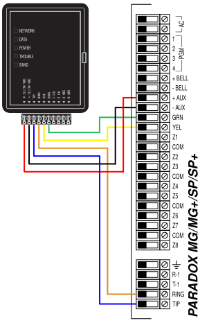

## Programmera Paradox-centralapparaten (knappsats med LCD-display)

Aktivera Contact ID och ange abonnentkoder från centralapparatens knappsats:

1. Gå in i installatörsprogrammeringen: `[ENTER] 0000` (eller din installatörskod).
2. Sekvens 801: allmänna uppringaralternativ → lämna förvalen om inget annat behövs.
3. Sekvens 811: ange abonnentkod för område 1 (exempelvärde: `1111`; använd värdet från larmcentralen).
4. Sekvens 812: ange abonnentkod för område 2 (exempelvärde: `2222`; använd värdet från larmcentralen).
5. Sekvens 815: ange telefonnummer för rapportering (exempelvärde: `123456`; använd värdet från larmcentralen).
6. Sekvens 911: ange PC-lösenord (exempelvärde: `1234`; ange enligt dina egna riktlinjer).
7. Tryck på `[CLEAR]` för att lämna programmeringsläget.

Se den fullständiga Paradox-manualen om knappsatsens koder skiljer sig.

## Lägg till systemet i Protegus2 (mobil eller webb)

  

    <strong>Steg 1.</strong> Tryck på <strong>Add new system</strong>.
    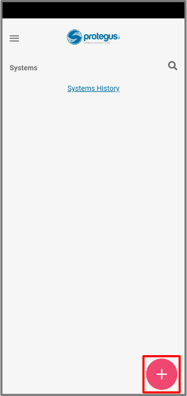
  

  

    <strong>Steg 2.</strong> Ange larmsändarens <strong>IMEI</strong> och tryck på <strong>Next</strong>.
    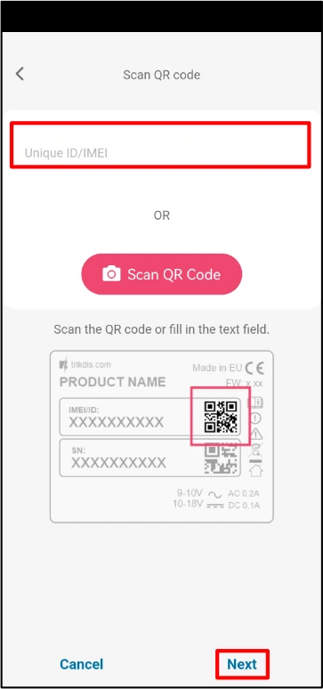
  

   

    <strong>Steg 3.</strong> Välj <strong>Serial BUS</strong> och tryck på <strong>Next</strong>.
    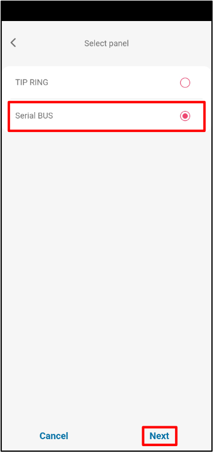
  

  

    <strong>Steg 4.</strong> Välj <strong>PARADOX</strong>.
    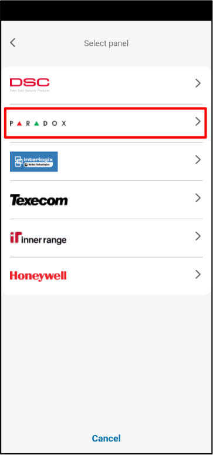
  

  

    <strong>Steg 5.</strong> Välj <strong>PARADOX SP+/MG+ series KeyBus</strong>.
    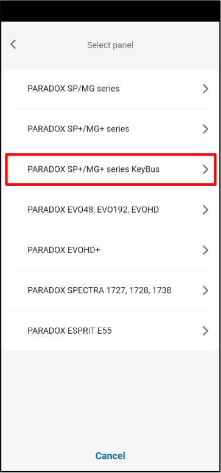
  

  

    <strong>Steg 6.</strong> Ange <strong>Primary Object ID</strong> och tryck på <strong>Next</strong>.
    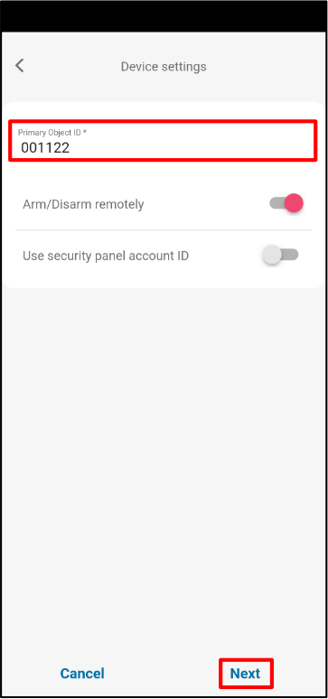
  

  

    <strong>Steg 7.</strong> Vänta medan data skrivs.
    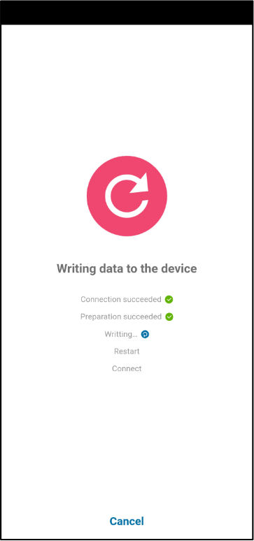
  

  

    <strong>Steg 8.</strong> Tryck på <strong>Next</strong>.
    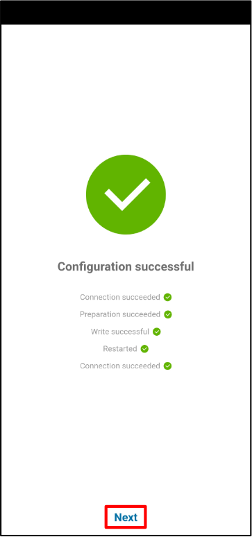
  

  

    <strong>Steg 9.</strong> Ange systemets <strong>Name</strong> och tryck på <strong>Next</strong>.
    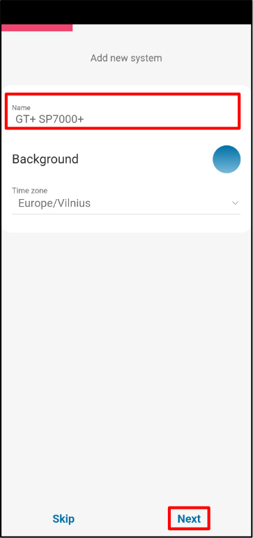
  

  

    <strong>Steg 10.</strong> Tryck på <strong>Skip</strong> (om du inte lägger till användare nu).
    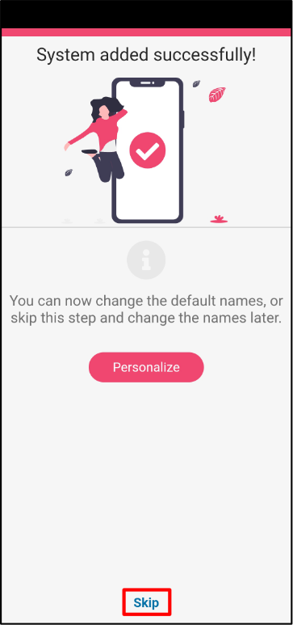
  

  

    <strong>Steg 11.</strong> Vänta ca 1 minut tills det är klart.
    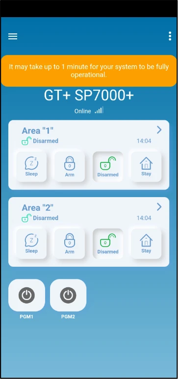
  

  

    <strong>Steg 12.</strong> Installationen är klar.
    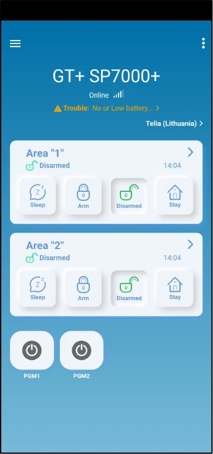
  

!!! tip "Tips"
    Om Protegus2 inte kan skriva klart data, kontrollera inkopplingen av KeyBus (YEl/GRN), att IMEI är rätt angivet och att inställningarna för larmcentral/Contact ID är sparade i centralapparaten.
