# Ethernet-larmsändare E16T

  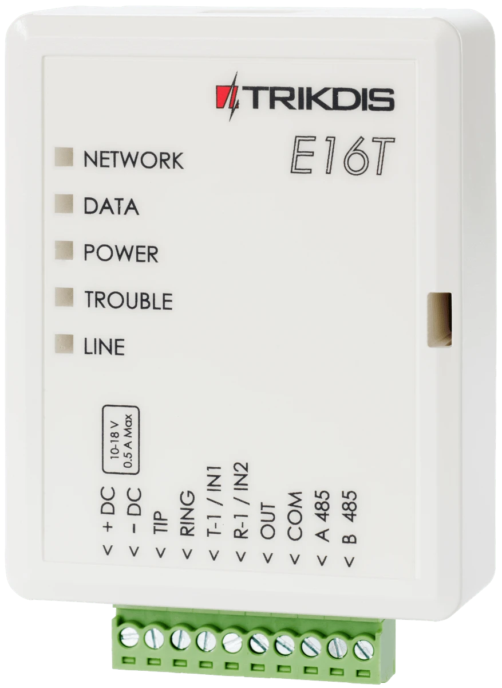

## Beskrivning

Ethernet-larmsändaren E16T kompletterar centralapparater med telefonuppringare, så att händelser kan skickas och hanteras via en trådbunden internetanslutning.

Larmsändaren överför fullständig händelseinformation till larmcentralens mottagare (CMS, Central Monitoring Station).

Larmsändaren fungerar med Protegus-apparna. Med Protegus kan användarna styra sitt larmsystem på distans och få aviseringar om händelser. Appen Protegus fungerar med alla centralapparater från andra tillverkare som E16T är ansluten till. Larmsändaren kan skicka händelsemeddelanden till larmcentralen och arbeta med Protegus samtidigt.

E16T ansluts med 2 ledare till centralapparatens telefonuppringare och tar emot händelsemeddelanden som överförs med DTMF-toner i protokollet Contact ID.

### Funktioner

**Ansluts till centralapparatens analoga telefonlinje:**

- Larmsändaren kan anslutas till centralapparatens uppringare för analog telelinje med 2 eller 4 ledare.

- Vid anslutning med 4 ledare övervakas telelinjen mellan centralapparaten och larmsändaren.

Skickar händelser till larmcentralens mottagare:

- Skickar händelser till TRIKDIS programvaru- eller maskinvarumottagare som fungerar med all programvara för larmcentraler.

- Kan skicka händelsemeddelanden till SIA DC-09-mottagare.

- Övervakning av anslutningen genom att en PING-förfrågan skickas till IP-mottagaren var 30:e sekund (eller med en period som användaren anger).

- Backupkanal som används om anslutningen via primärkanalen bryts.

- När tjänsten Protegus är aktiverad levereras händelserna först till larmcentralen och skickas därefter till appens användare.

**Fungerar med appen Protegus:**

- ”*Push*”-aviseringar och särskilda ljud som informerar om händelser.

- Fjärrstyrd tillkoppling/frånkoppling av systemet.

- Fjärrstyrning av anslutna enheter (belysning, portar, ventilationssystem, värme, bevattning m.m.).

- Olika användarrättigheter för administratör, installatör och användare.

**Meddelar användare:**

- Användarna kan få aviseringar om händelser via appen Protegus.

**Styrbara utgångar och ingångar:**

- 1 utgång som styrs med:

  - appen Protegus.

- 2 ingångar med valbar typ: NC; NO; EOL.

**Snabb installation:**

- Inställningarna kan sparas i en fil och snabbt skrivas till andra larmsändare.

- Två behörighetsnivåer för konfigurering av enheten: för larmcentralens administratör och för installatören.

- Fjärrkonfigurering och firmwareuppdateringar.

### Specifikationer

| Parameter | Beskrivning |
|:---|----|
| Matningsspänning | 10–18 V DC |
| Strömförbrukning | Upp till 0,5 A |
| Ethernetanslutning | IEEE802.3, 10 Base-T, RJ45-uttag |
| Innehåll i datapaketet | Koder i Contact ID-format |
| Minne | Upp till 100 meddelanden |
| Ingångar | 2, av typen NC/NO/EOL 2,2 kΩ |
| Utgång | 1 av typen OC, kopplingsspänning upp till 30 V och ström upp till 0,15 A |
| Driftmiljö | Temperatur från -10 °C till 50 °C, relativ luftfuktighet upp till 80 % vid +20 °C |
| Mått | 88 × 62 × 25 mm |
| Vikt | 80 g |

### Larmsändarens delar

1.  Lysdiodsindikeringar.

2.  Spår för att öppna kapslingens framsida.

3.  Plintblock för externa anslutningar.

4.  USB Mini-B-port för programmering av larmsändaren.

5.  RJ45-uttag för Ethernetanslutning.

### Plintarnas funktion

| Plint | Beskrivning |
|----|----|
| +DC | Plint för matning (pluspol, 10–18 V DC) |
| -DC | Plint för matning (minuspol, 10–18 V DC) |
| TIP | Plint för anslutning till centralapparatens TIP-plint |
| RING | Plint för anslutning till centralapparatens RING-plint |
| T-1 / IN1 | Plint för övervakning av telefonlinjen eller ingångsplint, typen kan väljas: NC; NO; EOL |
| R-1 / IN2 | Plint för övervakning av telefonlinjen eller ingångsplint, typen kan väljas: NC; NO; EOL |
| OUT | Utgångsplint (typ OC), ström upp till 0,15 A |
| COM | Gemensam plint (minus) |
| A 485 | Kontakt A på *RS485*-bussen |
| B 485 | Kontakt B på *RS485*-bussen |

### Lysdiodsindikering vid drift

| Indikator | Lysdiodens läge | Beskrivning |
|-----------|--------------|-------------|
| NETWORK | Fast grönt sken | Larmsändaren är ansluten till internet |
| NETWORK | Släckt | Ingen anslutning till LAN |
| DATA | Fast gult sken | Osända händelser finns lagrade i buffertminnet |
| DATA | Blinkar grönt | Meddelanden skickas från centralapparaten |
| POWER | Blinkar grönt | Matningen är på med tillräcklig spänning |
| POWER | Blinkar gult | Matningsspänningen är otillräcklig (≤11,5 V) |
| TROUBLE | Fast rött sken | Problem med LAN-anslutningen |
| TROUBLE | Släckt | Inga driftproblem |
| LINE | Fast grönt sken | Centralapparaten har ”lyft luren” |

### Principschema för användning av larmsändaren E16T

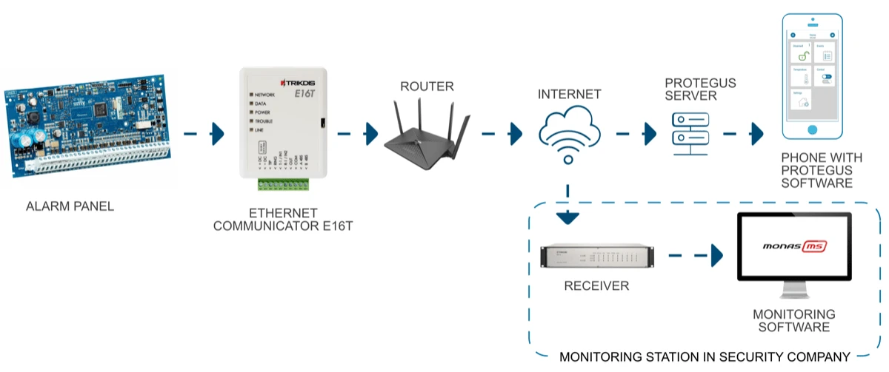

!!! note "Obs!"
    Innan du börjar, se till att du har följande:
    
    1.  USB-kabel (Mini-B) för konfigurering.
    
    2.  Ethernetkabel CAT-5 (högst 100 m lång).
    
    3.  Minst 4-ledarkabel för att ansluta larmsändaren till larmsystemet.
    
    4.  Spårskruvmejsel.
    
    5.  Installationsmanualen för den centralapparat som TRIKDIS-larmsändaren ska anslutas till.
    
    Beställ nödvändiga komponenter separat från din lokala distributör.
## Snabbkonfiguration med programmet *TrikdisConfig* 

1.  Ladda ned konfigurationsprogrammet TrikdisConfig från [www.trikdis.com](http://www.trikdis.com) (skriv ”TrikdisConfig” i sökfältet) och installera det.

2.  Öppna E16T:s kapsling med en spårskruvmejsel enligt bilden nedan:

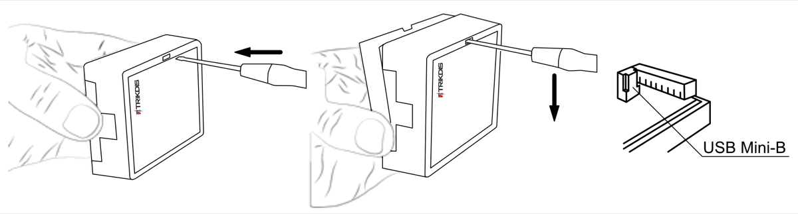

3.  Anslut E16T till datorn med en USB Mini-B-kabel.

4.  Starta TrikdisConfig. Programmet identifierar automatiskt den anslutna larmsändaren och öppnar ett fönster för konfigurering.

5.  Klicka på **Read [F4]** för att läsa larmsändarens inställningar. Om du uppmanas, ange administratörs- eller installatörskoden (6 siffror) i dialogrutan.

Nedan beskrivs vilka inställningar som behövs för att larmsändaren ska börja skicka händelser till larmcentralen och för att säkerhetssystemet ska kunna styras med appen Protegus.

### Inställningar för anslutning till appen Protegus 

**I fönstret ”System Settings”:**

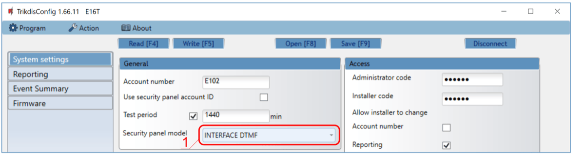

1.  Välj den **Security panel model** som ska anslutas till larmsändaren.

**I fönstret ”Reporting”, fliken ”Protegus Service”:**

2. Markera kryssrutan **Enable connection** i Protegus-tjänsten.

2.  Ändra **Service code** för inloggning i Protegus om användarna ska uppmanas att ange den när de lägger till Protegus-systemet i appen (fabriksinställning - 123456).

När konfigureringen är klar klickar du på knappen **Write [F5]** och kopplar bort USB-kabeln.

!!! note "Obs!"
    En beskrivning av alla övriga inställningar för E16T i
    TrikdisConfig finns i avsnitt 7 ”Beskrivning av fönstren i TrikdisConfig”.
### Inställningar för anslutning till larmcentralen 

**I fönstret ”System settings”:**

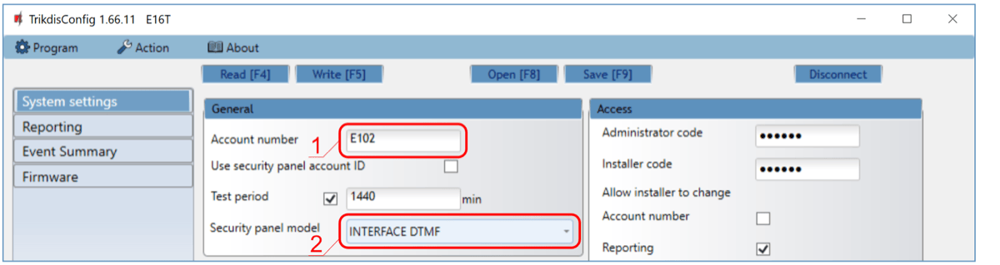

1.  Ange numret i **Account number** (abonnentkod) som du har fått från larmcentralen (4 tecken, 0–9, A–F. **Använd inte FFFE, FFFF som Object ID.**).

2.  Välj den **Security panel model** som ska anslutas till larmsändaren.

**I fönstret ”Reporting”, inställningar för kanalen ”Primary”:**

3.  **Enable** - aktivera primärkanalen.

4.  **Remote Host** - ange mottagarens IP-adress.

5.  **Remote Port** - ange mottagarens nätverksportnummer.

6.  **TCP or UDP** - välj det överföringsprotokoll (**TCP** eller **UDP**) som händelserna ska skickas med.

7.  **PING Time** - period för sändning av PING-signal.

8.  **Encryption key** - ange den krypteringsnyckel som är inställd i mottagaren.

9.  (Rekommenderas) Konfigurera inställningarna för kanalen **Backup**.

10. **TCP protocol** - välj vilket kodningsprotokoll som ska användas: TRK (för TRIKDIS-mottagare), DC-09_2007 eller DC-09_2012 (för universella mottagare).

11. **Encription enabled** - om TCP-protokollet SIA DC09_2012 är valt kan kryptering aktiveras.

12. **DC-09 encryption key** - ange den krypteringsnyckel som är inställd i mottagaren.

13. **DC-09 receiver No.** - ange mottagarnumret.

14. **DC-09 line No**. - ange mottagarens linjenummer.

!!! note "Obs!"
    Om du har valt DC-09-kodning av meddelandena anger du dessutom
    objekt-, linje- och mottagarnummer på fliken **Settings** i
    fönstret **Reporting**.
**I fönstret ”Reporting”, fliken ”Protegus Service”:**

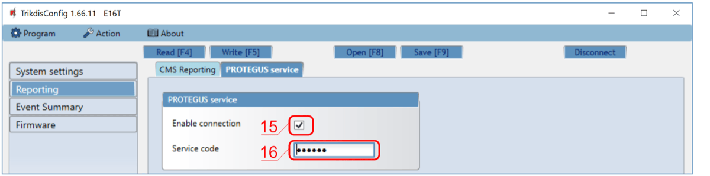

15. Markera kryssrutan **Enable connection** till PROTEGUS Cloud.

16. Du kan ändra **Service code** för inloggning i Protegus om användarna ska uppmanas att ange den när de lägger till systemet i appen Protegus (förvalt lösenord - 123456).

När konfigureringen är klar klickar du på knappen **Write [F5]** och kopplar bort USB-kabeln.

!!! note "Obs!"
    En beskrivning av alla övriga inställningar för E16T i
    TrikdisConfig finns i avsnitt 7 ”Beskrivning av fönstren i TrikdisConfig”.
## Installation och inkoppling

### Kopplingsscheman för inkoppling av larmsändaren till centralapparaten

Anslut larmsändaren till centralapparaten enligt kopplingsschemana nedan.

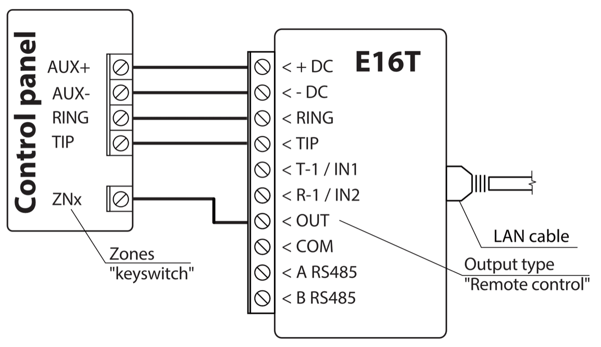

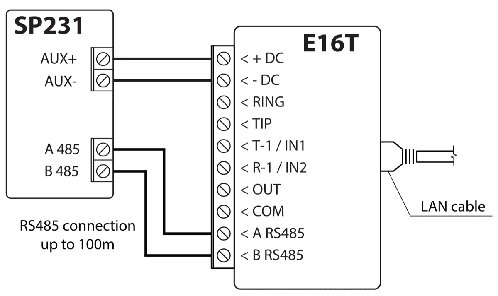

### Kopplingsscheman för anslutning av ingångar

Larmsändaren har två ingångsplintar (IN1, IN2) för anslutning av kretsar av typerna NO, NC och EOL. Förval för ingångsinställningen – NO. Ingångstypen kan ändras i TrikdisConfig-fönstret **Event summary**.

Anslut ingången enligt den valda ingångstypen (NO, NC, EOL), som i schemana nedan:

#### Normalt öppen (NO)

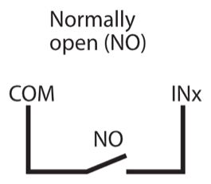

#### Normalt sluten (NC)

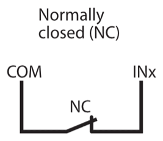

#### Normalt sluten med slutmotstånd 2,2k (EOL 2,2k)

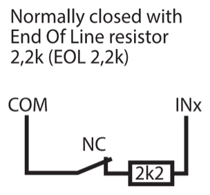

#### Normalt öppen med slutmotstånd 2,2k (EOL 2,2k)

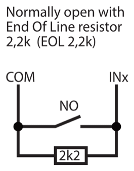

### Anslut LAN-kabeln

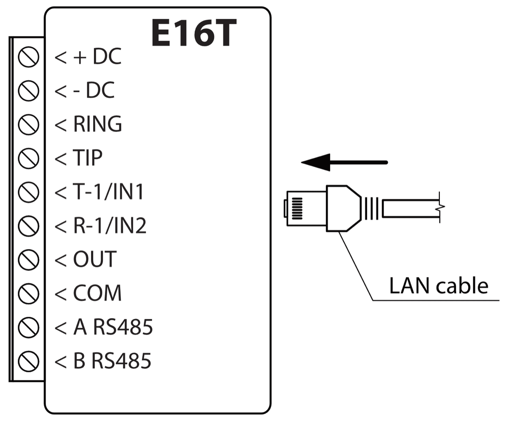

### Kopplingsscheman för inkoppling av ett relä och en lysdiod

#### Relä

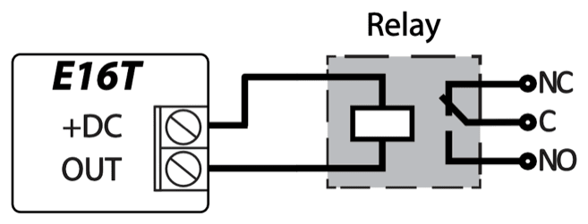

#### Lysdiod

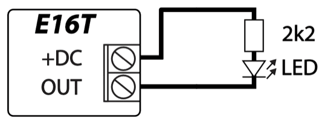

## Programmering av centralapparaten

För att centralapparaten ska kunna skicka händelser via telefonuppringaren måste uppringaren vara aktiverad och rätt konfigurerad. Ställ in centralapparatens uppringare enligt centralapparatens programmeringsmanual:

1.  Slå på centralapparatens uppringare för analog telelinje (PSTN).

2.  Om larmsändaren är ansluten till telefonlinjen anger du telefonnumret 1234. Om larmsändaren är ansluten till centralapparatens plintar RING / TIP anger du valfritt nummer med minst 2 siffror.

3.  Välj DTMF-läge.

4.  Välj kommunikationsprotokollet Contact ID.

5.  Ange centralapparatens 4-siffriga abonnentkod.

### Programmering av uppringaren i Honeywell Vista

Gå in i följande sekvenser med centralapparatens knappsats och ställ in dem enligt beskrivningen:

- \*41 – ange larmcentralens mottagares telefonnummer;

- \*43 – ange centralapparatens abonnentkod;

- \*47 – ställ in tonval på [1] och ange antalet uppringningsförsök;

- \*48 – använd förvalt värde, \*48 måste vara inställd på 7;

- \*49 – Split/Dual message. \*49 måste vara inställd på 5;

- \*50 – fördröjning av sändningen av inbrottslarm (valfritt). Förvalt värde är [2,0]. Då fördröjs sändningen av händelsemeddelandet med 30 sekunder. Om meddelandet ska skickas direkt ställer du in [0,0].

**Lämna programmeringsläget**

När alla nödvändiga inställningar är gjorda måste du lämna programmeringsläget. Tryck på \*99 på knappsatsen.

#### Särskilda inställningar för centralapparaten Honeywell Vista 48

Om du vill använda larmsändaren E16T med centralapparaten Honeywell Vista 48 ställer du in följande sekvenser enligt beskrivningen:

| Sekvens | Data                             | Sekvens | Data | Sekvens | Data |
|:-------:|:---------------------------------|:-------:|:----:|:-------:|:----:|
|  \*41   | 1111 (larmcentralens mottagares telefonnummer) |  \*60   |  1   |  \*69   |  1   |
|  \*42   | 1111                             |  \*61   |  1   |  \*70   |  1   |
|  \*43   | 1234 (centralapparatens abonnentkod)      |  \*62   |  1   |  \*71   |  1   |
|  \*44   | 1234                             |  \*63   |  1   |  \*72   |  1   |
|  \*45   | 1111                             |  \*64   |  1   |  \*73   |  1   |
|  \*47   | 1                                |  \*65   |  1   |  \*74   |  1   |
|  \*48   | 7                                |  \*66   |  1   |  \*75   |  1   |
|  \*50   | 1                                |  \*67   |  1   |  \*76   |  1   |
|  \*59   | 0                                |  \*68   |  1   |         |      |

När alla nödvändiga inställningar är gjorda måste du lämna programmeringsläget. Tryck på \*99 på knappsatsen.

## Fjärrstyrning

### Lägga till säkerhetssystemet i appen Protegus2

Med Protegus2 kan användarna styra sitt larmsystem på distans. De ser systemets status och får aviseringar om systemhändelser.

1.  Ladda ned och starta appen Protegus2 eller använd webbversionen: [www.protegus.app](https://www.protegus.app).

    

      
      
      
    

2.  Logga in med ditt användarnamn och lösenord, eller registrera dig och skapa ett nytt konto.

!!! warning "Viktigt"
    När du lägger till E16T i Protegus2, kontrollera att:

    1.  ”Protegus cloud” är aktiverat. Se avsnitt 7.3 (fönstret ”Reporting”);

    2.  Matningen är ansluten (lysdioden ”POWER” lyser grönt);

    3.  Larmsändaren är registrerad i nätverket (lysdioden ”NETWORK” lyser grönt).
3. Klicka på ”Add new system” och ange E16T:s nummer ”*MAC*”. Numret finns på enheten och på etiketten på förpackningen. Klicka på ”Next”.

{ .trik-mob-img }

4.  Ange systemets ”Name”. Klicka på ”Next”.

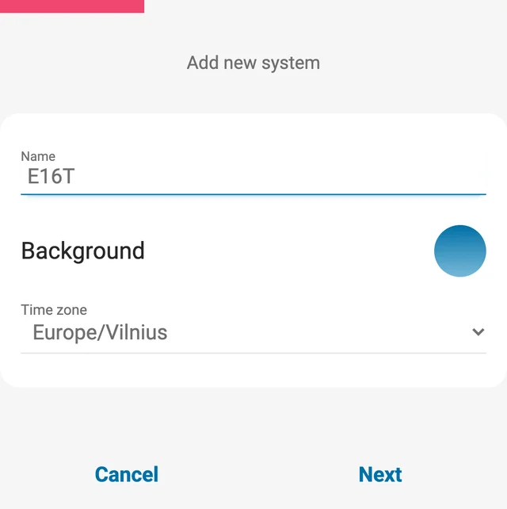{ .trik-mob-img }

### Ytterligare inställningar för tillkoppling/frånkoppling av systemet med centralapparatens nyckelbrytarsektion

!!! warning "Viktigt"
    Den sektion i centralapparaten som E16T-utgången OUT är ansluten till
    måste vara inställd på nyckelbrytarläge.
Följ anvisningarna nedan om centralapparaten ska styras med en PGM-utgång på E16T som slår på/av centralapparatens nyckelbrytarsektion.

1.  Klicka på „**Continue**“.

{ .trik-mob-img }

2. Ange ”**Area name**”. Aktivera styrning av PGM-utgången med appen Protegus2.
3. Välj ”**Pulse**” eller ”**Level**”, beroende på hur nyckelbrytarsektionens typ är konfigurerad. Vid behov kan du ändra intervallet för ”**Pulse**”.

4.  Klicka på „**Save**“.

{ .trik-mob-img }

5. Om säkerhetssystemet har ett område till måste du klicka på ”**Click to add an area**”. PGM-utgången ställs in på liknande sätt som beskrivits ovan.

6.  När inställningarna är klara klickar du på knappen ”**Skip**”.

{ .trik-mob-img }

### Tillkoppling/frånkoppling av larmsystemet med Protegus2

1.  I fönstret ”System Home Screen” klickar du på statusikonen ”Disarm”.

2.  *Protegus2* får ett meddelande om att säkerhetssystemets status har ändrats och statusikonen byter läge.

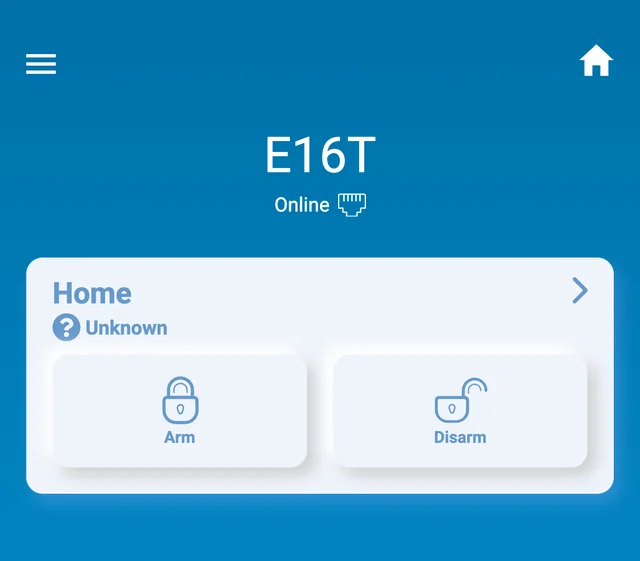{ .trik-mob-img }

## Fjärrkonfigurering

!!! warning "Viktigt"
    Fjärrkonfigurering fungerar bara om E16T uppfyller följande:

    1.  Tjänsten Protegus är aktiverad. Hur du aktiverar tjänsten
        beskrivs i avsnitt 7.3 (fönstret ”Reporting”);

    2.  Matningen är ansluten (lysdioden ”POWER” blinkar grönt);

    3.  E16T är ansluten till internet (LAN-kabeln är ansluten).
        Lysdioden ”NETWORK” lyser grönt när det finns en anslutning.
1.  Ladda ned TrikdisConfig från [www.trikdis.lt](http://www.trikdis.lt).

2.  Kontrollera att larmsändaren E16T är ansluten till internet och att tjänsten Protegus är aktiverad.

3.  Starta konfigurationsprogrammet TrikdisConfig. I avsnittet **Remote Access** anger du E16T:s MAC-adress i fältet **Unique ID** (MAC-adressen står på etiketterna på larmsändarens undersida och på förpackningen).

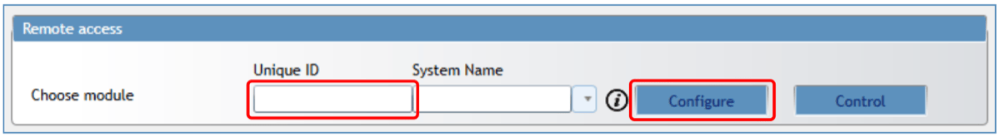

4. (Valfritt) Ange önskat namn på E16T med detta Unique ID i fältet **System name**. Klicka på **Configure.**

2.  Fönstret för konfigurering av larmsändaren öppnas. Klicka på knappen **Read [F4]** för att läsa de parametrar som är inställda i E16T. Om fönstret för administratörskoden (*Administrator Code*) öppnas anger du den sexsiffriga administratörskoden. För att programmet ska komma ihåg koden markerar du kryssrutan **Remember Password**.

3.  Ange de inställningar som behövs och klicka på **Write [F5]** när du är klar.

## Beskrivning av fönstren i TrikdisConfig

### Beskrivning av statusfältet i *TrikdisConfig*

När du har anslutit E16T och klickat på **Read [F4], *TrikdisConfig*** visar programmet information om den anslutna enheten i statusfältet:

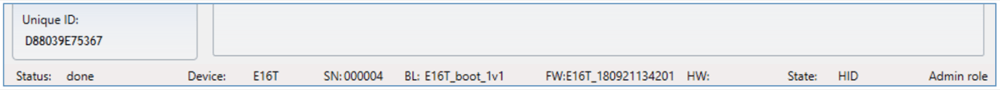

| Objekt    | Beskrivning                                        |
|-----------|----------------------------------------------------|
| Unique ID | Enhetens MAC-nummer                                |
| Status    | Driftstillstånd                                    |
| Device    | Enhetstyp (E16T ska visas)           |
| SN        | Enhetens serienummer                               |
| BL        | Bootloader-version                                 |
| FW        | Enhetens firmwareversion                           |
| HW        | Enhetens maskinvaruversion                         |
| Status    | Typ av anslutning till programmet (via USB eller på distans)     |
| Admin     | Behörighetsnivå (visas när åtkomstkoden har godkänts) |

När du har tryckt på **Read [F4]** läser programmet in och visar de inställningar som är gjorda i ***E16T*.** Ange de inställningar som behövs enligt beskrivningarna av TrikdisConfig-fönstren nedan.

### Fönstret ”System settings”

**Inställningsgruppen ”General”**

- **Account number** – om händelserna ska skickas till larmcentralen (CMS, Central Monitoring Station), ange den abonnentkod som du har fått från larmcentralen (hexadecimalt tal med 4 tecken, 0–9, A–F. **Använd inte FFFE, FFFF som Object ID.**).

- **Use security panel account ID** – när kryssrutan är markerad skickar larmsändaren händelserna med det konto-ID som är angivet i centralapparaten, i stället för värdet i fältet **Account number**.

- **Test period -** periodiska testmeddelanden skickas med det tidsintervall som anges här.

- **Security panel model** – aktivera/avaktivera DTMF-gränssnittet för analog telelinje på larmsändaren.

**Inställningsgruppen ”Ethernet settings”**

- **Internal MAC -** larmsändarens unika identifieringskod.

- Markera kryssrutan **Use DHCP** så att larmsändaren registrerar sig automatiskt i nätverket.

  - Om den automatiska registreringen misslyckas anger du **Internal IP address**, nätmasken (**Mask**), gateway-adressen (**Gateway**) och DNS-tjänsten (**DNS**) manuellt.

**Inställningsgruppen ”Access”**

När du ställer in larmsändaren E16T finns det två behörighetsnivåer (administratör och installatör):

- **Administrator code** - ger full åtkomst till konfigurationen (förvald kod – 123456).

- **Installer code** - ger installatören begränsad åtkomst till konfigurationen (förvald kod - 654321).

- **Allow installer to change** – administratören kan ange vilka inställningar som installatören får ändra.

  - Account number;

  - Reporting;

  - Ethernet settings;

  - Event summary.

!!! note "Obs!"
    Administratörs- och installatörskoderna måste bestå av sex siffror eller
    latinska tecken.
**Inställningsgruppen ”Output”**

- **OUT type** - välj utgångens funktion i listan (Disabled, LAN OK, Communication Trouble, Remote Control)**.**

- **Inverted** - markera kryssrutan om utgångens funktion ska inverteras.

- **OUT mode:**

  - **Pulse -** en status varar så länge som anges i fältet **Pulse Time** (pulsperiod i sekunder).

  - **Level -** en status ändras och består tills nästa kommando.
- **Pulse time** – ange pulsens varaktighet i sekunder. Utgången OUT aktiveras under den inställda tiden när utgångsläget är Pulse.

### Fönstren ”Reporting”

**Fliken ”CMS Reporting”**

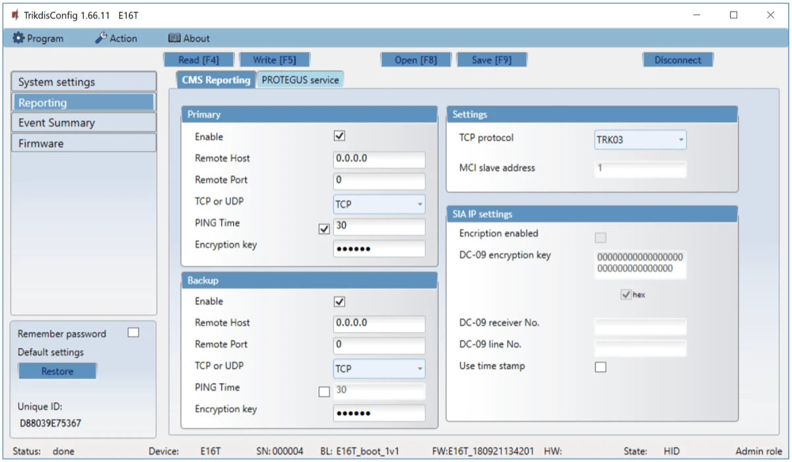

Larmsändaren skickar meddelanden till larmcentralen via en trådbunden internetanslutning (IP).

Meddelanden kan skickas via primärkanalen eller backupkanalen. Backupkanalen används när primärkanalen bryts.

Meddelanden till larmcentralen överförs med kryptering och lösenordsskydd. En TRIKDIS-mottagare krävs för att ta emot och vidarebefordra meddelanden till larmcentralens program:

- **För anslutning över IP** - programvarumottagaren IPcom för Windows/Linux, maskinvarumottagaren IP/SMS RL14 eller flerkanalsmottagaren RM14.

**Inställningsgruppen ”Primary”**

- **Enable** – när kryssrutan är markerad aktiveras huvudkanalen för att skicka händelsemeddelanden till larmcentralen (CMS, Central Monitoring Station).

- **Remote Host** – ange mottagarens domän eller IP-adress.

- **Remote Port** – ange mottagarens nätverksportnummer.

- **TCP or UDP** – välj med vilket protokoll (TCP eller UDP) händelserna ska skickas.

- **PING Time** – aktivera och ange tiden mellan signalerna i minuter (krävs för övervakning av kommunikationen).

- **Encryption key** – 6-siffrig krypteringsnyckel för meddelanden. Nyckeln som skrivs till larmsändaren måste stämma överens med mottagarens nyckel.

**Inställningsgruppen ”Backup”**

Aktivera backupkanalläget för att skicka händelser via backupkanalen om anslutningen via primärkanalen bryts. Backupkanalens inställningar är desamma som beskrivits ovan.

**Inställningsgruppen ”Settings”**

- **TCP protocol** – välj med vilket protokoll händelserna ska skickas.

  **Inställningsgruppen ”SIA IP parameter”**

Inställningarna kan ändras när kodningen DC-09_2007 eller DC-09_2012 för universella mottagare är vald i fältet TCP protocol.

- **Encryption enabled** – om TCP-protokollet DC09_2012 är valt kan kryptering aktiveras.

- **DC09-2012 encryption key** – anger krypteringsnyckeln.

- **DC09-2012 receiver No**. – anger mottagarens nummer.

- **DC-09 line No.** – ange mottagarens linjenummer.

- **Use time stamp –** när fältet är markerat tas tiden med i meddelandet.

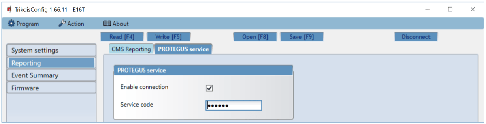

**Fliken ”Protegus service”** **Inställningsgruppen ”Protegus service”**

- **Enable connection** - aktivera tjänsten Protegus; E16T kan då utbyta data med appen Protegus och konfigureras på distans via ***TrikdisConfig*.**

- **Service code -** 6-siffrig kod för anslutning till appen Protegus (förval - 123456). Om Service code ändras måste du ange den när du lägger till larmsändaren i Protegus.

### Fönstren ”Event Summary”

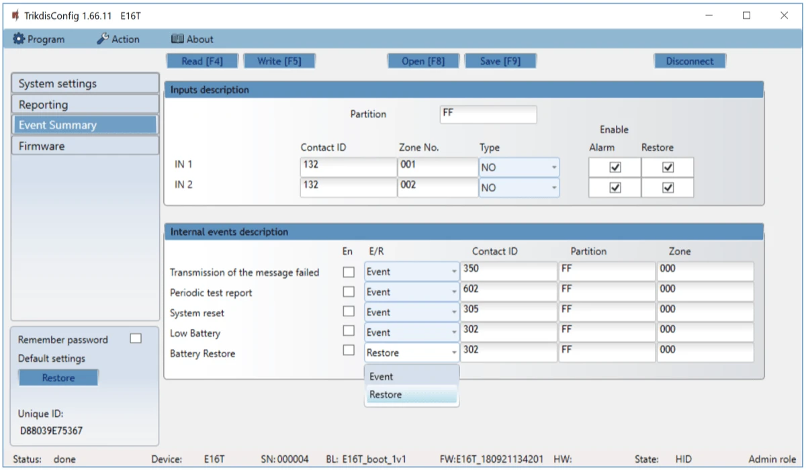

Här kan du aktivera, avaktivera och ändra de interna meddelanden och ingångsmeddelanden som enheten skickar. Om du avaktiverar ett internt meddelande här skickas det inte alls, oavsett andra inställningar.

Ytterligare detektorer kan anslutas till larmsändarens ingångar. När detektorn löser ut skickar larmsändaren ett händelsemeddelande. Ingången tilldelas en Contact ID-kod som skickas till larmcentralen och Protegus.

De Contact ID-händelsekoder som skickas till larmcentralen och till Protegus när händelsen inträffar anges genom att kryssrutan markeras.

**Inställningsgruppen ”Input description”**

- **Partition** – ange områdesnumret.

- **Contact ID** – ange händelsekoden eller lämna förvalt värde. När händelsen inträffar skickas händelsekoden till Protegus och larmcentralen.

- **Zone No. –** ange sektionsnumret så skickas det i meddelandena.

- **Type** – välj ingångstyp (NO, NC, EOL).

- **Enable / Alarm** – välj **Alarm** för att få en rapport när händelsen inträffar.

- **Enable / Restore** – välj **Restore** för att få en rapport när ingångens krets återställs.

**Inställningsgruppen ”Internal event description”**

- **En** – markerade händelsefält för vilka meddelanden skickas till larmcentralen och Protegus.

- **E/R** – välj vilken typ av händelse som ska skickas när ingången löser ut – **Event** eller **Restore**.

- **Contact ID** - ange händelsekoden eller lämna förvalt värde. När händelsen inträffar skickas händelsekoden till Protegus och larmcentralen.

- **Partition** – ange det områdesnummer som skickas när en intern händelse inträffar och när systemet återställs.

- **Zone** – ange det sektionsnummer som skickas när en intern händelse inträffar och när systemet återställs.

### Återställa fabriksinställningarna

För att återställa larmsändarens fabriksinställningar klickar du på knappen **Restore** i TrikdisConfig-fönstret.

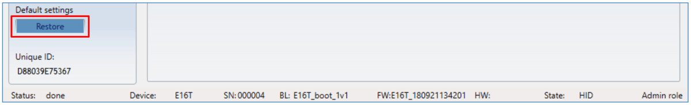

## Testa larmsändarens funktion

När konfigureringen och installationen är klara, gör en systemkontroll:

1.  Kontrollera att matningen är på.

2.  Kontrollera nätverksanslutningen (lysdioden ”NETWORK” lyser grönt).

3.  Generera en händelse:

- genom att tillkoppla/frånkoppla systemet med centralapparatens knappsats;

- genom att utlösa ett sektionslarm när säkerhetssystemet är tillkopplat.

1.  Kontrollera att händelsen kommer fram till larmcentralen (CMS, Central Monitoring Station) och/eller tas emot i appen Protegus.

2.  För att testa larmsändarens ingångar, utlös dem och kontrollera att rätt händelse tas emot.

3.  För att testa larmsändarens utgång, aktivera den på distans och kontrollera att den fungerar.

4.  Om centralapparaten ska styras på distans, tillkoppla/frånkoppla säkerhetssystemet på distans med appen Protegus.

## Firmwareuppdatering

!!! note "Obs!"
    När larmsändaren E16T är ansluten till TrikdisConfig erbjuder programmet
    automatiskt att uppdatera enhetens firmware om det finns
    uppdateringar. Uppdateringar kräver en internetanslutning. Antivirusprogram,
    brandvägg eller strikta inställningar för internetåtkomst kan blockera de automatiska
    firmwareuppdateringarna.
E16T:s firmware kan också uppdateras eller bytas manuellt. Efter en uppdatering finns alla tidigare gjorda inställningar kvar oförändrade. Vid manuell skrivning av firmware kan den bytas till en nyare eller äldre version. Så här uppdaterar du:

1.  Starta ***TrikdisConfig**.*

2.  Anslut E16T till datorn med en USB Mini-B-kabel eller anslut till larmsändaren E16T på distans.

- Om det finns en nyare firmwareversion erbjuder programmet att ladda ned filen med den nyare firmwareversionen.

1.  Välj menygrenen **Firmware**.

2.  Klicka på **Open firmware** och välj den firmwarefil som behövs. Om du inte har filen kan den senaste firmwarefilen laddas ned av <u>registrerade användare</u> från [www.trikdis.com](http://www.trikdis.com), under nedladdningsavsnittet för larmsändaren E16T.

    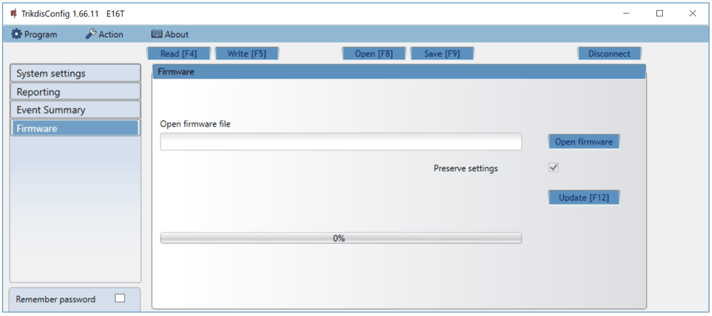

3.  Klicka på **Update [F12]**.

4.  Vänta tills uppdateringen är klar.

## Säkerhetskrav

Ethernet-larmsändaren ska installeras och underhållas av behörig personal.

Läs den här manualen noggrant före installationen för att undvika misstag som kan leda till funktionsfel eller till och med skador på utrustningen.

Koppla bort matningen innan du gör några elektriska anslutningar.

Ändringar, modifieringar eller reparationer som inte har godkänts av tillverkaren upphäver garantin.

Följ dina lokala bestämmelser och släng inte ett oanvändbart larmsystem eller dess komponenter bland vanligt hushållsavfall.
