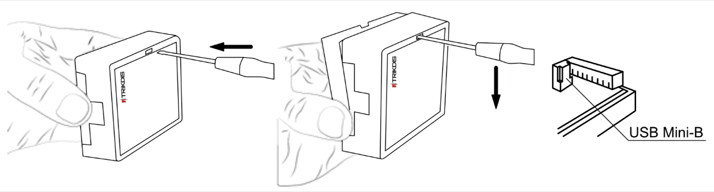
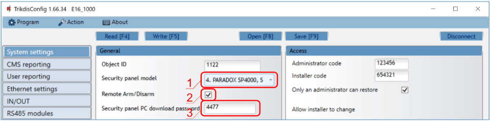
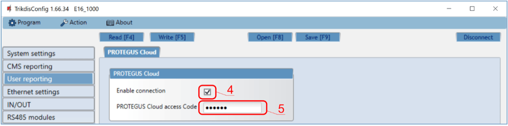
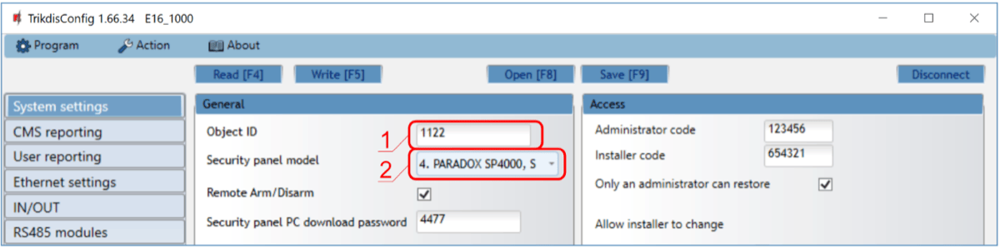
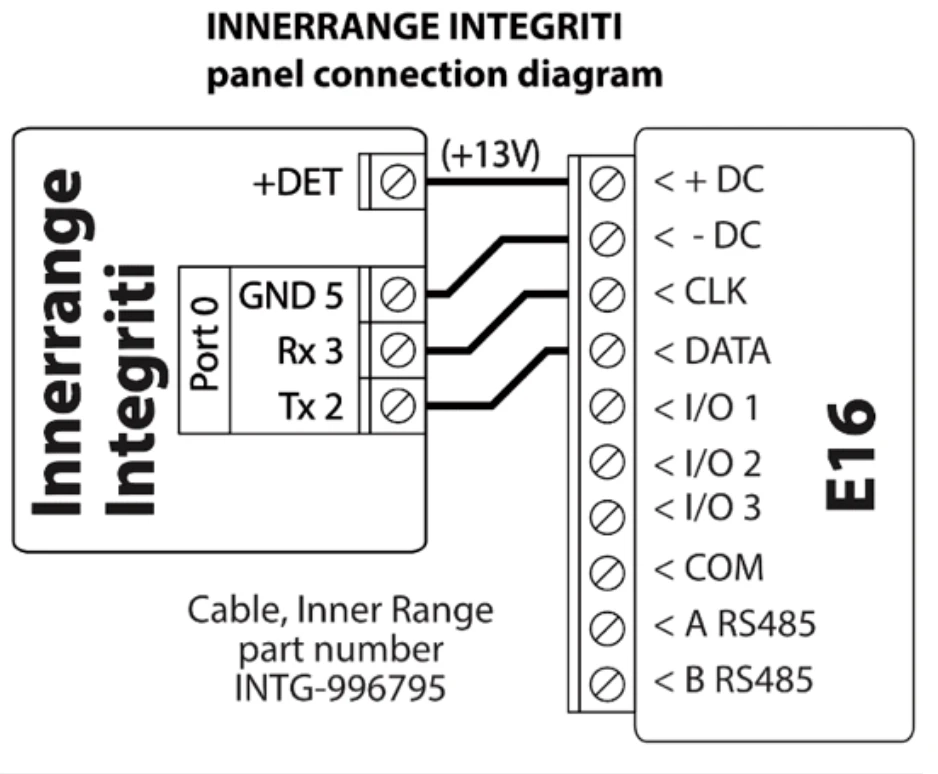

# Snabbinstallation av Innerrange Integriti med E16

Korta anvisningar för att ansluta larmsändaren E16 till en centralapparat Innerrange Integriti, konfigurera E16 för IP-rapportering och lägga till systemet i Protegus2. Använd anvisningen tillsammans med den fullständiga E16-manualen för alla övriga inställningar.

!!! caution "Försiktighet"
    Installation och service får endast utföras av behörig personal. Koppla bort matningen innan du drar ledningarna. Obehöriga ändringar upphäver garantin.

## Förutsättningar

- Larmsändaren E16 med ansluten LAN-kabel och en USB Mini-B-kabel för konfigureringen.
- Centralapparat Innerrange Integriti med firmware version **19.1.0.36608** eller senare.
- Innerranges professionella programvara version **19.1.0.15396** eller senare.
- Kabel från Inner Range, artikelnummer `INTG-996795`.
- Object ID (abonnentkod) hos larmcentralen, om rapportering sker till larmcentral.
- Protegus2-konto och larmsändarens MAC / Unique ID.

## Snabbkonfiguration med programmet *TrikdisConfig*

1. Ladda ned **TrikdisConfig** från [www.trikdis.com](http://www.trikdis.com) och installera det.
2. Öppna E16:s kapsling med en spårskruvmejsel.

3. Anslut E16 till datorn med en USB Mini-B-kabel.
4. Starta **TrikdisConfig**. Programmet identifierar larmsändaren och öppnar konfigurationsfönstret.
5. Klicka på **Read [F4]** för att läsa in de aktuella inställningarna. Om du uppmanas, ange administratörs- eller installatörskoden (6 siffror).

Gå igenom det avsnitt som motsvarar installationen:

- **Appen Protegus2**, om användarna ska styra systemet på distans.
- **Larmcentralen**, om larmsändaren ska rapportera till larmcentralen.
- Gå igenom båda avsnitten om larmsändaren ska fungera både mot larmcentralen och mot Protegus2.

### Inställningar för anslutning till appen Protegus2

**I fönstret ”System settings”:**

1. Välj den **Security panel model** som ska anslutas till larmsändaren.
2. Markera **Remote Arm/Disarm** om användarna ska styra centralapparaten i Protegus2 med sin knappsatskod.
3. För direktstyrning av Paradox- och Texecom-centralapparater anger du **Security panel PC download password**. Det måste stämma överens med lösenordet som är angivet i centralapparaten.

!!! note "Obs!"
    För att direktstyrningen ska fungera måste centralapparaten också programmeras enligt avsnittet om programmering av centralapparaten nedan.

**I fönstret ”User reporting”, fliken ”PROTEGUS Cloud”:**

4. Markera **Enable connection** för anslutning till Protegus Cloud.
5. Ändra **Protegus Cloud access Code** om användarna ska uppmanas att ange den när de lägger till systemet i appen Protegus2.

När konfigureringen är klar klickar du på **Write [F5]** och kopplar bort USB-kabeln.

### Inställningar för anslutning till larmcentralen

**I fönstret ”System settings”:**

1. Ange **Object ID** (abonnentkod) som du har fått från larmcentralen.
2. Välj den **Security panel model** som ska anslutas till larmsändaren.

**I fönstret ”CMS reporting”, inställningar för ”Primary channel”:**

3. Ställ in **Communication type** på **IP**.
4. Välj det protokoll som mottagaren kräver: **TRK**, **DC-09_2007**, **DC-09_2012** eller **TL150**.
5. Ange mottagarens krypteringsnyckel om det valda protokollet kräver det.
6. Ange mottagarens **Domain or IP** och **Port**.
7. Välj **TCP** eller **UDP**.
8. Konfigurera backupkanal och parallellkanal om installationen kräver redundans.

!!! note "Obs!"
    Om du väljer ett **DC-09**-protokoll anger du dessutom objekt-, linje- och mottagarnummer på fliken **Settings** i fönstret **CMS reporting**.

När konfigureringen är klar klickar du på **Write [F5]** och kopplar bort USB-kabeln.

## Inkoppling

Anslut centralapparaten till E16 enligt kopplingsschemat nedan:

| E16-plint | Innerrange Integriti-centralapparat | Anmärkning |
| --- | --- | --- |
| `+DC` | `+DET` | +13 V-matning |
| `-DC` | `GND 5` | Jord för TTL Port-0 |
| `CLK` | `Rx 3` | TTL Port-0 |
| `DATA` | `Tx 2` | TTL Port-0 |

## Programmering av centralapparaten

1. Kontrollera att firmware i centralapparaten Innerrange Integriti är **19.1.0.36608** eller senare och att den professionella programvaran är version **19.1.0.15396** eller senare.
2. Ange kommunikationsprotokollet **Trikdis** i konfigurationsprogrammet för Integriti.
3. Ställ in dataformatet för rapportering på **Contact ID**.
4. Konfigurera centralapparatens port som är ansluten till E16 som **TTL Port-0** med inställningarna **19200, 8, N, 1**.
5. Spara inställningarna och avsluta programmet.

## Lägg till systemet i Protegus2

1. Öppna [Protegus2](https://www.protegus.app) och klicka på **Add new system**.
2. Ange E16:s **MAC / Unique ID**.
3. Ange systemets namn och slutför guiden.
4. Om du använder nyckelbrytarstyrning i stället för direktstyrning ansluter du `I/O 1` till centralapparatens nyckelbrytarsektion och konfigurerar `PGM1` i Protegus2.
5. Vänta tills systemet visas som online.

## Systemkontroll

1. Tillkoppla och frånkoppla systemet från knappsatsen eller användargränssnittet.
2. Utlös ett testlarm.
3. Kontrollera att händelserna når larmcentralen (CMS) och Protegus2.
