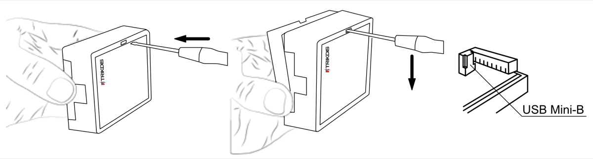
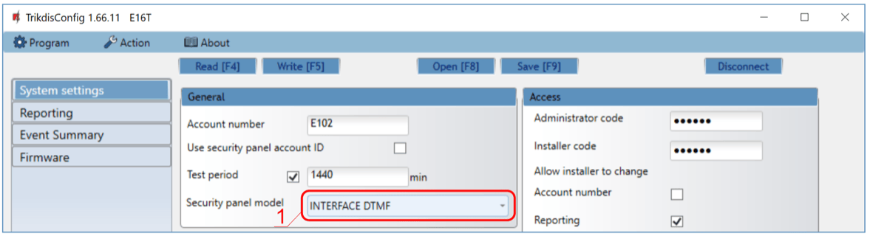
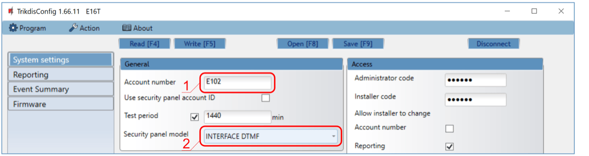
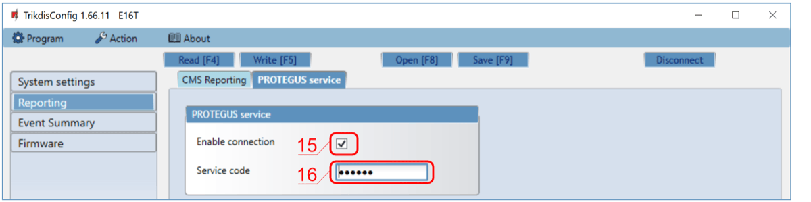
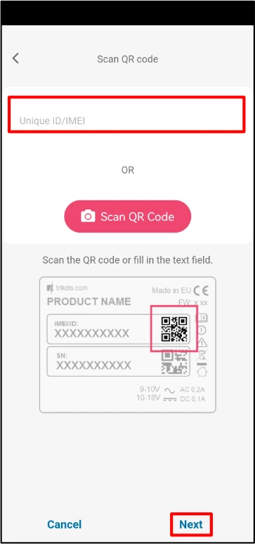

# Snabbinstallation av E16T

Korta anvisningar för att ansluta larmsändaren E16T till en centralapparats telefonuppringare, konfigurera IP-rapportering och lägga till systemet i Protegus. Använd anvisningen tillsammans med den fullständiga E16T-manualen för alla övriga inställningar.

!!! caution "Försiktighet"
    Installation och service får endast utföras av behörig personal. Koppla bort matningen innan du drar ledningarna. Obehöriga ändringar upphäver garantin.

## Förutsättningar

- Larmsändaren E16T med ansluten LAN-kabel och en USB Mini-B-kabel för konfigureringen.
- Centralapparat med telefonuppringare som stöder Contact ID över DTMF-toner.
- Installatörs- och knappsatsbehörighet till centralapparaten.
- Abonnentkod hos larmcentralen, om rapportering sker till larmcentral.
- Protegus-konto och larmsändarens MAC / Unique ID.

## Snabbkonfiguration med programmet *TrikdisConfig*

1. Ladda ned **TrikdisConfig** från [www.trikdis.com](http://www.trikdis.com) och installera det.
2. Öppna E16T:s kapsling med en spårskruvmejsel.

3. Anslut E16T till datorn med en USB Mini-B-kabel.
4. Starta **TrikdisConfig**. Programmet identifierar larmsändaren och öppnar konfigurationsfönstret.
5. Klicka på **Read [F4]** för att läsa in de aktuella inställningarna. Om du uppmanas, ange administratörs- eller installatörskoden (6 siffror).

Gå igenom det avsnitt som motsvarar installationen:

- **Appen Protegus**, om användarna ska styra systemet på distans.
- **Larmcentralen**, om larmsändaren ska rapportera till larmcentralen.
- Gå igenom båda avsnitten om larmsändaren ska fungera både mot larmcentralen och mot Protegus.

### Inställningar för anslutning till appen Protegus

**I fönstret ”System settings”:**

1. Välj den **Security panel model** som ska anslutas till larmsändaren.

**I fönstret ”Reporting”, fliken ”Protegus Service”:**

2. Markera **Enable connection** i inställningarna för Protegus-tjänsten.
3. Ändra **Service code** om användarna ska uppmanas att ange den när de lägger till systemet i Protegus.

När konfigureringen är klar klickar du på **Write [F5]** och kopplar bort USB-kabeln.

### Inställningar för anslutning till larmcentralen

**I fönstret ”System settings”:**

1. Ange **Account number** (abonnentkod) som du har fått från larmcentralen.
2. Välj den **Security panel model** som ska anslutas till larmsändaren.

**I fönstret ”Reporting”, inställningar för kanalen ”Primary”:**

3. Aktivera primärkanalen.
4. Ange mottagarens **Remote Host** och **Remote Port**.
5. Välj **TCP** eller **UDP**.
6. Ställ in **PING Time** och den krypteringsnyckel som mottagaren kräver.
7. Konfigurera inställningarna för **Backup** om installationen kräver redundans.
8. Välj det TCP-protokoll som mottagaren kräver: **TRK**, **DC-09_2007** eller **DC-09_2012**.
9. Om **DC-09_2012** används konfigurerar du kryptering samt mottagar- och linjenummer.

**I fönstret ”Reporting”, fliken ”Protegus Service”:**

10. Markera **Enable connection** till Protegus om användarna ska använda appen.
11. Ändra **Service code** om användarna ska uppmanas att ange den när de lägger till systemet i Protegus.

!!! note "Obs!"
    Om du väljer ett **DC-09**-protokoll anger du dessutom objekt-, linje- och mottagarnummer på fliken **Settings** i fönstret **Reporting**.

När konfigureringen är klar klickar du på **Write [F5]** och kopplar bort USB-kabeln.

## Inkoppling

Anslut E16T till centralapparatens matning, `TIP` / `RING` och LAN enligt kopplingsschemat nedan:

Om centralapparaten ska tillkopplas och frånkopplas via styrning av en nyckelbrytarsektion ansluter du centralapparatens nyckelbrytarsektion till `OUT` enligt samma schema.

## Programmering av centralapparaten

Programmera centralapparatens telefonuppringare på följande sätt:

1. Aktivera centralapparatens telefonuppringare.
2. Om E16T är ansluten direkt till `TIP` / `RING` anger du ett valfritt telefonnummer med minst 2 siffror.
3. Välj uppringningsläget `DTMF` (tonval).
4. Välj kommunikationsprotokollet `Contact ID`.
5. Ange centralapparatens fyrsiffriga abonnentkod.

## Särskilda inställningar för Honeywell Vista 48

Om den anslutna centralapparaten är en Honeywell Vista 48 ställer du in dessa värden:

| Sekvens | Data | Sekvens | Data | Sekvens | Data |
| --- | --- | --- | --- | --- | --- |
| `*41` | `1111` | `*60` | `1` | `*69` | `1` |
| `*42` | `1111` | `*61` | `1` | `*70` | `1` |
| `*43` | `1234` | `*62` | `1` | `*71` | `1` |
| `*44` | `1234` | `*63` | `1` | `*72` | `1` |
| `*45` | `1111` | `*64` | `1` | `*73` | `1` |
| `*47` | `1` | `*65` | `1` | `*74` | `1` |
| `*48` | `7` | `*66` | `1` | `*75` | `1` |
| `*50` | `1` | `*67` | `1` | `*76` | `1` |
| `*59` | `0` | `*68` | `1` |  |  |

Lämna programmeringsläget med `*99`.

## Lägg till systemet i Protegus

1. Öppna [Protegus](https://www.protegus.app) och klicka på **Add new system**.
2. Ange E16T:s **MAC / Unique ID**.
3. Ange systemets namn och slutför guiden.
4. Om du har anslutit `OUT` till en nyckelbrytarsektion öppnar du **Settings** i Protegus och aktiverar **Arm/Disarm with PGM Output 1**.
5. Välj **Pulse** eller **Level** så att läget motsvarar nyckelbrytarsektionens typ i centralapparaten.

## Systemkontroll

1. Tillkoppla och frånkoppla systemet från knappsatsen.
2. Utlös ett testlarm medan systemet är tillkopplat.
3. Kontrollera att händelserna når larmcentralen (CMS) och Protegus.
