# Larmsändaren FIRECOM för brandlarmcentraler

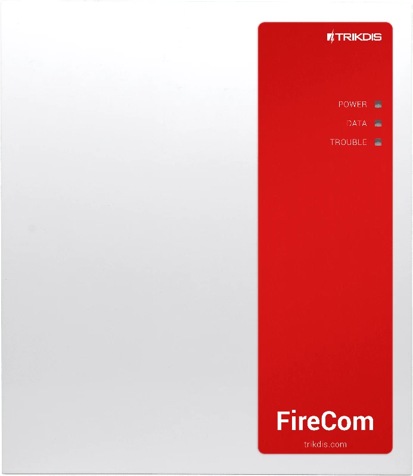

## Beskrivning

Larmsändaren ***FIRECOM*** uppfyller kraven i standarden EN 54-21:2006 och EN 54-4:1997/AC:1999/A1:2002/A2:2006.

Produkten uppfyller prestandakraven i bilaga A till standarden EN54-21 för överföringssystem av typ 1.

Certifikatnummer för larmsändaren ***FIRECOM***: 1922-CPR-2083. Branddetekterings- och brandlarmsystem. Larmöverförings- och felvarningsutrustning. Strömförsörjningsutrustning.

Produkten är certifierad av det anmälda certifieringsorganet för produkter nr 1922 ”Dedal”, Nesebar Mladost str. 50, Bulgarien, 8230.

Kontaktuppgifter till Trikdis tekniska support: support@trikdis.lt, +37067422877.

***FIRECOM*** används för att överföra meddelanden från brandlarmcentralen via LAN och/eller mobilnät till larmcentralens mottagare.

Funktionsprincip. När en ingång (sektion) på larmsändaren påverkas skickar ***FIRECOM*** ett händelsemeddelande till larmcentralens mottagare eller till appen ***Protegus2*** via mobilt internet och/eller LAN. Larmsändaren kan också skicka SMS och ringa upp. Larmsändaren finns med 4G-modem.

### Funktioner

**Meddelanden till larmbolaget**

- Skickar händelser via den inbyggda LAN-modulen eller 4G-modemet.

- Händelser skickas via tillgängliga kommunikationskanaler med den valda prioriteten.

- Alla larmcentraler kan ta emot rapporter, förutsatt att de har en programvaru- eller IP-mottagare från TRIKDIS, eller en IP-mottagare från en annan tillverkare som stöder IP-protokollet SIA DC-09.

- Händelser till larmcentralen prioriteras: meddelanden skickas först till larmcentralen och först därefter till ***Protegus2***.

- Möjlighet att skicka händelserapporter till larmcentralerna hos två olika larmbolag.

- Händelsemeddelanden skickas som Contact ID- eller SIA-koder.

**Meddelanden till användare**

- Ringer upp valda telefonnummer (upp till 8 användare).

- Skickar SMS om händelser.

- ”Push”-aviseringar och särskilda ljud som informerar om händelser i appen ***Protegus2***.

- Temperaturövervakning på distans.

**Fjärrstyrning av utgångar**

- Med appen ***Protegus2***.

- Genom att ringa upp enhetens telefonnummer.

- Med SMS.

**Inställningar och installation**

- Snabb och enkel installation.

- Enheten konfigureras antingen med USB-kabel eller på distans med programvaran ***TrikdisConfig***.

- Fjärruppdatering av firmware.

- Två behörighetsnivåer (kontotyper) för inställning av parametrar: för installatören och för administratören.

**Ingångar och utgångar**

- 3 reläutgångar (1 A, 30 V DC).

- Ingången ”**FLOOP**” är avsedd för anslutning av 2-tråds branddetektorer.

- 10 I/O-plintar som var och en kan ställas in som ingång (IN) eller utgång (OUT). Valbara ingångstyper (IN): NC, NO, EOL, EOL-T, ATZ, ATZ-T. Motstånd med olika värden kan användas i EOL- och ATZ-kretsar.

- Med utbyggnadsmodulerna ***iO*** kan antalet ingångar (IN) utökas till 32 och antalet utgångar (OUT) till 16.

- RS485-bussen används för att ansluta utbyggnadsmoduler i serien ***iO***.

- RS485 2-bussen används för att ansluta brandlarmcentraler.

### Specifikationer

| Parameter | Beskrivning |
|----|----|
| LTE-modemets frekvenser: / EU (Europa) / LA (Latinamerika) | LTE-FDD: B1/B3/B5/B7/B8/B20/B28 / LTE-FDD: B2/B3/B4/B5/B7/B8/B28/B66 |
| Matningsspänning | 15–32 V DC, 2,5 A |
| Strömförbrukning | Upp till 50 mA (i viloläge). / Upp till 300 mA (vid sändning). / Upp till 2,5 A (när den största möjliga belastningen med externa enheter är ansluten). |
| Reservbatteri [BAT] | 12 V blybatteri, 4 Ah/7 Ah |
| Batteriets laddström | Upp till 500 mA |
| Matningsspänning och ström för externa enheter [AUX] | 12 V DC, upp till 1 A |
| Överföringsprotokoll | TRK, SIA DC-09_2007, SIA DC-09_2012, SIA DC-09_IPcom, TL150 |
| Krypteringsnyckel | Krypteringsnyckel med 6 tecken. |
| Anslutning till larmcentralen | TCP/IP eller UDP/IP |
| Händelsekoder | Contact ID, SIA-koder. |
| LAN-modul | Ja, inbyggd |
| Konfigurering av LAN-nätverket | DHCP eller manuell |
| SIM-kort | 2, storlek NANO |
| Sändningsriktningar för rapporter | Till primär och sekundär mottagare hos 2 olika larmbolag; Till molntjänsten ***Protegus2*** och till mobilapparna ***Protegus2*** för iOS/Android; Till 8 mobiltelefoner med SMS. Ringer upp 8 mobiltelefoner. |
| Överföringskanaler för händelserapportering | 4G, Ethernet (LAN), SMS, samtal |
| Meddelandekryptering | Ja |
| Inbyggd klocka | Ja |
| Användare | 40 |
| Plintar med dubbel funktion [I/O] | 10; funktionen IN eller OUT väljs vid programmeringen. När IN är valt kan följande typer användas: NC, NO, EOL, EOL_T, ATZ, ATZ_T. När OUT är valt blir plinten en utgång med öppen kollektor (OC) för en ström på upp till 100 mA |
| Antal grupper | 8 |
| Antal sektioner | 10 (20 sektioner med ATZ), (kan utökas till 32 sektioner med utbyggnadsmoduler) |
| Antal PGM-utgångar | 3 relä (1 A, 30 V DC). (kan bli 13 om I/O-plintarna ställs in som utgångar. Kan utökas till 16 utgångar med utbyggnadsmoduler) |
| Buffertminnets kapacitet | 60 händelser |
| Händelseloggens minne | Upp till 1 000 händelser. De äldsta posterna raderas automatiskt. |
| Konfigurering | På distans med programvaran ***TrikdisConfig*** eller lokalt via USB Type-C. |
| Längd på 1-Wire-databussen [1 WIRE] | Upp till 30 m |
| Kompatibla temperaturgivare | Maxim®/Dallas® DS18S20, DS18B20; AM2301-serien |
| Största antal temperaturgivare på 1-Wire-databussen | 8 (Dallas) eller 1 (om en givare i AM2301-serien används) |
| RS485-buss | 2 |
| RS485-bussens längd | Upp till 100 m |
| Moduler och enheter som stöds | **iO-8** – utbyggnadsmodul; / **iO-MO** – radiotransceiver **iO-WL**; / **iO-LORA** – utbyggnadsmodul; / **iO8-LORA** – utbyggnadsmodul; / **PB-LORA** – överfallsknapp; / **REL-LORA** – utbyggnadsmodul; / Brandlarmcentral med protokollet **ESPA 4.4.4**; / **NSC Solution** – brandlarmcentral; / **INIM Smartline** – brandlarmcentral; / **C-TEC Cast ZFP** – brandlarmcentral; / **Polon-Alfa 3000** – brandlarmcentral. |
| Driftmiljö | Temperatur från -10 °C till +50 °C, relativ luftfuktighet upp till 80 % vid +20 °C. |
| Mått | 235 × 205 × 92 mm |
| Vikt | 1,35 kg |

### Delar på larmsändaren *FIRECOM*

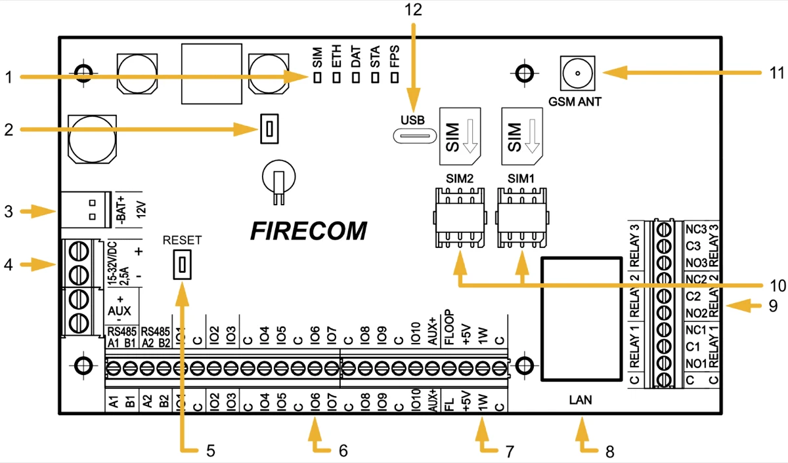

1. Lysdiodsindikeringar för anslutning och drift
2. Knapp. Används inte
3. Plintblock för reservbatteri
4. Plintblock för huvudmatning
5. Knappen RESET
6. Plintblock för externa anslutningar
7. Plintblock för 1-Wire
8. LAN-kontakt
9. Plintblock för reläutgångar
10. Kortplatser för SIM-kort
11. Kontakt för mobilantenn
12. USB Type-C-kontakt

### Plintarnas funktion

| Plint              | Beskrivning                                            |
|--------------------|--------------------------------------------------------|
| Matningsplint ”+”  | Plint för matning (positiv plint för 15–32 V DC)       |
| Matningsplint ”-”  | Plint för matning (negativ plint för 15–32 V DC)       |
| BAT+               | Positiv plint för reservbatteri, 12 V                  |
| BAT-               | Negativ plint för reservbatteri, 12 V                  |
| AUX+               | Positiv 12 V-plint för matning av externa enheter      |
| AUX-               | Gemensam negativ plint                                 |
| A1 RS485           | RS485-buss för anslutning av utbyggnadsmoduler iO      |
| A2 RS485           | RS485-buss för anslutning av brandlarmcentral          |
| IO1 – IO10         | Plintar för ingång/utgång (förval – ingång)            |
| C                  | Gemensam negativ plint                                 |
| AUX+               | Positiv 12 V-plint för matning av externa enheter      |
| FLOOP              | Plint för anslutning av en 2-tråds branddetektor       |
| +5 V               | Positiv 5 V-plint, 0,2 A, för matning av 1-Wire-enheter |
| 1 WIRE             | Plint för databussen ”1-Wire”                          |
| C                  | Gemensam negativ plint                                 |
| NO1/C1/NC1         | Plintar för PGM-reläutgång 1                           |
| NO2/C2/NC2         | Plintar för PGM-reläutgång 2                           |
| NO3/C3/NC3         | Plintar för PGM-reläutgång 3                           |

### Lysdiodsindikering vid drift

| Indikator | Lysdiodens läge | Beskrivning |
|----|----|----|
| SIM | Släckt | Ingen anslutning till mobilnätet |
|     | Blinkar grönt | SIM-kortet registreras i mobilnätet. |
|     | Fast grönt sken | SIM-kortet är registrerat i mobilnätet. |
|     | Fast grönt sken med gult blinkande | Larmsändaren är ansluten till mobilnätet. Tillräcklig mobil signalstyrka för 4G är nivå 3 (tre gula blinkningar). |
| ETH | Blinkar grönt | LAN-kabeln är bortkopplad eller problem med DHCP. |
|     | Fast grönt sken | Ansluten till LAN-nätverket. |
| DAT / DATA | Släckt | Alla händelsemeddelanden är skickade |
|            | Fast grönt sken | Ett meddelande skickas |
|            | Fast gult sken (DAT) | Osända händelsemeddelanden finns i buffertminnet |
| STA / TROUBLE | Blinkar grönt (STA) | Inga driftproblem |
|  | Släckt (TROUBLE) | Inga driftproblem |
|  | 1 röd blinkning | Inget SIM-kort är isatt |
|  | 2 röda blinkningar | SIM-kortets PIN-kod är felaktig |
|  | 3 röda blinkningar | Det går inte att ansluta till mobilnätet |
|  | 4 röda blinkningar | Det går inte att ansluta till IP-mottagaren via primärkanalen |
|  | 5 röda blinkningar | Det går inte att ansluta till IP-mottagaren via sekundärkanalen |
|  | 6 röda blinkningar | Ingen DC-matning |
|  | 7 röda blinkningar | Fel på AUX-utgången (överström eller överspänning) |
|  | 8 röda blinkningar | Batterifel |
|  | 9 röda blinkningar | LAN-kabeln är bortkopplad |
|  | 10 röda blinkningar | Problem med DHCP i LAN |
| FPS / POWER | Släckt | Matningen är inte ansluten |
|  | Fast grönt sken | Inga problem med matningen |
|  | 1 grön blinkning | Ingen nätspänning |
|  | 2 gröna blinkningar | Otillräcklig spänning från reservbatteriet |

### Komponenter som behövs för installationen

Innan du börjar installationen, se till att du har följande:

1.  USB Type-C-kabel för konfigurering.

2.  Minst 4-ledarkabel för att ansluta larmsändaren till brandlarmcentralen.

3.  Spårskruvmejsel 2,5 mm.

4.  Extern mobilantenn om nättäckningen i området är dålig.

5.  Aktiverat nano-SIM-kort (PIN-kodsbegäran kan vara avstängd).

6.  Manualen för den brandlarmcentral som larmsändaren ska anslutas till.

Beställ nödvändiga komponenter separat från din lokala distributör.

## Matning av larmsändaren

### Huvudmatning

Larmsändaren måste matas från en DC-källa. Ett reservbatteri på 12 V måste vara anslutet till systemet för att matningen ska vara oavbruten.

### Reservmatning

Om det blir problem med huvudmatningen skapas en händelserapport ”**DC Fault**” och enheten växlar automatiskt till reservbatteriet på 12 V. Om batteriets spänning sjunker till 11,5 V skapas en händelserapport ”**Low Battery**”. Batteriet kopplas bort om spänningen sjunker under 9,5 V. När DC-spänningen är åter skapas en rapport ”**DC Restore**” och batteriet börjar laddas automatiskt. När batteriets spänning stiger till 12,6 V skapas en händelserapport ”**Battery Restore**”.

### Larmsändarens leveransomfattning

| Benämning | Antal |
|----|:--:|
| Kretskort för larmsändaren ***FIRECOM*** med antenn, inbyggt i en metallkapsling | 1 st. |
| Metallkapsling med switchat nätaggregat från Mean Well | 1 st. |
| Motstånd 10 kΩ | 20 st. |
| Ledning för anslutning av batteriet | 1 st. |
| Sabotagekontakt | 1 st. |
| Plintblock med 3,15 A säkring | 1 st. |
| Fästelement (skruvar – 4 st., nylonplugg – 4 st.). | 1 |

!!! note "Obs!"
    USB-kabel (Type-C) för programmering av larmsändaren säljs separat.

## Installation av systemet

Larmsändarens kretskort monteras i en monteringskapsling som redan har ett DC-nätaggregat med 3,15 A säkring och utrymme för ett reservbatteri.

**Mått på kretskortet FIRECOM**

Bilden nedan visar kretskortets mått och monteringshål (i millimeter) samt hålens placering.

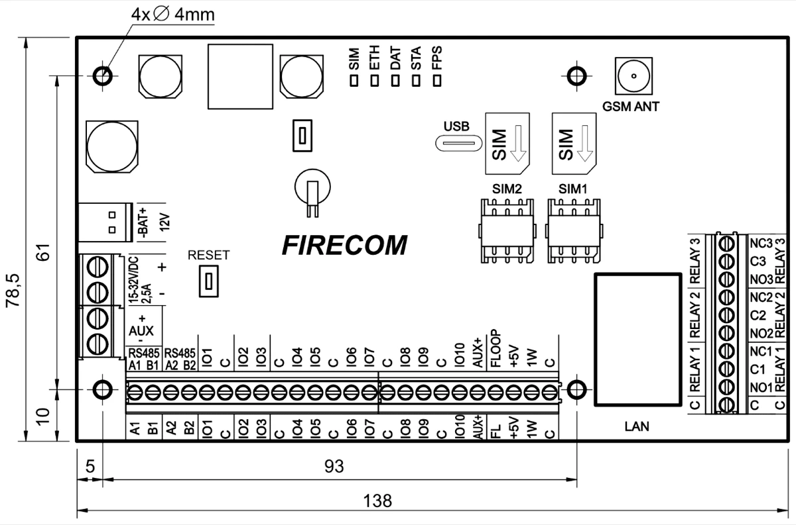

### Ordning för anslutning av enheter

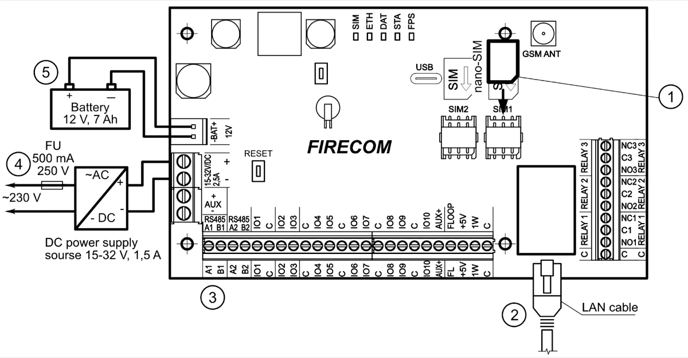

1.  Om du använder ett SIM-kort, sätt i det aktiverade SIM-kortet i kortplatsen.

2.  Om du använder LAN, anslut LAN-kabeln.

3.  Anslut branddetektorer, larmdon och styrda enheter enligt kopplingsschemana här och enligt kopplingsschemat för varje enhet som ska anslutas.

4.  Anslut ledningarna för nätspänningen till plintarna.

5.  Sätt ett reservbatteri i monteringskapslingen. Anslut batteriets plintar till plintarna BAT+ / BAT– på larmsändaren.

!!! note "Obs!"
    Batteriet ska väljas så att det laddas till 80 % av kapaciteten inom 24 timmar och att den återstående kapaciteten nås inom de följande 48 timmarna, för att uppfylla kraven i standarden EN54.

### Anslutning av detektorer

Larmsändarens kretskort har 10 plintar IO1–IO10 (ingångar) för anslutning av detektorkretsar. Antalet ingångar kan utökas till 32 med ingångsmoduler (***iO-8, iO-MO, iO-LORA, iO8-LORA**)*. Varje plint kan ställas in som ingång och tilldelas sektionsattribut: kretstyp (NO, NC, EOL, EOL_T, ATZ, ATZ_T); känslighet för tillfälliga kretshändelser; se avsnitt 6.6 (fönstret ”Zones”).

**Kopplingsscheman för anslutning av detektorer.**

<figure style="margin: 0;">
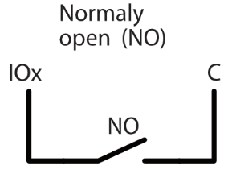
</figure>

<figure style="margin: 0;">
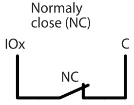
</figure>

<figure style="margin: 0;">
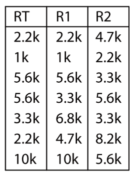
</figure>

<figure style="margin: 0;">
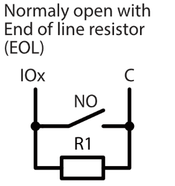
</figure>

<figure style="margin: 0;">
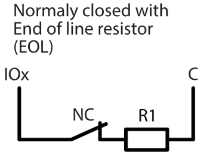
</figure>

<figure style="margin: 0;">
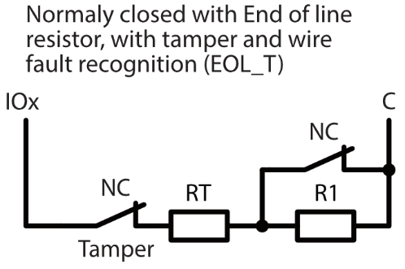
</figure>

<figure style="margin: 0;">
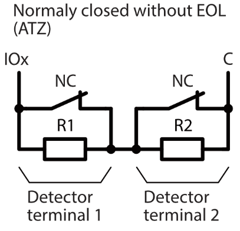
</figure>

<figure style="margin: 0;">
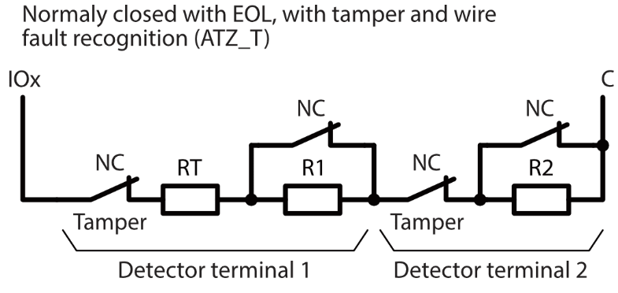
</figure>

### Anslutning av rökdetektorer

Kopplingsschema för anslutning av 2-tråds rökdetektorer.

Kopplingsschema för anslutning av 2-tråds rökdetektorer till utgången ”**FLOOP**”. När detta kopplingsschema används måste ingångstypen ”**Input**” ställas in på ”**FC Fire sensor (FLOOP input)**” i fönstret ”Zones”. Branddetektorns larmström måste vara över 10 mA. Upp till 8 branddetektorer kan anslutas till utgången ”**FLOOP**”.

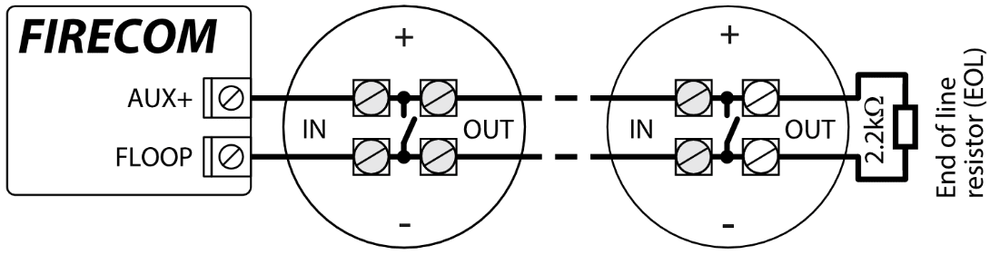

Kopplingsscheman för 2-tråds rökdetektorer med relämodulen SM1. För att ansluta rökdetektorkretsen till den valda ingången måste ingången (IOx) aktiveras och kretstypen (NO, NC, EOL, EOL_T, ATZ, ATZ_T) ställas in (se avsnitt 6.6, fönstret ”Zones”). För att ansluta rökdetektorernas matningskrets till PGM-utgången (IO10) måste funktionen ”**Fire Sensor Reset**” tilldelas utgången (se avsnitt 6.7, fönstret ”PGM”).

\* Reläet används för att upptäcka kabelbrott och att en branddetektor har tagits bort. Om du inte använder ett relä (K1) måste kontakt K1 kortslutas.

Eller

Kopplingsschema för anslutning av 4-tråds rökdetektorer.

För att ansluta rökdetektorkretsen till den valda ingången måste ingången (IOx) aktiveras och kretstypen (NO, NC, EOL, EOL_T, ATZ, ATZ_T) ställas in (se avsnitt 6.6, fönstret ”Zones”). För att ansluta matningskretsen för en 4-tråds rökdetektor till PGM-utgången (IO10) måste funktionen ”**Fire Sensor Reset**” tilldelas utgången (se avsnitt 6.7, fönstret ”PGM”).

\* Reläet används för att upptäcka kabelbrott och att en branddetektor har tagits bort. Om du inte använder ett relä (K1) måste kontakt K1 kortslutas.

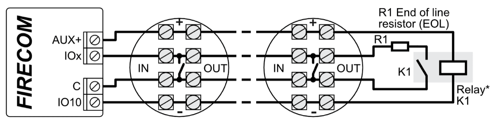

### Kopplingsschema för anslutning av larmsändaren till en brandlarmcentral

<figure style="margin: 0;">
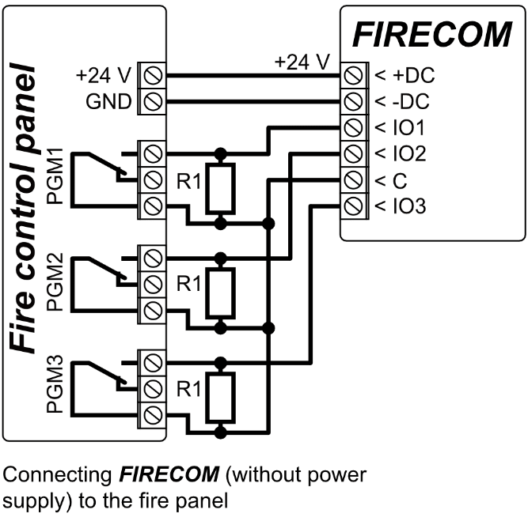
</figure>

<figure style="margin: 0;">
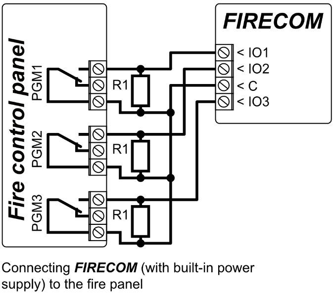
</figure>

Om du vill övervaka brandlarmcentralens status ansluter du dess motsvarande utgångar till ingångarna på ***FIRECOM***. Brandlarmcentralens utgångar (PGM1, PGM2, PGM3) måste konfigureras som statusutgångar (”Alarm”, ”Trouble” osv.).

### Kopplingsschema för anslutning av brandlarmcentral med protokollet ESPA4.4.4

<figure style="margin: 0;">
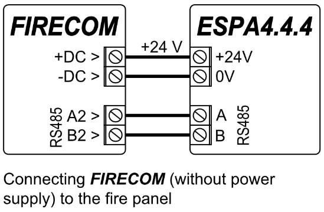
</figure>

<figure style="margin: 0;">
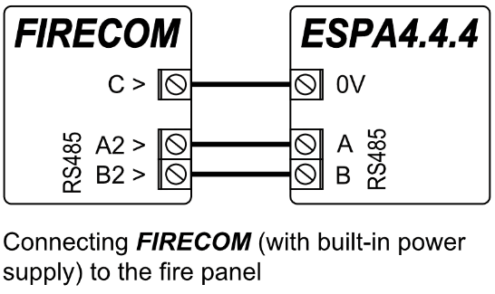
</figure>

Inställningar för larmsändaren ***FIRECOM*** i ***TrikdisConfig*** när en brandlarmcentral ansluts.

1.  Välj **ESPA4.4.4**.

2.  Välj anslutningstyp.

3.  Larmsändaren ***FIRECOM*** och brandlarmcentralen måste ha samma inställningar för dataöverföring.

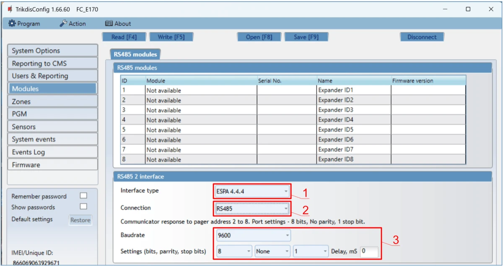

4.  Ange telefonnummer och e-postadresser för de användare som ska få meddelanden från ***FIRECOM***.

5.  Om användaren ska få meddelanden (eller samtal) om händelser, markera rutan **SMS** (eller **Call**).

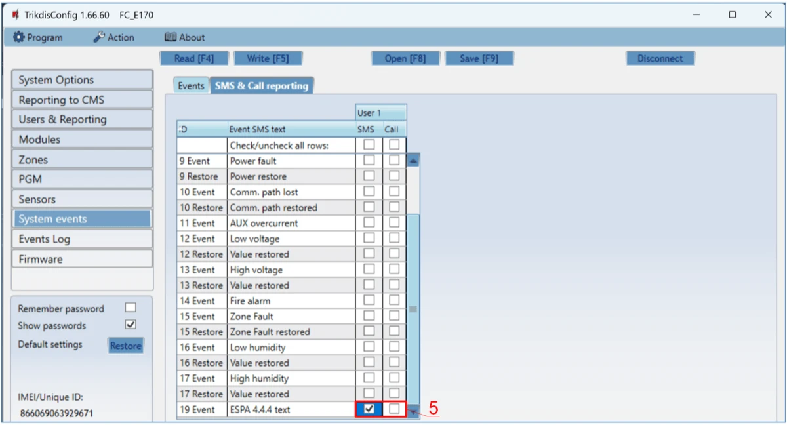

6.  Konfigurera kommunikationskanalen om meddelanden ska skickas till larmcentralens mottagare. Händelsemeddelandena överförs med protokollet SIA DC-09.

Testa systemet. Utlös ett brandlarm och kontrollera att meddelanden från ***FIRECOM*** skickas till larmcentralen (CMS, Central Monitoring Station) och till ***Protegus2***.

### Kopplingsschema för anslutning av brandlarmcentralen NSC Solution

<figure style="margin: 0;">
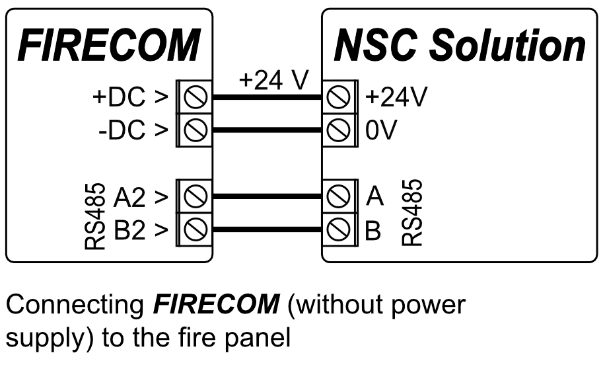
</figure>

<figure style="margin: 0;">
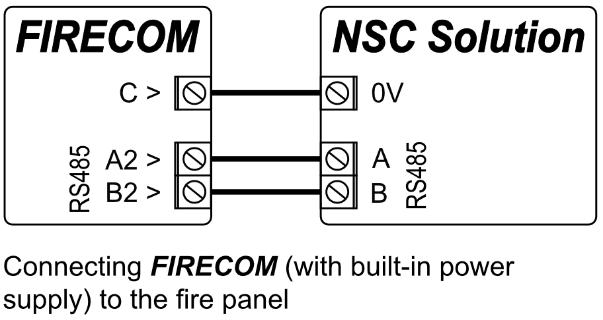
</figure>

Inställningar för larmsändaren ***FIRECOM*** i ***TrikdisConfig*** när brandlarmcentralen **NSC Solution** ansluts.

1.  Välj brandlarmcentralen **NSC solution**.

2.  ”**NSC slave address**” får inte vara samma som adressen på någon av de modulerna som är anslutna till brandlarmcentralen.

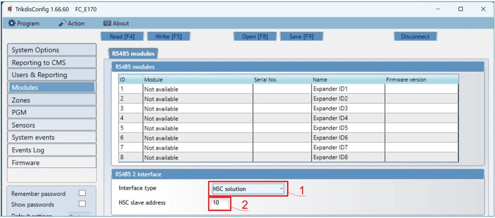

3.  Ange telefonnummer och e-postadresser för de användare som ska få meddelanden från ***FIRECOM***.

4.  Användarna får SMS och samtal om de händelser som är markerade. Du kan lägga till fler CID-händelsekoder i kolumnen **CID**. Du måste ange **SMS text** bredvid nya koder. Om användaren ska få meddelanden (eller samtal) om händelser, markera rutan **SMS** (eller **Call**).

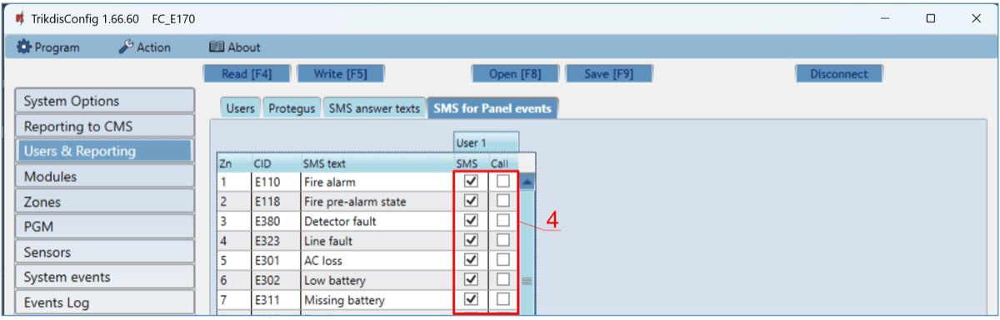

5.  Konfigurera kommunikationskanalen om meddelanden ska skickas till larmcentralens mottagare.

När du har ställt in larmsändaren ***FIRECOM*** slår du på brandlarmcentralens matning. Vänta tills brandlarmcentralens programvara har laddats. Modulerna som är anslutna till RS485-bussen måste skannas i brandlarmcentralen. Tryck på brandlarmcentralen: **PROG.\>INSTALLER\>(ange installatörskoden) 00000 OK\>(välj) SETTINGS\>ENTER\>(välj) SCAN RS485\>ENTER**. Vänta tills skanningen är klar. Återgå till huvudskärmen genom att trycka på ”**CANCEL**” två gånger.

Testa systemet. Utlös ett brandlarm och kontrollera att meddelanden från ***FIRECOM*** skickas till larmcentralen (CMS, Central Monitoring Station) och till ***Protegus2***.

### Kopplingsschema för anslutning av brandlarmcentralen INIM SMARTLINE

<figure style="margin: 0;">
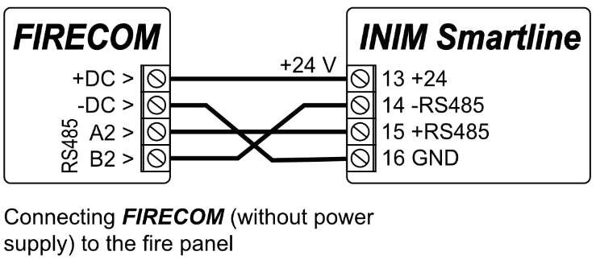
</figure>

<figure style="margin: 0;">
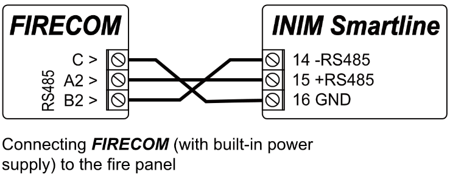
</figure>

Läget **Slave** måste ställas in på brandlarmcentralen **INIM Smartline** när den ansluts till larmsändaren ***FIRECOM*** via RS485-bussen.

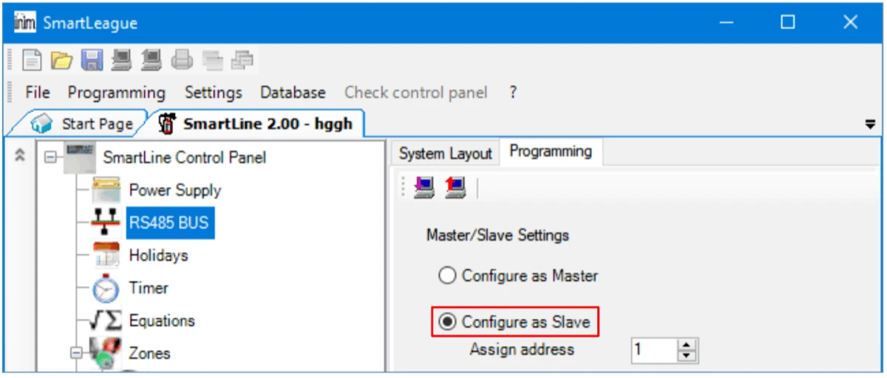

!!! note "Obs!"
    Du kan inte ansluta ***FIRECOM*** via RS485-bussen om repeaterenheter är anslutna till brandlarmcentralen **INIM Smartline**. / Utbyggnadsmodulerna **iO** stöds inte när ***FIRECOM*** är ansluten till brandlarmcentralen **INIM Smartline** via RS485-bussen. Inställningar för larmsändaren ***FIRECOM*** i ***TrikdisConfig*** när brandlarmcentralen **INIM SMARTLINE** ansluts.

1.  Välj brandlarmcentralen **Inim Smartline**.

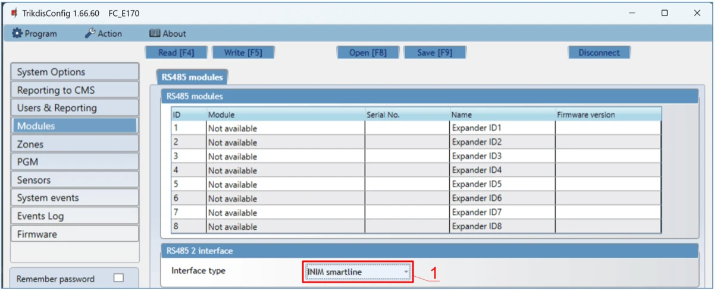

2.  Ange telefonnummer och e-postadresser för de användare som ska få meddelanden från ***FIRECOM***.

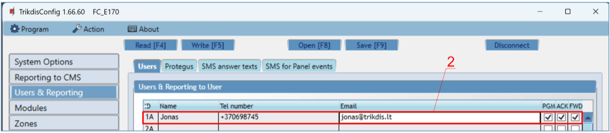

3.  Användarna får SMS och samtal om de händelser som är markerade. Du kan lägga till fler CID-händelsekoder i kolumnen **CID**. Du måste ange **SMS text** bredvid nya koder. Om användaren ska få meddelanden (eller samtal) om händelser, markera rutan **SMS** (eller **Call**).

4.  Konfigurera kommunikationskanalen om meddelanden ska skickas till larmcentralens mottagare.

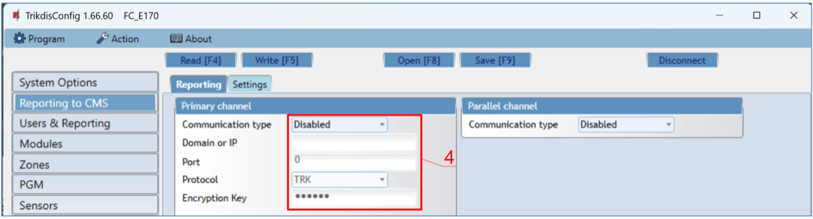

Testa systemet. Utlös ett brandlarm och kontrollera att meddelanden från ***FIRECOM*** skickas till larmcentralen (CMS, Central Monitoring Station) och till ***Protegus2***.

### Kopplingsschema för anslutning av brandlarmcentralen C-TEC Cast ZFP

<figure style="margin: 0;">
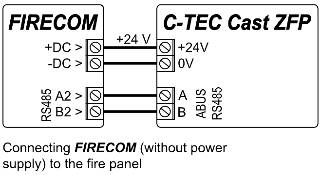
</figure>

<figure style="margin: 0;">
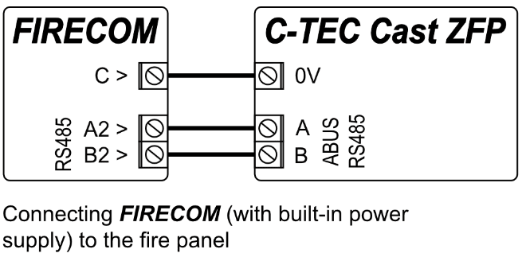
</figure>

Inställningar för larmsändaren ***FIRECOM*** i ***TrikdisConfig*** när brandlarmcentralen **C-TEC Cast ZFP** ansluts.

1.  Välj brandlarmcentralen **C-TEC Cast ZFP**.

2.  Ange telefonnummer och e-postadresser för de användare som ska få meddelanden från ***FIRECOM***.

3.  Användarna får SMS och samtal om de händelser som är markerade. Du kan lägga till fler CID-händelsekoder i kolumnen **CID**. Du måste ange **SMS text** bredvid nya koder. Om användaren ska få meddelanden (eller samtal) om händelser, markera rutan **SMS** (eller **Call**).

4.  Konfigurera kommunikationskanalen om meddelanden ska skickas till larmcentralens mottagare.

Installera programmet **ZFPtools** på datorn. Starta programmet **ZFPtools**. Slå på brandlarmcentralens matning. Vänta tills brandlarmcentralens programvara har laddats. Anslut brandlarmcentralen till datorn med en USB2.0 A-B-kabel.

1.  Öppna fliken ”**Node View**”.

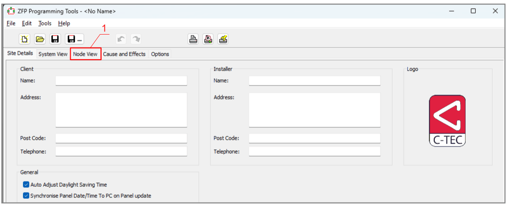

2.  Ladda ned brandlarmcentralens inställningar till datorn.

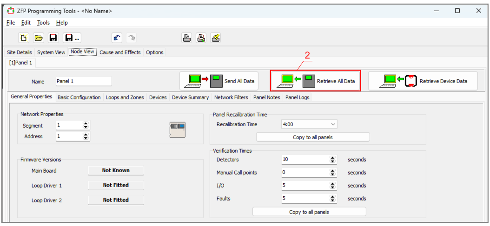

3.  Ange koden (förvald kod – 4444).

4.  Klicka på ”**OK**”.

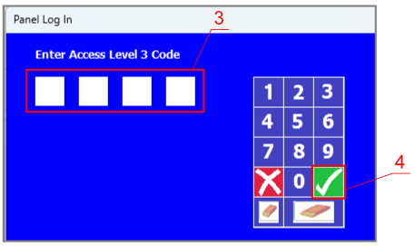

5.  Välj ”**BMS Interface**”.

6.  Klicka på den lediga ikonen.

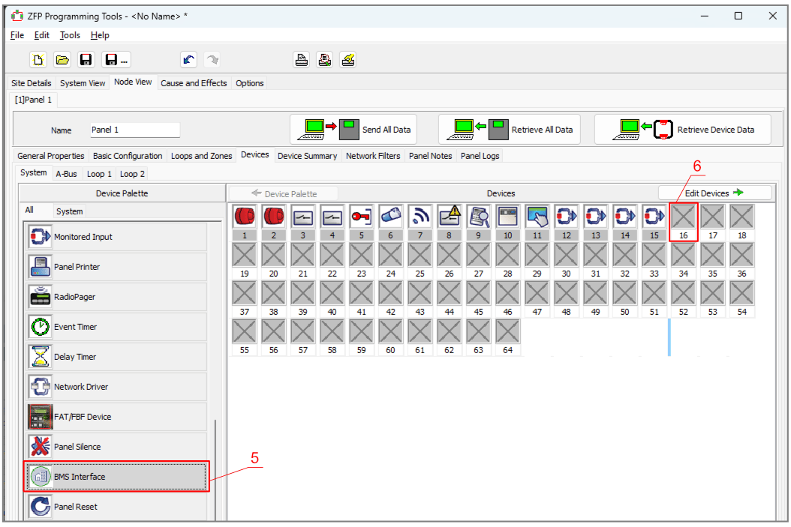

7.  Klicka på ”**Edit Devices**”.

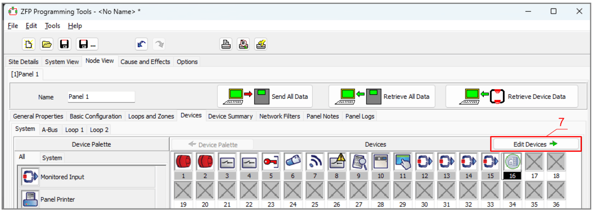

8.  På fliken ”**Device**” anger du systemets namn.

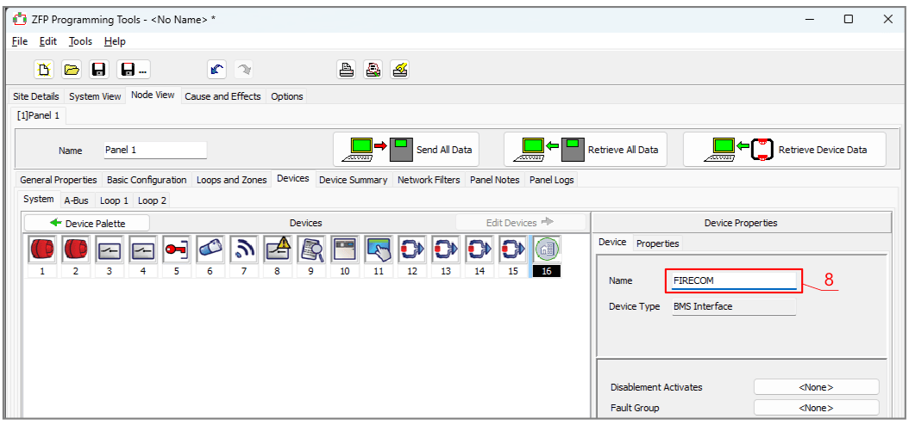

9.  På fliken ”**Properties**” anger du systemets namn.

10. Ange den buss ”**ABUS RS485**” som larmsändaren ***FIRECOM*** är ansluten till.

11. Konfigurera meddelandena.

12. Skriv inställningarna till brandlarmcentralen.

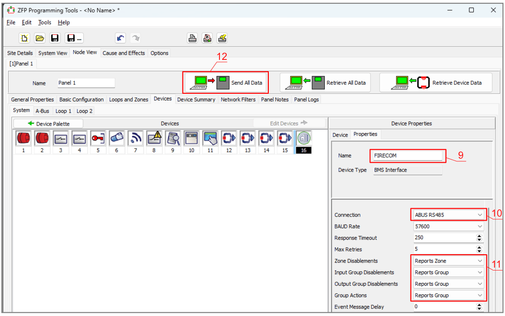

13. Ange koden (förvald kod – 4444).

14. Klicka på ”**OK**”.

Brandlarmcentralen är programmerad. Koppla bort USB2.0 A-B-kabeln från brandlarmcentralen.

Testa systemet. Utlös ett brandlarm och kontrollera att meddelanden från ***FIRECOM*** skickas till larmcentralen (CMS, Central Monitoring Station) och till ***Protegus2***.

### Kopplingsschema för anslutning av brandlarmcentralen Polon-Alfa 3000

**Larmsändaren FIRECOM ansluts till Polon-Alfa 3000 via RS485-bussen**

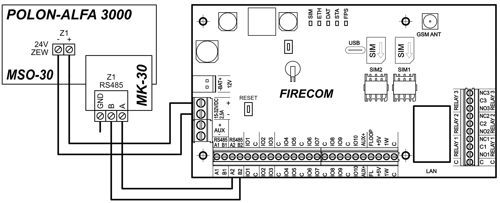

Konfigurera larmsändaren ***FIRECOM*** med ***TrikdisConfig***. 

1.	Välj **Polon-Alfa 3000**.
	
2.	Välj anslutningstyp **RS485**. 

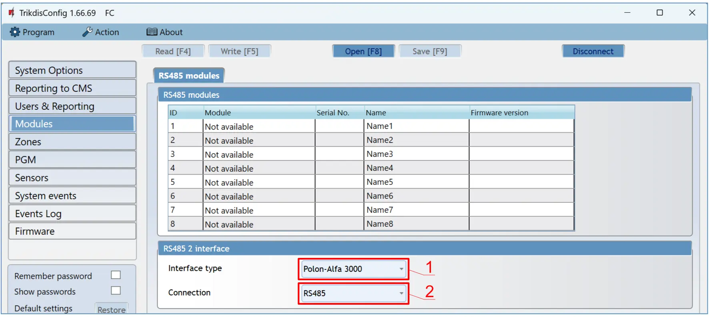

3.	Ange telefonnummer och e-postadresser för de användare som ska få meddelanden från ***FIRECOM***. 

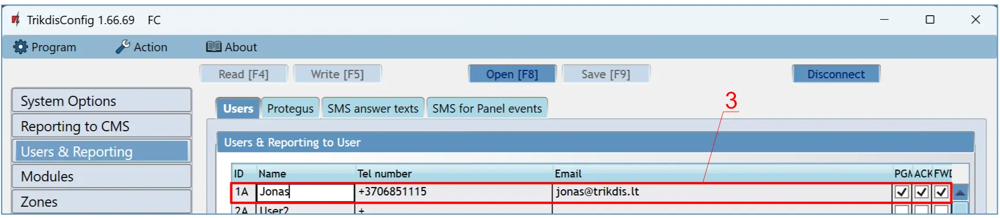

4.	Om användaren ska få meddelanden (eller samtal) om händelser, markera rutan **SMS** (eller **Call**). 

5.	Konfigurera kommunikationskanalen om meddelanden ska skickas till larmcentralens mottagare. 

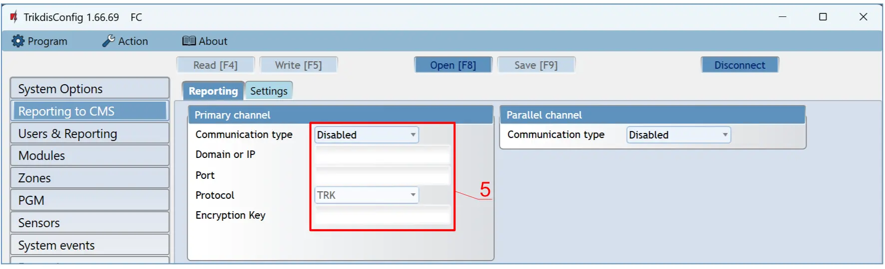

Brandlarmcentralen **POLON-ALFA 3000** med modulen **MK-30** måste konfigureras med programmet **POLON Studio** för att fungera via protokollet Modbus RTU (RS485). 

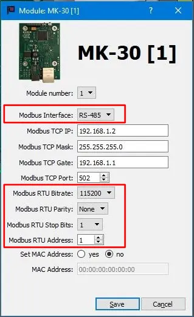 

Testa systemet. Utlös ett brandlarm och kontrollera att meddelanden från ***FIRECOM*** skickas till larmcentralen (CMS, Central Monitoring Station) och till ***Protegus2***. 

***FIRECOM*** **och brandlarmcentralen Polon-Alfa 3000 ansluts till samma LAN**

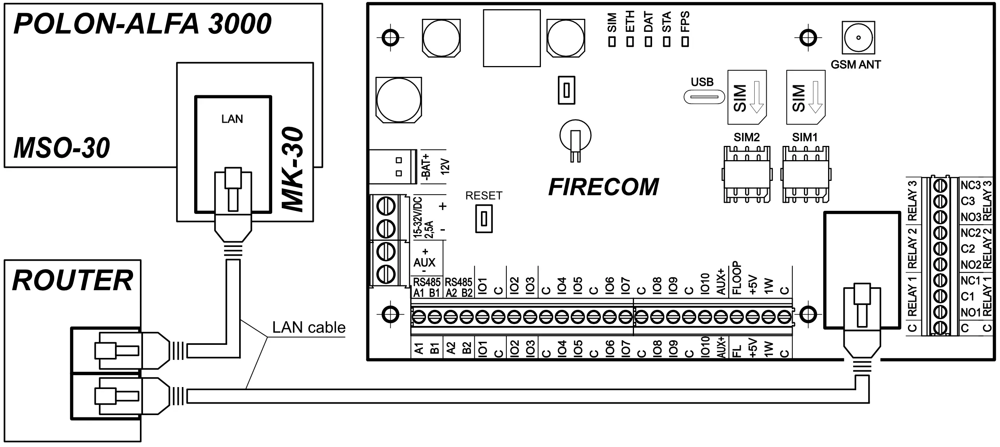

Konfigurera larmsändaren ***FIRECOM*** med TrikdisConfig. 

1.	Välj **Polon-Alfa 3000**.

2.	Välj anslutningstyp **TCP**.
	
3.	Ange IP-adressen till brandlarmcentralen **Polon-AlfA 3000**.

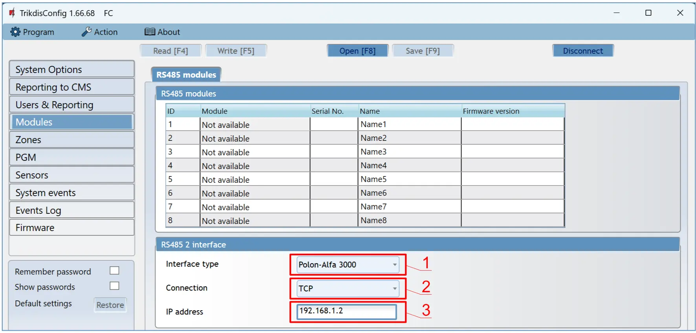

4.	Markera rutan ”**DHCP**” (automatiskt registreringsläge) så att larmsändaren ***FIRECOM*** automatiskt läser nätverksinställningarna (nätmask, gateway) och tilldelas en IP-adress. 

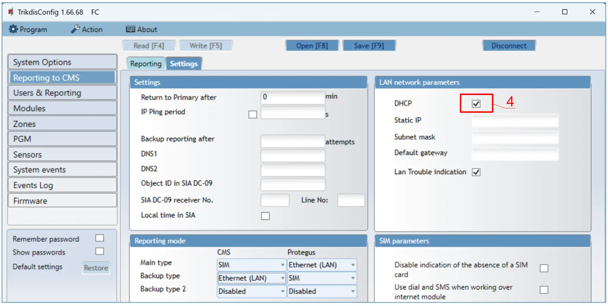

5.	Ange telefonnummer och e-postadresser för de användare som ska få meddelanden från ***FIRECOM***. 

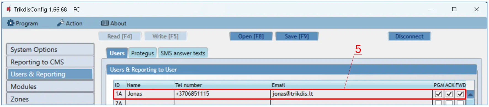

6.	Om användaren ska få meddelanden (eller samtal) om händelser, markera rutan **SMS** (eller **Call**). 

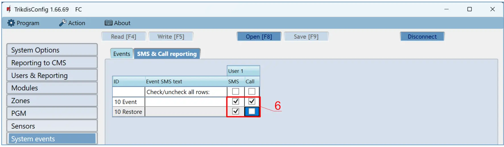

7.	Konfigurera kommunikationskanalen om meddelanden ska skickas till larmcentralens mottagare. 

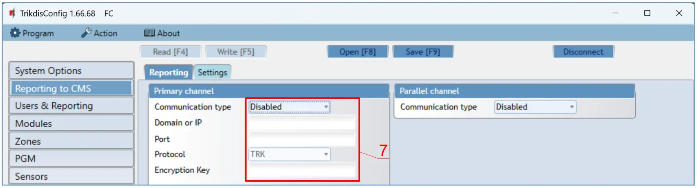

Brandlarmcentralen **Polon-Alfa 3000** med modulen **MK-30** måste konfigureras med programmet **Polon Studio** för att fungera via LAN. IP-adresserna för LAN måste anges enligt dina nätverksinställningar. 

Testa systemet. Utlös ett brandlarm och kontrollera att meddelanden från **_FIRECOM_** skickas till larmcentralen (CMS, Central Monitoring Station) och till **_Protegus2_**. 

### Kopplingsschema för anslutning av en temperaturgivare

 / 

Anslut temperaturgivarna enligt kopplingsschemat. Temperaturgivare av typ Maxim®/Dallas® DS18S20, DS18B20 (upp till 8) eller en givare för fukt och temperatur AM2301 (upp till 1) kan anslutas till larmsändaren ***FIRECOM***. 
Om en ledning längre än 0,5 meter används för att ansluta en temperaturgivare rekommenderar vi partvinnad kabel (UTP4x2x0,5 eller STP4x2x0,5). 
Plinten ”**+5V**” på kretskortet är avsedd för 5 V DC matning av enheter som är anslutna till databussen ”**1-Wire**”. Största utström är 0,2 A. Utgången är överlastskyddad. Om den största tillåtna strömmen överskrids stängs matningen av automatiskt. Larmsändaren känner automatiskt igen anslutna enheter och kopplar ihop dem. 

### Kopplingsscheman för anslutning av ett relä och en lysdiodsindikator

 / 

Med reläplintarna kan du styra (slå på/av) olika elektriska apparater på distans. Larmsändarens universella ”**I/O**”-plint måste vara inställd som utgång (OUT) och ha definitionen ”**Remote control**” tilldelad. 

### Kopplingsscheman för anslutning av brandlarmcentralens ingångar till larmsändaren

Enligt standarden EN54 måste brandlarmcentralen få information från larmsändaren om att kommunikationen med larmcentralen har fallerat och om att meddelanden har tagits emot av larmcentralen. Larmsändarens PGM-utgångar (till exempel ”**Relay1**” och ”**Relay2**”) måste anslutas till brandlarmcentralens särskilda ingångar. PGM-utgången ”**Relay1**” måste ställas in på ”**CMS fail**”. PGM-utgången ”**Relay2**” måste ställas in på ”**ACK received**”. Utgången ”**Relay1**” aktiveras när kommunikationskanalen till larmcentralen är bruten. Utgången ”**Relay2**” aktiveras i 5 sekunder när ett meddelande har skickats till larmcentralen.

### Kopplingsscheman för anslutning av utbyggnadsmoduler i serien iO

Om larmsändaren ***FIRECOM*** behöver fler ingångar (IN) eller utgångar (OUT), anslut en trådbunden eller trådlös utbyggnadsmodul för ingångar och utgångar i serien TRIKDIS ***iO***. Hur ***FIRECOM*** konfigureras för utbyggnadsmoduler beskrivs i avsnitt 6.5 (fönstret ”Modules”).

<figure style="margin: 0;">

</figure>

<figure style="margin: 0;">

</figure>

Kopplingsscheman för anslutning av **LORA**-moduler.

### Starta larmsändaren

Slå på larmsändaren genom att först slå på dess matning. Lysdiodsindikeringarna på larmsändaren ska fungera på följande sätt:

- Lysdioden ”**STA**” ska blinka grönt – det visar att matningsspänningen är tillräcklig;

- Lysdioden ”**SIM**” ska lysa fast grönt och periodvis blinka gult minst 3 gånger – grönt betyder att SIM-kortet är registrerat i mobilnätet och antalet gula blinkningar anger mobilsignalens styrka. Indikeringen ”**ETH**” lyser grönt när larmsändaren är ansluten till LAN-nätverket.

!!! note "Obs!"
    Tillräcklig 4G-signalstyrka är nivå 3 (tre gula blinkningar på lysdioden ”**SIM**”). / Om du ser färre gula blinkningar på lysdioden ”**SIM**” är mobilnätets signalstyrka otillräcklig. Vi rekommenderar att du väljer en annan plats för larmsändaren, flyttar antennen eller använder en känsligare mobilantenn. / Om du ser en annan lysdiodsindikering, se avsnitt 1.5 ”Lysdiodsindikering vid drift” för att ta reda på orsaken. / Om alla indikeringar på FIRECOM är släckta, kontrollera matningen och anslutningarna.

## Snabbkonfiguration med programvaran *TrikdisConfig*

1.  Ladda ned konfigurationsprogrammet ***TrikdisConfig*** från [www.trikdis.com](http://www.trikdis.com) (skriv ”TrikdisConfig” i sökfältet) och installera det*.*

2.  Anslut ***FIRECOM*** till datorn med en USB Type-C-kabel.

3.  Starta ***TrikdisConfig***. Programmet identifierar automatiskt den anslutna enheten och öppnar automatiskt konfigurationsfönstret för ***FIRECOM***.

4.  Klicka på knappen **Read [F4]** för att se de aktuella parametrarna för ***FIRECOM***. Om ett fönster öppnas som begär administratörs- eller installatörskoden, ange den 6-siffriga koden.

Nedan beskrivs vilka inställningar som behöver ändras för att larmsändaren ska skicka händelser till appen ***Protegus2*** eller till larmcentralen.

### Inställningar för anslutning till appen Protegus2

**I fönstret ”System options”, inställningsgruppen ”SIM”:**

1.  Ange koden ”**SIM card PIN**”.

2.  Ändra ”**APN**”. ”**APN**” hittar du på SIM-kortsoperatörens webbplats. ”**Internet**” är universellt och fungerar i de flesta operatörers nät.

**I fönstret ”Users & Reporting”, inställningsgruppen ”Cloud application”:**

3.  Markera rutan ”**Enable cloud service**”.

4.  Ändra ”**Cloud access Code**” för ***Protegus2*** om användarna ska uppmanas att ange den när de lägger till systemet i appen ***Protegus2*** (förvalt lösenord – 123456).

**I fönstret ”Reporting to CMS”, fliken ”Settings”:**

5.  Om en LAN-kabel är ansluten till larmsändaren, markera rutan ”**DHCP**” (automatiskt registreringsläge) så att larmsändaren ***FIRECOM*** automatiskt läser nätverksinställningarna (nätmask, gateway) och tilldelas en IP-adress.

6.  Ange parametrarna för hur larmsändaren ska skicka meddelanden till ***Protegus2***. Anslutningstyperna anges i ordning. Om anslutningen med den primära anslutningstypen misslyckas växlar larmsändaren till nästa, och så vidare. Om backupanslutningstypen lyckas skicka meddelandet till ***Protegus2*** görs ett nytt försök med anslutningstypen ”**Return to Primary**” efter ett inställt tidsintervall.

**I fönstret ”Zones”, fliken ”Zones settings”:**

7.  Markera rutorna om användarna ska få aviseringar i ***Protegus2*** om ändringar i sektionernas tillstånd.

**I fönstret ”PGM”, fliken ”Outputs”:**

8.  Markera rutorna om användarna ska få aviseringar i ***Protegus2*** om ändringar i PGM-utgångarnas tillstånd.

**I fönstret ”System events”, fliken ”Events”:**

9.  Markera rutorna om användarna ska få aviseringar i ***Protegus2*** om ändringar i tillstånden för larmsändarens interna händelser.

När konfigureringen är klar klickar du på knappen **Write [F5]** och kopplar bort USB-kabeln.

!!! note "Obs!"
    Mer information om övriga inställningar för ***FIRECOM*** i ***TrikdisConfig*** finns i avsnitt 6 ”Beskrivning av TrikdisConfig-fönstren”.

### Inställningar för anslutning till larmcentralen

**I fönstret ”System Options”, fliken ”System general”:**

1.  Ange numret i ”**Object ID**” (abonnentkod) som du har fått från larmcentralen (4 tecken, 0–9, A–F. **Använd inte FFFE, FFFF som Object ID**).

2.  Ange ”**SIM card PIN**”.

3.  Ändra ”**APN**”. ”**APN**” hittar du på SIM-kortsoperatörens webbplats. ”**Internet**” är universellt och fungerar i de flesta operatörers nät.

**I fönstret ”Reporting to CMS”, fliken ”Settings”:**

4.  Om en LAN-kabel är ansluten till larmsändaren, markera rutan ”**DHCP**” (automatiskt registreringsläge) så att larmsändaren ***FIRECOM*** automatiskt läser nätverksinställningarna (nätmask, gateway) och tilldelas en IP-adress.

5.  Ange parametrarna för hur larmsändaren ska skicka meddelanden till larmcentralen. Anslutningstyperna anges i ordning. Om anslutningen med den primära anslutningstypen misslyckas växlar larmsändaren till nästa, och så vidare. Om backupanslutningstypen lyckas skicka meddelandet till larmcentralen görs ett nytt försök med anslutningstypen ”Return to Primary” efter ett inställt tidsintervall.

**I fönstret ”Reporting to CMS”, fliken ”Reporting”:**

6.  **Communication type** – välj kommunikationstyp (TCP eller UDP).

7.  **Domain or IP** – ange mottagarens domän eller IP-adress.

8.  **Port** – ange mottagarens nätverksportnummer.

9.  **Protocol** – välj vilket överföringsprotokoll som ska användas för att skicka meddelanden: **TRK** (till TRIKDIS-mottagare), **DC-09_2007** eller **DC-09_2012** (till universella mottagare), **TL150** (till SUR-GARD-mottagare).

10.  **Encryption Key** – ange mottagarens krypteringsnyckel.

!!! note "Obs!"
    Om du har valt **DC-09** som överföringsprotokoll anger du dessutom objekt-, linje- och mottagarnummer i inställningsgruppen ”**Settings**” i fönstret ”**Reporting to CMS**”.

11. (Rekommenderas) Konfigurera inställningarna för ”**Backup channel**”. 

12. Konfigurera ”**Parallel channel**” om meddelanden ska skickas till larmcentralens andra mottagare.

När konfigureringen är klar klickar du på knappen **Write [F5]** och kopplar bort USB-kabeln.

!!! note "Obs!"
    Mer information om övriga inställningar för ***FIRECOM*** i ***TrikdisConfig*** finns i avsnitt 6 ”Beskrivning av TrikdisConfig-fönstren”.

## Fjärrstyrning

### Lägga till larmsändaren i appen Protegus2

Med ***Protegus2*** kan användarna se systemets status och få aviseringar om systemhändelser.

1.  Ladda ned och starta appen ***Protegus2*** eller använd webbversionen [www.protegus.app](https://www.protegus.app):

    

      

    

2.  Logga in med ditt användarnamn och lösenord, eller skapa ett nytt konto.

!!! warning "Viktigt"
    När du lägger till systemet i ***Protegus2***, kontrollera att larmsändaren ***FIRECOM***:

    1.  Har ett isatt och aktiverat SIM-kort där PIN-koden är angiven eller
        avstängd;
    
    2.  Har tjänsten ***Protegus2*** aktiverad. Se avsnitt 6.4 (fönstret
        ”Users & Reporting”);
    
    3.  Är påslagen (lysdioden ”**STA**” ska blinka grönt);
    
    4.  Är ansluten till ett nätverk (lysdioden ”**SIM**” ska lysa fast grönt
        och blinka gult; och/eller lysdioden ”**ETH**” lyser grönt när
        larmsändaren är ansluten till LAN-nätverket).

3.  Klicka på ”**Add new system**” och ange numret ”**Unique ID**” för ***FIRECOM***. Numret finns på enheten och på etiketten på förpackningen. När du har angett ”**Unique ID**” klickar du på knappen ”**Next**”.

### Konfigurering och styrning med SMS

**1.  Ändra administratörslösenordet**

Av säkerhetsskäl bör du ändra det förvalda SMS-lösenordet för administratören. Skicka ett SMS i följande format:

​	**PSW 123456 xxxxxx**

**123456**	Förvalt administratörslösenord

**xxxxxx**	Nytt administratörslösenord med 6 tecken

**2.  Ge andra användare behörighet att styra**

Bara telefonnummer som finns i användarlistan kan styra systemet med SMS eller telefonsamtal. Skicka från administratörens telefon SMS med andra personers telefonnummer och namn för att ge dem behörighet att styra systemet:

​	**SETN xxxxxx PHONEx=+PHONENR#NAME#EMAIL**

**xxxxxx**		Administratörslösenord med 6 tecken

**x**			Användarens nummer i listan. (Om du anger 1 som användarnummer överför du dina administratörsrättigheter till den andra användaren.)

**PHONENR**	Användarens telefonnummer

**NAME**		Användarens namn

**EMAIL**		Användarens e-postadress

**Lista över SMS-kommandon**

| Kommando | Data | Beskrivning |
|----|----|----|
| INFO |  | Begär information om larmsändaren. Svaret innehåller objektnamn, områdets status, IMEI-nummer, mobilsignalstyrka, firmwareversion och serienummer. T.ex.: **INFO 123456** |
| RESET |  | Starta om enheten. T.ex.: **RESET 123456** |
| OUTPUTx | ON | Slå på en utgång, ”x” är utgångens nummer. T.ex.: **OUTPUT1 123456 ON** |
|  | OFF | Slå av en utgång, ”x” är utgångens nummer. T.ex.: **OUTPUT1 123456 OFF** |
|  | PULSE=ttt | Slå på en utgång under några sekunder – ”x” är numret på utgången OUT och ”ttt” är ett tresiffrigt tal som anger pulstiden i sekunder.  T.ex.: **OUTPUT1 123456 PULSE=002** |
| PSW | Nytt lösenord | Ändra lösenord. T.ex.: **PSW 123456 654123** |
| TIME | YYYY/MM/DD,12:00:00 | Ställ in datum och tid. T.ex.: **TIME 123456 2026/05/09,10:02:00** |
| TXTA | Objektnamn | Ange ett objektnamn. T.ex.: **TXTA 123456 House** |
| RDR | PhoneNR#SMStext | Vidarebefordra SMS till det angivna numret. Telefonnumret måste börja med ett ”+” och landskoden. T.ex.: **RDR 123456 +37061234567#forwarded text** |
| ASKI |  | Begär ett SMS med status för ingångarna IN. T.ex.: **ASKI 123456** |
| ASKO |  | Begär ett SMS med status för utgångarna OUT. T.ex.: **ASKO 123456** |
| ASKT |  | Skicka ett SMS med värdena från alla temperaturgivare.  T.ex.: **ASKT 123456** |
| FRS |  | Återställer branddetektorns utgång, om utgången OUT har funktionen ”Fire sensor reset” tilldelad. T.ex.: **FRS 123456** |
| SETN | PhoneX=PhoneNR#Name#email | Lägg till ett telefonnummer, ett användarnamn och en e-postadress och tilldela dem användare ”x”. ”x” är telefonnumrets rad i listan. Telefonnumret måste börja med ett ”+” och landskoden. Telefonnumret och användarnamnet måste skiljas åt med tecknet ”#”.  T.ex.: **SETN 123456 PHONE5=+37061234567#JOHN#jonas@trikdis.lt** |
|  | PhoneX=DEL | Ta bort användarens telefonnummer och namn från systemet.  T.ex.: **SETN 123456 PHONE5=DEL** |
| UUSD | \*Uusd code# | Skicka en UUSD-kod till operatören. T.ex.: **UUSD 123456 \*245#** |
| CONNECT | Protegus=ON | Anslut till molntjänsten Protegus. T.ex.: **CONNECT 123456 PROTEGUS=ON** |
|  | Protegus=OFF | Koppla från molntjänsten Protegus.  T.ex.: **CONNECT 123456 PROTEGUS=OFF** |
|  | Code=123456 | Kod för molntjänsten Protegus. T.ex.: **CONNECT 123456 CODE=123456** |
|  | IP=0.0.0.0:8000 | Ange TCP IP-adress och port för huvudserverns anslutningskanal.  T.ex.: **CONNECT 123456 IP=0.0.0.0:8000** |
|  | IP=0 | För att stänga av huvudkanalen. T.ex.: **CONNECT 123456 IP=0** |
|  | ENC=123456 | TRK-krypteringsnyckel. T.ex.: **CONNECT 123456 ENC=123456** |
|  | APN=Internet | APN-namn. T.ex.: **CONNECT 123456 APN=INTERNET** |
|  | USER=user | APN-användare. T.ex.: **CONNECT 123456 USER=User** |
|  | PSW=password | APN-lösenord. T.ex.: **CONNECT 123456 PSW=Password** |

### Styra PGM-utgångar med telefonsamtal

Gör så här om du vill styra en PGM-utgång på distans:

- Användaren måste ha behörighet att styra utgångar (OUT) och utgången (OUT) måste ha typen ”Remote control” tilldelad (med ***TrikdisConfig***).

- Ring upp numret till SIM-kortet i ***FIRECOM***. ***FIRECOM*** svarar på samtalet och du kan slå in kommandon med telefonens knappsats (se tabellen).

**Kommandolista för mobiltelefonens knappsats**

| Knappar | Funktion | Beskrivning |
|----|----|----|
| [utgångsnr]*[tillståndsnr]# | Styr vald utgång OUT | Styr den angivna PGM-utgången. Tillstånd:                    |
|  |  | [**0**] – utgången är avstängd;                                 |
|  |  | [**1**] – utgången är påslagen;                                  |
|                         |  | [**2**] – avstängd under pulstiden; |
|  |  | [**3**] – påslagen under pulstiden; (pulstiden anges i programvaran ***TrikdisConfig***, tabellen ”PGM”); |
|  |  | [*****] – denna symbol visar slutet på kommandot.                                 |
|  |  | T.ex. (slå på utgång 1): **1*1#** |
|  |  | T.ex. (slå av utgång 1): **1*0#** |
|  |  | T.ex. (slå på utgång 2 under ”Pulse time” enligt tabellen ”PGM” i ***TrikdisConfig***): **2\*3#** |
| # | Ange kommandot på nytt | Om du har gjort ett misstag när du angav kommandot trycker du på ”#” på telefonens knappsats och anger kommandot igen. |

## Beskrivning av *TrikdisConfig*-fönstren

### Beskrivning av statusfältet i TrikdisConfig

När ***FIRECOM*** har anslutits visar ***TrikdisConfig*** information om den anslutna enheten i statusfältet.

| Namn           | Beskrivning                                         |
| -------------- | --------------------------------------------------- |
| IMEI/​Unique ID | Enhetens IMEI-nummer                                |
| Status         | Driftstillstånd                                     |
| Device         | Enhetstyp (ska visa **FC_xxxx**)                    |
| SN             | Enhetens serienummer                                |
| BL             | Bootloader-version                                  |
| FW             | Enhetens firmwareversion                            |
| HW             | Enhetens maskinvaruversion                          |
| State          | Typ av anslutning till programmet (USB eller på distans) |
| Role           | Behörighetsnivå (visas när åtkomstkoden har godkänts) |

När du klickar på knappen **Read [F4]** läser programmet in och visar de inställningar som är sparade i ***FIRECOM***. Ange de parametrar som behövs i ***TrikdisConfig*** enligt beskrivningarna av programfönstren nedan.

### Fönstret ”System Options”

**Fliken ”System general”** **Inställningsgruppen ”General”**

- **Object ID** – om händelserna ska skickas till larmcentralen, ange det Object ID (hexadecimalt tal med 4 tecken, 0–9, A–F. **Använd inte FFFE, FFFF som Object ID**) som du har fått från larmcentralen.

- **Object name** – namnet på det objekt som används i SMS som skickas till användaren.

- **Test period** - när rutan är markerad skickas ”**Test**”-meddelanden med det inställda intervallet.

- **Start test at** - markera rutan och ange vid vilken tid testrapporterna ska skickas.

- **Clear Events after reset** – alla osända händelsemeddelanden raderas vid omstart.

- **Text language** – välj önskat språk så används språkets specialtecken i SMS.

- Du kan avbryta händelserapporteringen (**Suspend event reporting when …**) när ett visst antal likadana händelser per … s (**same events per … s**) inträffar.

- **Restore event reporting after …** – ange efter hur lång tid som avbrottet i händelserapporteringen ska upphävas. Tiden kan vara mellan 0 och 999 minuter.

- **Call –** när en händelse inträffar ringer ***FIRECOM*** upp användaren eller användarna så många gånger som är inställt. Om samtalet avvisas eller besvaras slutar ***FIRECOM*** att ringa. Ett samtal varar i 20 sekunder.

- **EOL Type** - ange värdena på de motstånd som är anslutna till detektorerna (EOL – End Of Line, slutmotstånd. **RT + R1 + R2**. Motståndet **RT** - sabotage; motståndet **R1** - detektor nr 1; motståndet **R2** - detektor nr 2).

- **Communication path test** - ange det tidsintervall efter vilket larmsändaren kontrollerar backupkommunikationskanalerna genom att skicka meddelanden till larmcentralen. När meddelandena har skickats via backupkanalerna återgår larmsändaren till primärkanalen.

**Inställningsgruppen ”SIM”**

- Ange koden ”**SIM card PIN**”. 

- **APN** – namnet på mobiloperatörens åtkomstpunkt för mobilt internet. Du måste ange **APN** om händelsemeddelanden ska skickas till appen ***Protegus2*** eller till larmcentralen via GPRS.

- Om GPRS-operatören kräver det, ange användarnamn och lösenord för **APN** i fälten **Login** och **Password**.

- **Locked ICCID** - ange SIM-kortets ICCID-nummer om du vill att larmsändaren bara ska fungera med just det SIM-kortet.

- **Preferred operator** - när du har angett mobiloperatörens kod ansluter larmsändaren bara till den valda operatörens nät. Mobiloperatörens kod består av MCC- och MNS-koder.

**Inställningsgruppen ”Time settings”**

Du kan ställa in tiden genom att klicka på knappen ”**Set PC time**”. Om ”**Disabled**” är valt i fältet ”**Time set**” ställs datorns tid in i larmsändaren. Om ett modem eller en server är valt i fältet ”**Time set**” synkroniserar larmsändaren sin tid mot det modemet eller den servern.

- **Time zone (hours)** – ange ditt lands tidszon. Om larmsändaren till exempel ska installeras i Litauen, ange **+2**.

- **Time set** – ange en server som ***FIRECOM***:s interna klocka ska synkroniseras mot. Synkroniseringen sker när larmsändaren har slagits på.

- **Daylight saving time** – om du markerar rutan växlar larmsändarens interna klocka automatiskt till sommar- eller vintertid.

- **Power failure delay** - vid strömavbrott i huvudmatningen skickas en avisering om strömavbrottet efter den angivna fördröjningen. När matningsspänningen är åter skickas en avisering om att spänningen är återställd efter den angivna fördröjningen.

**Fliken ”Groups”**

Sektioner kan tilldelas grupper. Namnet på varje grupp kan ändras. **Group**-namnen visas i ***Protegus2***.

**Fliken ”Access”**

**Inställningsgruppen ”Access codes”**

- **Administrator Code** – ger full åtkomst till konfigureringsfunktionerna (förvald kod – 123456).

- **SMS password** – lösenord för fjärrstyrning och programmering med SMS (förvald kod – 123456).

- **Installer Code** – ger begränsad åtkomst för att ändra larmsändarens konfiguration (förvald kod – 654321).

!!! note "Obs!"
    Om den förvalda administratörskoden (123456) är inställd visar programmet de aktuella driftparametrarna för enheten direkt när du har klickat på **Read [F4]**, utan att fråga efter koden. 

**Inställningsgruppen ”Installer permissions”**

Administratören kan ange vilka parametrar som installatören får ändra.

### Fönstret ”Reporting to CMS”

**Fliken ”Reporting”**

Larmsändaren skickar meddelanden till larmcentralen via internet (IP).

Du kan tilldela primärkanalen en backupkanal. Den används när anslutningen via primärkanalen bryts.

Meddelanden som skickas till larmcentralen är kodade och lösenordsskyddade. En TRIKDIS-mottagare krävs för att ta emot meddelandena och skicka dem vidare till larmcentralens programvara:

- För IP-meddelanden – programvarumottagaren IPcom för Windows/Linux, maskinvarumottagaren IP/SMS RL14 eller flerkanalsmottagaren RM14.

**Inställningsgruppen ”Primary channel” (”Parallel channel”)**

- **Communication type** – välj metod för anslutning till larmcentralens mottagare.

- **Domain or IP** – ange mottagarens domän eller IP-adress.

- **Port** – ange mottagarens nätverksportnummer.

- **Protocol** – välj med vilken kodning händelserna ska skickas: **TRK** (till TRIKDIS-mottagare), **DC-09_2007** eller **DC-09_2012** (till universella mottagare. Genom att välja protokollet SIA DC kan du välja meddelandeformatet SIA-DCS.), **TL150** (till SUR-GARD-mottagare).

- **Encryption Key** – krypteringsnyckel för meddelanden, 6 siffror. Larmsändarens krypteringsnyckel måste stämma överens med mottagarens.

Om parametrar är inställda för den parallella kanalen skickas rapporter via båda kanalerna samtidigt. Båda kanalerna kan inte konfigureras för samma mottagare.

**Inställningsgruppen ”Backup channel” (”Parallel backup channel”)**

Aktivera backupkanalläget så att meddelanden kan skickas via backupkanalen om anslutningen störs. Konfigurera backupkanalen med samma inställningar som beskrivits ovan.

**Fliken ”Settings”**

**Inställningsgruppen ”Settings”**

- **Return to Primary after** – tid efter vilken ***FIRECOM*** försöker återfå anslutningen via ”**Primary channel**”.
- **IP PING period** – period för sändning av interna PING-signaler för att kontrollera anslutningen. Dessa meddelanden skickas bara via IP-kanal. Mottagaren vidarebefordrar inte dessa signaler till larmcentralens programvara och överbelastar därför inte programvaran. Programvaran får bara en avisering när mottagaren inte får något PING-meddelande från enheten under en förinställd tid.

Som förval skickar mottagaren meddelandet ”**Connection lost**” till larmcentralens programvara efter en tid som är tre gånger längre än larmsändarens PING-period. Om IP PING-perioden till exempel är 3 minuter skickar mottagaren ett meddelande om förlorad anslutning om den inte får någon PING på 9 minuter.

PING-meddelanden upprätthåller också en aktiv session mellan enheten och mottagaren. En aktiv session krävs för att konfigurera och styra larmsändaren på distans. Vi rekommenderar att PING-perioden ställs in på högst 5 minuter.

- **Backup reporting after** – ange antalet misslyckade försök att skicka ett meddelande via ”**Primary channel**”. Om meddelandet inte kan skickas efter det angivna antalet försök sänder enheten via ”**Backup channel**”.

- **DNS1, DNS2** – (Domain Name System) server som anger domänens IP-adress. Den används när en domän anges i fältet ”**Domain or IP**” för kommunikationskanalen (i stället för en IP-adress). Förval – adresserna till Googles DNS-servrar.

Följande inställningar visas bara när protokollet **DC-09_2007** eller **DC-09_2012** är valt i fältet **Protocol** för kommunikationskanalen.

- **Object ID in SIA DC-09** – <u>ange objektnumret. Om du har valt protokollet DC-09 används det objektnummer som anges i detta fält</u>. Du kan ange ett hexadecimalt tal med 3–16 tecken som du har fått från larmcentralen.

- **SIA DC-09 receiver No.** – ange mottagarens nummer.

- **SIA DC-09 line No.** – ange linjenumret i mottagaren.

- **Local time in SIA -** markera rutan så att meddelandena till larmcentralen anger den tid som är inställd i modulen.

**Inställningsgruppen ”Reporting mode”**

Här ställs det in hur larmsändaren ska kommunicera via kanalerna till larmcentralen och med ***Protegus2***. Anslutningstyperna anges i ordning. Om larmsändaren inte kan ansluta med anslutningstypen ”**Main type**” växlar den till ”**Backup type**”, och så vidare. Om backupanslutningstypen lyckas skicka meddelandet till larmcentralen görs ett nytt försök med anslutningstypen ”**Return to main**” efter det angivna tidsintervallet.

- **Main type** – välj anslutningstyp (SIM, Ethernet (LAN)) mot larmcentralens mottagare och ***Protegus2***.

- **Backup type** – välj anslutningstyp (SIM, Ethernet (LAN)) mot larmcentralens mottagare och ***Protegus2***.

- **Backup type 2** – välj anslutningstyp (SIM, Ethernet (LAN)) mot larmcentralens mottagare och ***Protegus2***.

- **Dual path for CMS** - dual path-läget gör att larmcentral 1 (CMS1) arbetar över LAN och larmcentral 2 (CMS2) över SIM. De två kanalerna och kommunikationsvägarna arbetar parallellt. 

- **Return to main (both channel)** – tid efter vilken ***FIRECOM*** försöker återfå anslutningen via *primärkanalen*, om en backupkanal användes, min.

**Inställningsgruppen ”LAN network parameters”**

- **DHCP mode** – läge för registrering i LAN-nätverket (manuellt eller automatiskt). Markera rutan så läser larmsändaren ***FIRECOM*** automatiskt nätverksinställningarna (nätmask, gateway) och tilldelas automatiskt en IP-adress (automatiskt registreringsläge).

- **Static IP** – statisk IP-adress för manuellt registreringsläge.

- **Subnet mask** – nätmask för manuellt registreringsläge.

- **Default gateway** – gateway för manuellt registreringsläge.

- **LAN Trouble indication** – markera rutan så att lysdioden på larmsändaren tänds när LAN-förbindelsen bryts.

**Inställningsgruppen ”SIM parameters”**

- **Disable indication of the absence of a SIM card** – när rutan är markerad visar larmsändaren ***FIRECOM*** ingen indikering för att SIM-kort saknas.

- **Use dial and SMS when working over internet module** – om du markerar rutan kan larmsändaren styras med telefonsamtal och SMS. Om rutan inte är markerad och ett LAN-nätverk finns tillgängligt används varken SMS eller telefonsamtal. Om rutan inte är markerad och inget LAN-nätverk finns kan ***FIRECOM*** ändå styras med telefonsamtal och SMS. ***FIRECOM*** skickar SMS till användaren.

- **Disable the use of SIM card mobile data** – om du markerar rutan avaktiveras användningen av SIM-kortets mobildata. Data skickas då bara via LAN. Om LAN-nätverket tillfälligt inte är tillgängligt lagrar ***FIRECOM*** data i minnet. När LAN-nätverket är åter skickar ***FIRECOM*** data via LAN.

### Fönstret ”Users & Reporting”

**Fliken ”Users”**

**Inställningsgruppen ”Users & Reporting to User”**

- **ID** – användarens nummer i listan.

- **Name** – användarens namn. Namnen används i SMS om händelser och i appen.

- **Tel number** – användarens telefonnummer som tar emot SMS. Numren måste börja med landskod. De första 8 telefonnumren får rapporter via meddelanden och telefonsamtal.

- **E-mail** - ange användarens e-postadress så att användaren bjuds in till ***Protegus2*** för att styra systemet.

- **PGM** – om rutan är markerad kan användaren styra utgångar på distans (samtal, SMS).

- **ACK** – om rutan är markerad skickar ***FIRECOM*** ett SMS med ”**SMS answer text**” till användaren efter varje mottaget SMS-kommando.

- **FWD** – om rutan är markerad vidarebefordras SMS från avsändare som inte är användare i systemet till användaren (t.ex. saldo på SIM-kortet, slumpmässiga reklammeddelanden osv.).

**Fliken ”Protegus”**

**Inställningsgruppen ”Cloud application”**

- **Enable cloud service** – aktivera tjänsten ***Protegus*** 2 så att ***FIRECOM*** kan utbyta data med appen ***Protegus2*** och konfigureras på distans med ***TrikdisConfig***.

- **Parallel reporting** – aktivera parallell sändning av meddelanden via ”**Primary channel**” och till ***Protegus2***.

- **Cloud access code** – 6-siffrig kod för inloggning i ***Protegus2*** (förval – 123456).

**Fliken ”SMS answer texts”**

**Inställningsgruppen ”SMS answer texts”**

Texten för svar på kommandon som skickas med SMS kan anpassas i kolumnen ”**SMS text**”. Här finns också texterna för de SMS som används när ingångar eller utgångar aktiveras.

### Fönstret ”Modules”

**Fliken ”RS485 modules”**

**Inställningsgruppen ”RS485 modules”**

- **ID** – modulens nummer i listan.

- **Module** – välj den modul som används (modulerna ***iO-8***, ***iO-MO***, ***iO-LORA***, ***iO8-LORA***, ***PB-LORA***, ***REL-LORA***) i modullistan.

- **Serial No**. – obligatoriskt 6-siffrigt nummer som finns på modulens kapsling och förpackning.

- **Name** – du kan ge modulen ett namn.

- **Firmware version** – firmwareversionen visas när ***FIRECOM*** hittar den anslutna modulen.

**Inställningsgruppen ”RS485 2 modules”**

Brandlarmcentraler (med protokollet **ESPA4.4.4**, **NSC solution**, **INIM smartline**, **C-TEC Cast ZFP**, **Polon-Alfa 3000**) kan anslutas till RS485 2-bussen på larmsändaren ***FIRECOM***. Kopplingsschemat för brandlarmcentralen och inställningarna visas i avsnitt 3.5–3.9.

### Fönstret ”Zones”

**Fliken ”Zones settings”**

- **Zone No** – sektionens nummer i listan.

- **Name** - sektionen kan ges ett namn som används i SMS och i appen.

- **Input** – välj vilken ingång IN på ***FIRECOM*** eller på en utbyggnadsmodul som ska tilldelas sektionen.

- **Group** - tilldela sektionen en grupp.

- **Type** – välj i en lista typen av krets som är ansluten till sektionsingången IN: **NC** – normalt sluten; **NO** – normalt öppen; **EOL** – med slutmotstånd; **EOL_T** – med slutmotstånd och sabotageövervakning; **ATZ** – krets med två sektioner, normalt sluten, med slutmotstånd, utan sabotageövervakning (för att använda denna typ, välj den andra ATZ-sektionen i ingångslistan); **ATZ_T** – krets med två sektioner, normalt sluten, med slutmotstånd, med sabotageövervakning (för att använda denna typ, välj den andra ATZ-sektionen i ingångslistan).

- **CMS** – om rutan är markerad skickas meddelanden om sektionshändelser till larmcentralen (CMS, Central Monitoring Station).

- **Prot**. – om rutan är markerad skickas aviseringar om sektionshändelser till appen ***Protegus2***.

- **Delay** – reaktionstid för sektionsingången IN i millisekunder.

**Fliken ”SMS & Call reporting”**

**Detta fönster visas bara om minst ett telefonnummer för en användare har lagts till i fönstret ”Users & Reporting”.**

- **Zn** – sektionsnummer med ett ord som identifierar händelsen. Kan vara ”**Event**” eller ”**Restore**”.

- **User SMS/Call** – välj hur användarna ska informeras om varje sektionshändelse – via SMS och/eller samtal.

**Fliken ”Zone’s codes”**

När sektionen påverkas skickar larmsändaren ett händelsemeddelande. Ingången tilldelas en Contact ID-kod (SIA-kod) som skickas till larmcentralen och ***Protegus2***.

- **Enable** – markerade händelsefält för vilka meddelanden skickas till larmcentralen och ***Protegus2***.

- **E/R** – välj vilken typ av händelse som ska skickas när ingången löser ut – ”**Event**” (E) eller ”**Restore**” (R).

- **CID** – ange händelsekoden eller lämna förvalt värde.

- **SIA** - SIA-händelsekoder.

- **Group** – ange det gruppnummer som skickas när en händelse inträffar.

- **Zone** - ange det sektionsnummer som skickas när en händelse inträffar.

### Fönstret ”PGM”

**Fliken ”Outputs”**

- **PGM No** – PGM-utgångens nummer i listan.

- **Name** - ange namnet på PGM-utgången.

- **PGM output** – tilldela PGM en utgång OUT på ***FIRECOM*** eller på en extern enhet.

- **Output definition** – välj driftläge för en utgång OUT.

- **Pulse time, s** – ange hur länge OUT ska vara påslagen, från 0 till 9999 sekunder.

- **CMS** – om rutan är markerad skickas meddelanden om valda händelser till larmcentralen.

- **Prot**. – om rutan är markerad skickas aviseringar om utgångshändelser till appen ***Protegus2***.

**Fliken ”Set Action”**

- **ID** – utgångens nummer i listan.

- **Enable** – aktiverar algoritmen för PGM-funktionen.

- **PGM No.** – välj den PGM-utgång OUT som ska styras efter att den händelse som beskrivs i kolumnerna ”**Factor**”, ”**Factor No.**”, ”**Start when**” och ”**Set value**” inträffar.

- **Action**:

- **PGM OFF** – utgång OUT har läget ”**Off**”.

- **PGM ON** – utgång OUT har läget ”**On**”.

- **Pulse OFF** – utgång OUT har utgångsläget ”**On**”. Efter kommandot blir OUT-läget ”**Off**” under ”**Pulse time**” och återgår därefter automatiskt till utgångsläget ”**On**”.

- **Pulse ON** – utgång OUT har utgångsläget ”**Off**”. Efter kommandot blir OUT-läget ”**On**” under ”**Pulse time**” och återgår därefter automatiskt till utgångsläget ”**Off**”.

- **Pulse time, s** – du kan ställa in pulstiden mellan 0 och 9999 sekunder.

- **Factor/Factor No.** – välj vilken händelse (Zone, SMS received, Zone tamper) som ska slå på utgången OUT.

- **Start when** – du kan ange ett extra villkor för när utgången OUT ska slås på, beroende på händelsen i ”**Factor**”.

- **Set value** – beroende på villkoret som valts i kolumnen ”**Factor**” kan ett värde (texten i ett mottaget SMS) anges. Om detta värde identifieras utförs åtgärden (som valts i kolumnen ”**Action**”). SMS-texten kan avgränsas med tecknet **%**. Tecknen **%** används för att skilja ut det nyckelord som ändrar en PGM-utgångs läge från hela det mottagna SMS:et.

**%…..%** - en del av texten i det mottagna SMS:et måste stämma överens med texten som anges mellan %-tecknen (t.ex. **%hoUSe%**. Texten i ett SMS måste innehålla ”**hoUSe**”. Exempel på SMS: **VacationhoUSe25864**).

**…..%** - början av det mottagna SMS:et måste stämma överens med texten som anges före %-tecknet (t.ex. **hoUSe%**. SMS:et måste börja med texten **”hoUSe”**. Exempel på SMS: **hoUSeddss**).

**%…..** – slutet av det mottagna SMS:et måste stämma överens med texten som anges efter %-tecknet. (t.ex. **%hoUSe**. SMS:et måste sluta med texten **”hoUSe”**. Exempel på SMS: **1144hoUSe**).

SMS-texten är skiftlägeskänslig.

**Fliken ”Scheduler”**

- **ID** – schemats nummer i listan.

- **Enable** – aktivera schemat.

- **Start time** – ange tiden då OUT ska slås på (schemats starttid).

- **Stop time** – ange tiden då OUT ska slås av (schemats sluttid).

- **Mon – Sun** – du kan markera de veckodagar då OUT ska slås på/av.

**Fliken ”SMS & Call reporting”**

**Den här fliken visas bara om det finns minst ett telefonnummer för en användare i fönstret ”Users & Reporting”**. Dessa inställningar kan bara göras för de 8 första användarna.

- **PGM** – numret på utgången OUT och typen av händelse när den slås på/av (”**Event**” – händelsen när OUT slås på och ”**Restore**” – händelsen när OUT slås av).

- **User SMS/Call** – välj vilka användare som ska informeras via SMS och/eller samtal när en utgång OUT slås på/av.

### Fönstren ”Sensors”

- **ID** – temperaturgivarens nummer i listan.

- **Module type** – välj den temperaturgivare som ska tilldelas ID.

- **Serial No.** - serienumret på temperaturgivaren som larmsändaren har läst av.

- **Sensor name** – ge temperaturgivaren ett namn.

- **Max** – när temperaturen är högre än denna inställning skapas en händelserapport. För att ett händelsemeddelande ska skapas måste rutan ”**High**” vara markerad.

- **Min** – när temperaturen är lägre än denna inställning skapas en händelserapport. För att ett händelsemeddelande ska skapas måste rutan ”**Low**” vara markerad.

- **Delay** - en händelse skickas om det värde som givaren mäter (**Max** eller **Min**) överskrids inom den angivna tiden. Fördröjningen anges i minuter.

- **Sensor type** – välj typ av ansluten temperaturgivare (Dallas 1Wire – upp till 8 temperaturgivare av denna typ kan anslutas. Om Dallas-givare väljs kopplas de ihop automatiskt; Humidity & Temperature – en temperatur- och fuktgivare AM2301 kan anslutas. Om givaren Humidity & Temperature används måste den tilldelas manuellt i kolumnen ”**Module type**”).

### Fönstret ”System events”

**Fliken ”Events”**

- **ID** – händelsens nummer i listan.

- **Event name** – händelsens namn.

- **Enable** – aktivera igenkänning av händelsen.

- **CMS** – meddelanden om valda händelser skickas till larmcentralen.

- **Prot**. – aviseringar om valda händelser skickas till appen ***Protegus*** 2.

- **CID Code** – händelsens Contact ID-kod.

- **SMS event text** – texten i händelsens SMS.

- **SMS restore text** - texten i SMS för händelsens återställning.

**Fliken ”SMS & Call reporting”**

**Den här fliken visas bara om det finns minst ett telefonnummer för en användare i fönstret ”Users & Reporting”**

- **ID** – händelsens nummer och identifierande ord (**Event**, **Restore**).

- **Event SMS text** – text som används i SMS om händelser.

- **User SMS/Call** – välj hur användarna ska informeras om varje händelse – SMS och/eller telefonsamtal.

### Fönstret ”Events Log”

- Knappen **Read Log** – för att läsa händelseloggen från enhetens minne.

- Knappen **Clear Log** – för att radera händelseloggens poster från enhetens minne.

- I tabellen finns ”**Event No.**”, ”**Time**”, koden ”**CID**” och ”**Event definition**”. Händelseloggen kan visa upp till 1 000 händelser som är lagrade i ***FIRECOM***:s minne.

### Återställa fabriksinställningarna

För att återställa larmsändarens fabriksinställningar klickar du på knappen ”**Restore**” i ***TrikdisConfig***.

## Fjärrkonfigurering

!!! warning "Viktigt"
    Fjärrkonfigurering fungerar bara om ***FIRECOM***:

    1.  Har ett isatt och aktiverat SIM-kort där PIN-koden är angiven eller
        avstängd.
    
    2.  Har tjänsten Protegus aktiverad. Se avsnitt **6.4 (fönstret
        ”Users & Reporting”)**.
    
    3.  Är påslagen (lysdioden ”**STA**” ska blinka grönt);
    
    4.  Är ansluten till ett nätverk (lysdioden ”**SIM**” ska lysa fast grönt
        och blinka gult; och/eller lysdioden ”**ETH**” lyser grönt när
        larmsändaren är ansluten till LAN-nätverket).
    
    Om ”**SIM**” lyser fast gult eller ”**DAT**” lyser fast gult kan
    enheten inte ansluta till GSM och/eller ***Protegus2***.

1.  Starta konfigurationsprogrammet ***TrikdisConfig*** på datorn.

2.  I fönstret ”**Remote access**” anger du larmsändarens nummer ”**Unique ID**”. Numret finns på baksidan av enheten och på enhetens förpackning.

3.  (Valfritt) Ange önskat namn på larmsändaren i fältet ”**System Name**”.

4.  Klicka på ”**Configure**”.

5.  I fönstret som öppnas klickar du på **Read [F4]**. Ange administratörs- eller installatörskoden om du uppmanas.

6.  När du har angett önskade parametrar klickar du på **Write [F5]**. Om du är klar med ***TrikdisConfig*** klickar du på ”**Disconnect**”.

## Testa larmsändarens funktion

När konfigureringen och installationen är klara, gör en systemkontroll:

1.  För att testa en ingång på larmsändaren, aktivera den. Kontrollera att händelserna har tagits emot av larmcentralen (CMS) och/eller i appen ***Protegus2***.

2.  För att testa larmsändarens utgångar, slå på dem på distans och kontrollera att de fungerar. Kontrollera att händelserna har tagits emot av larmcentralen (CMS) och/eller i appen ***Protegus2***.

3.  Utlös ett brandlarm som test och kontrollera att larmcentralen tar emot händelserna korrekt.

## Firmwareuppdatering

!!! note "Obs!"
    När larmsändaren har anslutits till ***TrikdisConfig*** erbjuder programmet automatiskt att uppdatera firmware om det finns uppdateringar. Internetanslutning krävs för den här funktionen. Antivirusprogram, brandvägg eller strikta inställningar för internetåtkomst kan blockera den automatiska uppdateringen. I så fall måste du konfigurera om antivirusprogrammet. Larmsändarens firmware kan också uppdateras eller bytas manuellt. Alla tidigare inställningar i larmsändaren finns kvar efter en uppdatering. Om firmware installeras manuellt kan den bytas till en nyare eller äldre version. Gör så här:

1.  Starta ***TrikdisConfig**.*

2.  Anslut larmsändaren till datorn med en USB Type-C-kabel eller anslut till larmsändaren på distans.

3.  Om en nyare firmwareversion finns erbjuder programmet automatiskt att installera den.

4.  Öppna fönstret ”**Firmware**” i ***TrikdisConfig***.

5.  Klicka på knappen ”**Open firmware**” och välj den firmwarefil som behövs.

6.  Klicka på knappen **Update [F12]**.

7.  Vänta tills uppdateringen är klar.

## Säkerhetskrav

Larmsändaren ska installeras och underhållas av behörig personal.

Läs den här manualen noggrant före installationen för att undvika misstag som kan leda till funktionsfel eller till och med skador på utrustningen.

Koppla bort matningen innan du gör några elektriska anslutningar.

Ändringar, modifieringar eller reparationer som inte har godkänts av tillverkaren upphäver garantin.

Följ de lokala reglerna för avfallssortering och släng inte denna utrustning eller dess komponenter bland vanligt hushållsavfall.
