# LTE-larmsändaren G17F för brandlarmcentraler

  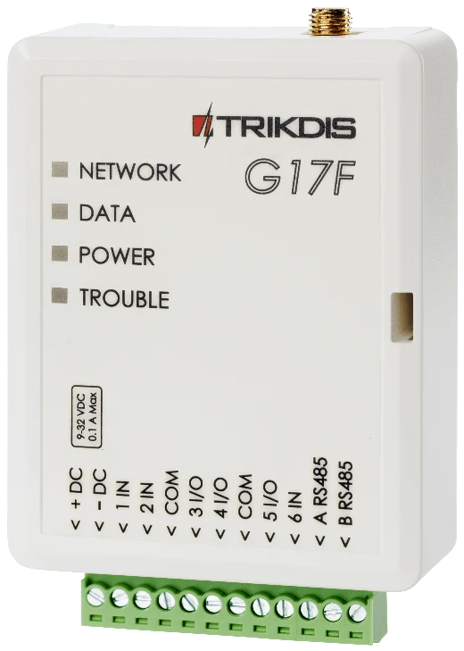

## Beskrivning 

Larmsändaren G17F uppfyller kraven i standarden EN 54-21:2006.

Produkten uppfyller prestandakraven i bilaga A till standarden EN54-21 för överföringssystem av typ 1.

Certifikatnummer för larmsändaren G17F: 1922-CPR-1974. Branddetekterings- och brandlarmsystem. Larmöverförings- och felvarningsutrustning.

Produkten är certifierad av det anmälda certifieringsorganet för produkter nr 1922 ”Dedal”, Nesebar Mladost str. 50, Bulgarien, 8230.

Kontaktuppgifter till Trikdis tekniska support: support@trikdis.lt, +37067422877.

G17F används för att överföra meddelanden från brandlarmcentralen via mobilnätet.

Funktionsprincip. När en ingång (sektion) på larmsändaren påverkas skickar G17F ett händelsemeddelande till larmcentralens mottagare eller till appen Protegus2 via mobilt internet. Larmsändaren kan också skicka SMS och ringa upp. Larmsändaren finns med 2G- eller 4G-modem.

### Funktioner

**Meddelanden till larmbolaget**

- Skickar händelser till TRIKDIS programvaru- eller maskinvarumottagare som fungerar med all programvara för larmcentraler.

- Kan skicka händelser till mottagare som stöder SIA DC-09.

- Om anslutningen via huvudkanalen bryts skickas meddelandena automatiskt till en backupmottagare.

- Kan rapportera händelser till larmcentralen med SMS. Mycket användbart eftersom det fungerar även när IP-anslutningen i mobiloperatörens nät är störd.

- Igenkänning av störsändning mot mobilnätet.

- Kan rapportera händelser till larmcentralen och samtidigt arbeta med appen *Protegus2*. Det går att ställa in prioritet för att skicka händelser till larmcentralen.

- Händelsemeddelanden skickas som Contact ID-koder.

**Meddelanden till användare**

- Ringer upp valda telefonnummer (upp till 8 användare).

- Skickar SMS om händelser.

- ”Push”-aviseringar och särskilda ljud som informerar om händelser i appen Protegus2.

**Fjärrstyrning av utgångar**

- Med appen Protegus2.

- Genom att ringa upp enhetens telefonnummer.

- Med SMS.

**Inställningar och installation**

- Snabb och enkel installation.

- Enheten konfigureras antingen med USB-kabel eller på distans med programvaran TrikdisConfig.

- Fjärruppdatering av firmware.

- Två behörighetsnivåer (kontotyper) för inställning av parametrar: för installatören och för administratören.

**Ingångar och utgångar**

- 3 ingångar med valbar typ: NO, NC, EOL (4,7 kΩ, 10 kΩ).

- 3 plintar med dubbel funktion (I/O) som kan ställas in som ingång (IN) eller utgång (OUT). Valbara ingångstyper: NO, NC, EOL (4,7 kΩ, 10 kΩ).

- RS485-bussen används för att ansluta utbyggnadsmoduler i serien iO.

- Med utbyggnadsmoduler i serien iO kan antalet ingångar (IN) eller utgångar (OUT) utökas till 12.

### Specifikationer 

| **Parameter** | **Beskrivning** |
|:---|----|
| GSM/GPRS-modemets frekvenser | 850 / 900 / 1800 / 1900 MHz |
| LTE-modemets frekvenser | 700 / 800 / 900 / 1800 / 2100 / 2600 MHz |
| Matningsspänning | 9–32 V DC |
| Strömförbrukning | 100 mA |
| Överföringsprotokoll | TRK, SIA DC-09_2007, SIA DC-09_2012 |
| Krypteringsnyckel | Krypteringsnyckel med 6 tecken. |
| Anslutning till larmcentralen | TCP/IP eller UDP/IP, SMS |
| Händelsekoder | Contact ID-koder. |
| Minne | Upp till 60 meddelanden. |
| Ingångar och utgångar | 3 ingångar som kan ställas in som NO, NC eller EOL (4,7 kΩ, 10 kΩ). / 3 plintar med dubbel funktion (IN/OUT) som kan ställas in som ingångar av typen NO, NC eller EOL (4,7 kΩ, 10 kΩ) eller som utgångar med öppen kollektor (OC) för en ström på upp till 100 mA. |
| Händelseminne | Upp till 1 000 händelser. |
| Konfigurering | På distans med programvaran TrikdisConfig eller lokalt via USB Mini-B. På distans med SMS. |
| RS485-bussens längd | Upp till 100 m |
| Moduler och enheter som stöds | iO – utbyggnadsmodul; / iO-WL - iO-MO – radiotransceiver iO-WL; / iO-8 – utbyggnadsmodul; / E485 – Ethernet-modul; / W485(W17u) – WiFi-modul; / iO-LORA – utbyggnadsmodul; / iO8-LORA – utbyggnadsmodul; / **PB-LORA** – överfallsknapp; / **REL-LORA** – utbyggnadsmodul; / **INIM Smartline** – brandlarmcentral; / **NSC Solution** – brandlarmcentral; / **C-TEC Cast ZFP** – brandlarmcentral. / Brandlarmcentral med protokollet **ESPA 4.4.4**. |
| Driftmiljö | Temperatur från -10 °C till +50 °C, relativ luftfuktighet upp till 80 % vid +20 °C. |
| Mått | 92 × 62 × 25 mm |
| Vikt | 80 g |

### Delar på larmsändaren G17F 

1.  SMA-kontakt för mobilantenn.

2.  Lysdioder.

3.  Skåra för att ta bort det övre locket.

4.  Plintar för anslutning av ledningar.

5.  USB Mini-B-kontakt för programmering av larmsändaren.

6.  Hållare för SIM-kort.

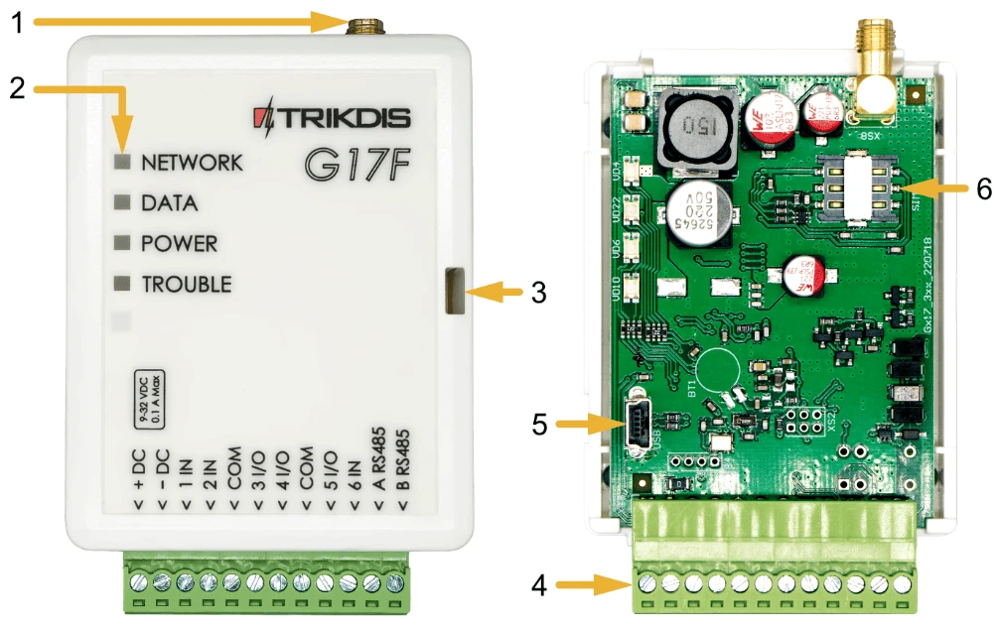

### Plintarnas funktion 

| Plint | Beskrivning |
|----------|-------------|
| +DC | Plint för matning (positiv plint för 9–32 V DC) |
| -DC | Plint för matning (negativ plint för 9–32 V DC) |
| 1 IN | Första ingångsplinten, valbar typ: NO, NC, EOL (förval 10 kΩ) |
| 2 IN | Andra ingångsplinten, valbar typ: NO, NC, EOL (förval 10 kΩ) |
| COM | Gemensam (negativ) plint |
| 3 I/O | Tredje plinten med dubbel funktion (IN/OUT). Kan ställas in som ingång med valbar typ NO, NC, EOL (förval 10 kΩ) eller som utgång med öppen kollektor (OC) för en ström på upp till 100 mA |
| 4 I/O | Fjärde plinten med dubbel funktion (IN/OUT). Kan ställas in som ingång med valbar typ NO, NC, EOL (förval 10 kΩ) eller som utgång med öppen kollektor (OC) för en ström på upp till 100 mA |
| COM | Gemensam (negativ) plint |
| 5 I/O | Femte plinten med dubbel funktion (IN/OUT). Kan ställas in som ingång med valbar typ NO, NC, EOL (förval 10 kΩ) eller som utgång med öppen kollektor (OC) för en ström på upp till 100 mA |
| 6 IN | Sjätte ingångsplinten, valbar typ: NO, NC, EOL (förval 10 kΩ) |
| A RS485 | RS485-buss för anslutning av iO-utbyggnadsmoduler, brandlarmcentralerna INIM Smartline, NSC Solution och C-TEC Cast ZFP, brandlarmcentraler med protokollet ESPA4.4.4 samt modulerna E485 och W485. |

### Lysdiodsindikering vid drift 

| Indikator | Lysdiodens läge | Beskrivning |
|-----------|--------------|-------------|
| Network | Släckt | Ingen anslutning till mobilnätet |
|  | Fast grönt sken med gult blinkande | Larmsändaren är ansluten till mobilnätet. Tillräcklig mobil signalstyrka är nivå 5 för GPRS (fem gula blinkningar) och nivå 3 för 4G (tre gula blinkningar). |
| Data | Fast grönt sken | Ett meddelande skickas |
|  | Fast gult sken | Osända händelsemeddelanden finns i buffertminnet |
| Power | Blinkar grönt | Matningsspänningen är tillräcklig |
|  | Blinkar gult | Matningsspänningen är otillräcklig |
|  | Blinkar grönt och gult | Konfigureringsläget är aktivt |
| Trouble | Släckt | Inga driftproblem |
|  | 1 blinkning | Inget SIM-kort är isatt |
|  | 2 blinkningar | SIM-kortets PIN-kod är felaktig |
|  | 3 blinkningar | Det går inte att ansluta till mobilnätet |
|  | 4 blinkningar | Det går inte att ansluta till IP-mottagaren via primärkanalen |
|  | 5 blinkningar | Det går inte att ansluta till IP-mottagaren via backupkanalen |
|  | 6 blinkningar | G17F:s interna klocka är inte inställd |
|  | 7 blinkningar | Otillräcklig matningsspänning |
|  | 9 blinkningar | Problem med anslutningen till RS485-modulen |

### Komponenter som behövs för installationen

Innan du börjar installationen, se till att du har följande:

1.  USB Mini-B-kabel för konfigurering.

2.  Minst 4-ledarkabel för att ansluta larmsändaren till brandlarmcentralen.

3.  Spårskruvmejsel 2,5 mm.

4.  Extern mobilantenn om nättäckningen i området är dålig.

5.  Aktiverat nano-SIM-kort (PIN-kodsbegäran kan vara avstängd).

6.  Manualen för den brandlarmcentral som larmsändaren ska anslutas till.

Beställ nödvändiga komponenter separat från din lokala distributör.

## Snabbkonfiguration med programvaran *TrikdisConfig* 

1.  Ladda ned konfigurationsprogrammet TrikdisConfig från [www.trikdis.com](http://www.trikdis.com) (skriv ”TrikdisConfig” i sökfältet) och installera det*.*

2.  Ta bort G17F:s lock med en spårskruvmejsel enligt bilden nedan:

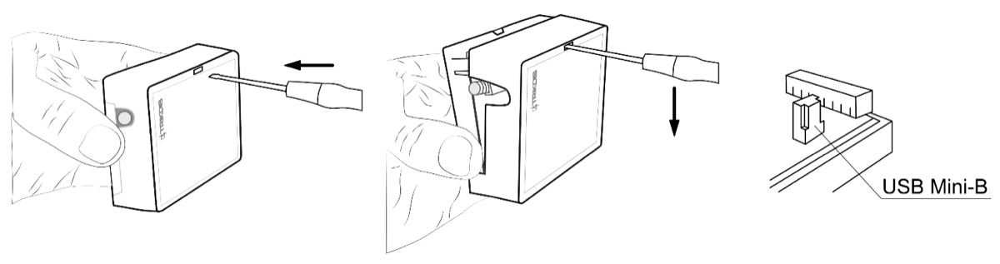

1.  Anslut G17F till datorn med en USB Mini-B-kabel.

2.  Starta TrikdisConfig. Programmet identifierar automatiskt den anslutna enheten och öppnar automatiskt konfigurationsfönstret för G17F.

3.  Klicka på knappen **Read [F4]** för att se de aktuella parametrarna för G17F. Om ett fönster öppnas som begär administratörs- eller installatörskoden, ange den 6-siffriga koden.

Nedan beskrivs vilka inställningar som behöver ändras för att larmsändaren ska skicka händelser till appen Protegus2 eller till larmcentralen (CMS, Central Monitoring Station).

### Inställningar för anslutning till appen *Protegus2* 

**I fönstret ”Users & Reporting”, inställningsgruppen ”Cloud application”:**

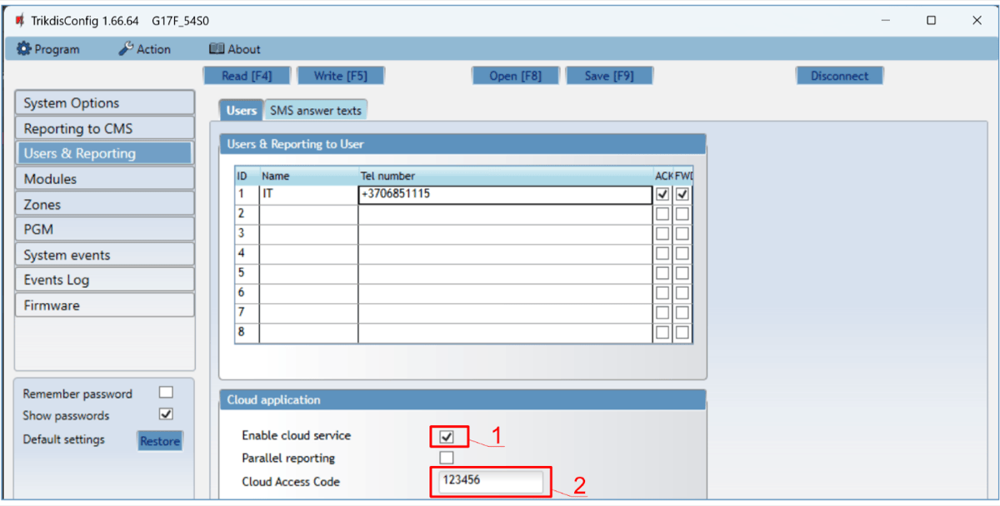

1.  Markera rutan **Enable cloud service**.

2.  Ändra **Cloud Access Code** om användarna ska uppmanas att ange den när de lägger till systemet i appen Protegus2 (förvalt lösenord – 123456).

**I fönstret ”System options”, inställningsgruppen ”SIM”:**

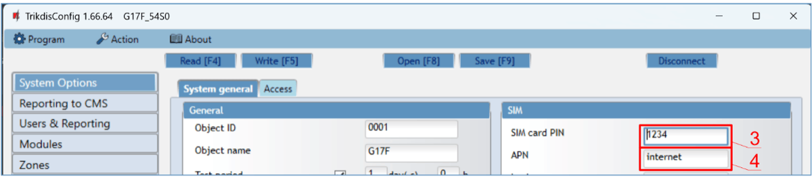

3. Ange koden **SIM card PIN**.

4.  Ändra **APN**. **APN** hittar du på SIM-kortsoperatörens webbplats. ”Internet” är universellt och fungerar i de flesta operatörers nät.

**I fönstret ”Zones”:**

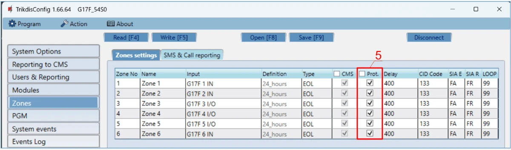

5. Markera rutorna om användarna ska få aviseringar i Protegus2 om ändringar i sektionernas tillstånd.

**I fönstret ”PGM”:**

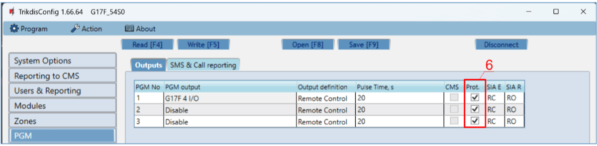

6. Markera rutorna om användarna ska få aviseringar i Protegus2 om ändringar i PGM-utgångarnas tillstånd.

**I fönstret ”System events”:**

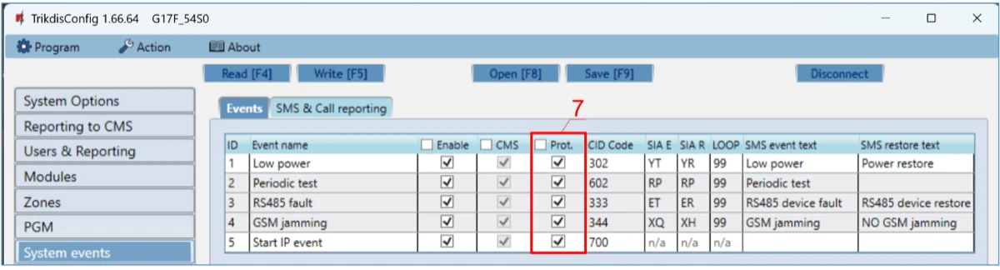

7. Markera rutorna om användarna ska få aviseringar i Protegus2 om ändringar i tillstånden för larmsändarens interna händelser.

När konfigureringen är klar klickar du på knappen **Write [F5]** och kopplar bort USB-kabeln.

!!! note "Obs!"
    Mer information om övriga inställningar för G17F i ***TrikdisConfig*** finns i avsnitt **5 ”Beskrivning av TrikdisConfig-fönstren”**.
### Inställningar för anslutning till larmcentralen 

**I fönstret ”System Options”:**

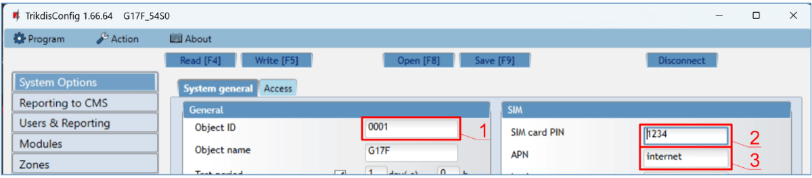

1.  Ange numret i **Object ID** (abonnentkod) som du har fått från larmcentralen (4 tecken, 0–9, A–F. **Använd inte FFFE, FFFF som Object ID**).

2.  Ange **SIM card PIN**.

3.  Ändra **APN**. **APN** hittar du på SIM-kortsoperatörens webbplats. ”Internet” är universellt och fungerar i de flesta operatörers nät.

**I fönstret ”Reporting to CMS”:**

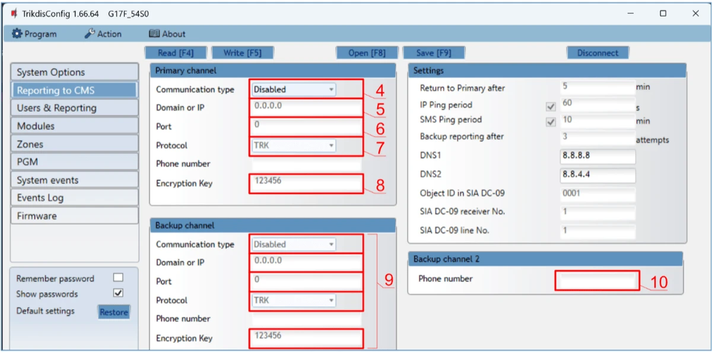

4. **Communication type** – välj kommunikationstyp (vi rekommenderar inte SMS för primärkanalen).

2.  **Domain or IP** – ange mottagarens domän eller IP-adress.

3.  **Port** – ange mottagarens nätverksportnummer.

4.  **Protocol** – välj vilket överföringsprotokoll som ska användas för att skicka meddelanden: **TRK** (till TRIKDIS-mottagare), **DC-09_2007** eller **DC-09_2012** (till universella mottagare).

5.  **Encryption Key** – ange mottagarens krypteringsnyckel.

!!! note "Obs!"
    Om du vill ställa in anslutningen till larmcentralen via
    **SMS** behöver du bara ange **Encryption key** och
    **Phone number**. SMS kan tas emot av TRIKDIS
    IP/SMS-mottagare för larmcentraler RL14, flerkanalsmottagaren RM14 och
    SMS-mottagaren GM14. / Om du har valt **DC-09** som överföringsprotokoll
    anger du dessutom objekt-, linje- och mottagarnummer i
    inställningsgruppen **Settings** i fönstret **”Reporting to CMS”**.
1.  (Rekommenderas) Konfigurera inställningarna för **Backup channel**.

2.  (Rekommenderas) Ange telefonnumret för **Backup channel 2**.

När konfigureringen är klar klickar du på knappen **Write [F5]** och kopplar bort USB-kabeln.

!!! note "Obs!"
    Mer information om övriga inställningar för G17F i ***TrikdisConfig*** finns i avsnitt **5 ”Beskrivning av TrikdisConfig-fönstren”**.
## Kopplingsscheman, installation och start av systemet 

### Montering 

1.  Innan du installerar systemet, kontrollera att mobilnätets signalstyrka är tillräcklig på den plats där *G17F* ska monteras.

2.  Ta bort det övre locket och dra ut plintblocken.

3.  Ta ut kretskortet.

4.  Fäst kapslingens nedre del med skruvar på önskad plats.

5.  Sätt tillbaka kretskortet och plintblocken.

6.  Skruva fast mobilantennen.

7.  Sätt i ett nano-SIM-kort. SIM-kortet måste vara registrerat i ett mobilnät och tjänsterna måste vara aktiverade och fungera, dvs. kortet måste kunna ringa, skicka och ta emot SMS och ha mobildata aktiverat. <u>Fråga SIM-kortets mobiloperatör hur du aktiverar de tjänster du vill ha.</u>

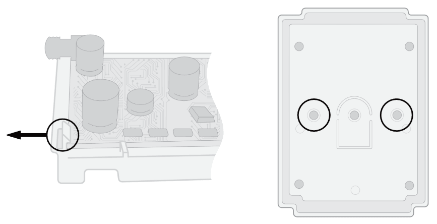

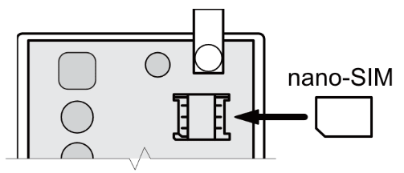

!!! note "Obs!"
    Kontrollera att SIM-kortet är aktiverat. / Kontrollera att mobildata är
    aktiverat om du ska använda anslutning via IP-kanal eller
    appen Protegus2. / För att slippa ange PIN-koden i
    TrikdisConfig, sätt SIM-kortet i en mobiltelefon och stäng av
    PIN-kodsbegäran.
8. För att konfigurera G17F på distans, sätt i ett SIM-kort med avstängd PIN-kodsbegäran. Slå på larmsändarens matning. Om G17F inte har konfigurerats med TrikdisConfig och tjänsten Protegus inte har aktiverats, skicka SMS: **CONNECT  123456  PROTEGUS=ON,APN=INTERNET**

2.  Hur du ändrar parametrar på distans beskrivs i avsnitt **6 ”Ställa in parametrar på distans”**.

3.  Sätt tillbaka det övre locket.

### Kopplingsschema för anslutning av larmsändaren till en brandlarmcentral 

Om du vill övervaka brandlarmcentralens status ansluter du dess motsvarande utgångar till ingångarna på *G17F*. Brandlarmcentralens utgångar (PGM1, PGM2, PGM3) måste konfigureras som statusutgångar (”Alarm”, ”Trouble” osv.).

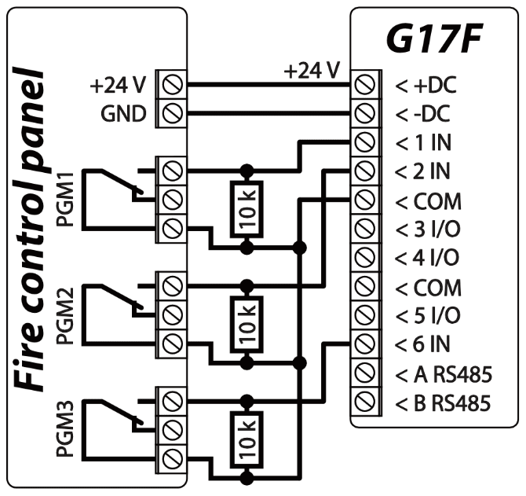

### Kopplingsschema för anslutning av brandlarmcentral med protokollet ESPA4.4.4 och larmsändaren G17F 

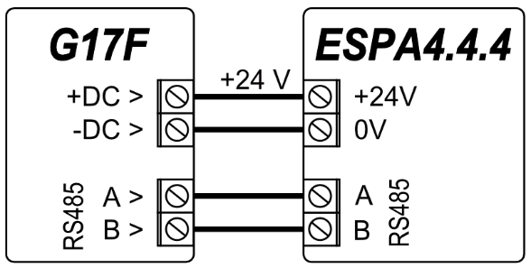

Inställningar för larmsändaren G17F i TrikdisConfig när brandlarmcentralen **ESPA4.4.4** ansluts.

1.  Välj **ESPA4.4.4**.

2.  Välj gränssnittets baudrate.

3.  Larmsändaren G17F och brandlarmcentralen måste ha samma inställningar för dataöverföring.

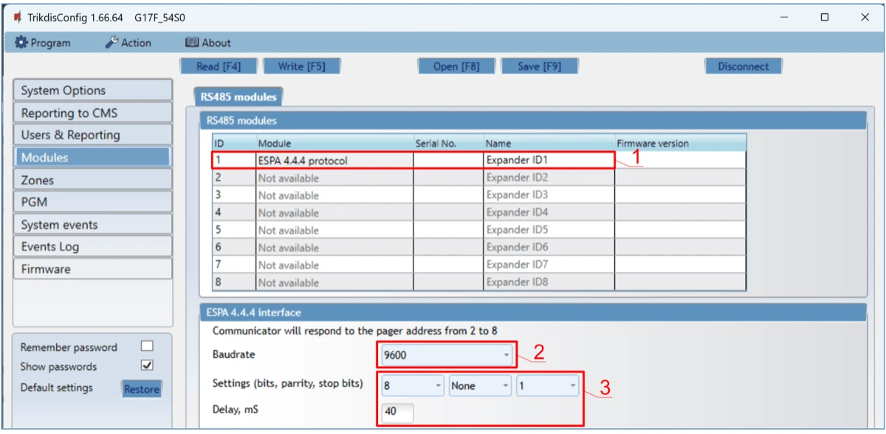

4. Ange telefonnummer för de användare som ska få meddelanden från G17F.

5. Om användaren ska få meddelanden (eller samtal) om händelser, markera rutan SMS (eller Call).

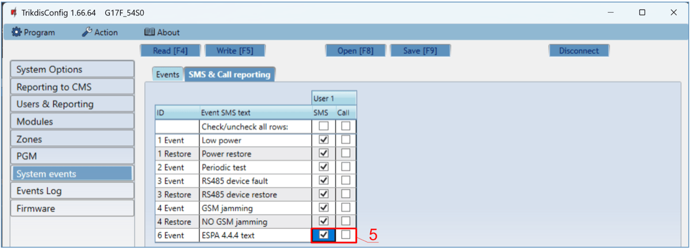

6. Konfigurera kommunikationskanalen om meddelanden ska skickas till larmcentralens mottagare. Händelsemeddelandena överförs med protokollet SIA DC-09.

Testa systemet. Utlös ett brandlarm och kontrollera att meddelanden från G17F skickas till larmcentralen (CMS, Central Monitoring Station) och till Protegus2.

### Kopplingsschema för anslutning av brandlarmcentralen NSC Solution och larmsändaren G17F 

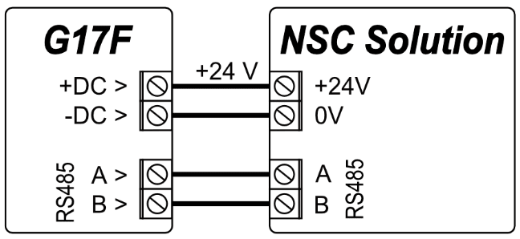

Inställningar för larmsändaren G17F i TrikdisConfig när brandlarmcentralen **NSC Solution** ansluts.

1.  Välj ”**NSC Solution**”.

2.  ”NSC slave address” får inte vara samma som adressen på någon av de modulerna som är anslutna till brandlarmcentralen.

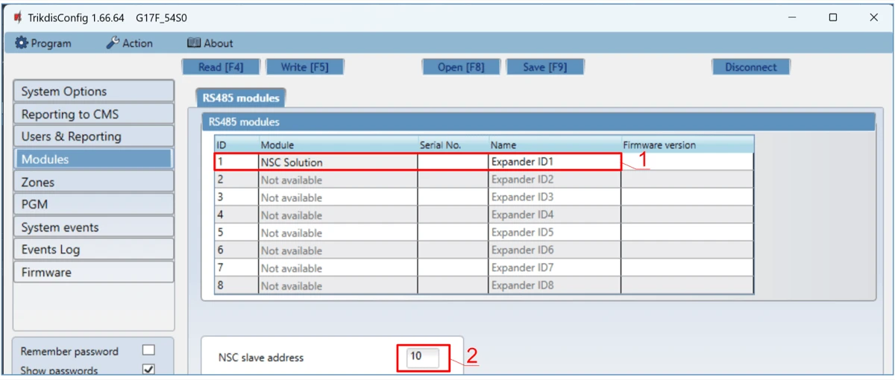

3. Ange telefonnummer för de användare som ska få meddelanden från G17F.

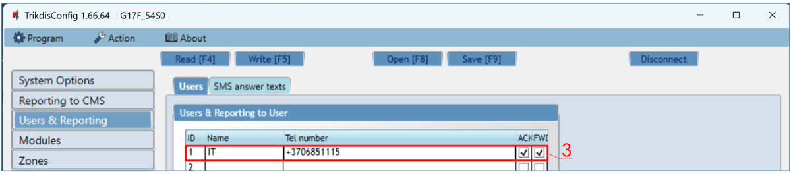

4. Användarna får SMS och samtal om de händelser som är markerade. Du kan lägga till fler CID-händelsekoder i kolumnen **CID**. Du måste ange **SMS text** bredvid nya koder. Om användaren ska få meddelanden (eller samtal) om händelser, markera rutan **SMS** (eller **Call**).

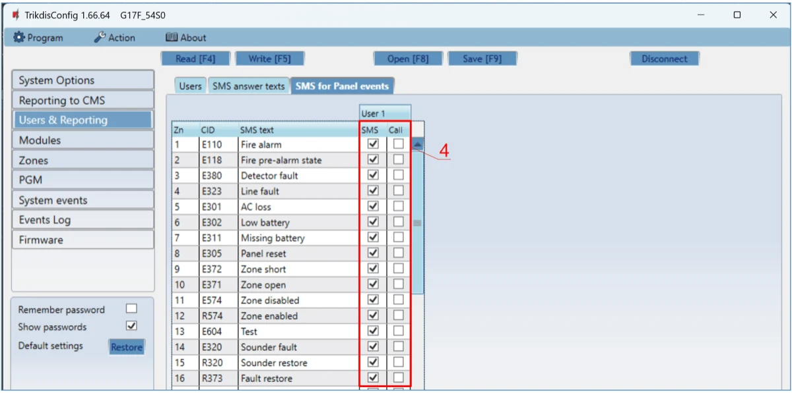

5. Konfigurera kommunikationskanalen om meddelanden ska skickas till larmcentralens mottagare.

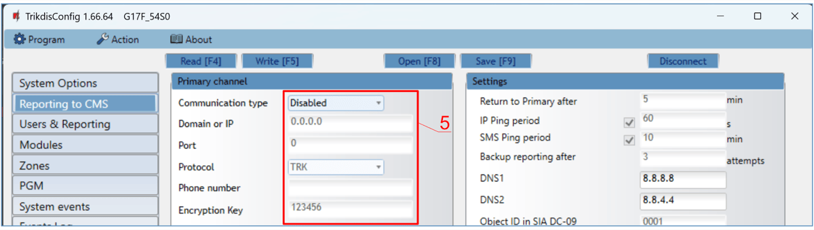

När du har ställt in larmsändaren G17F slår du på brandlarmcentralens matning. Vänta tills brandlarmcentralens programvara har laddats. Modulerna som är anslutna till RS485-bussen måste skannas i brandlarmcentralen. Tryck på brandlarmcentralen: **PROG.>INSTALLER>(ange installatörskoden) 00000 OK>(välj) SETTINGS>ENTER>(välj) SCAN RS485>ENTER**. Vänta tills skanningen är klar. Återgå till huvudskärmen genom att trycka på ”**CANCEL**” två gånger.

Testa systemet. Utlös ett brandlarm och kontrollera att G17F skickar meddelanden till larmcentralen och Protegus2.

### Kopplingsschema för anslutning av brandlarmcentralen INIM Smartline och larmsändaren G17F 

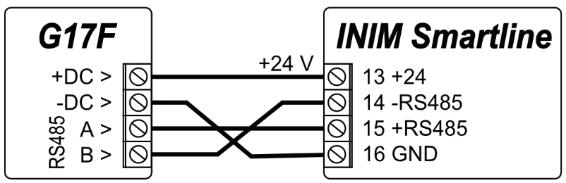

Läget **Slave** måste ställas in på brandlarmcentralen **INIM Smartline** när den ansluts till larmsändaren G17F via RS485-bussen.

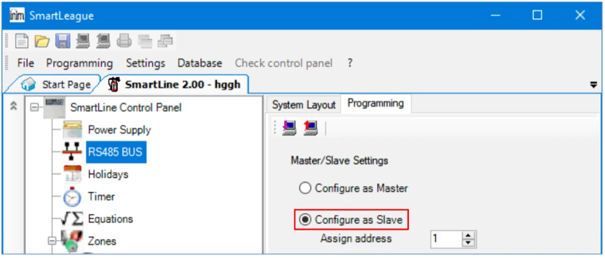

!!! note "Obs!"
    Du kan inte ansluta G17F via RS485-bussen om repeaterenheter är anslutna till brandlarmcentralen **INIM Smartline**. / Utbyggnadsmodulerna **iO** stöds inte när larmsändaren G17F är ansluten till RS485-bussen på brandlarmcentralen **INIM Smartline**.
Inställningar för larmsändaren i TrikdisConfig när brandlarmcentralen **INIM Smartline** ansluts.

**I fönstret ”Modules”:**

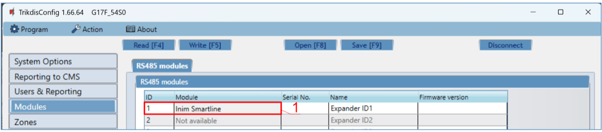

1.  Välj modulen **Inim Smartline**.

**I fönstret ”Users & Reporting”:**

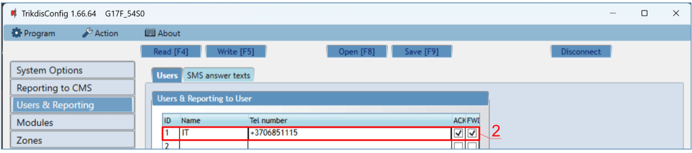

2. Ange telefonnummer för de användare som ska få meddelanden från larmsändaren G17F.

3. Användarna får SMS och samtal om de händelser som är markerade. Du kan lägga till fler CID-händelsekoder i kolumnen **CID**. Du måste ange **SMS text** bredvid nya koder. Om användaren ska få meddelanden (eller samtal) om händelser, markera rutan **SMS** (eller **Call**).

2.  Konfigurera kommunikationskanalen om meddelanden ska skickas till larmcentralens mottagare.

Testa systemet. Utlös ett brandlarm och kontrollera att G17F skickar meddelanden till larmcentralen (CMS) och Protegus2.

### Kopplingsschema för anslutning av brandlarmcentralen C-TEC Cast ZFP och larmsändaren G17F 

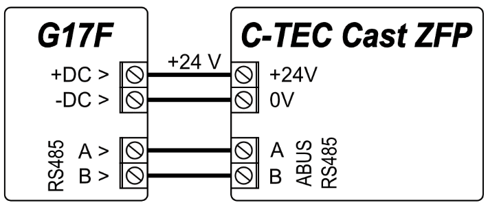

Inställningar för larmsändaren G17F i TrikdisConfig när brandlarmcentralen **C-TEC Cast ZFP** ansluts.

1.  Välj brandlarmcentralen **C-TEC Cast ZFP**.

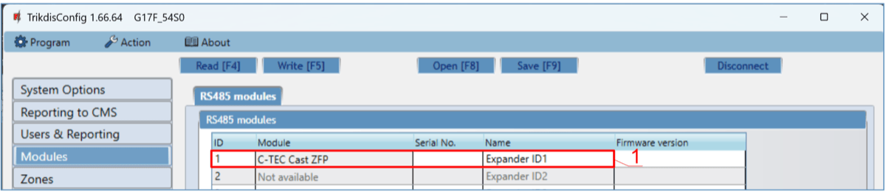

1.  Ange telefonnummer för de användare som ska få meddelanden från larmsändaren G17F.

2. Användarna får SMS och samtal om de händelser som är markerade. Du kan lägga till fler CID-händelsekoder i kolumnen **CID**. Du måste ange **SMS text** bredvid nya koder. Om användaren ska få meddelanden (eller samtal) om händelser, markera rutan **SMS** (eller **Call**).

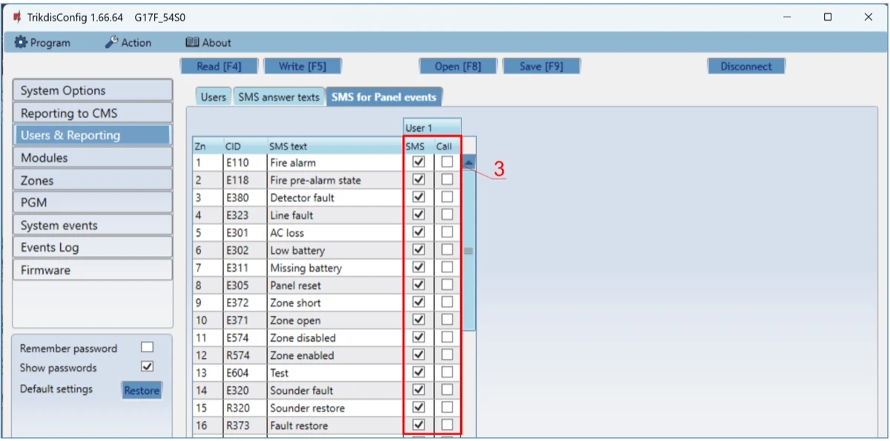

3. Konfigurera kommunikationskanalen om meddelanden ska skickas till larmcentralens mottagare.

Installera programmet **ZFPtools** på datorn. Starta programmet **ZFPtools**. Slå på brandlarmcentralens matning. Vänta tills brandlarmcentralens programvara har laddats. Anslut brandlarmcentralen till datorn med en USB2.0 A-B-kabel.

4. Öppna fliken ”**Node View**”.

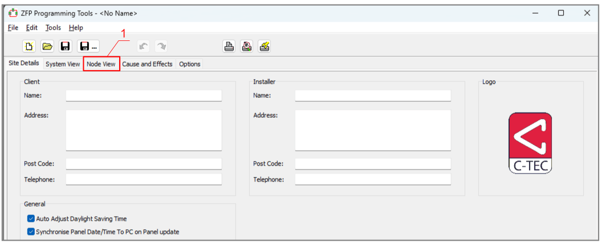

5. Ladda ned brandlarmcentralens inställningar till datorn.

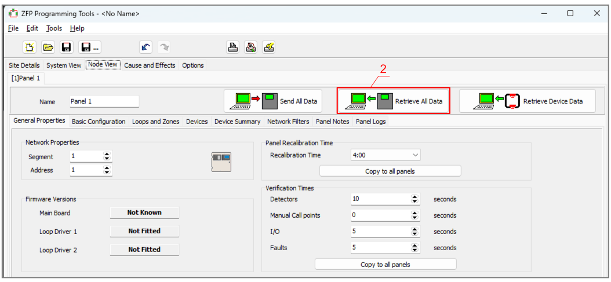

6. Ange koden (förvald kod – 4444).

2.  Klicka på ”OK”.

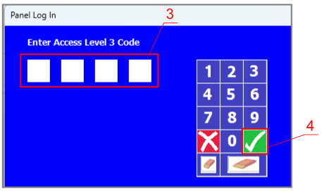

3. Välj ”**BMS Interface**”.

2.  Klicka på den lediga ikonen.

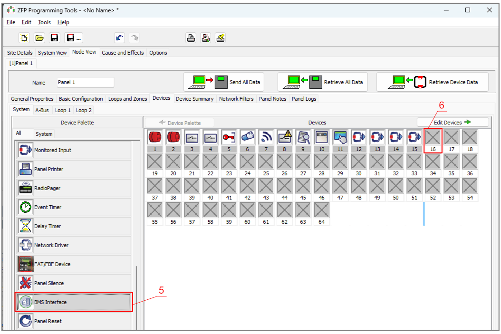

11. Klicka på ”**Edit Devices**”.

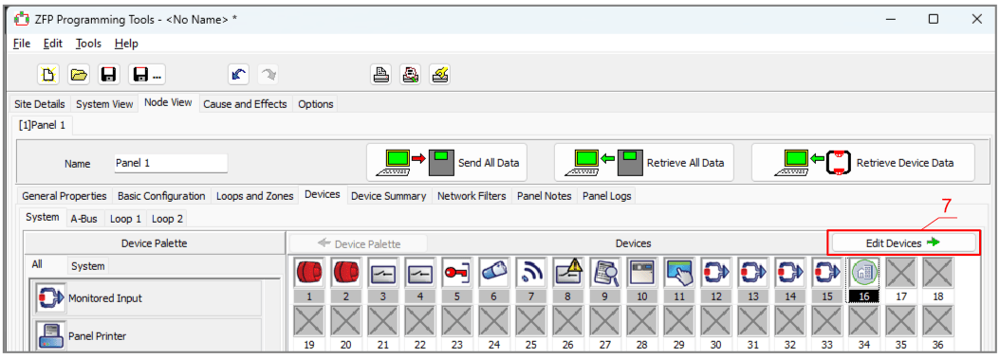

12. På fliken ”**Device**” anger du systemets namn.

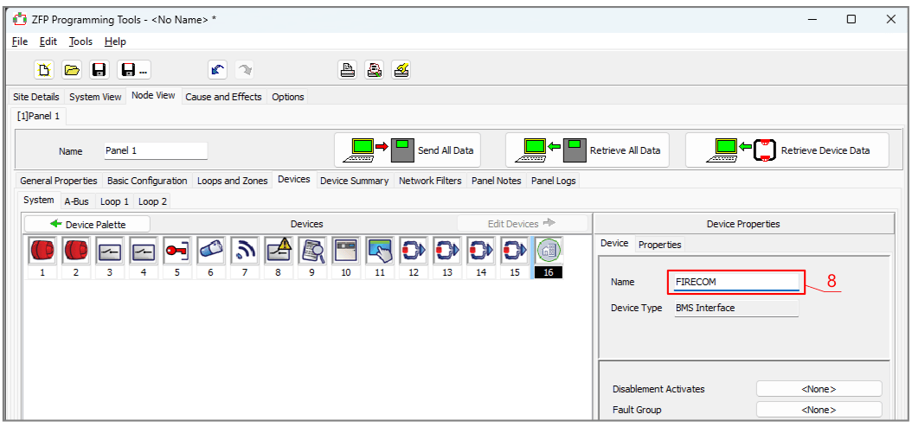

13. På fliken ”**Properties**” anger du systemets namn.

14. Ange den buss ”**ABUS RS485**” som larmsändaren G17F är ansluten till.

15. Konfigurera meddelandena.

16. Skriv inställningarna till brandlarmcentralen.

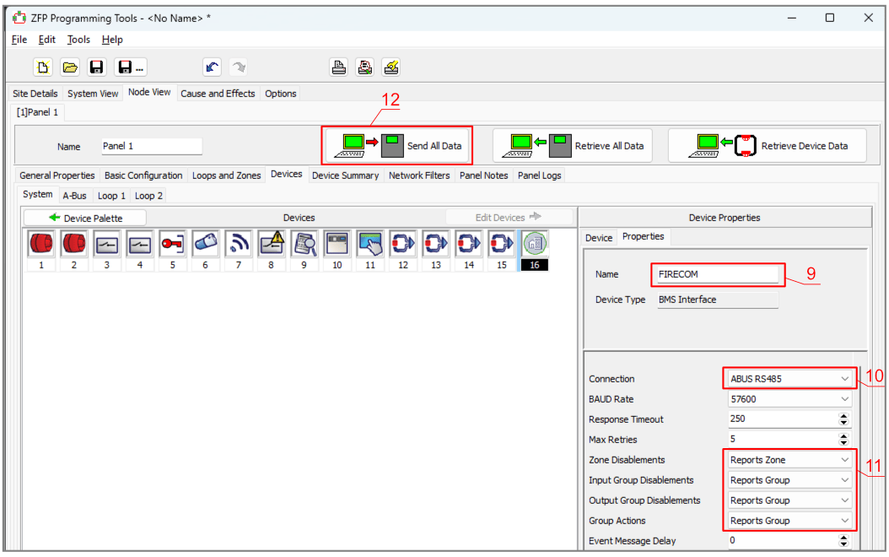

17. Ange koden (förvald kod – 4444).

18. Klicka på ”OK”.

Brandlarmcentralen är programmerad. Koppla bort USB2.0 A-B-kabeln från brandlarmcentralen.

Testa systemet. Utlös ett brandlarm och kontrollera att meddelanden från G17F skickas till larmcentralen (CMS, Central Monitoring Station) och till Protegus2.

### Kopplingsscheman för anslutning av ingångar 

Larmsändaren har sex ingångsplintar (1 IN – 6 IN), varav tre är plintar med dubbel funktion (IN/OUT), för anslutning av kretsar av typen NO, NC, EOL (med slutmotstånd 4,7 kΩ eller 10 kΩ). Förval: ingången övervakar en EOL-krets. Du kan ställa in en annan ingångstyp i fönstret **Zones** i TrikdisConfig.

Kopplingsscheman för kretsar av typen NO, NC, EOL:

#### Normalt öppen (NO)

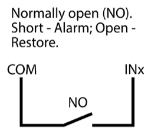

#### Normalt sluten (NC)

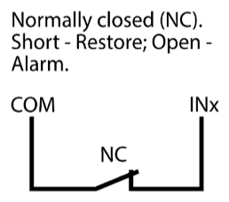

#### Normalt öppen med slutmotstånd på 10 kΩ (EOL10k)

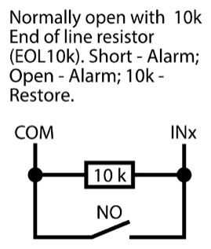

#### Normalt sluten med slutmotstånd på 10 kΩ (EOL10k)

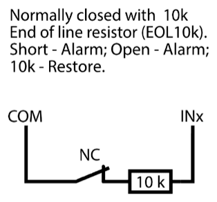

### Kopplingsschema för anslutning av utbyggnadsmoduler i serien iO 

Om larmsändaren behöver fler ingångar (IN) eller utgångar (OUT), anslut en trådbunden eller trådlös utbyggnadsmodul för ingångar och utgångar i serien TRIKDIS iO.

### Kopplingsschema för anslutning av utbyggnadsmodulen iO-8 

Om larmsändaren behöver fler ingångar (IN) eller utgångar (OUT), anslut den trådbundna utbyggnadsmodulen *iO-8*.

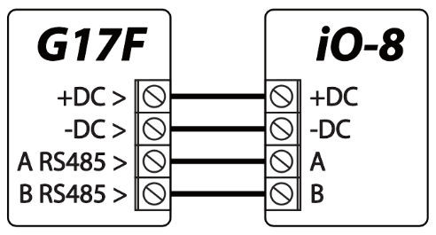

### Kopplingsscheman för anslutning av utbyggnadsmoduler i serien LORA

Kopplingsscheman för anslutning av **LORA**-moduler.

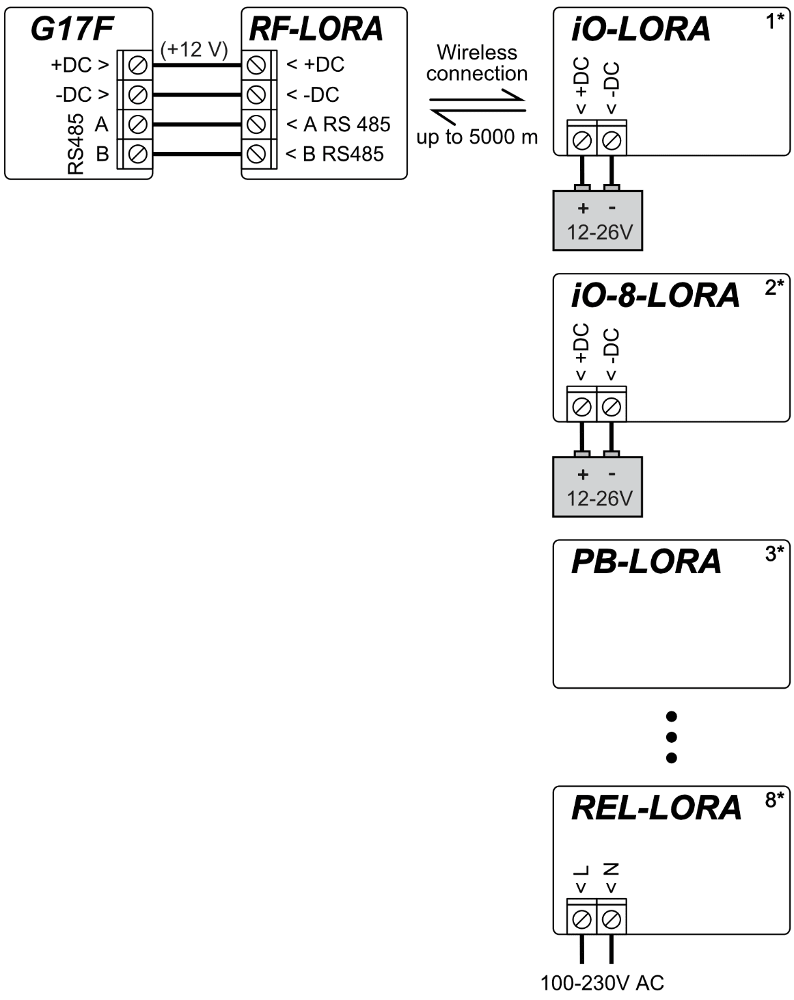

### Kopplingsschema för anslutning av WiFi-modulen W485 

*G17F* firmwareversion 1.08 eller senare. / Modulen *W485* skickar meddelanden till larmcentralen (CMS, Central Monitoring Station) och till *Protegus2* via en WiFi-router. När WiFi-anslutning finns skickar *G17F* händelsemeddelanden via modulen *W485*. Om WiFi-anslutningen bryts skickar *G17F* meddelanden via GPRS. När WiFi-anslutningen är återupprättad återgår *G17F* till att skicka meddelanden via *W485*. / Konfigureringen av WiFi-modulen *W485* för användning med *G17F* beskrivs i avsnitt 5.5 (fönstret ”Modules”). / Du behöver inget SIM-kort när du använder *W485* med *G17F*.

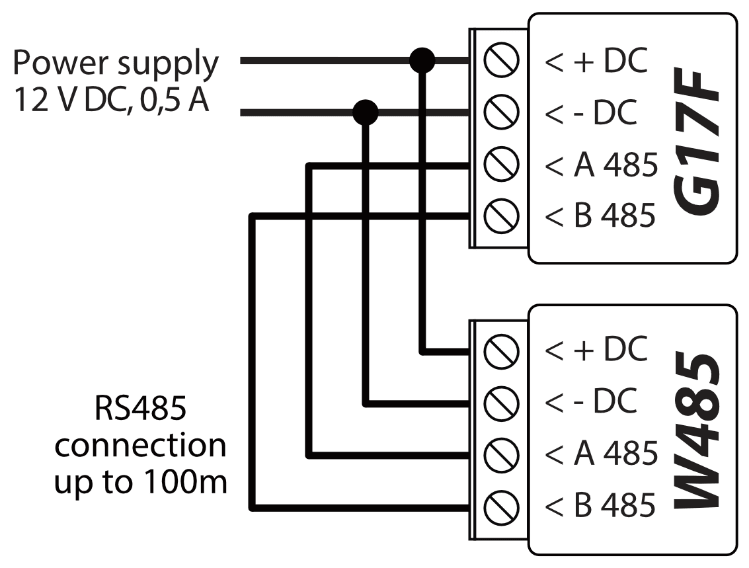

### Kopplingsschema för anslutning av Ethernet-modulen E485 

*G17F* firmwareversion 1.08 eller senare. / Modulen *E485* skickar meddelanden till larmcentralen (CMS, Central Monitoring Station) och till *Protegus2* via en kabelansluten internetanslutning. När *E485* används med *G17F* skickas meddelanden till larmcentralen och *Protegus2* över kabelanslutet internet, och mobilt internet används inte. Om den kabelanslutna internetanslutningen bryts skickar *G17F* meddelanden via mobilt internet. När den kabelanslutna internetanslutningen är återupprättad börjar *G17F* skicka meddelanden via *E485* igen. / Konfigureringen av modulen *E485* för användning med *G17F* beskrivs i avsnitt 5.5 (fönstret ”Modules”). / Du behöver inget SIM-kort när du använder *E485* med *G17F*.

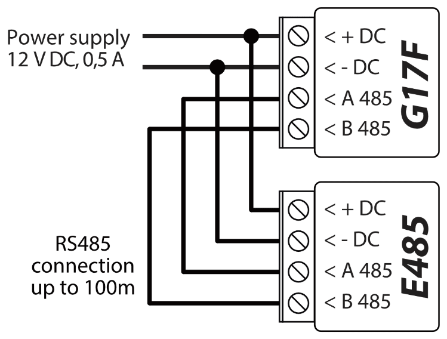

### Starta larmsändaren 

Slå på larmsändaren genom att först slå på brandlarmcentralens matning. Om larmsändaren fungerar som den ska ska följande lysdioder på G17F tändas:

- Lysdioden ”POWER” ska lysa fast grönt (tillräcklig matningsspänning);

- Lysdioden ”NETWORK” ska lysa fast grönt och blinka gult när larmsändaren är ansluten till ett nät.

!!! note "Obs!"
    Tillräcklig mobil signalstyrka är nivå 5 (fem gula blinkningar på lysdioden ”NETWORK”).
    Tillräcklig 4G-signalstyrka är nivå 3 (tre gula blinkningar på lysdioden
    ”NETWORK”). / Om du ser färre än 3 gula blinkningar på lysdioden
    ”NETWORK” är mobilnätets signalstyrka otillräcklig. Vi rekommenderar att du
    väljer en annan plats för larmsändaren eller använder en
    känsligare mobilantenn. / Om du ser en annan lysdiodsindikering, se
    avsnitt 1.5 ”Lysdiodsindikering vid drift” för att ta reda på orsaken. / Om
    alla indikeringar på G17F är släckta, kontrollera
    matningen och anslutningarna.
## Fjärrstyrning 

### Lägga till larmsändaren i appen Protegus2 

Med Protegus2 kan användarna se systemets status och få aviseringar om systemhändelser.

1.  Ladda ned och starta appen Protegus2 eller använd webbversionen [www.protegus.app](https://www.protegus.app):

    

      
      
      
    

2.  Skapa ett nytt konto eller logga in med ditt användarnamn och lösenord.

!!! warning "Viktigt"
    När du lägger till systemet i Protegus2 måste larmsändaren G17F:

    1.  Ha ett isatt och aktiverat SIM-kort där PIN-koden är angiven eller
        avstängd;

    2.  Ha tjänsten Protegus aktiverad. Se avsnitt 5.4 (fönstret
        ”Users & Reporting”);

    3.  Vara påslagen (lysdioden ”POWER” ska lysa fast grönt);

    4.  Vara ansluten till ett nät (lysdioden ”NETWORK” ska lysa fast grönt och
        blinka gult).
3. Klicka på ”Add new system” och ange numret ”*Unique ID*” för *G17F*. Numret finns på enheten och på etiketten på förpackningen. När du har angett ”*Unique ID*” klickar du på knappen ”Next”.

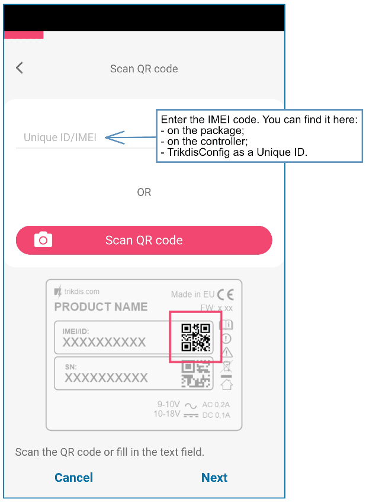

### Konfigurering och styrning med SMS 

**1. Ändra administratörslösenordet**

Av säkerhetsskäl bör du ändra det förvalda SMS-lösenordet för administratören. Skicka ett SMS i följande format:

#### PSW 123456 xxxxxx

| **123456** | Förvalt administratörslösenord      |
|------------|-------------------------------------|
| **xxxxxx** | Nytt administratörslösenord med 6 tecken |

1.  **Ge andra användare behörighet att styra**

Bara telefonnummer som finns i användarlistan kan styra systemet med SMS eller telefonsamtal. Skicka från administratörens telefon SMS med andra personers telefonnummer och namn för att ge dem behörighet att styra systemet:

#### SETN xxxxxx PHONEx=+PHONENR#NAME

| **xxxxxx** | Administratörslösenord med 6 tecken |
|----|----|
| **x** | Användarens nummer i listan. (Om du anger 1 som användarnummer överför du dina administratörsrättigheter till den andra användaren.) |
| **PHONENR** | Användarens telefonnummer |
| **NAME** | Användarens namn |

**Lista över SMS-kommandon**

| Kommando | Data | Beskrivning |
|---------|------|-------------|
| INFO |  | Begär information om larmsändaren. Svaret innehåller larmsändarens typ, IMEI-nummer, serienummer och firmwareversion. / T.ex.: INFO 123456 |
| RESET |  | Starta om enheten. T.ex.: RESET 123456 |
| OUTPUTx | ON | Slå på en utgång, ”x” är utgångens nummer. T.ex.: OUTPUT1 123456 ON |
| OUTPUTx | OFF | Slå av en utgång, ”x” är utgångens nummer. T.ex.: OUTPUT1 123456 OFF |
| OUTPUTx | PULSE=ttt | Slå på en utgång under några sekunder – ”x” är numret på utgången OUT och ”ttt” är ett tresiffrigt tal som anger pulstiden i sekunder. / T.ex.: OUTPUT1 123456 PULSE=002 |
| PSW | Nytt lösenord | Ändra lösenord. T.ex.: PSW 123456 654123 |
| TIME | YYYY/MM/DD,12:00:00 | Ställ in datum och tid. T.ex.: TIME 123456 2025/05/09,10:23:00 |
| TXTA | Objektnamn | Ange ett objektnamn. T.ex.: TXTA 123456 House |
| TXTE | Z1= / ........ / Z12= | Anpassa texten i SMS vid sektionslarm: Z1...Z12 – ingångssektionens nummer. / T.ex.: TXTE 123456 Z1=ALARM in Zone1 |
| TXTR | Z1= / ........ / Z12= | Anpassa texten i SMS vid sektionsåterställning: Z1...Z12 – ingångssektionens nummer. / T.ex.: TXTR 123456 Z1=Restore Zone1 |
| RDR | PhoneNR#SMStext | Vidarebefordra SMS till det angivna numret. Telefonnumret måste börja med ett ”+” och landskoden. |
| RDR | PhoneNR#SMStext | T.ex.: RDR 123456 +37061234567#forwarded text |
| ASKI |  | Begär ett SMS med status för ingångarna IN. T.ex.: ASKI 123456 |
| ASKO |  | Begär ett SMS med status för utgångarna OUT. T.ex.: ASKO 123456 |
| SETN | PhoneX=PhoneNR#Name | Lägg till ett telefonnummer och ett användarnamn och tilldela dem användare ”x”. ”x” är telefonnumrets rad i listan. Telefonnumret måste börja med ett ”+” och landskoden. Telefonnumret och användarnamnet måste skiljas åt med tecknet ”#”. T.ex.: SETN 123456 PHONE5=+37061234567#JOHN |
|  | PhoneX=DEL | Ta bort användarens telefonnummer och namn från systemet. / T.ex.: SETN 123456 PHONE5=DEL |
| UUSD | *Uusd code# | Skicka en USSD-kod till operatören. T.ex.: UUSD 123456 *245# |
| CONNECT | Protegus=ON | Anslut till molntjänsten Protegus. T.ex.: CONNECT 123456 PROTEGUS=ON |
| CONNECT | Protegus=OFF | Koppla från molntjänsten Protegus. T.ex.: CONNECT 123456 PROTEGUS=OFF |
| CONNECT | Code=123456 | Kod för molntjänsten Protegus. T.ex.: CONNECT 123456 CODE=123456 |
| CONNECT | IP=0.0.0.0:8000 | Ange TCP IP-adress och port för huvudserverns anslutningskanal. / T.ex.: CONNECT 123456 IP=0.0.0.0:8000 |
| CONNECT | IP=0 | För att stänga av huvudkanalen. T.ex.: CONNECT 123456 IP=0 |
| CONNECT | ENC=123456 | TRK-krypteringsnyckel. T.ex.: CONNECT 123456 ENC=123456 |
| CONNECT | APN=Internet | APN-namn. T.ex.: CONNECT 123456 APN=INTERNET |
| CONNECT | USER=user | APN-användare. T.ex.: CONNECT 123456 USER=User |
| CONNECT | PSW=password | APN-lösenord. T.ex.: CONNECT 123456 PSW=Password |

### Styra PGM-utgångar med telefonsamtal 

!!! note "Obs!"
    Om inga användare har lagts till i systemet blir den första som ringer upp
    G17F systemets administratör och den enda som kan styra G17F med
    telefonsamtal och SMS-kommandon. / Om du vill ge fler användare behörighet
    att styra systemet med telefonsamtal, lägg till dem med TrikdisConfig eller
    ge dem behörighet med SMS-kommandon.
Gör så här om du vill styra en PGM-utgång på distans:

- Användaren måste ha behörighet att styra utgångar (OUT) och utgången (OUT) måste ha typen ”Remote control” tilldelad (med TrikdisConfig).

- Ring upp numret till SIM-kortet i G17F. G17F svarar på samtalet och du kan slå in kommandon med telefonens knappsats (se tabellen).

**Kommandolista för mobiltelefonens knappsats**

| Knappar | Funktion | Beskrivning |
|------------------|----------|-------------|
| [utgångsnr]*[tillståndsnr]# | Styr vald utgång OUT | Styr den angivna PGM-utgången. Tillstånd: [0] – utgången är avstängd; [1] – utgången är påslagen; [2] – avstängd under pulstiden; [3] – påslagen under pulstiden; (pulstiden anges i programvaran TrikdisConfig, tabellen ”PGM”) [*] – denna symbol visar slutet på kommandot. T.ex. (slå på utgång 1): 1*1# T.ex. (slå av utgång 1): 1*0# T.ex. (slå på utgång 2 under pulstiden som anges i tabellen ”PGM” i TrikdisConfig): 2*3# |
| # | Ange kommandot på nytt | Om du har gjort ett misstag när du angav kommandot trycker du på # på telefonens knappsats och anger kommandot igen. |

## Beskrivning av *TrikdisConfig*-fönstren 

### Beskrivning av statusfältet i TrikdisConfig 

När G17F har anslutits visar TrikdisConfig information om den anslutna enheten i statusfältet.

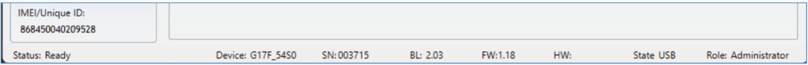

| **Namn**       | **Beskrivning**                                     |
|----------------|----------------|
| IMEI/Unique ID | Enhetens IMEI-nummer                                |
| Status         | Driftstillstånd                                     |
| Device         | Enhetstyp (ska visa G17F)                  |
| SN             | Enhetens serienummer                                |
| BL             | Bootloader-version                                  |
| FW             | Enhetens firmwareversion                            |
| HW             | Enhetens maskinvaruversion                          |
| State          | Typ av anslutning till programmet (USB eller på distans) |
| Role           | Behörighetsnivå (visas när åtkomstkoden har godkänts)  |

När du klickar på knappen **Read [F4]** läser programmet in och visar de inställningar som är sparade i G17F. Ange de parametrar som behövs i TrikdisConfig enligt beskrivningarna av programfönstren nedan.

### Fönstret ”System Options” 

**Fliken ”System general”** **Inställningsgruppen ”General”**

- **Object ID** – om händelserna ska skickas till larmcentralen, ange det Object ID (hexadecimalt tal med 4 tecken, 0–9, A–F. **Använd inte FFFE, FFFF som Object ID**) som du har fått från larmcentralen.

- **Object name** – namnet på det objekt som används i SMS som skickas till användaren.

- **Test period** - när rutan är markerad skickas ”Test”-meddelanden med det inställda intervallet.

- **Time set** – välj en server att synkronisera tiden mot. Om du väljer ”*IP server*” synkroniseras tiden mot IP-mottagarens tid, och om du väljer ”*Cellular modem*” synkroniseras tiden mot GSM-operatörens servertid.

- **Clear Events after reset** – alla osända händelsemeddelanden raderas vid omstart.

- **Text language** – välj önskat språk så används språkets specialtecken i SMS.

- Du kan avbryta händelserapporteringen (**Suspend event reporting when ...**) när ett visst antal likadana händelser per ... s (**same events per ... s**) inträffar.

- **Restore event reporting after ...** – ange efter hur lång tid som avbrottet i händelserapporteringen ska upphävas. Tiden kan vara mellan 0 och 999 minuter.

- **Low power voltage** – ange matningsspänningen (12 V eller 24 V) som används för att skapa meddelanden om otillräcklig matningsspänning.

**Inställningsgruppen ”SIM”**

- Ange koden **SIM card PIN**.

  - **APN** – namnet på mobiloperatörens åtkomstpunkt för mobilt internet. Du måste ange APN om händelsemeddelanden ska skickas till appen Protegus2 eller till larmcentralen via GPRS.
- Om GPRS-operatören kräver det, ange användarnamn och lösenord för APN i fälten **Login** och **Password**.

**Inställningsgruppen ”Time zone”**

- **Time zone** – ange ditt lands tidszon. Om larmsändaren till exempel ska installeras i Litauen, ange **+2.**

- **Daylight saving time** – om du markerar rutan växlar larmsändarens interna klocka automatiskt till sommar- eller vintertid.

**Fliken ”Access”**

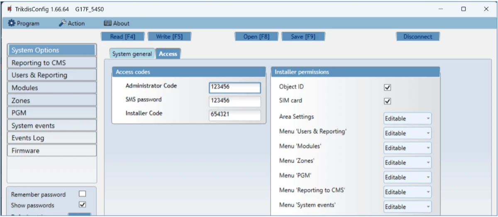

**Inställningsgruppen ”Access codes”**

- **Administrator Code** – ger full åtkomst till konfigureringsfunktionerna (förvald kod – 123456).

- **SMS password** – lösenord för fjärrstyrning och programmering med SMS (förvald kod – 123456).

- **Installer Code** – ger begränsad åtkomst för att ändra larmsändarens konfiguration (förvald kod – 654321).

**Inställningsgruppen ”Installer permissions”**

Administratören kan ange vilka parametrar som installatören får ändra.

### Fönstret ”Reporting to CMS” 

Larmsändaren skickar meddelanden till larmcentralen via internet (IP) eller SMS.

Du kan tilldela primärkanalen en backupkanal. Den används när anslutningen via primärkanalen bryts.

Meddelanden som skickas till larmcentralen är kodade och lösenordsskyddade. En TRIKDIS-mottagare krävs för att ta emot meddelandena och skicka dem vidare till larmcentralens programvara:

- För IP-meddelanden – programvarumottagaren IPcom för Windows/Linux, maskinvarumottagaren IP/SMS RL14 eller flerkanalsmottagaren RM14.

- För SMS – maskinvarumottagaren IP/SMS RL14, flerkanalsmottagaren RM14 eller SMS-mottagaren GM14.

Anslutning via SMS är mycket användbar för backupkanalen eftersom den fungerar även när internetanslutningen i operatörens nät är störd. Vi rekommenderar inte att SMS används som primärkanal.

**Inställningsgruppen ”Primary channel”**

- **Communication type** – välj metod för anslutning till larmcentralens mottagare.

- **Domain or IP** – ange mottagarens domän eller IP-adress.

- **Port** – ange mottagarens nätverksportnummer.

- **Protocol** – TRIKDIS IP-mottagare kan ta emot meddelanden som skickas med protokollet **TRK**, och protokollen **SIA DC-09** används för IP-mottagare som kan ta emot händelsemeddelanden som skickas med SIA DC-09.

- **Phone number** – (bara för SMS) ange telefonnumret till en TRIKDIS SMS-mottagare. Telefonnumret måste börja med landskod (t.ex.: 370xxxxxxxx).

- **Encryption Key** – krypteringsnyckel för meddelanden, 6 siffror. Larmsändarens krypteringsnyckel måste stämma överens med mottagarens.

**Inställningsgruppen ”Backup channel”**

Aktivera backupkanalläget så att meddelanden kan skickas via backupkanalen om anslutningen störs. Konfigurera backupkanalen med samma inställningar som beskrivits ovan.

**Inställningsgruppen ”Settings”**

- **Return to Primary after** – tid efter vilken G17F försöker återfå anslutningen via ”**Primary channel**”.
- **IP PING period** – period för sändning av interna PING-signaler för att kontrollera anslutningen. Dessa meddelanden skickas bara via IP-kanal. Mottagaren vidarebefordrar inte dessa signaler till larmcentralens programvara och överbelastar därför inte programvaran. Programvaran får bara en avisering när mottagaren inte får något PING-meddelande från enheten under en förinställd tid.

Som förval skickar mottagaren meddelandet ”*Connection lost*” till larmcentralens programvara efter en tid som är tre gånger längre än larmsändarens PING-period. Om IP PING-perioden till exempel är 3 minuter skickar mottagaren ett meddelande om förlorad anslutning om den inte får någon PING på 9 minuter.

PING-meddelanden upprätthåller också en aktiv session mellan enheten och mottagaren. En aktiv session krävs för att konfigurera och styra larmsändaren på distans. Vi rekommenderar att PING-perioden ställs in på högst 5 minuter.

- **SMS Ping reporting** - period för sändning av en PING-signal över kanalen för SMS, i minuter. Markera rutan för att aktivera kommunikationskanalen och ange tidsintervallet.

- **Backup reporting after** – ange antalet misslyckade försök att skicka ett meddelande via ”**Primary channel**”. Om meddelandet inte kan skickas efter det angivna antalet försök sänder enheten via ”**Backup channel**”.

- **DNS1, DNS2** – (Domain Name System) server som anger domänens IP-adress. Den används när en domän anges i fältet ”**Domain or IP**” för kommunikationskanalen (i stället för en IP-adress). Förval – adresserna till Googles DNS-servrar.

Följande inställningar visas bara när protokollet **DC-09_2007** eller **DC-09_2012** är valt i fältet ”**Protocol**” för kommunikationskanalen.

- **Object ID in SIA DC-09** – <u>ange objektnumret. Om du har valt protokollet DC-09 används det objektnummer som anges i detta fält</u>. Du kan ange ett hexadecimalt tal med 3–16 tecken som du har fått från larmcentralen.

- **SIA DC-09 receiver No.** – ange mottagarens nummer.

- **SIA DC-09 line No.** – ange linjenumret i mottagaren.

**Inställningsgruppen ”Backup channel 2”**

- **Phone number** - (bara för SMS) ange telefonnumret till en TRIKDIS SMS-mottagare. Telefonnumret måste börja med landskod (t.ex.: 370xxxxxxxx).

### Fönstret ”Users & Reporting”

**Fliken ”Users”**

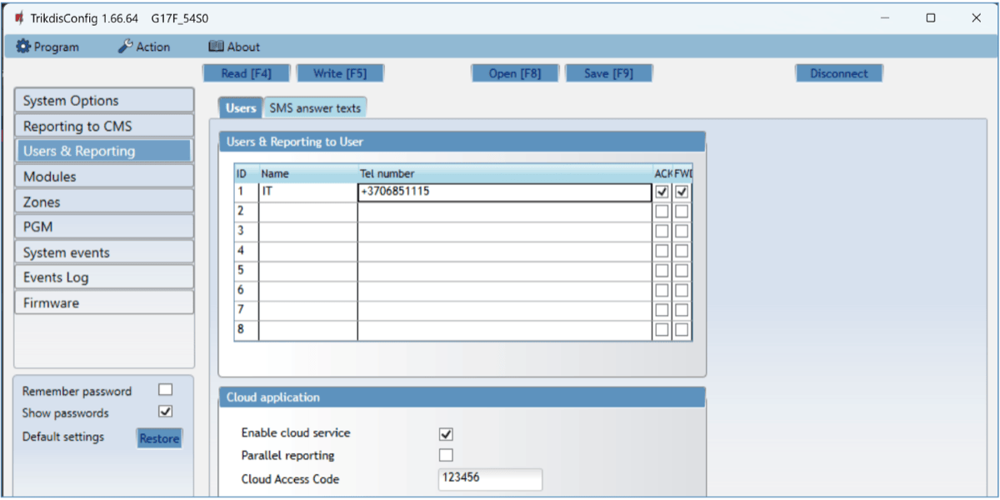

**Inställningsgruppen ”Users & Reporting to User”**

- **ID** – användarens nummer i listan.

- **Name** – användarens namn. Namnen används i SMS om händelser.

- **Tel number** – användarens telefonnummer som tar emot SMS. Numren måste anges med landskod.

- **PGM** – om rutan är markerad kan användaren styra utgångar på distans.

- **ACK** – om rutan är markerad skickar G17F ett SMS med **SMS answer text** till användaren efter varje mottaget SMS-kommando.

- **FWD** – om rutan är markerad vidarebefordras SMS från avsändare som inte är användare i systemet till användaren (t.ex. saldo på SIM-kortet, slumpmässiga reklammeddelanden osv.).

**Inställningsgruppen ”Cloud application”**

- **Enable cloud service** – aktivera tjänsten Protegus så att G17F kan utbyta data med appen Protegus2 och konfigureras på distans med TrikdisConfig.

- **Parallel reporting** – aktivera parallell sändning av meddelanden via **Primary channel** och till Protegus2.

- **Cloud access code** – 6-siffrig kod för inloggning i Protegus2 (förval – 123456).

**Fliken ”SMS answer texts”**

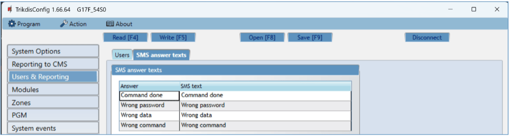

**Inställningsgruppen ”SMS answer texts”**

- Texten för svar på kommandon som skickas med SMS kan anpassas i kolumnen **SMS text**.

**Fliken ”SMS for Panel events”**

Det här fönstret visas bara om minst ett telefonnummer för en användare har lagts till i fönstret ”Users & Reporting”*.*

- **Zn** – händelsens nummer i listan.

- **CID** – händelsens Contact ID-kod.

- **SMS text** – texten i händelsens SMS.

- **User SMS/Call** – välj hur användarna ska informeras om varje händelse – via SMS och/eller samtal.

### Fönstret ”Modules” 

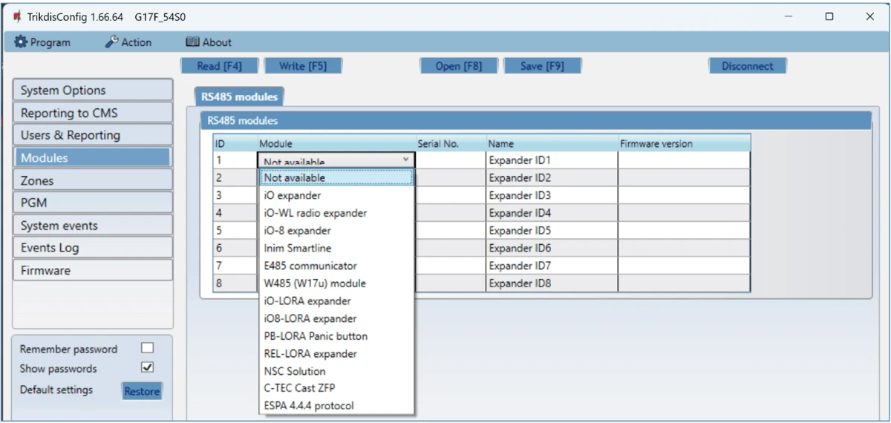

**Inställningsgruppen ”RS485 modules”**

- **ID** – modulens nummer i listan.

- **Module** – välj den modul som används (modulerna iO, iO-WL, iO-8, Inim Smartline, E485, W485, iO-LORA, iO8-LORA, PB-LORA, REL-LORA, NSC Solution, C-TEC Cast ZFP, ESPA 4.4.4) i modullistan.

- **Serial No**. – obligatoriskt 6-siffrigt nummer som finns på modulens kapsling och förpackning.

- **Name** – du kan ge modulen ett namn.

- **Firmware version** – firmwareversionen visas när G17F hittar den anslutna modulen.

**Fliken ”W485 settings”**

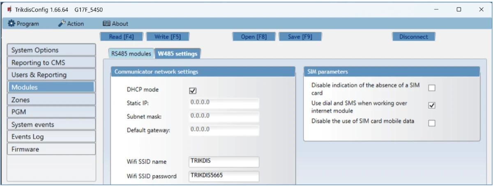

Inställningsfönstret för WiFi-modulen W485 (W17u), inställningsgruppen ”Communicator network settings”

- **DHCP mode** – WiFi-modulens läge för registrering i nätverket (manuellt eller automatiskt). Markera rutan (automatiskt registreringsläge) så läser WiFi-modulen automatiskt nätverksinställningarna (nätmask, gateway) och tilldelas en IP-adress.

  - **Static IP** – statisk IP-adress för manuellt registreringsläge.

  - **Subnet mask** – nätmask för manuellt registreringsläge.

  - **Default gateway** – gateway för manuellt registreringsläge.

  - **Wifi SSID name** – namnet på det WiFi-nätverk som W485 (W17u) ansluter till.

- **Wifi SSID password** - lösenord för WiFi-nätverket.

**Inställningsgruppen ”SIM parameters”**

- **Disable indication of the absence of a SIM card** – när rutan är markerad visar G17F ingen indikering för att SIM-kort saknas.

- **Use dial and SMS when working over internet module** – om du markerar rutan kan larmsändaren styras med telefonsamtal och SMS. Om rutan inte är markerad och ett WiFi-nätverk finns tillgängligt används varken SMS eller telefonsamtal. Om rutan inte är markerad och inget WiFi-nätverk finns kan G17F ändå styras med telefonsamtal och SMS. G17F skickar SMS till användaren.

- **Disable the use of SIM card mobile data** – om du markerar rutan avaktiveras användningen av SIM-kortets mobildata. Data skickas då bara via modulen W485. Om WiFi-nätverket kopplas bort lagrar G17F data i minnet. När WiFi-nätverket är åter skickar G17F de sparade data via WiFi-modulen W485.

**Fliken ”E485 settings”**

Inställningsfönstret för Ethernet-modulen E485, inställningsgruppen ”Communicator network settings”

- **DHCP mode** – Ethernet-modulens läge för registrering i nätverket (manuellt eller automatiskt).

  - **Static IP** – statisk IP-adress för manuellt registreringsläge.

  - **Subnet mask** – nätmask för manuellt registreringsläge.

  - **Default gateway** – gateway för manuellt registreringsläge.

**Inställningsgruppen ”SIM parameters”**

- **Disable indication of the absence of a SIM card** – när rutan är markerad visar G17F ingen indikering för att SIM-kort saknas.

- **Use dial and SMS when working over internet module** – om du markerar rutan kan larmsändaren styras med telefonsamtal och SMS. Om rutan inte är markerad och internet finns tillgängligt används varken SMS eller telefonsamtal. Om rutan inte är markerad och inget internet finns kan G17F ändå styras med telefonsamtal och SMS. G17F skickar SMS till användaren.

- **Disable the use of SIM card mobile data** – om du markerar rutan avaktiveras användningen av SIM-kortets mobildata. Data skickas då bara via modulen E485. Om internetanslutningen försvinner lagrar G17F data i minnet. När internetanslutningen är åter skickar G17F de sparade data via Ethernet-modulen E485.

### Fönstret ”Zones” 

**Fliken ”Zones settings”**

- **Zone No** – sektionens nummer i listan.

- **Name** - sektionen kan ges ett namn som används i SMS.

- **Input** – välj vilken ingång IN på G17F eller på en utbyggnadsmodul som ska tilldelas sektionen.

- **Definition** – alla sektioner har definitionen **24 hours**. Om sektionen påverkas skickas ett meddelande om händelsen omedelbart.

- **Type** – välj i en lista typen av krets som är ansluten till sektionsingången IN: NC – normalt sluten kontakt, NO – normalt öppen kontakt, EOL – med ett slutmotstånd (4,7 kΩ eller 10 kΩ) i slutet av kretsen.

- **CMS** – om rutan är markerad skickas meddelanden om sektionshändelser till larmcentralen (CMS, Central Monitoring Station).

- **Prot**. – om rutan är markerad skickas aviseringar om sektionshändelser till appen Protegus2.

- **Delay** – reaktionstid för sektionsingången IN i millisekunder.

- **CID Code** – händelsens Contact ID-kod.

- **SIA E** – SIA-händelsekod.

- **SIA R** – SIA-återställningskod.

- **LOOP** - slingnumret anges i SMS.

**Fliken ”SMS & Call reporting”**

Det här fönstret visas bara om minst ett telefonnummer för en användare har lagts till i fönstret ”Users & Reporting”*.*

- **Zn** – sektionsnummer med ett ord som identifierar händelsen. Kan vara ”*Event*” eller ”*Restore*”.

- **SMS text** – beskrivning av sektionshändelsen som ingår i SMS till användarna.

- **User SMS/Call** – välj hur användarna ska informeras om varje sektionshändelse – via SMS och/eller samtal.

### Fönstret ”PGM”

**Fliken ”Outputs”**

- **PGM No** – PGM-utgångens nummer i listan.

- **PGM output** – tilldela PGM en utgång OUT på G17F eller på en extern enhet.

- **Output definition** – välj driftläge för en utgång OUT.

- **Pulse time, s** – ange hur länge OUT ska vara påslagen, från 0 till 9999 sekunder.

- **CMS** – om rutan är markerad skickas meddelanden om valda händelser till larmcentralen.

- **Prot**. – om rutan är markerad skickas aviseringar om utgångshändelser till appen Protegus2.
- **SIA E** – SIA-händelsekod.
- **SIA R** – SIA-återställningskod.

**Fliken ”SMS & Call reporting”**

Det här fönstret visas bara om minst ett telefonnummer för en användare har lagts till i fönstret ”Users & Reporting”

- **PGM** – numret på utgången OUT och typen av händelse när den slås på/av (”*Event*” – händelsen när OUT slås på och ”*Restore*” – händelsen när OUT slås av).

- **SMS text** – namnet på händelsen när OUT slås på/av, som ingår i händelsens SMS.

- **User SMS/Call** – välj vilka användare som ska informeras via SMS och/eller samtal när en utgång OUT slås på/av.

### Fönstret ”System events” 

**Fliken ”Events”**

- **ID** – händelsens nummer i listan.

- **Event name** – händelsens namn.

- **Enable** – aktivera igenkänning av händelsen.

- **CMS** – meddelanden om valda händelser skickas till larmcentralen.

- **Prot**. – aviseringar om valda händelser skickas till appen Protegus2.

- **CID Code** – händelsens Contact ID-kod.
- **SIA E** – SIA-händelsekod.

- **SIA R** – SIA-återställningskod.
- **LOOP** - slingnumret anges i SMS.

- **SMS event text** – texten i händelsens SMS.

- **SMS restore text** - texten i SMS för händelsens återställning.

**Fliken ”SMS & Call reporting”**

Det här fönstret visas bara om minst ett telefonnummer för en användare har lagts till i fönstret ”Users & Reporting”

- **ID** – händelsens nummer i listan och identifierande ord (*Event*, *Restore*).

- **Event SMS text** – text som används i SMS om händelser.

- **User SMS/Call** – välj hur användarna ska informeras om varje händelse – via SMS och/eller samtal.

### Fönstret ”Events Log”

- Knappen **Read Log** – för att läsa händelseloggen från enhetens minne.

- Knappen **Clear Log** – för att radera händelseloggens poster från enhetens minne.

- I tabellen finns **Event No.**, **Time**, koden **CID** och **Event definition**. Händelseloggen kan visa upp till 1 000 händelser som är lagrade i G17F:s minne.

### Återställa fabriksinställningarna 

För att återställa larmsändarens fabriksinställningar klickar du på knappen **Restore** i TrikdisConfig.

## Ställa in parametrar på distans 

!!! warning "Viktigt"
    Fjärrkonfigurering fungerar bara om G17F:

    1.  Har ett isatt och aktiverat SIM-kort där PIN-koden är angiven eller
        avstängd.

    2.  Har tjänsten Protegus aktiverad. Se **5.4 (fönstret
        ”Users & Reporting”)**.

    3.  Är påslagen (lysdioden ”POWER” ska lysa fast grönt);

    4.  Är ansluten till ett nät (lysdioden ”NETWORK” ska lysa fast grönt och
        blinka gult).

    Om ”NETWORK” lyser fast gult eller ”DATA” lyser fast gult kan
    enheten inte ansluta till GSM och/eller Protegus2.
1.  Starta konfigurationsprogrammet TrikdisConfig på datorn.

2.  I fönstret **Remote access** anger du larmsändarens nummer ”Unique ID”. Numret finns på baksidan av enheten och på enhetens förpackning.

3. (Valfritt) Ange önskat namn på larmsändaren i fältet **System Name**.

2.  Klicka på **Configure**.

3.  I fönstret som öppnas klickar du på **Read [F4]**. Ange administratörs- eller installatörskoden om du uppmanas.

4.  När du har angett önskade parametrar klickar du på **Write [F5]**. Om du är klar med ***TrikdisConfig*** klickar du på **Disconnect.**

## Testa larmsändaren G17F 

När konfigureringen och installationen är klara, gör en systemkontroll:

1.  För att testa en ingång på larmsändaren, aktivera den. Kontrollera att händelserna har tagits emot av larmcentralen (CMS) och/eller i appen Protegus2.

2.  För att testa larmsändarens utgångar, slå på dem på distans och kontrollera att de fungerar. Kontrollera att händelserna har tagits emot av larmcentralen (CMS) och/eller i appen Protegus2.

3.  Utlös ett brandlarm som test och kontrollera att larmcentralen tar emot händelserna korrekt.

## Firmwareuppdatering 

!!! note "Obs!"
    När larmsändaren har anslutits till TrikdisConfig erbjuder programmet
    automatiskt att uppdatera firmware om det finns uppdateringar. Internetanslutning krävs
    för den här funktionen. Antivirusprogram, brandvägg eller strikta inställningar för internetåtkomst kan blockera den
    automatiska uppdateringen.
Larmsändarens firmware kan också uppdateras eller bytas manuellt. Alla tidigare inställningar i larmsändaren finns kvar efter en uppdatering. Om firmware installeras manuellt kan den bytas till en nyare eller äldre version. Gör så här:

1.  Starta ***TrikdisConfig**.*

2.  Anslut larmsändaren till datorn med en USB Mini-B-kabel eller anslut till larmsändaren på distans.

    - Om en nyare firmwareversion finns erbjuder programmet automatiskt att installera den.

3.  Öppna fönstret **Firmware** i TrikdisConfig.

4. Klicka på knappen **Open firmware** och välj den firmwarefil som behövs.

2.  Klicka på knappen **Update [F12]**.

3.  Vänta tills uppdateringen är klar.

## Säkerhetskrav 

Larmsändaren ska installeras och underhållas av behörig personal.

Läs den här manualen noggrant före installationen för att undvika misstag som kan leda till funktionsfel eller till och med skador på utrustningen.

Koppla bort matningen innan du gör några elektriska anslutningar.

Ändringar, modifieringar eller reparationer som inte har godkänts av tillverkaren upphäver garantin.

Följ de lokala reglerna för avfallssortering och släng inte denna utrustning eller dess komponenter bland vanligt hushållsavfall.
