# Radiosändare T16

## Beskrivning 

Radiosändaren T16 är en multifunktionell radioenhet som används för att överföra centralapparatens händelsemeddelanden via TRIKDIS radionät.

Sändaren kan skicka egna händelsemeddelanden och händelsemeddelanden som tas emot från centralapparater till larmcentralen (CMS, Central Monitoring Station), med möjlighet att vidarebefordra dem till slutanvändaren.

#### Funktioner

**Kommunikation**

- Skickar händelsemeddelanden till larmcentralen.

- Radionätsprotokollen RAS3, RAS2M, LARS1 och LARS.

- Sändningseffekt från 1 W till 5 W.

- Möjlighet att använda en extern IP-larmsändare som primär kommunikationskanal.

- Överföring av händelsemeddelanden med Contact ID- och 4+2-koder.

- Användning av centralapparatens abonnentkod i system med flera områden.

**Konfigurering**

- Snabb och enkel installation.

- Firmwareuppdateringar.

- Två behörighetsnivåer (konton): för installatören och för administratören.

- Möjlighet att konfigurera på distans när en IP-larmsändare används.

**Seriell port, ingångar och utgångar**

- Universell seriell port för anslutning av olika centralapparater.

- TIP/RING-gränssnittet för analog telelinje kan ta emot meddelanden från centralapparaten i Contact ID- och 4+2-koder.

- RS485-gränssnitt för IP-larmsändare och utbyggnadsmoduler.

- 6 ingångar med valbara typer: NC, NO, EOL (2,2 kΩ). (*T16V*, *T16U*)

5 ingångar med valbara typer: NC, NO, EOL (2,2 kΩ). (*T16U5*)

- 1 utgång. (*T16V*, *T16U*)

2 utgångar. (*T16U5*)

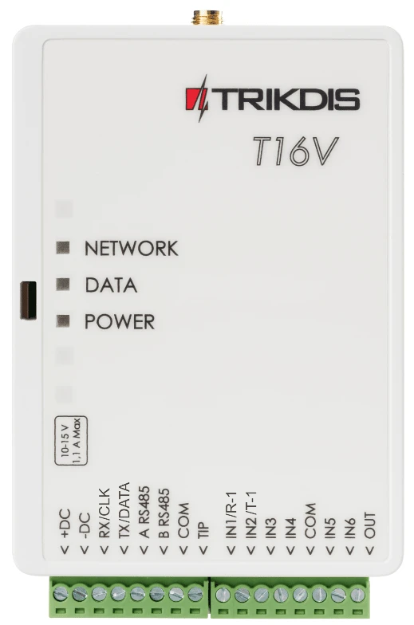

### Funktionsbeskrivning 

När sändaren är ansluten till centralapparatens plintar läser den signalerna från centralapparaten och omvandlar dem till meddelanden som motsvarar koderna i protokollet Contact ID.

Om sändaren är inställd på att sända med radiosystemet RAS-3:s kodning skickas *Contact ID*-meddelandet oförändrat. Om sändaren är inställd på någon annan radiosystemkodning omvandlas meddelandena till det systemets koder. Omvandlingstabellen finns lagrad i sändarens minne och kan ändras vid behov. Om *TRIKDIS*-utrustning används för mottagningen vidarebefordras meddelanden som sänts i vilken kodning som helst till larmcentralens programvara med exakt samma betydelse. Externa kretsar av typen *NC, NO* eller *EOL=2,2 kΩ* kan anslutas till sändarens *IN*-plintar (ingångar). Om kretsens tillstånd ändras eller återgår till utgångsläget skickar sändaren ett händelsemeddelande.

Sändaren skickar centralapparatens meddelanden på en förinställd radiofrekvens och med en förinställd kodning. Samma meddelande kan upprepas 1–10 gånger. Sändaren kan ställas in så att den skickar meddelanden i två olika radiosystemkodningar, på två olika radiofrekvenser och med olika identifieringsnummer för den skyddade anläggningen.

Sändaren skickar periodiska **Test**-meddelanden för att kontrollera förbindelsen. Mottagningen av dessa meddelanden övervakas av larmcentralens programvara för meddelandeövervakning. Det går också att skicka **PING**-meddelanden kontinuerligt. Mottagningen av dem övervakas av larmcentralens mottagarutrustning.

Sändaren kontrollerar matningsspänningen automatiskt. Om spänningen sjunker under 11,5 ±0,2 V skickar sändaren ett meddelande om att matningsspänningen är otillräcklig. Om spänningen stiger över 12,6 ±0,2 V skickar sändaren ett meddelande om att matningsspänningen är återställd.

Om matningsspänningen sjunker under 10 ±0,2 V går sändaren över i strömsparläge. Innan den gör det skickar sändaren ett meddelande om spänningsfallet. I strömsparläge lagrar och skickar sändaren inga meddelanden. Sändaren återgår från strömsparläge till normalt läge först när matningsspänningen på 12,6 V är stabil efter att sändarens matning har slagits på.

**DC-matning.** T16 måste anslutas direkt till centralapparatens matningsplintar (AUX) eller till plintarna på 12 V-batteriet. Matningsledarens area ska vara minst 1 mm2. Vid sändning förbrukar sändaren 1,2 A ström, så en stabil matningsspänning är viktig för att sändaren ska fungera tillförlitligt.

**Antenn.** Antennen är mycket viktig för en förbindelse av god kvalitet. Använd endast en antenn som är avsedd för rätt frekvens och effekt. Om du använder en 1/4 λ-antenn ska den monteras vertikalt och så högt som möjligt. Montera inte antennen där metallskärmar eller betongväggar skymmer mottagningsantennen. Förbindelsens kvalitet är bäst när sändarens och mottagarens antenner har fri sikt mot varandra. Vanligtvis kan förbindelsens kvalitet förbättras genom att antennen monteras så högt som möjligt. Antennen ska anslutas till sändaren med en koaxialkabel på 50 Ω. Ju längre kabel, desto större signalförluster. Vi rekommenderar en kabel som inte är längre än 10 meter. När kabeln är kortare än 5 m rekommenderas RG-58U eller en bättre kabel. Använd en kabel med lägre dämpning för längre kabellängder. Kontrollera förbindelsens kvalitet när sändaren är installerad. Skicka några meddelanden och kontrollera signalnivån i mottagaren. En signalnivå på minst 3 är tillräcklig.

**Datakabel**. Datakabeln mellan radiosändaren och centralapparaten får vara högst 50 cm lång. Om datakabeln är längre måste en skärmad kabel användas. Datakabeln ska anslutas till centralapparatens knappsatsbuss, serieport eller telefonuppringare. Dra inte kabeln parallellt med nätspänningskablar, antennkabeln eller andra källor till starka elektromagnetiska fält.

**RS485-gränssnitt**. Modulerna W485 och TM17 kan anslutas till sändarens RS485-gränssnitt. När RS485-bussen är längre än 1 m ska en partvinnad kabel (STP 4x2x0,5) användas. Dra inte kabeln parallellt med nätspänningskablar, antennkabeln eller andra källor till starka elektromagnetiska fält.

### Specifikationer 

| Parameter | T16V | T16U | T16U5 |
|-----------|------|------|-------|
| Matningsspänning | 10–15 V DC |  |  |
| Strömförbrukning | Upp till 50 mA (viloläge) / upp till 1,2 A (sändningsläge) |  |  |
| Radiofrekvenser | 136 MHz – 174 MHz (VHF) | 430 MHz – 512 MHz (UHF) | 430 MHz – 470 MHz (UHF) |
| Radiokanaler | 2 |  |  |
| RF-utgångens impedans | 50 Ω |  |  |
| Sekundära emissioner | Uppfyller kraven i EN 300 113 |  |  |
| Sändningsprotokoll | RAS3, RAS2M, LARS, LARS1, LARS_RAS2M, LARS1_RAS2M |  |  |
| Sändningstid | 60–400 ms (beror på valt radioprotokoll) |  |  |
| Minne | Upp till 32 meddelanden |  |  |
| Ingångar | 6, valbara typer: NC, NO, EOL (2,2 kΩ) | 6, valbara typer: NC, NO, EOL (2,2 kΩ) | 5, valbara typer: NC, NO, EOL (2,2 kΩ) |
| Utgång | 1, typ OC, brytspänning 15 V, 1 A | 1, typ OC, brytspänning 15 V, 1 A | 2, typ OC, brytspänning 15 V, 1 A |
| Format för händelsemeddelanden | Contact ID; 4+2 |  |  |
| Driftmiljö | Temperatur från –20 °C till +50 °C, relativ luftfuktighet 80 % vid +20 °C |  |  |
| Mått | 113 × 71 × 26 mm |  |  |
| Vikt | 0,10 kg |  |  |

Mottagare för meddelanden som skickas i olika radiosystemformat av sändare i T16-serien

|                     | RAS-002 | RAS-2M | LARS  | LARS1 | RAS-3_CID |
|---------------------|:-------:|:------:|:-----:|:-----:|:---------:|
| TRIKDIS R7          |  **+**  | **+**  | **+** | **+** |           |
| TRIKDIS RF7         |  **+**  | **+**  | **+** | **+** |           |
| TRIKDIS R11         |  **+**  | **+**  | **+** | **+** |   **+**   |
| TRIKDIS RF11        |  **+**  | **+**  | **+** | **+** |   **+**   |
| Andra tillverkare   |         |        | **+** | **+** |           |

### Sändarens delar 

|  |  | SMA-kontakt för antenn. Lysdiodsindikeringar. Spår för att öppna det övre locket. Plintar för anslutning av ledare. |
|--|--|----------------------------------------------------------------------------------------------------------------|
| T16V, T16U | T16U5 |  |

### Plintarnas funktion 

| Plint | Beskrivning |
|----------|-------------|
| +DC | Matningsplint (plus, 10–15 V DC) |
| -DC | Matningsplint (minus, 10–15 V DC) |
| Rx/CLK | Plint CLK på centralapparatens serieport |
| Tx/DATA | Plint DATA på centralapparatens serieport |
| A 485 | Plint A på RS485-bussen |
| B 485 | Plint B på RS485-bussen |
| COM/RING | Gemensam plint (minus) eller RING-plint för telefonuppringare |
| TIP | TIP-plint för telefonuppringare |
| IN1/R-1 | Plint för ingång 1, valbara typer: NC, NO, EOL (2,2 kΩ). (fabriksinställning NO) eller plint för övervakning av telelinjen |
| IN2/T-1 | Plint för ingång 2, valbara typer: NC, NO, EOL (2,2 kΩ). (fabriksinställning NO) eller plint för övervakning av telelinjen |
| IN3 | Plint för ingång 3, valbara typer: NC, NO, EOL (2,2 kΩ). (fabriksinställning NO) |
| IN4 | Plint för ingång 4, valbara typer: NC, NO, EOL (2,2 kΩ). (fabriksinställning NO) |
| COM | Gemensam plint (minus) |
| IN5 | Plint för ingång 5, valbara typer: NC, NO, EOL (2,2 kΩ). (fabriksinställning NO) |
| IN6 eller | Plint för ingång 6, valbara typer: NC, NO, EOL (2,2 kΩ). (fabriksinställning NO). (T16V, T16U) |
| OUT1 | Utgångsplint, typ öppen kollektor, ström upp till 1 A. (T16U5) |
| OUT1 eller | Utgångsplint, typ öppen kollektor, ström upp till 1 A. (T16V, T16U) |
| OUT2 | Utgångsplint, typ öppen kollektor, ström upp till 1 A. (T16U5) |

### Lysdiodsindikering vid drift 

| Indikator | Lysdiodens läge | Beskrivning |
|-----------|--------------|-------------|
| NETWORK | Blinkar grönt | Radiosändaren skickar data |
| DATA | Fast grönt sken | Osända händelsemeddelanden finns i minnesbufferten |
| DATA | Fast rött sken | Minnesbufferten är överfull |
| DATA | Blinkar rött (1/1) | Problem med anslutningen till centralapparaten |
| DATA | Blinkar rött (1/10) | Problem med anslutningen till RS485-modulen |
| POWER | Blinkar grönt | Matningsspänning finns |
| POWER | Blinkar gult | Låg matningsspänning |
| POWER | Blinkar grönt och gult | (Konfigurationsläge) USB-kabeln är ansluten |

### Nödvändiga komponenter för installationen 

Kontrollera innan du börjar installera att du har:

1.  en USB-kabel (Mini-B) för konfigurering;

2.  minst 4-ledarkabel för att ansluta sändaren till centralapparaten;

3.  installationsmanualen för den centralapparat som sändaren ska anslutas till;

4.  en antenn;

5.  en spårskruvmejsel, 2,5 mm.

Beställ nödvändiga komponenter från din lokala distributör.

## Schemata och installation 

### Kopplingsscheman för inkoppling av centralapparater 

Lista över centralapparater som sändarna *T16V, T16U* och *T16U5* kan anslutas till:

| Tillverkare | Centralapparatens modell | T16V, T16U, T16U5 |
|--------------|---------------------|-------------------|
| DSC® | PC1616, PC1832, PC1864, PC1616, PC1832, PC1864 | + |
| PYRONIX® | MATRIX 424, MATRIX 832, MATRIX 832+, MATRIX 6, MATRIX 816 | + |
| GE® | CADDX NX-4, NX-6, NX-8, NX-8E | + |
| PARADOX® | SPECTRA SPxxxx, 1727, 1728, 1738 | + |
| PARADOX® | MAGELLAN MG5000, MG5050 | + |
| PARADOX® | DIGIPLEX EVO48, EVO192, EVOHD, NE96, EVO96 | + |
| PARADOX® | ESPRIT E55, E65, 728ULT, 738ULT | + |
| SECOlink | PAS832 | + |
| TEXECOM | PREMIER 412, 816, 816+, 832 / PREMIER ELITE 12, 24, 48, 88, 168, 640 | + |
| CROW | RUNNER | + |
| ARGUS-SPECTR | Strelec RROP | + |
| BOLID | C2000 | + |
| ROVALANT | A6-06 (LARS / MAYAK) | + |
| RISCO | LightSYS | + |
| Honeywell | Vista | + |
| INIM | Smartline | + |
| Telefonuppringare | CID; 3/1, 4/1, 4/2 2300; 3/1, 4/1, 4/2 1400 | + |

Ingångarna (IN) på sändarna ***T16V,** **T16U, T16U5*** kan anslutas direkt till olika enheter (t.ex. detektorer, överfallsknapp, sirenutgång) eller till centralapparatens programmerbara utgångar PGM. Du måste välja rätt ingångstyp (*IN*) beroende på hur den anslutna enheten fungerar.

**DC-matning**. Anslut sändaren med en ledare med en area på minst 1 mm². Undvik långa kablar (rekommenderad längd – upp till 1 m). Dra inte kabeln parallellt med nätspänningskablar, antennkabeln eller andra starka källor till elektromagnetiska fält. Radiosändaren förbrukar 1,2 A ström i sändningsläge, så en stabil strömkälla behövs för matningen (centralapparatens AUX-plintar, eller direkt till batteriplintarna).

**Datakabel**. Datakabeln mellan radiosändaren och centralapparaten får vara högst 50 cm lång. Om datakabeln är längre måste en skärmad kabel användas. Datakabeln ska anslutas till centralapparatens knappsatsbuss, serieport eller telefonuppringare. Dra inte kabeln parallellt med nätspänningskablar, antennkabeln eller andra starka källor till elektromagnetiska fält.

#### DSC

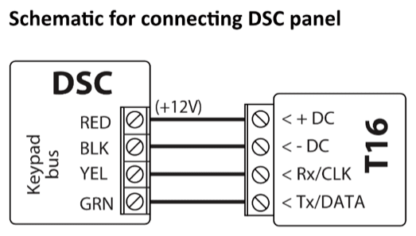

#### PARADOX

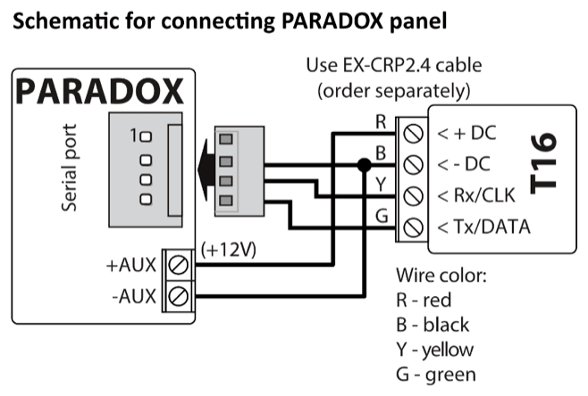

#### CADDX

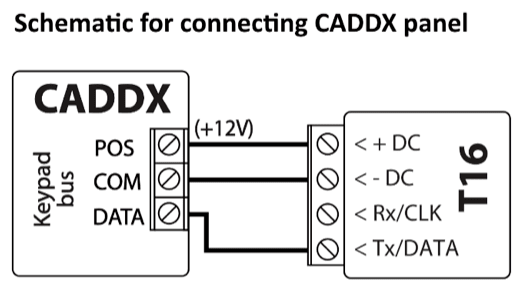

#### TEXECOM

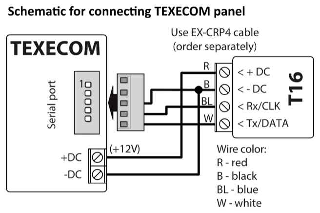

#### CROW Runner

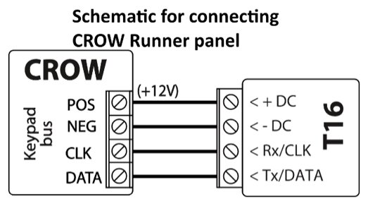

#### SECOLink

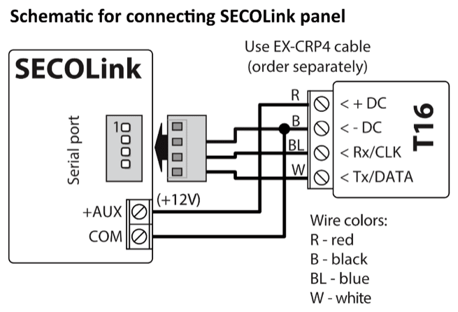

#### ARGUS-SPEKTR STRELEC

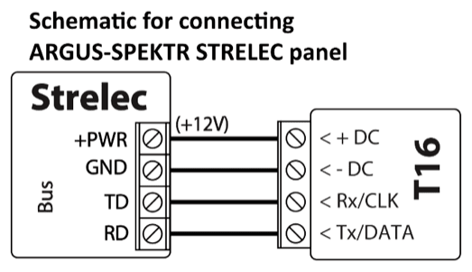

#### BOLID C2000

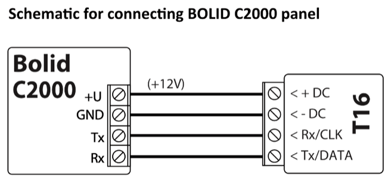

#### PYRONIX

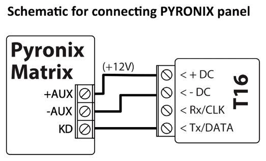

#### ROVALANT A6-06

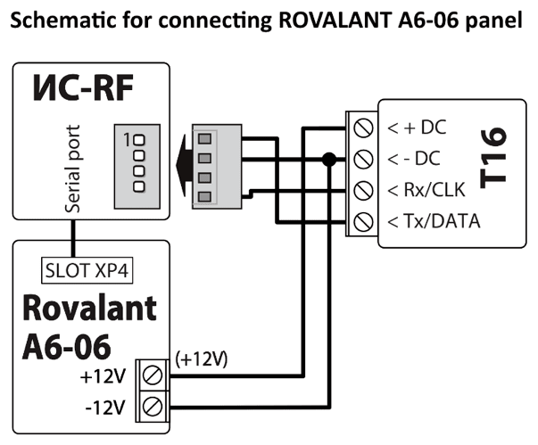

#### RISCO LightSYS

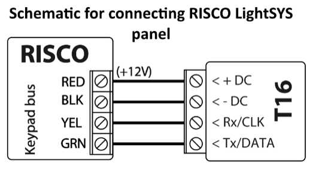

#### HONEYWELL VISTA

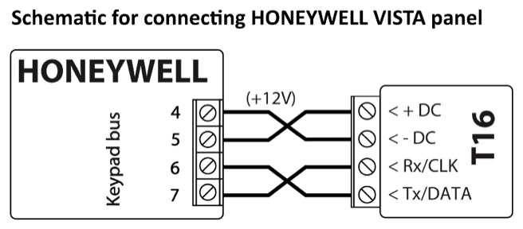

#### INIM SMARTLINE

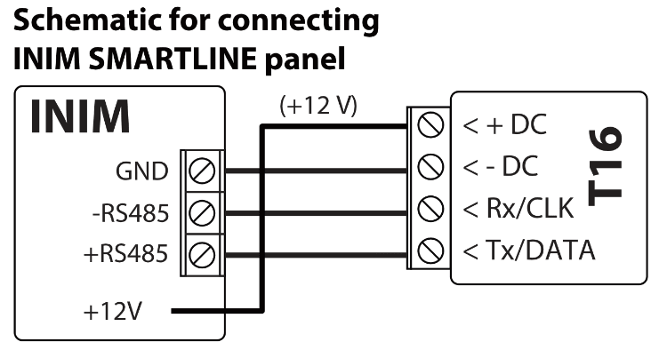

### Kopplingsschema för inkoppling av centralapparatens telefonuppringare 

#### Utan övervakning av telelinjen

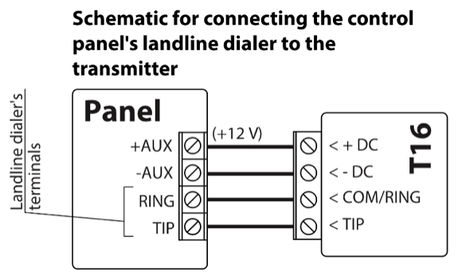

#### Med övervakning av telelinjen

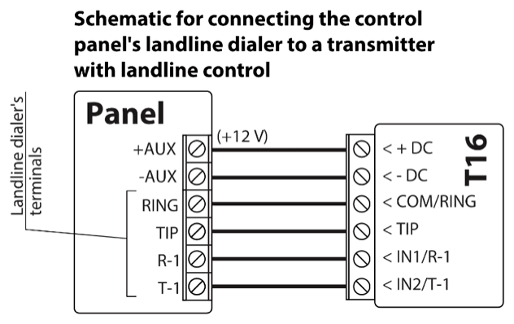

!!! warning "Viktigt"
    T16 får inte anslutas till en fungerande analog telelinje.
Ställ in följande parametrar för centralapparatens telefonuppringare enligt centralapparatens programmeringsanvisningar:

- Ange centralapparatens identifieringsnummer med 4 tecken (abonnentkod, 0–9, A–F);

- Ange det 2-teckens telefonnummer till den mottagare som centralapparaten ringer upp när en händelse inträffar (t.ex. 12). Om centralapparatens TLC-programmeringsregel kräver det, ange en slutsymbol efter numret;

- Ställ in att meddelandena överförs med DTMF-toner;

- Ställ in formatet Contact ID för automatisk meddelandeöverföring.

- Om du vill överföra särskilda meddelanden, eller om centralapparaten inte har automatisk Contact ID-kodning, anger du de händelsekoder som behövs manuellt.

Generera ett meddelande i centralapparaten och kontrollera gränssnittets funktion. Indikeringen ”DATA” blinkar när sändaren läser centralapparatens meddelanden.

Kontrollera att sändaren har skickat alla centralapparatens meddelanden som genererades under testet korrekt till den inställda mottagaren.

### Kopplingsscheman för anslutning av ingångar 

Sändaren har 6 (eller 5) ingångsplintar (IN1, IN2, IN3, IN4, IN5, IN6) för anslutning av kretsar av typerna NO, NC och EOL. Fabriksinställningen för alla ingångar är typ NO. Ingångskretsens typ kan ändras i TrikdisConfig-fönstret **Events → Inputs**.

Kopplingsscheman för anslutning av kretsar av typerna NO, NC och EOL:

#### Normalt öppen (NO)

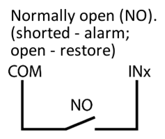

#### Normalt sluten (NC)

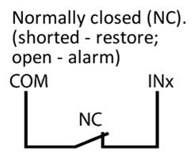

#### Normalt sluten med slutmotstånd på 2,2k (EOL)

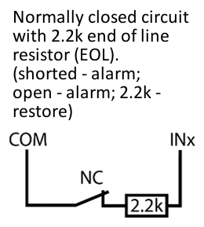

#### Normalt öppen med slutmotstånd på 2,2k (EOL)

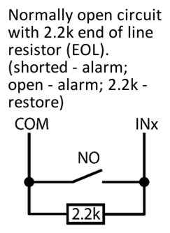

### Kopplingsschema för inkoppling av centralapparatens PGM-utgångar 

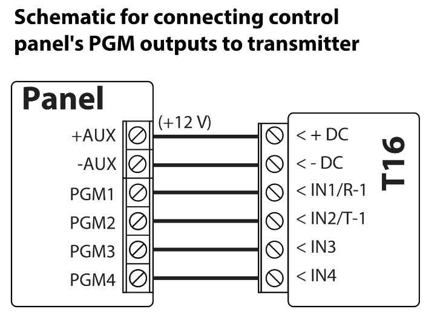

Sändarens ingångar (IN) ska ställas in på NO eller NC.

### Kopplingsschema för inkoppling av en siren 

Sirenen ska anslutas när *TM17* är ansluten till sändaren. En siren som förbrukar upp till 1 A ström kan anslutas till utgången OUT1 (eller OUT2) på sändaren *T16*. Sirenen aktiveras om en av sändarens ingångar (IN) utlöses när systemet är tillkopplat. Sirenen stängs av efter 3 minuter eller när en kontaktnyckel används.

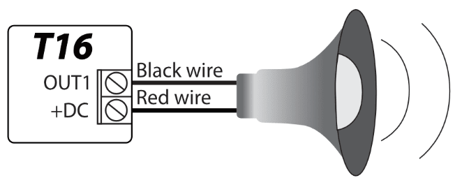

### Kopplingsscheman för inkoppling av RS485-moduler 

#### Wi-Fi-modul W485

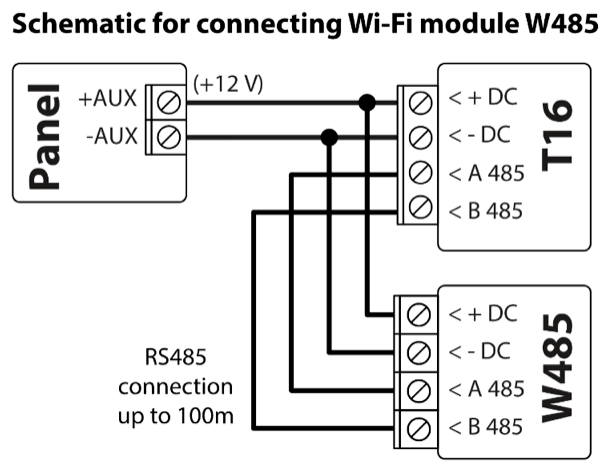

#### TM17-läsare

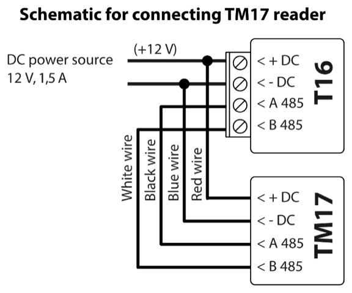

#### Ethernet-modul E485

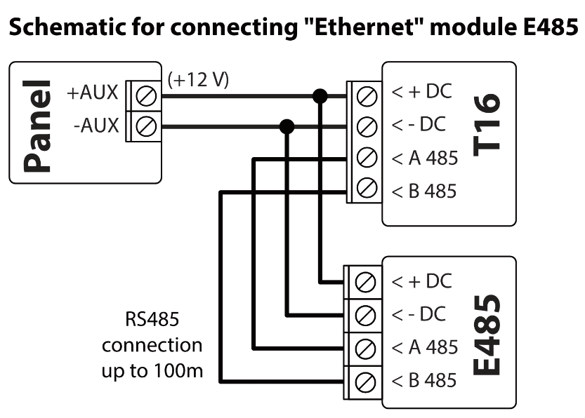

När RS485-databussen är längre än 1 m ska en partvinnad kabel (STP 4x2x0,5) användas. Dra inte kabeln parallellt med nätspänningskablar, antennkabeln eller andra starka källor till elektromagnetiska fält.

Wi-Fi-modulen W485 är kompatibel med radiosändaren T16. W485 skickar meddelanden trådlöst via en Wi-Fi-router och internet till larmcentralen (CMS, Central Monitoring Station).

Ethernet-modulen E485 är kompatibel med radiosändaren T16. E485 skickar meddelanden från T16 till larmcentralen (CMS) via ett trådbundet datornätverk.

## Inställning av parametrar med programvaran TrikdisConfig 

1.  Ladda ned konfigurationsprogrammet **TrikdisConfig** från [www.trikdis.com](http://www.trikdis.com/lt) (skriv ”TrikdisConfig” i sökfältet) och installera det.

2.  Ta av det främre locket på T16 med en spårskruvmejsel enligt bilden nedan:

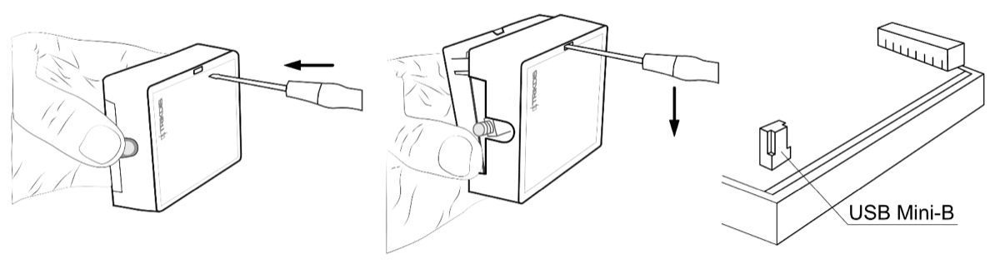

1.  Anslut T16 till en dator med en USB Mini-B-kabel.

2.  Starta konfigurationsprogrammet TrikdisConfig. Programmet identifierar automatiskt den anslutna enheten. Om du uppmanas, ange administratörs- eller installatörskoden i ett popup-fönster, så öppnar TrikdisConfig automatiskt konfigurationsfönstret för T16.

### Beskrivning av statusfältet i TrikdisConfig 

När T16 är ansluten till programvaran TrikdisConfig visar programmet information om den anslutna enheten i statusfältet:

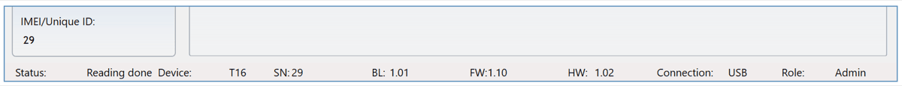

| Objekt        | Beskrivning                                             |
|---------------|---------------------------------------------------------|
| Unique ID     | Enhetens serienummer                                    |
| Status        | Driftstillstånd                                         |
| Device        | Enhetstyp (T16 ska visas)                               |
| SN            | Enhetens serienummer                                    |
| BL            | Bootloader-version                                      |
| FW            | Enhetens firmwareversion                                |
| HW            | Enhetens maskinvaruversion                              |
| State         | Typ av anslutning till programmet (via USB eller på distans) |
| Administrator | Behörighetsnivå (visas när åtkomstkoden har godkänts)   |

!!! note "Obs!"
    Klicka på **Read [F4]** för att programmet ska läsa och visa de
    inställningar som för tillfället är sparade i enheten. / Klicka på **Write [F5]**
    för att spara de inställningar som gjorts i programmet i enheten. / Klicka på **Save [F9]**
    för att spara inställningarna i en konfigurationsfil. Du kan senare ladda in de sparade
    inställningarna i andra enheter. På så sätt kan du snabbt konfigurera
    flera enheter med samma inställningar. / Klicka på **Open [F8]** och
    välj en konfigurationsfil för att visa tidigare sparade inställningar. / Om du
    vill återgå till fabriksinställningarna klickar du på knappen **Restore**
    längst ned till vänster på skärmen.
När du har klickat på **Read [F4]** läser programmet in och visar de inställningar som för tillfället är sparade i T16. Ange de inställningar som behövs i TrikdisConfig enligt beskrivningarna av programfönstren nedan.

### Fönstret ”MainSetting” 

**Fliken ”Settings”**

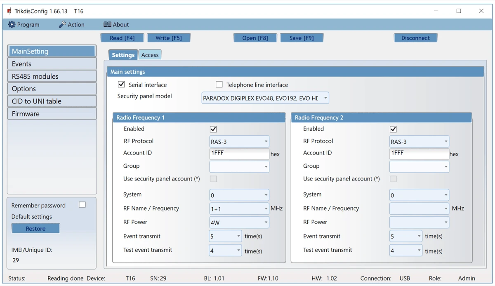

**Inställningsgruppen ”Main settings”**

- **Serial interface** – markera kryssrutan när T16 är ansluten till centralapparatens seriella port.

- **Telephone line interface** - markera kryssrutan när T16 är ansluten till centralapparatens telefonuppringare.

- **Security panel model** – ange vilken typ av centralapparat som sändaren ska anslutas till.

**Inställningsgruppen ”Radio frequency 1”**

- **Enabled** – markera kryssrutan för att aktivera sändarens radiokanal.

- **RF protocol** – ange vilket radioprotokoll som ska användas (RAS-2M, RAS-3, LARS, LARS1, LARS_RAS2M, LARS1_RAS2M).

- **Account ID** – ange användarens identifieringsnummer för de interna händelser och centralapparatens händelser som sändaren skickar.

- **Group** – ange det partiella användar-ID:t (används endast med radioprotokollet LARS).

- **Use security panel account** – markera kryssrutan så skickas centralapparatens händelser med centralapparatens ID. Inte alla centralapparater tillåter att identifieringsnumret används.

- **System** – radionätets systemnummer. Används för att tilldela anläggningar (användare) till grupper i ett radionät.

- **RF name/frequency** – namnet på radiokanalens frekvens. Det kan anges i fönstret **Options > Available radio frequencies**.

- **RF power** – välj sändningseffekt (1–5 W).

- **Event transmit** – ange hur många gånger händelsesändningen ska upprepas (1–10 gånger). (Vi rekommenderar att förvalda inställningar behålls).

- **Test event transmit** – ange hur många gånger testsändningen ska upprepas (1–10 gånger). (Vi rekommenderar att förvalda inställningar behålls).

**Inställningsgruppen ”Radio frequency 2”**

Inställningarna är identiska med **Radio frequency 1**.

**Fliken ”Access”**

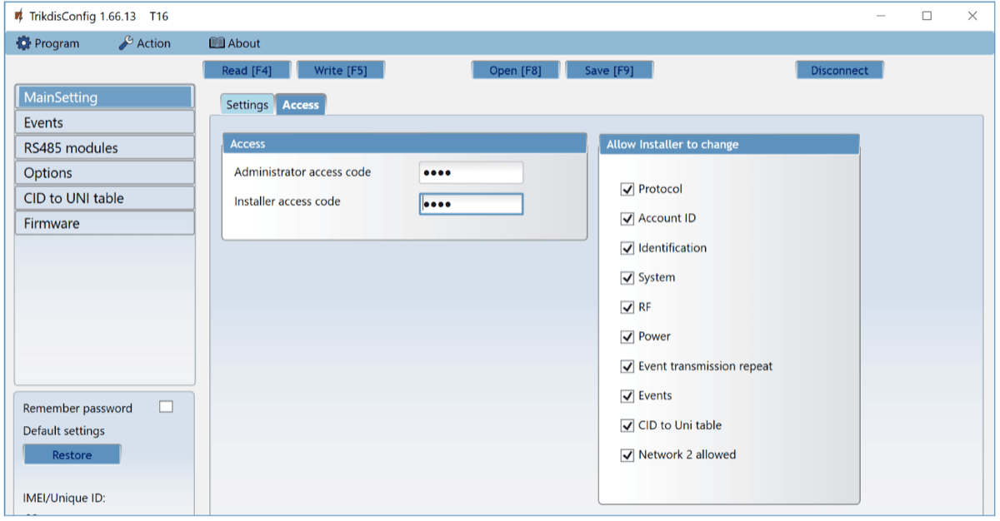

**Inställningsgruppen ”Access”**

- **Administrator access code** – ger full åtkomst till sändarens konfiguration. Koden kan vara upp till 6 tecken lång och bestå av siffror eller latinska bokstäver. (Förvald kod – 1234).

- **Installer access code** – ger begränsad åtkomst till sändarens konfiguration (fabrikskod – 1234).

**Inställningsgruppen ”Allow Installer to change”**

Det finns två behörighetsnivåer för konfigurering av radiosändaren T16 (administratör och installatör). Administratören har åtkomst till alla konfigurationsfunktioner. Installatörens åtkomst ger möjlighet att göra begränsade ändringar i sändarens konfiguration. Administratören kan ange vilka parametrar installatören (användaren) får ändra.

### Fönstret ”Events” 

**Fliken ”Inputs”**

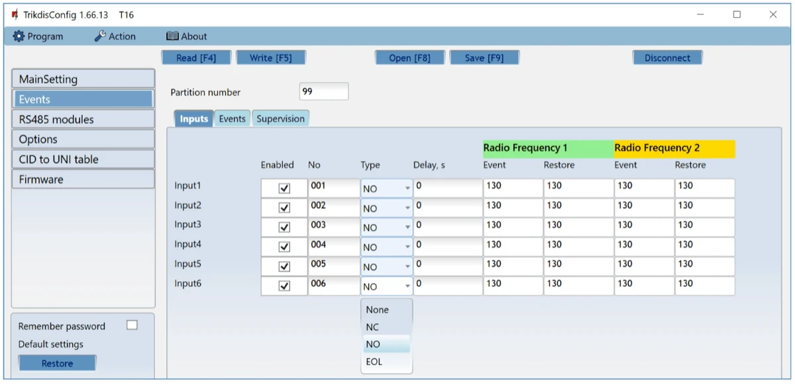

- **Enabled** – markera kryssrutan för att skicka händelser när ingången utlöses.

- **No** – tilldela ingången ett nummer.

- **Type** – ange ingångstyp (NO, NC, EOL).

- **Delay** – ange fördröjningstid för ingångens utlösning (s).

- **Event F1** – händelsekod som skickas via radiosändarens 1:a kanal (CID-koden ställs in automatiskt).

- **Restore F1** – återställningskod som skickas via radiosändarens 1:a kanal (CID-koden ställs in automatiskt).

- **Event F2** – händelsekod som skickas via radiosändarens 2:a kanal (CID-koden ställs in automatiskt).

- **Restore F2** – återställningskod som skickas via radiosändarens 2:a kanal (CID-koden ställs in automatiskt).

**Fliken ”Events”**

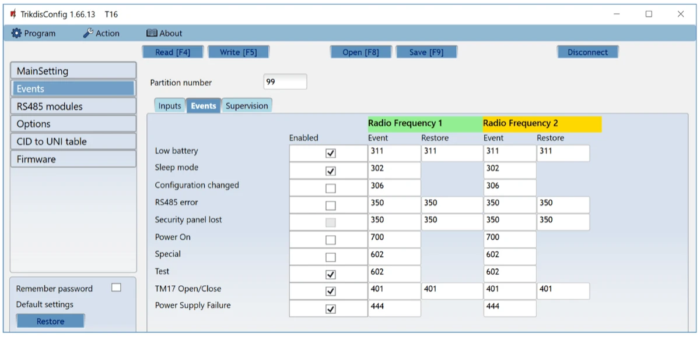

- **Enabled** – markera kryssrutan för att aktivera sändning av interna händelser:
- **Low battery** – matningsspänningen är lägre än 11,5 V.

- **Sleep mode** – matningsspänningen är lägre än 10 V.

- **Configuration change** – sändarens konfiguration har ändrats.

- **RS485 error** – problem med enheter som är anslutna till RS485-bussen.

- **Security panel lost** – anslutningen mellan sändaren och centralapparaten har brutits.

- **Power ON** – sändarens matning har slagits på.

- **Special** – användning av en särskild kod i radionätet, när en radiorepeater med lägena ”listen” och ”cancel” används.

- **Test** – periodiskt testmeddelande.

- **TM17 Open/Close** – för att skicka meddelanden om till- och frånkoppling när TM17-läsaren används.

- **Power Supply Failure** – händelsen matningsfel skickas när likspänningen från matningen är lägre än 11,5 V vid sändning av meddelanden.
- **Radio frequency 1** – interna händelsekoder som skickas via den första radiokanalen när en händelse utlöses och återställs.
- **Radio frequency 2** – interna händelsekoder som skickas via den andra radiokanalen när en händelse utlöses och återställs.

**Fliken ”Supervision”**

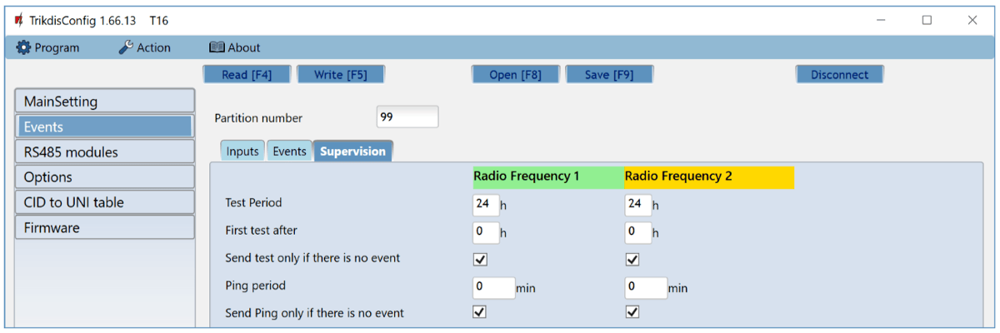

- **Test period** – ange tidsintervallet mellan två testmeddelanden via 1:a och 2:a kanalen. Syftet med periodiska tester är att regelbundet kontrollera att radiosystemen fungerar. En typisk testperiod är 24 timmar. Den kan kortas ned till 1 timme. Larmcentralens programvara övervakar testmeddelandet automatiskt. En varning genereras om inga testmeddelanden kommer från anläggningen.
- **First test after** – ange hur länge det första meddelandet ska fördröjas efter att sändaren har spänningssatts. Syftet är att kunna sprida ut sändningen av meddelanden över dygnet (24 timmar) för att undvika överbelastning av nätet. Ange tider för 1:a och 2:a kanalen.

- **Send test only if there is no event** – markera kryssrutan för att bara skicka testmeddelanden när inga händelsemeddelanden skickas.

- **PING period** – ange tidsintervallet för sändning av PING-signaler. Huvudsyftet med PING-meddelanden är att övervaka funktionen hos utrustningen på den skyddade anläggningen. PING-meddelanden genereras med korta intervall (var 5–10:e minut) och skickas. PING-meddelanden övervakas automatiskt av larmcentralens mottagare. Det är viktigt att förstå att radionätet är avsett för överföring av händelsemeddelanden. PING-meddelanden kan därför bara användas för de viktigaste skyddade anläggningarna i ett nät, för att undvika överbelastning av nätet.

- **Send PING only if there is no event** – markera kryssrutan för att bara skicka PING-signaler när inga händelsemeddelanden skickas.

### Fönstret ”RS485 modules” 

**Fliken ”Modules list”**

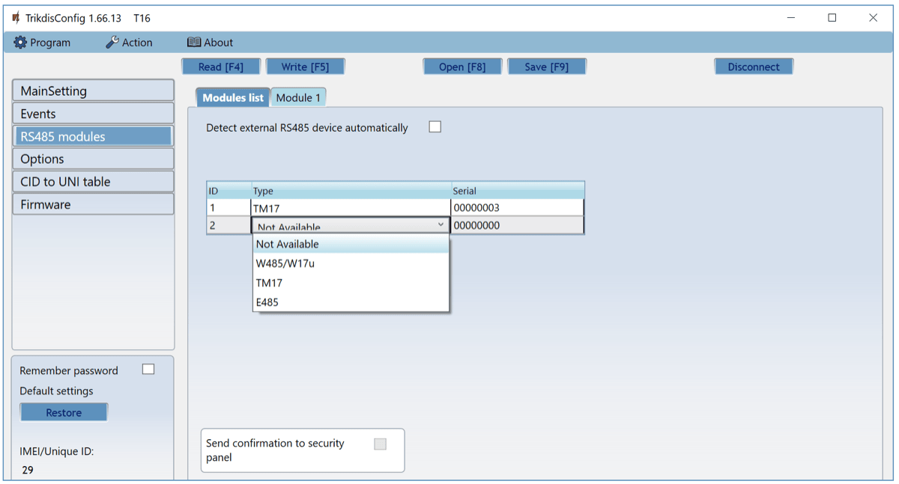

- **Detect external RS485 device automatically** – markera kryssrutan för att aktivera automatisk identifiering av moduler som är anslutna till RS485-bussen.

- **Type** – välj den modul som är ansluten till sändarens RS485-buss i listan.

- **Serial No** – ange den anslutna modulens serienummer. Du hittar numret på en etikett på den anslutna modulen eller dess förpackning.

- **Send confirmation to security panel** – om en IP-larmsändare (Wi-Fi, LAN) är ansluten till T16:s RS485-buss som primär kanal får centralapparaten, när rutan är markerad, en bekräftelse på att det skickade meddelandet har tagits emot. Det gör meddelandeöverföringen mer tillförlitlig. Inte alla centralapparater har det här alternativet. Om den valda centralapparaten inte har alternativet är rutan inaktiv.

!!! note "Obs!"
    Du kan bara ansluta en TM17-modul och en W485-modul (eller
    E485-modul) till sändaren T16.
**Fliken ”Module 1”**

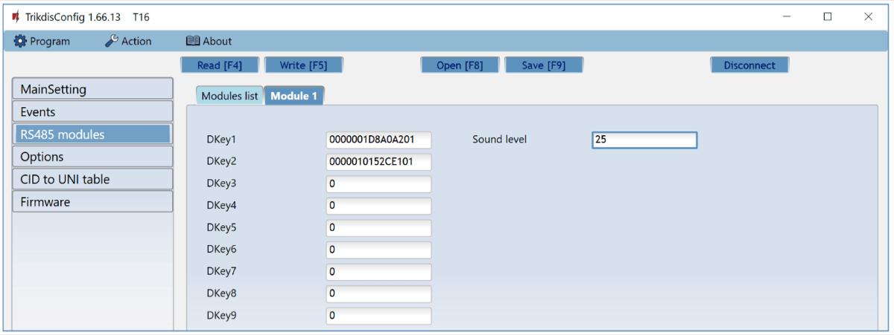

Det går att ansluta en TM17-läsare till sändaren T16. När TM17-läsaren är ansluten kan sändaren användas som centralapparat. Upp till 9 kontaktnycklar (iButton) kan tilldelas läsaren (en av dem är huvudnyckeln, ”Master key”) för att styra säkerhetssystemets tillstånd (tillkopplat/frånkopplat).

- **Dkey 1 – Dkey 9** – ange identifieringsnumren för kontaktnycklarna (iButton).

- **Sound level** – ange läsarens ljudsignalsnivå (från 0 till 100).

#### Lägga till kontaktnycklar (iButton) 

1.  Om listan med kontaktnycklar är tom läggs den första nyckel som hålls mot läsaren till på den första raden i listan och blir huvudnyckeln (**Master key**).

2.  För att aktivera registreringsläget för kontaktnycklar håller du **huvudnyckeln** (**Main key**) mot nyckelläsaren i minst 10 sekunder. Indikeringen ”State” släcks. När registreringsläget är aktiverat börjar lysdioden på TM17-läsaren blinka grönt och en ljudsignal hörs.

3.  Håll den nyckel du vill registrera mot läsaren. Läsarens ljudsignal stängs av. Nyckeln har nu lagts till i listan. Ta bort nyckeln från läsaren. Den gröna indikeringen på läsaren slutar blinka och lyser med fast grönt sken. Efter några sekunder lämnar läsaren automatiskt registreringsläget. Indikeringen ”State” lyser grönt och den gröna lysdioden på läsaren släcks.

4.  Aktivera registreringsläget igen för att lägga till ytterligare en nyckel.

5.  För att radera alla nycklar (inklusive huvudnyckeln) håller du **huvudnyckeln** (**Main key**) mot läsaren i minst 20 s.

#### Använda sändaren som centralapparat 

När TM17-läsaren är ansluten kan sändaren användas som centralapparat. Detektorernas kontakter kan anslutas till sändarens ingångar (IN1 – IN6). Om modulen W485 (eller E485) dessutom är ansluten till radiosändaren kan säkerhetssystemet styras på distans via ett datornätverk.

#### Förvalda inställningar för ingångar (IN) och utgång (OUT) 

| Plint | Beskrivning |
|----------|-------------|
| IN1 | Plint för ingång 1, valbara typer: NC, NO, EOL (2,2 kΩ). (förval NO). Fördröjd sektion. Direkt efter att larmsystemet har tillkopplats kan sektionen påverkas under utpasseringstiden. Om sektionen fortfarande är påverkad när utpasseringstiden har gått ut aktiveras utgången OUT1 och ett meddelande skickas. Om sektionen påverkas när larmsystemet är tillkopplat börjar inpasseringstiden räknas. Om larmsystemet inte frånkopplas under den tiden aktiveras utgången OUT1 och ett meddelande skickas. |
| IN2 (IN3, IN4, IN5, IN6) | Plint för ingång 2 (3, 4, 5, 6), valbar typ: NC, NO, EOL (2,2 kΩ). (förval NO). Direktlarmande sektion. Om sektionen påverkas när larmsystemet är tillkopplat aktiveras utgången OUT1 (eller OUT2) och ett meddelande skickas direkt. |
| OUT1 eller | Utgångsplint, typ öppen kollektor, ström upp till 1 A. För anslutning av en siren. (T16V, T16U) |
| OUT2 | Utgångsplint, typ öppen kollektor, ström upp till 1 A. För anslutning av en siren. (T16U5) |

Lysdioderna som blinkar på TM17 visar vilka ingångar som är aktiverade medan systemet är tillkopplat. När larmsystemet frånkopplas (genom att en nyckel hålls mot läsaren) slutar indikeringarna inte att blinka. För att få indikeringarna att sluta blinka håller du nyckeln mot läsaren igen.

#### Lysdiodsindikering vid drift för läsaren *TM17* 

| Indikator | Läge | Beskrivning |
|-----------|-------|-------------|
| 1 (2, 3, 4, 5, 6) | Släckt | Sektionen är inte utlöst |
| 1 (2, 3, 4, 5, 6) | Fast rött sken | Sektionen är utlöst |
| 1 (2, 3, 4, 5, 6) | Blinkar rött | Den utlösta sektionen har utlöst säkerhetssystemet |
| State | Fast grönt sken | Området är frånkopplat |
| State | Blinkar grönt | Utpasseringstiden räknas ned |
| State | Fast rött sken | Området är tillkopplat |
| State | Blinkar rött | Inpasseringstiden räknas ned |
| Trouble | Släckt | Inga driftproblem |
| Trouble | 9 röda blinkningar | Problem med anslutningen till RS485-modulen |

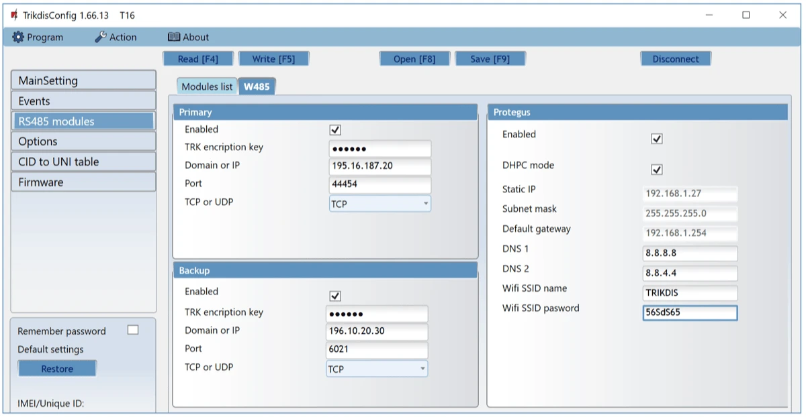

**Fliken ”W485”** **Inställningsgruppen ”Primary”**

- **Enabled** - genom att markera kryssrutan aktiverar du den primära kommunikationskanalen.

- **TRK encryption key** - 6-siffrig krypteringsnyckel för meddelanden. Nyckeln som skrivs till sändaren måste stämma överens med mottagarens nyckel.

- **Domain or IP** - ange mottagarens domän eller IP-adress.

- **Port** - ange mottagarens nätverksport.

- **TCP or UDP** - välj med vilket protokoll (TCP eller UDP) händelserna ska skickas.

**Inställningsgruppen ”Backup”**

Aktivera backupkanalen för att skicka händelser via backupkanalen om anslutningen via primärkanalen bryts. Inställningarna för backupkanalen är desamma som beskrivs ovan.

**Inställningsgruppen ”Protegus”**

- **Enabled** – aktivera tjänsten Protegus. T16 kan då utbyta data med appen Protegus och konfigureras på distans via TrikdisConfig.

  - **DHCP mode** – Wi-Fi-modulens sätt att ansluta till nätverket (manuellt eller automatiskt).

  - **Static IP** – statisk IP-adress, för när det manuella anslutningsläget är valt.

  - **Subnet mask** – nätmask, för när det manuella anslutningsläget är valt.

  - **Default gateway** – gateway-adress, för när det manuella anslutningsläget är valt.

  - **DNS1, DNS2** - (Domain Name System) anger den server som tillhandahåller IP-adressen för domänen. Används när en domän (inte en IP-adress) har angetts i kommunikationskanalens fält **Domain or IP**. Googles DNS-server är förvald.

  - **Wifi SSID name** – namnet på det Wi-Fi-nätverk som W485 ska ansluta till.

- **Wifi SSID password** - lösenordet till Wi-Fi-nätverket.

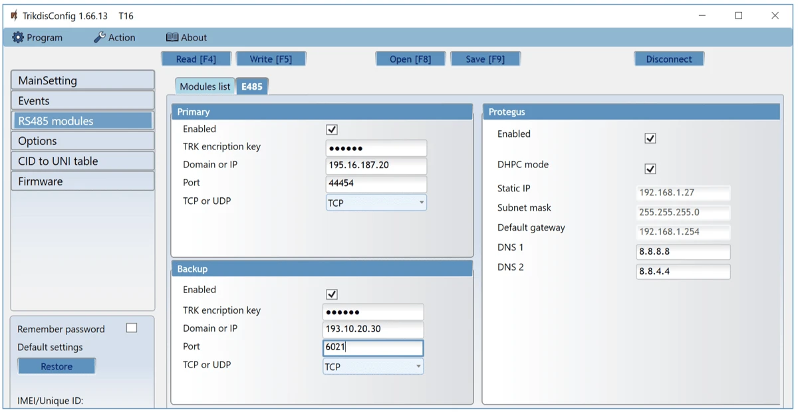

**Fliken ”E485”** **Inställningsgruppen ”Primary”**

- **Enabled** - genom att markera kryssrutan aktiverar du den primära kommunikationskanalen.

- **TRK encryption key** - 6-siffrig krypteringsnyckel för meddelanden. Nyckeln som skrivs till sändaren måste stämma överens med mottagarens nyckel.

- **Domain or IP** - ange mottagarens domän eller IP-adress.

- **Port** - ange mottagarens nätverksport.

- **TCP or UDP** - välj med vilket protokoll (TCP eller UDP) händelserna ska skickas.

**Inställningsgruppen ”Backup”**

Aktivera backupkanalen för att skicka händelser via backupkanalen om anslutningen via primärkanalen bryts. Inställningarna för backupkanalen är desamma som beskrivs ovan.

**Inställningsgruppen ”Protegus”**

- **Enabled** – aktivera tjänsten Protegus. T16 kan då utbyta data med appen Protegus och konfigureras på distans via TrikdisConfig.

  - **DHCP mode** – Wi-Fi-modulens sätt att ansluta till nätverket (manuellt eller automatiskt).

  - **Static IP** – statisk IP-adress, för när det manuella anslutningsläget är valt.

  - **Subnet mask** – nätmask, för när det manuella anslutningsläget är valt.

  - **Default gateway** – gateway-adress, för när det manuella anslutningsläget är valt.

  - **DNS1, DNS2** - (Domain Name System) anger den server som tillhandahåller IP-adressen för domänen. Används när en domän (inte en IP-adress) har angetts i kommunikationskanalens fält **Domain or IP**. Googles DNS-server är förvald.

### Fönstret ”Options” 

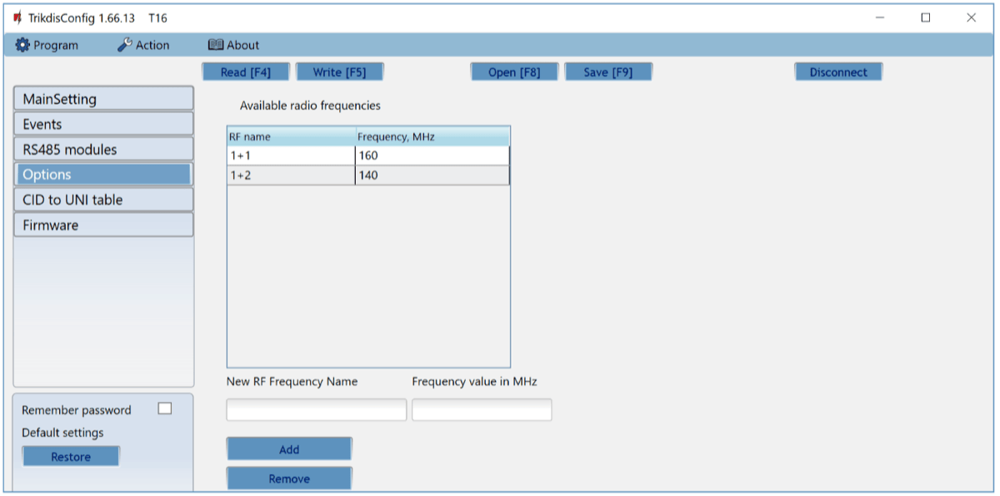

**Inställningsgruppen ”Available radio frequencies”**

Du kan lägga till radiofrekvenser i listan över frekvenser som sändaren T16 kan använda, och ta bort dem från listan. Radiofrekvenserna får ”namn”.

### Fönstret ”CID to UNI table” 

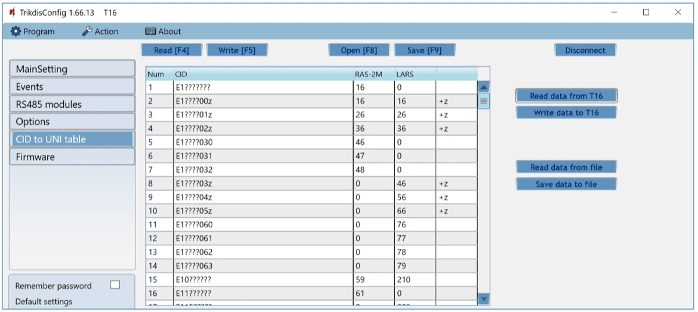

Contact ID-koder som tas emot från säkerhetssystemets centralapparat omvandlas till radiosystemets koder (RAS2M, LARS). Endast Contact ID-meddelanden som finns beskrivna i tabellen (kolumnen CID) omvandlas till radiosystemets koder och skickas till larmcentralen. Tecknet ”?” står för en valfri siffra på den positionen. Tecknet ”z” betyder att siffran på positionen läggs till radiosystemets huvudkod. Tabellen kan redigeras, men ändra den med omsorg och bara om det är nödvändigt, eftersom systemet kanske inte fungerar korrekt om tabellen innehåller fel.

!!! note "Obs!"
    När konfigureringen är klar klickar du på **Write [F5]**, väntar tills
    data har sparats och kopplar bort USB-kabeln.
### Återställa fabriksinställningarna 

För att återställa **sändarens** fabriksinställningar klickar du på knappen **Restore** i programmet TrikdisConfig.

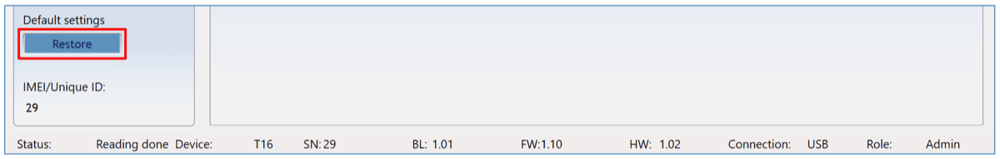

## Testa radiosändaren T16 

När konfigureringen och installationen är klara, gör en systemkontroll:

1.  Kontrollera att matningen är på;

2.  Testa T16:s ingångar genom att aktivera dem och kontrollera att rätt meddelanden kommer fram till larmcentralens mottagare;

3.  Gör ett larmtest för att kontrollera att larmsystemets händelser tas emot korrekt av larmcentralen (CMS, Central Monitoring Station).

## Firmwareuppdatering 

!!! note "Obs!"
    När T16 är ansluten till TrikdisConfig erbjuder programmet
    automatiskt att uppdatera enhetens firmware om det finns
    uppdateringar. Den här funktionen kräver en internetanslutning. / Om det finns
    antivirusprogram installerat på datorn kan det blockera den automatiska
    firmwareuppdateringen. I så fall måste du konfigurera om
    antivirusprogrammet.
T16:s firmware kan uppdateras eller bytas manuellt. Alla tidigare inställningar i T16 finns kvar efter uppdateringen om kryssrutan ”**Preserve settings**” är markerad. Vid manuell installation av firmware kan den bytas till en nyare eller äldre version. Så här gör du:

1.  Starta TrikdisConfig.

2.  Anslut T16 till en dator med en USB Mini-B-kabel. Om det finns en nyare firmwareversion erbjuder programmet automatiskt att installera den.

3.  Välj **Firmware**.

    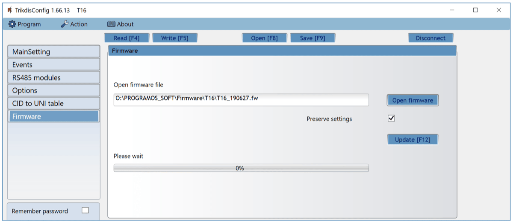

4.  Klicka på knappen **Open firmware** och välj den firmwarefil som behövs. Om du inte har filen kan den senaste firmwarefilen laddas ned <u>av registrerade användare</u> från [www.trikdis.com](http://www.trikdis.com), under nedladdningar för T16.

5.  Klicka på knappen **Update [F12]**.

6.  Vänta tills uppdateringen är klar.

## Säkerhetskrav 

Radiosändaren ska installeras och underhållas av behörig personal.

Läs den här manualen noggrant före installationen för att undvika misstag som kan leda till funktionsfel eller till och med skador på utrustningen.

Koppla bort matningen innan du gör några elektriska anslutningar.

Ändringar, modifieringar eller reparationer som inte har godkänts av tillverkaren upphäver garantin.
