# Centralapparat CG17 med mobilanslutning

  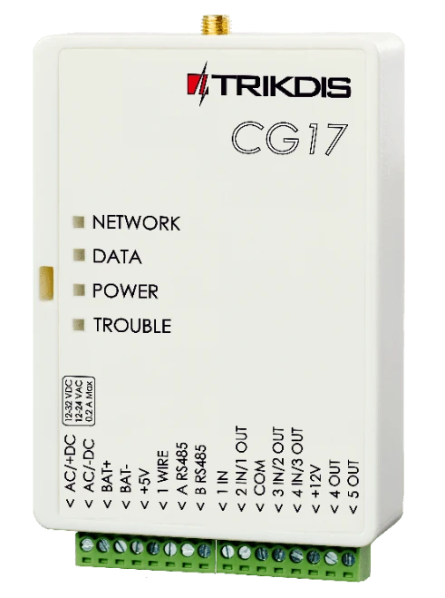

## Beskrivning 

CG17 är en multifunktionell centralapparat med integrerad larmsändare med mobilanslutning. Med centralapparaten kan 12 trådbundna och trådlösa sektioner grupperas i ett system med 8 områden.

**Med CG17 kan du:**

- Installera ett enkelt larmsystem som kan övervakas och styras på distans.

- Styra olika utrustningar på distans (t.ex. värme- och ventilationssystem, automatiska portar).

- Övervaka temperatur, bränslenivå och likspänning.

- Meddela användare om händelser.

- Skicka händelsemeddelanden till larmbolagets mottagare (CMS).

### Funktioner

Skickar händelser till larmcentralens mottagare:

- Skickar händelser till TRIKDIS programvaru- eller maskinvarumottagare som fungerar med all programvara för larmcentraler.

- Kan skicka händelsemeddelanden till SIA DC-09-mottagare.

- Övervakning av anslutningen genom att IP-mottagaren pollas var 30:e sekund (eller med en period som användaren anger).

- Backupkanal som används om anslutningen via primärkanalen bryts.

- Händelser kan rapporteras till larmcentralen med SMS. SMS skickas även om dataanslutningen slutar fungera i mobiloperatörens nät.

- När tjänsten *Protegus* är aktiverad levereras händelserna först till larmcentralen och skickas därefter till appens användare.

**Fungerar med appen Protegus2:**

- ”*Push*”-aviseringar och särskilda ljud som informerar om händelser.

- Fjärrstyrd tillkoppling/frånkoppling av systemet.

- Fjärrstyrning av anslutna enheter (belysning, portar, ventilationssystem, värme, bevattning m.m.).

- Temperaturövervakning på distans (med utbyggnadsmodulerna iO, iO-WL eller iO-LORA).

- Olika användarrättigheter för administratör, installatör och användare.

- Användarna kan också få information om händelser med SMS och samtal.

**Meddelar användare om händelser:**

- Ringer upp angivna telefonnummer (upp till 8 användare).

- Skickar SMS om händelser.

- ”*Push*”-aviseringar och särskilda ljud om händelser med appen Protegus2.

**Fjärrstyrning av systemet och utgångarna:**

- Med appen Protegus2.

- Med en läsare för elektroniska nycklar (*iButton*).

- Med en RFID-läsare med knappsats (Wiegand 26/34).

- Genom att ringa till enhetens telefonnummer.

- Med SMS.

- Med en automatisk ”*om ... så*”-algoritm. T.ex. när en ingång aktiveras eller temperaturen överstiger en viss gräns slås en utgång på.

**Stöder följande utbyggnadsmoduler:**

- Trådbundna eller trådlösa utbyggnadsmoduler i serierna iO och LORA, som ökar antalet ingångar (IN) och utgångar (OUT).

- GPS-mottagare (användbar för skydd av bankomater och varuautomater).

- Bränslenivågivare. För att skydda bränsletankar eller övervaka nivån.

- Reservmatning och laddning av 12 V-batteri.

**Ingångar och utgångar**

- 1 ingång, 2 utgångar och 3 I/O-plintar som kan ställas in antingen som ingångar (IN) eller som styrbara utgångar (OUT).

- En dataledning (*1-Wire*) för anslutning av temperaturgivare (upp till 8) och en läsare för elektroniska nycklar (*iButton*).
- Antalet ingångar (IN) eller utgångar (OUT) kan ökas till 12 med trådbundna eller trådlösa utbyggnadsmoduler i serien iO.

**Enkel installation:**

- Förvalda inställningar för användning antingen som centralapparat eller som larmsändare.

- Inställningarna kan sparas i en fil och snabbt skrivas till andra enheter.

- Konfigurering antingen med en USB-kabel eller på distans med programvaran TrikdisConfig.

- Två behörighetsnivåer (konton): för installatören och för administratören.

### Modelltyper 

Den här manualen gäller följande modeller av CG17:

- CG17_12, centralapparat CG17 med 2G-modem.

- CG17_14, CG17_1E, CG17_1S, centralapparat CG17 med 4G-modem.

### Specifikationer 

| Parameter | Beskrivning |
|-----------|-------------|
| Frekvenser för GSM/GPRS-modem | 850 / 900 / 1800 / 1900 MHz |
| Frekvenser för 4G-modem: Europa, Latinamerika | - LTE-FDD-band: B1/B3/B5/B7/B8/B20/B28 / - GSM-band: B2/B3/B5/B8 / - LTE-FDD-band: B2/B3/B4/B5/B7/B8/B28/B66 / - GSM-band: B2/B3/B5/B8 |
| Matning [AC / DC] | 16–24 V DC eller 16–18 V AC |
| Strömförbrukning | Upp till 50 mA (i viloläge), / upp till 200 mA (kortvarigt, vid sändning) |
| Reservmatning [BAT] | 12 V blybatteri |
| Batteriets laddningsström | Upp till 500 mA |
| Matningsspänning och ström för externa enheter [+12 V] | 12 V DC, upp till 1 A |
| Plintar med dubbel funktion [IN/OUT] | 3, kan ställas in antingen som ingångar av typen NC, NO, EOL=10 kΩ, EOL_T eller som utgångar av typen öppen kollektor (OC) med en ström på upp till 100 mA |
| Antal områden | 8 |
| Antal sektioner | 4 (kan utökas till 12 sektioner med utbyggnadsmoduler) |
| Antal PGM-utgångar | 2 (kan vara 5 om I/O-plintarna ställs in som utgångar. Kan utökas till 12 utgångar med utbyggnadsmoduler) |
| Längd på dataledningen ”1-Wire” [1 WIRE] | Upp till 30 m |
| Kompatibla temperaturgivare | Maxim®/Dallas® DS18S20, DS18B20 |
| Högsta antal temperaturgivare på dataledningen ”1-Wire” | 8 |
| Kompatibla elektroniska nycklar (iButton) [1 WIRE] | Maxim®/Dallas® DS1990A |
| Högsta antal elektroniska nycklar (iButton) | 12 |
| Längd på RS485-bussen | Upp till 100 m |
| Högsta antal enheter på RS485-bussen | 8 |
| Knappsatser som stöds | Crow CR-16, Crow LCD, Crow touch keypad |
| Moduler som stöds | iO-8 – utbyggnadsmodul; / iO – utbyggnadsmodul; / iO-MOD – radiotransceiver för iO-WL; / iO-WL – trådlös utbyggnadsmodul; / RF-SH – radiomottagare för trådlösa detektorer; / E485 – modul för anslutning till Ethernet-nät; / W485 – modul för anslutning till WiFi-nät; / TM17 – läsare för elektroniska nycklar (iButton); / CZ-Dallas – läsare för elektroniska nycklar (iButton); / FLS – bränslenivågivare Strela RS485; / iO-LORA – utbyggnadsmodul; / iO8-LORA – utbyggnadsmodul; / PB-LORA – överfallsknapp; / REL-LORA – utbyggnadsmodul. |
| Buffertminnets kapacitet | 60 händelser |
| Antal kommunikationskanaler | 2 (1:a kanalen: primär, backup; / 2:a kanalen: Protegus) |
| Inbyggd klocka | Ja |
| Kanaler för händelserapportering | GPRS eller 4G, SMS |
| Kommunikation med larmcentralen | TCP / IP eller UDP / IP, eller SMS |
| Kommunikationsprotokoll | TRK, krypterat SIA DC-09_2007, SIA DC-09_2012, SIA DC-09_IPcom |
| Driftmiljö | Från -10 °C till +50 °C, relativ luftfuktighet upp till 70 % vid 0 till +40 °C (utan kondens) |
| Mått | 113 × 70 × 25 mm |
| Vikt | 0,10 kg |

### Centralapparatens delar 

1.  SMA-kontakt för mobilantenn.

2.  Lysdiodsindikeringar.

3.  Spår för att öppna det övre locket.

4.  Plintblock för externa anslutningar.

5.  USB Mini-B-port för programmering av *CG17.*

6.  Kortplats för nano-SIM-kort.

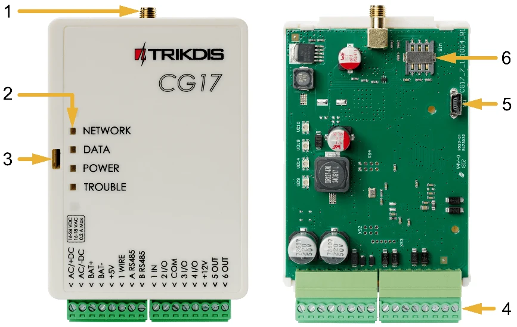

### Plintarnas funktion 

| Plint | Beskrivning |
|----|----|
| AC / +DC | Matningsplint (16–18 V AC eller plus 16–24 V DC) |
| AC / -DC | Matningsplint (16–18 V AC eller minus 16–24 V DC) |
| BAT+ | Pluspol för 12 V-reservbatteriet |
| BAT- | Minuspol för 12 V-reservbatteriet |
| +5 V | Plus 5 V matning för enheter på ”*1-Wire*” |
| 1 WIRE | Plint för dataledningen ”*1-Wire*” |
| A 485 | Plint A på *RS485*-bussen |
| B 485 | Plint B på *RS485*-bussen |
| 1 IN | Ingångsplint 1 (förval ”Delay”, sektionstyp EOL) |
| 2 I/O | Ingångs-/utgångsplint: ingångsplint 2 eller utgångsplint av typen OC. (förval ”Interior”, sektionstyp EOL) |
| COM | Gemensam minusplint |
| 3 I/O | Ingångs-/utgångsplint: ingångsplint 3 eller utgångsplint av typen OC. (förval ”Instant”, sektionstyp EOL) |
| 4 I/O | Ingångs-/utgångsplint: ingångsplint 4 eller utgångsplint av typen OC. (förval ”Fire”, sektionstyp EOL) |
| +12 V | Plus 12 V matning för externa enheter |
| 5 OUT | Utgångsplint av typen OC (förval ”Fire sensor reset”) |
| 6 OUT | Utgångsplint av typen OC (förval ”Siren”) |

### Lysdiodsindikering vid drift

| Indikator | Lysdiodens läge | Beskrivning |
|-----------|--------------|-------------|
| NETWORK | Fast grönt sken | Ansluten till mobilnätet |
| NETWORK | Blinkar gult | Indikering av mobilsignalens styrka från 0 till 5. Tillräcklig styrka är 3. |
| DATA | Fast grönt sken | Ett meddelande skickas |
| DATA | Fast gult sken | Osända händelser finns lagrade i databufferten |
| POWER | Blinkar grönt | Matningsspänningen är tillräcklig |
| POWER | Blinkar gult | Matningsspänningen är otillräcklig |
| POWER | Blinkar grönt och gult | Konfigurationsläget är på |
| TROUBLE | Släckt | Inga driftproblem |
| TROUBLE | 1 blinkning | Inget SIM-kort isatt |
| TROUBLE | 2 blinkningar | SIM-kortets PIN-kod är felaktig |
| TROUBLE | 3 blinkningar | Det går inte att ansluta till mobilnätet |
| TROUBLE | 4 blinkningar | Det går inte att ansluta till IP-mottagaren via primärkanalen |
| TROUBLE | 5 blinkningar | Det går inte att ansluta till IP-mottagaren via backupkanalen |
| TROUBLE | 6 blinkningar | CG17:s inbyggda klocka är inte inställd |
| TROUBLE | 7 blinkningar | Otillräcklig matningsspänning från reservmatningen |
| TROUBLE | 8 blinkningar | Ingen nätspänning |
| TROUBLE | 9 blinkningar | Problem med anslutningen till RS485-modulen |

### Komponenter som behövs för installationen

Innan du påbörjar installationen, se till att du har de komponenter som behövs. Du kan beställa dem från din lokala distributör.

## Snabbkonfiguration med programvaran *TrikdisConfig* 

1.  Ladda ned konfigurationsprogrammet **TrikdisConfig** från [www.trikdis.com](http://www.trikdis.com) (skriv ”TrikdisConfig” i sökfältet) och installera det.

2.  Öppna kapslingen på CG17 med en spårskruvmejsel enligt bilden nedan:

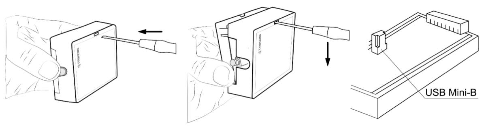

1.  Anslut CG17 till datorn med en USB Mini-B-kabel.

2.  Starta TrikdisConfig. Programmet identifierar automatiskt den anslutna CG17 och öppnar ett fönster för konfigurering.

3.  Klicka på **Read [F4]** för att läsa inställningarna i CG17. Om du uppmanas, ange administratörs- eller installatörskoden (6 siffror) i dialogrutan.

Nedan beskrivs vilka inställningar som behövs för att larmsändaren ska börja skicka händelser till larmcentralen (CMS, Central Monitoring Station) och för att säkerhetssystemet ska kunna styras med appen Protegus2.

### Inställningar för anslutning till appen Protegus2 

**I fönstret ”System Options”, fliken ”SIM”:**

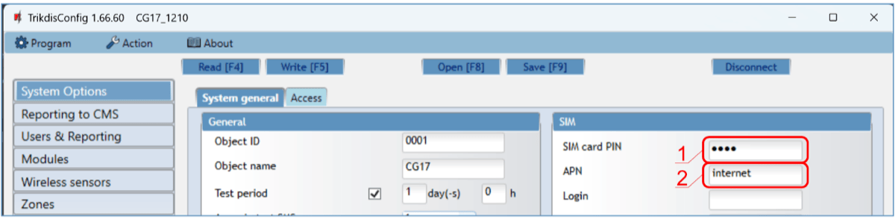

1.  Ange koden i ”**SIM card PIN**”.

2.  Ändra namnet i ”**APN**”. APN hittar du på SIM-kortsoperatörens webbplats (”internet” är universellt och fungerar i många operatörers nät).

**I fönstret ”Users & Reporting”, inställningsgruppen ”Cloud application”:**

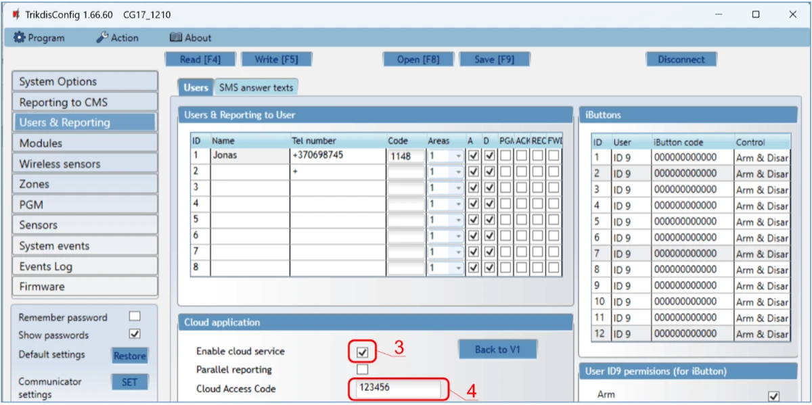

3. Markera kryssrutan ”**Enable cloud service**” till Protegus Cloud.

2.  Ändra ”**Cloud Access Code**” för inloggning i Protegus2 om användarna ska uppmanas att ange den när de lägger till systemet i appen Protegus2 (förvalt lösenord – 123456).

När konfigureringen är klar klickar du på knappen **Write [F5]** och kopplar bort USB-kabeln.

!!! note "Obs!"
    Mer information om övriga inställningar för CG17 i
    TrikdisConfig finns i avsnitt 4 ”Inställning av parametrar med programvaran TrikdisConfig”.
### Inställningar för anslutning till larmcentralen 

**I fönstret ”System Options”:**

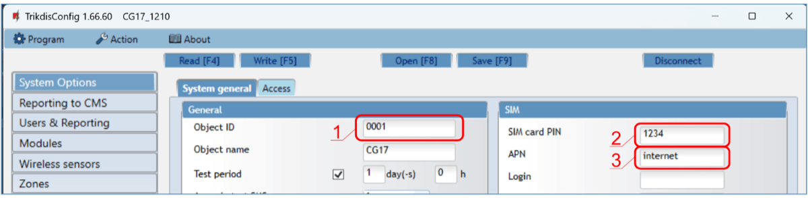

1.  Ange numret i ”**Object ID**” (abonnentkod) som du har fått från larmcentralen (4 tecken, 0–9, A–F. **Använd inte FFFE, FFFF som Object ID**).

2.  Ange koden i ”**SIM card PIN**”.

3.  Ändra namnet i ”**APN**”. APN hittar du på SIM-kortsoperatörens webbplats (”internet” är universellt och fungerar i många operatörers nät).

**I fönstret ”Reporting to CMS”, inställningar för ”Primary channel”:**

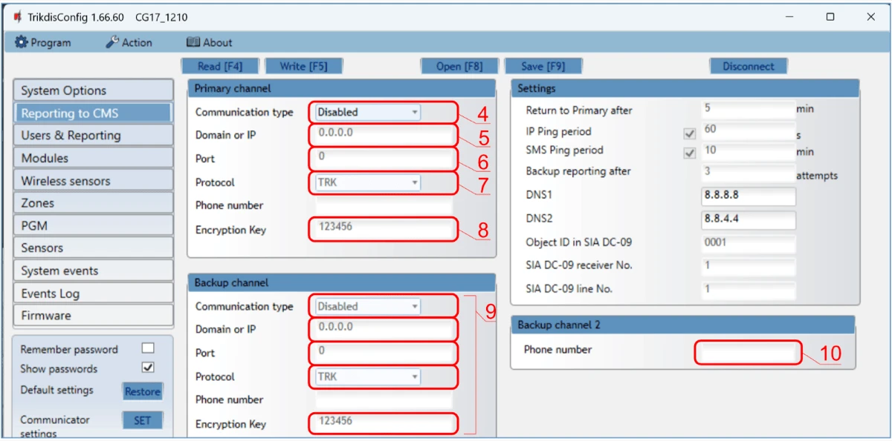

4. **Communication type** - välj anslutningsmetoden **IP** (vi rekommenderar inte SMS som primärkanal).

2.  **Domain or IP** - ange mottagarens domän eller IP-adress.

3.  **Port** - ange mottagarens nätverksportnummer.

4.  **Protocol** - välj protokolltyp för händelsemeddelandena: **TRK** (till TRIKDIS-mottagare), **DC-09_2007, DC-09_2012** eller **DC-09_IPcom** (till universella mottagare).

5.  **Encryption key** - ange den krypteringsnyckel som är inställd i mottagaren.

!!! note "Obs!"
    Om du vill ställa in kommunikation med larmcentralen via **SMS** behöver du bara ställa in ”**Encryption key**” och ”**Phone number**”. SMS kan bara tas emot av TRIKDIS mottagare: IP/SMS-mottagaren RL14, flerkanalsmottagaren RM14 och SMS-mottagaren GM14. Om du har valt protokollet **DC-09** anger du dessutom objekt-, linje- och mottagarnummer på fliken ”**Settings**” i fönstret ”**Reporting to CMS**”.
1.  (Rekommenderas) Konfigurera inställningarna för ”**Backup channel**”.

2.  (Rekommenderas) Ange numret för SMS-rapportering i ”**Backup channel 2**”.

När konfigureringen är klar klickar du på **Write [F5]** och kopplar bort USB-kabeln.

!!! note "Obs!"
    Mer information om övriga inställningar för CG17 i
    TrikdisConfig finns i avsnitt 4 ”Inställning av parametrar med programvaran TrikdisConfig”.
## Kopplingsscheman och installation

### Montering

1.  Innan du börjar, se till att mobilsignalens nivå är tillräcklig på den plats där *CG17* ska monteras.

2.  Ta bort det övre locket och dra ut plintblocken.

3.  Ta ut kretskortet.

4.  Fäst kapslingens bottendel på önskad plats med skruvar.

5.  Sätt tillbaka kretskortet och plintblocken.

6.  Skruva fast mobilantennen.

7.  Sätt i ett nano-SIM-kort. SIM-kortet måste redan vara aktiverat i mobilnätet och alla tjänster som behövs måste vara på, dvs. kortet måste kunna ringa samtal, skicka och ta emot SMS och använda mobilt internet. <u>Fråga SIM-kortets mobiloperatör hur du aktiverar de tjänster som behövs.</u>

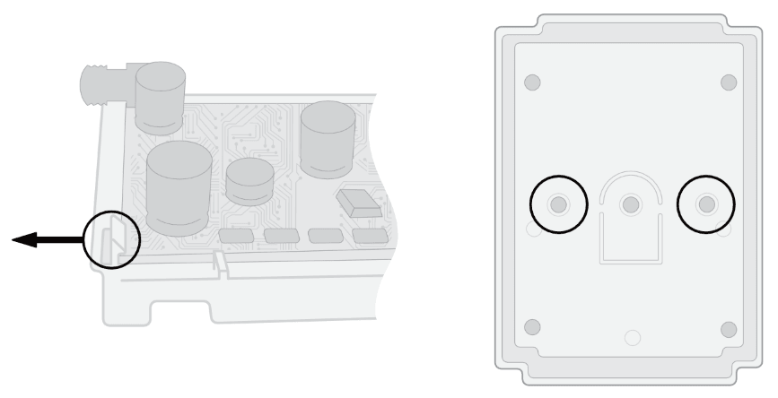

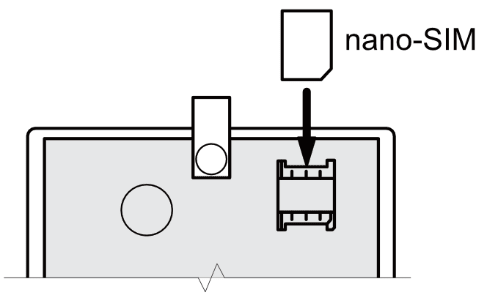

!!! note "Obs!"
    Se till att SIM-kortet är aktiverat. Se till att tjänsten mobilt internet är påslagen om anslutning via IP-kanalen ska användas. Om du inte vill ange PIN-koden i TrikdisConfig sätter du i SIM-kortet i en mobiltelefon och stänger av PIN-kodsbegäran.
8. Om du vill kunna konfigurera CG17 på distans sätter du i ett SIM-kort med avstängd PIN-kodsbegäran. Skicka ett SMS: **CONNECT 123456 PROTEGUS=ON,APN=INTERNET**

2.  Fjärrkonfigurering beskrivs i avsnitt 5.4 ”Inställning av parametrar på distans”.

3.  Stäng det övre locket.

### Kopplingsscheman för anslutning av ingångar

CG17 har fyra ingångar IN för anslutning av olika larmdetektorer. Möjliga sätt att ansluta en detektor: NO – normalt öppen kontakt; NC – normalt sluten kontakt; EOL – normalt sluten krets med ett 10 kΩ slutmotstånd (EOL); EOL_T – normalt sluten krets med slutmotstånd (EOL, 10 kΩ), med sabotage- och ledningsfelsdetektering.

**Fabriksinställningar för sektionerna (ingångarna)**

| Sektion  | Beskrivning                                            |
|-------|--------------------------------------------------------|
| 1 IN  | Förval ”Delay”, sektionstyp EOL, område 1    |
| 2 I/O | Förval ”Interior”, sektionstyp EOL, område 1 |
| 3 I/O | Förval ”Instant”, sektionstyp EOL, område 1  |
| 4 I/O | Förval ”Fire”, sektionstyp EOL, område 1     |

Hur du ändrar sektionsinställningarna och områdestillhörigheten beskrivs i avsnitt 4.7, fönstret ”Zones”.

Möjliga kopplingsscheman:

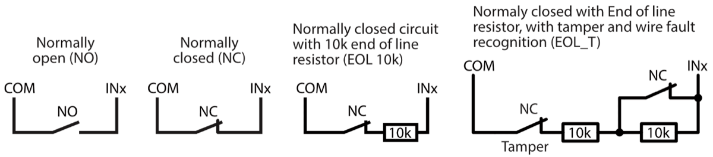

### Kopplingsscheman för anslutning av en rökdetektor 

Ge en PGM-utgång funktionen ”**Fire sensor reset**” (se TrikdisConfig, fönstret ”PGM”, [fliken ”Outputs”](#48-fonstret-pgm)) så att rökdetektorn kan startas om efter ett larm.

- **Ansluta en fyrtrådsrökdetektor**

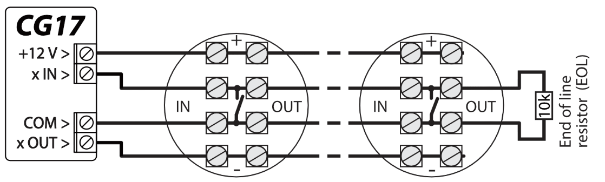

- **Ansluta en tvåtrådsrökdetektor**

1)  med en EOL-sektion (eller NC, utan motstånd).

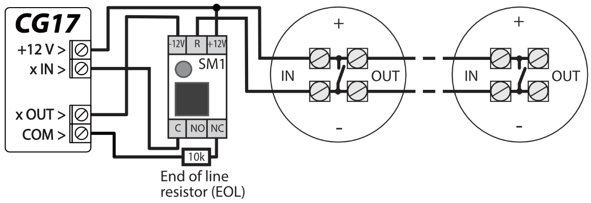

1)  med en EOL-sektion (eller NO, utan motstånd).

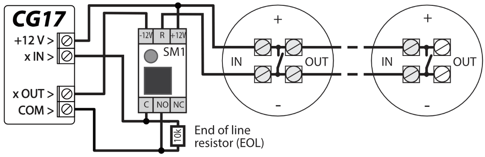

\*SM1 – en kompatibilitetsmodul från Trikdis som gör det möjligt att på distans starta om en tvåtrådsrökdetektor efter ett utlöst larm.

### Kopplingsscheman för anslutning av en temperaturgivare

- Temperaturgivare ska anslutas enligt det givna kopplingsschemat. Temperaturgivarna Maxim®/Dallas® DS18S20 och DS18B20 (upp till 8 st) kan anslutas till *CG17*.

- Om ledningen till temperaturgivaren är längre än 0,5 m rekommenderar vi en partvinnad kabel (UTP4x2x0,5 eller STP4x2x0,5).

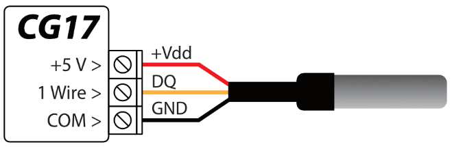

Ledarnas färger:

**Vdd** - röd ledare, anslut den till plinten ”+5 V”;

**DQ** - gul ledare, anslut den till plinten ”1-Wire”;

**GND** – svart ledare, anslut den till plinten ”COM”.

### Kopplingsscheman för anslutning av ett relä och en LED

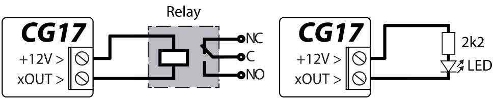

### Kopplingsscheman för anslutning av läsare för elektroniska nycklar

Läsaren TM17 ska anslutas till CG17 via en *RS485*-buss. *RS485*-bussen kan vara upp till 100 m lång. Upp till åtta TM17-läsare kan anslutas till CG17.

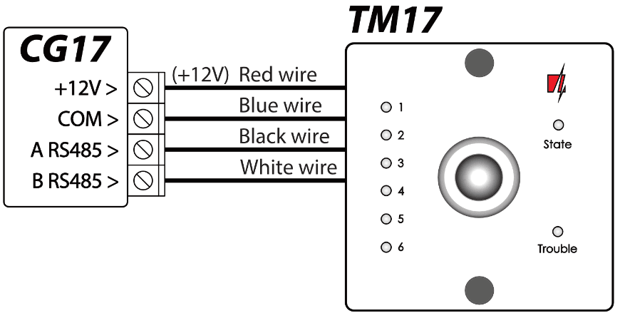

Läsaren för iButton-nycklar ska anslutas till CG17 via porten ”1 Wire”. Ledningen kan vara upp till 30 m lång:

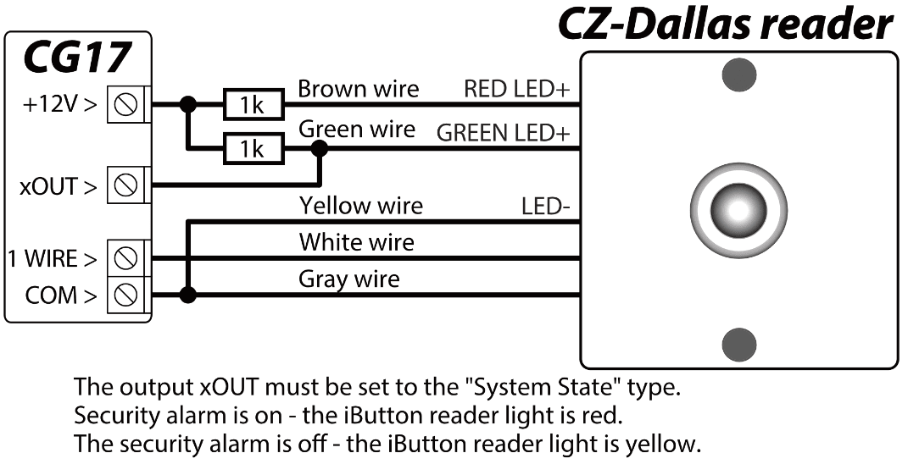

!!! note "Obs!"
    Hur du länkar nycklar till CG17 beskrivs i avsnitt 4.4.1
    ”Registrera elektroniska nycklar (iButton)”.
### Kopplingsschema för anslutning av radiotransceivern RF-SH för trådlösa detektorer 

Radiotransceivern *RF-SH* för trådlösa detektorer är avsedd för trådlösa enheter av märket Crow (rörelsedetektorer, magnetkontakter, siren, fjärrkontroller m.m.). En *RF-SH*-transceiver kan anslutas till *CG17*.

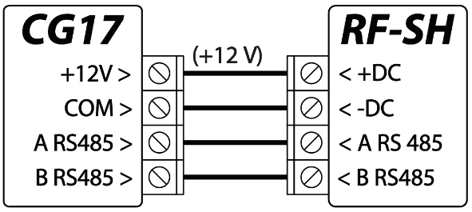

### Kopplingsscheman för anslutning av utbyggnadsmoduler i serien iO 

Om centralapparaten CG17 behöver fler ingångar IN eller utgångar OUT ansluter du en trådbunden eller trådlös TRIKDIS utbyggnadsmodul för ingångar och utgångar i serien iO. Hur CG17 konfigureras för utbyggnadsmoduler beskrivs i avsnitt 4.5, fönstret ”Modules”. Upp till åtta utbyggnadsmoduler iO-8 kan anslutas till CG17. Modulen iO-8 kan använda alla sektioner eller bara några. Det totala antalet sektioner i CG17 är 12.

  <figure style="margin: 0;">
    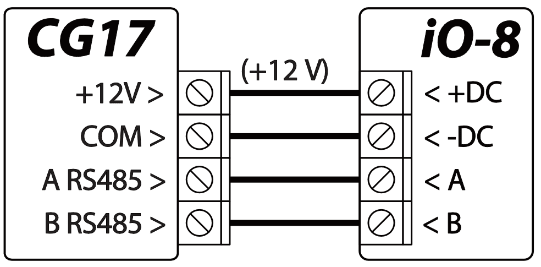
  </figure>
  <figure style="margin: 0;">
    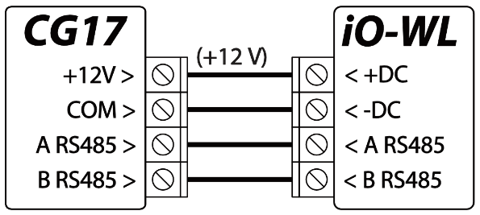
  </figure>

### Kopplingsscheman för anslutning av knappsatsen Crow CR-16 

Upp till 8 knappsatser (Crow CR-16 Runner, Crow LCD Runner, Crow Touch Runner eller Crow CR-16 PowerWave) kan anslutas till *CG17*. I *TrikdisConfig* måste du ange att en Crow-knappsats används (se avsnitt 4.2, fönstret ”System Options”).

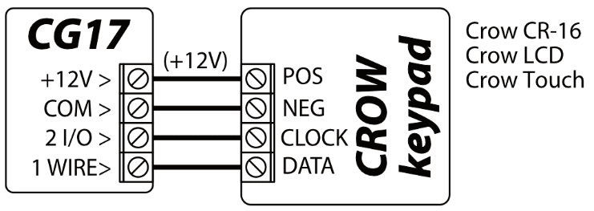

### Kopplingsscheman för anslutning av en siren

- En siren som drar upp till 1 A kan anslutas till utgång 5 OUT eller utgång 6 OUT.

- En siren som drar upp till 100 mA kan anslutas till valfri utgång OUT.

- Utgången OUT måste ha funktionen ”Siren” och ett område i larmsystemet måste vara inställt.

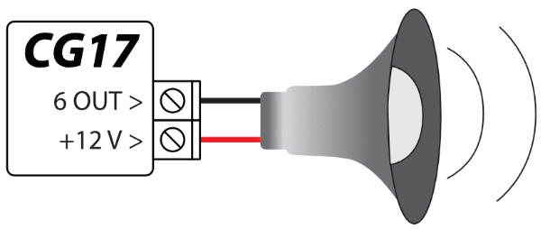

### Kopplingsscheman för anslutning av utbyggnadsmoduler i serien iO

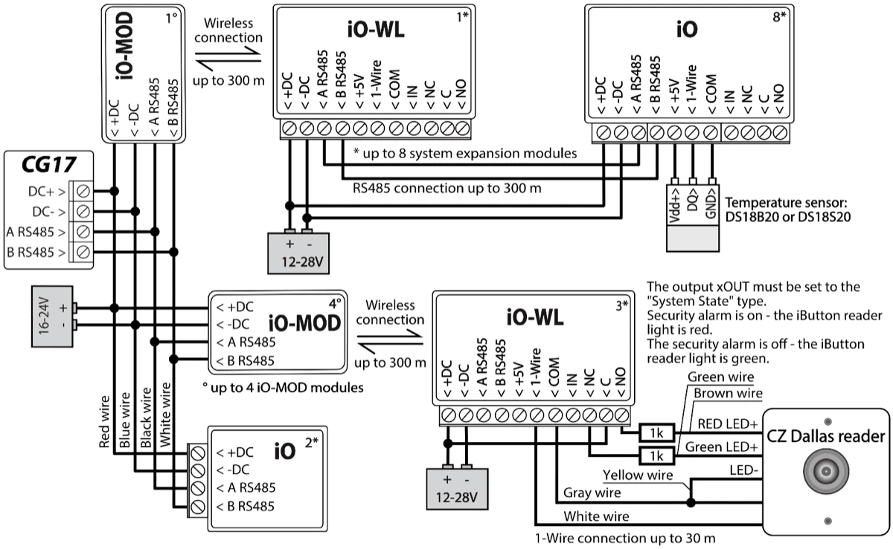

**Obs!**

- Om ledningen till temperaturgivaren är längre än 0,5 m rekommenderar vi en **partvinnad kabel (UTP4x2x0,5 eller STP4x2x0,5**).

- Till en CG17 kan du ansluta:

  - Upp till fyra iO-MOD-moduler.

  - Upp till åtta iO- och/eller iO-WL-moduler.

- Läsare för iButton-nycklar och temperaturgivare ska anslutas till plinten ”1-Wire”.

### Kopplingsscheman för anslutning av bränslenivågivaren Strela RS485

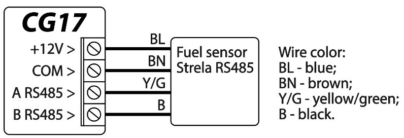

En bränslenivågivare ”Strela RS485” kan anslutas till CG17. När bränslegivaren är ansluten får inga andra moduler (iO-8, iO, iO-WL, RF-SH, TM17, E485, W485, iO-LORA, iO8-LORA, PB-LORA, REL-LORA) vara anslutna till CG17.

**Konfigurera och förbereda bränslenivågivaren för användning med *CG17***

Bränslenivågivaren ”**STRELA S485**” (<http://strela-fls.com/products/fuel_level_sensors_strela.html>) måste kalibreras med tillverkarens kalibreringsprogram ”DUTConfig” (<http://strela-fls.com/programs.html>) och bränsletankens volym måste anges, annars kan givarens mätvärden bli felaktiga.

1.  Anslut bränslenivågivaren till en dator med en programmeringsadapter. Tryck på den ”bruna” knappen på adaptern så att den gröna indikeringen i avsnittet RS-485 UART tänds.

2.  Starta programmet ”DUTConfig”. Välj ”**Interface sensor**”.

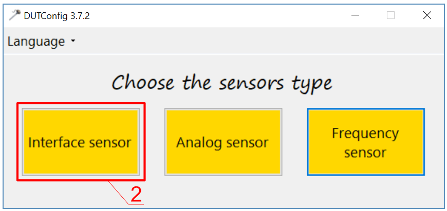

3. Ställ in läget ”**View**” på ”**Standart**”.

2.  Klicka på ”**Connect**” och vänta.

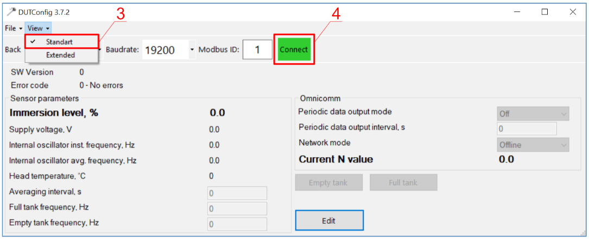

3. När givaren är ansluten till ”DUTConfig” visas en ruta ”**Connection: on**”.

    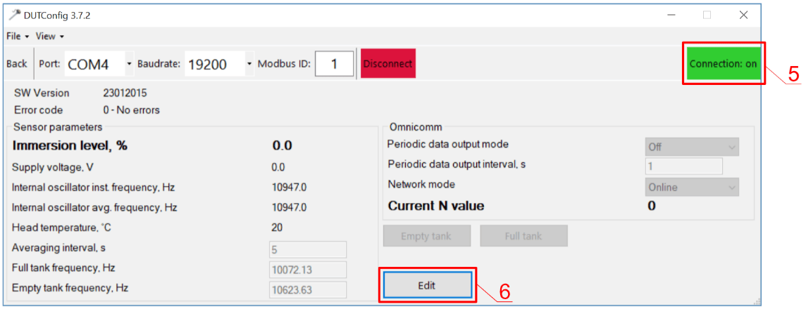

2.  Klicka på knappen ”**Edit**” och kalibrera givaren för full och tom tank.

3.  Kalibrering under verkliga förhållanden: a) Bränsletanken är full och givaren sitter i tanken – klicka på knappen ”**Full tank**”; b) Bränsletanken är tom och givaren är uttagen ur tanken – klicka på knappen ”**Empty tank**”.

4.  Klicka på knappen ”**OK**” för att spara värdena.

    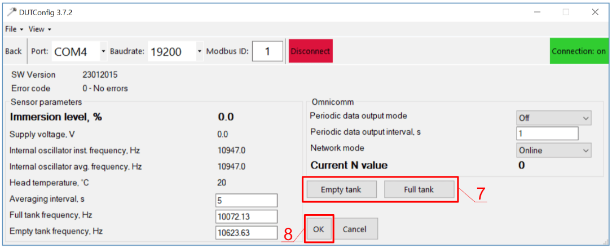

5.  Ändra läget ”**View**” till ”**Extended**”.

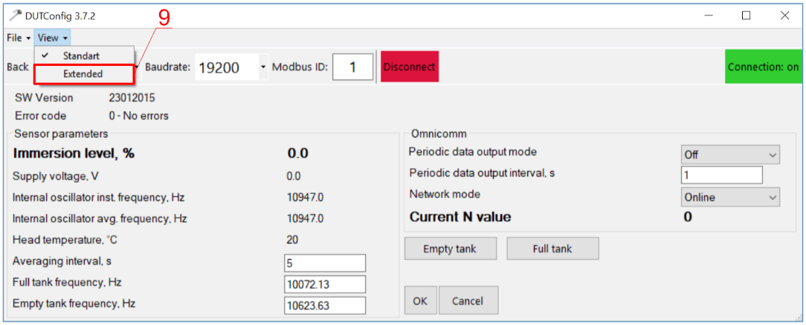

10. Fyll i tabellen efter bränsletankens form. Enkel metod: ställ in 0 % nedsänkning som 0 liter och 100 % nedsänkning som bränsletankens volym (tanken i exemplet rymmer 200 l).

11. När du har fyllt i tabellen klickar du på ”**OK**”.

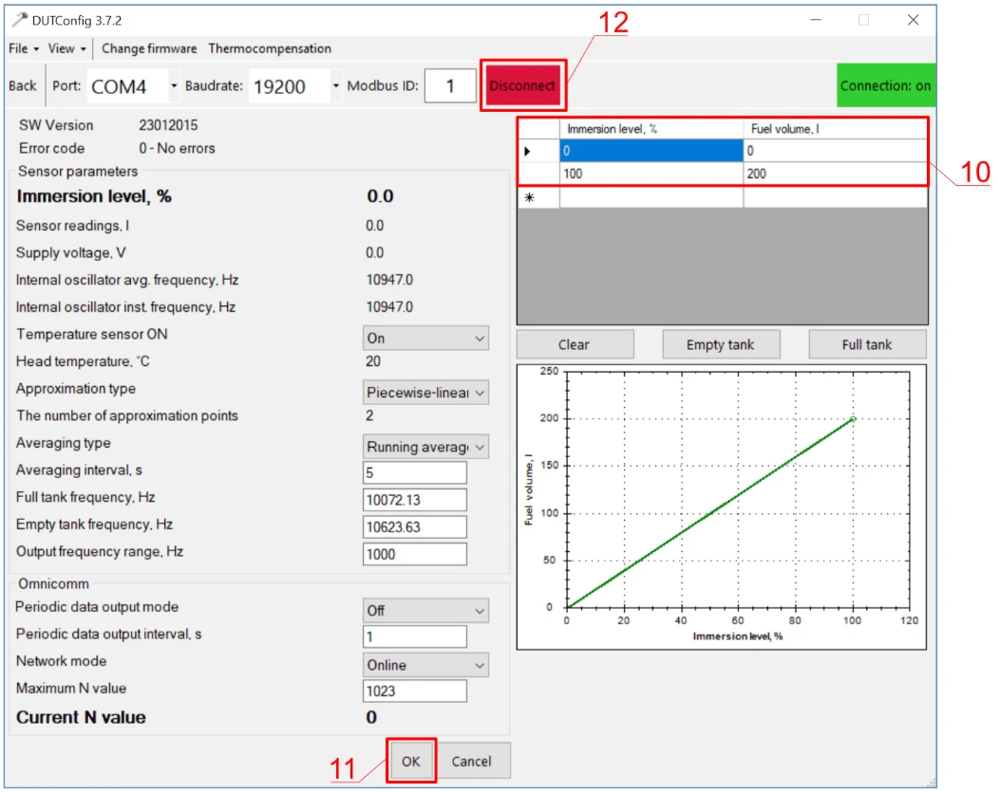

12. Klicka på knappen ”**Disconnect**”.

13. Koppla bort bränslenivågivaren och anslut den till CG17.

### Kopplingsscheman för anslutning av ett batteri

Ett 12 V-batteri kan anslutas till CG17. Om nätspänningen försvinner skickas händelsemeddelandet *”AC fault”* och CG17 växlar automatiskt över till 12 V-batteriet.

- När batteriets spänning sjunker till 11,5 V skickas händelsemeddelandet *”Battery low”*.

- När batteriets spänning sjunker under 9,5 V och nätspänningen saknas stängs CG17 av.

- När nätspänningen kommer tillbaka skickas händelsemeddelandet ”**AC restore**” och batteriladdningen startar automatiskt.

- När batteriets spänning stiger till 12,6 V skickas händelsemeddelandet ”**Battery restore**”.

**Ansluta batteriet:**

- Placera reservbatteriet i kapslingen.

- Anslut batteriets ledare till kontakterna BAT+ / BAT– för reservmatning på *CG17*.

- Kontrollera att *CG17*:s laddningsström räcker för att ladda batteriet.

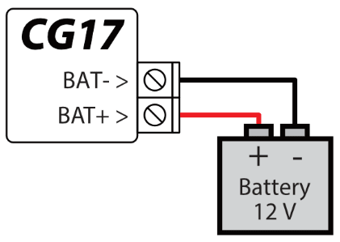

### Kopplingsscheman för anslutning av CG17 till en centralapparat för inbrottslarm

*CG17* fungerar i läget larmsändare. *CG17*:s ingångar måste ställas in på typen NO eller NC och definitionen ”24_hours”. *CG17*:s ingångar kan beskrivas med SMS-texter som användaren får när ingångarna ger en händelse eller återställning. Centralapparatens PGM-utgångar måste kopplas till särskilda händelser.

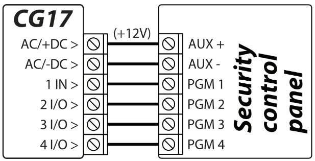

### Mäta likspänning med CG17

*CG17* kan användas för att mäta likspänning. Fyra av *CG17*:s ingångar, 1IN, 2IN, 3IN och 4IN, kan väljas för spänningsmätning. Spänningar från 0 V till 30 V mäts (om spänningen överstiger 30 V skadas centralapparaten *CG17*). Spänningen som ska mätas måste anslutas till plintarna ”1IN” och ”COM”. ”1IN” – pluspol. ”COM” – minuspol.

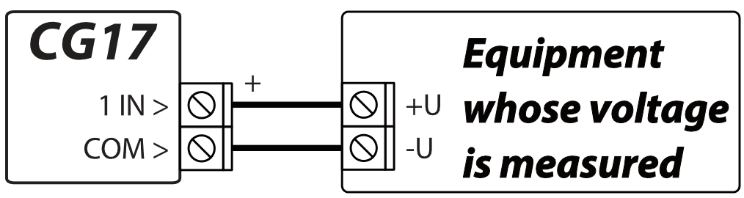

Anslut CG17 till en dator med en USB Mini-B-kabel. Starta TrikdisConfig. Programmet identifierar automatiskt den anslutna CG17 och öppnar ett fönster för konfigurering. I fönstret ”**Sensors**” anger du ”**In1 Voltage**” och anger också den spänning över vilken ett meddelande ska skapas.

- **Max** – när spänningen är högre än den här inställningen skapas ett händelsemeddelande. För att ett händelsemeddelande ska skapas måste rutan ”**High**” vara markerad.

- **Min** – när spänningen är lägre än den här inställningen skapas ett händelsemeddelande. För att ett händelsemeddelande ska skapas måste rutan ”**Low**” vara markerad.

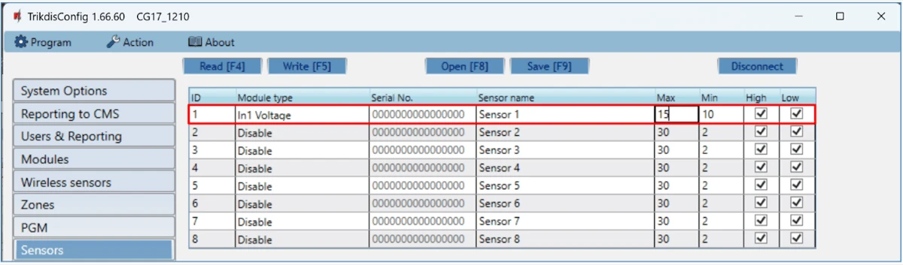

PGM-utgången kan styras när en spänning över eller under ett inställt värde mäts. I TrikdisConfig väljer du PGM-utgången och ställer in driftläget ”**Remote Control**”.

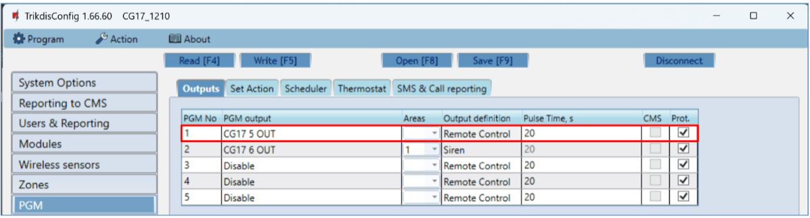

Gå till fliken ”**Set Action**”.

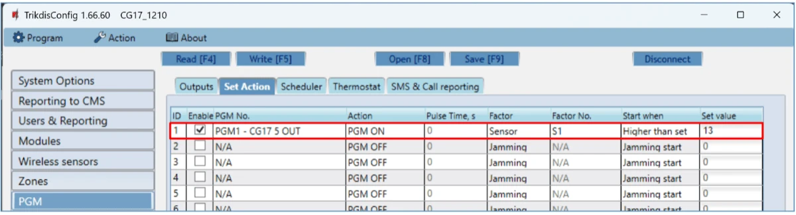

- **Enable** – aktiverar PGM:en.

- **PGM No.** – ange den PGM-utgång som ingången ”1IN” ska styra.

- **Action** - ange PGM-utgångens driftläge:
- **PGM OFF** – stänger av PGM-utgången.

- **PGM ON** – slår på PGM-utgången.

- **Pulse OFF -** stänger av PGM-utgången under pulstiden (efter kommandot är utgången avstängd under pulstiden och slås därefter på)**.**

- **Pulse ON** – slår på PGM-utgången under pulstiden (efter kommandot är utgången påslagen under pulstiden och stängs därefter av).
- **Pulse time, s** – ställ in pulstiden från 0 till 9999 sekunder.
- **Factor** – ange givaren.

- **Factor No.** – tilldela mätingången ”1IN” för spänning.

- **Start when** – ange ett extra villkor för att aktivera PGM-utgången.
- **Set value** – ange den spänning (V) som styrenheten ska övervaka och styra PGM-utgången efter.

### Kopplingsschema för anslutning av WiFi-modulen *W485* 

Modulen *W485* skickar meddelanden till larmcentralen (CMS, Central Monitoring Station) och till *Protegus2* via en WiFi-router med internetanslutning. När WiFi-anslutning finns skickar *CG17* (firmware från v. 1.13) händelsemeddelanden via modulen *W485*. När WiFi-anslutningen bryts skickar *CG17* meddelanden via GPRS. När WiFi-anslutningen är återupprättad går *CG17* tillbaka till att skicka meddelanden via *W485*. Hur WiFi-modulen *W485* konfigureras för att fungera med *CG17* beskrivs i avsnitt 4.5, fönstret ”Modules”. Du behöver inget SIM-kort när du använder *W485* med centralapparaten *CG17*. En *W485*-modul kan anslutas till *CG17*.

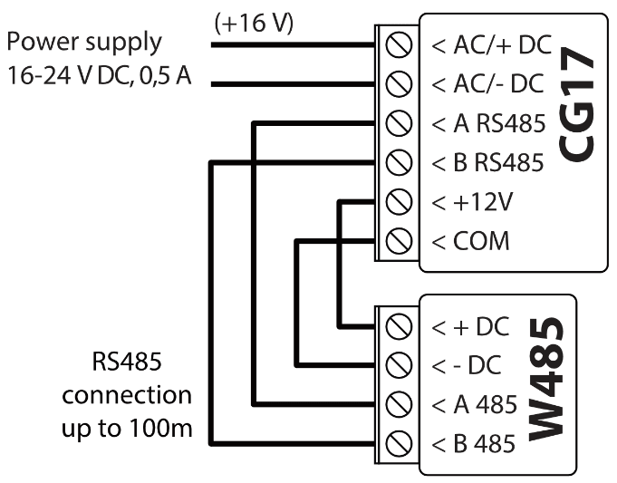

### Kopplingsschema för anslutning av Ethernet-modulen E485

*E485* skickar meddelanden till larmcentralen (CMS, Central Monitoring Station) och till *Protegus2* via en trådbunden internetanslutning. När *E485* används med *CG17* (firmware från v. 1.13) skickas meddelanden till larmcentralen och till *Protegus* via trådbundet internet och mobilt internet används inte. Om den trådbundna internetanslutningen bryts skickar *CG17* meddelanden via mobilt internet. När den trådbundna internetanslutningen är återupprättad börjar *CG17* skicka meddelanden via *E485* igen. Hur Ethernet-modulen *E485* konfigureras för att fungera med *CG17* beskrivs i avsnitt 4.5, fönstret ”Modules”. Du behöver inget SIM-kort när du använder *E485* med centralapparaten *CG17*. En *E485*-modul kan anslutas till *CG17*.

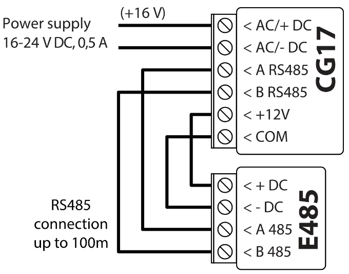

### Kopplingsschema för anslutning av utbyggnadsmoduler i serien iO-LORA 

CG17-centralapparat med firmware version 1.18 eller senare.

Anslut transceivern RF-LORA till CG17. Därefter kan du använda modulerna iO-LORA, iO8-LORA, PB-LORA och REL-LORA. En RF-LORA-transceiver kan anslutas till CG17.

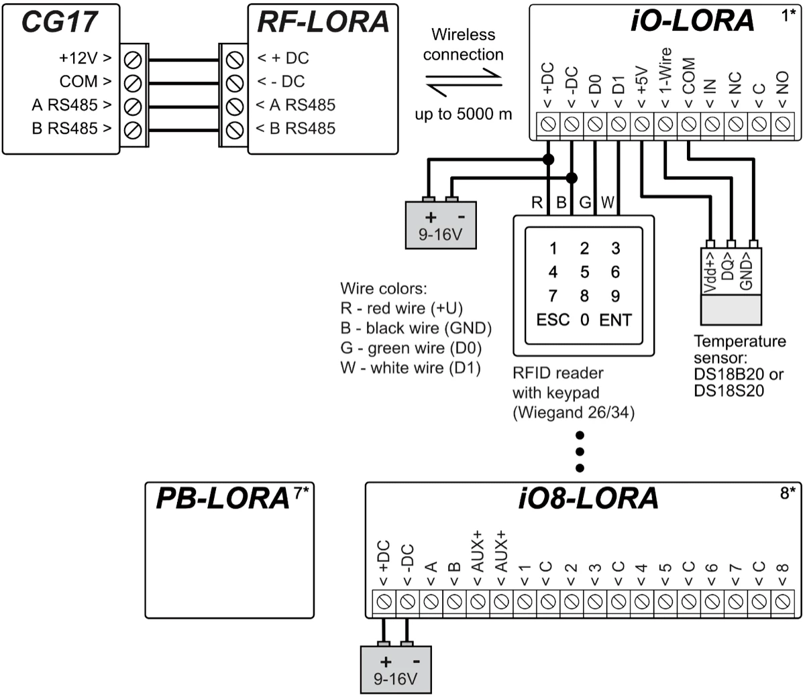

Starta TrikdisConfig. Anslut CG17 till datorn med en USB Mini-B-kabel eller på distans. Klicka på knappen **Read [F4]** i TrikdisConfig för att visa de aktuella värdena för styrenhetens driftparametrar. Om du uppmanas, ange administratörs- eller installatörskoden i dialogrutan. I listan ”**Modules**” väljer du den LORA-modul du använder. I fältet ”**Serial No.**” anger du modulens serienummer.

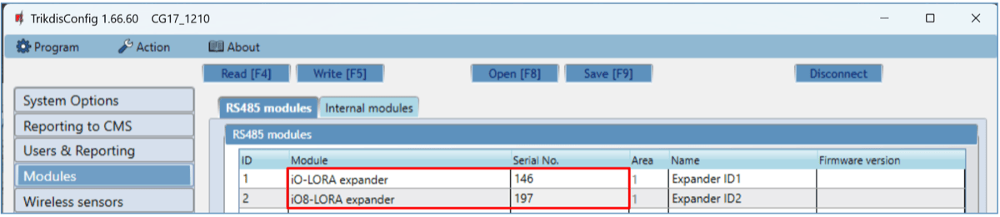

När du har gjort ändringarna klickar du på **Write [F5]**. Vänta tills uppdateringen är klar. Klicka på ”**Disconnect**” och dra ut USB Mini-B-kabeln.

## Inställning av parametrar med programvaran *TrikdisConfig* 

1.  Ladda ned konfigurationsprogrammet TrikdisConfig från [www.trikdis.com/](http://www.trikdis.com/lt) (skriv ”TrikdisConfig” i sökfältet) och installera det.

2.  Ta bort locket på CG17 med en spårskruvmejsel enligt bilden nedan:

1.  Anslut CG17 till en dator med en USB Mini-B-kabel.

2.  Starta konfigurationsprogrammet TrikdisConfig. Programmet identifierar automatiskt den anslutna enheten och öppnar automatiskt konfigurationsfönstret för CG17.

3.  Klicka på knappen **Read [F4]** för att se CG17:s aktuella parametrar. Om du uppmanas, ange *administratörs-* eller *installatörskoden* i dialogrutan.

### Statusfältet i TrikdisConfig 

När CG17 är ansluten till programvaran TrikdisConfig visar programmet information om den anslutna enheten i statusfältet:

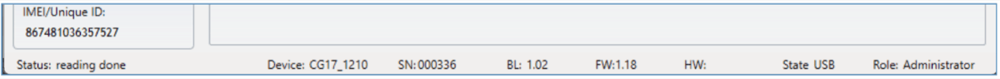

#### Statusfält

| Namn           | Beskrivning                                         |
|----------------|-----------------------------------------------------|
| IMEI/Unique ID | Enhetens IMEI-nummer                            |
| Status         | Driftstatus                                         |
| Device         | Enhetstyp (måste visa CG17)                  |
| SN             | Enhetens serienummer                              |
| BL             | Bootloader-version                                  |
| FW             | Enhetens firmwareversion                           |
| HW             | Enhetens maskinvaruversion                           |
| State          | Typ av anslutning till programmet (USB eller på distans) |
| Role           | Behörighetsnivå (visas när åtkomstkoden har godkänts)  |

!!! note "Obs!"
    Klicka på **Read [F4]** så att programmet läser och visar de inställningar som för närvarande är sparade i enheten. Klicka på **Write [F5]** för att spara de inställningar som visas på skärmen i enheten. Klicka på **Save [F9]** för att spara inställningarna i en konfigurationsfil. Du kan senare ladda upp de sparade inställningarna till andra enheter. På så sätt kan du snabbt konfigurera flera enheter med samma inställningar. Klicka på **Open [F8]** och välj en konfigurationsfil för att visa tidigare sparade inställningar. Om du vill återgå till förvalen klickar du på knappen ”**Restore**” längst ned till vänster på skärmen.
När du klickar på **Read [F4]** läser programmet och visar de inställningar som för närvarande är sparade i CG17. Ställ in de parametrar du behöver i TrikdisConfig med hjälp av beskrivningarna av programfönstren nedan.

### Fönstret ”System Options” 

**Fliken ”System general”**

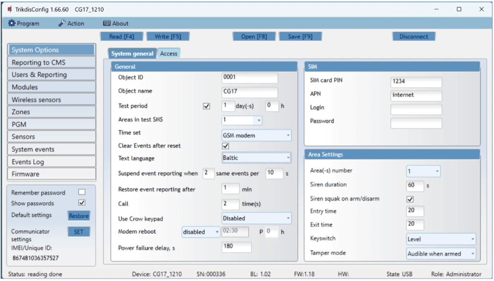

**Inställningsgruppen ”General”**

- Om händelser ska skickas till larmcentralen anger du ”**Object ID**” (abonnentkod; hexadecimalt tal med 4 tecken, 0–9, A–F. **Använd inte FFFE, FFFF som Object ID.**) som du har fått från larmcentralen.

- **Object name** används i SMS om händelser (upp till 20 tecken, bokstäver och siffror kan användas).

- **Test period** – när rutan är markerad skickas periodiska ”**Test**”-meddelanden med den inställda perioden.

- **Areas in test SMS** – de valda områdenas lägen tas med i testmeddelandet.

- **Time set –** välj en server att synkronisera tiden mot. Om du väljer ”**IP server**” synkroniseras tiden mot IP-mottagarens tid, om du väljer ”**Cellular modem**” synkroniseras tiden mot mobiloperatörens servertid.

- **Clear Events after reset** – alla osända händelsemeddelanden raderas efter återställning.

- **Text language** – ange önskat språk så används det språkets särskilda tecken i SMS.

- Du kan ange **Suspend event reporting when ...**, dvs. att rapporteringen upphör när ett visst antal **same events per ... s** inträffar.

- **Restore event reporting after** – ange efter hur lång tid upphörandet av händelserapporteringen ska hävas. Tiden kan vara från 0 till 999 minuter.

- **Call –** efter en händelse ringer CG17 upp användaren/användarna så många gånger som anges. Om samtalet avvisas eller besvaras slutar CG17 att ringa. Samtalstiden är 20 sekunder.

- **Use CROW keypad** – ange vilken knappsatstyp (**Crow CR-16**, **Crow LCD**, **Crow Touch**) som är ansluten till centralapparaten.

- **Modem reboot** - du kan ställa in att modemet ska startas om vid en angiven tid.

- **AC failure delay** - om huvudmatningen försvinner skickas en avisering om spänningsbortfall efter den angivna fördröjningen. När matningsspänningen kommer tillbaka skickas en avisering om att spänningen är återställd efter den angivna fördröjningen.

**Inställningsgruppen ”SIM”**

- Ange koden i ”**SIM card PIN**”.

  - **APN** – namnet på mobiloperatörens åtkomstpunkt för mobilt internet. Du måste ange APN om händelsemeddelanden ska skickas till molntjänsten Protegus eller till larmcentralen via GPRS.
- Om SIM-kortets GPRS-operatör kräver det anger du användarnamn och lösenord för ”**APN**” i fälten ”**Login**” och ”**Password**”**.**

**Inställningsgruppen ”Area Settings”**

- **Area(-s) number** anger antalet oberoende delar av larmsystemet.

Om en siren är ansluten och en utgång OUT (som måste vara tilldelad ett område) är inställd som ”*Siren*”:

- **Siren duration** – hur länge sirenen ljuder när larmet utlöses. Tiden kan vara från 0 till 999 sekunder.

- **Siren squak on arm/disarm** – sirenen ger ett kort ljud en gång när larmet tillkopplas och två gånger när det frånkopplas.

- **Entry time** – inpasseringstid via sektionen ”**Delay**”. Tiden kan vara från 0 till 999 sekunder.

- **Exit time** – utpasseringstid via sektionen ”**Delay**”. Tiden kan vara från 0 till 999 sekunder. När larmet tillkopplas med appen Protegus2 eller med telefonsamtal räknar systemet inte utpasseringstiden (”**Exit time**”).

- **Keyswitch** anger hur larmet tillkopplas/frånkopplas med sektionen ”**Keyswitch**”. Du kan välja styrning med ”**Pulse**” eller ”**Level**”.

- **Tamper mode** – välj reaktionstyp (”**Silent**”, ”**Audible when armed**”, ”**Always Audible**”) när systemet upptäcker sabotage av en detektor. ”**Silent**” – mottagarna får händelserapporter men sirenen slås inte på; ”**Audible when armed**” – mottagarna får händelserapporter men sirenen slås bara på om sabotaget sker när systemet är tillkopplat; ”**Always audible**” – mottagarna får händelserapporter och sirenen slås på även när larmsystemet är frånkopplat.

**Fliken ”Access”**

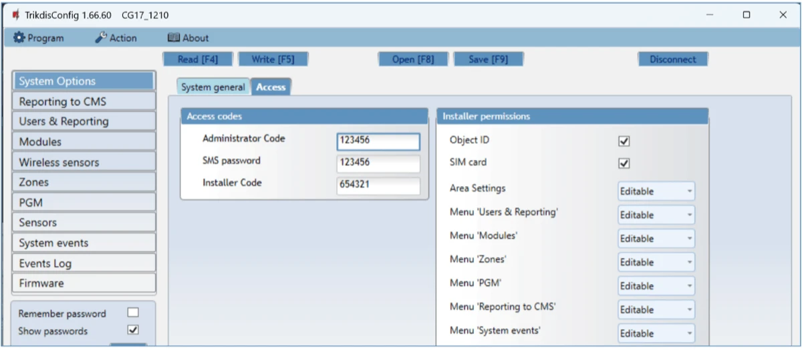

**Inställningsgruppen ”Access codes”**

- **Administrator Code** – *(förvald kod 123456)* ger full åtkomst till konfigureringen (koden måste vara 6 tecken lång och bestå av latinska bokstäver och/eller siffror).

- **SMS password –** *(förvald kod 123456)* ger säkerhet vid styrning med SMS. För ökad säkerhet ändrar du den till en kod med 6 tecken som bara du känner till.

- **Installer Code** – (*förvald kod 654321*) ger installatören åtkomst till konfigureringen. För säkerhets skull ändrar du den till en kod med 6 tecken som bara du känner till.

!!! note "Obs!"
    Om den förvalda *administratörskoden* (123456) är inställd kräver programvaran inte att den anges, och när du klickar på **Read [F4]** visas direkt de parametrar som för närvarande är sparade i enheten.
**Inställningsgruppen ”Installer permissions”**

- För att ställa in installatörens rättigheter.

### Fönstret ”Reporting to CMS” 

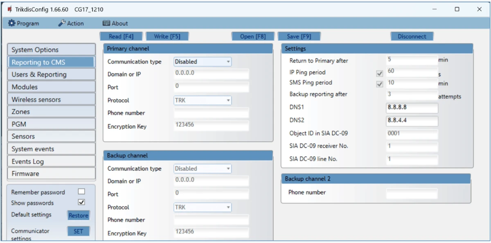

Centralapparaten kan skicka meddelanden till larmbolagets mottagare på larmcentralen.

**Inställningsgrupperna ”Primary channel” och ”Backup channel”**

- **Communication type** – välj protokoll för kommunikationen med mottagaren (TCP/IP, UDP/IP, SMS).

- **Domain or IP** – ange mottagarens domän eller IP-adress.

- **Port** – ange mottagarens nätverksportnummer.

- **Protocol – TRK** för överföring av händelser till TRIKDIS-mottagare, **SIA DC-09** för överföring av händelser till universella mottagare.

- **Phone number** – telefonnummer till en larmcentralsmottagare som kan ta emot SMS.

- **Encryption Key** – krypteringsnyckel med 6 siffror för meddelandena, som måste stämma överens med krypteringsnyckeln i larmcentralens mottagare.

**Inställningsgruppen ”Settings”**

- **Return to primary after** – tid i minuter efter vilken *CG17* försöker återfå anslutningen via ”**Primary channel**”.

- **IP Ping period** – period i sekunder för att skicka PING-signaler som kontrollerar anslutningen på GPRS-kanalen. Markera rutan för att slå på signalerna.

- **SMS PING period** – period i minuter för att skicka PING-signaler som kontrollerar anslutningen på SMS-kanalen. Markera rutan för att slå på signalerna.

- **Backup reporting after** – ange hur många misslyckade försök att skicka meddelanden via ”**Primary channel**” som ska ske innan växling sker till ”**Backup channel**”.

- **DNS1 – DNS2** – adresser till DNS-servrar.

- **Object ID in SIA DC-09** – ange objektnummer.

- **SIA DC-09 receiver No.** – ange mottagarnummer.

- **SIA DC-09 line No.** – ange linjenummer.

**Inställningsgruppen ”Backup channel 2”**

- **Phone number** – telefonnummer till en larmcentralsmottagare som kan ta emot SMS (t.ex.: 370xxxxxxxx). Kanalen ”**Backup SMS**” används när meddelanden inte kan skickas via ”**Primary**” och ”**Backup**”. Funktionen är mycket användbar eftersom den fungerar även när IP-anslutningen i mobiloperatörens nät är störd. Kanalen fungerar bara när läget GPRS är inställt för både ”**Primary**” och ”**Backup**”. SMS skickas till mottagningscentralen: 1) så snart *CG17* slås på för första gången; och 2) efter att TCP/IP- eller UDP/IP-anslutningen har gått förlorad på ”**Primary**” och ”**Backup**”.

### Fönstret ”Users & Reporting” 

**Fliken ”Users”**

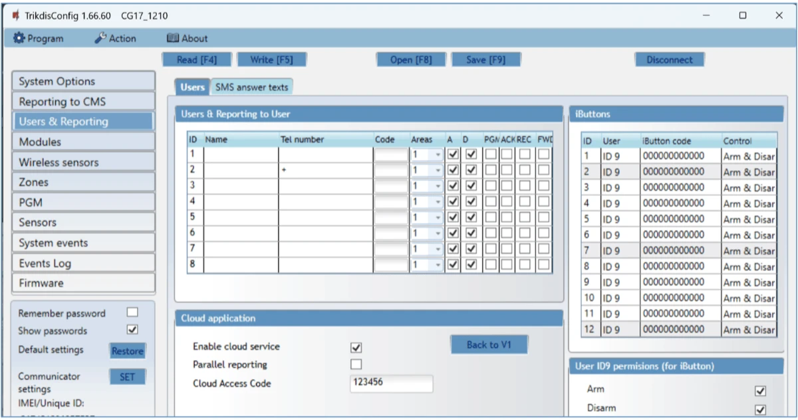

**Inställningsgruppen ”Users & Reporting to User”**

- **ID** – användarens nummer i listan.

- **Name** – användarens namn eller e-postadress. Namnen används i SMS om händelser. En administratör kan ange användarens e-postadress. Då kan användaren logga in i Protegus2.

- **Tel number** – användarens telefonnummer. Det här numret kan styra larmet på distans och tar emot SMS. Numren måste anges med landskod.

- **Code** – den kod för tillkoppling och frånkoppling av larmet som är tilldelad varje användare.

- **Areas** – de områden som användaren kan styra. ”**User ID9**” kan bara styra område 1, parametern kan inte ändras.

- **A** – markera rutan om användaren ska få tillkoppla larmet.

- **D** – markera rutan om användaren ska få frånkoppla larmet.

  - Om rutorna **PGM** och **REC** inte är markerade men både **A** och **D** är valda avvisas användarens samtal när användaren ringer till CG17, och larmet byter driftläge till motsatt tillstånd, dvs. larmet tillkopplas eller frånkopplas.

  - Om bara **PGM** är markerad kan användaren ringa till CG17 och slå på eller stänga av en önskad utgång med DTMF-toner.

- **REC** – för framtida bruk.

  - **ACK** – om rutan är markerad skickar CG17 SMS till användaren med ”**SMS answer text**” efter varje kommando som tas emot i SMS.

- **FWD** – markera den här rutan om SMS som tas emot från andra än systemets användare (t.ex. besked om SIM-kortets saldo, slumpmässiga reklammeddelanden m.m.) ska vidarebefordras till användaren.

**Inställningsgruppen ”Cloud application”**

- **Enable cloud service** – aktiverar ”**Protegus service**” så att CG17 kan utbyta data med appen Protegus2. Gör det också möjligt att konfigurera på distans med TrikdisConfig.

- **Parallel reporting** – aktivera parallell sändning av meddelanden via *primärkanalen* och till Protegus2.

- **Cloud Access Code** – kod med 6 siffror för anslutning till Protegus2.

**Inställningsgruppen ”iButtons”**

!!! note "Obs!"
    Fler än en nyckel kan tilldelas en användare! Alla nyligen länkade nycklar tilldelas ”**User ID9**” (utan namn). Namn kan bara tilldelas åtta användare. Behörigheterna för ”**User ID9**” ställer du in i inställningsgruppen ”**User ID9 permissions**”.
- **ID** – nyckelns nummer i listan.

- **User** – den användare som nyckeln är tilldelad. För att tilldela en nyckel till en användare ändrar du ”**ID9**” till en annan användares *ID* från tabellen **”Users & Reporting to User”** (t.ex. för att tilldela en nyckel till användare nr 3 ändrar du ”**ID9**” till ”**ID3**”).

- **iButton code** – identifieringsnumret för en *iButton*-nyckel eller ett RFID-kort.

- **Control** – välj vilken åtgärd systemet ska vidta när nyckeln har lästs (t.ex. av TM17): None / Arm / Disarm / Arm & Disarm.

#### Registrera elektroniska nycklar (iButton)

1.  Om listan ”iButtons” är tom sparas den första nyckel som länkas på den första raden i listan och blir ”**Master key**”.

2.  För att slå på länkningsläget för kontaktnycklar håller du ”**Master key**” mot nyckelläsaren i minst 10 sekunder. När länkningsläget är på börjar nyckelläsaren TM17:s lysdiod ”*State*” blinka grönt.

3.  För att länka användarnycklar håller du dem mot nyckelläsaren en i taget. 3 ljudsignaler från läsaren visar att nyckeln har länkats.

4.  När du har länkat användarnas elektroniska nycklar (*iButton*) håller du ”**Master key**” mot nyckelläsaren igen för att stänga av länkningsläget. När länkningsläget är avstängt slutar lysdioden ”*State*” på nyckelläsaren **TM17** att blinka*.*

5.  För att radera alla nycklar (inklusive huvudnyckeln) håller du ”**Master key**” mot läsaren i minst 20 sekunder.

!!! warning "Viktigt"
    ”Master key” får bara användas för att länka andra nycklar!
#### Registrera RFID-kort 

Centralapparaten CG17 används med modulen iO-LORA, till vilken en RFID-läsare med knappsats är ansluten. RFID-kortets ID-nummer anges i fältet ”**iButton code**”.

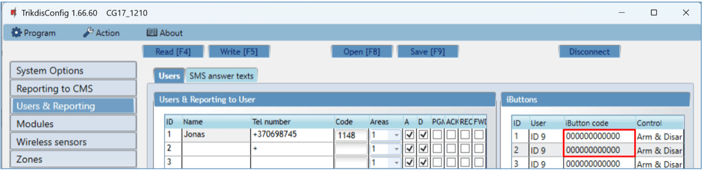

När du har gjort ändringarna klickar du på **Write [F5]**. Vänta tills uppdateringen är klar.

**Fliken ”SMS answer texts”**

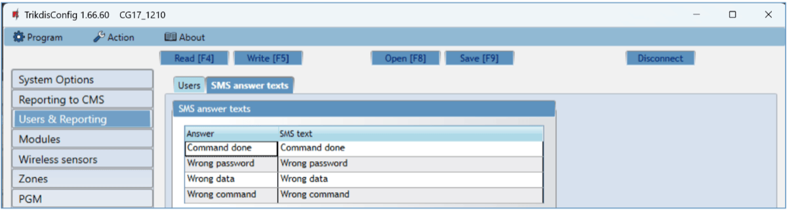

**Inställningsgruppen ”SMS answer texts”**

- Texterna i svaren på kommandon som skickas via SMS kan ändras i fältet ”**SMS text**”.

### Fönstret ”Modules” 

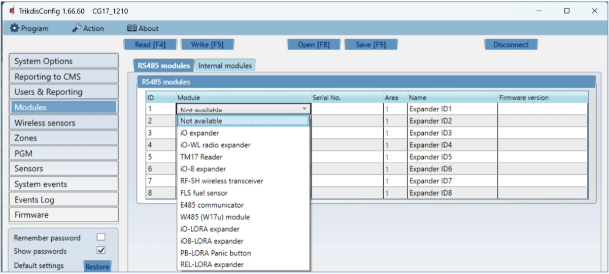

**Inställningsgruppen ”RS485 modules”**

- **ID** – modulens nummer i listan.

- **Module** – välj vilka moduler som används (modulerna iO, iO-WL, TM17, iO-8, RF-SH, FLS, E485, W485, iO-LORA, iO8-LORA, PB-LORA, REL-LORA) i listan över moduler.

- **Serial No.** – obligatoriskt 6-siffrigt nummer som finns på etiketterna på modulens kapsling och på förpackningen.

- **Area** – tilldela modulen ett område (TM17 visar tillståndet för det område den är tilldelad och även tillståndet för sektionerna i området).

- **Name** – du kan ge modulen ett namn.
- **Firmware version** – firmwareversionen visas när CG17 har identifierat den anslutna modulen.

#### Inställningsfönstret för WiFi-modulen W485

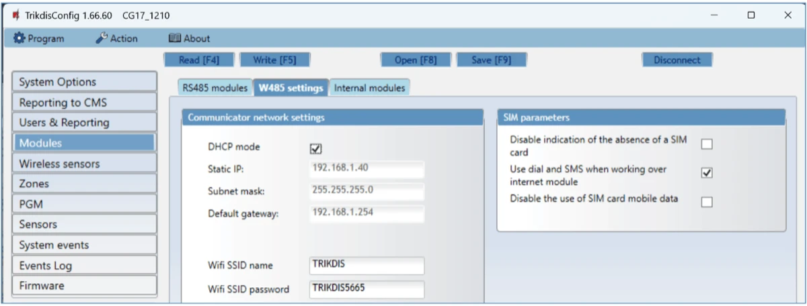

**Inställningsgruppen ”Communicator network settings”**

- **DHCP mode** – WiFi-modulens sätt att registrera sig i nätet (manuellt eller automatiskt).

- **Static IP** – statisk IP-adress när manuellt registreringsläge är inställt.

- **Subnet mask** – nätmask när manuellt registreringsläge är inställt.

- **Default gateway** – gateway-adress när manuellt registreringsläge är inställt.

- **Wifi SSID name** – namnet på det WiFi-nät som W485 ansluter till.

- **Wifi SSID password** - lösenordet till WiFi-nätet.

**Inställningsgruppen ”SIM parameters”**

- **Disable indication of the absence of a SIM card** – när rutan markeras stängs indikeringen av att SIM-kort saknas av när CG17 arbetar utan SIM-kort.

- **Use dial and SMS when working over internet module** – när rutan markeras skickas aviseringar samtidigt via samtal, SMS och den anslutna WiFi-modulen W485. Om rutan inte är markerad och ett WiFi-nät finns används varken SMS eller samtal. Om rutan inte är markerad och inget WiFi-nät finns kan CG17 hantera samtal och SMS. CG17 skickar SMS till användaren.

- **Disable the use of SIM card mobile data** - när rutan markeras stängs användningen av mobildata på SIM-kortet av. Data skickas bara via modulen W485. Om WiFi-nätet försvinner lagrar CG17 data i minnet. När WiFi-nätet är återställt skickar CG17 de sparade data via WiFi-modulen W485***.***

I tabellen kan du tilldela Contact ID-koder för händelse och återställning till händelsen fel på RS485-databussen. När anslutningen mellan W485 och CG17 bryts eller återupprättas skickar CG17 ett meddelande med den tilldelade CID-koden till larmcentralen och till appen Protegus2.

!!! note "Obs!"
    Du måste konfigurera CG17 för att skicka meddelanden till larmcentralen och till Protegus, se avsnitt 2.2 ”Inställningar för anslutning till larmcentralen” och 2.1 ”Inställningar för anslutning till appen Protegus2”. **Du behöver inget SIM-kort när du använder *W485* med centralapparaten *CG17* (firmware från v. 1.13).**
#### Inställningsfönstret för Ethernet-modulen E485

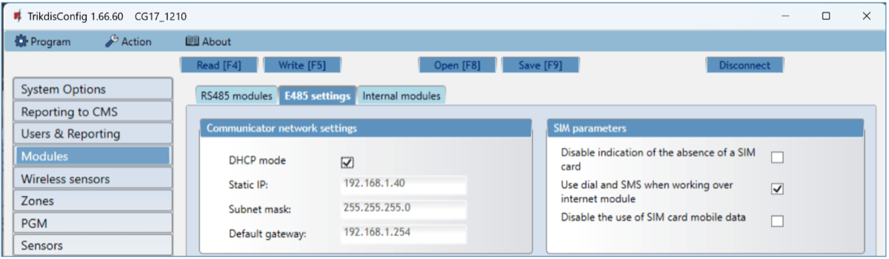

**Inställningsgruppen ”Communicator network settings”**

- **DHCP mode** – Ethernet-modulens sätt att registrera sig i nätet (manuellt eller automatiskt).

- **Static IP** – statisk IP-adress när manuellt registreringsläge är inställt.

- **Subnet mask** – nätmask när manuellt registreringsläge är inställt.

- **Default gateway** – gateway-adress när manuellt registreringsläge är inställt.

**Inställningsgruppen ”SIM parameters”**

- **Disable indication of the absence of a SIM card** – när rutan markeras stängs indikeringen av att SIM-kort saknas av när CG17 arbetar utan SIM-kort.

- **Use dial and SMS when working over internet module** – när rutan markeras skickas aviseringar samtidigt via samtal, SMS och den anslutna Ethernet-modulen E485. Om rutan inte är markerad och internet finns används varken SMS eller samtal. Om rutan inte är markerad och internet saknas kan CG17 hantera samtal och SMS. CG17 skickar SMS till användaren.

- **Disable the use of SIM card mobile data** - när rutan markeras stängs användningen av mobildata på SIM-kortet av. Data skickas bara via modulen E485. Om internet försvinner lagrar CG17 data i minnet. När internet är återställt skickar CG17 de sparade data via Ethernet-modulen E485***.***

I tabellen kan du tilldela Contact ID-koder för händelse och återställning till händelsen fel på RS485-databussen. När anslutningen mellan E485 och CG17 bryts eller återupprättas skickar CG17 ett meddelande med den tilldelade CID-koden till larmcentralen och till appen Protegus2.

!!! note "Obs!"
    Du måste konfigurera CG17 för att skicka meddelanden till larmcentralen och till Protegus2, se avsnitt 2.2 ”Inställningar för anslutning till larmcentralen” och 2.1 ”Inställningar för anslutning till appen Protegus2”. **Du behöver inget SIM-kort när du använder *E485* med centralapparaten *CG17* (firmware från v. 1.13).**
**Fliken ”Internal modules”**

**Inställningsgruppen ”Internal modules”**

- **Module type** – välj den GPS-modul som används.

- **Coordinates reporting every \_\_ min, when no movement or every \_\_ sec, when movement or selected zone in alarm** – ange intervallen för att skicka koordinater i normalläge och när rörelse upptäcks eller larmet utlöses i sektionen.

- **Movement detection** – om rutan är markerad utlöses larmet när skillnaden mellan koordinaterna är större än den angivna. Koordinaterna skickas då oftare.

- **Coefficients for smoothness, Slow smooth** – medelvärdesbildade koordinater skickas när ingen rörelse förekommer (medelvärdet tas av det angivna antalet koordinater – 256 eller ett annat angivet antal).

- **Coefficients for smoothness, Fast smooth** – medelvärdesbildade koordinater skickas när rörelse förekommer eller sektionen är i larmtillstånd (medelvärdet tas av det angivna antalet koordinater – 8 eller ett annat angivet antal).

- **Generate alarm when movement detected** – om rutan är markerad skickas CID-händelsekoden till larmcentralen, och till användaren i Protegus2, när rörelse upptäcks.

- **Force movement reporting on zone alarm** – ange den sektion i larmsystemet som en detektor är ansluten till. Om detektorn utlöses (tolkas som sektionslarm) skickar *CG17* koordinaterna oftare.

- **Stop reporting after alarm when no movement for \_\_ min** – ange ett tidsintervall (i minuter). Om koordinaterna inte ändras och inget sektionslarm inträffar under den här tiden återgår koordinatsändningen till normalläge.

Meddelanden med koordinaterna skickas till övervakningsprogrammet Monas MS.

#### Länka bränslenivågivaren ”STRELA RS485” 

!!! note "Obs!"
    Bränslenivågivaren ”**Strela RS485**” måste kalibreras med tillverkarens programvara ”**DUTconfig**” innan den används. Bränslenivågivaren ansluts till datorn med en adapter och kalibreras därefter. När bränslenivågivaren ”**Strela RS485**” är ansluten till CG17 blir övriga RS485-moduler (iO, iO-WL, TM17, iO-8, RF-SH, E485, W485, iO-LORA, iO8-LORA, PB-LORA, REL-LORA) inaktiva.
**Inställningsgruppen ”RS485 modules”**

- **Module** – välj modulen **FLS fuel sensor**.

Klicka på **Write [F5]**. Vänta tills data har sparats. Dra ut USB-kabeln ur CG17. Vänta i ca 1 minut. Anslut USB-kabeln till CG17. Klicka på **Read [F4]**. Programmet läser och visar de inställningar som för närvarande är sparade i CG17. ”**Serial No.**” och ”**Firmware version**” för bränslenivågivaren ”**Strela S485**” visas i programfönstret ”**Modules**”.

Öppna fönstret ”**Sensors**”.

- **Module type** – välj ”**Fuel level sensor**”.

- **Sensor name** – ge givaren ett namn.

- **Max** – ange största bränslemängd (i liter). När den faktiska mängden är större än den som anges här skapas ett händelsemeddelande. För att meddelandet ska skickas måste rutan ”**High**” vara markerad.

- **Min** – ange minsta bränslemängd (i liter). När den faktiska mängden är mindre än den som anges här skapas ett händelsemeddelande. För att meddelandet ska skickas måste rutan ”**Low**” vara markerad.

**Inställningsgruppen ”Fuel sensor settings”**

- **Enable fuel loss detection** – när rutan markeras slås övervakningen av bränslenivån på.

- **Start fuel loss detection when engine started** – om rutan är markerad börjar övervakningen av bränslenivån när motorn startas. Signalen för motorstart måste skickas till den ingång (sektion) på CG17 som väljs i nästa inställning.

- **Zone number for engine start** – ange numret på den ingång (IN) på CG17 som motorstarten aktiverar.

- **Fuel consumption rate** – ange bränsleförbrukningen.

Användaren informeras om plötsliga förändringar av bränslenivån med ett SMS. Användaren kan ändra texten i SMS:et.

Beskrivning av hur bränslenivågivaren fungerar. Bränslenivågivaren **Strela RS485** ansluts till CG17 (se 3.12 ”Kopplingsscheman för anslutning av bränslenivågivaren Strela RS485”). Mätparametrarna ställs in i CG17. Bränslenivågivaren börjar mäta:

1.  När rutan ”**Enable fuel loss detection**” är markerad. När CG17 spänningssätts börjar bränslenivågivaren övervaka bränsleförbrukningen. Mätningen avbryts när CG17:s matning stängs av.

2.  Rutorna ”Enable fuel loss detection” och ”Start fuel loss detection when engine started” är markerade. Dessutom måste numret på den ingång (IN) som ska starta övervakningen av bränslenivån när den aktiveras (motorn startas) anges. När ingången (IN) återställs (motorn stängs av) avbryts övervakningen av bränslenivån.

Varje gång bränslenivågivaren slås på mäter den den aktuella bränslenivån och jämför den med den bränslenivå som sparades i minnet innan givaren stängdes av. Om den aktuella nivån är lägre skickar CG17 meddelanden om bränsleförlust till larmbolaget och/eller till användarna.

Under drift mäter bränslenivågivaren bränslenivån med ett visst tidsintervall och jämför den med förbrukningen. Om bränsleförbrukningen under ett tidsintervall är större än den angivna bränsleförbrukningen skickar CG17 meddelanden till larmbolaget och/eller till användarna.

### Fönstret ”Wireless sensors” 

CG17 kan arbeta med trådlösa detektorer, sirener och fjärrkontroller i serien Shepherd från Crow med en modul **RF-SH**.

#### Länka radiotransceivern RF-SH till *CG17*

1.  Anslut transceivern **RF-SH** till CG17 enligt kopplingsschemat i **3.7 ”Kopplingsschema för anslutning av radiotransceivern RF-SH för trådlösa detektorer”**.

2.  Slå på matningen.

3.  Anslut en USB Mini-B-kabel till ***CG17*.**

4.  Starta programmet TrikdisConfig och klicka på knappen **Read [F4]**.

5.  Välj ”**RF-SH wireless transceiver**” i listan ”**Modules**”.

6.  Ange enhetens serienummer i fältet ”**Serial No**”.

7.  Klicka på **Write [F5]**.

8.  Dra ut USB Mini-B-kabeln.

9.  Vänta 1 minut så att CG17 och **RF-SH** hinner ansluta till varandra.

10. Anslut USB Mini-B-kabeln till **CG17**.

11. Klicka på **Read [F4]**.

12. **RF-SH**:s firmwareversion visas i fönstret ”**Modules**”.

13. Modulen **RF-SH** är nu länkad till CG17.

Alla trådlösa detektorer kan länkas samtidigt.

#### Länka trådlösa detektorer (FW2)

1.  Kontrollera att transceivern **RF-SH** är länkad till CG17 (se avsnitt 4.6.1 ovan).

2.  Slå på matningen.

3.  Ta bort locket på transceivern **RF-SH**.

4.  Håll in modulen **RF-SH**:s knapp ”**LEARN**” tills lysdioden ”**LEARN**” börjar blinka grönt.

5.  Släpp knappen.

6.  Den gröna blinkande lysdioden ”**LEARN**” visar att **RF-SH** är i länkningsläge för trådlösa detektorer.

7.  Sätt i ett batteri i den trådlösa detektorn och vänta tills detektorns lysdioder slutar blinka.

8.  Tryck kort på sabotagekontakten på detektorn och släpp den.

9.  När du har släppt sabotagekontakten ändras detektorns lysdiodsindikering:

    1.  Indikeringen blinkar grönt och rött – detektorn har lagts till i systemet.

    2.  Indikeringen blinkar bara grönt – länkningen av detektorn misslyckades. Upprepa länkningen.

    3.  Indikeringen blinkar rött – batterispänningen är för låg (byt batteri).

10. Håll in transceivern **RF-SH**:s knapp ”**LEARN**” tills lysdioden ”**LEARN**” slutar blinka grönt. Transceivern **RF-SH** har lämnat länkningsläget.

11. Anslut en USB Mini-B-kabel till CG17.

12. Starta TrikdisConfig och klicka på knappen **Read [F4]**.

13. I fönstret ”**Wireless sensors**” i TrikdisConfig visas en lista över de länkade trådlösa detektorerna. De 7-teckenskoderna i fältet ”**Serial No.**” måste stämma överens med de koder som finns på kapslingens baksida eller på kretskortet.

14. Detektorerna måste tilldelas centralapparatens sektioner och områden (fönstret ”**Zones**”). När du har gjort ändringarna klickar du på **Write [F5]**.

15. Den trådlösa detektorn är nu länkad till systemet.

!!! note "Obs!"
    Ta bort trådlösa detektorer ur CG17:s minne:
    
    1.  Anslut en USB Mini-B-kabel till CG17.
    
    2.  Starta **TrikdisConfig** och klicka på knappen **Read [F4]**.
    
    3.  Ange ”**Disabled**” i fältet ”**Device type**” på raden för den **trådlösa detektor** som du vill ta bort i fönstret ”**Wireless sensors**” i TrikdisConfig och klicka på
        **Write [F5]**. Den trådlösa detektorn är nu borttagen ur
        CG17:s minne.
#### Länka en trådlös fjärrkontroll (FW2)

1.  Kontrollera att den trådlösa transceivern RF-SH är länkad till *CG17* (se avsnitt 4.6.1 ovan).

2.  Slå på matningen.

3.  Ta bort locket på transceivern RF-SH.

4.  Håll in modulen RF-SH:s knapp ”LEARN” tills lysdioden ”LEARN” börjar blinka grönt.

5.  Släpp knappen.

6.  Den gröna blinkande lysdioden ”LEARN” visar att RF-SH är i länkningsläge för trådlösa enheter.

7.  Tryck på knapparna 3 och 4 på den trådlösa fjärrkontrollen och håll in dem. En lysdiod börjar blinka gult. Efter några sekunder slutar den, och en grön lysdiod tänds en kort stund.

8. Släpp knapparna 3 och 4. Den trådlösa fjärrkontrollen är länkad.

2.  Håll in transceivern **RF-SH**:s knapp ”**LEARN**” tills lysdioden ”**LEARN**” slutar blinka grönt. Transceivern **RF-SH** har lämnat länkningsläget.

3.  Anslut en USB Mini-B-kabel till CG17.

4.  Starta TrikdisConfig och klicka på **Read [F4]**.

5.  I fönstret ”**Wireless sensors**” i TrikdisConfig måste texten ”**Keyfob**” visas i fältet ”**Device type**”, och fältet ”**Serial No.**” måste ha en 7-teckenskod som stämmer överens med koden på fjärrkontrollens baksida.

6.  Ange i fältet ”**Area**” det område i larmsystemet som den trådlösa fjärrkontrollen ska styra (tillkoppla/frånkoppla).

7.  Ange användarens nummer i fältet ”**User**”.

8.  Du kan tilldela fjärrkontrollens knappar 3 och 4 ytterligare funktioner (tillkoppla/frånkoppla område; tyst larm; överfallslarm).

9.  När du har gjort ändringarna klickar du på **Write [F5]**.

10. Den trådlösa fjärrkontrollen är nu länkad till systemet.

!!! note "Obs!"
    Återställa fjärrkontrollen till förvalen:
    
    1.  Tryck på knapparna 2 och 3 samtidigt och håll in dem tills indikeringen börjar blinka grönt och rött.
    
    2.  Du kan släppa knapparna när indikeringen slutar blinka. Fjärrkontrollens minne är raderat.
#### Länka en trådlös siren (FW2)

1.  Kontrollera att den trådlösa transceivern **RF-SH** är länkad till CG17 (se avsnitt 4.6.1 ovan).

2.  Slå på matningen.

3.  Ta bort locket på transceivern **RF-SH**.

4.  Håll in modulen **RF-SH**:s knapp ”**LEARN**” tills lysdioden ”**LEARN**” börjar blinka grönt.

5.  Släpp knappen.

6.  Den gröna blinkande lysdioden ”**LEARN**” visar att **RF-SH** är i registreringsläge för trådlösa enheter.

7.  Ta bort locket på sirenen.

8.  Anslut matning till sirenen.

9.  Sirenens blixtljus blinkar med långa mellanrum i 30 sekunder. När indikeringen slutar blinka är sirenen klar för länkning.

10. Håll in knappen ”**LEARN**” på sirenens kretskort.

11. Blixtljuset börjar blinka.

12. Släpp knappen. När blixtljuset slutar blinka är sirenen länkad.

13. Håll in transceivern **RF-SH**:s knapp ”**LEARN**” tills lysdioden ”**LEARN**” slutar blinka grönt. Mottagaren **RF-SH** har lämnat länkningsläget.

14. Anslut en USB Mini-B-kabel till CG17.

15. Starta **TrikdisConfig** och klicka på **Read [F4]**.

16. I fönstret ”**Wireless sensors**” i TrikdisConfig måste texten ”**Siren**” visas i fältet ”**Device type**”, och fältet ”**Serial No.**” måste ha en 7-teckenskod som stämmer överens med koden på sirenens kretskort.

17. Ange ett områdesnummer i fältet ”**Area**” och klicka på **Write [F5]**.

18. Den trådlösa sirenen är nu helt länkad till systemet.

!!! note "Obs!"
    Återställa den trådlösa sirenen till förvalen:
    
    1.  Ta bort locket på sirenen.
    
    2.  Koppla bort matningen till sirenen.
    
    3.  Tryck på knappen ”**LEARN**” på sirenens kretskort och slå på
        matningen.
    
    4.  Håll in knappen ”**LEARN**” tills sirenens blixtljus har blinkat 3 gånger.
    
    5.  Släpp knappen ”**LEARN**”. Sirenens blixtljus blinkar med långa mellanrum i ytterligare 30 sekunder.
    
    6.  Blixtljuset slutar blinka. Den trådlösa sirenens förval är återställda.
#### Länka trådlösa detektorer (SH)

1.  Kontrollera att transceivern **RF-SH** är länkad till CG17 (se avsnitt 4.6.1 ovan).

2.  Slå på matningen.

3.  Ta bort locket på transceivern **RF-SH**.

4.  Håll in modulen **RF-SH**:s knapp ”**LEARN**” tills lysdioden ”**LEARN**” börjar blinka grönt.

5.  Släpp knappen.

6.  Den gröna blinkande lysdioden ”**LEARN**” visar att **RF-SH** är i länkningsläge för trådlösa detektorer.

7.  Sätt i ett batteri i den trådlösa detektorn och vänta tills detektorns lysdioder slutar blinka. När länkningen är klar tänds detektorns gröna lysdiod i 3 sekunder och släcks sedan.

8.  Om länkningen misslyckas slutar lysdioden att blinka. Ta ur batteriet, vänta i ca 10 sekunder och upprepa länkningen.

9.  Håll in transceivern **RF-SH**:s knapp ”**LEARN**” tills lysdioden ”**LEARN**” slutar blinka grönt. Transceivern **RF-SH** har lämnat länkningsläget.

10. Anslut en USB Mini-B-kabel till CG17.

11. Starta TrikdisConfig och klicka på knappen **Read [F4]**.

12. I fönstret ”**Wireless sensors**” i TrikdisConfig visas en lista över de länkade trådlösa detektorerna. De 7-teckenskoderna i fältet ”**Serial No.**” måste stämma överens med de koder som finns på kapslingens baksida eller på kretskortet.

13. Detektorerna måste tilldelas centralapparatens sektioner och områden (fönstret ”**Zones**”). När du har gjort ändringarna klickar du på **Write [F5]**.

14. Den trådlösa detektorn är nu länkad till systemet.

!!! note "Obs!"
    Ta bort trådlösa detektorer ur CG17:s minne:
    
    1.  Anslut en USB Mini-B-kabel till CG17.
    
    2.  Starta **TrikdisConfig** och klicka på knappen **Read [F4]**.
    
    3.  Ange ”**Disabled**” i fältet ”**Device type**” på raden för den **trådlösa detektor** som du vill ta bort i fönstret ”**Wireless sensors**” i TrikdisConfig och klicka på
        **Write [F5]**. Den trådlösa detektorn är nu borttagen ur
        CG17:s minne.
#### Länka en trådlös knappsats (SH) 

1.  Kontrollera att den trådlösa transceivern **RF-SH** är länkad till CG17 (se avsnitt 4.6.1 ovan).

2.  Slå på matningen.

3.  Ta bort locket på transceivern **RF-SH**.

4.  Håll in modulen **RF-SH**:s knapp ”**LEARN**” tills lysdioden ”**LEARN**” börjar blinka grönt.

5.  Släpp knappen.

6.  Den gröna blinkande lysdioden ”**LEARN**” visar att **RF-SH** är i länkningsläge för trådlösa enheter.

7.  Sätt i batterier i knappsatsen och vänta tills lysdioden  slutar blinka rött och grönt. När länkningen är klar tänds lysdioden  grönt i 3 sekunder och släcks sedan.

8.  Håll in transceivern **RF-SH**:s knapp ”**LEARN**” tills lysdioden ”**LEARN**” slutar blinka grönt. Mottagaren **RF-SH** har lämnat länkningsläget.

9.  Anslut en USB Mini-B-kabel till CG17.

10. Starta **TrikdisConfig** och klicka på **Read [F4]**.

11. I fönstret ”**Wireless sensors**” i TrikdisConfig måste texten ”**Keypad SH**” visas i fältet ”**Device type**”, och fältet ”**Serial No.**” måste ha en 7-teckenskod som stämmer överens med koden på knappsatsens baksida.

12. Ange ett områdesnummer i fältet ”**Area**” och ange en användares nummer i fältet ”**User**”.

13. När du har gjort ändringarna klickar du på **Write [F5]**.

14. Den trådlösa knappsatsen är nu länkad till systemet.

!!! note "Obs!"
    Ta bort trådlösa enheter ur CG17:s minne:
    
    1.  Anslut en USB Mini-B-kabel till CG17.
    
    2.  Starta **TrikdisConfig** och klicka på knappen **Read [F4]**.
    
    3.  Ange ”**Disabled**” i stället för ”**Keypad SH**” i fältet ”**Device type**” i TrikdisConfig-fönstret ”**Wireless sensors**” och klicka på **Write [F5]**. Den trådlösa knappsatsen är nu borttagen ur CG17:s minne.
### Fönstret ”Zones” 

**Fliken ”Zones settings”**

- **Zone No** – sektionens nummer i listan.

- **Name** - ange sektionens namn.

- **Input** – välj vilken ingång IN på CG17 eller på en extern modul som ska tilldelas sektionen.

- **Area** – tilldela sektionen ett område.

- **Definition** – varje sektion kan tilldelas en av dessa funktioner:

  - **Delay** – för anslutning av en magnetkontakt på ytterdörren. För den här sektionstypen kan du ställa in inpasseringstid och utpasseringstid.

    Efter att larmet har tillkopplats är det tillåtet att påverka sektionen ”Delay” under utpasseringstiden. Om sektionen fortfarande är påverkad när tiden har gått slås utgångarna OUT ”Siren” och ”Flash” på och larmrapporter skickas.

    När larmet är tillkopplat startar en påverkan på sektionen ”Delay” inpasseringstiden, under vilken larmet måste frånkopplas. Om larmet fortfarande inte är frånkopplat när tiden har gått slås utgångarna OUT ”Siren” och ”Flash” på och larmrapporter skickas.

  - **Interior** – för anslutning av en rörelsedetektor vid ytterdörren.

    När larmet är tillkopplat slås utgångarna OUT ”Siren” och ”Flash” på och larmrapporter skickas om sektionen ”Interior” påverkas.

    Om larmet är tillkopplat och den första sektionen som påverkas är sektionen ”Delay” kan sektionen ”Interior” också påverkas under den inställda inpasseringstiden. Om larmet inte är frånkopplat när den inställda inpasseringstiden har gått slås utgångarna OUT ”Siren” och ”Flash” på och larmrapporter skickas.
- **Instant** – för anslutning av rörelsedetektorer. Om sektionen ”Instant” påverkas när larmet är tillkopplat slås utgångarna OUT ”Siren” och ”Flash” på och ett meddelande om att larmet har utlösts skickas.

- **Fire** – för anslutning av branddetektorer. Om den här sektionen påverkas slås utgångarna OUT ”Siren” och ”Flash” på omedelbart och ett meddelande om händelsen skickas.

  - **Keyswitch** – för anslutning av en knappsats eller en annan brytare. Om brytaren påverkar den här sektionen tillkopplas eller frånkopplas larmet. Larmet tillkopplas igen när den inställda utpasseringstiden (”**Exit time**”) har gått.

  - **24 hours** – för anslutning av glaskross- och sabotagedetektorer. Om den här sektionen påverkas slås utgångarna OUT ”Siren” och ”Flash” på omedelbart och ett meddelande om händelsen skickas.

  - **Silent** – om larmet är tillkopplat och den här sektionen påverkas skickas ett händelsemeddelande omedelbart, men utsignalerna ”Siren” och ”Flash” genereras inte.

  - **SIlent 24h** – för anslutning av överfallsknappar. Om den här sektionen påverkas skickas ett händelsemeddelande omedelbart oavsett säkerhetssystemets tillstånd, men utsignalerna ”Siren” och ”Flash” genereras inte.
- **Type** – välj typen av krets som är ansluten till sektionens ingång IN i listan: NC – normalt sluten, NO – normalt öppen, EOL – slutmotstånd 10 kΩ, EOL_T – med slutmotstånd och sabotageövervakning.

- **Bypass** – markera den här rutan om du vill förbikoppla en sektion så att dess utlösning ignoreras.

- **Force** – markera den här rutan om säkerhetssystemet ska kunna tillkopplas med en öppen sektion. Om larmet är tillkopplat utlöser en påverkan på sektionen i läget ”Force” larmet.

- **CMS**– om rutan är markerad skickas händelsemeddelanden för den här sektionen till larmcentralen (CMS, Central Monitoring Station).

- **Prot.** – om rutan är markerad skickas sektionens händelserapporter till Protegus Cloud.

- **Delay** – reaktionstid för sektionen på ingången IN, i millisekunder.

- **CID code** – Contact ID-koder för händelserna. Koden fylls i automatiskt när du har valt en definition för sektionen.

**Fliken ”SMS & Call reporting”**

Den här fliken visas bara om det finns minst ett användartelefonnummer i fönstret ”Users & Reporting”*.*

- **Zn** – sektionsnummer med ett ord som anger händelsen. Kan vara *”Event”* eller *”Restore”*.

- **SMS text** – beskrivning av sektionshändelsen som används i SMS till användarna.

- **SMS/Call** – markera på vilket sätt användarna ska informeras om händelser: SMS och/eller samtal.

### Fönstret ”PGM” 

**Fliken ”Outputs”**

- **PGM No**– PGM:ens nummer i listan.

- **PGM output** – tilldela en PGM utgångarna OUT på CG17 eller på en extern enhet.

- **Areas** – tilldela en utgång OUT ett område.

- **Output definition** – välj driftläge för utgången OUT.
- **Siren** – för anslutning av en siren.

- **Remote Control** – för styrning av externa enheter.

- **Fire sensor reset** – för att återställa en branddetektor efter utlösning.

- **System state** – för anslutning av en statusindikering för säkerhetssystemet. Till exempel kan en lysdiod visa när larmet är tillkopplat/frånkopplat.

- **Flash** – om larmet är tillkopplat genereras en jämn signal, om det har utlösts en pulserande signal. Signalen bryts när larmet frånkopplas.

- **Thermostat** - utgången OUT styrs efter den inställda temperaturen från temperaturgivaren.
- **Pulse time, s** – du kan ställa in hur länge utgången OUT ska vara påslagen, från 0 till 9999 sekunder.

- **CMS** – om den här rutan är markerad skickas rapporter om att PGM-utgången slås på/av till larmcentralen (CMS).

- **Prot.** – om rutan är markerad skickas rapporter om att PGM-utgången slås på/av till Protegus Cloud.

**Fliken ”Set Action”**

- **ID** – utgångens nummer i listan.
- **Enable** – aktiverar PGM:en.

- **PGM No.** – välj den PGM-utgång OUT som ska styras när den händelse som anges i kolumnerna **Factor**, **Factor No.**, **Start when** och **Set value** inträffar.

- **Action**:
- **PGM OFF** – utgången OUT har tillståndet ”Off”.

- **PGM ON** – utgången OUT har tillståndet ”On”.

- **Pulse OFF** – utgången OUT är från början påslagen (”On”). Efter kommandot blir utgångens tillstånd ”Off” under ”**Pulse time**” och återgår därefter automatiskt till det ursprungliga tillståndet ”On”**.**

- **Pulse ON** – utgången OUT är från början avstängd (”Off”). Efter kommandot blir utgångens tillstånd ”On” under ”**Pulse time**” och återgår därefter automatiskt till det ursprungliga tillståndet ”Off”**.**
- **Pulse time, s** – du kan ställa in pulstiden från 0 till 9999 sekunder.
- **Factor/Factor No.** – välj vilken händelse (*Zone, Sensor, Schedule, Jamming*, *Sensor lost*, *iButton, Arm, Disarm, SMS received*) som slår på utgången OUT.

  - Du kan tilldela en utgång ett schema som slår på utgången vid angivna tider. På fliken ”**Scheduler**” kan du förbereda 10 scheman.

- **Start when** – du kan ställa in ett extra villkor för när utgången OUT ska slås på, beroende på händelsen i ”**Factor**”.

- **Set value** – beroende på det villkor som valts i kolumnen ”**Factor**” (*SMS received, Sensor*) kan du ange det värde (texten i ett inkommande SMS, eller ett spännings- eller temperaturvärde) som ska användas för att styra PGM-utgången.

Texten i SMS:et kan avgränsas med %-tecken. %-tecknet skiljer PGM-styrningens nyckelord från resten av SMS-texten.

**%.....%** – en del av det inkommande SMS:ets text måste stämma överens med texten som anges mellan %-tecknen (t.ex. **%sMS%**. Texten i SMS:et ska innehålla texten ”**sMS**”. Exempel på ett SMS: **1155sMS332**).

**.....%** – början av det inkommande SMS:ets text måste stämma överens med texten som anges före %-tecknet (t.ex. **sMS%**. SMS-texten ska börja med texten ”**sMS**”. Exempel på ett SMS: **sMS332**).

**%.....** – slutet av det inkommande SMS:ets text måste stämma överens med texten som anges efter %-tecknet (t.ex. **%sMS**. SMS-texten ska sluta med texten ”**sMS**”. Exempel på ett SMS: **1155sMS**).

SMS-texten är skiftlägeskänslig.

**Fliken ”Scheduler”**

- **ID** – schemats nummer i listan.

- **Enable** – aktivera schemat.

- **Start time** – ange den tid då OUT ska slås på (schemats starttid).

- **Stop time** – ange den tid då OUT ska stängas av (schemats sluttid).
- **Mon – Sun** – du kan markera de veckodagar då OUT ska slås på/av.

**Fliken ”Thermostat”**

- **ID** – termostatens nummer i listan.

- **PGM No.** – ange numret på den PGM-utgång som termostaten ska styra.

- **Action** – ange termostatens driftläge: värme eller kyla.

- **Active** – om rutan är markerad arbetar termostaten med den valda temperaturgivaren enligt den inställda temperaturen.

- **Sensor No –** tilldela termostaten en temperaturgivare.

- **Temperature –** ange den temperatur som termostaten ska hålla.

**Fliken ”SMS & Call reporting”**

Den här fliken visas bara om det finns minst ett användartelefonnummer i fönstret ”Users & Reporting”.

- **PGM** – utgångens OUT nummer och typ av händelse för på-/avslagning (”Event” – händelse när utgången OUT slås på och ”Restore” – händelse när OUT stängs av).

- **SMS text** – namnet på händelsen när utgången OUT slås på/av, som används i händelse-SMS.

- **User / SMS and Call** – välj vilka användare som ska informeras med SMS och/eller telefonsamtal när utgången OUT slås på/av.

### Fönstret ”Sensors” 

- **ID** – givarens nummer i listan.

- **Module type** – den valda temperaturgivaren tilldelas ID:t.

- **Serial No.** - serienumret för den temperaturgivare som centralapparaten har läst.

- **Sensor name** – ge temperaturgivaren ett namn.

- **Max** – när temperaturen är högre än den här inställningen skapas ett händelsemeddelande. För att ett händelsemeddelande ska skapas måste rutan ”**High**” vara markerad.

- **Min** – när temperaturen är lägre än den här inställningen skapas ett händelsemeddelande. För att ett händelsemeddelande ska skapas måste rutan ”**Low**” vara markerad.

### Fönstret ”System events” 

**Fliken ”Events”**

- **ID** – händelsens nummer i listan.

- **Event name** – händelsens namn.

- **Enable** – aktivera igenkänning av händelsen.

- **CMS/Prot.** – meddelanden om den valda händelsen skickas till larmcentralen och/eller till Protegus Cloud.

- **CID code** – händelsens Contact ID-kod.

- **SMS event text** – SMS-text för händelsen.

- **SMS restore text** – SMS-text för återställningshändelsen.

**Fliken ”SMS & Call reporting”**

Den här fliken visas bara om det finns minst ett användartelefonnummer i fönstret ”Users & Reporting”.

- **ID** – händelsens nummer och ett ord som anger händelsen (*Event*, *Restore*).

- **Event SMS text** – text som används i händelse-SMS.

- **User / SMS and Call** – välj hur användarna ska informeras om varje typ av händelse: via SMS och/eller telefonsamtal.

### Fönstret ”Events Log” 

- Knappen **Read Log** – för att läsa händelseloggens poster från enhetens minne.

- Knappen **Clear Log** – för att rensa händelseloggens poster i enhetens minne.

- I tabellen finns ”**Event No.**”, ”**Time**”, koden ”**CID**” och ”**Event definition**”. Upp till 1000 händelser som sparats i CG17:s minne kan visas i ”**Events Log**”.

### Återställa förvalen 

Du återställer centralapparatens förval genom att klicka på knappen ”**Restore**” i TrikdisConfig**.**

## Fjärrstyrning 

### Styrning med appen *Protegus2* 

Med Protegus2 kan användarna styra sitt larmsystem på distans. De kan också se systemets status och få aviseringar om händelser i systemet.

1.  Ladda ned och starta appen Protegus2, eller använd webbversionen [www.protegus.app](https://www.protegus.app).

    

      
      
      
    

2. Logga in med ditt användarnamn och lösenord, eller registrera dig och skapa ett nytt konto.

2.  Tryck på ”Add new system” och ange *CG17*:s IMEI-kod i fältet ”Unique ID”. Numret finns på enheten och på etiketten på förpackningen.

!!! warning "Viktigt"
    När CG17 läggs till i Protegus2:

    1.  Molntjänsten Protegus måste vara aktiverad. Hur du aktiverar
        tjänsten beskrivs i avsnitt 4.4, fönstret **”Users & Reporting”
        (inställningsgruppen ”Cloud application”)**;

    2.  Ett aktiverat SIM-kort måste vara isatt och PIN-koden måste vara
        angiven eller avstängd;

    3.  Matningen måste vara på (lysdioden ”**POWER**” måste lysa fast
        grönt);

    4.  Enheten måste vara ansluten till nätet (lysdioden ”**NETWORK**” måste
        lysa fast grönt och blinka gult).

    Om ”**NETWORK**” eller ”**DATA**” lyser fast gult kan enheten inte
    ansluta till GSM och/eller Protegus2.
#### Tillkoppla/frånkoppla larmsystemet med Protegus2

1.  Gå till appen *Protegus2* och tryck på knappen ”ARM” i systemfönstret.

2.  Välj det läge du vill slå på i menyn och ange användarkoden.

3.  När systemet byter läge ändras även ikonen ”ARM”.

#### Lägga till andra användare i Protegus2

Starta appen Protegus2 på din telefon. Logga in med ditt användarnamn och lösenord.

1.  Tryck på ”**Settings**”.

1.  Tryck på ”**System configuration**”.

2. Tryck på ”**Users**”.

3. Tryck på ”**Add new user**”

4. Ange användarens e-postadress eller användarnamn.

2.  Ange användarens telefonnummer.

3.  Ange koden.

4.  Markera det område som användaren ska styra.

5.  Markera den PGM-utgång som användaren ska styra.

6.  Tryck på ”**Add user**”.

11. En ny användare visas i användarlistan.

12. Tryck på ”**Back**” för att återgå till huvudfönstret.

### Styrning med SMS-kommandon 

1.  **Tillkoppla eller frånkoppla säkerhetssystemet med SMS-kommandon**

> #### ARM xxxxxx SYS:x
>
> #### DISARM xxxxxx SYS:x

| xxxxxx | Administratörens lösenord med 6 tecken (*förval – 123456*) |
|--------------|------------------------------------------------------|
| ***x***      | Säkerhetssystemets områdesnummer (1–8)             |

1.  **Byt administratörens lösenord**

För säkerhets skull ändrar du administratörens förvalda SMS-lösenord. Skicka ett SMS med det här formatet:

#### PSW 123456 xxxxxx

| 123456 | Administratörens förvalda lösenord      |
|--------------|-------------------------------------|
| xxxxxx | Nytt lösenord för administratören med 6 tecken |

1.  **Tillåt andra användare att styra**

Bara telefonnummer i användarlistan kan styra systemet med SMS eller telefonsamtal. Från en administratörstelefon skickar du SMS med andra personers telefonnummer och namn för att ge dem tillåtelse att styra systemet:

#### SETN xxxxxx PHONEx=+PHONENR#NAME

| xxxxxx | Administratörens lösenord med 6 tecken |
|----|----|
| ***x*** | Användarens nummer i listan. (Om du skriver 1 som användarnummer överför du dina administratörsrättigheter till en annan användare.) |
| PHONENR | Användarens telefonnummer |
| NAME | Användarens namn |

1.  **Återställ rökdetektorerna**

Återställ rökdetektorerna på distans med ett SMS:

#### FRS xxxxxx

!!! note "Obs!"
    Administratörens lösenord med 6 siffror
!!! note "Obs!"
    Den utgång OUT som branddetektorerna är anslutna till måste ha typen ”**Restore fire sensors**”. Utgång ”**5 OUT**” har den här typen som förval.
#### Lista över SMS-kommandon

| Command | Data | Description |
|---------|------|-------------|
| INFO |  | Begär information om centralapparaten. Svaret innehåller centralapparatens typ, IMEI-nummer, serienummer och firmwareversion. / T.ex.: INFO 123456 |
| RESET |  | Starta om enheten. T.ex.: RESET 123456 |
| OUTPUTx | ON | Slå på en utgång, ”x” är utgångens nummer. T.ex.: OUTPUT1 123456 ON |
|  | OFF | Stäng av en utgång, ”x” är utgångens nummer. / T.ex.: OUTPUT1 123456 OFF |
| PULSE=ttt | Slå på en utgång under en angiven tid – ”x” är utgångens OUT-nummer och ”ttt” är ett tresiffrigt tal som anger pulstiden i sekunder. |
| PULSE=ttt | T.ex.: OUTPUT1 123456 PULSE=002 |
| PSW | New password | Byt lösenord. T.ex.: PSW 123456 654123 |
| TIME | YYYY/MM/DD,12:00:00 | Ställ in datum och tid. T.ex.: TIME 123456 2018/01/03,12:23:00 |
| TXTA | Object name | Ange objektnamn. T.ex.: TXTA 123456 House |
| TXTE | Z1= / ........ / Z12= | Anpassa SMS-texten för sektionslarm: Z1...Z12 – sektionens ingångsnummer. |
| TXTE | Z1= / ........ / Z12= | T.ex.: TXTE 123456 Z1=ALARM in Zone1 |
| TXTR | Z1= / ........ / Z12= | Anpassa texten för sektionens återställning: Z1...Z12 – sektionens ingångsnummer. / T.ex.: TXTR 123456 Z1=Restore Zone1 |
| RDR | PhoneNR#SMStext | Vidarebefordrar SMS till det angivna numret. Telefonnumret måste börja med ett ”+” och landskoden. |
| RDR | PhoneNR#SMStext | T.ex.: RDR 123456 +37061234567#forwarded text |
| ASKI |  | Skicka ett SMS med ingångarnas (IN) status. T.ex.: ASKI 123456 |
| ASKO |  | Skicka ett SMS med utgångarnas (OUT) status. T.ex.: ASKO 123456 |
| ASKT |  | Skicka ett SMS med värdena från alla temperaturgivare. / T.ex.: ASKT 123456 |
| DISARM | SYS:x | Frånkoppla larmet, ”x” är områdets nummer (1–8). / T.ex.: DISARM 123456 SYS:1 |
| ARM | SYS:x | Tillkoppla larmet, ”x” är områdets nummer (1–8). T.ex.: ARM 123456 SYS:1 |
| FRS |  | Återställer branddetektorns utgång om utgången OUT har funktionen ”Restore fire sensors”. T.ex.: FRS 123456 |
| SETN | PhoneX=PhoneNR#Name | Lägg till ett telefonnummer och ett användarnamn och tilldela dem till användare ”x”. ”x” är telefonnumrets rad i listan. Telefonnumret måste börja med ett ”+” och landskoden. Telefonnumret och användarnamnet måste separeras med tecknet #. / T.ex.: SETN 123456 PHONE5=+37061234567#JOHN |
|  | PhoneX=DEL | Ta bort användarens telefonnummer och namn. / T.ex.: SETN 123456 PHONE5=DEL |
| UUSD | *Uusd code# | Skickar en UUSD-kod till operatören. T.ex.: UUSD 123456 *245# |
| CONNECT | Protegus=ON | Anslut till molntjänsten Protegus Cloud. / T.ex.: CONNECT 123456 PROTEGUS=ON |
| CONNECT | Protegus=OFF | Koppla från molntjänsten Protegus Cloud. |
| CONNECT | Code=123456 | T.ex.: CONNECT 123456 PROTEGUS=OFF |
| CONNECT | IP=0.0.0.0:8000 | Åtkomstkod för molntjänsten Protegus Cloud. T.ex.: CONNECT 123456 CODE=123456 |
| CONNECT | IP=0 | Ange TCP-IP och port för huvudserverns anslutningskanal. |
| CONNECT | ENC=123456 | T.ex.: CONNECT 123456 IP=0.0.0.0:8000 |
| CONNECT | APN=Internet | Stänger av huvudkanalen. T.ex.: CONNECT 123456 IP=0 |
| CONNECT | USER=user | Krypteringsnyckel för TRK. T.ex.: CONNECT 123456 ENC=123456 |
| CONNECT | PSW=password | APN-namn. T.ex.: CONNECT 123456 APN=INTERNET |
| CONNECT |  | APN-användare. T.ex.: CONNECT 123456 USER=User |
| CONNECT |  | APN-lösenord. T.ex.: CONNECT 123456 PSW=Password |
| SETHx | Ty=45 | Inställningarna gäller termostat ”x”. ”x” är termostatens nummer, som kan vara 1, 2, 3 eller 4. |
| SETHx | Sy=2 | Ställer in temperaturen för läge ”y” (4 lägen kan tilldelas). / T.ex. (tilldela den första termostaten det andra läget vid +45 °C): / SETH1 123456 T2=45 |
| SETHx | O=1 | Ställer in numret på den temperaturgivare i läge ”y” (4 lägen kan tilldelas) som mätningen ska göras med. / T.ex. (tilldela den andra termostaten 2 temperaturgivare för det första läget): SETH2 123456 S1=2 |
| SETHx | A=2 | Termostaten tilldelas en utgång OUT (måste vara inställd som utgång OUT av typen ”Remote Control” eller ”Thermostat”). / T.ex. (tilldela den första termostaten den första utgången): SETH1 123456 O=1 |
| SETHx | M=C | Anger termostatens givare för drifttemperatur (välj en av de fyra angivna givarna för termostatens drifttemperatur). / T.ex. (tilldela den första termostaten den tredje termostatgivaren): SETH1 123456 A=3 |
| SETHx |  | Termostatens driftläge ställs in: C – kyla; H – värme. / T.ex. (ställ in kylning för den första termostaten): SETH1 123456 M=С |
| SETHx |  | Ett enda SMS kan ändra en eller flera inställningar. De enskilda inställningarna separeras med kommatecken. / T.ex.: SETH2 123465 T2=55,S3=5,A=3,O=1,M=H / För den andra termostaten ställs en andra temperatur på +55 °C in; det tredje läget arbetar efter temperaturgivare 5; en temperaturgivare för läge 3 är aktiv; tilldelad att styra utgång 1 OUT; termostatens driftläge är värme. |
| ASKH |  | Skickar inställningarna för alla termostater med SMS. Grundinformationen är om termostaten är på, kyler eller värmer, numret på det aktiva termostatläget och värdena för alla inställda temperaturer. / T.ex.: ASKH 123456 |

### Styrning med telefonsamtal

!!! note "Obs!"
    Om inga användare har lagts till i systemet blir den första som ringer till CG17 systemadministratör och är den enda som kan styra CG17 med telefonsamtal och SMS-kommandon. Om du vill att andra användare ska kunna styra systemet med telefonsamtal lägger du till dem med TrikdisConfig eller med SMS-kommandon.
**Kommandon för styrning av CG17 med telefonsamtal**

Styra utgångar OUT med telefonsamtal:

1.  Om säkerhetssystemet har 1 område eller användaren inte har behörighet att styra utgångar: ring upp CG17 så avvisar centralapparaten samtalet. Säkerhetssystemets skyddsläge ändras till det motsatta tillståndet.

2.  Om användaren har behörighet att styra utgångar OUT och utgången OUT har typen ”Remote control” (i TrikdisConfig), eller om säkerhetssystemet CG17 har 2 eller fler områden: ring upp CG17. CG17 svarar på samtalet och du kan slå kommandon med telefonens sifferknappar (se tabellen nedan).

    **Lista över kommandon med mobiltelefonens knappsats**

| Keyboard buttons | Function | Description |
|------------------|----------|-------------|
| [1] | Ändra skyddsläge | Ändra skyddsläget till motsatsen till det nuvarande. T.ex.: 1 |
| [2][output no][#][state no][*] | Styr vald utgång OUT | Styr en angiven utgång OUT. Läge: [0] – utgången avstängd; [1] – utgången påslagen; [2] – avstängd under pulstiden; [3] – påslagen under pulstiden; (pulstiden anges i programmet TrikdisConfig, i tabellen ”PGM”) [*] – det här tecknet markerar slutet på kommandot. T.ex. (slå på utgång 5OUT): 21#1* T.ex. (slå på utgång 6OUT under ”Pulse time” enligt tabellen ”PGM” i TrikdisConfig): 22#3* |
| [6][area no][#] | Tillkoppla angivet område i säkerhetssystemet | T.ex. (tillkoppla område 2): 62# |
| [7][area no][#] | Frånkoppla angivet område i säkerhetssystemet | T.ex. (frånkoppla område 1): 71# |

### Inställning av parametrar på distans 

!!! warning "Viktigt"
    Fjärrkonfigurering fungerar bara om:

    1.  Tjänsten ”Protegus cloud” är aktiverad. Hur du aktiverar
        tjänsten beskrivs i avsnitt 4.4, fönstret **”Users & Reporting”**
        (inställningsgruppen **”Cloud application”**);

    2.  Ett aktiverat SIM-kort är isatt och PIN-koden är angiven eller
        avstängd;

    3.  Matningen är på (lysdioden ”**POWER**” lyser fast grönt);

    4.  Enheten är ansluten till nätet (lysdioden ”**NETWORK**” lyser fast grönt och
        blinkar gult).

1.  Ladda ned programvaran TrikdisConfig från [www.trikdis.com](http://www.trikdis.com) .

2.  Kontrollera att centralapparaten är ansluten till internet och att anslutningen till Protegus är aktiverad.

3.  Starta konfigurationsprogrammet TrikdisConfig och ange din CG17:s IMEI-nummer i fältet ”**Unique ID**” i gruppen ”**Remote Access**” (IMEI-numret finns på etiketterna på enhetens baksida och på förpackningen).

4.  Ge den CG17 som har detta IMEI ett namn i fältet ”**System Name**”. Klicka på ”**Configure**”.

5.  Klicka på knappen **Read [F4]** så läser programmet de parametervärden som för närvarande är inställda i CG17. Om ett fönster för att ange ”Administrator code” visas anger du administratörskoden med 6 tecken. Om du vill att programmet ska komma ihåg koden markerar du kryssrutan bredvid ”**Remember password**” och klickar på knappen **Write [F5]**.

6.  Gör de ändringar du vill i CG17:s inställningar och klicka på **Write [F5]**. Om du vill koppla från CG17 klickar du på ”**Disconnect**” och avslutar programmet TrikdisConfig.

### Fjärrstyrning med TrikdisConfig

1.  Ladda ned konfigurationsprogrammet TrikdisConfig från [www.trikdis.com/](http://www.trikdis.com/lt) (skriv ”TrikdisConfig” i sökfältet) och installera det.

2.  Kontrollera att centralapparaten är ansluten till internet. Tjänsten ”Protegus cloud” måste vara aktiverad.

3.  Starta konfigurationsprogrammet TrikdisConfig och ange din CG17:s IMEI-nummer i fältet ”**Unique ID**” i gruppen ”Remote Access” (IMEI-numret finns på etiketterna på enhetens baksida och på förpackningen).

1.  Klicka på ”**Control**”**.**

2.  Ange ”**Self-service code**” (förvald kod – 123456) och klicka på knappen ”**OK**”.

3. Fönstret ”**Remote control**” öppnas. Där kan du styra centralapparatens områden (”**Area**”), övervaka sektionernas status (”**Zone**”), styra PGM-utgångar (”**PGM outputs**”) och övervaka temperaturen (”**Temperature**”).

2.  Fliken ”**Partitions**”. Klicka på knappen ”**Disarm**” (eller ”**ARM**”) och ange användarkoden så frånkopplas (eller tillkopplas) centralapparatens område.

3. Fliken ”**Zones**”. Här visas sektionernas status. Du kan aktivera förbikoppling av en sektion.

4. Fliken ”**PGM outputs**”. Här kan du styra de ”**PGM outputs**” som är inställda på ”**Remote control**”.

10. Fliken ”**Temperature**”. Här kan du övervaka temperaturgivarnas värden.

## Testa centralapparatens funktion 

När konfigureringen och installationen är klar gör du en systemkontroll:

1.  Kontrollera att matningen är på;

2.  Kontrollera nätanslutningen (indikeringen ”**NETWORK**”): tillräcklig mobilsignalstyrka är nivå 5 (fast grönt sken i 4 sekunder och fem gula blinkningar). Tillräcklig 3G-signalstyrka är nivå 3 (fast grönt sken i 4 sekunder och tre gula blinkningar). Om den röda lysdioden ”**TROUBLE**” blinkar 5 gånger ska du hitta en annan plats att montera CG17 på;

3.  För att testa CG17:s ingångar aktiverar du dem och kontrollerar att rätt meddelanden når mottagarna;

4.  För att testa CG17:s utgångar aktiverar du dem på distans och kontrollerar att rätt meddelanden når mottagarna och att utgångarna aktiveras som de ska;

5.  Testa larmet för att se till att larmcentralen tar emot händelserna på rätt sätt.

## Uppdatera firmware i CG17 

!!! note "Obs!"
    När CG17 har anslutits till TrikdisConfig erbjuder programmet automatiskt att uppdatera firmware om det finns några uppdateringar. En internetanslutning behövs för den här funktionen. Om antivirusprogram är installerat på datorn kan det blockera den automatiska firmwareuppdateringen. Du måste då ändra inställningarna i antivirusprogrammet.
Firmware i CG17 kan uppdateras eller bytas manuellt. Alla tidigare inställningar i CG17 ligger kvar efter en uppdatering. Om firmware installeras manuellt kan den bytas till en nyare eller en äldre version.

Gör så här:

1.  Starta ***TrikdisConfig**.*

2.  Anslut CG17 till en dator med en USB Mini-B-kabel eller anslut till CG17 på distans. Om en nyare firmwareversion finns erbjuder programmet att installera den.

3.  Öppna fönstret ”**Firmware**”.

    

4.  Klicka på knappen ”**Open firmware**” och välj den firmwarefil som behövs.

5.  Klicka på uppdateringsknappen **Update [F12]**.

6.  Vänta tills uppdateringen är klar.

## Innehåll 

## Säkerhetsföreskrifter 

Det elektroniska inbrottslarmsystemet får installeras och servas endast av behörig personal.

Läs den här manualen noggrant innan du installerar, så att du undviker fel som kan leda till funktionsstörningar eller till och med skador på utrustningen.

Koppla alltid bort matningen innan du gör några elektriska anslutningar.

 Ändringar, modifieringar eller reparationer som inte har godkänts av tillverkaren upphäver garantin.

Följ lokala föreskrifter om avfallssortering och släng inte den här utrustningen eller dess komponenter i hushållsavfallet.
