# Centralapparat ”FLEXi” SP3

  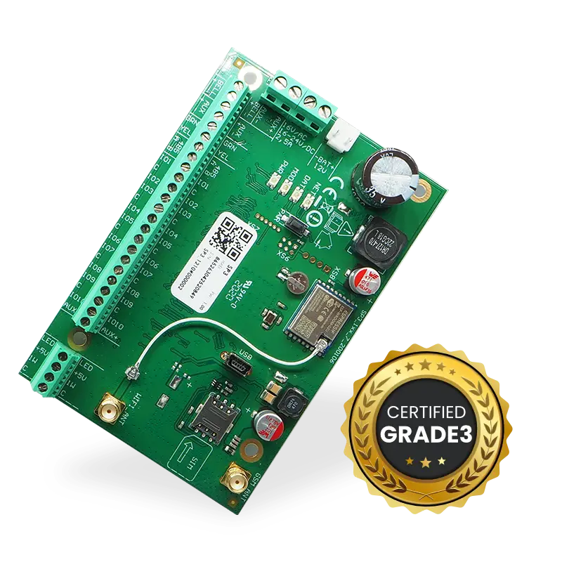

**Vanliga frågor**

??? question "Hur ansluter jag en enskild Wiegand-läsare (utan knappsats) för att pulsa en dörrutgång?"

    --8<-- "sv/faq/index.md:sp3-wiegand-reader-door-output-body"

    Se hela avsnittet: [Länka RFID-brickor (kort)](#541-lanka-rfid-brickor-kort).

Hittar du inte din fråga? Kontakta [support@trikdis.lt](mailto:support@trikdis.lt).

## Beskrivning

**Centralapparaten *FLEXi SP3*** är processordelen i ett inbrotts- och brandlarmsystem. Den har en inbyggd WiFi-modul och ett 2G/4G-mobilmodem. Med FLEXi SP3 kan 64 trådbundna och trådlösa sektioner grupperas i ett system med 8 områden. Användarna kan enkelt och på distans (med mobilappen Protegus2, SMS eller telefonsamtal) ändra skyddsläget i olika delar av lokalen, eller med enheter som stöder personlig identifiering (trådbundna och trådlösa knappsatser, elektroniska nycklar, RFID-kort m.m.). Alla händelser i systemet rapporteras till larmcentralen (CMS, Central Monitoring Station) och till molntjänsten Protegus Cloud via WiFi och/eller via mobilnätet om ett SIM-kort är isatt.

**När rekommenderas centralapparaten *FLEXi SP3*?**

- För att skydda små och medelstora lokaler som ska övervakas av ett larmbolag. FLEXi SP3 stöder både trådbundna och trådlösa sektioner. Centralapparaten kan ge både slutanvändare och larmbolag fjärrstyrning och systeminformation.

- Som ersättning för en befintlig inbrottslarmcentral. Med FLEXi SP3 kan du ställa in ett annat motståndsvärde, så att det motsvarar den typ som den gamla centralapparaten använde. Det sparar mycket tid vid installationen, eftersom motstånden i varje detektor inte behöver bytas.

- När larmsystemet ska göra mer än att skydda lokalen. Exempel: öppna dörrar och portar, vattna gräsmattan, styra belysning, värme, ventilation och kyla samt många andra automatiska start- och stoppfunktioner.

### Funktioner

**Rapportering till larmbolagets larmcentral (CMS):**

- Händelserapportering antingen via den inbyggda WiFi-modulen eller via 2G/4G-mobilmodemet.

- Extra moduler som skickar rapporter via Ethernet, VHF/UHF-radio eller Sigfox, med valfri prioritet.

- Alla larmcentraler kan ta emot rapporter, förutsatt att de har TRIKDIS programvaru-/IP-mottagare eller en IP-mottagare från en annan tillverkare som stöder protokollet SIA DC-09 IP.

- Konstruktionen bygger på två decenniers erfarenhet av att skicka rapporter till larmcentralens primära mottagare och backupmottagare, vilket gör att larmbolag kan ge lokalerna högsta möjliga skydd.

- En inställning för om sändning till larmcentralen krävs: rapporterna skickas obligatoriskt till larmcentralen först och därefter till kunderna.

- Möjlighet att skicka händelserapporter till larmcentralerna hos två olika larmbolag.

- Många kommunikationskanaler och flera inställningar för överföringsprioritet.

**Rapportering till användaren:**

- Via mobilappen Protegus2, som varnar för händelser i larmsystemet med push-aviseringar och särskilda ljud.

- Händelserapportering via SMS till 8 mobilnummer.

- Rapportering av händelser med förinspelade röstmeddelanden (upp till 8 mobilnummer; för centralapparat SP3_12xx med firmware upp till och med 1.13).

- Fjärrstyrning av skyddsläget i valda lokaler (tillkoppling/frånkoppling/hemmatillkoppling/tillkoppling i nattläge).

- Fjärrstyrning av anslutna enheter (belysning, automatiska portar, ventilation, värme, bevattning m.m.).

- Mätning av temperatur på distans.

**Ingångar och utgångar:**

- 10 I/O-plintar som var och en kan ställas in som ingång (IN) eller utgång (OUT). Typer för ingång (IN): ATZ, EOL, NC, NO. I EOL- och ATZ-kretsar kan olika motståndsvärden användas. Antalet ingångar (IN) kan utökas till 64 med knappsatser och utbyggnadsmodulerna iO, iO-8, iO8-LORA, iO-LORA och iO-WL.

- Kretskortet har 2 fasta utgångar: sirenutgången (BELL) och LED-utgången. Sirenutgången styr sirenen och LED-utgången styr indikeringslampor. Antalet utgångar kan utökas till 16 med utbyggnadsmodulerna iO, iO-8, iO8-LORA, iO-LORA och iO-WL.

- Sju driftinställningar för utgångar. Varje utgång kan tilldelas en driftlogik, ett förinställt driftschema eller en egenskap, till exempel termostatläge.

- En enkeltrådsbuss (”1-Wire”) för anslutning av temperaturgivare (upp till 8), en temperatur- och fuktgivare (1) eller en läsare för elektroniska nycklar (”iButton”).

- Databussen GRN-YEL är avsedd för anslutning av 8 knappsatser av samma typ.

- RS485-bussen ansluter utbyggnadsmoduler i serien iO, radiotransceivrar för trådlösa detektorer (RF-SH, RF-LORA, RF-S8, RF-HW), Ethernet-modulen E485, VHF/UHF-radiosändaren T16 och modulen **Sigfox**.

**Styrning av larmsystemet**

- Styrkoder med 4 eller 6 siffror (40 st. totalt), som också kan användas som tvångskod. I det fallet frånkopplar användarkoden larmet, men ett särskilt meddelande skickas till larmcentralen om att larmet frånkopplades under tvång.

- Styrning med knappsatser: SK-LED TouchPad (Protegus SK232LED W), SK-LCD TouchPad (FLEXi SK232LCD), SK LCD Button, SK LED Button; Paradox K636, K10H(V), K32+LED, K32LED, K32LCD+, K35, TM50, TM70; Crow-knappsats CR16, CR-LCD; elektronisk nyckelläsare (”iButton”) CZ-Dallas; elektronisk nyckelläsare TM17; RFID-läsare (Wiegand 26/34).

- Fjärrstyrning med mobilappen Protegus2, telefonsamtal eller SMS.

**Enkel installation:**

- FLEXi SP3 finns i flera monteringskit som innehåller en dekorativ vit metallkapsling med inbyggd nedtransformator eller switchad nätdel.

- Förvalda driftinställningar för FLEXi SP3 bygger på många års erfarenhet. Därför kan systemet installeras i 7 av 10 små och medelstora lokaler utan att förvalen behöver ändras.

- Centralapparaten FLEXi SP3 kan ersätta den tidigare centralapparaten utan att motstånden i varje trådbunden detektor behöver bytas.

- Inställningarna kan sparas som en fil för senare användning.

- Konfigurering via USB-kabel eller på distans med programmet TrikdisConfig.

- Fjärranslutning med TrikdisConfig gör det möjligt att inte bara ändra parametrarna i FLEXi SP3 utan också övervaka centralapparatens drift.

- Två åtkomstnivåer för parameterinställning: installatör och administratör.

### Tekniska data

| Parameter | Beskrivning |
|-----------|-------------|
| Matningsspänning [AC / DC] | 16 V AC eller 16–24 V DC, 2,5 A |
| Strömförbrukning | Upp till 50 mA (vänteläge) / upp till 200 mA (kortvarigt, vid sändning) |
| Reservströmkälla [BAT] | 12 V blybatteri, 4 Ah/7 Ah |
| Laddström för batteriet | Upp till 500 mA |
| Spänning och ström till externa enheter [AUX] | 12 V DC, upp till 1 A |
| Sirenutgång [BELL] | 1 A |
| Utgång [LED] | 0,1 A |
| PGM-utgång | 0,1 A |
| WiFi-modul | Ja, inbyggd |
| WiFi: frekvens, protokoll, krypteringstyp | 2,4 GHz, 802.11 b/g/n, WPA, WPA2, WPA mixed |
| WiFi: typ av nätverkskonfiguration | DHCP eller manuell |
| SIM-kort | 1, storlek NANO |
| Frekvenser för GSM/GPRS-modem | 850 / 900 / 1800 / 1900 MHz |
| Frekvenser för 4G-modem FLEXi SP3_14E / FLEXi SP3_24E / EMEA/Thailand | B1/B3/B7/B8/B20/B28 |
| Frekvenser för 4G-modem FLEXi SP3_24S / Latinamerika/Australien/Nya Zeeland | B1/B3/B4/B5/B7/B8/B28 |
| Frekvenser för 4G-modem FLEXi SP3_24A / Nordamerika | B2/B4/B12 |
| Mottagare av rapporter | Till primär mottagare och backupmottagare hos 2 olika larmbolag; till molntjänsten Protegus Cloud och till mobilapparna Protegus2 för iOS/Android; till 8 mobiltelefoner via SMS. Ringer upp 8 mobiltelefoner. Om en användare svarar meddelar centralapparaten med röst vad som har hänt (för centralapparat SP3_12xx med firmware upp till och med 1.13). |
| Kommunikationskanaler för händelserapportering | GPRS eller 4G, WiFi, LAN (med modulen E485), SMS, röstsamtal (upp till 8 mobilnummer; för centralapparat SP3_12xx med firmware upp till och med 1.13), VHF/UHF-radio (med sändaren T16) |
| Protokoll för anslutning till larmcentralen | TCP/IP eller UDP/IP, eller SMS |
| Kodning av händelser | Contact ID-koder |
| Kryptering av rapporter | TRK AES 128, SIA IP AES 128 |
| Intern klocka | Ja |
| Buffertminnets kapacitet | 60 händelser |
| Händelseloggens minne | Upp till 1 000 händelser. De äldsta posterna raderas automatiskt. |
| Användarkoder | 40 (koder med 4 eller 6 siffror) |
| Tvångskod | Två metoder för kodinmatning kan väljas vid programmeringen |
| Plintar med dubbel funktion [I/O] | 10; funktionen IN eller OUT väljs vid programmeringen. När IN är vald finns typerna NC, NO, EOL, EOL_T, 3EOL, ATZ, ATZ_T. När OUT är vald blir plinten en utgång med öppen kollektor (OC) för upp till 100 mA |
| Antal områden | 8 |
| Antal sektioner | 10 (20 sektioner med ATZ), (kan utökas till 64 sektioner med utbyggnadsmoduler) |
| Antal PGM-utgångar | 2 (kan bli 12 om IO-plintarna ställs in som utgångar. Kan utökas till 16 utgångar med utbyggnadsmoduler) |
| Max antal anslutna knappsatser | 8 |
| Knappsatser som stöds | SK-LED TouchPad (Protegus SK232 LED W) / SK-LCD TouchPad (FLEXi SK232LCD) / SK LCD Button / SK LED Button / Paradox K636 / Paradox K10H(V) / Paradox K32 LED / Paradox K32+ LED / Paradox K32LCD+ / Paradox K35 / Paradox TM50 / Paradox TM70 / Crow CR16 / Crow CR-LCD |
| Max antal RFID-läsare (Wiegand 26/34) | 2 |
| Längd på 1-Wire-bussen [1 WIRE] | Upp till 30 m |
| Kompatibla temperaturgivare | Maxim®/Dallas® DS18S20, DS18B20; serie AM2301 |
| Max antal temperaturgivare på 1-Wire-bussen | 8 (Dallas) eller 1 (om en givare i serien AM2301 används) |
| Kompatibla elektroniska nycklar (iButton) [1 WIRE] | Maxim®/Dallas® DS1990A |
| Max antal elektroniska nycklar (iButton) | 40 |
| Längd på RS485-bussen | Upp till 100 m |
| Max antal enheter på RS485-bussen | 8 |
| Moduler som stöds | iO-8 – utbyggnadsmodul; / iO – utbyggnadsmodul; / iO-MOD – radiotransceiver för iO-WL; / iO-WL – trådlös utbyggnadsmodul; / RF-SH – radiomottagare för trådlösa detektorer; / RF-HW – transceiver för trådlösa detektorer; / RF-S8 – transceiver för trådlösa detektorer; / RF-LORA – transceiver för trådlösa LORA-detektorer; / E485 – modul för anslutning till Ethernet-nätverk; / TM17 – läsare för iButton-nycklar; / CZ-Dallas – läsare för iButton-nycklar; / T16 – VHF/UHF-radiosändare; / iO-LORA – utbyggnadsmodul; / iO8-LORA – utbyggnadsmodul; / PB-LORA – överfallsknapp; / REL-LORA – reläkort; / RFID-läsare. |
| Driftmiljö | Temperatur från -10 °C till +50 °C, relativ luftfuktighet 80 % vid +20 °C, ingen kondens. |
| Centralapparatens mått | 117 × 79 × 25 mm |
| Vikt | 0,1 kg |

### Kompatibla moduler

| **Modulens namn** | **Ström** |
|----|----|
| Knappsats SK-LED TouchPad (Protegus SK232 LED W) | Min 60 mA, max 150 mA |
| Knappsats SK-LCD TouchPad (FLEXi SK232LCD) | Min 25 mA, max 60 mA |
| Knappsats SK LCD Button | Max 70 mA |
| Knappsats SK LED Button | Max 70 mA |
| Knappsats Paradox K636 | Min 40 mA, max 70 mA |
| Knappsats Paradox K10H(V) | Min 44 mA, max 72 mA |
| Knappsats Paradox K32 LED | Min 49 mA, max 148 mA |
| Knappsats Paradox K32+ LED | Min 49 mA, max 148 mA |
| Knappsats Paradox K32LCD+ | Min 70 mA, max 150 mA |
| Knappsats Paradox K35 | Min 30 mA, max 70 mA |
| Knappsats Paradox TM50 | Min 100 mA, max 230 mA |
| Knappsats Paradox TM70 | Min 200 mA, max 330 mA |
| Knappsats Crow CR16 | Min 40 mA, max 75 mA |
| Knappsats Crow CR-LCD | Min 40 mA, max 75 mA |
| Utbyggnadsmodul iO-8 | Max 20 mA |
| Utbyggnadsmodul iO | Max 50 mA |
| iO-MOD – radiotransceiver för iO-WL | Min 50 mA, max 150 mA |
| Trådlös utbyggnadsmodul iO-WL | Max 200 mA |
| Transceiver RF-SH för trådlösa detektorer (Crow) | Max 100 mA |
| Ethernet-larmsändare E485 | Min 50 mA, max 150 mA |
| Läsare för iButton-nycklar TM17 | Max 50 mA |
| Läsare för iButton-nycklar CZ-Dallas | Max 25 mA |
| Radiosändare T16 (VHF eller UHF) | Min 100 mA, max 1,2 A |
| RFID-läsare (Wiegand 26/34) | Max 100 mA |
| Transceiver RF-LORA för trådlösa LORA-detektorer och LORA-moduler | Min 50 mA, max 150 mA |
| Utbyggnadsmodul iO-LORA | Max 50 mA |
| Utbyggnadsmodul iO8-LORA | Max 50 mA |
| Överfallsknapp PB-LORA | Batteri 3 V, CR123A |
| Reläkort REL-LORA | Max 45 mA |
| Transceiver RF-S8 för trådlösa detektorer (S8) | Upp till 100 mA |
| Transceiver RF-HW för trådlösa detektorer (Honeywell) | Upp till 100 mA |

### Externa plintars funktion

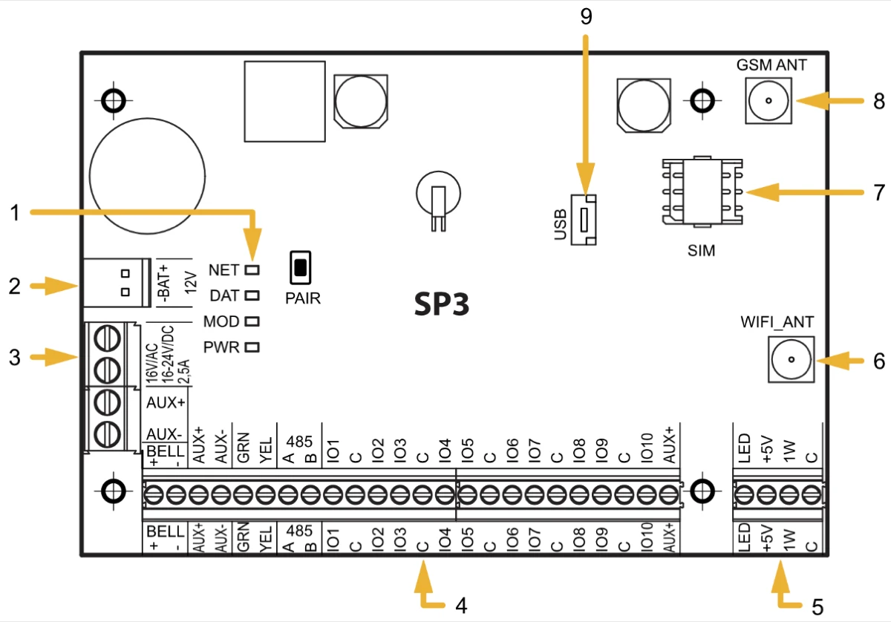

1.  Indikeringar för anslutning och drift.
2.  Plintblock för reservmatning.
3.  Plintblock för huvudmatning.
4.  Externt plintblock.
5.  Plintblock för 1-WIRE-bussen.
6.  SMA-kontakt med skruvfäste för WiFi-antenn.
7.  Hållare för nano-SIM-kort.
8.  SMA-kontakt med skruvfäste för mobilantenn.
9.  USB Mini-B-kontakt (USB Type-C på kretskort SP3_8xx) för konfigurering av centralapparatens inställningar.

| **Plint** | **Beskrivning** |
|----|----|
| Matningsplint | Plint för matning (16 V AC eller plus 16–24 V DC) |
| Matningsplint | Plint för matning (16 V AC eller minus 16–24 V DC) |
| BAT+ | Pluspol för reservmatning, 12 V |
| BAT- | Minuspol för reservmatning, 12 V |
| AUX+ | Pluspol 12 V för externa enheter |
| AUX- | Gemensam minuspol |
| GRN | Knappsatsbuss |
| YEL | Knappsatsbuss |
| A 485 | Plint A på *RS485*-bussen |
| B 485 | Plint B på *RS485*-bussen |
| IO1 – IO9 | In-/utgångsplintar (förval: ingång) |
| IO10 | In-/utgångsplint (förval: PGM-utgång, Fire Sensor Reset) |
| C | Gemensam minuspol |
| LED | PGM-utgång (förval: System State) |
| +5 V | Pluspol 5 V för *1-Wire*-enheter |
| 1 WIRE | Plint för *1-Wire*-bussen |
| C | Gemensam minuspol |

### Lysdiodernas indikering

| Lysdiod | Ljusstatus | Beskrivning |
|---------------|--------------|-------------|
| NET | Blinkar grönt | SIM-kortet registrerar sig i mobilnätet. |
| NET | Fast grönt sken | SIM-kortet är registrerat i mobilnätet. |
| NET | Blinkar gult | Visar mobilnätets signalstyrka från 0 till 5. 3 räcker. |
| DAT | Släckt | Inga osända händelsemeddelanden. |
| DAT | Fast grönt sken | Ett meddelande skickas. |
| DAT | Fast gult sken | Det finns osända händelsemeddelanden i buffertminnet. |
| MOD | Blinkar grönt | Ansluter till WiFi-nätverket. |
| MOD | Fast grönt sken | Ansluten till WiFi-nätverket. |
| PWR | Blinkar grönt | Inga driftproblem. |
| PWR | 1 rött blink | Inget SIM-kort hittades |
| PWR | 2 röda blink | SIM-kortets PIN-kod är felaktig |
| PWR | 3 röda blink | Det går inte att ansluta till mobilnätet |
| PWR | 4 röda blink | Det går inte att ansluta till larmcentralens mottagare på kanal 1 |
| PWR | 5 röda blink | Det går inte att ansluta till larmcentralens mottagare på kanal 2 |
| PWR | 6 röda blink | Den interna klockan är inte inställd |
| PWR | 7 röda blink | För låg spänning från reservmatningen |
| PWR | 8 röda blink | Ingen nätspänning |
| PWR | 9 röda blink | Det går inte att ansluta till WiFi-nätverket |

### Centralapparatens firmwareversioner

| **Firmware-revision** | **Trådlös mottagare** | **Trådlösa detektorer** | **Antal sektioner som stöds** | **Knappsatser som stöds** | **Moduler som stöds** |
|----|----|----|:--:|----|----|
| SP3_xxx0 | RF-SH, RF-LORA | CROW | 32 | Flexi, Paradox, Crow CR Icon/LCD (ST) | iO, iO-8, iO-WL, iO-MO, TM17, E485, T16, SF485, RF-LORA, iO-LORA, iO8-LORA, PB-LORA, REL-LORA, RF-SH |
| SP3_xxx1 | RTX3, RF-LORA | PARADOX | 32 | Flexi, Paradox, Crow CR Icon/LCD (ST) | iO, iO-8, iO-WL, iO-MO, TM17, E485, T16, SF485, RF-LORA, iO-LORA, iO8-LORA, PB-LORA, REL-LORA |
| SP3_xxx2 | RF-HW, RF-LORA | HONEYWELL | 64 | Flexi, Paradox, Crow CR Icon/LCD (ST) | iO, iO-8, iO-WL, iO-MO, TM17, E485, T16, SF485, RF-LORA, iO-LORA, iO8-LORA, PB-LORA, REL-LORA, RF-HW |
| SP3_xxx4 | RF-LORA, RF-S8 | MAXIMUM, S8 | 64 | Flexi, Paradox | iO, iO-8, iO-WL, iO-MO, E485, T16, SF485, RF-LORA, iO-LORA, iO8-LORA, PB-LORA, REL-LORA, RF-S8 |

## Matning av centralapparaten

### Huvudmatning

Centralapparaten och hela larmsystemet kan matas från en växelströms- eller likströmskälla. I båda fallen måste en reservmatning, ett 12 V-batteri, vara ansluten till systemet så att matningen aldrig bryts. För att uppfylla kraven i EN 50131 måste reservbatteriet kunna driva systemet i 12 timmar för säkerhetsgrad II eller 60 timmar för säkerhetsgrad III efter att huvudmatningen har försvunnit. Ta hänsyn till den sammanlagda strömförbrukningen hos de extra anslutna modulerna. Varje moduls strömförbrukning anges i avsnitt 1.3 ”Kompatibla moduler”.

### Reservmatning

Om det blir problem med huvudmatningen genereras en händelserapport *AC Fault* och centralapparaten växlar automatiskt till reservbatteriet på 12 V. Om batterispänningen sjunker till 11,5 V genereras en händelserapport *Low Battery*. Batteriet kopplas bort om spänningen sjunker under 9,5 V. När nätspänningen kommer tillbaka genereras en rapport *AC Restore* och batteriet börjar laddas automatiskt. När batterispänningen stiger till 12,6 V genereras en händelserapport *Battery Restore*.

### Kit med centralapparat

#### Centralapparat *FLEXi SP3*

| Namn                                  | Antal |
|:--------------------------------------|:---------|
| Kretskort med centralapparat FLEXi SP3 | 1 st.    |
| Ledning för anslutning av batteri           | 1 st.    |
| Motstånd 2,2 kΩ                       | 20 st.  |
| Motstånd 4,7 kΩ                       | 10 st.  |
| Plastdistans (monteringsdelar)       | 4 st.    |
| Antenn ME301M med 2,5 m kabel  | 2 st.    |

#### Centralapparat *FLEXi SP3* KIT

| Namn                                                            | Antal |
|:----------------------------------------------------------------|:---------|
| Kretskort med centralapparat FLEXi SP3, inbyggt i metallkapsling | 1 st.    |
| Metallkapsling K01 med 40 VA-transformator                        | 1 st.    |
| Motstånd 2,2 kΩ                                                 | 20 st.  |
| Motstånd 4,7 kΩ                                                 | 10 st.  |
| Antenn ME301M med 2,5 m kabel                            | 2 st.    |
| Ledning för anslutning av batteri                                           | 1 st.    |
| Sabotagekontakt                                                   | 1 st.    |
| Plintblock med 0,5 A säkring                                  | 1 st.    |

#### Centralapparat *FLEXi SP3* KITi

| Namn                                                            | Antal |
|:----------------------------------------------------------------|:---------|
| Kretskort med centralapparat FLEXi SP3, inbyggt i metallkapsling | 1 st.    |
| Metallkapsling K02 med switchad nätdel från Mean Well           | 1 st.    |
| Motstånd 2,2 kΩ                                                 | 20 st.  |
| Motstånd 4,7 kΩ                                                 | 10 st.  |
| Antenn ME301M med 2,5 m kabel                            | 2 st.    |
| Ledning för anslutning av batteri                                           | 1 st.    |
| Sabotagekontakt                                                   | 1 st.    |
| Plintblock med 3,15 A säkring                                 | 1 st.    |

!!! note "Obs!"
    USB-kabel (typ Mini-B; typ Type-C för kretskort SP3_8xx) för programmering av centralapparaten säljs separat.

## Installation av systemet

### Rekommenderad installationsordning

**Planera systemet:**

- Rita en skiss över lokalen och markera var metallkapslingen med centralapparaten, knappsatserna, signalenheterna och den utrustning som ska styras automatiskt eller på distans av centralapparaten ska monteras.

- Efter att du har bedömt lokalen, skyddskraven och egenskaperna hos möjliga detektorer väljer du hur många detektorer som ska användas, vilka typer och var de ska monteras.

#### Montera centralapparaten i kapslingen

Centralapparatens kretskort kan monteras i en kapsling som redan har en nedtransformator med 500 mA säkring och utrymme för ett reservbatteri. Montera annars centralapparaten i en vald plast- eller metallkapsling med hjälp av plastdistanser. Om du väljer en metallkapsling, glöm inte att jorda den vid installationen. Den valda kapslingen måste uppfylla kraven i standarderna EN 60950 och EN 50131.

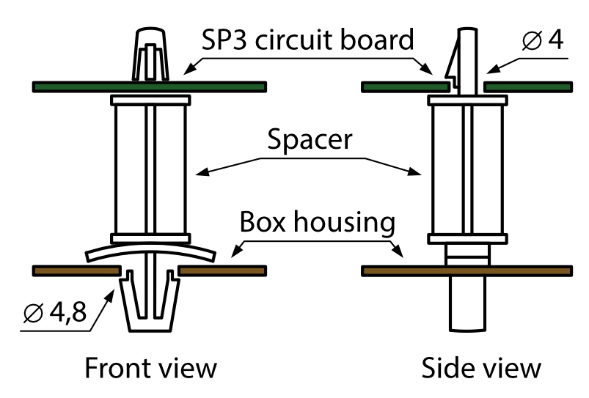

**Mått på kretskortet FLEXi SP3**

Bilden nedan visar kretskortets mått och monteringshålens placering (i millimeter).

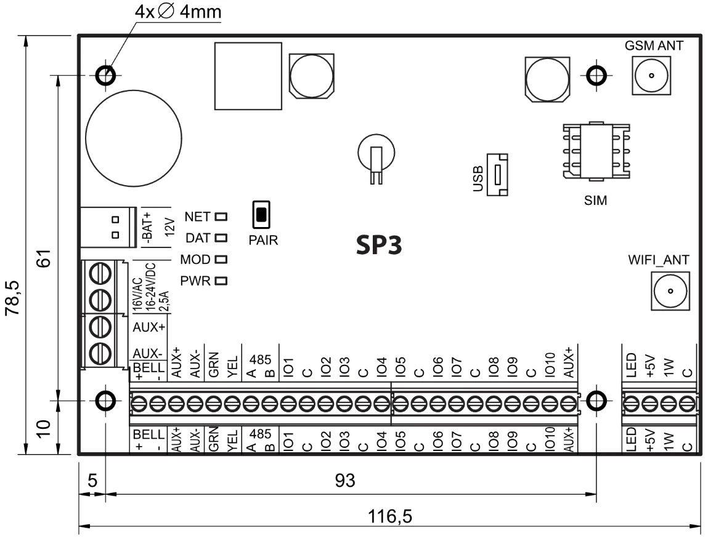

#### Ordning för anslutning av enheter

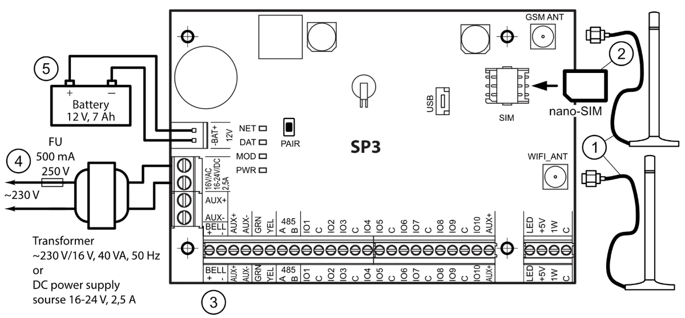

1.  Anslut GSM- och WiFi-antennerna till antennkontakterna.

2.  Sätt i ett aktiverat SIM-kort i SIM-hållaren. Inget SIM-kort behövs om centralapparaten ansluter via WiFi eller via modulen E485. Markera i så fall **Disable indication of the absence of a SIM card** (se avsnitt 5.3, fönstret ”Reporting to CMS”).

3.  Anslut dörr- och fönstermagnetkontakter, rörelse-, brand- och andra detektorer, signalenheter, knappsatser och styrda enheter enligt kopplingsschemana här och kopplingsschemat för varje enhet som ska anslutas. Anslut kapslingens dörr- och väggsabotagekontakter till centralapparatens plintar.

4.  Anslut huvudmatningens ledningar till centralapparatens AC/DC-plintar. Slå på huvudmatningen. FLEXi SP3 identifierar de knappsatser, utbyggnadsmoduler och gränssnitt som är rätt anslutna via databussarna 1-WIRE och YEL/GRN.

5.  Placera ett reservbatteri i kapslingen. Anslut batteriets poler till plintarna BAT+ / BAT– på centralapparaten.

!!! note "Obs!"
    Batteriet måste laddas upp på mindre än 72 timmar för att larmsystemet ska uppfylla larmklass II, eller på mindre än 24 timmar för larmklass III.

#### Rekommendationer för inställning av centralapparatens parametrar

1.  Se avsnitt 5 ”Inställning av parametrar” för hur du ansluter till centralapparaten för att konfigurera den.

2.  Systeminställningar:

    1.  **Områden.** Om du vill tillkoppla skyddet för vissa sektionsgrupper separat kan larmsystemet delas in i områden. Se avsnitt 5.2, fönstret ”System options”, för hur du delar in systemet och ställer in de områdesegenskaper som behövs.

    2.  **Sektioner.** Se avsnitt 5.7, fönstret ”Zones”, för hur du ställer in varje sektion efter detektorernas egenskaper och hur larmet ska fungera när en händelse inträffar i sektionen. Om larmsystemet är indelat i områden kan varje sektion tilldelas ett valfritt område.

    3.  **Användare.** Systemets *användare* måste skapas för att larmsystemet ska kunna styras med knappsats, iButton-nyckel eller telefonsamtal (SMS). Se avsnitt 5.4, fönstret ”Users & Reporting”, för hur du skapar *användare* och ger dem behörigheter.

3.  Sändning av meddelanden:

    1.  **Tidsinställning.** Centralapparatens tid måste vara inställd för att meddelandena ska få rätt tidsstämpel. Se avsnitt 5.2, fönstret ”System options”.

    2.  **Aktivera rapportsändning.** Med förvalen är funktionen för sändning av händelserapporter aktiverad för alla händelser. Om en händelse inträffar skickas rapporten till de inställda mottagarna via de inställda kanalerna. Se avsnitt 5.10, fönstret ”System events”, för hur du avaktiverar rapportering av vissa händelser.

    3.  **SIM-kortets parametrar.** Om meddelanden ska skickas via mobilnät måste du ställa in parametrarna för det SIM-kort som används (se avsnitt 5.2, fönstret ”System options”).

    4.  **Rapporter till larmcentralen.** Sändning av rapporter till larmcentralen är avaktiverad som förval. Se avsnitt 5.3, fönstret ”Reporting to CMS”, för hur du ställer in sändning av meddelanden till larmcentralen.

    5.  **Rapporter till användaren.** Kommunikationen med Protegus Cloud är aktiverad som förval, och sändning av rapporter via SMS och telefonsamtal är avaktiverad. Se avsnitt 5.10, fönstret ”System events”, för hur du ställer in sändning av rapporter till användarens mobiltelefon.

4.  Fjärrstyrning av systemet:

    1.  **Användaråtkomst.** Larmsystemet kan fjärrstyras (via telefonsamtal och/eller SMS) av användare vars telefonnummer finns i användarlistan. Se avsnitt 5.4, fönstret ”Users & Reporting”, för hur du anger telefonnummer.

    2.  **Styrning med telefonsamtal.** Med telefonsamtal kan du inte bara tillkoppla eller frånkoppla hela eller delar av larmsystemet, utan också styra (slå på och av) utrustning som är ansluten till PGM-utgångar. Se avsnitt 4.4 ”Styrning med telefonsamtal” för vilka parametrar som ska ändras för att telefonsamtal ska kunna ändra tillståndet för en vald PGM-utgång med en ansluten styrkrets för utrustning.

    3.  **Styrning med SMS.** Med SMS kan du ändra vissa av centralapparatens driftparametrar, tillkoppla eller frånkoppla hela eller delar av lokalen och styra (slå på och av) utrustning som är ansluten till PGM-utgångarna. Se listan över SMS-kommandon i avsnitt 4.3 ”Konfigurering och styrning med SMS”.

5.  Dessutom:

    1.  **Byt styrkoder.** Vi rekommenderar att du byter centralapparatens förvalda koder för larmstyrning och konfigurering mot koder som bara du känner till.

        - Användarkoden för **Master** kan ändras under **Users & Reporting** i programmets meny.

        - Koden för **fjärrstyrning med SMS** kan ändras i fönstret **System options** i programmets meny, i fältet **SMS Password** i avsnittet **Access**.

        - **Åtkomstkoderna för anslutning med TrikdisConfig** kan ändras i avsnittet **Access** under **System options** i programmets meny.

### Ansluta detektorer

Kretskortet har 10 plintar IO1–IO10 (ingångar) för anslutning av detektorkretsar. Antalet ingångar kan utökas till 64 med utbyggnadsmoduler för ingångar (***iO, iO8, iO-WL, RF-SH, iO-LORA, iO8-LORA**)*. Varje plint kan ställas in som ingång och tilldelas sektionsegenskaper: kretstyp (NO, NC, EOL, EOL_T, 3EOL, ATZ, ATZ_T), känslighet för tillfälliga händelser i kretsen och sektionsfunktion (Delay, Instant, Instant Stay, Interior, Interior Stay, Fire, Keyswitch, 24_hour, Silent, Silent 24h), se avsnitt 5.7, fönstret ”Zones”. Utbyggnadsmodulerna iO8 och iO8-LORA stöder alla typer av sektionsmotstånd (EOL-typer) som centralapparaten har.

#### Kopplingsscheman för anslutning av detektorer.

  <figure style="margin: 0;">
    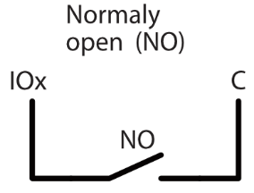
  </figure>
  <figure style="margin: 0;">
    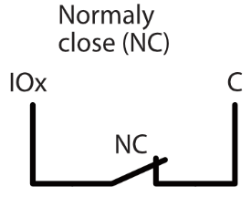
  </figure>
  <figure style="margin: 0;">
    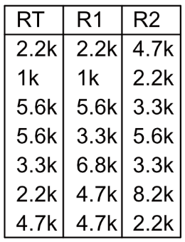
  </figure>

  <figure style="margin: 0;">
    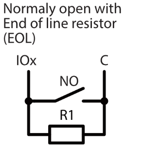
  </figure>
  <figure style="margin: 0;">
    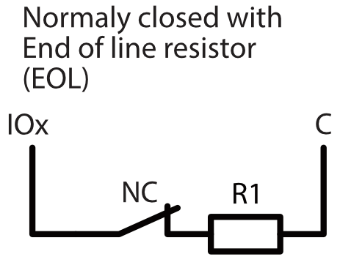
  </figure>
  <figure style="margin: 0;">
    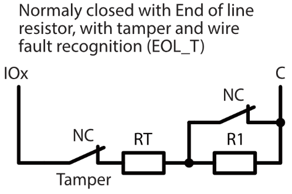
  </figure>

  <figure style="margin: 0;">
    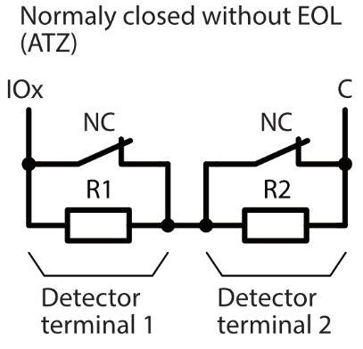
  </figure>
  <figure style="margin: 0;">
    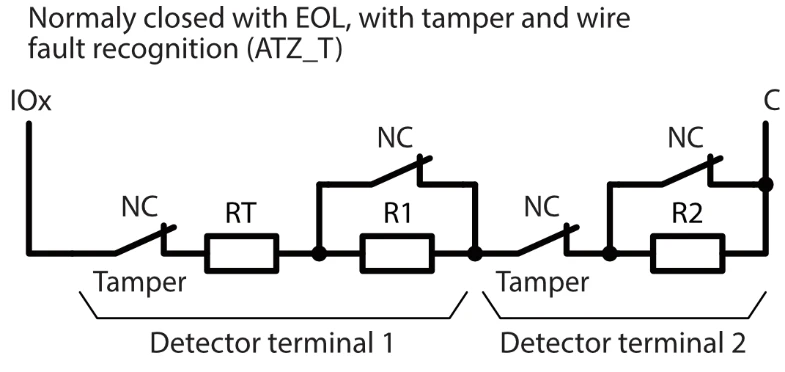
  </figure>

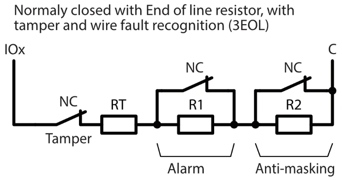

### Ansluta rökdetektorer

Upp till 5 tvåtrådsbranddetektorer kan anslutas till FLEXi SP3.

Kopplingsschema för anslutning av tvåtrådsrökdetektorer till PGM-utgångar (LED). När du använder det här schemat för att ansluta branddetektorer måste du markera fältet ”**LED out as 2Wire fire**” (se avsnitt 5.2, fönstret ”System options”).

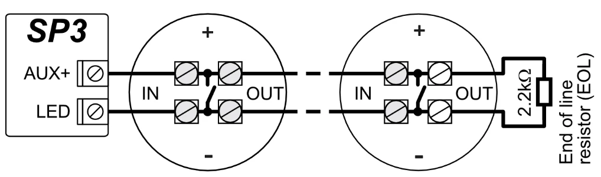

Kopplingsschema för anslutning av fyrtrådsrökdetektorer.

För att ansluta en rökdetektorkrets till en vald ingång måste ingången (IOx) tilldelas sektionsfunktionen Fire (se avsnitt 5.7, fönstret ”Zones”).

För att ansluta en fyrtrådsrökdetektorkrets till en vald PGM-utgång (IO10) måste utgången tilldelas funktionen Fire Sensor Reset (se avsnitt 5.8, fönstret ”PGM”). Reläet K1 används för att upptäcka kabelbrott och att en branddetektor har tagits bort.

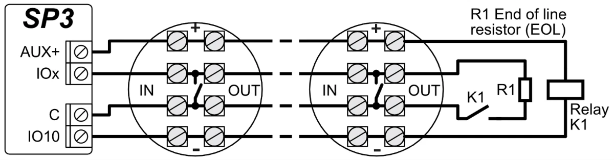

Kopplingsschema för anslutning av tvåtrådsrökdetektorer. Reläet K1 används för att upptäcka kabelbrott och att en branddetektor har tagits bort.

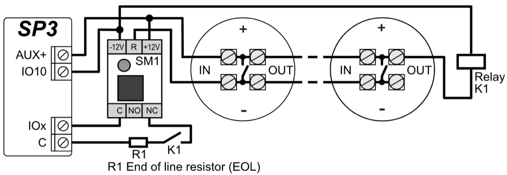

Eller

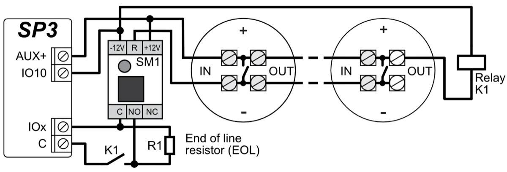

### Kopplingsschema för anslutning av en siren

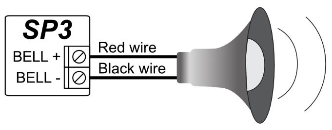

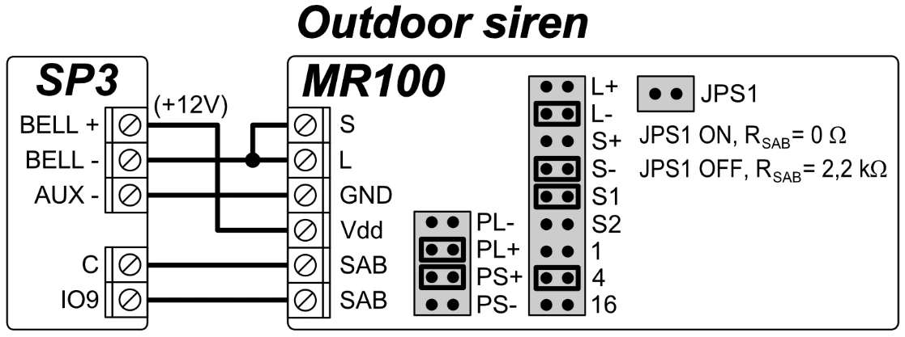

Bilden visar anslutningen och inställningarna för utomhussirenen **MR100**. Om centralapparaten ska övervaka sirenens sabotagekrets (SAB-plintarna) med ett annat slutmotstånd (EOL; fabriksinställningen är 2,2 kΩ) måste du sluta kontakterna JPS1 och ansluta ett motstånd med motsvarande värde i serie med sabotagekretsen. Sektionstypen **24_hours** är fabriksinställd för ingången IO9.

### Kopplingsscheman för anslutning av knappsatser och RFID-läsare (Wiegand 26/34)

Upp till 8 enheter kan anslutas till knappsatsbussen. Typen av ansluten knappsats måste anges i programmet TrikdisConfig (se avsnitt 5.5, fönstret ”Modules”). Centralapparaten identifierar och länkar de anslutna enheterna automatiskt.

Hur du styr larmet med Protegus- eller Paradox-knappsatser, inklusive användarkoder, förbikoppling, iButton/RFID, samtal, SMS och PGM-utgångar, beskrivs i [SP3-användarhandboken för Protegus- och Paradox-knappsatser](paradox-user-guide/index.md).

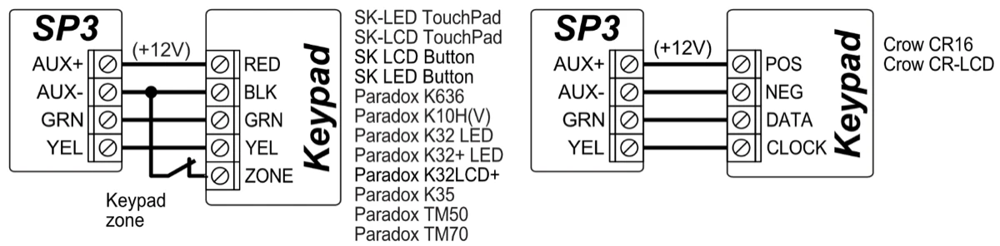

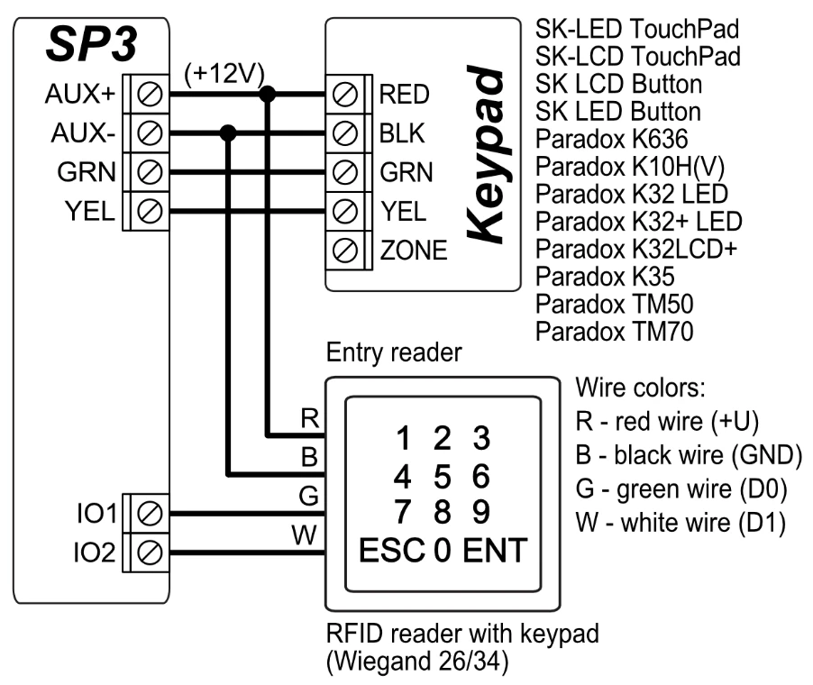

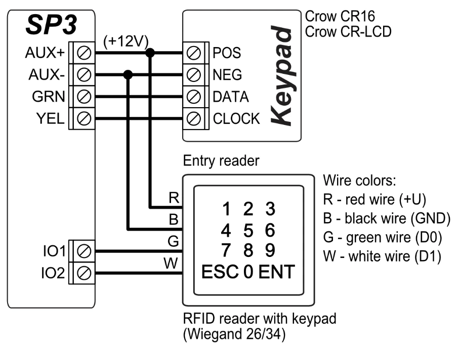

Upp till 2 RFID-läsare kan anslutas till centralapparaten. Om 2 RFID-läsare är anslutna kan inga knappsatser anslutas.

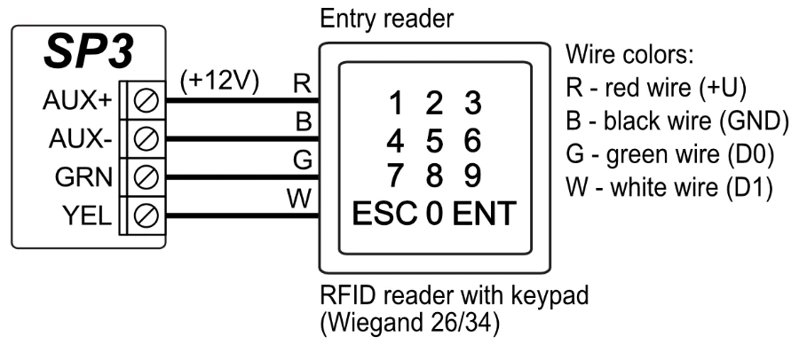

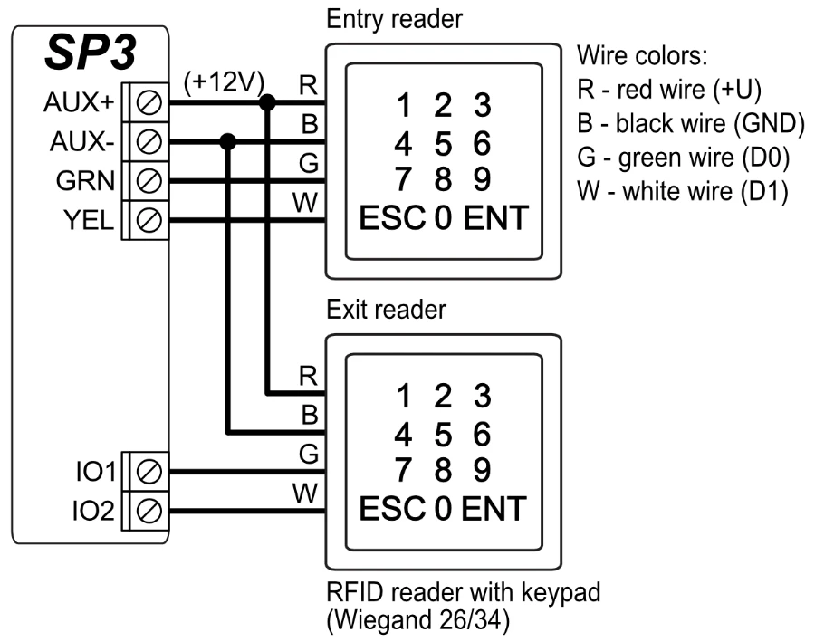

### Kopplingsscheman för anslutning av läsarna TM17 och CZ-Dallas

Läsaren **CZ-Dallas** för iButton-nycklar ansluts till FLEXi SP3 via databussen ”*1 Wire*”. Ledningarna till databussen får vara upp till 30 m långa:

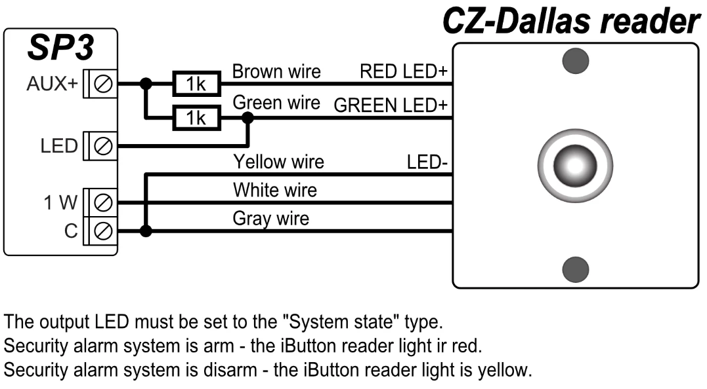

Läsaren **TM17** ansluts till FLEXi SP3 via databussen *RS485*. Ledningarna till *RS485*-databussen får vara upp till 100 m långa.

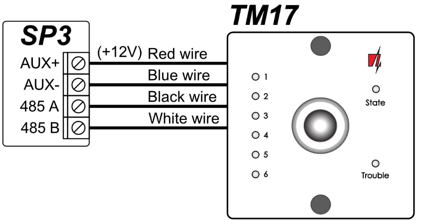

### Kopplingsschema för anslutning av en temperaturgivare

**Temperaturgivare** ska anslutas enligt schemat. Temperaturgivarna Maxim®/Dallas® DS18S20 och DS18B20 (upp till 8) eller temperatur- och fuktgivaren AM2301 (upp till 1) kan anslutas till centralapparaten FLEXi SP3.

Om en ledning längre än 0,5 meter används för att ansluta en temperaturgivare rekommenderar vi **partvinnad kabel (UTP4x2x0,5 eller STP4x2x0,5)**.

Plinten +5V på kretskortet matar enheter som är anslutna till 1-Wire-bussen med 5 V DC. Maximal utström är 0,2 A. Utgången är överlastskyddad. Om den högsta tillåtna strömmen överskrids stängs matningen automatiskt av. Centralapparaten identifierar och länkar anslutna enheter automatiskt.

  <figure style="margin: 0;">
    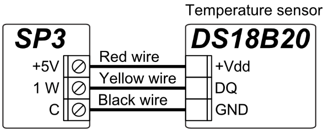
  </figure>
  <figure style="margin: 0;">
    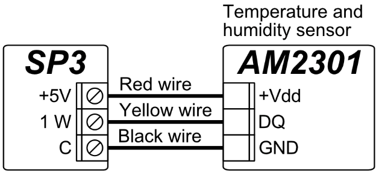
  </figure>

### Kopplingsscheman för anslutning av ett relä och en LED-indikering

Med reläplintarna kan olika elektriska enheter styras (slås på och av) på distans. Centralapparatens universella I/O-plint måste vara inställd som utgång (OUT) och tilldelas definitionen Remote control.

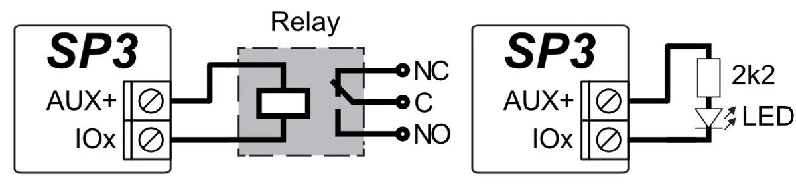

### Kopplingsschema för anslutning av Ethernet-larmsändaren E485

Modulen *E485* gör att centralapparaten kan skicka och ta emot styrkommandon via en kabelansluten internetanslutning. Om en *E485*-modul är ansluten till centralapparaten skickas rapporter till larmcentralen och till *Protegus2* via den kabelanslutna internetanslutningen, och mobil internetanslutning används inte. Om den kabelanslutna internetanslutningen bryts används mobil internetanslutning för att skicka rapporter till larmcentralen. När den kabelanslutna internetanslutningen kommer tillbaka slutar centralapparaten automatiskt använda mobil internetanslutning och återgår till att kommunicera med larmcentralen och mobilappen *Protegus2* via *E485*, alltså via den kabelanslutna internetanslutningen.

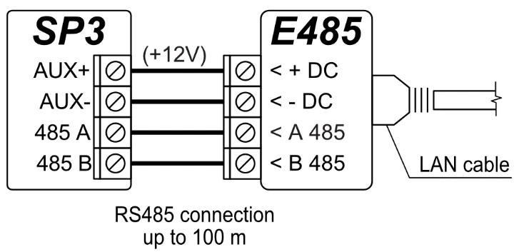

Se avsnitt 5.3, fönstret ”Reporting to CMS”, för hur du väljer prioritet för anslutningarna (SIM, WiFi, LAN(E485)). Hur FLEXi SP3 konfigureras för Ethernet-modulen E485 beskrivs i avsnitt 5.5, fönstret ”Modules”.

Om E485 är ansluten behövs inget SIM-kort i centralapparaten.

### Kopplingsschema för anslutning av RF-SH

Firmwareversionen i centralapparaten *FLEXi SP3* måste vara SP3_xxx0_0101.fw (firmwareversion 1.01 eller senare). Med den trådlösa detektormottagaren *RF-SH* ansluten kan *FLEXi SP3* arbeta med trådlösa detektorer (upp till 32), trådlösa sirener (upp till 16), fjärrkontroller (upp till 42) och trådlösa knappsatser (upp till 8) från ”Crow”.

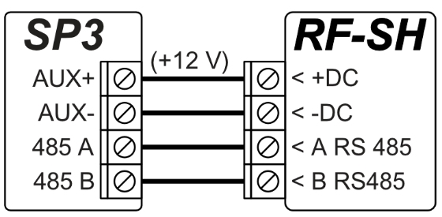

### Kopplingsschema för anslutning av RTX3

Firmwareversionen i centralapparaten *FLEXi SP3* måste vara SP3_xxx1_0112.fw (firmwareversion 1.12 eller senare). Med den trådlösa detektormottagaren RTX3 ansluten kan *FLEXi SP3* arbeta med trådlösa enheter från ”Paradox” (magnetkontakter, PIR-detektorer, glaskrossdetektorer (G550), rökdetektorer (SD360), fjärrkontroller (REM2, REM25), sirener (SR230, SR250), knappsatser (K37), PGM- och sektionsutbyggnadsmodul (2WPGM), repeater (RPT1)).

Firmware för RTX3, anslutning samt hur Paradox trådlösa enheter läggs till eller tas bort beskrivs i [Använda trådlösa Paradox-enheter med FLEXi SP3 (RTX3)](paradox-rtx3/index.md).

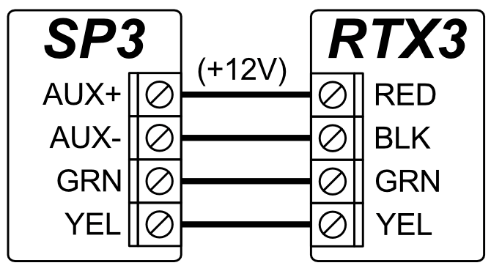

### Kopplingsschema för anslutning av RF-HW

Firmwareversionen i centralapparaten *FLEXi SP3* måste vara SP3_xxx2_0114.fw (firmwareversion 1.14 eller senare). Med den trådlösa detektormottagaren *RF-HW* ansluten är *FLEXi SP3* kompatibel med trådlösa detektorer, sirener, knappsatser och fjärrkontroller från ”Honeywell”.

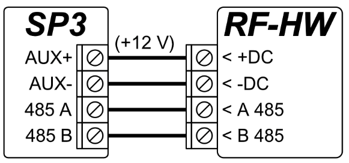

### Kopplingsschema för anslutning av RF-S8

Firmwareversionen i centralapparaten *FLEXi SP3* måste vara SP3_xxx4_0122.fw (firmwareversion 1.22 eller senare). Med den trådlösa detektormottagaren *RF-S8* ansluten är *FLEXi SP3* kompatibel med trådlösa detektorer, sirener och fjärrkontroller från ”S8”.

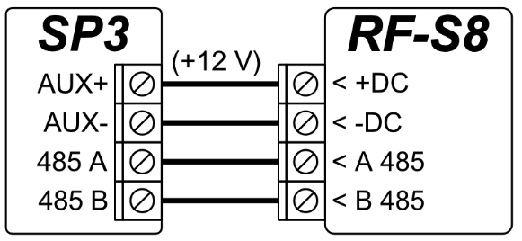

### Kopplingsschema för anslutning av RF-LORA

Firmwareversionen i centralapparaten *FLEXi SP3* måste vara SP3_xxx4_0122.fw (firmwareversion 1.22 eller senare). Med en trådlös detektormottagare *RF-LORA* ansluten kan *FLEXi SP3* arbeta med trådlösa detektorer (upp till 32), sirener (upp till 16) och fjärrkontroller (upp till 32) från företaget ”Maximum”. Hur FLEXi SP3 konfigureras med utbyggnadsmoduler beskrivs i avsnitt 5.5, fönstret ”Modules”.

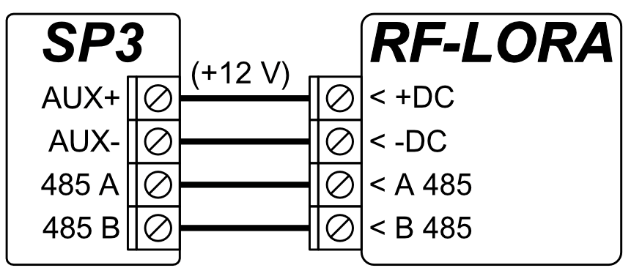

### Kopplingsscheman för utbyggnadsmoduler i serien LORA

### Kopplingsscheman för utbyggnadsmoduler i serien iO

Om centralapparaten FLEXi SP3 behöver fler ingångar IN eller utgångar OUT ansluter du en trådbunden eller trådlös TRIKDIS utbyggnadsmodul för ingångar och utgångar i serien iO. Hur FLEXi SP3 konfigureras för utbyggnadsmoduler beskrivs i avsnitt 5.5, fönstret ”Modules”.

  <figure style="margin: 0;">
    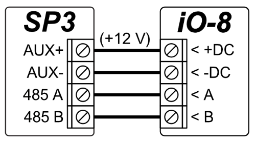
  </figure>
  <figure style="margin: 0;">
    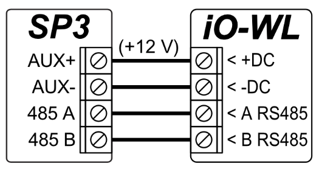
  </figure>

### Kopplingsscheman för anslutning av radiosändaren T16

Radiosändaren T16 används för att överföra centralapparatens händelsemeddelanden via TRIKDIS radionät. Sändaren kan skicka egna händelsemeddelanden och händelsemeddelanden som tas emot från centralapparater till larmcentralen (CMS), med möjlighet att vidarebefordra dem till slutanvändaren.

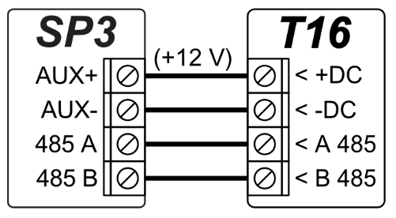

### Kopplingsscheman för anslutning av SF485

*SF485* fungerar som sekundär kanal för överföring av centralapparatens händelser till larmcentralen (CMS) eller mobilappen *Protegus2* över Sigfox-nätet när den primära kanalen fallerar. Händelserna överförs i formatet Contact ID.

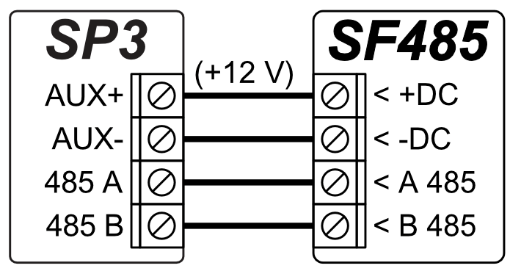

### Mäta likspänning med FLEXi SP3

*FLEXi SP3* kan användas för att mäta likspänning. Spänning från 0 V till 30 V mäts (över 30 V skadas centralapparaten *FLEXi SP3*). Den spänning som ska mätas måste anslutas till plintarna ”IN1” och ”C”. ”IN1” är pluspol och ”C” är minuspol.

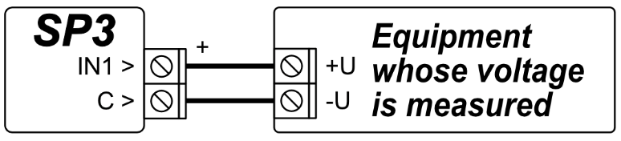

Anslut FLEXi SP3 till en dator med en USB Mini-B-kabel (kretskort SP3_8xx: USB Type-C). Starta TrikdisConfig. Programmet identifierar automatiskt den anslutna FLEXi SP3 och öppnar ett fönster för konfigurering. I fönstret ”**Sensor**” anger du ”**In1 Voltage**” och anger också den spänning över vilken ett meddelande ska genereras.

- **Max** – när spänningen är högre än den här inställningen genereras ett händelsemeddelande. För att ett händelsemeddelande ska genereras måste rutan ”**High**” vara markerad.

- **Min** – när spänningen är lägre än den här inställningen genereras ett händelsemeddelande. För att ett händelsemeddelande ska genereras måste rutan ”**Low**” vara markerad.

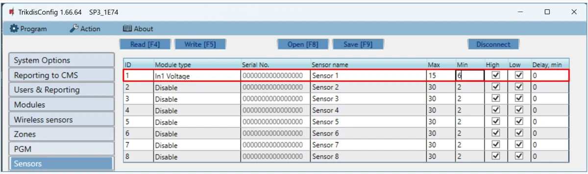

PGM-utgången kan styras när en spänning över eller under ett inställt värde mäts. I TrikdisConfig väljer du PGM-utgången och ställer in driftläget ”**Remote Control**”.

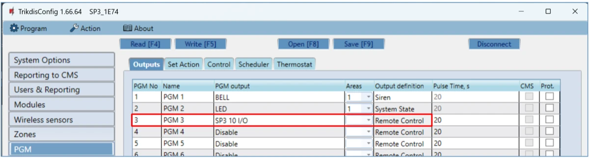

Gå till fliken ”**Set Action**”.

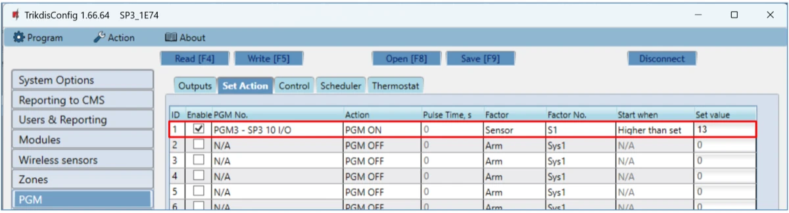

- **Enable** – aktiverar PGM:en.

- **PGM No.** – ange den PGM-utgång som ingången ”**IN1**” ska styra.

- **Action** – ställ in PGM-utgångens driftläge:
- **PGM OFF** – stänger av PGM-utgången.

- **PGM ON** – aktiverar PGM-utgången.

- **Pulse OFF -** stänger av PGM-utgången under pulstiden (efter att ha tagit emot kommandot stängs utgången av under pulstiden och slås sedan på)**.**

- **Pulse ON** – slår på PGM-utgången under pulstiden (efter att ha tagit emot kommandot slås utgången på under pulstiden och stängs sedan av).
- **Pulse time, s** – ställ in pulstiden från 0 till 9999 sekunder.
- **Factor** – ställ in givare.

- **Factor No.** – tilldela en ingång för spänningsmätning ”**IN1**”.

- **Start when** – ställ in ett extra villkor för att aktivera PGM-utgången.

- **Set value** – ange den spänning (V) som centralapparaten ska övervaka och styra PGM-utgången efter.

### Slå på centralapparaten

För att slå på centralapparaten slår du först på dess matning. Centralapparatens lysdioder måste fungera på följande sätt:

- Lysdioden PWR ska blinka grönt – det visar att matningsspänningen är tillräcklig;

- Lysdioden NET ska lysa fast grönt och regelbundet blinka gult minst 3 gånger – grönt betyder att SIM-kortet har registrerats i mobilnätet, och antalet gula blink visar mobilsignalens styrka.

!!! note "Obs!"
    Tillräcklig mobilsignal är 3 (tre gula blink från lysdioden NET). Om du ser färre gula blink från NET-lysdioden är mobilsignalen för svag. Vi rekommenderar att du väljer en annan plats för centralapparaten, flyttar antennen eller använder en känsligare mobilantenn. Om lysdiodernas indikering är en annan, se avsnitt 1.5 ”Lysdiodernas indikering” för orsaken. Om alla indikeringar på FLEXi SP3 är släckta kontrollerar du matningen och anslutningarna.

## Fjärrstyrning

### Länka FLEXi SP3 till en användares Protegus2-konto

Med Protegus2 kan användarna styra larmsystemet på distans. De kan också se systemets status och ta emot händelserapporter från systemet.

1.  Om du ännu inte har ett eget konto i Protegus Cloud öppnar du sidan [www.protegus.app](https://www.protegus.app) i en webbläsare och skapar ett konto genom att klicka på länken ”*Sign up*”.

    

      
      
      
    

2.  Klicka på länken i e-postmeddelandet du får för att aktivera kontot.

3.  Ladda ned och installera mobilappen Protegus2 på din smartphone.
4. Starta mobilappen Protegus2 på din smartphone och logga in med ditt användarnamn och lösenord.

!!! warning "Viktigt"
    När du lägger till FLEXi SP3 i Protegus2:

    1.  Ett aktiverat SIM-kort måste vara isatt och PIN-koden måste vara angiven eller avstängd, eller så måste centralapparaten vara ansluten till ett WiFi-nätverk;

    2.  Molntjänsten Protegus Cloud måste vara aktiverad. Se avsnitt 5.4 ”Users & Reporting” (fliken **Protegus**);

    3.  Matningen måste vara påslagen (lysdioden ”POWER” ska lysa fast grönt);

    4.  Centralapparaten måste vara ansluten till nätverket (lysdioden ”NET” ska lysa fast grönt vid anslutning till mobilnätet och/eller lysdioden ”MOD” ska lysa fast grönt vid anslutning till WiFi-nätverket).
5. Klicka på ”Add new system” och ange numret ”*Unique ID/IMEI*” för *FLEXi SP3*. Du hittar det på etiketten på förpackningen. När du har angett ID:t klickar du på ”Next”.

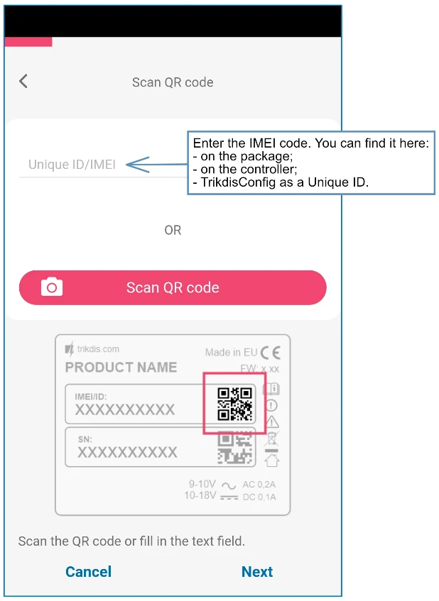

### Tillkoppla och frånkoppla systemet med Protegus2

1.  Öppna Protegus2 för att styra systemet.

2.  Klicka på knappen ”Armed” (eller ”Disarmed”) i Protegus2. Ange centralapparatens användarkod i fönstret som öppnas.

3.  Om programmet inte svarar på dina kommandon eller om programfönstrens utseende är helt annorlunda går du till  
    *Settings* -> *System configuration* -> System out of sync? och klickar på knappen ”Sync”.

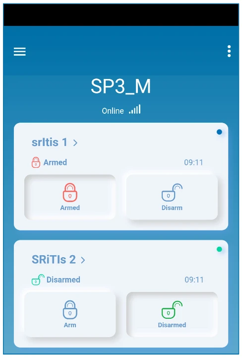

### Konfigurering och styrning med SMS

Centralapparaten FLEXi SP3 kan styras och konfigureras på distans med SMS.

SMS-meddelandets uppbyggnad: Kommando `[mellanslag]` Lösenord `[mellanslag]` Data

Centralapparatens förvalda SMS-lösenord är **123456**. Av säkerhetsskäl rekommenderar vi att du byter det mot något som bara du känner till, och att du inte glömmer lösenordet!

#### Lista över SMS-kommandon

| **Kommando** | **Data** | **Beskrivning** |
|----|----|----|
| *INFO* |  | Begär information om centralapparaten. Svaret innehåller objektnamn, områdenas status, IMEI-nummer, mobilsignalens styrka, firmwareversion och serienummer. T.ex.: INFO 123456 |
| *RESET* |  | Starta om enheten. T.ex.: RESET 123456 |
| *OUTPUTx* | *ON* | Slå på en utgång, ”x” är utgångens nummer. T.ex.: OUTPUT1 123456 ON |
|  | *OFF* | Stäng av en utgång, ”x” är utgångens nummer. T.ex.: OUTPUT1 123456 OFF |
|  | *PULSE=ttt* | Slå på en utgång under en angiven tid – ”x” är utgångens OUT-nummer och ”ttt” är ett tresiffrigt tal som anger pulstiden i sekunder. T.ex.: OUTPUT1 123456 PULSE=002 |
| *PSW* | *New password* | Byt lösenord. T.ex.: PSW 123456 654123 |
| *TIME* | *YYYY/MM/DD,12:00:00* | Ställ in datum och tid. T.ex.: TIME 123456 2025/05/09,10:02:00 |
| *TXTA* | *Object name* | Ange objektnamn. T.ex.: TXTA 123456 Namas |
| *RDR* | *PhoneNR#SMStext* | Vidarebefordrar SMS till det angivna numret. Telefonnumret måste börja med ett ”+” och landskoden. T.ex.: RDR 123456 +37061234567#forwarded text |
| *ASKI* |  | Skicka ett SMS med ingångarnas (IN) status. T.ex.: ASKI 123456 |
| *ASKO* |  | Skicka ett SMS med utgångarnas (OUT) status. T.ex.: ASKO 123456 |
| *ASKA* |  | Skicka ett SMS med områdenas status. T.ex.: ASKA 123456 |
| *ASKT* |  | Skicka ett SMS med värdena från alla temperaturgivare. T.ex.: ASKT 123456 |
| *DISARM* | *SYS:x* | Frånkoppla larmet, ”x” är områdets nummer (1–8). T.ex.: DISARM 123456 SYS:1 |
| *ARM* | *SYS:x* | Tillkoppla larmet, ”x” är områdets nummer (1–8). T.ex.: ARM 123456 SYS:1 |
| *STAY* | *SYS:x* | Tillkoppla område ”x” i hemmaläge, ”x” är områdets nummer (1–8). T.ex.: STAY 123456 SYS:1 |
| *SLEEP* | *SYS:x* | Tillkoppla område ”x” i nattläge, ”x” är områdets nummer (1–8). T.ex.: SLEEP 123456 SYS:1 |
| *FRS* |  | Återställer branddetektorns utgång om utgången OUT har funktionen ”Fire sensor reset”. T.ex.: FRS 123456 |
| *SETN* | *PhoneX=PhoneNR#Name#email* | Lägg till ett telefonnummer och ett användarnamn och tilldela dem till användare ”x”. ”x” är telefonnumrets rad i listan. Telefonnumret måste börja med ett ”+” och landskoden. Telefonnumret och användarnamnet måste separeras med tecknet \#. T.ex.: SETN 123456 PHONE5=+37061234567#JOHN#john@peter.com |
|  | *PhoneX=DEL* | Ta bort telefonnummer och användarnamn från listan. T.ex.: SETN 123456 PHONE5=DEL |
| *UUSD* | *\*Uusd code#* | Skickar en UUSD-kod till operatören. T.ex.: ***UUSD 123456 \*245#*** |
| *CONNECT* | *Protegus=ON* | Anslut till molntjänsten Protegus Cloud. T.ex.: CONNECT 123456 PROTEGUS=ON |
|  | *Protegus=OFF* | Koppla från molntjänsten Protegus Cloud. T.ex.: CONNECT 123456 PROTEGUS=OFF |
|  | *Code=123456* | Åtkomstkod för molntjänsten Protegus Cloud. T.ex.: CONNECT 123456 CODE=123456 |
|  | *IP=0.0.0.0:8000* | Ange TCP-IP och port för huvudserverns anslutningskanal. T.ex.: CONNECT 123456 IP=0.0.0.0:8000 |
|  | *IP=0* | Stänger av huvudkanalen. T.ex.: CONNECT 123456 IP=0 |
|  | *ENC=123456* | Krypteringsnyckel för TRK. T.ex.: CONNECT 123456 ENC=123456 |
|  | *APN=Internet* | APN-namn. T.ex.: CONNECT 123456 APN=INTERNET |
|  | *USER=user* | APN-användare. T.ex.: CONNECT 123456 USER=User |
|  | *PSW=password* | APN-lösenord. T.ex.: CONNECT 123456 PSW=Password |

### Styrning med telefonsamtal

!!! note "Obs!"
    Systemadministratören kan styra FLEXi SP3 med SMS och telefonsamtal. Om du vill att andra ska kunna styra systemet med telefonsamtal anger du deras identifieringsuppgifter med TrikdisConfig eller med SMS-kommandon. **<u>Styrning med telefonsamtal fungerar inte med centralapparater *SP3_хх7х*. Centralapparat *SP3_12xx* har inget röstmeddelande med firmware 1.14 och senare.</u>**

**Kommandon för styrning av FLEXi SP3 med telefonsamtal**

Styra utgångar OUT och larmsystemets områden med telefonsamtal:

1.  Om användaren har behörighet att styra utgångar OUT och utgången OUT har typen ”Remote control” (i TrikdisConfig), eller om säkerhetssystemet FLEXi SP3 är indelat i 1 eller flera områden: ring upp telefonnumret till FLEXi SP3:s SIM-kort***. FLEXi SP3*** svarar på samtalet och du kan slå kommandon med telefonens sifferknappar (se tabellen nedan).

#### Lista över kommandon med mobiltelefonens knappsats

| **Knappar** | **Funktion** | **Beskrivning** |
|----|----|----|
| *[1][områdesnr][#]* | Tillkoppla valt område i larmsystemet | T.ex. (tillkoppla område 2): 12# |
| *[2][ områdesnr][#]* | Frånkoppla valt område i larmsystemet | T.ex. (frånkoppla område 2): 22# |
| *[3][utgångsnr][#][läge]* | Styr vald utgång OUT | Styr en angiven utgång OUT. / Läge: / *[0]* – utgången avstängd; / *[1]* – utgången påslagen; / *[2]* – avstängd under pulstiden; / *[3]* – påslagen under pulstiden; / (pulstiden anges med programmet TrikdisConfig, i fönstret ”PGM”) / T.ex. (sätt utgång 1OUT i läge ”på”): 31#1 / T.ex. (sätt utgång 2OUT i läge ”på” under **Pulse time** enligt tabellen ”PGM” i TrikdisConfig): 32#3 |
| *[4][#][inspelningsnr][#]* | Starta inspelning av vald ljudfil | T.ex. (starta röstinspelning 1): 4#1# |
| *[5]* | Lyssna (1–5) på den röstinspelning som just gjorts | T.ex.: ***5*** |
| *[6]* | Spara röstinspelningen | T.ex.: ***6*** |

En ljudsignal markerar början och slutet av inspelningen av ljudfilen. Inspelningstiden för ljudfilen är 15 sekunder. En ljudsignal markerar slutet av uppspelningen. Inspelningen är klar när du hör ett pip. Andra åtgärder kan bara utföras när pipet hörs.

## Inställning av parametrar 

De flesta inställningarna som beskrivs nedan kan ändras i Protegus-appen eller i TrikdisConfig. Vad varje inställning gör beskrivs en gång; där ett avsnitt har en växlare Protegus app | TrikdisConfig visas stegen för båda verktygen, med appens namn där de skiljer sig åt. Inställningar och åtgärder som bara finns i det ena verktyget är markerade. Bara TrikdisConfig kan återställa förvalen, uppdatera firmware, ställa in SMS- och samtalsrapportering till användare för sektioner, PGM-utgångar och händelser, redigera händelsernas SMS-texter och ställa in SMS-ping.

=== "Protegus app"

    **Innan du konfigurerar i appen.** Centralapparaten måste vara online och tillagd i ett Protegus2-konto (se [Länka FLEXi SP3 till en användares Protegus2-konto](#41-lanka-flexi-sp3-till-en-anvandares-protegus2-konto)), och dess firmware måste vara 1.12 eller senare: med äldre firmware säger appen att versionen inte stöds och visar ingen knapp **Read**. En centralapparat som ännu inte är online ställs först in via USB i TrikdisConfig. När en centralapparat läggs till i mobilappen och appen inte hittar den online erbjuder appen att ställa in centralapparatens WiFi från telefonen, men bara för revisioner som börjar på 1, 2, 3E eller 52.

    1. Öppna systemet i Protegus-appen och gå till **Settings → Advanced settings**. Första gången varnar appen för att felaktiga inställningar kan göra att systemet slutar fungera; bekräfta för att gå vidare.
    2. Tryck på **Read** för att läsa centralapparatens inställningar. Om centralapparaten inte använder den förvalda administratörskoden ber appen om åtkomstkoden.
    3. Ändra inställningarna, gå sedan tillbaka till **Advanced settings** och tryck på **Write** för att spara dem i centralapparaten.

    Överst på varje skärm visas den anslutna centralapparaten: **Unique ID**, versionen (**SP3_1E74**: revision 1E74), **Serial**, **Boot** och **Firmware**.

    { .trik-mob-img }

=== "TrikdisConfig"

    1.  Ladda ned konfigurationsprogrammet TrikdisConfig från [www.trikdis.com/](http://www.trikdis.com/lt) (skriv ”TrikdisConfig” i sökfältet) och installera det.

    2.  Anslut FLEXi SP3 till en dator med en USB Mini-B-kabel (kretskort SP3_8xx: USB Type-C).

        **Obs!** Om du ansluter FLEXi SP3 till en dator med USB-kabel medan den är påslagen och i drift slutar FLEXi SP3 att fungera som centralapparat och går över i programmeringsläge.

    3.  Starta konfigurationsprogrammet TrikdisConfig. Programmet identifierar automatiskt den anslutna enheten och öppnar automatiskt konfigurationsfönstret för FLEXi SP3.

    4.  Klicka på **Read [F4]** för att se FLEXi SP3:s aktuella parametrar. Om ett popup-fönster visas anger du *administratörs*- eller *installatörskoden*.

    5.  Ändra inställningarna och klicka sedan på **Write [F5]** för att spara dem i FLEXi SP3.

### Statusfältet i TrikdisConfig

När FLEXi SP3 är ansluten visar TrikdisConfig information om den anslutna enheten i statusfältet.

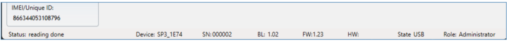

| **Namn** | **Beskrivning** |
|----|----|
| IMEI/Unique ID | Enhetens IMEI-nummer |
| Status | Driftstatus |
| Device | Enhetstyp (måste visa SP3_xxxx) |
| SN | Enhetens serienummer |
| BL | Bootloader-version |
| FW | Enhetens firmwareversion |
| HW | Enhetens maskinvaruversion |
| State | Typ av anslutning till programmet (USB eller fjärr) |
| Role | Visar åtkomstnivån (visas efter att en åtkomstkod har angetts) |

När du klickar på knappen **Read [F4]** läser och visar programmet de inställningar som för närvarande finns lagrade i FLEXi SP3. Ändra önskade inställningar i TrikdisConfig enligt beskrivningarna av programfönstren nedan.

### Fönstret ”System options” 

**System general**

=== "Protegus app"

    Öppna **System options → System general**.

    
    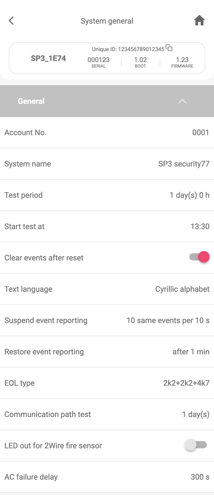General
    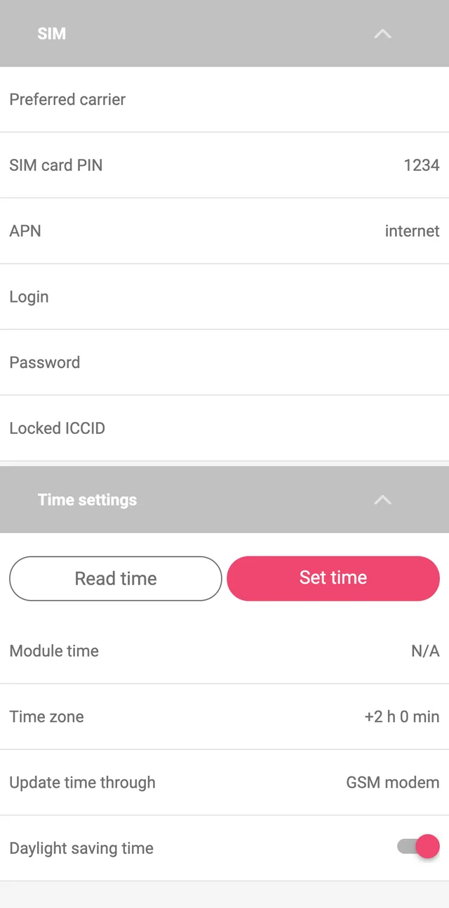SIM, Time settings
    

    **System name** kan vara upp till 19 tecken i appen, och **AC failure delay** finns i gruppen General. Tryck på **Set time** för att skicka telefonens aktuella tid till centralapparaten direkt. Gruppen **SIM** visas på revisioner som börjar på 1, 2, 52, 4 eller 6, men inte 10 eller 20; **Preferred carrier** kräver firmware 1.21 eller senare. **Areas in test SMS** och **Call** finns inte i appen.

=== "TrikdisConfig"

    **Fliken ”System general”**
    {: .trik-tab-title }

    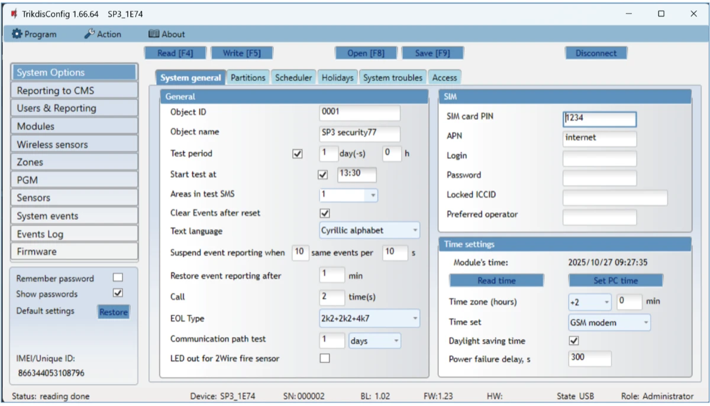

**Inställningsgruppen ”General”**

- Om rapporter ska skickas till larmcentralen anger du <strong>Account No.</strong> (i TrikdisConfig: <strong>Object ID</strong>) (abonnentkoden: ett hexadecimalt tal med 4 tecken, 0–9, A–F. **Använd inte FFFE eller FFFF.**) som du har fått av larmcentralen.

- <strong>System name</strong> (i TrikdisConfig: <strong>Object name</strong>) – tas med i rapporter som skickas via SMS (upp till 20 tecken i TrikdisConfig, 19 i appen; bokstäver och siffror kan användas).

- **Test period** – periodiska testrapporter skickas med den inställda perioden, om inte **Start test at** är inställd.

- **Start test at** – den tid på dygnet då testrapporter skickas.

- **Areas in test SMS** – de angivna områdenas aktuella skyddslägen tas med i den periodiska testrapporten. *Finns bara i TrikdisConfig.*

- **Clear Events after reset** – om den är påslagen raderas alla osända händelserapporter i buffertminnet när centralapparaten återställs.

- **Text language** – särskilda tecken för det valda språket används i SMS.

- <strong>Suspend event reporting</strong> (i TrikdisConfig: <strong>Suspend event reporting when ...</strong>) – rapporteringen av en händelse upphör när samma händelse inträffar det inställda antalet gånger inom det inställda antalet sekunder.

- <strong>Restore event reporting</strong> (i TrikdisConfig: <strong>Restore event reporting after</strong>) – ställ in efter hur lång tid avstängningen av händelserapporteringen upphävs. Tiden kan vara från 0 till 999 minuter.

- **Call** – när en händelse inträffar ringer FLEXi SP3 upp användaren/användarna det inställda antalet gånger. Om samtalet avvisas eller besvaras slutar FLEXi SP3 att ringa. Ett samtal varar i 20 sekunder. *Finns bara i TrikdisConfig.*

- **EOL Type** – ange värdena på de motstånd som är anslutna till detektorerna (EOL – End Of Line, slutmotstånd. RT + R1 + R2. Motstånd RT – sabotage; motstånd R1 – detektor nr 1; motstånd R2 – detektor nr 2). Alternativen är 2k2+2k2+4k7, 1k+1k+2k2, 5k6+5k6+3k3, 5k6+3k3+5k6, 3k3+6k8+3k3 och 2k2+4k7+8k2, och från firmware 1.19 även 4k7+4k7+2k2.

- **Communication path test** – ange det tidsintervall efter vilket centralapparaten kontrollerar backupkanalerna genom att skicka meddelanden till larmcentralen. När meddelandena har skickats på backupkanalerna går centralapparaten tillbaka till primärkanalen.

- **LED out for 2Wire fire sensor** – aktivera den när tvåtrådsbranddetektorn är ansluten till LED-utgången.

**Inställningsgruppen ”SIM”**

- Ange **SIM card PIN.** Om PIN-kodsbegäran är avstängd för just det SIM-kortet ändrar du inte förvalet.

  - **APN** – namnet på mobiloperatörens åtkomstpunkt för mobilt internet. Du måste ange APN om händelsemeddelanden ska skickas till Protegus Cloud eller till larmcentralen via mobilt internet.
- Om mobiloperatören kräver det anger du användarnamn och lösenord för APN i fälten **Login** och **Password**.

- **Locked ICCID** – ange SIM-kortets ICCID-nummer om du vill att centralapparaten bara ska fungera med just det SIM-kortet.

- <strong>Preferred carrier</strong> (i TrikdisConfig: <strong>Preferred operator</strong>) – när du har angett mobiloperatörens kod ansluter larmsändaren bara till den valda operatörens nät. Mobiloperatörens kod består av MCC- och MNC-koderna. Firmware 1.21 eller senare.

**Inställningsgruppen ”Time settings”**

Du kan ställa in tiden med knappen <strong>Set time</strong> (i TrikdisConfig: <strong>Set PC time</strong>). Om **Disabled** är valt i <strong>Update time through</strong> (i TrikdisConfig: <strong>Time synchronization</strong>) behåller centralapparaten den tid som ställdes in med den knappen: datorns tid i TrikdisConfig, telefonens tid i appen. Om ett modem eller en server är valt i <strong>Update time through</strong> (i TrikdisConfig: <strong>Time synchronization</strong>) synkroniserar centralapparaten sin tid mot det modemet eller den servern.

- <strong>Time zone</strong> (i TrikdisConfig: <strong>Time zone (Hours)</strong>) – ange tidszonen för ditt land. Om centralapparaten till exempel ska installeras i Litauen anger du **+2**.

- <strong>Update time through</strong> (i TrikdisConfig: <strong>Time set</strong>) – ange en server som ***FLEXi SP3**:s* interna klocka ska synkroniseras mot. Synkroniseringen sker efter att centralapparaten har spänningssatts.

- **Daylight saving time** – om den är påslagen ställs centralapparatens interna klocka automatiskt om till sommar- eller vintertid.

- <strong>AC failure delay</strong> (i TrikdisConfig: <strong>Power failure delay</strong>) – om huvudmatningen försvinner skickas en avisering om spänningsbortfall efter den angivna fördröjningen. När matningsspänningen kommer tillbaka skickas en avisering om att spänningen är återställd efter den angivna fördröjningen.

**Areas**

=== "Protegus app"

    Öppna **System options → Areas** och tryck sedan på ett område.

    { .trik-mob-img }

    { .trik-mob-img }

    På revisioner som börjar på 4 eller 6, med firmware 1.15 eller senare, visar appen också **Arm after**, en tid i minuter: systemet tillkopplar sig självt så många minuter efter att det har frånkopplats (med 2, två minuter senare). 0 betyder att det aldrig tillkopplar sig självt.

=== "TrikdisConfig"

    **Fliken ”Partitions”**
    {: .trik-tab-title }

    

- <strong>Areas enabled</strong> (i TrikdisConfig: <strong>Partitions enabled</strong>) – ange hur många oberoende delar larmsystemet ska delas in i.

- <strong>Area name</strong> (i TrikdisConfig: <strong>Partition name</strong>) – ange områdets namn.

- <strong>Entry delay</strong> (i TrikdisConfig: <strong>Entry</strong>) – inpasseringstid: tid för att komma in genom en sektion av typen *Delay*, gå till en knappsats och frånkoppla larmsystemet. Tiden kan vara från 0 till 999 sekunder.

- <strong>Exit delay</strong> (i TrikdisConfig: <strong>Exit</strong>) – utpasseringstid: tid för att lämna lokalen genom en sektion av typen *Delay* efter att du har angett tillkopplingskoden på en knappsats. Tiden kan vara från 0 till 999 sekunder. Om larmsystemet tillkopplas på distans, till exempel med mobilappen Protegus2, räknar systemet inte med <strong>Exit delay</strong> (i TrikdisConfig: <strong>Exit</strong>) utan tillkopplas direkt.

- <strong>Bell time</strong> (i TrikdisConfig: <strong>Bell</strong>) – hur länge sirenen ljuder när larmet har utlösts. Tiden kan vara från 0 till 999 sekunder.

- **Squawk** – sirenen ger ett kort ljud en gång vid tillkoppling och två gånger vid frånkoppling.

- **Re-ARM** – aktivera den om du vill att systemet automatiskt ska tillkoppla larmsystemet igen efter att det har frånkopplats på distans, men sektionen av typen *Delay* inte påverkades under den inställda inpasseringstiden.

- **Force-ARM** – gör att systemet kan tillkopplas även om sektioner av typen *Stay* är påverkade, så länge sektionen av typen *Entry* inte är påverkad.

- <strong>Keyswitch mode</strong> (i TrikdisConfig: <strong>Keyswitch</strong>) – välj på vilket sätt, *Pulse* eller *Level*, en nyckelbrytarsektion (*Keyswitch*) måste påverkas för att systemet ska tillkoppla eller frånkoppla skyddet av lokalen*.*

- <strong>Tamper action</strong> (i TrikdisConfig: <strong>Tamper</strong>) – välj reaktionstyp (Silent, Audible when armed, Always Audible) när systemet upptäcker sabotage av en detektor. ”Silent” – mottagarna får händelserapporter men sirenen slås inte på; ”Audible when armed” – mottagarna får händelserapporter men sirenen slås bara på om sabotaget inträffar när systemet är tillkopplat; ”Always audible” – mottagarna får händelserapporter och sirenen slås på även när larmsystemet är frånkopplat.

**Schedulers**

=== "Protegus app"

    Öppna **System options → Schedulers**. Tryck på ett schemas tid för att ändra den, och på dess pil för att öppna inställningarna för område, åtgärd och helgdagar samt dagknapparna.

    { .trik-mob-img }

=== "TrikdisConfig"

    **Fliken ”Scheduler”**
    {: .trik-tab-title }

    

I den här tabellen kan du ställa in scenarier för automatisk tillkoppling och frånkoppling av säkerhetssystemet genom att välja olika veckodagar och ta med helgdagar.

- **Enable** – aktivera schemat för när systemet automatiskt ska tillkopplas och frånkopplas.

- <strong>Area</strong> (i TrikdisConfig: <strong>Partition</strong>) – det område som schemat gäller.

- **Time** – ange den tid då åtgärden ska utföras.

- <strong>Enabled only when not armed</strong> (i TrikdisConfig: <strong>Not Armed</strong>) – schemats åtgärd utförs bara om centralapparaten inte är tillkopplad i läget AWAY (bortatillkoppling). Firmware 1.15 eller senare.

- **Action** – ange det skyddsläge (Disarm/Arm/Sleep/Stay) som systemet automatiskt ska växla till vid den angivna tiden.

- **Monday, ... Sunday** – de veckodagar då det inställda skyddsläget och den inställda tiden gäller.

- **Holiday** – ange hur schemat ska bete sig under helgdagar (Disabled/Ignore on holidays/Additional when holidays/Only holidays). Disabled – inga helgdagar. Ignore on holidays – utför inte schemat under helgdagar. Additional when holidays – utför en extra åtgärd under helgdagar. Only holidays – utför schemat under helgdagar.

- **Holiday group** – ange en helgdagsgrupp (Any/1/2/3/4) som schemat ska betrakta som helgdagar. Om ”Any” väljs arbetar schemat i helgdagsläge under varje aktiv helgdag.

**Holidays**

=== "Protegus app"

    Öppna **System options → Holidays**. Tryck på ett datum för att ändra det, och på pilen för att öppna raden och välja **Group** 1 till 4.

    { .trik-mob-img }

=== "TrikdisConfig"

    **Fliken ”Holidays”**
    {: .trik-tab-title }

    

- **Enable** – slår på helgdagen.

- **Start date** – ange helgdagens startdatum.

- **Stop date** – ange helgdagens slutdatum. Om helgdagen bara är en dag lång ska det här datumet vara detsamma som **Start date**.

- <strong>Group</strong> (i TrikdisConfig: <strong>Group 1, Group 2, Group 3, Group 4</strong>) – kombinera helgdagar i grupper.

**System troubles**

=== "Protegus app"

    Öppna **System options → System troubles**.

    { .trik-mob-img }

=== "TrikdisConfig"

    **Fliken ”System troubles”**
    {: .trik-tab-title }

    

Om tillkoppling är begränsad för ett fel kan centralapparaten inte tillkopplas så länge felet finns.

**Access**

=== "Protegus app"

    Öppna **System options → Access**.

    { .trik-mob-img }

    **Can change Account No.** är en omkopplare; **Area settings** och varje meny är **Editable**, **Visible** (skrivskyddad) eller **Hidden**. Appen visar **Administrator code** och **SMS code** bara för administratören. Installatörens behörighet för **SIM card** ställs bara in i TrikdisConfig.

=== "TrikdisConfig"

    **Fliken ”Access”**
    {: .trik-tab-title }

    

**Inställningsgruppen ”Access codes”**

- **Administrator Code** – *(förvald kod 123456)* ger full åtkomst till konfigurationen (koden måste vara 6 tecken lång; den kan bestå av latinska bokstäver och/eller siffror).

- <strong>SMS code</strong> (i TrikdisConfig: <strong>SMS password</strong>) – *(förvalt lösenord 123456)* används för att styra systemet säkert med SMS. Byt det av säkerhetsskäl mot ett lösenord med 6 tecken som bara du känner till.

- **Installer Code** – (*förvald kod 654321*) ger installatörer åtkomst till konfigurering av systemet. Byt den av säkerhetsskäl mot en kod med 6 tecken som bara du känner till.

!!! note "Obs!"
    Om den förvalda *administratörskoden* (123456) är inställd visar TrikdisConfig omedelbart enhetens aktuella driftparametrar utan att fråga efter koden när du har klickat på **Read [F4]**.

**Inställningsgruppen ”Installer permissions”**

- Anger vad installatören får ändra: <strong>Can change Account No.</strong> (i TrikdisConfig: <strong>Object ID</strong>), inställningarna för **SIM card** (*bara i TrikdisConfig*) samt varje område eller meny, som kan vara redigerbar, skrivskyddad eller dold.

### Fönstret ”Reporting to CMS” 

**Reporting**

=== "Protegus app"

    Öppna **Reporting to CMS → Reporting**. Slå på en kanal med dess omkopplare **Enabled**. Gruppen **Backup channel** visas när primärkanalen är påslagen, och **Parallel backup channel** när den parallella kanalen är påslagen.

    
    Primary channel
    Backup och parallel channel
    

    **Communication type** har alternativen TCP/IP och UDP/IP; med protokollet **TL150** bara UDP/IP. **Protocol** har alternativen TRK, SIA DC-09_2012, SIA DC-09_2007, SIA DC-09_IPcom och, från firmware 1.14, TL150. Med TRK har **Encryption key** 6 tecken. Med något annat protokoll visar appen **Enable encryption**, **Encryption key** och **Key is HEX**: när kryptering är påslagen har nyckeln 16 tecken, eller 32 hexadecimala tecken när **Key is HEX** är påslagen, och en kortare nyckel fylls ut med nollor. Med ett SIA DC-09-protokoll visar appen också **SIA DCS**: när den är påslagen skickar centralapparaten SIA-meddelanden till larmcentralen. Det kräver en SIA- eller IPcom-mottagare. SMS-rapportering till larmcentralen och numren för **Backup channel 2** ställs bara in i TrikdisConfig.

=== "TrikdisConfig"

    **Fliken ”Reporting”**
    {: .trik-tab-title }

    

Centralapparaten skickar händelser till larmcentralen över en IP-anslutning (mobildata, WiFi eller Ethernet, beroende på revision) eller via SMS (ställs bara in i TrikdisConfig).

Händelser kan skickas över flera kommunikationskanaler. Primärkanalen och den parallella kanalen kan arbeta samtidigt, så att centralapparaten kan skicka händelser till två mottagare på en gång. Backupkanaler kan tilldelas både primärkanalen och den parallella kanalen och används när anslutningen via primärkanalen eller den parallella kanalen bryts.

Med protokollet **TRK** är kommunikationen krypterad och lösenordsskyddad, och en TRIKDIS-mottagare krävs för att ta emot händelserna och vidarebefordra dem till larmcentralens programvara:

• För anslutning över IP – programvarumottagaren IPcom för Windows/Linux, IP/SMS-maskinvarumottagaren RL14 eller flerkanalsmottagaren RM14.

• För mottagning av SMS – IP/SMS-maskinvarumottagaren RL14, flerkanalsmottagaren RM14 eller SMS-mottagaren GM14.

SMS-kommunikation är särskilt användbar som backupkanal, eftersom den fungerar även när det inte finns någon mobil internetanslutning. Vi rekommenderar inte SMS som primärkanal.

**Inställningsgrupperna ”Primary channel” och ”Backup channel”**

- **Communication type** – välj protokoll för kommunikation med mottagaren (TCP/IP, UDP/IP eller SMS i TrikdisConfig).

- **Domain or IP** – ange mottagarens domän eller IP-adress.

- **Port** – ange mottagarens nätverksport.

- **Protocol** – **TRK** för dataöverföring med TRIKDIS-mottagare, **SIA DC-09** för IP-mottagare som kan ta emot händelserapporter som överförs med SIA DC-09-protokoll.

- **Phone number** – (bara för SMS; *finns bara i TrikdisConfig*) ange telefonnumret till en TRIKDIS SMS-mottagare. Telefonnumret måste börja med landskoden (t.ex. 370xxxxxxxx).

- **Encryption key** – med **TRK** en nyckel med 6 siffror som måste stämma överens med larmcentralsmottagarens krypteringsnyckel.

Om parametrar ställs in för den parallella kanalen skickas rapporter samtidigt över båda kanalerna. Båda kanalerna kan inte konfigureras för samma mottagare. När den parallella kanalen är aktiverad kan händelser skickas samtidigt till två mottagare (t.ex. en lokal och en central larmcentral).

**Rapporteringsnumret för ”Backup channel 2” och ”Parallel backup channel 2”** *Finns bara i TrikdisConfig.*

Backup-SMS skickas när meddelanden inte kan överföras via primärkanalen, den parallella kanalen och backupkanalerna. Det är särskilt användbart eftersom det fungerar även när mobiloperatörens nät saknar IP-anslutning.

Den här kanalen fungerar bara när IP-läge är inställt för den första kanalen och dess backupkanal.

SMS-aviseringar skickas till larmcentralens SMS-mottagare: 1) direkt första gången centralapparaten börjar fungera; och 2) om TCP/IP- eller UDP/IP-anslutningen bryts i den första kanalen och dess backupkanal.

- **Phone number** – ange telefonnumret till TRIKDIS SMS-mottagare hos larmcentralen (CMS, Central Monitoring Station). Telefonnumret måste börja med landskoden (t.ex. 370xxxxxxxx).

**Settings**

=== "Protegus app"

    Öppna **Reporting to CMS → Settings**.

    
    Settings
    Reporting mode, WiFi network parameters
    

    **IP Ping enabled** slår på ping. I **Reporting mode** beror alternativen på centralapparatens revision:

    - 10 och 20: inget SIM.
    - 3E och 3L: **LAN (ethernet)** i stället för SIM; 3E har inget **LAN (RS485)** och 3L inget WiFi.
    - 4 och 6: **LAN (ethernet)** i stället för WiFi.

    WiFi-namnet och lösenordet finns i **WiFi network parameters** (revisioner som börjar på 1, 2, 3E eller 5), tillsammans med inställningarna för DHCP och IP. Revisioner som börjar på 3E, 3L, 4 eller 6 har en grupp **LAN parameters** med DHCP- och IP-inställningarna för det kabelanslutna nätverket och en omkopplare **LAN trouble indication** i gruppen **Settings**. När den är påslagen visar en lysdiod på centralapparatens kretskort ett LAN-fel. Händelsen LAN-fel skickas oavsett om omkopplaren är påslagen eller avstängd. **SMS Ping period** och **SIM parameters** finns inte i appen.

=== "TrikdisConfig"

    **Fliken ”Settings”**
    {: .trik-tab-title }

    

**Inställningsgruppen ”Settings”**

- **Return to primary after** – den tid, i minuter, efter vilken FLEXi SP3 försöker återfå anslutningen via *primärkanalen*.

- **IP Ping period** – hur ofta PING-signaler skickas för att kontrollera IP-anslutningen (mobildata, WiFi eller Ethernet), i sekunder. Slå på dem för att de ska skickas.

- **SMS Ping period** – hur ofta PING-signaler skickas för att kontrollera förbindelsen på SMS-kanalen, i minuter. Slå på dem för att de ska skickas. *Finns bara i TrikdisConfig.*

- **Backup reporting after** – ange hur många misslyckade försök att skicka meddelanden via *primärkanalen* som ska göras innan centralapparaten växlar till *backupkanalen*.

- **DNS1, DNS2** – adresser till DNS-servrar.

- <strong>Account No. in SIA DC-09</strong> (i TrikdisConfig: <strong>Object ID in SIA DC-09</strong>) – abonnentkoden som används i SIA DC-09-meddelanden.

- **SIA DC-09 receiver No.** – ange mottagarnumret.

- <strong>SIA DC-09 line No.</strong> (i TrikdisConfig: <strong>Line No.</strong>) – ange linjenumret.

- **Local time in SIA** – när den är påslagen anger meddelandena som skickas till larmcentralen (CMS) den tid som är inställd i modulen.

!!! warning "Viktigt"
    Oavsett IP-inställningar ska du kontrollera att DNS-adresserna stämmer med de som din internetleverantör stöder.

**Inställningsgruppen ”Reporting mode”**

Här ställer du in hur centralapparaten ska kommunicera med larmcentralens kanaler och med Protegus2. Anslutningstyperna anges i ordning. Om centralapparaten inte kan ansluta med anslutningstypen **Main type** växlar den till **Backup type**, och så vidare. Om backupanslutningen lyckades överföra meddelandet till larmcentralen görs ett nytt försök med anslutningstypen **Return to main** efter det angivna tidsintervallet.

- **Main type** – välj anslutningstyp (SIM, WiFi, <strong>LAN (RS485)</strong> (i TrikdisConfig: <strong>LAN(E485)</strong>)) mot larmcentralens mottagare och Protegus2.

- **Backup type** – välj anslutningstyp (SIM, WiFi, <strong>LAN (RS485)</strong> (i TrikdisConfig: <strong>LAN(E485)</strong>)) mot larmcentralens mottagare och Protegus2.

- **Backup type 2** – välj anslutningstyp (SIM, WiFi, <strong>LAN (RS485)</strong> (i TrikdisConfig: <strong>LAN(E485)</strong>)) mot larmcentralens mottagare och Protegus2.

- <strong>Radio T16 (RS485)</strong> (i TrikdisConfig: <strong>Radio T16/SF485</strong>) – slå på den när sändaren T16 används för att överföra information. Sändaren T16 fungerar som backupkanal om minst en av de andra anslutningsmetoderna (SIM, WiFi, <strong>LAN (RS485)</strong> (i TrikdisConfig: <strong>LAN(E485)</strong>)) används. Om det inte finns några andra anslutningsmetoder är den huvudkanalen. T16 kan bara användas för att skicka rapporter till larmcentralen.
- <strong>Return to main (both channels)</strong> (i TrikdisConfig: <strong>Return to main (both channel)</strong>) – den tid, i minuter, efter vilken FLEXi SP3 försöker återfå anslutningen via *primärkanalen* om den körde en backupkanal.

**Inställningsgruppen ”Communicator network settings”**

- **DHCP mode** – läge för registrering i WiFi-nätverket (manuellt eller automatiskt). När det är påslaget läser centralapparaten FLEXi SP3 automatiskt nätverksinställningarna (nätmask, gateway) och tilldelas automatiskt en IP-adress (automatiskt registreringsläge).

- **Static IP** – statisk IP-adress för manuellt registreringsläge.

- **Subnet mask** – nätmask för manuellt registreringsläge.

- **Default gateway** – gateway för manuellt registreringsläge.

- **WiFi SSID name** – namnet på WiFi-nätverket (som centralapparaten FLEXi SP3 ska ansluta till).

- **WiFi SSID password** – lösenord till WiFi-nätverket.

**Inställningsgruppen ”SIM parameters”** *Finns bara i TrikdisConfig.*

- **Disable indication of the absence of a SIM card** – när den är påslagen visar centralapparaten FLEXi SP3 ingen indikering om att inget SIM-kort är isatt. Slå på den när centralapparaten arbetar utan SIM-kort.

- **Use dial and SMS when the working over internet module** – om den slås på kan centralapparaten styras med telefonsamtal och SMS. Om den är avstängd och ett WiFi-nätverk finns tillgängligt används varken SMS eller telefonsamtal. Om den är avstängd och inget WiFi-nätverk finns kan FLEXi SP3 ändå styras med telefonsamtal och SMS. FLEXi SP3 skickar SMS till användaren.

- **Disable the use of SIM card mobile data** – om den slås på används inte SIM-kortets mobildata. Data skickas då bara via WiFi. Om ett WiFi-nätverk tillfälligt inte är tillgängligt lagrar FLEXi SP3 data i minnet. När WiFi-nätverket är återställt skickar FLEXi SP3 data via WiFi.

### Fönstret ”Users & Reporting” 

**Users**

=== "Protegus app"

    Öppna **Users & Reporting → Users** och tryck sedan på en användare. Användare 1 till 8 är markerade med **A** i listan: det är de som får rapporter via SMS och samtal, och därför är det bara de som har **Readdress SMS messages from unknown sender**.

    { .trik-mob-img }

    { .trik-mob-img }

    **Name** kan vara upp till 18 tecken och **Tag code** upp till 12 hexadecimala tecken. **Keypad code** har 4 siffror; med firmware 1.24 eller senare och **6-digit user code** påslagen i **Modules → Keypads** har den 6. Om e-postadressen redan används av en annan användare säger appen det. **Delete** rensar användarens namn, telefonnummer, e-postadress, knappsatskod, tagg-kod och områden, och slår av **Can ARM system**, **Can DISARM system** och **Can remotely control PGM**. **User get response messages from module** och **Readdress SMS messages from unknown sender** behåller sina värden: kontrollera dem när du återanvänder platsen.

=== "TrikdisConfig"

    **Fliken ”Users”**
    {: .trik-tab-title }

    

**Inställningsgruppen ”Users & Reporting to User”**

- **Name** – användarens namn. Namnen används i händelse-SMS.

- <strong>Phone number</strong> (i TrikdisConfig: <strong>Tel number</strong>) – användarens telefonnummer, som används för att fjärrstyra larmsystemet och som tar emot SMS. Numren måste börja med landskoden. De första 8 telefonnumren får rapporter via meddelanden och telefonsamtal.

- **Email** – ange användarens e-postadress så att användaren bjuds in till Protegus2 för att styra systemet.

- <strong>Keypad code</strong> (i TrikdisConfig: <strong>Code</strong>) – den kod för tillkoppling och frånkoppling av larmsystemet som är tilldelad användaren.

- **Tag code** – ange identifieringsnumret för ett RFID-kort, en RFID-bricka eller en elektronisk nyckel (iButton).

- <strong>Can control areas</strong> (i TrikdisConfig: <strong>Areas</strong>) – de områden som den aktuella användaren kan styra.

- <strong>Can ARM system</strong> (i TrikdisConfig: <strong>A</strong>) – gör att användaren kan tillkoppla larmet.

- <strong>Can DISARM system</strong> (i TrikdisConfig: <strong>D</strong>) – gör att användaren kan frånkoppla larmet.

- <strong>Can remotely control PGM</strong> (i TrikdisConfig: <strong>PGM</strong>) – när den är påslagen kan användaren ringa upp FLEXi SP3 och slå på och av önskade utgångar OUT med DTMF-toner.

- <strong>User get response messages from module</strong> (i TrikdisConfig: <strong>ACK</strong>) – när den är påslagen skickar FLEXi SP3 SMS till användaren med **SMS answer text** om att mottagna kommandon har utförts.

- <strong>Readdress SMS messages from unknown sender</strong> (i TrikdisConfig: <strong>FWD</strong>) – när den är påslagen vidarebefordras SMS som tas emot från andra än systemets användare (t.ex. besked om SIM-kortets saldo eller slumpmässiga reklammeddelanden) till användaren.

#### Länka RFID-brickor (kort)

=== "Protegus app"

    Ange RFID-brickans (kortets) ID-nummer i användarens **Tag code** (**Users & Reporting → Users** och sedan användaren) och tryck sedan på **Advanced settings → Write**.

=== "TrikdisConfig"

    Du kan lägga till RFID-brickor (kort) genom att ange deras ID-nummer i fältet Tag code i *TrikdisConfig*. Klicka på knappen Write [F5] för att skriva listan över RFID-brickor (kort) till centralapparaten.

--8<-- "sv/faq/index.md:sp3-wiegand-reader-door-output"

#### Länka elektroniska nycklar (iButton)

Länka elektroniska nycklar med läsaren TM17.

1.  Om listan **Tag code** är tom ska den första nyckeln som läggs till skrivas på den första raden i listan och blir **Master key.**

2.  För att slå på länkningsläget för kontaktnycklar håller du **Master key** mot nyckelläsarens ”öga” i minst 10 sekunder. När länkningsläget är på börjar nyckelläsaren TM17:s lysdiod *State* blinka grönt.

3.  För att länka användarnycklar håller du dem mot nyckelläsarens ”öga” en i taget. 3 ljudsignaler från läsaren visar att nyckeln har länkats till systemet.

4.  När du har länkat användarnas elektroniska nycklar (*iButton*) håller du **Master key** mot nyckelläsaren igen för att stänga av länkningsläget. När länkningsläget är avstängt slutar lysdioden *State* på nyckelläsaren TM17 att blinka*.*

5.  För att radera alla nycklar (inklusive huvudnyckeln) håller du **Master key** mot läsaren i minst 20 sekunder.

Länka elektroniska nycklar med läsaren CZ-Dallas.

1.  Om listan **Tag code** är tom ska den första nyckeln som läggs till skrivas på den första raden i listan och blir **Master key.**

2.  För att slå på länkningsläget för kontaktnycklar håller du **Master key** mot nyckelläsarens ”öga” i minst 10 sekunder.

3.  För att länka användarnycklar håller du dem mot nyckelläsarens ”öga” en i taget.

4.  När du har länkat användarnas elektroniska nycklar (*iButton*) håller du **Master key** mot nyckelläsaren igen för att stänga av länkningsläget.

5.  För att radera alla nycklar (inklusive huvudnyckeln) håller du **Master key** mot läsaren i minst 20 sekunder.

!!! warning "Viktigt"
    Master key är avsedd för att länka andra elektroniska nycklar. Om du använder Master key för kommandon för tillkoppling och frånkoppling utförs de med fördröjning.

**Protegus2**

=== "Protegus app"

    Öppna **Users & Reporting → Protegus2**.

    { .trik-mob-img }

=== "TrikdisConfig"

    **Fliken ”Protegus”**
    {: .trik-tab-title }

    

**Inställningsgruppen ”Cloud application”**

- <strong>Enable Protegus2 cloud service</strong> (i TrikdisConfig: <strong>Enable cloud service</strong>) – aktivera molntjänsten Protegus Cloud; då kan FLEXi SP3 utbyta data med appen Protegus2 och centralapparaten kan konfigureras på distans med TrikdisConfig.

- <strong>Enable parallel reporting</strong> (i TrikdisConfig: <strong>Parallel reporting</strong>) – när den är påslagen skickas meddelanden samtidigt via primärkanalen (till larmcentralen) och till Protegus2.

- <strong>Protegus2 cloud access code</strong> (i TrikdisConfig: <strong>Cloud access code</strong>) – kod med 6 siffror för anslutning till Protegus2 (förval 123456).

**SMS answer texts**

=== "Protegus app"

    Öppna **Users & Reporting → SMS answer texts** och tryck sedan på ett svar för att ändra dess text.

    { .trik-mob-img }

=== "TrikdisConfig"

    **Fliken ”SMS answer texts”**
    {: .trik-tab-title }

    

    Ändra texterna i kolumnen **SMS text**.

**Inställningsgruppen ”SMS answer texts”**

- Texterna i svaren på kommandon som skickas via SMS kan ändras. Appen har de fyra första svaren: **Command done**, **Wrong password**, **Wrong data** och **Wrong command**; **Zone alarm**, **Zone restore**, **Output ON** och **Output OFF** ställs bara in i TrikdisConfig.

### Fönstret ”Modules” 

**Keypads**

=== "Protegus app"

    Öppna **Modules → Keypads**. Gruppen **Keypad settings** finns överst; listan **Keypads** under den visar varje knappsats som centralapparaten har hittat, med typ och serienummer. Tryck på en knappsats för att välja vilka områden den styr, eller på **Delete** för att ta bort den.

    
    Keypad settings
    Listan Keypads
    

    { .trik-mob-img }

    I appen är knappsatstyperna **Disabled**, **Paradox/Protegus**, **Wiegand reader** och **Crow CR Icon/LCD (ST)**; Crow erbjuds inte på revisioner som slutar på 4 med firmware 1.18 eller senare. En knappsats områdesomkopplare visas när knappsatstypen är Crow, eller, på revisioner som slutar på 4 med firmware 1.19 eller senare, för knappsatser vars serienummer börjar med 52, 51, 1E eller 1D. **6-digit user code** kräver firmware 1.24 eller senare; **Low voltage reader (1IO/2IO)**, **Use fingerprint** och **Do not change charset** kräver 1.15, och **Custom entry beep** 1.17. **Low voltage reader (1IO/2IO)** kan bara ändras när **Additional Wiegand on 1IO/2IO** är påslagen.

=== "TrikdisConfig"

    **Fliken ”Keypads”**
    {: .trik-tab-title }

    

    För att ta bort en knappsats kan du också ange nollor i **Serial**.

- **Serial** – knappsatsens serienummer, som centralapparaten identifierar automatiskt. För att ta bort en knappsats använder du <strong>Delete</strong> (i TrikdisConfig: <strong>Remove</strong>).

- **Keypad type** – knappsatstypen, som centralapparaten identifierar automatiskt.

- **Areas** – du kan ange vilka områden knappsatsen ska kunna styra (gäller bara följande knappsatser: FLEXi SK LCD, FLEXi SK LED, SK LCD Button, SK LED Button).

- <strong>Delete</strong> (i TrikdisConfig: <strong>Remove</strong>) – när du trycker på knappen tas knappsatsen bort från listan.

<strong>Inställningsgruppen ”</strong><strong>Keypad settings</strong> (i TrikdisConfig: <strong>Keypad parameters</strong>)<strong>”</strong>

- **Keypad type** – ange typen av knappsats (Crow CR16, Paradox LED, Wiegand reader) som är ansluten till centralapparaten (plintarna GRN, YEL).

- **Additional Wiegand on 1IO/2IO** – slå på den om en extra RFID-läsare är ansluten. En extra läsare kan anslutas till plintarna IO1 och IO2, som i så fall inte kan användas som ingångar eller utgångar.

- <strong>6-digit user code</strong> (i TrikdisConfig: <strong>6 digits user code</strong>) – när den är påslagen har användarkoden som slås på knappsatsen 6 siffror. Om den nuvarande koden hade 4 siffror läggs de första två siffrorna i den nuvarande koden till användarkoden (1234 blir 123412). Alla användarkoder med 4 siffror ändras enligt den beskrivna metoden.

- **Duress code type** – välj typ av tvångskod. Om du tvingas att tillkoppla eller frånkoppla larmsystemet och anger tvångskoden tillkopplar eller frånkopplar systemet larmet och skickar omedelbart en tyst varning till larmcentralen (CMS).

- **Quick ARM** – knapparna ARM, STAY och SLEEP kan användas för att snabbt tillkoppla säkerhetssystemet utan att ange en kod.

- **Incorrect codes until lockout** – ange hur många felaktiga koder som tillåts innan knappsatsen spärras.

- **Lockout timer** – ange hur länge knappsatsen ska vara spärrad.

- **Panic alarm type** – ange vad larmet ska ge för ljud (**Audible** / **Silent** / **Disabled**) om funktionsknapparna **Panic alarm** på knappsatsen trycks in. När larmet är **Audible** skickas larmmeddelanden till Protegus2 och larmcentralen (CMS), och centralapparaten ger ett hörbart larm på knappsatsen och slår på sirenen. När larmet är **Silent** skickas larmmeddelanden till Protegus2 och larmcentralen, och centralapparaten stänger av de hörbara larmen. Om det är inställt på Disabled skickas inget larmmeddelande till Protegus2 och larmcentralen.

- **Medical alarm type** – ange vad larmet ska ge för ljud (**Audible** / **Silent** / **Disabled**) om funktionsknapparna **Medical alarm** på knappsatsen trycks in. När larmet är **Audible** skickas larmmeddelanden till Protegus2 och larmcentralen, och centralapparaten ger ett hörbart larm på knappsatsen och slår på sirenen. När larmet är **Silent** skickas larmmeddelanden till Protegus2 och larmcentralen, och centralapparaten stänger av de hörbara larmen. Om det är inställt på **Disabled** skickas inga larmmeddelanden till Protegus2 och larmcentralen.

- **Fire alarm type** – ange vad larmet ska ge för ljud (**Audible** / **Silent** / **Disabled**) om funktionsknapparna **Fire alarm** på knappsatsen trycks in. När larmet är **Audible** skickas larmmeddelanden till Protegus2 och larmcentralen, och centralapparaten ger ett hörbart larm på knappsatsen och slår på sirenen. När larmet är **Silent** skickas larmmeddelanden till Protegus2 och larmcentralen, och centralapparaten stänger av de hörbara larmen. Om det är inställt på **Disabled** skickas inga larmmeddelanden till Protegus2 och larmcentralen.

- **Low voltage reader (1IO/2IO)** – slå på den för att ändra kommunikationsprotokollet mellan centralapparaten och läsaren om den anslutna RFID-läsaren inte fungerar.

- **Use fingerprint** – slå på den om en fingeravtrycksläsare med protokollet Wiegand 26/34 ska anslutas.

- **Do not change charset** – slå på den om du inte vill ändra textkodningen för sektions- och områdesnamn på knappsatsen SK-LCD TouchPad.

- **Custom entry beep** – när den är påslagen är pipet för inpasseringstid på knappsatsen intermittent.

**RS485 modules**

=== "Protegus app"

    Öppna **Modules → RS485 modules** och tryck sedan på en modul, eller på **&lt;Add module&gt;** för en ledig plats. Med firmware 1.23 eller senare trycker du på **Update** för att visa varje moduls signalstyrka och matningsspänning.

    { .trik-mob-img }

    { .trik-mob-img }

    Vilka moduler som kan väljas beror på centralapparatens revision och firmware; larmsändarna E485, SF485, RF-S8/S9 och PSTN kan vardera läggas till bara en gång. **Assigned area** visas bara för läsaren TM17.

=== "TrikdisConfig"

    **Fliken ”RS485 modules”**
    {: .trik-tab-title }

    

**Inställningsgruppen ”RS485 modules”**

- **ID** – modulens nummer i listan.

- **Module** – välj den modul som används (modulerna iO, iO-WL, TM17, iO-8, RF-SH, E485 T16, SF485, iO-MO, iO-LORA, iO8-LORA, PB-LORA, REL-LORA, RF-LORA, RF-HW, RF-S8) i modullistan.

- <strong>Serial number</strong> (i TrikdisConfig: <strong>Serial No.</strong>) – obligatoriskt serienummer i hexadecimal form (0–9, A–F), som anges på etiketterna på modulens kapsling och förpackning.

- <strong>Assigned area</strong> (i TrikdisConfig: <strong>Area</strong>) – tilldela modulen ett område (TM17 visar status för det område den är tilldelad, och även status för de sektioner som är tilldelade samma område).

- <strong>Expander name</strong> (i TrikdisConfig: <strong>Name</strong>) – du kan ge modulen ett namn.

- **Firmware version** – när FLEXi SP3 hittar den anslutna modulen visas versionen av dess firmware.

**E485 settings**

=== "Protegus app"

    I appen finns nätverksinställningarna för E485 på E485-larmsändarens egen skärm: öppna **Modules → RS485 modules** och tryck på E485.

    { .trik-mob-img }

=== "TrikdisConfig"

    **Fliken ”E485 settings”**
    {: .trik-tab-title }

    

- **DHCP mode** – läge för registrering i LAN (manuellt eller automatiskt). När det är påslaget läser centralapparaten FLEXi SP3 automatiskt nätverksinställningarna (nätmask, gateway) och tilldelas automatiskt en IP-adress (automatiskt registreringsläge).

- **Static IP** – statisk IP-adress för manuellt registreringsläge.

- **Subnet mask** – nätmask för manuellt registreringsläge.

- **Default gateway** – gateway för manuellt registreringsläge.

### Fönstret ”Wireless” 

**Wireless sensors**

=== "Protegus app"

    Öppna **Wireless**. Listan visar varje trådlös enhet med batterispänning och signalstyrka; tryck på en enhet för att se dess inställningar. Tryck på **Update** för att läsa av aktuella nivåer för batteri och signal (inte på revisioner som slutar på 1).

    { .trik-mob-img }

    { .trik-mob-img }

    **Update** läser bara av dessa nivåer. Appen kan därefter säga att inställningarna har ändrats, men inget behöver skrivas. Vilka inställningar en enhet har beror på dess typ. På revisioner som slutar på 4 med firmware 1.19 eller senare visar appen också **Supervision time (min)**, 30 till 2 880 minuter. Om centralapparaten inte hör något från en trådlös detektor under den tiden skickar den felhändelsen *RF device lost* (Contact ID 381), och *RF device restore* när detektorn är tillbaka.

=== "TrikdisConfig"

    

FLEXi SP3 kan med en ansluten RF-LORA-modul använda trådlösa detektorer, sirener och fjärrkontroller från företaget ”Maximum”.

#### Registrera mottagaren RF-LORA för trådlösa detektorer i centralapparaten FLEXi SP3

Centralapparaten FLEXi SP3 har firmware-revision 4 SP3_xxx**4**\_0121.fw (firmwareversion 1.21 eller senare), som gör att trådlösa detektorer från ”Maximum” fungerar. Den trådlösa transceivern RF-LORA måste vara ansluten till centralapparaten.

=== "Protegus app"

    1.  Slå på matningen till FLEXi SP3 och vänta 1 minut.
    2.  Öppna **Settings → Advanced settings** i Protegus-appen och tryck på **Read**.
    3.  Öppna **Modules → RS485 modules**. Om **RF-LORA** finns i listan trycker du på den: om den visar en **Firmware version** är den redan länkad och du kan sluta här.
    4.  Tryck på **&lt;Add module&gt;**, välj **RF-LORA** under **Module**, ange RF-LORA:s **Serial number** (finns på enheten och på etiketten på förpackningen) och tryck på **Ok**.
    5.  Tryck på **Advanced settings → Write**.
    6.  Vänta 1 minut tills FLEXi SP3 och RF-LORA har länkats ihop och tryck sedan på **Read**.
    7.  Tryck på raden för RF-LORA i **Modules → RS485 modules**: en **Firmware version** visar att den är länkad.

=== "TrikdisConfig"

    1. Slå på matningen till centralapparaten FLEXi SP3.

    2. Vänta 1 minut.

    3. Starta ***TrikdisConfig**.*

    4. Anslut FLEXi SP3 till en dator med en USB Mini-B-kabel (kretskort SP3_8xx: USB Type-C).

    5. Modullistan ska visa ”**RF-LORA transceiver**” samt serienummer och firmwareversion. Om du ser firmwareversionen för transceivern RF-LORA är den redan länkad: fortsätt från ”RF-LORA-modulen är nu länkad”.

        

    6. Om listan inte visar ”**RF-LORA transceiver**” måste du välja ”**RF-LORA transceiver**” i listan.

    7. Ange serienumret för RF-LORA-modulen i fältet ”**Serial No.**”. Serienumret finns på enheten och på etiketten på förpackningen.

        

    8. Klicka på **Write [F5]**.

    9. Koppla bort USB-kabeln.

    10. Vänta 1 minut tills FLEXi SP3 och RF-LORA har länkats ihop.

    11. Anslut en USB Mini-B-kabel (kretskort SP3_8xx: USB Type-C) till FLEXi SP3.

    12. Klicka på **Read [F4]**.

    13. Firmwareversionen för RF-LORA visas i fönstret ”**Modules**”.

        

    14. RF-LORA-modulen är nu länkad till FLEXi SP3.

    15. Koppla bort USB-kabeln.

    16. Klicka på ”**Disconnect**”.

        

    17. Vänta 1 minut.

#### Länka trådlösa detektorer på distans

=== "Protegus app"

    Appen ansluter alltid på distans, så centralapparaten måste vara online.

    1.  Sätt i batterier i de trådlösa detektorerna. Håll RF-LORA minst 1 m från detektorerna.
    2.  Öppna **Wireless** och tryck på **Learn**. Appen visar **Learning mode**, och lysdioden ”**DATA/TROUBLE**” på RF-LORA blinkar grönt/rött. Om appen säger att åtgärden avbröts kontrollerar du att alla områden är frånkopplade och att systemet inte har några fel, och försöker sedan igen.
    3.  Tryck på knappen ”**TAMPER**” på detektorn.

        

    4.  När appen hittar detektorn (”New device was found”) väljer du en oanvänd sektion i **Select zone** och sektionens definition i **Select zone definition**. Andra enheter, till exempel en siren eller en fjärrkontroll, kan i stället fråga efter en utgång, ett område eller en användare.
    5.  För att lägga till nästa detektor trycker du på dess ”**TAMPER**”-knapp och väljer dess sektion och definition på samma sätt.
    6.  Tryck på **Stop learning** och sedan på **Advanced settings → Write**.
    7.  Kontrollera i **Zones** att detektorerna är tilldelade rätt sektioner och områden.

    För att ta bort en trådlös enhet öppnar du den i **Wireless**, ställer in **Device** på **Disabled**, trycker på **Ok** och sedan på **Advanced settings → Write**.

=== "TrikdisConfig"

    Anslut på distans till centralapparaten FLEXi SP3 med TrikdisConfig.

    !!! warning "Viktigt"
        Fjärrkonfigurering fungerar bara när FLEXi SP3:

        1.  Ett aktiverat SIM-kort måste vara isatt och PIN-koden måste vara angiven eller avstängd, eller så måste centralapparaten vara ansluten till ett WiFi-nätverk.

        2.  Om ett SIM-kort används är mobilt internet aktiverat på det.

        3.  Molntjänsten Protegus Cloud måste vara aktiverad.

        4.  Matningen måste vara påslagen (lysdioden ”**PWR**” ska blinka grönt).

        5.  Centralapparaten måste vara ansluten till nätverket (lysdioden ”**NET**” ska lysa fast grönt och blinka gult).
    I avsnittet ”**Remote access**” anger du centralapparatens nummer ”**IMEI/Unique ID**”. Numret finns på enheten och på etiketten på förpackningen.

    

    Klicka på ”**Configure**”.

    Klicka på **Read [F4]** i det nya fönstret som öppnas. Ange administratörs- eller installatörskoden om det behövs.

    Gå till fönstret ”**Wireless sensors**”.

    

    Klicka på knappen ”**Learn sensors**”.

    

    Alla trådlösa detektorer kan länkas samtidigt. Sätt i batterier i de trådlösa detektorerna (PIR, magnetkontakt, vattenläckagedetektor, rökdetektor, siren).

    När detektorerna registreras måste modulen *RF-LORA* vara minst 1 m från detektorerna.

    1. Lysdioden ”**DATA/TROUBLE**” på RF-LORA-modulen blinkar grönt/rött.

    2. RF-LORA-modulen växlar till inlärningsläge. TrikdisConfig öppnar fönstret för koppling av detektorer.

        

    3. Tryck på knappen ”**TAMPER**” på detektorn.

        

    4. På RF-LORA-modulen blinkar lysdioden ”**DATA/TROUBLE**” grönt en kort stund (det visar att detektorn är registrerad). Efter några sekunder börjar indikeringen ”**DATA/TROUBLE**” blinka grönt/rött igen.

    5. TrikdisConfig öppnar ett nytt fönster där du måste tilldela den trådlösa detektorn ett ”**Zone Number**” och en ”**Zone Definition**”.

    6. Klicka på ”**Save**”.

        

    7. Den trådlösa detektorn läggs till i listan över detektorer.

    8. Om du behöver lägga till nästa detektor trycker du på knappen ”**TAMPER**” på detektorn och gör inställningarna som beskrivs ovan.

    9. Klicka på ”**Stop learning**” för att slutföra registreringen av trådlösa detektorer.

        

    10. Klicka på ”**Yes**” för att skriva detektorerna till centralapparaten FLEXi SP3, eller på ”**No**” om du vill justera parametrarna ytterligare.

        

    Vänta några minuter. Klicka på **Read [F4].**

    TrikdisConfig visar en lista över registrerade trådlösa detektorer i fönstret ”**Wireless sensors**”. Serienumret anges i fältet ”**Serial No.**”.

    

    Kontrollera att detektorerna är rätt tilldelade centralapparatens ”**Zones**” och ”**Areas**” (fönstret ”**Zones**”).

    

    Om du ställer in sektionens ”**Type**” på EOL-T aktiveras övervakning av detektorns sabotage.

    Klicka på **Write [F5]** efter att du har gjort ändringar.

    !!! note "Obs!"
        Så här tar du bort trådlösa detektorer från FLEXi SP3:s minne:

        1.  Starta ***TrikdisConfig**.*

        2.  Anslut FLEXi SP3 till en dator med en USB Mini-B-kabel (kretskort SP3_8xx: USB Type-C) eller anslut till FLEXi SP3 på distans. Klicka på knappen **Read [F4]**.

        3.  I TrikdisConfig-fönstret ”**Wireless sensors**” väljer du ”**Disabled**” i kolumnen ”**Device type**” för den trådlösa detektor du vill ta bort och klickar på **Write [F5]**. Den trådlösa detektorn är nu borttagen från FLEXi SP3:s minne.

#### Länka trådlösa detektorer utan fjärråtkomst

Alla trådlösa detektorer kan länkas samtidigt. Sätt i batterier i de trådlösa detektorerna (PIR, magnetkontakt, vattenläckagedetektor, rökdetektor, siren). **När detektorerna registreras måste modulen *RF-LORA* vara minst 1 m från detektorerna.**

1. Kontrollera att transceivern RF-LORA är registrerad i centralapparaten FLEXi SP3.

2. Slå på matningen till centralapparaten FLEXi SP3.

3. Ta bort locket från transceivern RF-LORA.

4. Håll knappen ”**LEARN**” på RF-LORA-modulen nedtryckt tills indikeringen ”**DATA/TROUBLE**” börjar blinka grönt/rött.

5. Släpp knappen ”**LEARN**”.

6. Den blinkande indikeringen ”**DATA/TROUBLE**” visar att RF-LORA är i registreringsläge för trådlösa enheter.

7. Tryck på knappen ”TAMPER” på detektorn.

    

8. På RF-LORA-modulen blinkar lysdioden ”**DATA/TROUBLE**” grönt en kort stund (det visar att detektorn är registrerad).

9. Efter några sekunder börjar indikeringen ”**DATA/TROUBLE**” blinka grönt/rött igen.

10. Om du behöver lägga till nästa detektor trycker du på knappen ”**TAMPER**” på detektorn.

11. För att slutföra registreringen av trådlösa detektorer håller du knappen ”**LEARN**” nedtryckt tills indikeringen ”**DATA/TROUBLE**” slutar blinka grönt/rött. Släpp knappen ”**LEARN**”. Transceivern RF-LORA har lämnat registreringsläget.

Kontrollera sedan resultatet:

=== "Protegus app"

    1. Tryck på **Advanced settings → Read** (centralapparaten måste vara online).
    2. Öppna **Wireless**: de registrerade enheterna finns i listan.
    3. Kontrollera i **Zones** att detektorerna är tilldelade rätt sektioner och områden.
    4. Tryck på **Advanced settings → Write** efter att du har gjort ändringar.

=== "TrikdisConfig"

    1. Anslut en USB Mini-B-kabel (kretskort SP3_8xx: USB Type-C) till FLEXi SP3.

    2. Starta TrikdisConfig. Klicka på knappen **Read [F4]**.

    3. TrikdisConfig-fönstret ”**Wireless sensors**” innehåller en lista över registrerade trådlösa enheter. I fältet ”**Serial No.**” står serienummer med 7 siffror.

        

    4. Kontrollera att detektorerna är rätt tilldelade centralapparatens ”**Zones**” och ”**Areas**” (fönstret ”**Zones**”).

        

    5. Klicka på **Write [F5]** efter att du har gjort ändringar.

    6. De trådlösa detektorerna är registrerade.

### Fönstret ”Zones” 

**Zones settings**

=== "Protegus app"

    Öppna **Zones** och tryck sedan på en sektion. Listan visar varje sektion med ingång, områden, definition och typ; en sektion utan ingång visar **Disabled**.

    { .trik-mob-img }

    { .trik-mob-img }

    I appen har ingångar på utbyggnadsmodulerna iO, iO-WL, iO-MO, iO-LORA och PB-LORA bara typerna NO och NC.

=== "TrikdisConfig"

    **Fliken ”Zones settings”**
    {: .trik-tab-title }

    

- **Zone No** – sektionens nummer i listan.

- <strong>Zone name</strong> (i TrikdisConfig: <strong>Name</strong>) – ange sektionens namn.

- **Input** – du kan välja vilken ingång IN på FLEXi SP3 eller på en utbyggnadsmodul som ska tilldelas sektionen.

- <strong>Assigned areas</strong> (i TrikdisConfig: <strong>Area</strong>) – tilldela sektionen ett område.

- **Definition** – varje sektion kan tilldelas en av dessa sektionsfunktioner:

  - **Delay** – för anslutning av en magnetkontakt på ytterdörren. För den här sektionstypen kan du ställa in inpasseringstid och utpasseringstid.

Efter att larmet har tillkopplats är det tillåtet att påverka sektionen ”Delay” under utpasseringstiden. Om sektionen fortfarande är påverkad när tiden har gått slås utgångarna OUT ”Siren” och ”Flash” på och larmrapporter skickas.

När larmet är tillkopplat startar en påverkan på sektionen ”Delay” inpasseringstiden, under vilken larmet måste frånkopplas. Om larmet fortfarande inte är frånkopplat när tiden har gått slås utgångarna OUT ”Siren” och ”Flash” på och larmrapporter skickas.

- **Interior** – för anslutning av en rörelsedetektor vid ytterdörren.

Om larmsystemet är tillkopplat och sektionen ”Interior” utlöses slås utsignalerna ”Siren” och ”Flash” på och en rapport om att larmsystemet har utlösts skickas.

Om larmsystemet är tillkopplat och sektionen ”Delay” utlöses först kan sektionen ”Interior” också utlösas under den inställda inpasseringstiden. Om larmet inte frånkopplas under den inställda inpasseringstiden slås utsignalerna ”Siren” och ”Flash” på och en rapport om att larmsystemet har utlösts skickas.

- **Interior Stay** – för anslutning av en rörelsedetektor vid ytterdörren.

Om larmsystemet är tillkopplat och sektionen ”Interior Stay” påverkas slås utsignalerna ”Siren” och ”Flash” på och en rapport om att larmsystemet har utlösts skickas.

Om larmsystemet är tillkopplat och sektionen ”Delay” utlöses först kan sektionen ”Interior Stay” också utlösas under den inställda inpasseringstiden. Om larmet inte frånkopplas under den inställda inpasseringstiden slås utsignalerna ”Siren” och ”Flash” på och en rapport om att larmsystemet har utlösts skickas.

När larmsystemet är tillkopplat i hemmaläge (STAY) är sektionerna ”Interior Stay” inte skyddade.

- **Instant** – för anslutning av rörelsedetektorer. Om sektionen ”Instant” påverkas när larmet är tillkopplat slås utgångarna OUT ”Siren” och ”Flash” på och ett meddelande om att larmet har utlösts skickas.

- **Instant Stay** – för anslutning av rörelsedetektorer. Om en sektion ”Instant Stay” påverkas när larmet är tillkopplat slås utgångarna OUT ”Siren” och ”Flash” på och ett meddelande om att larmet har utlösts skickas. När larmsystemet är tillkopplat i hemmaläge (STAY) är sektionerna ”Instant Stay” inte skyddade.

- **Fire** – för anslutning av branddetektorer. Om den här sektionen påverkas slås utgångarna OUT ”Siren” och ”Flash” på omedelbart och en händelserapport skickas.

  - **Keyswitch** – för anslutning av en knappsats eller en annan brytare. Om brytaren utlöser den här sektionen tillkopplas eller frånkopplas larmet. Larmet tillkopplas när den inställda utpasseringstiden (**Exit time**) har gått.

  - <strong>24 hours</strong> (i TrikdisConfig: <strong>24_hour</strong>) – för anslutning av glaskross- och sabotagedetektorer. Om den här sektionen påverkas slås utgångarna OUT ”Siren” och ”Flash” på omedelbart och en händelserapport skickas.

  - **Silent** – om larmet är tillkopplat och den här sektionen påverkas skickas en händelserapport omedelbart, men utsignalerna ”Siren” och ”Flash” genereras inte.

  - **Silent 24h** – för anslutning av överfallsknappar. Om den här sektionen påverkas skickas en händelserapport omedelbart oavsett säkerhetssystemets tillstånd, men utsignalerna ”Siren” och ”Flash” genereras inte.
- **Type** – välj typen av krets som är ansluten till sektionens ingång IN i en lista: NC – normalt sluten; NO – normalt öppen; EOL – med slutmotstånd; EOL_T – med slutmotstånd och sabotageövervakning; ATZ – tvåsektionskrets, normalt sluten, med slutmotstånd, utan sabotageövervakning (för att använda den här typen väljer du den andra ATZ-sektionen i ingångslistan); ATZ_T – tvåsektionskrets, normalt sluten, med slutmotstånd, med sabotageövervakning (för att använda den här typen väljer du den andra ATZ-sektionen i ingångslistan); 3EOL – med slutmotstånd och sabotageövervakning (inställningen används när rörelsedetektion med anti-masking-funktion används).

- <strong>Enable chime</strong> (i TrikdisConfig: <strong>Chime</strong>) – om den slås på aktiveras ding-dong-funktionen för sektionen. När sektionen aktiveras piper knappsatsen.

- <strong>Can be bypassed</strong> (i TrikdisConfig: <strong>Bypass</strong>) – gör att den här sektionen kan förbikopplas och ignoreras när den utlöses.

- <strong>Force ARM</strong> (i TrikdisConfig: <strong>Force</strong>) – gör att säkerhetssystemet kan tillkopplas med sektionen öppen. När larmet är tillkopplat kopplas öppna sektioner som är inställda på läget ”Force” tillfälligt bort. Efter att sektionen har återställts slås de på och övervakas igen. En påverkan på den här sektionen utlöser ett larm.

- <strong>Report to CMS</strong> (i TrikdisConfig: <strong>CMS</strong>) – när den är påslagen skickas händelserapporter för sektionen till larmcentralen (CMS).

- <strong>Report to Protegus2 cloud</strong> (i TrikdisConfig: <strong>Prot.</strong>) – när den är påslagen skickas händelserapporter för sektionen till Protegus Cloud.

- <strong>Reaction time</strong> (i TrikdisConfig: <strong>Delay</strong>) – reaktionstid för sektionen på ingången IN, i millisekunder.
- <strong>Zone event CID code</strong> (i TrikdisConfig: <strong>CID code</strong>) – händelsekoder i Contact ID. Koden fylls i automatiskt när du har valt en definition för sektionen.

- **Sound** – ange numret på den röstinspelning som spelas upp för användaren när centralapparaten FLEXi SP3 ringer upp vid ett larm (funktionen gäller centralapparat SP3_12xx med firmware upp till och med 1.13). *Finns bara i TrikdisConfig.*

**Fliken ”SMS & Call reporting”** *Finns bara i TrikdisConfig.*

Den här fliken visas bara om det finns minst ett användartelefonnummer i fönstret *[”Users & Reporting”](#Users_window)*.

- **Zn** – sektionsnummer med ett ord som anger händelsen. Kan vara *”Event”* eller ”Restore”.

- **User / SMS and Call** – välj hur användarna ska informeras om händelser i varje enskild sektion: via SMS och/eller telefonsamtal.

### Fönstret ”PGM” 

**Outputs**

=== "Protegus app"

    Öppna **PGM → Outputs** och tryck sedan på en utgång.

    { .trik-mob-img }

    { .trik-mob-img }

    **Pulse time** visas för utgångar av typen **Remote control**. Med firmware 1.19 eller senare listar appen också definitionen **Fire reset (inverted)**, som fungerar tvärtom jämfört med **Fire sensor reset**.

=== "TrikdisConfig"

    **Fliken ”Outputs”**
    {: .trik-tab-title }

    

- **PGM No** – anger PGM-utgångens nummer i listan.

- **Name** – ange PGM-utgångens namn.

- <strong>Output</strong> (i TrikdisConfig: <strong>PGM output</strong>) – tilldela PGM:en utgångarna OUT på FLEXi SP3 eller på en extern enhet.

- <strong>Assigned area(s)</strong> (i TrikdisConfig: <strong>Area</strong>) – tilldela utgången OUT ett område.

- <strong>Definition</strong> (i TrikdisConfig: <strong>Output definition</strong>) – välj driftläge för utgången OUT.
- **Siren** – för anslutning av en siren.

- **Remote control** – för styrning av externa elektriska enheter.

- <strong>Fire sensor reset</strong> (i TrikdisConfig: <strong>Fire Sensor Reset</strong>) – för att återställa en branddetektor efter utlösning.

- <strong>System state</strong> (i TrikdisConfig: <strong>System State</strong>) – för anslutning av en statusindikering för säkerhetssystemet. Till exempel kan en lysdiod visa när larmet är tillkopplat/frånkopplat.

- **Flash** – om larmet är tillkopplat genereras en jämn signal, om det har utlösts en pulserande signal. Signalen bryts när larmet frånkopplas.

- **Thermostat** – den här inställningen gör att PGM-utgången arbetar i termostatläge. En temperaturgivare måste vara ansluten till FLEXi SP3. PGM-utgången måste vara inställd på termostatläge och den temperatur som den ska hålla måste anges.

- **Buzzer** – för att upprepa knappsatsens ljudsignaler.
- <strong>Pulse time</strong> (i TrikdisConfig: <strong>Pulse time, s</strong>) – du kan ställa in hur länge utgången OUT ska vara påslagen, från 0 till 9999 sekunder.

- <strong>Report to CMS</strong> (i TrikdisConfig: <strong>CMS</strong>) – när den är påslagen skickas rapporter om att PGM-utgången slås på och av till larmcentralen (CMS).

- <strong>Report to Protegus2 cloud</strong> (i TrikdisConfig: <strong>Prot.</strong>) – när den är påslagen skickas rapporter om att PGM-utgången slås på och av till Protegus Cloud.

**Set action**

=== "Protegus app"

    Öppna **PGM → Set action**. Varje rad har en omkopplare som slår på den, utgången och dess åtgärd, och villkoret under. Tryck på en rad för att ställa in villkoret (**If**) samt utgången och åtgärden (**Then**).

    { .trik-mob-img }

    Under **If** omfattar villkoret också när det gäller (till exempel larm eller återställning) och ett eventuellt värde. Åtgärderna är **OFF**, **ON**, **Pulse OFF**, **Pulse ON** och, med firmware 1.20 eller senare, **Toggle**. Villkoren **AC lost**, **Low battery** och **Zone tamper** kräver firmware 1.20 eller senare.

=== "TrikdisConfig"

    **Fliken ”Set Action”**
    {: .trik-tab-title }

    

- **ID** – utgångens nummer i listan.
- **Enable** – aktiverar PGM:ens driftalgoritm.

- <strong>Then</strong> (i TrikdisConfig: <strong>PGM No.</strong>) – den utgång OUT som styrs när villkoret inträffar.

- **Action**:
- <strong>OFF</strong> (i TrikdisConfig: <strong>PGM OFF</strong>) – utgången OUT är avstängd (”Off”).

- <strong>ON</strong> (i TrikdisConfig: <strong>PGM ON</strong>) – utgången OUT är påslagen (”On”).

- **Pulse OFF** – utgången OUT är från början påslagen (”On”). Efter kommandot blir utgångens tillstånd ”Off” under **Pulse time** och återgår därefter automatiskt till det ursprungliga tillståndet ”On”**.**

- **Pulse ON** – utgången OUT är från början avstängd (”Off”). Efter kommandot blir utgångens tillstånd ”On” under **Pulse time** och återgår därefter automatiskt till det ursprungliga tillståndet ”Off”**.**

- **Toggle** – när villkoret är uppfyllt växlar utgången OUT till motsatt tillstånd.
- <strong>Pulse time</strong> (i TrikdisConfig: <strong>Pulse time, s</strong>) – du kan ställa in pulstiden från 0 till 9999 sekunder.

- <strong>If</strong> (i TrikdisConfig: <strong>Factor/Factor No.</strong>) – välj vilken händelse (Zone, Sensor, Jamming, Sensor lost, iButton, Arm, Disarm, SMS received, Zone(follow), Stay, Sleep, AC lost, Low battery, Zone tamper) som ska slå på utgången OUT.

  - Scheman kan tilldelas en utgång OUT. Schemat visar när utgången ska slås på. Upp till 10 olika scheman kan förberedas i <strong>Schedulers</strong> (i TrikdisConfig: <strong>Scheduler tab</strong>).

- **Start when** – ett extra villkor för att slå på utgången OUT, beroende på händelsen.

- <strong>Value</strong> (i TrikdisConfig: <strong>Set value</strong>) – beroende på villkoret (SMS received, Temperature) kan ett värde anges (texten i ett mottaget SMS, spänning eller temperatur). Om det här värdet identifieras utförs åtgärden. SMS-texten kan avgränsas med %-tecken. %-tecknen används för att skilja ut det nyckelord som ändrar tillståndet för en PGM-utgång från hela det mottagna SMS:et.

**%.....%** – en del av det mottagna SMS:ets text måste stämma överens med texten som anges mellan %-tecknen (t.ex. **%hoUSe%**. Texten i ett SMS måste innehålla texten ”**hoUSe**”. Exempel på ett SMS: **VacationhoUSe25864**).

**.....%** – början av det mottagna SMS:et måste stämma överens med texten som anges före %-tecknet (t.ex. **hoUSe%**. SMS:et måste börja med texten ”**hoUSe**”. Exempel på ett SMS: **hoUSeddss**).

**%.....** – slutet av det mottagna SMS:et måste stämma överens med texten som anges efter %-tecknet (t.ex. **%hoUSe**. SMS:et måste sluta med texten ”**hoUSe**”. Exempel på ett SMS: **1144hoUSe**).

SMS-texten är skiftlägeskänslig.

**Control**

=== "Protegus app"

    Öppna **PGM → Control**.

    
    Entry/Exit control
    Paradox keypad control
    

    Med en Crow-knappsats visar appen **Crow keypad output control** i stället för Paradox-tangenterna.

=== "TrikdisConfig"

    **Fliken ”Control”**
    {: .trik-tab-title }

    

**Inställningsgruppen ”Entry/Exit control”**

- **Reader** – de läsare som kan anslutas till centralapparaten anges.

- <strong>Enabled</strong> (i TrikdisConfig: <strong>En</strong>) – låter läsaren styra PGM-utgången.

- **Code** – när den är påslagen kan du utföra en åtgärd (aktivera PGM-utgången eller styra centralapparaten) med användarkoden.

- **PGM –** ange den PGM-utgång som läsaren ska styra. PGM-utgången måste vara inställd på läget **Remote control**.

- **PGM mode –** ange hur PGM-utgången utlöses (**Pulse** eller **Level**).

- **Area action -** ange hur centralapparatens skyddsläge ändras när en iButton-nyckel eller ett RFID-kort hålls mot läsaren.

**Inställningsgruppen ”Paradox keypad control”**

- **Utility key** – om du håller in funktionstangenterna (utility keys) i 3 sekunder utlöses PGM-utgången. PGM-utgången aktiveras under pulstiden (om driftläget är **Pulse**) eller så ändras nivån på PGM-utgångens signal (om driftläget är **Level**).

**Schedulers**

=== "Protegus app"

    Öppna **PGM → Schedulers**. Tryck på ett schemas tid för att ändra den, på dess omkopplare för att slå på det och på dess pil för att välja dagar. Startdagarna och stoppdagarna väljs separat.

    { .trik-mob-img }

=== "TrikdisConfig"

    **Fliken ”Scheduler”**
    {: .trik-tab-title }

    

- **ID** – schemats nummer i listan.

- **Enable** – aktivera schemat.

- **Start time** – ange den tid då OUT ska slås på (schemats starttid).

- **Stop time** – ange den tid då OUT ska stängas av (schemats sluttid).
- **Mon – Sun** – du kan markera de veckodagar då OUT ska slås på/av.

**Thermostats**

=== "Protegus app"

    Öppna **PGM → Thermostats** och tryck sedan på en termostat.

    { .trik-mob-img }

    En termostats övriga inställningar visas när **Active** är påslagen.

=== "TrikdisConfig"

    **Fliken ”Thermostat”**
    {: .trik-tab-title }

    

- **ID** – termostatens nummer i listan.

- <strong>Assigned output</strong> (i TrikdisConfig: <strong>PGM No.</strong>) – ange numret på den PGM-utgång som termostaten ska styra.

- **Action** – ange termostatens driftläge: värme eller kyla.

- **Active** – när den är påslagen arbetar termostaten med den valda temperaturgivaren enligt den inställda temperaturen.

- <strong>Assigned sensor</strong> (i TrikdisConfig: <strong>Sensor No</strong>) – tilldela termostaten en temperaturgivare.

- **Temperature –** ange den temperatur som termostaten ska hålla.

**Fliken ”SMS & Call reporting”** *Finns bara i TrikdisConfig.*

**Den här fliken visas bara om det finns minst ett användartelefonnummer i fönstret** ***[”Users & Reporting”](#Users_window)*.** Dessa inställningar kan bara göras för de första 8 användarna.

- **PGM** – visar utgångens OUT-nummer och typen av händelse när den slås på/av (”Event” – händelsen att utgången OUT slås på och ”Restore” – händelsen att utgången OUT stängs av).

- **User / SMS and Call** – välj vilka användare som ska informeras via SMS och/eller telefonsamtal när utgången OUT slås på/av.

### Fönstret ”Sensors” 

**Sensors**

=== "Protegus app"

    Öppna **Sensors**. **Sensor type** finns överst; tryck på en givare i listan för att ställa in den.

    { .trik-mob-img }

    { .trik-mob-img }

    **Delay** kräver firmware 1.15 eller senare.

=== "TrikdisConfig"

    

- **ID** – temperaturgivarens nummer i listan.

- **Module type** – välj en temperaturgivare som ska tilldelas ID:t.

- **Serial No.** – serienumret för den temperaturgivare som är ansluten till centralapparaten.

- <strong>Name</strong> (i TrikdisConfig: <strong>Sensor name</strong>) – ge temperaturgivaren ett namn.

- <strong>Max. temp.</strong> (i TrikdisConfig: <strong>Max</strong>) – när det uppmätta värdet (temperatur, luftfuktighet eller spänning) är högre än den här inställningen genereras en händelserapport. För att ett händelsemeddelande ska genereras måste <strong>Send event when max reached</strong> (i TrikdisConfig: <strong>High</strong>) vara påslagen.

- <strong>Min. temp.</strong> (i TrikdisConfig: <strong>Min</strong>) – när det uppmätta värdet är lägre än den här inställningen genereras en händelserapport. För att ett händelsemeddelande ska genereras måste <strong>Send event when min reached</strong> (i TrikdisConfig: <strong>Low</strong>) vara påslagen.

- <strong>Delay</strong> (i TrikdisConfig: <strong>Delay, min</strong>) – en händelse skickas om det värde (Max eller Min) som givaren mäter överskrids inom den inställda tiden. Fördröjningen anges i minuter.

- **Sensor type** – välj typ av ansluten temperaturgivare (Dallas 1Wire – upp till 8 temperaturgivare av den här typen kan anslutas. Om Dallas-givare väljs länkas de automatiskt; <strong>Humidity and temperature (AM23xx series)</strong> (i TrikdisConfig: <strong>Humidity & Temperature</strong>) – en temperatur- och fuktgivare AM2301 kan anslutas. Om givaren Humidity & Temperature ska användas måste den tilldelas manuellt i **Module type**).

### Fönstret ”System events” 

**Events**

=== "Protegus app"

    Öppna **System events**. Omkopplaren på en händelses rad slår på den; tryck på pilen för att öppna **Report to CMS**, **Report to cloud** och **CID code**.

    { .trik-mob-img }

=== "TrikdisConfig"

    **Fliken ”Events”**
    {: .trik-tab-title }

    

- **ID** – händelsens nummer i listan.

- **Event name** – händelsens namn.

- **Enable** – aktivera igenkänning av händelsen och skapande av rapporter.

- <strong>Report to CMS / Report to cloud</strong> (i TrikdisConfig: <strong>CMS / Prot.</strong>) – rapporter om valda händelser skickas till larmcentralen och/eller till Protegus Cloud.

- <strong>CID code</strong> (i TrikdisConfig: <strong>CID Code</strong>) – händelsens Contact ID-kod.

- **SMS event text** – texten i händelsens SMS. *Finns bara i TrikdisConfig.*

- **SMS restore text** – texten i SMS:et när händelsen återställs. *Finns bara i TrikdisConfig.*

**Fliken ”SMS & Call reporting”** *Finns bara i TrikdisConfig.*

Den här fliken visas bara om det finns minst ett användartelefonnummer i fönstret [”*Users & Reporting*”](#Users_window)*.*

- **ID** – händelsens nummer och ord som anger typen (*Event*, *Restore*).

- **Event SMS text** – texten som används i händelse-SMS.

- **User / SMS and Call** – välj hur användarna ska informeras om varje händelse: via SMS och/eller telefonsamtal.

### Fönstret ”Events log” 

**Events log**

=== "Protegus app"

    Öppna **Events log** och tryck på **Read log**. Den senaste händelsen står överst, med kod och tid. Om centralapparaten inte använder den förvalda administratörskoden ber appen om den. **Clear log** visas bara för användare som får ändra inställningarna.

    { .trik-mob-img }

=== "TrikdisConfig"

    

- Knappen <strong>Read log</strong> (i TrikdisConfig: <strong>Read Log</strong>) – kommando för att läsa händelseloggen från enhetens minne.

- <strong>Clear log</strong> (i TrikdisConfig: <strong>Clear Log</strong>) – kommando för att radera posterna i händelseloggen från enhetens minne.

- Varje post visar sitt nummer, händelsen, dess kod och tiden. Händelseloggen kan visa upp till 1 000 händelser som lagras i minnet i FLEXi SP3.

### Återställa förvalen

För att återställa centralapparatens förval klickar du på knappen **Restore** i TrikdisConfig.

### Fjärrkonfigurering

!!! warning "Viktigt"
    Fjärrkonfigurering fungerar bara om:

    1.  Det isatta SIM-kortet är aktiverat och PIN-koden är angiven eller avstängd, eller enheten är ansluten till ett WiFi-nätverk;

    2.  ”Protegus cloud” är aktiverad. Hur du aktiverar molntjänsten beskrivs i avsnitt 5.4, fönstret ”Users & Reporting”;

    3.  Matningen är ansluten (lysdioden ”**PWR**” blinkar grönt);

    4.  Enheten är registrerad i nätverket (lysdioden ”**NET**” måste lysa fast grönt vid anslutning till mobilnätet och/eller lysdioden ”**MOD**” måste lysa fast grönt vid anslutning till WiFi-nätverket).
1.  Starta konfigurationsprogrammet TrikdisConfig.

2.  I avsnittet ”**Remote access**” anger du centralapparatens nummer ”**IMEI/Unique ID**”. Numret finns på enheten och på etiketten på förpackningen.

3. (Valfritt) Ange önskat namn för FLEXi SP3 med det här Unique ID i fältet ”**System name**”.

2.  Klicka på ”**Configure**”.

3.  Klicka på **Read [F4]** i det nya fönstret som öppnas. Ange administratörs- eller installatörskoden om det behövs*.* Markera ”**Remember password**” för att spara lösenordet.

4.  Gör de inställningar som behövs och klicka på **Write [F5]** när du är klar.

### Testa centralapparatens funktion

När konfigureringen och installationen är klar gör du en systemkontroll:

1\. Skapa en händelse:

\- genom att tillkoppla/frånkoppla systemet med centralapparatens knappsats;

\- genom att utlösa ett sektionslarm när säkerhetssystemet är tillkopplat.

2\. Kontrollera att händelsen kommer fram till larmcentralen (CMS, Central Monitoring Station) och/eller tas emot i appen Protegus2.

3\. För att testa centralapparatens utgångar aktiverar du dem på distans och kontrollerar att de fungerar.

4\. Om säkerhetssystemet ska fjärrstyras tillkopplar och frånkopplar du säkerhetssystemet på distans med appen Protegus2.

### Uppdatera firmware

!!! note "Obs!"
    När FLEXi SP3 har anslutits till TrikdisConfig erbjuder programmet automatiskt att uppdatera firmware om det finns några uppdateringar. En internetanslutning behövs för den här funktionen. Om antivirusprogram är installerat på datorn kan det blockera den automatiska firmwareuppdateringen. Du måste då ändra inställningarna i antivirusprogrammet.
Firmware i FLEXi SP3 kan också uppdateras eller bytas manuellt. Alla tidigare inställningar i FLEXi SP3 ligger kvar oförändrade efter en uppdatering. Om firmware installeras manuellt kan den bytas till en nyare eller en äldre version.

Gör så här:

1.  Starta ***TrikdisConfig**.*

2.  Anslut FLEXi SP3 till en dator med en USB Mini-B-kabel (kretskort SP3_8xx: USB Type-C) eller anslut till FLEXi SP3 på distans. Om en nyare firmwareversion finns erbjuder programmet automatiskt att installera den.

3.  Öppna TrikdisConfig-fönstret **Firmware**.

4. Klicka på knappen **Open firmware** och välj den firmwarefil som behövs.

2.  Klicka på knappen **Update [F12]**.

3.  Vänta tills uppdateringarna är klara.

När konfigureringen är klar klickar du på knappen **Write [F5]** och kopplar bort USB-kabeln.

## Garanti och ansvarsbegränsning

Centralapparaten har 24 månaders garanti från och med försäljningsdatum. Under garantiperioden garanteras kostnadsfri reparation av fel som orsakats av tillverkaren.

Garantin gäller om centralapparaten har installerats av behörig personal enligt anvisningarna i det här dokumentet och gällande föreskrifter för installation av elektrisk utrustning, och har använts enligt anvisningarna i det här dokumentet och gällande föreskrifter för säker användning av elektrisk utrustning.

Centralapparaten ska lämnas in för reparation i tillverkarens förpackning tillsammans med en felrapport som anger felets art.

När garantin har gått ut utförs centralapparatens tekniska underhåll och reparationer på köparens bekostnad.

Garantin kan upphöra i förtid om:

- Obehörig personal har reparerat eller försökt reparera centralapparaten;

- Centralapparaten har använts för något annat än sitt avsedda ändamål;

- Centralapparaten har förvarats och/eller installerats i olämpliga lokaler med oförenliga klimatförhållanden eller aggressiv kemisk miljö;

- Centralapparaten har gått sönder mekaniskt och/eller skadats avsiktligt;

- Centralapparaten har skadats av omständigheter som utgör *force majeure* (blixtnedslag m.m.).

Tillverkaren ansvarar inte för:

- fel på centralapparaten om den har installerats eller använts på annat sätt än enligt manualen.

- fel på centralapparaten om orsaken är fel på eller förlust av anslutningen via GSM/GPRS/internet eller fel i operatörens nät.

- begränsningar i eller avbrott av tjänster för GSM/GPRS/internet-anslutning till centralapparatens köpare eller användare, och ersätter inte köparen eller användaren för skador på egendom eller andra skador som uppstår på grund av detta.

- begränsningar i eller avbrott av elförsörjningen till centralapparatens köpare eller användare, och ersätter inte köparen eller användaren för skador på egendom eller andra skador som uppstår på grund av detta.

- rån, brand i lokalen eller andra förluster som köparen eller användaren av centralapparaten drabbas av, och ersätter inte köparen eller användaren för skador på egendom eller andra skador som uppstår på grund av dessa händelser.

## Säkerhetsföreskrifter

Läs den här manualen noggrant innan du använder centralapparaten.

Centralapparaten FLEXi SP3 är en elektrisk enhet, vilket betyder att den får installeras och servas endast av behörig personal enligt anvisningarna i det här dokumentet och gällande föreskrifter för installation av elektrisk utrustning.

Matningen till centralapparaten måste vara avstängd under installationen!

Centralapparaten måste installeras på en plats med begränsad åtkomst inne i lokalen och på säkert avstånd från känslig elektronisk utrustning. Centralapparaten tål inte vibrationer, andra mekaniska påverkningar, fukt och aggressiv kemisk miljö. Centralapparaten uppfyller kraven för miljöklass II enligt standarden EN 50131.

!!! warning "Varning"

    Kapslingar, transformatorer, batterier och programmeringsutrustning som används måste uppfylla säkerhetskraven i standarden EN 60950.
    
    Enheten matas från ett 230 V-nät med frekvensen 50 Hz via en nedtransformator i klass II som sänker spänningen till 16–18 V, eller från en 16–24 V DC-matning. Ett 12 V-batteri med en kapacitet på minst 7 Ah används som reservmatning. Strömförbrukningen beror på effekten hos de anslutna externa enheterna.
    
    En tvåpolig automatsäkring måste installeras i matningskretsen som skydd. Avståndet mellan brytarens öppna kontakter måste vara minst 3 mm. Säkerhetsbrytaren måste placeras på en plats som är känd för de specialister som servar centralapparaten.
    
    För att koppla bort centralapparaten från elnätet:
    
    - från växelströmsnätet – slå av automatsäkringen;
    
    - från batteriet – koppla bort polerna.
