# Använda trådlösa Paradox-enheter med FLEXi SP3 (RTX3)

  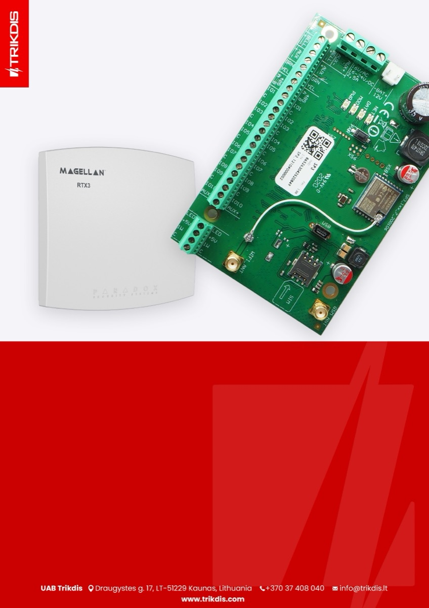

## Byte av centralapparatens firmware

Centralapparatens firmware måste bytas mot en firmware som gör att trådlösa Paradox-detektorer fungerar. Firmwarefilen kan laddas ned av registrerade användare från [www.trikdis.com](http://www.trikdis.com).

#### Kompatibilitetstabell för centralapparatens utförande och firmwareversion

| Centralapparatens utförande | Firmwareversion som är kompatibel med centralapparaten |
|:--:|:--:|
| 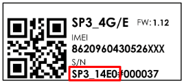 | SP3_1xx1_0112.fw |
| 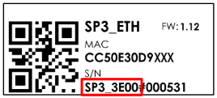 | SP3_3xx1_0112.fw |
| 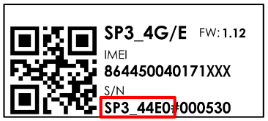 | SP3_4xx1_0112.fw |
| 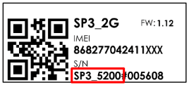 | SP3_5xx1_0112.fw |

Byt firmware så här:

1.  Starta ***TrikdisConfig**.*

2.  Anslut ”FLEXi” SP3 till en dator med en USB-kabel (Mini-B).

3.  Öppna fönstret **”Firmware”** i TrikdisConfig.

4.  Klicka på knappen **”Open firmware”** och välj den firmwarefil som behövs.

5.  Klicka på knappen **Update [F12]**.

6.  Vänta tills uppdateringen är klar.

7.  Klicka på knappen **”Disconnect”** och koppla bort USB-kabeln.

Anslut ledningarna från huvudmatningen till centralapparatens plintar AC/DC. Anslut modulen *RTX3* till centralapparaten.

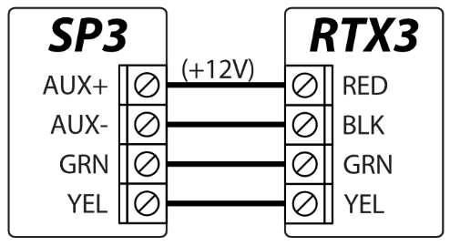

Sätt i ett aktiverat SIM-kort i SIM-kortshållaren. Slå på huvudmatningen. Vänta några minuter. Anslut till centralapparaten ”FLEXi” SP3 på distans med TrikdisConfig. I statusfältet i TrikdisConfig visas information om den installerade firmwareversionen (1). I fönstret **”Modules” / ”Keypads”** finns modulen RTX3 (2), som är ansluten till centralapparaten, i tabellen.

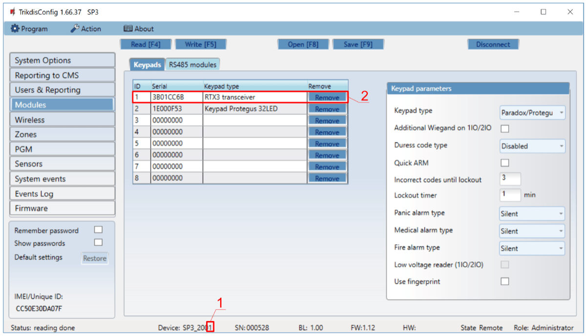

När modulen RTX3 är ansluten kan centralapparaten ”FLEXi” SP3 arbeta med trådlösa enheter från Paradox (magnetkontakter, rörelsedetektorer, glaskrossdetektor (G550), rökdetektor (SD360), fjärrkontroller (REM2, REM25), sirener (SR230, SR250), knappsatser (K37), utbyggnadsmodul (2 WPGM), repeater (RPT1)).

## Lära in en trådlös detektor

1.  Kontrollera att radiomottagaren **RTX3** för trådlösa detektorer har lärts in i ”FLEXi” SP3.

2.  Slå på matningen till centralapparaten. Sätt i batterierna i den trådlösa detektorn och vänta tills lysdioderna slutar blinka.

3.  Anslut till centralapparaten ”FLEXi” SP3 på distans med TrikdisConfig.

4.  Klicka på knappen **”Learn sensors”** i fönstret **”Wireless”** i TrikdisConfig.

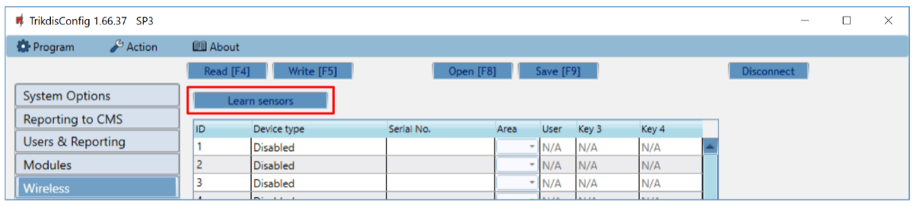

5.  Välj enhetstyp: **”Sensors”**.

6.  Tryck på knappen **”Start”**.

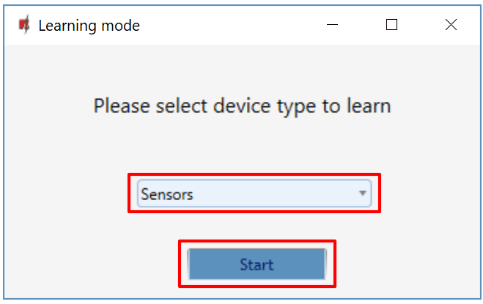

7.  Tryck på detektorns sabotagekontakt (**”Tamper”**).

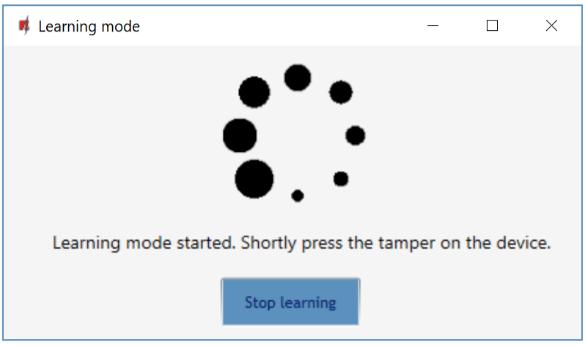

8.  Vänta några sekunder. Centralapparaten hittar detektorn.

9.  Numret **”UID”** måste stämma överens med detektorns serienummer, som finns på etiketten på detektorns kretskort.

10. Detektorn måste tilldelas ett **”Zone Number”** (sektionsnummer) och en **”Zone definition”** (sektionstyp).

11. Klicka på **”Save”**.

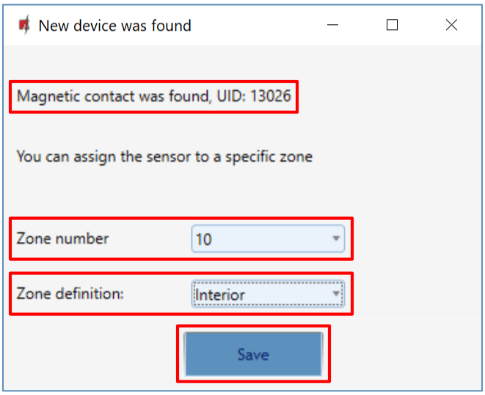

12. Den trådlösa detektorn läggs till i listan över trådlösa enheter.

13. Numret **”UID”** måste stämma överens med detektorns serienummer, som finns på etiketten på detektorns kretskort.

14. Klicka på **”Stop learning”** för att slutföra registreringen av trådlösa detektorer.

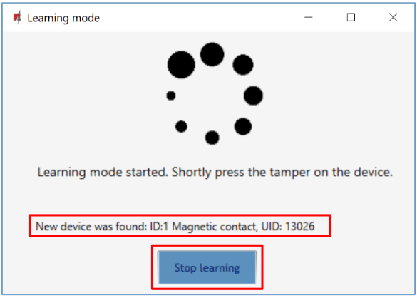

15. Klicka på **”Yes”** så att detektorn skrivs till centralapparaten ”FLEXi” SP3.

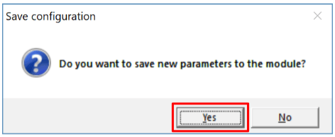

16. En ny trådlös detektor läggs till i listan över enheter i fönstret **”Wireless”**.

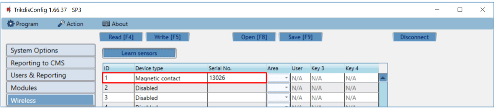

17. Du måste tilldela detektorerna **”Zones”** (sektioner) och **”Area”** (område) i centralapparaten (fönstret **”Zones”**).

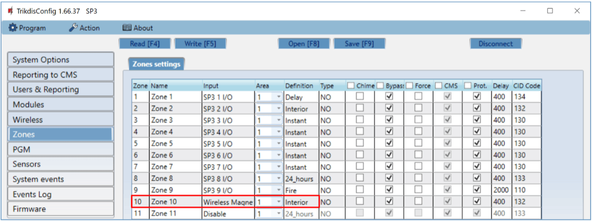

18. Klicka på **Write [F5]** när du har gjort ändringarna.

19. Den trådlösa detektorn är nu inlärd i systemet.

!!! note "Obs!"
    Så här tar du bort trådlösa detektorer ur minnet i ”FLEXi” SP3:

    1.  Anslut en USB-kabel (Mini-B) till ”FLEXi” SP3.

    2.  Starta TrikdisConfig och klicka på knappen **Read [F4]**.

    3.  I fönstret **”Wireless”** i TrikdisConfig väljer du **”Disabled”** i kolumnen
        **”Device type”** i stället för **”Wireless
        sensor”** på den detektor du vill ta bort, och klickar på **Write [F5]**. Den
        trådlösa detektorn är nu borttagen ur minnet i ”FLEXi” SP3.
## Lära in en trådlös fjärrkontroll

1.  Kontrollera att radiomottagaren **RTX3** för trådlösa detektorer har lärts in i ”FLEXi” SP3.

2.  Slå på matningen till centralapparaten.

3.  Anslut till centralapparaten ”FLEXi” SP3 på distans med TrikdisConfig.

4.  Klicka på knappen **”Learn sensors”** i fönstret **”Wireless”** i TrikdisConfig.
5.  Välj enhetstyp: **”Pendants”**.

6.  Tryck på knappen **”Start”**.

7.  Håll valfri knapp på fjärrkontrollen nedtryckt tills lysdioden på fjärrkontrollen tänds. Släpp knappen.

8.  Vänta några sekunder. Centralapparaten hittar fjärrkontrollen.

9.  Numret **”UID”** måste stämma överens med fjärrkontrollens serienummer, som finns på etiketten på fjärrkontrollens baksida.

10. Ange i fältet **”Partition”** vilket område i säkerhetssystemet som fjärrkontrollen ska styra (tillkoppla/frånkoppla).

11. Ange i fältet **”User”** numret på den användare som fjärrkontrollen ska tilldelas.

12. Klicka på **”Save”**.

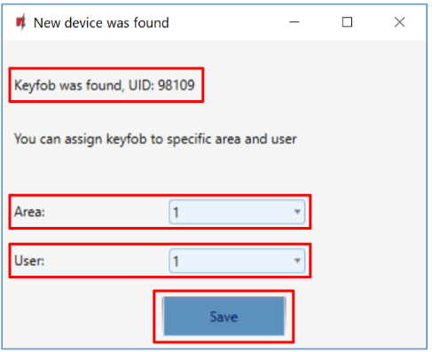

13. Den trådlösa fjärrkontrollen läggs till i listan över enheter.

14. Numret **”UID”** måste stämma överens med fjärrkontrollens serienummer, som finns på fjärrkontrollens baksida.

15. Klicka på **”Stop learning”** för att slutföra registreringen av den trådlösa fjärrkontrollen.

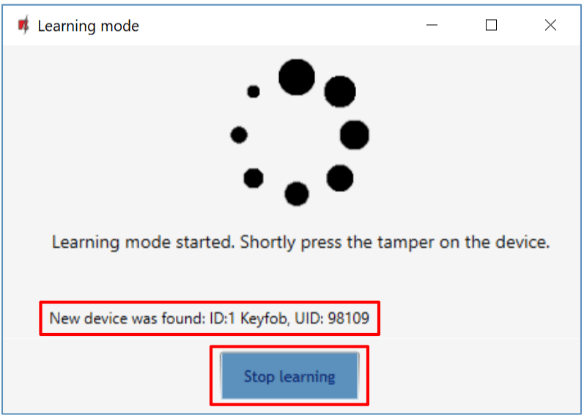

16. Klicka på **”Yes”** så att fjärrkontrollen skrivs till centralapparaten ”FLEXi” SP3.

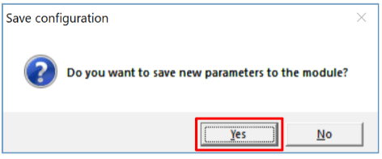

17. Den trådlösa fjärrkontrollen har lagts till i listan över enheter i fönstret **”Wireless”**.
18. Du kan tilldela fjärrkontrollens knappar 3 och 4 ytterligare funktioner (tillkoppla/frånkoppla, tyst larm, överfallslarm, PGM-styrning).

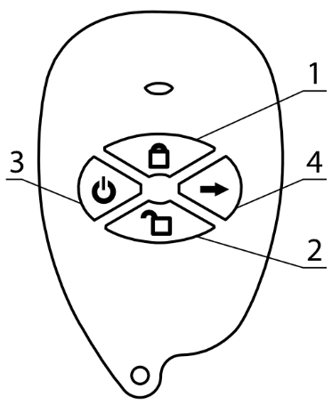

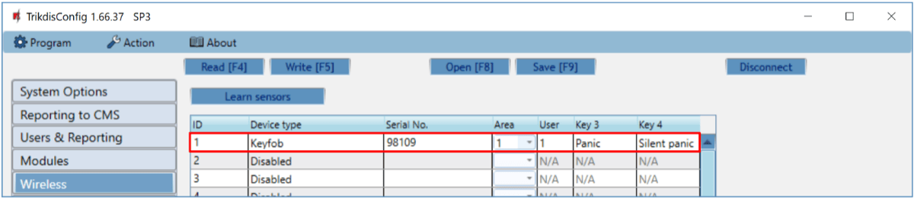

19. Klicka på **Write [F5]** när du har gjort ändringarna.

20. Den trådlösa fjärrkontrollen är nu inlärd i systemet.

!!! note "Obs!"
    Så här tar du bort en trådlös fjärrkontroll ur minnet i ”FLEXi” SP3:

    1.  Anslut en USB-kabel (Mini-B) till ”FLEXi” SP3.

    2.  Starta TrikdisConfig och klicka på knappen **Read [F4]**.

    3.  I fönstret **”Wireless”** i TrikdisConfig väljer du **”Disabled”** i kolumnen
        **”Device type”** i stället för **”Keyfob”**
        på den fjärrkontroll du vill ta bort, och klickar på **Write [F5]**. Fjärrkontrollen
        är nu borttagen ur minnet i ”FLEXi” SP3.
## Lära in en trådlös siren

1.  Kontrollera att radiomottagaren **RTX3** för trådlösa detektorer har lärts in i ”FLEXi” SP3.

2.  Slå på matningen till centralapparaten. Sätt i batterierna i den trådlösa sirenen.

3.  Anslut till centralapparaten ”FLEXi” SP3 på distans med TrikdisConfig.

4.  Klicka på knappen **”Learn sensors”** i fönstret **”Wireless”** i TrikdisConfig.
5.  Välj enhetstyp: **”Sirens”**.

6.  Tryck på knappen **”Start”**.

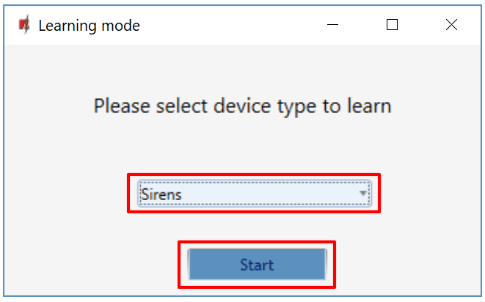

7.  Håll knappen **”LEARN”** på sirenens kretskort nedtryckt i 3 sekunder. Lysdioden på sirenen börjar blinka. Släpp knappen.

8.  Vänta några sekunder. Centralapparaten hittar sirenen.

9.  Numret **”UID”** måste stämma överens med sirenens serienummer, som finns på etiketten på sirenens kretskort.

10. Ange i fältet **”Area”** den sektion i säkerhetssystemet vars påverkan ska få sirenen att larma.

11. Klicka på **”Save”**.

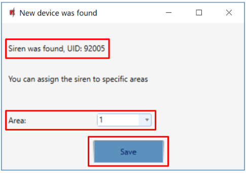

12. Den trådlösa sirenen läggs till i listan över trådlösa enheter.

13. Numret **”UID”** måste stämma överens med sirenens serienummer, som finns på etiketten på sirenens kretskort.

14. Klicka på **”Stop learning”** för att slutföra registreringen av den trådlösa sirenen.

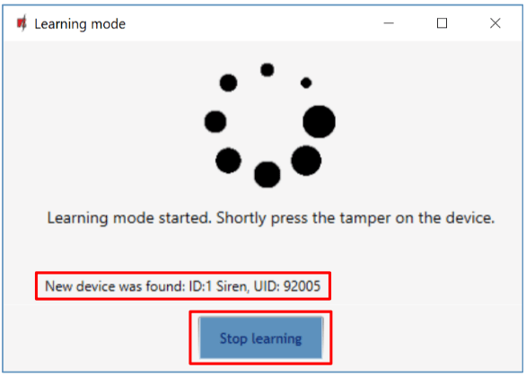

15. Klicka på **Yes** så att sirenen skrivs till centralapparaten ”FLEXi” SP3.

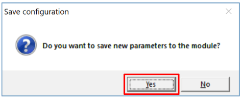

16. Den trådlösa sirenen har lagts till i listan över enheter i fönstret **”Wireless”**.

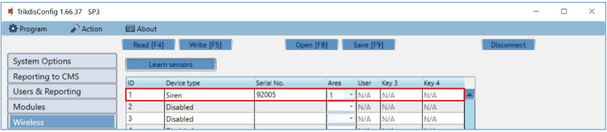

17. Klicka på **Write [F5]** när du har gjort ändringarna.

18. Den trådlösa sirenen är nu inlärd i systemet.

!!! note "Obs!"
    Så här tar du bort en trådlös siren ur minnet i ”FLEXi” SP3:

    1.  Anslut en USB-kabel (Mini-B) till ”FLEXi” SP3.

    2.  Starta TrikdisConfig och klicka på knappen **Read [F4]**.

    3.  I fönstret **”Wireless”** i TrikdisConfig väljer du **”Disabled”** i kolumnen
        **”Device type”** i stället för **”Siren”**
        på den siren du vill ta bort, och klickar på **Write [F5]**. Den trådlösa
        sirenen är nu borttagen ur minnet i ”FLEXi” SP3.
## Lära in en trådlös knappsats

1.  Kontrollera att radiomottagaren **RTX3** för trådlösa detektorer har lärts in i ”FLEXi” SP3.

2.  Slå på matningen till centralapparaten. Sätt i batterierna i den trådlösa knappsatsen.

3.  Anslut till centralapparaten ”FLEXi” SP3 på distans med TrikdisConfig.

4.  Klicka på knappen **”Learn sensors”** i fönstret **”Wireless”** i TrikdisConfig.
5.  Välj enhetstyp: **”Keypads”**.

6.  Tryck på knappen **”Start”**.

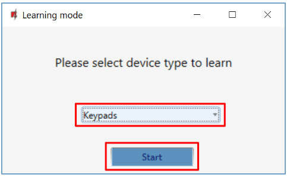

7.  Håll knapparna **[**  **]** och **[BYP]** på knappsatsen nedtryckta samtidigt i 3 sekunder. Knappsatsen piper flera gånger. Släpp knapparna.

8.  Vänta några sekunder. Centralapparaten hittar knappsatsen.

9.  UID-numret måste stämma överens med knappsatsens serienummer, som finns på etiketten på baksidan av knappsatsens kapsling.

10. Ange i fältet **Area** vilket område i säkerhetssystemet som knappsatsen ska styra.

11. Klicka på **Save**.

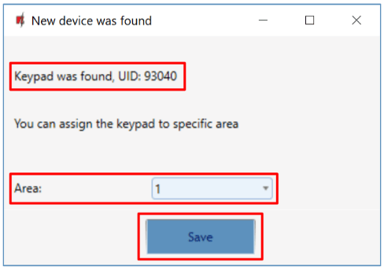

12. Den trådlösa knappsatsen läggs till i listan över trådlösa enheter.

13. Numret **”UID”** måste stämma överens med knappsatsens serienummer, som finns på baksidan av knappsatsens kapsling.

14. Klicka på **”Stop learning”** för att slutföra registreringen av den trådlösa knappsatsen.

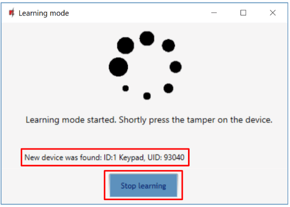

15. Klicka på **”Yes”** så att knappsatsen skrivs till centralapparaten ”FLEXi” SP3.

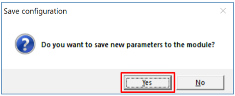

16. Den trådlösa knappsatsen har lagts till i listan över enheter i fönstret **”Wireless”**.

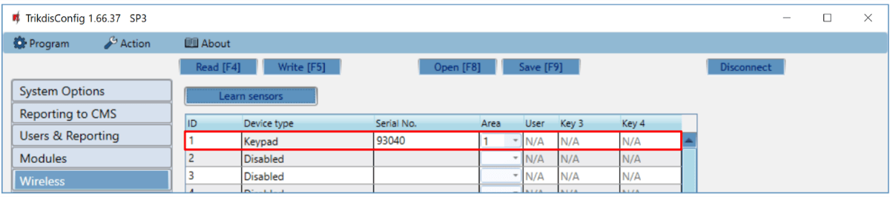

17. Klicka på **Write [F5]** när du har gjort ändringarna.

18. Den trådlösa knappsatsen är nu inlärd i systemet.

!!! note "Obs!"
    Så här tar du bort en trådlös knappsats ur minnet i ”FLEXi” SP3:

    1.  Anslut en USB-kabel (Mini-B) till ”FLEXi” SP3.

    2.  Starta TrikdisConfig och klicka på knappen **Read [F4]**.

    3.  I fönstret **”Wireless”** i TrikdisConfig väljer du **”Disabled”** i kolumnen
        **”Device type”** i stället för **”Keypad”**
        på den knappsats du vill ta bort, och klickar på **Write [F5]**. Knappsatsen
        är nu borttagen ur minnet i ”FLEXi” SP3.
## Lära in en trådlös tvåvägs-PGM 2WPGM

1.  Kontrollera att radiomottagaren **RTX3** för trådlösa detektorer har lärts in i ”FLEXi” SP3.

2.  Slå på matningen till centralapparaten. Slå på matningen till modulen 2WPGM.

3.  Anslut till centralapparaten ”FLEXi” SP3 på distans med TrikdisConfig.

4.  Klicka på knappen **”Learn sensors”** i fönstret **”Wireless”** i TrikdisConfig.
5.  Välj enhetstyp: **”PGM device”**.

6.  Tryck på knappen **”Start”**.

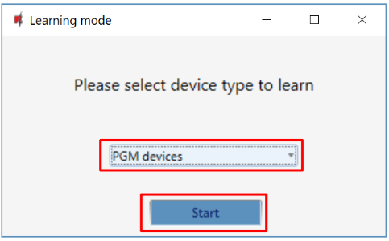

7.  Ta bort bygeln JP2 på modulen 2WPGM och sätt tillbaka den efter några sekunder.

8.  Vänta några sekunder. Centralapparaten hittar modulen.

9.  Numret **”UID”** måste stämma överens med modulens serienummer, som finns på etiketten på modulens kretskort.

10. Ange i fältet **”Select output”** numret på den PGM-utgång som du vill tilldela modulen.

11. Klicka på **”Save”**.

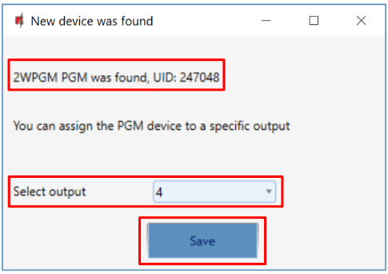

12. Den trådlösa modulen 2WPGM läggs till i listan över trådlösa enheter.

13. Numret **”UID”** måste stämma överens med 2WPGM:s serienummer, som finns på etiketten på modulens kretskort.

14. Klicka på **”Stop learning”** för att slutföra registreringen av den trådlösa modulen 2WPGM.

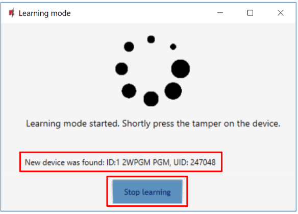

15. Klicka på **”Yes”** så att den trådlösa modulen 2WPGM skrivs till centralapparaten ”FLEXi” SP3.

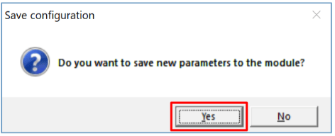

16. Den trådlösa modulen 2WPGM har lagts till i listan över enheter i fönstret **”Wireless”**.

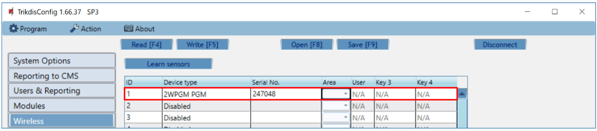

17. PGM-utgången kan döpas om.

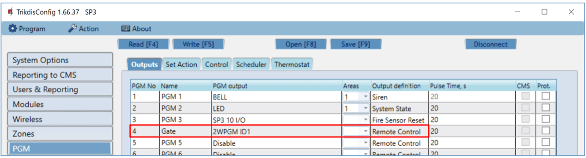

18. Klicka på **Write [F5]** när du har gjort ändringarna.

19. Den trådlösa modulen 2WPGM är nu inlärd i systemet.

!!! note "Obs!"
    Så här tar du bort den trådlösa modulen 2WPGM ur minnet i ”FLEXi” SP3:

    1.  Anslut en USB-kabel (Mini-B) till ”FLEXi” SP3.

    2.  Starta TrikdisConfig och klicka på knappen **Read [F4]**.

    3.  I fönstret **”Wireless”** i TrikdisConfig väljer du **”Disabled”** i kolumnen
        **”Device type”** i stället för 2WPGM
        på den modul du vill ta bort, och klickar på **Write [F5]**. 2WPGM
        är nu borttagen ur minnet i ”FLEXi” SP3.
## Lära in en trådlös repeater RPT1

1.  Kontrollera att radiomottagaren **RTX3** för trådlösa detektorer har lärts in i ”FLEXi” SP3.

2.  Slå på matningen till centralapparaten. Slå på matningen till modulen RPT1.

3.  Anslut till centralapparaten ”FLEXi” SP3 på distans med TrikdisConfig.

4.  Klicka på knappen **”Learn sensors”** i fönstret **”Wireless”** i TrikdisConfig.
5.  Välj enhetstyp: **”Repeater”**.

6.  Tryck på knappen **”Start”**.

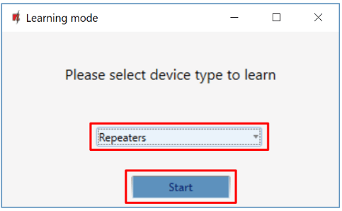

7.  Tryck på knappen **”LEARN”** på repeatern RPT1.

8.  Vänta några sekunder. Centralapparaten hittar repeatern RPT1.

9.  Numret **”UID”** måste stämma överens med repeaterns serienummer, som finns på etiketten på repeaterns kretskort.

10. Klicka på **”Stop learning”** för att slutföra registreringen av trådlösa repeatrar.

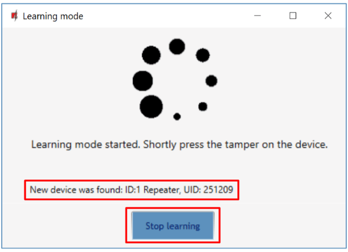

11. Klicka på **”Yes”** så att den trådlösa repeatern RPT1 skrivs till centralapparaten ”FLEXi” SP3.

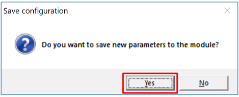

12. Den trådlösa repeatern RPT1 har lagts till i listan över enheter i fönstret **”Wireless”**.

13. Klicka på **Write [F5]** när du har gjort ändringarna.

14. Den trådlösa repeatern RPT1 är nu inlärd i systemet.

!!! note "Obs!"
    Så här tar du bort den trådlösa repeatern RPT1 ur minnet i ”FLEXi” SP3:

    1.  Anslut en USB-kabel (Mini-B) till ”FLEXi” SP3.

    2.  Starta TrikdisConfig och klicka på knappen **Read [F4]**.

    3.  I fönstret **”Wireless”** i TrikdisConfig väljer du **”Disabled”** i kolumnen
        **”Device type”** i stället för
        **”Repeater”** på den repeater du vill ta bort, och klickar på **Write [F5]**.
        Repeatern RPT1 är nu borttagen ur minnet i ”FLEXi” SP3.
