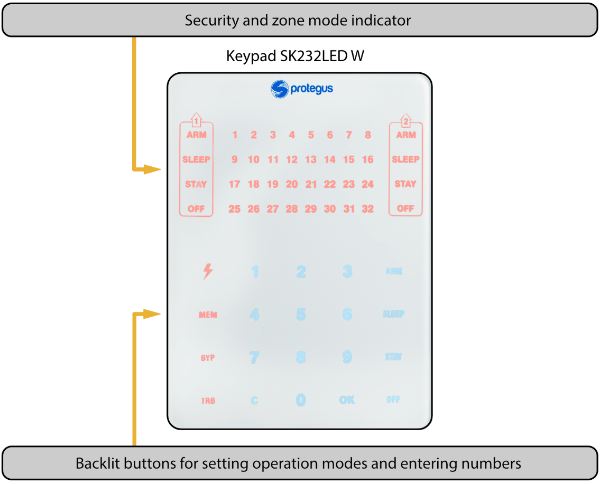
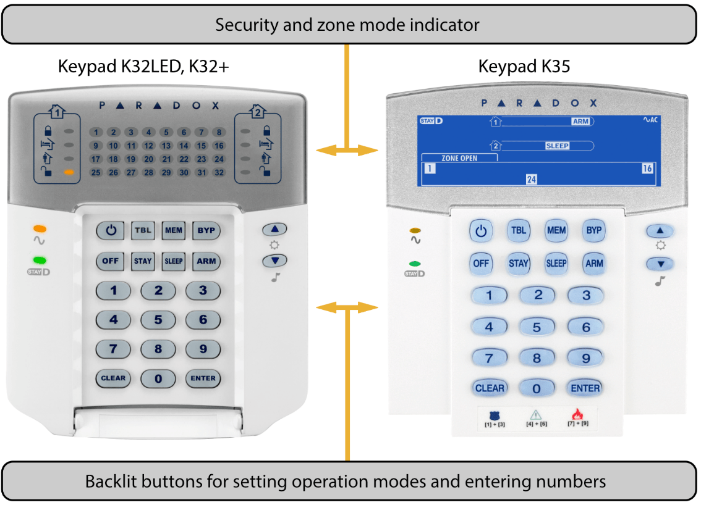

# FLEXi SP3 – användarguide för Protegus- och Paradox-knappsatser

#### **Beskrivning**

### OFF (frånkopplat)

I det här läget är bara en del av sektionerna skyddade. Larmet reagerar bara på händelser i sektioner som är inställda på **Fire**, **24 hour** och **Silent 24h.**

### ARM

I det här läget är alla sektioner skyddade. Larmet reagerar på alla möjliga händelser.

### STAY

I det här läget är en del av sektionerna skyddade, men rörelse är tillåten i sektioner som är inställda på **Interior STAY** och **Instant STAY**. Om larmsystemet är i det här läget och en sektion av typen **Delay** påverkas, utlöses larmet först när inpasseringstiden har gått.

### SLEEP

I det här läget är en del av sektionerna skyddade, men rörelse är tillåten i sektioner som är inställda på **Interior STAY** och **Instant STAY**. Om larmsystemet är i det här läget och en sektion av typen **Delay** påverkas, utlöses larmet omedelbart.

### Styrning av larmsystemet

Larmsystemet kan styras med följande enheter:

- *Trikdis*-knappsatsen Protegus SK232LED W;

- *Paradox*-knappsatserna K32+, K32LED, K636, K10LED V/H, K35, TM50, TM70;

- *Crow*-knappsatserna CR-16, CR-LCD;

- *iButton*-nycklar;

- *RFID*-brickor;

- elektrisk brytare, genom att ändra tillståndet för den sektion som är vald som nyckelbrytarsektion;

- telefon (med ett telefonsamtal eller ett SMS med visst innehåll);

- Protegus-appen;

- fjärrkommando från larmcentralen.

### Åtkomst till styrning

Med styrkoder får olika användare olika behörighet att styra larmsystemet. Användarnas styrkoder har fyra siffror. När du väljer och anger styrkoder används bara siffrorna 0–9. Andra tecken kan inte användas.

Typer av styrkoder för larmsystemet:

- Administratörskod – sex siffror (förvald kod: 123456). Det finns bara en administratörskod. Den kan inte raderas, men den kan ändras. Med administratörskoden kan du lägga till och radera andra användares styrkoder. Administratörskoden kan inte tillkoppla eller frånkoppla larmsystemet;

- Användarkod – fyra siffror för att tillkoppla och frånkoppla larmsystemet och för att tillfälligt förbikoppla sektioner. Vi rekommenderar att varje användare får en egen styrkod. Modulen FLEXi SP3 kan lagra upp till 40 användarkoder;

- SMS-lösenord – sex siffror för att styra larmsystemet med SMS (förvald kod: 123456).

### Säkerhetsfunktioner

### **Namn**

#### **Beskrivning**

### Bypass

Förbikopplar en sektion tillfälligt (under en tillkoppling av larmsystemet) när larmstatusen ändras. Funktionen används när larmet behöver tillkopplas men en sektion fungerar felaktigt och felet inte går att åtgärda direkt.

### Bell Squawk

Modulen kan varna för att larmsystemet i lokalen tillkopplas och frånkopplas med en kort sirensignal.

### Chime

När larmet är frånkopplat kan modulen varna för att en sektion påverkas genom att slå på knappsatsens summer och/eller en särskilt programmerad PGM-utgång.

### Re-ARM

Skyddar mot att larmet frånkopplas av misstag. Om larmet har frånkopplats med ett telefonsamtal men sektionen av typen **Delay** inte påverkades, återgår larmet automatiskt till det tidigare skyddsläget när inpasseringstiden har gått.

### Ytterligare funktioner

| **Namn** | **Beskrivning** |
|:---|----|
| Temperaturmätning | Till modulen ***FLEXi* *SP3*** kan du ansluta upp till 8 temperaturgivare av typen DS18B20 eller DS18S20, eller en temperatur- och fuktgivare AM2301. För varje givare kan du ställa in ett tillåtet temperaturintervall. Om temperaturen hamnar utanför intervallet skapas ett händelsemeddelande som skickas till användarna. |
| Fjärrstyrning av enheter | Du kan ansluta ytterligare elektroniska enheter till säkerhetsmodulens ***FLEXi* *SP3*** programmerbara utgångar med öppen kollektor och styra dem på distans. |

## Styra larmet

### Styra larmet med en SK232LED W-knappsats

Trikdis-knappsatsen SK232LED W för styrning av larmsystemet visar status för 32 sektioner och 2 områden.

#### Knappar för att välja driftläge och ange siffror

| **Knapp** | **Beskrivning** |
|:---|----|
|  | Lyser knappen med fast sken drivs larmsystemet från elnätet, och blinkar knappen finns det ett batterifel. Är knappen släckt är nätspänningen bruten eller så drivs systemet från batteriet. Knappen används också för att ändra styrkoder och för att återställa branddetektorer. |
| MEM | Lyser knappen med fast sken finns det ny information i minnet om att ett larm har utlösts, och blinkar knappen är knappsatsen i läget MEM. Knappen används också för att välja läget för visning av minnet. |
| BYP | Lyser knappen med fast sken finns det tillfälligt förbikopplade sektioner, och blinkar knappen är knappsatsen i läget BYP. Knappen används också för att välja läget för tillfällig förbikoppling. |
| TRB | Lyser knappen med fast sken har ett driftfel registrerats, och blinkar knappen är knappsatsen i läget TBL. Knappen används också för att välja läget för visning av fel. |
| 1, 2 ...9, 0 | Knappar för att ange siffror. |
| C | Knapp för att lämna lägen och radera värden. |
| OK | Knapp för att bekräfta det angivna valet. |
| ARM | Knapp för att slå på det fulla skyddsläget **ARM**. |
| SLEEP | Knapp för att slå på läget **SLEEP**. |
| STAY | Knapp för att slå på läget **STAY**. |
| OFF | Knapp för att slå på läget **OFF** (frånkopplat). |

> [!NOTE]
>     1. Tryck på knappen **C** om du vill lämna programmeringsläget eller radera ett felaktigt angivet värde.

2. Om minst en sektion är påverkad går det inte att tillkoppla larmsystemet (såvida inte egenskapen **FORCE** är tilldelad de påverkade sektionerna).
### Styra larmet med en Paradox-knappsats

Paradox-knappsatsen K10LED V/H för styrning av larmsystemet visar status för 10 sektioner och 2 områden.

Paradox-knappsatsen K636 för styrning av larmsystemet visar status för 10 sektioner och 1 område.

Paradox-knappsatserna K32LED, K32+ och K35 för styrning av larmsystemet visar status för 32 sektioner och 2 områden.

#### Knappar för att välja driftläge och ange siffror

| **Knapp** | **Beskrivning** |
|----|----|
|  | Knapp för att återställa branddetektorer. |
| MEM | Lyser knappen med fast sken finns det ny information i minnet om att ett larm har utlösts, och blinkar knappen är knappsatsen i läget MEM. Knappen används också för att välja läget för visning av minnet. |
| BYP | Lyser knappen med fast sken finns det tillfälligt förbikopplade sektioner, och blinkar knappen är knappsatsen i läget BYP. Knappen används också för att välja läget för tillfällig förbikoppling. |
| TBL | Lyser knappen med fast sken har ett driftfel registrerats, och blinkar knappen är knappsatsen i läget TBL. Knappen används också för att välja läget för visning av fel. |
| 1, 2 ...9, 0 | Knappar för att ange siffror. |
| CLEAR | Knapp för att lämna lägen och radera värden. |
| ENTER | Knapp för att bekräfta det angivna valet. |
| ARM | Knapp för att slå på det fulla skyddsläget **ARM**. |
| SLEEP | Knapp för att slå på läget **SLEEP**. |
| STAY | Knapp för att slå på läget **STAY**. |
| OFF | Knapp för att slå på läget **OFF** (frånkopplat). |
|  | Indikering för nätspänning. Fast sken: nätspänningen är påslagen. Blinkar: batterifel. Släckt: nätspänningen är bruten eller så drivs systemet från batteriet. |

> [!NOTE]
>     1. Tryck på knappen **CLEAR** om du vill lämna programmeringsläget eller radera ett felaktigt angivet värde.

2. Om minst en sektion är påverkad går det inte att tillkoppla larmsystemet (såvida inte egenskapen **FORCE** är tilldelad de påverkade sektionerna).
## Snabb tillkoppling och frånkoppling av larmsystemet

Tillkoppla eller frånkoppla larmsystemet med en kod när säkerhetssystemet har **STAY**-sektioner.

Skyddslägena **ARM**, **STAY** och **SLEEP** växlas till **OFF** (frånkopplat), och **OFF** växlas till **ARM** eller **STAY**.

Så ändrar du skyddsläget:

1. Ange **användarkoden**.

1. Om systemet bara har ett område hoppar du över steg 2. Om systemet har fler än ett område lyser numren på de områden som användaren får ändra läget för på knappsatsen.

2. Tryck på siffrorna för de områden du väljer.

3. Områden som var i läget **ARM**, **STAY** eller **SLEEP** växlar till läget **OFF** (frånkopplat).

1. När larmet är frånkopplat lyser indikeringen **OFF**.

2. Om funktionen **Bell Squawk** är aktiverad ger sirenen två korta signaler när larmet frånkopplas.

4. Utpasseringstiden räknas ned för områden som var i läget **OFF** (frånkopplat). Om en sektion av typen **Delay** påverkas under nedräkningen slås läget **ARM** på, och om ingen sektion av typen **Delay** påverkas slås läget **STAY** på.

1. Motsvarande indikering på knappsatsen (**ARM** eller **STAY**) tänds.

2. Om funktionen **Bell Squawk** är aktiverad ger sirenen en kort signal när larmet tillkopplas.

### Tillkoppla larmet i läget ARM

Så slår du på skyddsläget **ARM** för ett larmsystem som är uppdelat i flera områden:

1. Tryck på knappen **ARM** på knappsatsen.

2. Ange **användarkoden** på knappsatsen.

3. Tryck på knapparna med numren på de områden du vill styra.

4. Bekräfta valet genom att trycka på knappen **OK** (eller **ENTER**).

5. Lämna lokalen och stäng dörren innan utpasseringstiden har gått.

1. Under nedräkningen av utpasseringstiden blinkar indikeringen **ARM** på knappsatsen, och när larmet är tillkopplat lyser den med fast sken.

2. Om funktionen **Bell Squawk** är aktiverad ger sirenen en kort signal när larmet tillkopplas.

### Tillkoppla larmet i läget STAY

Så slår du på skyddsläget **STAY** för ett larmsystem som är uppdelat i flera områden:

1. Tryck på knappen **STAY** på knappsatsen.

2. Ange **användarkoden** på knappsatsen.

3. Tryck på knapparna med numren på de områden du vill styra.

4. Bekräfta valet genom att trycka på knappen **OK** (eller **ENTER**).

5. Indikeringen **STAY** på knappsatsen tänds.

1. Om funktionen **Bell Squawk** är aktiverad ger sirenen en kort signal när larmet tillkopplas.

> [!NOTE]
>     Läget **STAY** är inte tillgängligt om inte minst en sektion är inställd på **Interior STAY** eller **Instant STAY**.
### Tillkoppla larmet i läget SLEEP

Så slår du på skyddsläget **SLEEP** för ett larmsystem som är uppdelat i flera områden:

1. Tryck på knappen **SLEEP** på knappsatsen.

2. Ange **användarkoden** på knappsatsen.

3. Tryck på knapparna med numren på de områden du vill styra.

4. Bekräfta valet genom att trycka på knappen **OK** (eller **ENTER**).

5. Indikeringen **SLEEP** på knappsatsen börjar lysa.

1. Om funktionen **Bell Squawk** är aktiverad ger sirenen en kort signal när larmet tillkopplas.

## Frånkoppla larmet (läget OFF)

När lokalen är skyddad i läget **ARM** eller **STAY** startar nedräkningen av inpasseringstiden när någon går in i lokalen. Du måste frånkoppla larmet innan tiden har gått.

Så stänger du av skyddsläget (slår på läget **OFF**, frånkopplat):

1. Tryck på knappen **OFF** på knappsatsen.

2. Ange **användarkoden** på knappsatsen.

1. Om systemet bara har ett område hoppar du över steg 3 och 4.

3. Tryck på knapparna med numren på de områden du vill styra.

4. Bekräfta valet genom att trycka på knappen **OK** (eller **ENTER**).

1. När larmet är frånkopplat tänds indikeringen **OFF**.

2. Om funktionen **Bell Squawk** är aktiverad ger sirenen två korta signaler när larmet frånkopplas.

#### Stänga av larmet efter att det har utlösts

Så stänger du av larmet:

1. Ange **användarkoden**.

1. Om systemet bara har ett område hoppar du över steg 2 och 3.

2. Tryck på knapparna med numren på de områden du vill styra.

3. Bekräfta valet genom att trycka på knappen **OK** (eller **ENTER**).

1. När larmet är frånkopplat tänds indikeringen **OFF**.

2. Om funktionen **Bell Squawk** är aktiverad ger sirenen två korta signaler när larmet frånkopplas.

3. Indikeringen [**MEM]** tänds och de sektioner som har påverkats börjar blinka. Tryck på **MEM** och sedan på **C** (eller **CLEAR**) så slutar de påverkade sektionerna att blinka.

## Tillfällig förbikoppling av sektioner (funktionen Bypass)

Så slår du på funktionen **Bypass**:

1. Tryck på knappen **BYPASS** på knappsatsen.

2. Ange **användarkoden**.

1. Indikeringen **BYP** börjar blinka.

3. Ange de tvåsiffriga numren på de sektioner du vill förbikoppla.

4. Bekräfta valet genom att trycka på knappen **OK** (eller **ENTER**).

5. Indikeringen **BYP** börjar lysa med fast sken.

Upprepa samma steg om du vill stänga av funktionen **Bypass**.

### Visa och radera larmminnet

När larmet har utlösts börjar indikeringen **MEM** lysa. Så tar du reda på varför larmet utlöstes:

1. Tryck på knappen **MEM** på knappsatsen.

2. De tända siffrorna visar vilka sektioner som utlöste larmet.

3. Tryck på knappen **C** (eller **CLEAR**) när du vill lämna det här läget.

1. Om du inte gör något på knappsatsen stängs läget för visning av minnet av automatiskt efter en minut, men minnet raderas inte och indikeringen **MEM** fortsätter att lysa.

4. Minnet raderas när larmet har tillkopplats och indikeringen **MEM** har slutat lysa.

### Återställa branddetektorer (rökdetektorer)

När branddetektorer (rökdetektorer) har utlösts återställer du dem så här:

1. Håll knappen  (eller ) nedtryckt i 3 sekunder.

1. PGM-utgången som branddetektorerna är anslutna till och som är inställd på funktionen **Fire sensor reset** slås på.

2. De branddetektorer (rökdetektorer) som är anslutna till centralapparatens sektion återställs.

### Nödlarmsknappar

Med knappsatsen kan du skicka meddelanden till larmbolaget om att du behöver hjälp eller att fara är nära förestående. Funktionen finns bara om du använder ett larmbolags tjänster och larmsystemet är anslutet till larmcentralen.

Håll följande knappar nedtryckta samtidigt i 3 sekunder:

- **1** **3** för att skicka meddelandet **Panic** om att fara är nära förestående.

- **4** **6** för att skicka meddelandet **Medical** om att du behöver medicinsk hjälp.

- **7** **9** för att skicka meddelandet **Fire**.

### Felsöka larmsystemet

Om det finns något driftfel tänds indikeringen **TRB** på knappsatsen. Så visar du larmsystemets driftfel:

1. Tryck på knappen **TRB**.

2. Felgrupperna tänds på knappsatsen.

3. Om du vill visa en felgrupp trycker du på motsvarande knapp.

4. Tryck på knappen **C** (eller **CLEAR**) när du vill lämna felsökningsläget.

#### Beskrivning av fel

| Felgrupp | Beskrivning av vald grupp |
|---------------|-------------------------------|
| 1: System | 1 Ingen nätspänning. |
| 1: System | 2 Batterifel. |
| 1: System | 3 Klockan är inte inställd. |
| 1: System | 4 Max tillåten ström för utgången AUX har överskridits. |
| 1: System | 5 Max tillåten ström för sirenutgången har överskridits. |
| 1: System | 6 Ingen siren. |
| 1: System | 7 Fel på branddetektorslingan. |
| 2: Communications | 1 Fel på den huvudsakliga kommunikationskanalen (alla anslutningstyper). |
| 2: Communications | 2 Fel på den andra kommunikationskanalen (alla anslutningstyper). |
| 2: Communications | 3 Fel på kommunikationskanalen till Protegus (alla anslutningstyper). |
| 2: Communications | 4 Inget SIM-kort. |
| 2: Communications | 5 Felaktig PIN-kod till SIM-kortet. |
| 2: Communications | 6 Det går inte att ansluta till mobilnätet. |
| 2: Communications | 7 Det går inte att ansluta till WiFi-nätverket. |
| 2: Communications | 8 Kommunikationsfel i modulen E485 (se modulens lysdiodsindikering). |
| 3: Zone tamper | Numren på de sektioner där sabotagekontakten har påverkats. |
| 4: 485 bus | Numren på de utbyggnadsmoduler på 485-bussen som har fel. |
| 5: Missing RF sensor | En trådlös detektor fungerar inte längre (tiden för den periodiska kontrollen har gått). Sektionsnumret visar ordningen från en separat RF-tabell. |
| 6: RF battery low | En trådlös detektor har meddelat att dess batteri snart är slut. Detektorns nummer finns i en separat RF-tabell. |
| 7: Anti-masking | Numren på de sektioner där maskningsskyddet har påverkats. |

### Programmera användarkoder

#### Ändra administratörskoden

**Administratörskoden** kan ändras i programmet TrikdisConfig, i menygrenen **System Options / Access / Access codes**.

#### Ange nya användarkoder

1. Tryck på knappen  (eller ) på knappsatsen.

2. Ange den sexsiffriga **administratörskoden**.

1. Knappen  (eller ) börjar blinka.

3. Ange ett ledigt tvåsiffrigt löpnummer för användaren.

4. Ange en fyrsiffrig **användarkod**.

5. Ange den fyrsiffriga **användarkoden** en gång till.

6. Ange de områden som användaren ska kunna styra.

7. Bekräfta valet genom att trycka på knappen **OK** (eller **ENTER**).

8. Tryck på knappen **C** (eller **CLEAR**) när du vill lämna programmeringsläget.

#### Ändra användarkoder

1. Tryck på knappen  (eller ) på knappsatsen.

2. Ange den sexsiffriga **administratörskoden**.

1. Knappen  (eller ) börjar blinka.

3. Ange användarens tvåsiffriga löpnummer.

4. Ange den fyrsiffriga **användarkoden**.

5. Ange den fyrsiffriga **användarkoden** en gång till.

6. Ange de områden som användaren ska kunna styra.

7. Bekräfta valet genom att trycka på knappen **OK** (eller **ENTER**).

8. Tryck på knappen **C** (eller **CLEAR**) när du vill lämna programmeringsläget.

#### Visa områdenas status

Visa status för de aktuella områdena.

## Användarkodsfunktioner på Paradox-knappsatser

### Tryck på knapparna 1 och 2 samtidigt i 3 sekunder, knappsatsen ska ge ett pip

### Håll knapp 2 nedtryckt i 3 sekunder, knappsatsen ska ge ett pip
Lysdioderna numrerade 1–8 visar områdenas status. Lyser: läget **Arm** är påslaget. Blinkar: läget **Stay** är påslaget. Släckt: **Disarm** eller av.

#### Radera användarkoder

Så raderar du befintliga användarkoder:

1. Tryck på knappen (eller ) på knappsatsen.

2. Ange den sexsiffriga **administratörskoden**.

1. Knappen  (eller ) börjar blinka.

3. Ange användarens tvåsiffriga löpnummer.

4. Tryck på knappen **SLEEP**.

5. Tryck på knappen **C** (eller **CLEAR**) när du vill lämna programmeringsläget.

#### Tvångskod

Om du tvingas att tillkoppla eller frånkoppla larmsystemet kan du ange din användarkod med tvångsalternativet aktiverat. Systemet tillkopplar eller frånkopplar då larmsystemet och skickar omedelbart ett tyst larm (tvångskod) till larmcentralen. Tvångskoden måste aktiveras av installatören. Det finns två typer av tvångskoder: **Higher last digit** (sista siffran är högre) eller **”0” instead of the first digit** (”0” i stället för första siffran).

## Styra med iButton-nycklar

> [!NOTE]
>     Om minst en sektion är påverkad går det inte att tillkoppla larmsystemet.
iButton-nycklar kan användas för att ställa in larmsystemets skyddslägen **ARM** / **STAY** / **OFF**. Skyddsläget **SLEEP** är inte tillgängligt.

Håll iButton-nyckeln mot nyckelläsaren. Larmsystemets läge ändras till det motsatta läget. Var systemet tillkopplat frånkopplas det. Var systemet frånkopplat tillkopplas det och nedräkningen av utpasseringstiden startar. Om sektionen av typen **Delay** inte påverkas under utpasseringstiden och det finns sektioner av typen **Interior STAY** och **Instant STAY**, slås skyddsläget **STAY** på.

Du kan radera befintliga nycklar och lägga till nya i ett installerat larmsystem som är i drift med hjälp av konfigurationsprogrammet TrikdisConfig eller en kontaktnyckelläsare**.**

Lära in nycklar med läsaren CZ-Dallas.

1. Om listan **Tag code** är tom håller du kontaktnyckeln mot läsarens ”öga” i 3 sekunder. Nyckeln läggs in på första raden i listan och blir **Master key**.

2. Slå på inlärningsläget för kontaktnycklar genom att hålla **Master key** mot nyckelläsarens ”öga” i minst 10 sekunder.

3. Lär in användarnas nycklar genom att hålla dem mot nyckelläsarens ”öga” en i taget.

4. När du har lärt in användarnas elektroniska nycklar (*iButton*) håller du **Master key** mot nyckelläsaren igen för att stänga av inlärningsläget.

5. Radera alla nycklar (inklusive huvudnyckeln) genom att hålla **Master key** mot läsaren i minst 20 sekunder.

## Styra med RFID-brickor

> [!NOTE]
>     Om minst en sektion är påverkad går det inte att tillkoppla larmsystemet.
RFID-brickor kan användas för att ställa in larmsystemets skyddslägen **ARM** / **STAY** / **OFF**.

En Wiegand-läsare (26/34) med knappsats måste vara ansluten till centralapparaten. RFID-brickor kan läggas till genom att ange deras ID-nummer i fältet **Tag code** i TrikdisConfig.

Håll RFID-brickan mot Wiegand-läsaren, eller ange **användarkoden** på Wiegand-läsarens knappsats och tryck på **#**. Larmsystemets läge ändras till det motsatta läget. Var systemet tillkopplat frånkopplas det. Var systemet frånkopplat tillkopplas det och nedräkningen av utpasseringstiden startar. Om sektionen av typen **Delay** inte påverkas under utpasseringstiden och det finns sektioner av typen **Interior STAY** och **Instant STAY**, slås skyddsläget **STAY** på.

## Styra med telefonsamtal

> [!NOTE]
>     Om minst en sektion är påverkad går det inte att tillkoppla larmsystemet (såvida inte egenskapen **FORCE** är tilldelad de påverkade sektionerna). / Vid styrning med telefonsamtal är bara skyddslägena **ARM** och **STAY** tillgängliga. / Innan du ringer rekommenderar vi att du kontrollerar aktuellt skyddsläge genom att skicka en förfrågan om områdenas status med SMS (kommando: **ASKA 123456**) och kontrollerar sektionernas aktuella status genom att skicka en förfrågan om sektionernas status med SMS (kommando: **ASKI 123456**).
Genom att programmera centralapparaten kan du lägga in användarnas telefonnummer och ange vad dessa användare får styra med telefonsamtal: tillkoppla eller frånkoppla larmet, eller styra elektronisk utrustning som är ansluten till modulens utgång **PGMx**.

Ring upp numret till SIM-kortet i säkerhetsmodulen FLEXi SP3. Om det telefonnummer du ringer från finns lagrat i modulens minne svarar centralapparaten på samtalet och du ska ange styrkommandot (se tabellen med styrkommandon).

### Lista över kommandon som kan anges med telefonens knappsats

### 1[områdesnummer][#]

### 2[ områdesnummer][#]

### 3[utgångsnummer][#][stay no]

### T.ex. (tillkoppla område 2): 12#

### T.ex. (frånkoppla område 2): 22#

> [!NOTE]
> Styr en angiven utgång OUT. Tillstånd: 0 – utgången är avstängd; 1 – utgången är påslagen; 2 – avstängd under pulstiden; 3 – påslagen under pulstiden; (pulstiden anges i TrikdisConfig, i tabellen PGM) T.ex. (sätt utgång 1OUT i tillståndet ”på”): 31#1 T.ex. (sätt utgång 2OUT i tillståndet ”på” under den pulstid som anges i tabellen ”PGM” i TrikdisConfig): ”PGM”-tabellen): 32#3
Om funktionen **Re-ARM** är aktiverad och sektionen av typen **Delay** inte påverkas när den inställda inpasseringstiden har gått efter kommandot att frånkoppla larmet, återgår larmsystemet automatiskt till det tidigare skyddsläget.

## Styra med SMS

Med SMS kan du styra centralapparaten FLEXI SP3 och ändra några av centralapparatens parametrar. Bara TrikdisConfig kan ändra alla modulens parametrar.

Uppbyggnad av ett SMS: Kommando `[mellanslag]` Lösenord `[mellanslag]` Data

För en centralapparat med förvalda inställningar är SMS-lösenordet **123456**. Av säkerhetsskäl rekommenderar vi att du byter det mot en kombination som bara du känner till, och att du inte glömmer den!

### Lista över SMS-kommandon

| Kommando | Data | Beskrivning |
|---------|------|-------------|
| INFO |  | Begär information om centralapparaten. Svaret innehåller objektnamn, områdenas status, IMEI-nummer, mobilnätets signalstyrka, firmwareversion och serienummer. T.ex.: INFO 123456 |
| RESET |  | Starta om enheten. T.ex.: RESET 123456 |
| OUTPUTx | ON | Slå på en utgång, ”x” är utgångens nummer. T.ex.: OUTPUT1 123456 ON |
|  | OFF | Stäng av en utgång, ”x” är utgångens nummer. T.ex.: OUTPUT1 123456 OFF |
|  | PULSE=ttt | Slå på en utgång under en angiven tid: ”x” är utgången OUT:s nummer och ”ttt” är ett tresiffrigt tal som anger pulstiden i sekunder. / T.ex.: OUTPUT1 123456 PULSE=002 |
| PSW | Nytt SMS-lösenord | Byt SMS-lösenord. T.ex.: PSW 123456 654123 |
| TIME | YYYY/MM/DD,12:00:00 | Ställ in datum och tid. T.ex.: TIME 123456 2020/01/02,12:23:00 |
| TXTA | Objektnamn | Ange objektnamn. T.ex.: TXTA 123456 House |
| RDR | PhoneNR#SMStext | Vidarebefordrar SMS till det angivna numret. Telefonnumret måste börja med ”+” och landsnumret. / T.ex.: RDR 123456 +37061234567#forwarded text |
| ASKI |  | Skicka ett SMS med status för ingångarna IN. T.ex.: ASKI 123456 |
| ASKO |  | Skicka ett SMS med status för utgångarna OUT. T.ex.: ASKO 123456 |
| ASKA |  | Skicka ett SMS med områdenas status. T.ex.: ASKA 123456 |
| ASKT |  | Skicka ett SMS med värdena från alla temperaturgivare. / T.ex.: ASKT 123456 |
| DISARM | SYS:x | Frånkoppla larmet, ”x” är områdets nummer (1–8). T.ex.: DISARM 123456 SYS:1 |
| ARM | SYS:x | Tillkoppla larmet, ”x” är områdets nummer (1–8). T.ex.: ARM 123456 SYS:1 |
| STAY | SYS:x | Tillkoppla område ”x” i hemmaläge, ”x” är områdets nummer (1–8). / T.ex.: STAY 123456 SYS:1 |
| SLEEP | SYS:x | Tillkoppla område ”x” i nattläge, ”x” är områdets nummer (1–8). / T.ex.: SLEEP 123456 SYS:1 |
| FRS |  | Återställer branddetektorernas utgång om utgången OUT har funktionen ”Fire sensor reset”. T.ex.: FRS 123456 |
| SETN | PhoneX=PhoneNR#Name#email | Lägg till ett telefonnummer och ett användarnamn och koppla dem till användare ”x”. ”x” är telefonnumrets rad i listan. Telefonnumret måste börja med ”+” |
| SETN | PhoneX=PhoneNR#Name#email | och landsnumret. Telefonnumret och användarnamnet måste skiljas åt med tecknet #. / T.ex.: SETN 123456 PHONE5=+37061234567#JOHN#john@trikdis.com |
|  | PhoneX=DEL | Radera telefonnummer och användarnamn ur listan. / T.ex.: SETN 123456 PHONE5=DEL |
| UUSD | *Uusd code# | Skickar en USSD-kod till operatören. T.ex.: UUSD 123456 *245# |
| CONNECT | Protegus=ON | Anslut till molntjänsten Protegus. T.ex.: CONNECT 123456 PROTEGUS=ON |
|  | Protegus=OFF | Koppla från molntjänsten Protegus. T.ex.: CONNECT 123456 PROTEGUS=OFF |
|  | Code=123456 | Kod för molntjänsten Protegus. T.ex.: CONNECT 123456 CODE=123456 |
|  | IP=0.0.0.0:8000 | Ange TCP-IP-adress och port för huvudserverns anslutningskanal. / T.ex.: CONNECT 123456 IP=0.0.0.0:8000 |
|  | IP=0 | Stänger av huvudkanalen. T.ex.: CONNECT 123456 IP=0 |
|  | ENC=123456 | Krypteringsnyckel för TRK. T.ex.: CONNECT 123456 ENC=123456 |
|  | APN=Internet | APN-namn. T.ex.: CONNECT 123456 APN=INTERNET |
|  | USER=user | APN-användare. T.ex.: CONNECT 123456 USER=User |
|  | PSW=password | APN-lösenord. T.ex.: CONNECT 123456 PSW=Password |

## Styra PGM-utgångar

Med knappsatsen kan du styra PGM-utgångarna. I TrikdisConfig (**PGM / Control**) måste du tilldela PGM-utgångarna och driftsättet (Level eller Pulse) till funktionstangenterna. När du trycker (eller håller nedtryckt) på motsvarande tangenter på knappsatsen slås den tilldelade PGM-utgången på.

| Funktionstangent | Knappsatsens funktionstangent TM50, TM70 / (tryck) | Obs! Paradox / (håll nedtryckt i 3 sek.) |
|-------------|--------------------------------------------|-------------------------------------------|
| Funktionstangent 1 | Funktionstangent 1 | 1+2 |
| Funktionstangent 2 | Funktionstangent 2 | 4+5 |
| Funktionstangent 3 | Funktionstangent 3 | 7+8 |
| Funktionstangent 4 | Funktionstangent 4 | 2+3 |
| Funktionstangent 5 | Funktionstangent 5 | 5+6 |
| Funktionstangent 6 | Funktionstangent 6 | 8+9 |
