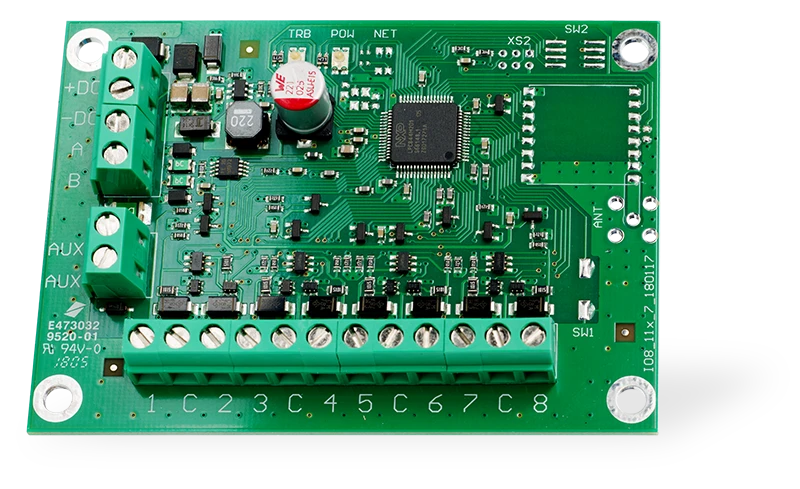
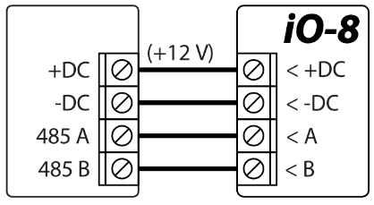
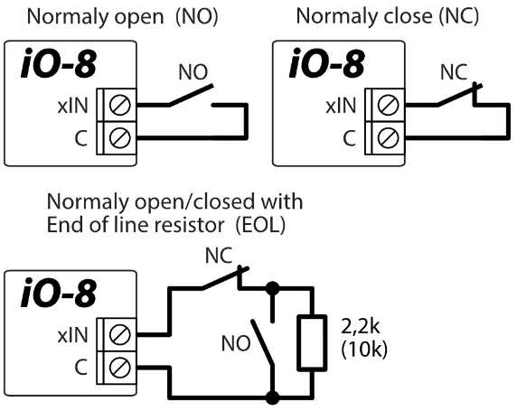
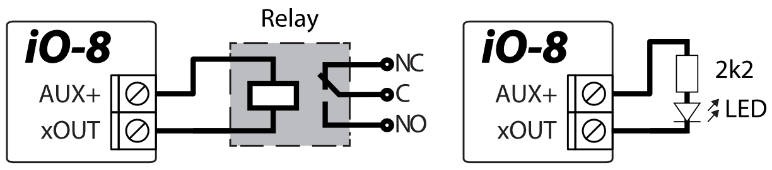
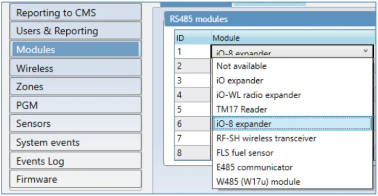
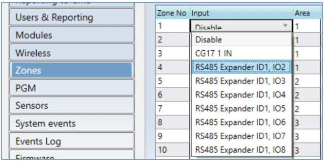

# Utbyggnadsmodul iO-8 för ingångar och utgångar

  

Med utbyggnadsmodulen iO-8 kan du öka antalet ingångar och utgångar i en kompatibel TRIKDIS-enhet.

iO-8 har 8 kontakter som kan ställas in som ingång eller utgång.

På [sidan om iO-8 på *trikdis.com*](http://www.trikdis.com/) finns enhetens specifikationer och en aktuell lista över kompatibla TRIKDIS-enheter.

Kompatibel med [SP3](/en/control-panels/sp3/), [CG17](/en/control-panels/cg17/), [GT+](../../alarm-communicators/cellular/gt-plus/index.md), [GT](../../alarm-communicators/cellular/gt/index.md), [G16](/en/alarm-communicators/cellular/g16/), [G16T](/en/alarm-communicators/cellular/g16t/), [G17F](/en/alarm-communicators/fire-panels/g17f/), [E16](/en/alarm-communicators/e16/), [E16T](/en/alarm-communicators/e16t/), [GATOR Cellular](../../gate-controllers/gator/index.md) och [GATOR WiFi](../../gate-controllers/gator-wifi/index.md).

**Gör så här för att ställa in iO-8:**

1.  Anslut iO-8 till en kompatibel TRIKDIS-enhet enligt bilden:

2.  Anslut ingångarna enligt bilden:

Kopplingsscheman och motståndsvärden för ingångarna bestäms av den huvudenhet som iO-8-modulen är ansluten till.

3.  Anslut utgångarna enligt bilden:

4.  Anslut en USB-kabel till TRIKDIS-huvudenheten och öppna programvaran TrikdisConfig. Klicka på **Read [F4]**.

5.  Gå till fönstret Modules och klicka på en ledig rad i rutan ”RS485 modules”. Välj ”iO-8 expander” i rullgardinslistan enligt bilden:

6.  Ange iO-8:s serienummer (endast siffror) i cellen till höger. Du hittar numret på etiketten på iO-8.

7.  I rullgardinsmenyerna **Input** och **PGM Output** (fönstret Zones and PGM) visas nu iO-8:s ingångar och utgångar, som du kan aktivera:

    

Inställningarna kan skilja sig beroende på TRIKDIS-huvudenheten. Konfigurera sektioner och PGM-utgångar enligt huvudenhetens manual.

8.  Klicka på **Write [F5**] när du är klar och koppla bort USB-kabeln.

9.  Påverka ingångarna och koppla utgångarna för att testa installationen.
