# Trådlös utbyggnadsmodul iO-LORA

  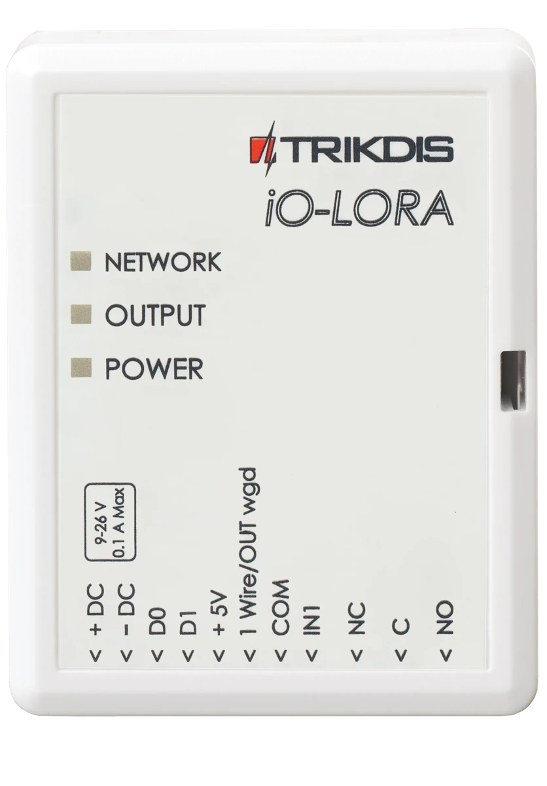

## Beskrivning 

Trådlösa utbyggnadsmoduler iO-LORA med radiotransceivern RF-LORA ökar antalet ingångar och utgångar i centralapparaten ”FLEXi” SP3 med hjälp av dubbelriktad radiokommunikation.

Kompatibel med centralapparaten [SP3](../../control-panels/sp3/index.md) för inbrottslarm samt styrenheterna för port och dörr [GATOR Cellular](../../gate-controllers/gator/index.md) och [GATOR WiFi](../../gate-controllers/gator-wifi/index.md).
Till utbyggnadsmodulen iO-LORA kan en temperaturgivare (1 st.) och läsare för kontaktnycklar (”iButton”) anslutas. Utbyggnadsmodulens PGM-utgång (relä) kan användas för att fjärrstyra (slå på/stänga av) olika elektriska enheter. iO-LORA har en digital ingång.

### Funktioner

**Kommunikation:**

- Trådlös räckvidd i fri sikt upp till 5000 m.

- Upp till 8 trådlösa utbyggnadsmoduler *iO-LORA* kan anslutas till centralapparaten *”FLEXi” SP3*.

- Produkter från HW-versionen iO-LO_x30x_7_230418 levereras med en standardantenn som passar de flesta tillämpningar. <u>Om kommunikationen måste vara av hög kvalitet på största möjliga avstånd ska en antenn med högre förstärkning av radiosignalen användas (AX-ANT-KIT – 433 MHz, AX-ANT01S SF – 868 MHz)</u>.

**Ingångar och utgångar:**

- Bussen ”1-Wire” är avsedd för anslutning av en temperaturgivare (1 st.) och läsare för kontaktnycklar (”iButton”).
- 1 ingång med valbar typ: NC, NO.

- 1 utgång (relä).

Anslutning:
- Den trådlösa utbyggnadsmodulen iO-LORA ansluts till centralapparaten ”FLEXi” SP3 via radiotransceivern RF-LORA.

### Specifikationer 

| Parameter | Beskrivning |
|----|----|
| Sändningsfrekvens | Utförande 4F: 433,3–434,7 MHz / utförande 8F: 867–869 MHz |
| Modulationstyp | LORA |
| Matningsspänning | 9–26 V DC |
| Strömförbrukning | Upp till 50 mA (vänteläge) / upp till 100 mA (kortvarigt, vid sändning) |
| Kryptering av meddelanden | Ja |
| Räckvidd i öppen miljö | Upp till 5000 m |
| Ingång | 1, valbar typ: NC, NO |
| Utgång | 1, relä, 250 V AC, 4 A |
| Temperaturgivare | 1, Maxim®/Dallas® DS18S20, DS18B20 |
| Driftmiljö | Temperatur från –20 °C till +50 °C, relativ luftfuktighet upp till 80 % vid +20 °C |
| Mått | 62 × 77 × 25 mm |
| Vikt | 80 g |

### Utbyggnadsmodulens delar 

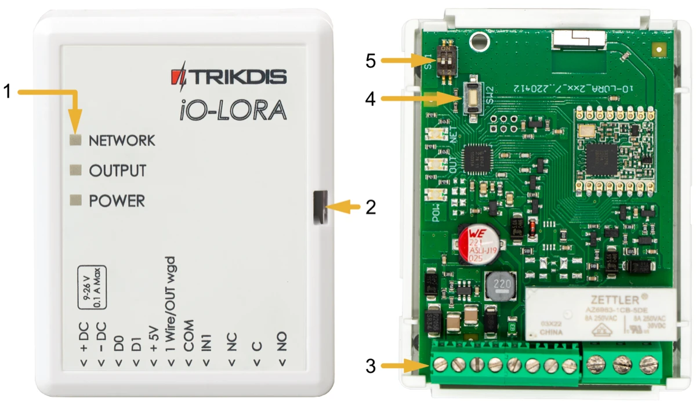

1. Lysindikatorer.
2. Öppningsspår på kapslingens framsida.
3. Plint för externa anslutningar.
4. Knappen ”SW2” för inlärning av enheten och kontroll av förbindelsen.
5. DIP-switchen ”SW1”.

!!! note "Inställningar för DIP-switchen 'SW1'"
    För produkter med HW-version iO-LO_x30x_7_230418:

    1. Radiofrekvens (`OFF` - RF1; `ON` - RF2). Används för att byta radiokanal om den aktuella kanalen är hårt belastad.
    2. Modulationstyp (`OFF` - snabb; `ON` - långsam). Läget `ON` ökar kommunikationsavståndet ungefär 2 gånger (beroende på omgivningen). Om förbindelsen är god i läget `OFF` rekommenderas det läget. I läget `ON` minskar systemets prestanda.

    **OBS!** I enheterna iO-LORA och RF-LORA måste lägena för switchen `SW1` vara desamma! Annars fungerar inte radiokommunikationen!

### Plintarnas funktion 

| Plint           | Beskrivning                                               |
|-----------------|-----------------------------------------------------------|
| +DC             | Matningsplint (9–26 V DC, plus)                           |
| -DC             | Matningsplint (9–26 V DC, minus)                          |
| D0              | Används inte                                              |
| D1              | Används inte                                              |
| +5V             | Plint för 5 V plus till enheter på ”**1-Wire**”           |
| 1Wire / OUT wgd | Plint för databussen ”**1-Wire**” (”**OUT wgd**” används inte) |
| COM             | Gemensam minusplint                                       |
| IN1             | 1 ingång med valbar typ NO, NC (fabriksinställning: NO)   |
| NC              | Reläplint NC                                              |
| C               | Reläplint C                                               |
| NO              | Reläplint NO                                              |

### Lysdiodsindikering vid drift 

| Indikator | Ljussignal | Beskrivning |
|-----------|--------------|-------------|
| NETWORK | Släckt | Ingen RF-signal |
| NETWORK | Blinkar grönt | RF-signalnivå från 0 till 10. Tillräcklig signalstyrka är 4. |
| OUTPUT/KEY | Fast grönt sken | Reläutgången är aktiverad |
| OUTPUT/KEY | Fast gult sken | Dallas-kontaktnyckeln är aktiverad |
| POWER | Släckt | Ingen matningsspänning |
| POWER | Blinkar grönt | Normal matningsspänning |
| POWER | Blinkar gult | Låg matningsspänning (≤11,5 V) |

## Kopplingsscheman 

### Montering 

1.  Ta bort locket.

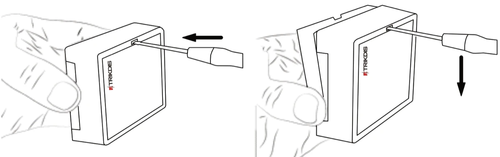

2.  Ta ut kretskortet.

3.  Fäst kapslingens bottendel på önskad plats med skruvar.

4.  Sätt tillbaka kretskortet.

5.  Sätt tillbaka locket.

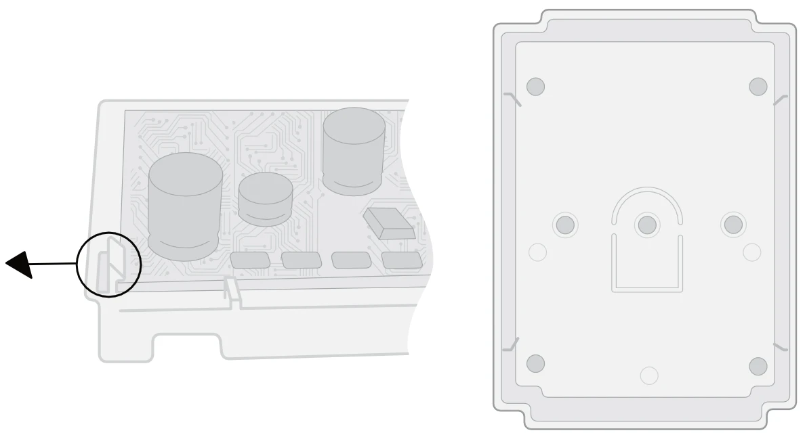

### Kopplingsschema för anslutning av matningen 

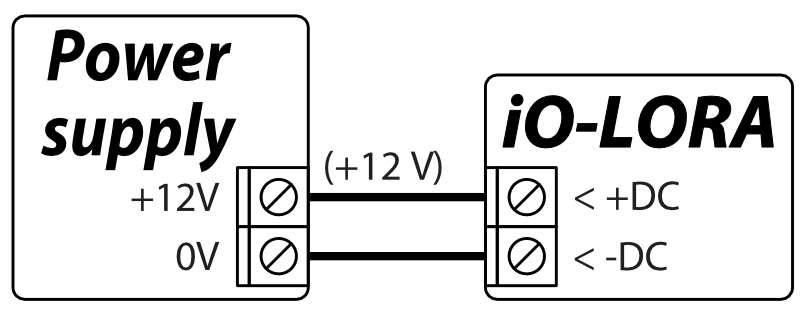

### Kopplingsschema för anslutning av ingången 

iO-LORA har en ingång. Ingångens typ kan ställas in: NC, NO.

  <figure style="margin: 0;">
    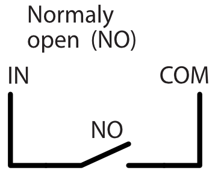
  </figure>
  <figure style="margin: 0;">
    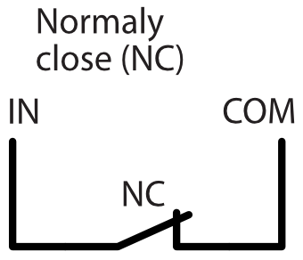
  </figure>

### Kopplingsschema för anslutning av en temperaturgivare 

Temperaturgivare ska anslutas enligt schemat. En temperaturgivare (1 st.) av typen Maxim®/Dallas® DS18S20 eller DS18B20 kan anslutas till den trådlösa utbyggnadsmodulen *iO-LORA*. Om en ledning längre än 0,5 meter används för att ansluta temperaturgivaren rekommenderar vi partvinnad kabel (UTP4x2x0,5 eller STP4x2x0,5). Plinten ”+5V” på kretskortet matar enheter som är anslutna till databussen ”1-Wire” med 5 V DC.

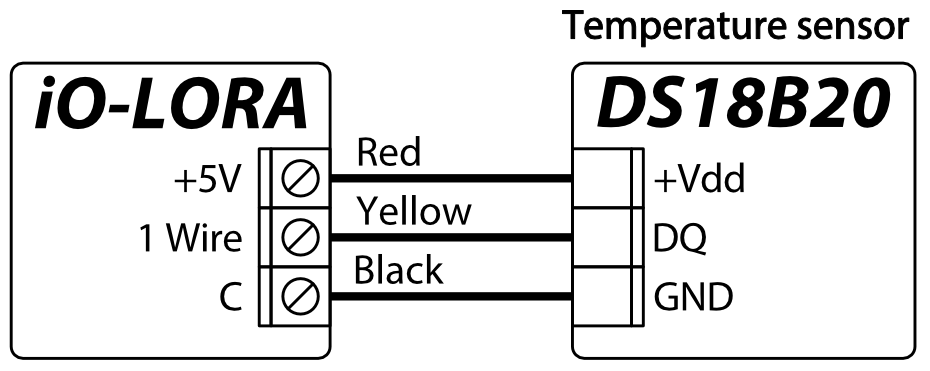

Den maximala utgångsströmmen är 0,2 A. Utgången är överlastskyddad. Om den högsta tillåtna strömmen överskrids kopplas matningen bort automatiskt. Centralapparaten ”FLEXi” SP3 känner automatiskt igen och lär in den anslutna temperaturgivaren.

### Kopplingsscheman för anslutning av läsaren CZ-Dallas 

iButton-läsaren **CZ-Dallas** ansluts till iO-LORA via databussen ”**1 Wire**”. Ledningarna till databussen kan vara upp till 30 m långa.

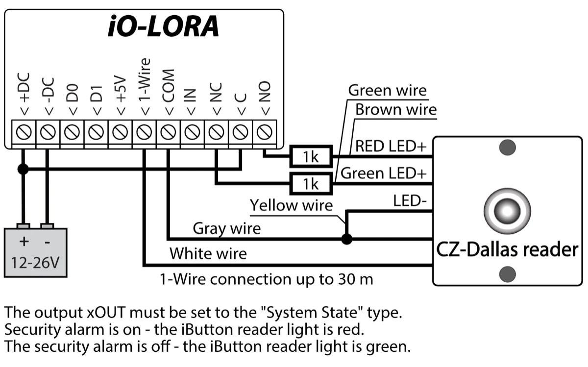

### Kopplingsscheman för anslutning av iO-LORA-moduler 

!!! note
    En radiotransceiver RF-LORA måste vara ansluten till centralapparaten ”FLEXi”
    SP3. Därefter kan upp till 8 trådlösa utbyggnadsmoduler iO-LORA
    anslutas. Vi rekommenderar partvinnad kabel (UTP4x2x0.5 eller STP4x2x0.5)
    för anslutning av temperaturgivaren. iButton-läsare av typen
    **CZ-Dallas** och temperaturgivaren måste
    anslutas till bussen ”**1-Wire**”.

## Centralapparaten ”FLEXi” SP3

1.  En radiotransceiver RF-LORA måste vara ansluten till centralapparaten ”FLEXi” SP3.

2.  Slå på matningen till centralapparaten ”FLEXi” SP3.

3.  Slå på matningen till den trådlösa utbyggnadsmodulen iO-LORA.

4.  Starta ***TrikdisConfig**.*

5.  Anslut ”FLEXi” SP3 till en dator med en USB Mini-B-kabel eller anslut till ”FLEXi” SP3 på distans.

6.  Klicka på knappen **Read [F4]** så att programmet läser de parametrar som är inställda i centralapparaten ”FLEXi” SP3. Om ett fönster för administratörskoden öppnas, ange den sexsiffriga administratörskoden.

7.  Välj ”**iO-LORA expander**” i listan ”**Modules**”.

8.  Ange iO-LORA-modulens serienummer i fältet ”**Serial No.**”.

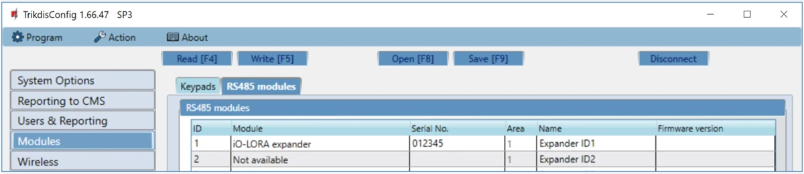

9.  Ställ in expanderns ingång på fliken ”**Zones**”.

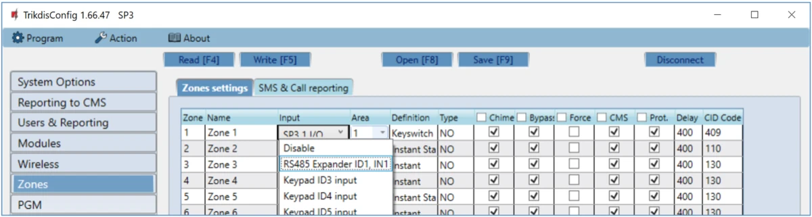

10. Konfigurera expanderns PGM-utgång på fliken ”**PGM**”.

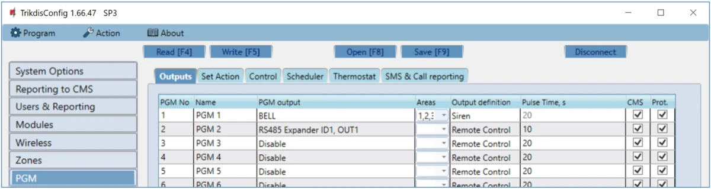

11. Temperaturgivare tas med i listan ”**Sensors**” om en temperaturgivare är ansluten till iO-LORA.

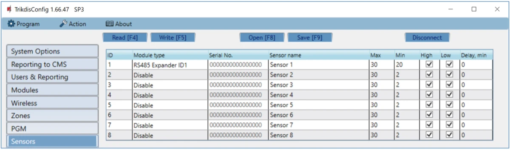

12. Klicka på knappen **Write [F5]** när konfigurationen är klar.

13. Vänta tills uppdateringen är klar.

14. Klicka på knappen ”**Disconnect**” och koppla bort USB-kabeln.

## Säkerhetskrav 

Den trådlösa utbyggnadsmodulen iO-LORA ska installeras och underhållas av behörig personal.

Läs den här manualen noggrant före installationen för att undvika misstag som kan leda till funktionsfel eller till och med skador på utrustningen.

Koppla alltid bort matningen innan du gör några elektriska anslutningar.

Ändringar, modifieringar eller reparationer som inte har godkänts av tillverkaren upphäver garantin.

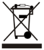Följ dina lokala bestämmelser för avfallssortering och släng inte utrustningen eller dess komponenter bland vanligt hushållsavfall.
