# Trådlös utbyggnadsmodul iO8-LoRa

  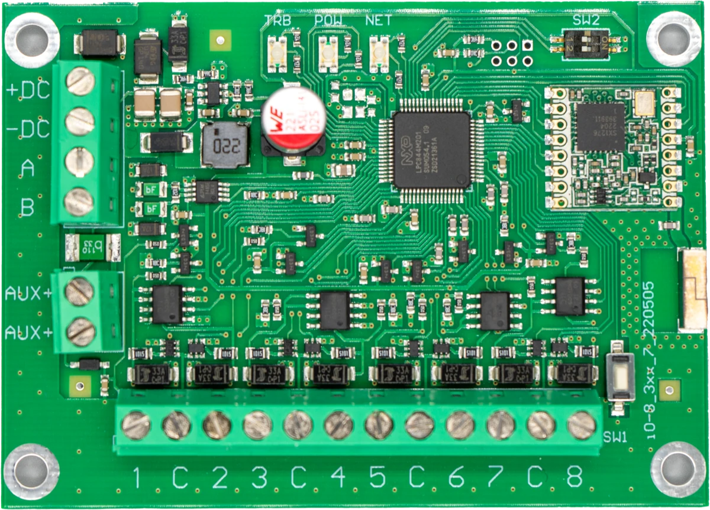

## Beskrivning 

Trådlösa utbyggnadsmoduler iO-8-LORA med radiotransceivern RF-LORA ökar antalet ingångar och utgångar i centralapparaten ”FLEXi” SP3 med hjälp av dubbelriktad radiokommunikation.

Kompatibel med centralapparaten [SP3](../../control-panels/sp3/index.md) för inbrottslarm och styrenheten för port och dörr [GATOR Cellular](../../gate-controllers/gator/index.md).
Den trådlösa utbyggnadsmodulen iO-8-LORA har 8 I/O-plintar som kan ställas in var och en som ingång (IN) eller utgång (OUT).

### Funktioner

**Kommunikation:**

- Trådlös räckvidd i fri sikt upp till 5000 m.

- Upp till 8 trådlösa utbyggnadsmoduler *iO-8-LORA* kan anslutas till centralapparaten *”FLEXi” SP3*.

- Produkter från HW-versionen iO8_x5xx_7_230419 levereras med en standardantenn som passar de flesta tillämpningar. <u>Om kommunikationen måste vara av hög kvalitet på största möjliga avstånd ska en antenn med högre förstärkning av radiosignalen användas (AX-ANT-KIT – 433 MHz, AX-ANT01S SF – 868 MHz)</u>.

Ingångar och utgångar:
- 8 I/O-plintar som kan ställas in var och en som ingång (IN) eller utgång (OUT). Ingångstyper (IN): ATZ, EOL, NC, NO. Motstånd med olika värden kan användas i kretsar av typen EOL och ATZ.

**Anslutning:**

- Den trådlösa utbyggnadsmodulen iO-8-LORA ansluts till centralapparaten ”FLEXi” SP3 via radiotransceivern RF-LORA.

### Specifikationer 

| Parameter | Beskrivning |
|----|----|
| Sändningsfrekvens | Utförande 4F: 433,3–434,7 MHz / utförande 8F: 867–869 MHz |
| Modulationstyp | LORA |
| Matningsspänning | 10–26 V DC |
| Strömförbrukning | Upp till 50 mA (vänteläge) / upp till 120 mA (kortvarigt, vid sändning) |
| Kryptering av meddelanden | Ja |
| Räckvidd i öppen miljö | Upp till 5000 m |
| Plintar med dubbel funktion [I/O] | 8, funktionen IN eller OUT väljs vid programmeringen. När IN väljs är följande typer tillgängliga: NC, NO, EOL, EOL_T, 3EOL, ATZ, ATZ_T. När OUT väljs blir plinten en utgång med öppen kollektor (OC) för upp till 100 mA |
| Driftmiljö | Temperatur från –20 °C till +50 °C, relativ luftfuktighet upp till 80 % vid +20 °C |
| Mått | 65 × 90 × 12 mm |
| Vikt | 80 g |

### Utbyggnadsmodulens delar 

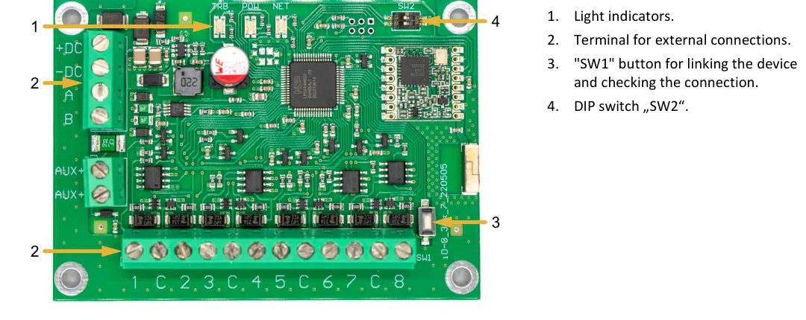

!!! note "Inställningar för DIP-switchen 'SW2'"
    För produkter med HW-version iO8_x5xx_7_230419:

    1. Radiofrekvens (`OFF` - RF1; `ON` - RF2). Används för att byta radiokanal om den aktuella kanalen är hårt belastad.
    2. Modulationstyp (`OFF` - snabb; `ON` - långsam). Läget `ON` ökar kommunikationsavståndet ungefär 2 gånger (beroende på omgivningen). Om förbindelsen är god i läget `OFF` rekommenderas det läget. I läget `ON` minskar systemets prestanda.

    **OBS!** I enheterna iO8-LORA och RF-LORA måste lägena för switchen `SW` vara desamma! Annars fungerar inte radiokommunikationen!

### Plintarnas funktion 

| Plint | Beskrivning                           |
|----------|---------------------------------------|
| +DC      | Matningsplint (10–26 V DC, plus)      |
| -DC      | Matningsplint (10–26 V DC, minus)     |
| A        | Plint A på databussen *RS485*         |
| B        | Plint B på databussen *RS485*         |
| 1- 8     | Ingångs-/utgångsplintar               |
| C        | Gemensam minusplint                   |

### Lysdiodsindikering vid drift 

| Indikator | Ljussignal | Beskrivning |
|-----------|--------------|-------------|
| NETWORK | Släckt | Ingen RF-signal |
| NETWORK | Blinkar grönt | RF-signalnivå från 0 till 10. Tillräcklig signalstyrka är 3 |
| POWER | Släckt | Ingen matningsspänning |
| POWER | Blinkar grönt | Normal matningsspänning |
| POWER | Blinkar gult | Låg matningsspänning (≤11,5 V) |

## Kopplingsscheman 

### Kopplingsschema för anslutning av matningen 

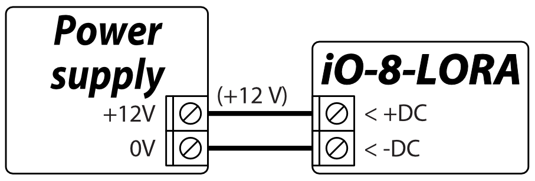

### Kopplingsscheman för anslutning av ingångar 

På kretskortet i utbyggnadsmodulen iO-8-LORA finns 8 plintar IO1–IO8 (ingångar) för anslutning av detektorkretsar. Varje plint kan ställas in som ingång och tilldelas sektionsegenskaper: kretstyp (NO, NC, EOL, EOL_T, 3EOL, ATZ, ATZ_T), känslighet för tillfälliga händelser i kretsen och sektionsfunktion (Delay, Instant, Instant Stay, Interior, Interior Stay, Fire, Keyswitch, 24_hour, Silent, Silent 24h).

  <figure style="margin: 0;">
    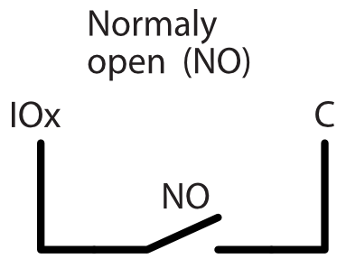
  </figure>
  <figure style="margin: 0;">
    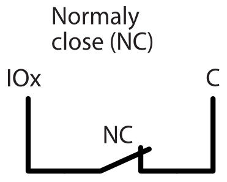
  </figure>
  <figure style="margin: 0;">
    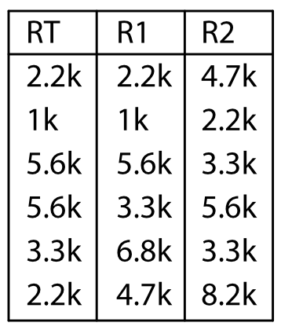
  </figure>

  <figure style="margin: 0;">
    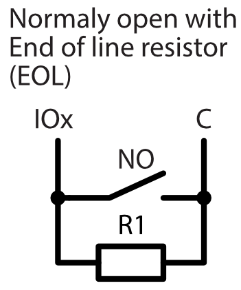
  </figure>
  <figure style="margin: 0;">
    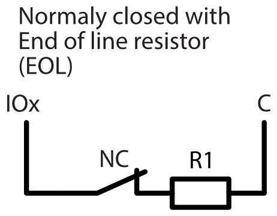
  </figure>
  <figure style="margin: 0;">
    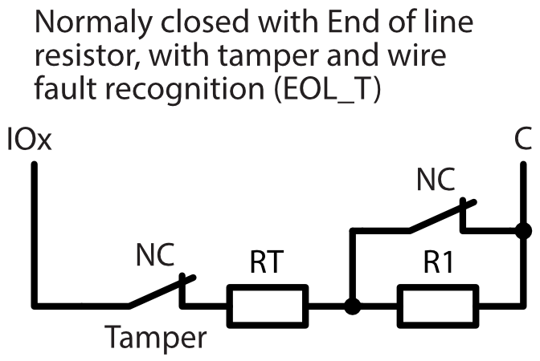
  </figure>

  <figure style="margin: 0;">
    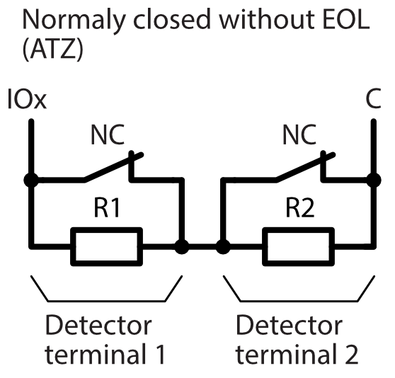
  </figure>
  <figure style="margin: 0;">
    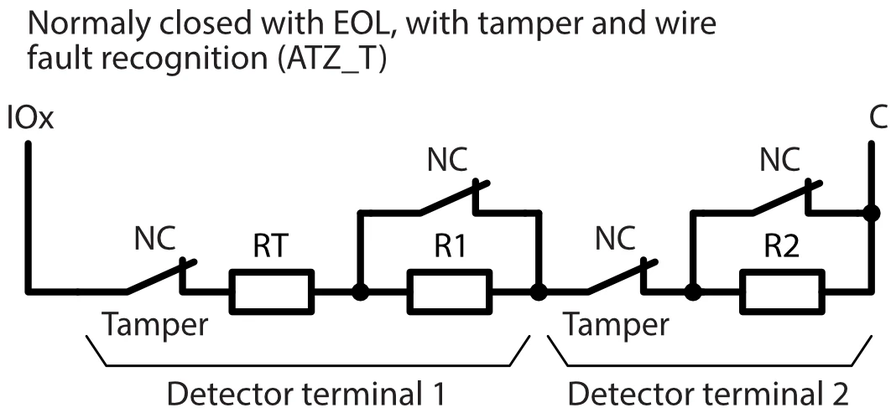
  </figure>

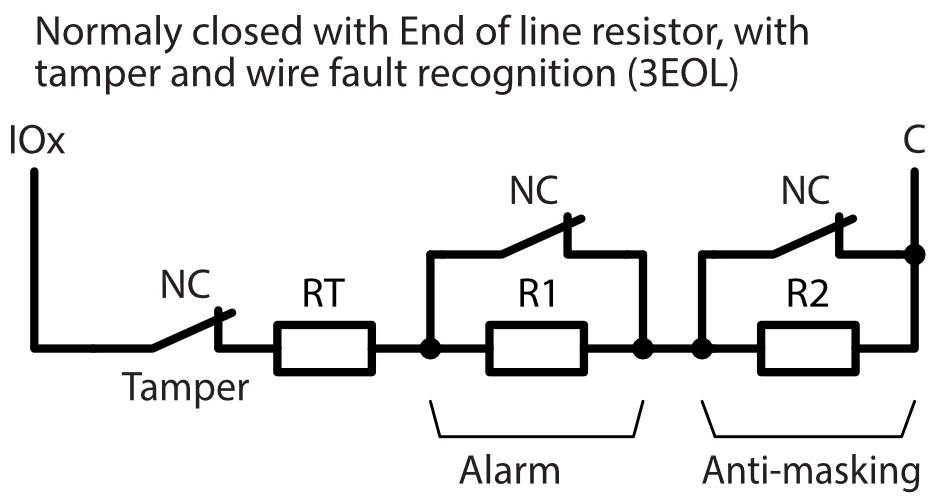

### Kopplingsschema för anslutning av ett relä 

Med reläplintarna kan olika elektriska enheter fjärrstyras (slås på/av). Den universella I/O-plinten på den trådlösa utbyggnadsmodulen *iO-8-LORA* måste konfigureras som utgång (OUT) och tilldelas definitionen ”Remote control”.

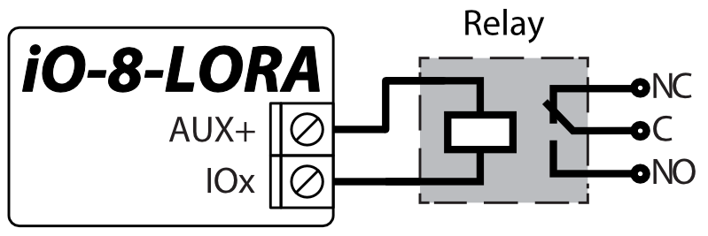

### Kopplingsschema för anslutning av utbyggnadsmoduler iO-8-LORA till centralapparaten ”FLEXi” SP3 

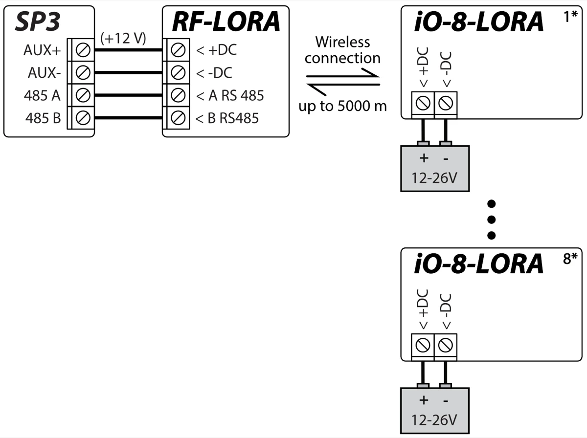

!!! note
    En radiotransceiver RF-LORA måste vara ansluten till centralapparaten ”FLEXi”
    SP3. Därefter kan upp till 8 trådlösa utbyggnadsmoduler
    iO-8-LORA anslutas.

## Centralapparaten ”FLEXi” SP3

1.  En radiotransceiver RF-LORA måste vara ansluten till centralapparaten ”FLEXi” SP3.

2.  Slå på matningen till centralapparaten ”FLEXi” SP3.

3.  Slå på matningen till den trådlösa utbyggnadsmodulen iO-8-LORA.

4.  Starta ***TrikdisConfig**.*

5.  Anslut ”FLEXi” SP3 till en dator med en USB Mini-B-kabel eller anslut till ”FLEXi” SP3 på distans.

6.  Klicka på knappen **Read [F4]** så att programmet läser de parametrar som är inställda i centralapparaten ”FLEXi” SP3. Om ett fönster för administratörskoden öppnas, ange den sexsiffriga administratörskoden.

7.  Välj ”**iO-8-LORA expander**” i listan ”**Modules**”.

8.  Ange iO-8-LORA-modulens serienummer i fältet ”**Serial No.**”.

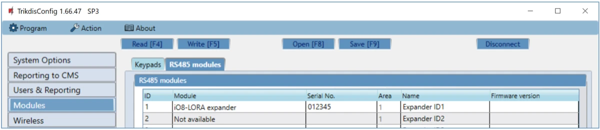

9.  Ställ in expanderns ingångar på fliken ”**Zones**”.

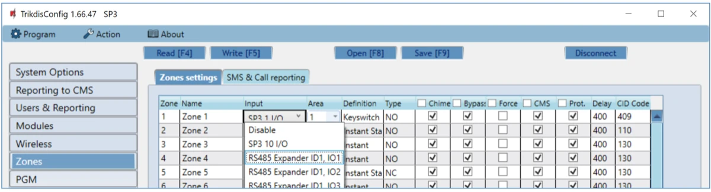

10. Konfigurera expanderns PGM-utgångar på fliken ”**PGM**”.

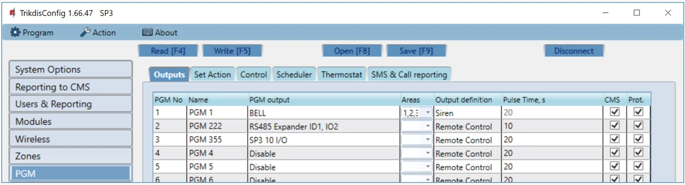

11. Klicka på knappen **Write [F5]** när konfigurationen är klar.

12. Vänta tills uppdateringen är klar.

13. Klicka på knappen ”**Disconnect**” och koppla bort USB-kabeln.

## Säkerhetskrav 

Den trådlösa utbyggnadsmodulen iO-8-LORA ska installeras och underhållas av behörig personal.

Läs den här manualen noggrant före installationen för att undvika misstag som kan leda till funktionsfel eller till och med skador på utrustningen.

Koppla alltid bort matningen innan du gör några elektriska anslutningar.

Ändringar, modifieringar eller reparationer som inte har godkänts av tillverkaren upphäver garantin.

Följ dina lokala bestämmelser för avfallssortering och släng inte utrustningen eller dess komponenter bland vanligt hushållsavfall.
