# Trådlös överfallsknapp PB-LoRa

  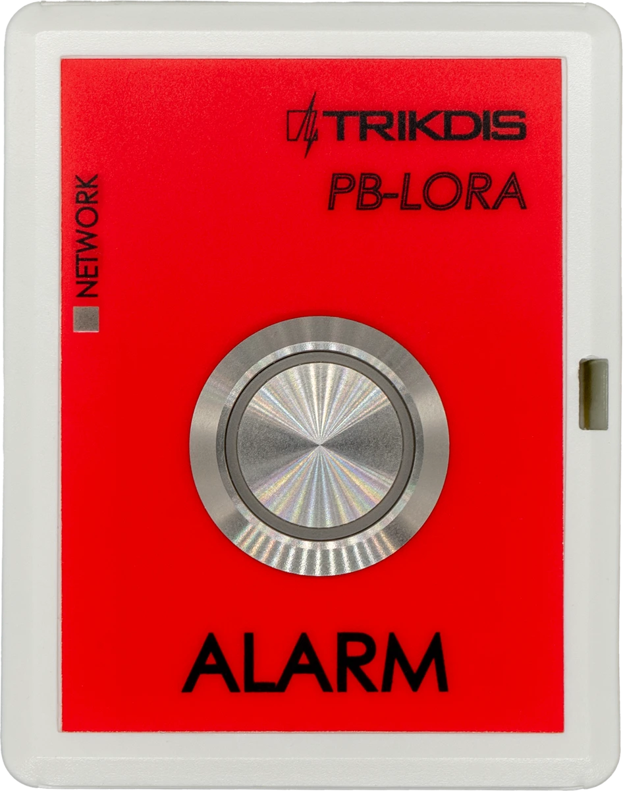

## Beskrivning 

Produkten PB-LORA är avsedd för trådlös överföring av ett nödmeddelande. Nödanropet skickas när knappen trycks in. Modulen RF-LORA tar emot meddelandet och är ansluten till centralapparaten ”FLEXi” SP3.

Kompatibel med centralapparaten [SP3](../../control-panels/sp3/index.md) för inbrottslarm.

8 överfallsknappar PB-LORA kan läras in i centralapparaten om firmwareversion 1.17 eller högre används (t.ex. SP3_xxxx_0117.fw). När centralapparaten har firmware av utgåva 2 med version 1.16 eller högre (t.ex. SP3_xxx2_0116.fw) kan 250 överfallsknappar PB-LORA läras in i centralapparaten.

### Funktioner

**Kommunikation:**

- Trådlös räckvidd i fri sikt upp till 5000 m.

**Anslutning:**

- Den trådlösa överfallsknappen *PB-LORA* ansluts till centralapparaten *”FLEXi” SP3* via radiotransceivern *RF-LORA*.
### Specifikationer 

| Parameter | Beskrivning |
|----|----|
| Sändningsfrekvens | 433,3–434,7 MHz |
| Modulationstyp | LORA |
| Matningsspänning | 3 V, batteri CR123A |
| Batteriets livslängd | Minst 3 år |
| Strömförbrukning | Upp till 0,008 mA (vänteläge) / upp till 50 mA (kortvarigt, vid sändning) |
| Kryptering av meddelanden | Ja |
| Räckvidd i öppen miljö | Upp till 5000 m |
| Driftmiljö | Temperatur från –10 °C till +50 °C, relativ luftfuktighet upp till 80 % vid +20 °C |
| Mått | 62 × 77 × 25 mm |
| Vikt | 80 g |

### Den trådlösa överfallsknappens delar 

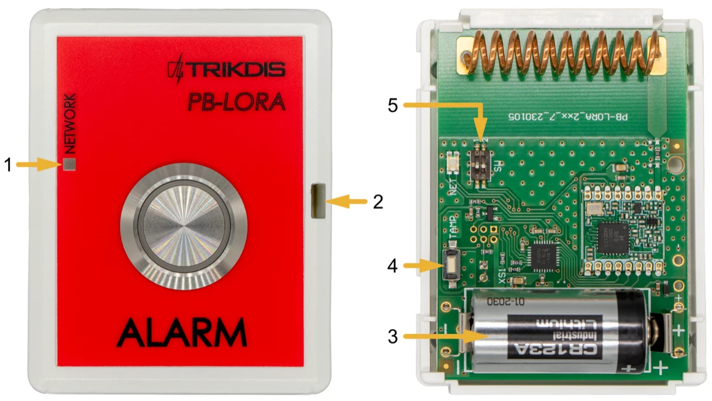

1. Lysindikator.
2. Öppningsspår på kapslingens framsida.
3. Batteri 3 V (CR123A).
4. Knappen ”TAMP” för inlärning av enheten och kontroll av förbindelsen.
5. DIP-switchen ”SW”.

!!! note "Inställningar för DIP-switchen 'SW'"
    1. Radiofrekvens (”OFF” - RF1; ”ON” - RF2). Används för att byta radiokanal om den aktuella kanalen är hårt belastad.
    2. Modulationstyp (”OFF” - snabb; ”ON” - långsam). Läget ”ON” ökar kommunikationsavståndet ungefär 2 gånger (beroende på omgivningen). Om förbindelsen är god i läget ”Off” rekommenderas det läget. I läget ”On” ökar batteriförbrukningen och systemets prestanda minskar.

    **OBS!** I enheterna PB-LORA och RF-LORA måste lägena för switchen ”SW” vara desamma! Annars fungerar inte radiokommunikationen!

### Lysdiodsindikering vid drift 

| Indikator | Åtgärd | Beskrivning |
|-----------|--------|-------------|
| NETWORK | Efter ett tryck på knappen ”Alarm” | Första blinkningen grön: meddelandet är skickat, batterispänningen är god. |
| NETWORK | Första blinkningen röd: meddelandet skickas, batterispänningen är låg. | Första blinkningen grön: meddelandet är skickat, batterispänningen är god. |
| NETWORK | Andra blinkningen röd: bekräftelse på att meddelandet mottagits av modulen RF-LORA har tagits emot. |  |
| NETWORK | Efter ett tryck på knappen ”TAMP” |  |
| NETWORK | Första blinkningen röd: meddelandet skickas, batterispänningen är låg. |  |
| NETWORK | Andra blinkningen röd: bekräftelse på att meddelandet mottagits av modulen RF-LORA har tagits emot. |  |
| NETWORK | Tredje till tolfte blinkningen: radiosignalens styrka. * |  |

\* Minst fyra blinkningar rekommenderas.

OBS: efter att batteriet har satts i rekommenderas att du väntar minst 10 sekunder innan du använder enheten.  

## Kopplingsscheman 

### Montering 

1.  Ta bort locket.

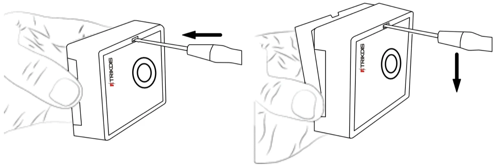

2.  Ta ut kretskortet.

3.  Fäst kapslingens bottendel på önskad plats med skruvar.

4.  Sätt tillbaka kretskortet.

5.  Sätt i batteriet i modulen.

6.  Sätt tillbaka locket.

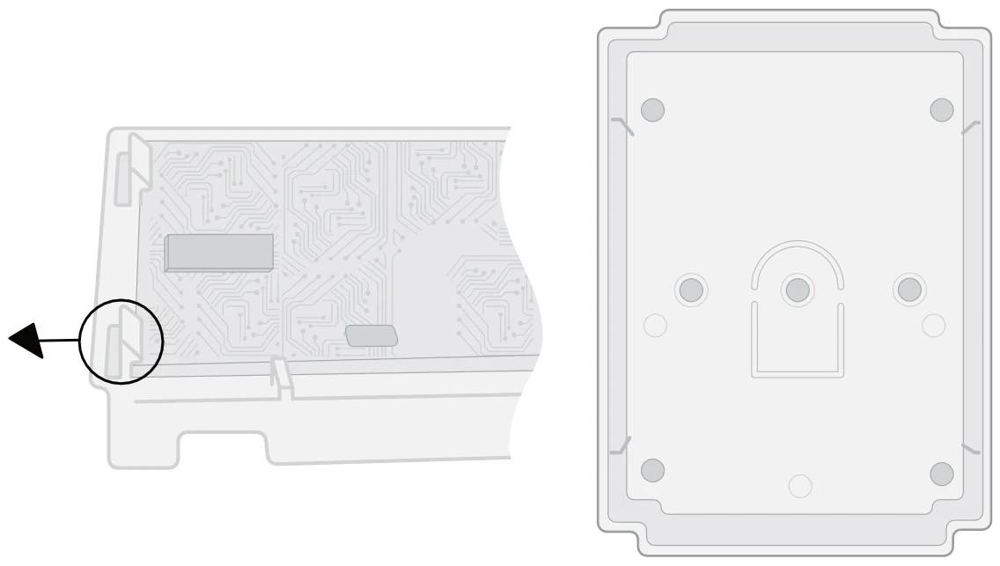

### Kopplingsschema för anslutning av den trådlösa överfallsknappen PB-LORA 

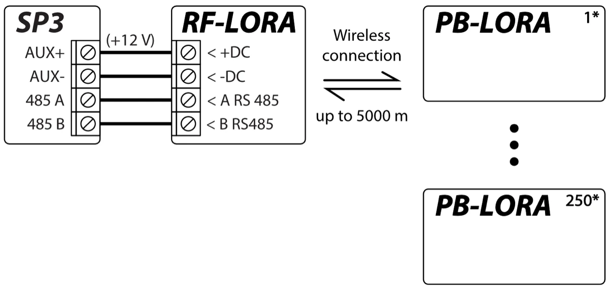

!!! note
    Radiotransceivern RF-LORA måste vara ansluten till centralapparaten ”FLEXi”
    SP3. Därefter kan upp till 8 trådlösa överfallsknappar PB-LORA
    anslutas (centralapparatens firmwareversion 1.17 eller högre. Exempel:
    SP3_xxxx_0117.fw) eller upp till 250 st. trådlösa överfallsknappar PB-LORA
    (centralapparatens firmware av utgåva 2 med version 1.16 eller högre. Exempel:
    SP3_xxx2_0116.fw).
## Centralapparaten ”FLEXi” SP3

Centralapparaten *”FLEXi” SP3* måste ha firmware med version 1.17 eller högre (till exempel SP3_xxxx_0117.fw).

1.  En radiotransceiver RF-LORA måste vara ansluten till centralapparaten ”FLEXi” SP3.

2.  Slå på matningen till centralapparaten ”FLEXi” SP3***.***

3.  Batteriet måste vara isatt i den trådlösa överfallsknappen PB-LORA.

4.  Starta ***TrikdisConfig**.*

5.  Anslut ”FLEXi” SP3 till en dator med en USB Mini-B-kabel eller anslut till ”FLEXi” SP3 på distans.

6.  Klicka på knappen **Read [F4]** så att programmet läser de parametrar som är inställda i centralapparaten ”FLEXi” SP3. Om ett fönster för administratörskoden öppnas, ange den sexsiffriga administratörskoden.

7.  Välj ”**PB-LORA Panic button**” i listan ”**Modules**”**.**

8.  Ange PB-LORA:s serienummer i fältet ”**Serial No.**”.

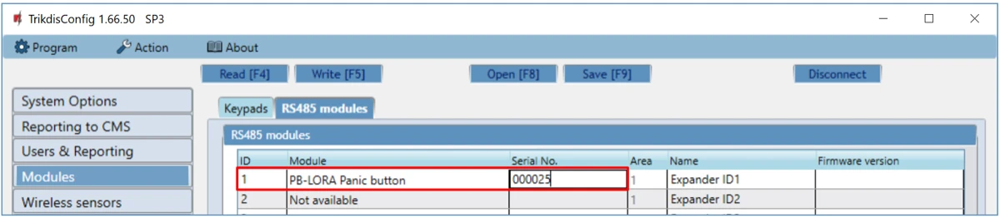

9.  Ställ in överfallsknappen på fliken ”**Zones**”.

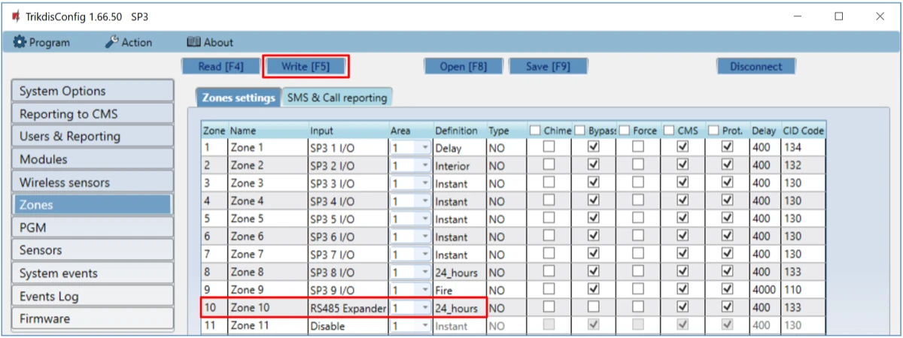

10. Klicka på knappen **Write [F5]** när konfigurationen är klar.

11. Vänta tills uppdateringen är klar.

12. Klicka på knappen ”**Disconnect**” och koppla bort USB-kabeln.

13. Vänta 1 minut. Tryck på knappen ”Alarm” på modulen PB-LORA.

14. Anslut USB Mini-B-kabeln till ”FLEXi” SP3.

15. Klicka på knappen **Read [F4].**

16. PB-LORA:s firmwareversion visas i fönstret ”**Modules**”.

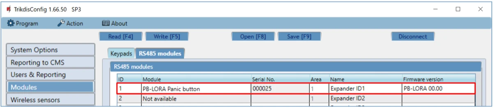

17. Klicka på knappen ”**Disconnect**” och koppla bort USB-kabeln.

!!! note
    Ta bort trådlösa överfallsknappar PB-LORA ur minnet i ”FLEXi”
    SP3:
    
    1.  Starta ***TrikdisConfig**.*
    
    2.  Anslut ”FLEXi” SP3 till en dator med en USB Mini-B-kabel
        eller anslut till ”FLEXi” SP3 på distans. Klicka på knappen
        **Read [F4]**.
    
    3.  I TrikdisConfig, i fönstret ”**Modules**”, i kolumnen
        ”**Module**”, välj ”**Not available**” i stället för den ”**PB-LORA
        Panic button**” som ska tas bort och klicka på **Write [F5]**.
        Den trådlösa överfallsknappen är nu borttagen ur minnet i ”FLEXi”
        SP3.
## Inlärning av 250 trådlösa överfallsknappar PB-LORA i centralapparaten ”FLEXi” SP3 

Centralapparaten *”FLEXi” SP3* måste ha firmware av utgåva 2 med version 1.16 eller högre (till exempel SP3_xxx2_0116.fw).

1.  En radiotransceiver RF-LORA måste vara ansluten till centralapparaten ”FLEXi” SP3.

2.  Slå på matningen till centralapparaten ”FLEXi” SP3***.***

3.  Batteriet måste vara isatt i den trådlösa överfallsknappen PB-LORA.

4.  Starta ***TrikdisConfig**.*

5.  Anslut till ”FLEXi” SP3 på distans.

!!! warning "Viktigt"
    Fjärrkonfigurering fungerar bara när ”FLEXi” SP3:

    1.  Kommunikationskanalen WiFi/LAN är konfigurerad, eller ett aktiverat SIM-kort
        är isatt och PIN-koden är angiven eller avstängd.

    2.  Mobildata är aktiverad på SIM-kortet.

    3.  Molntjänsten Protegus måste vara aktiverad.

    4.  Matningen är påslagen (lysdioden ”**PWR**” måste blinka
        grönt).

    5.  Är ansluten till nätverket (lysdioden ”**NET**” måste lysa fast grönt och
        blinka gult).
6.  Starta konfigurationsprogrammet TrikdisConfig och ange IMEI-numret för ”FLEXi” SP3 i fältet ”**Unique ID**” i avsnittet ”**Remote access**”. IMEI-numret finns på etiketterna på centralapparaten och på förpackningen.

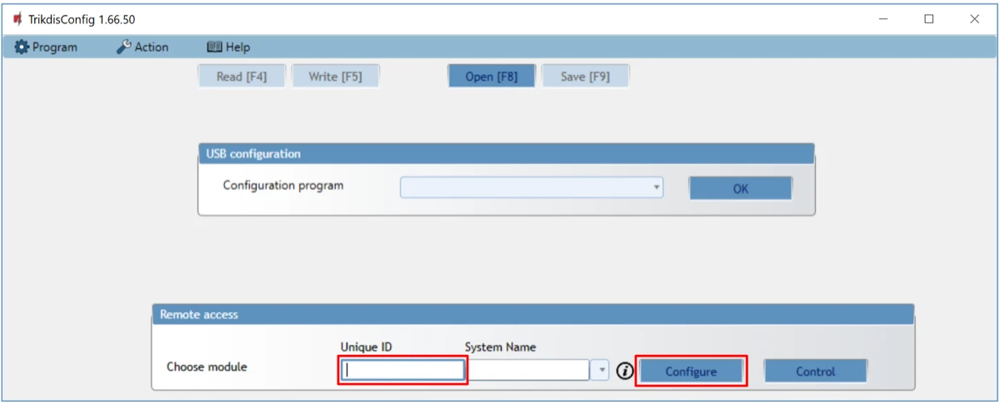

7.  Klicka på ”**Configure**”.

8.  Klicka på knappen **Read [F4]** så att programmet läser de parametrar som är inställda i ”FLEXi” SP3. Om ett fönster för administratörskoden öppnas, ange den sexsiffriga administratörskoden.

9.  Välj ”**RF-LORA transceiver**” i listan ”**Modules**”**.**

10. Ange RF-LORA:s serienummer i fältet ”**Serial No.**”.

11. Klicka på knappen **Write [F5]**.

12. Vänta tills uppdateringen är klar.

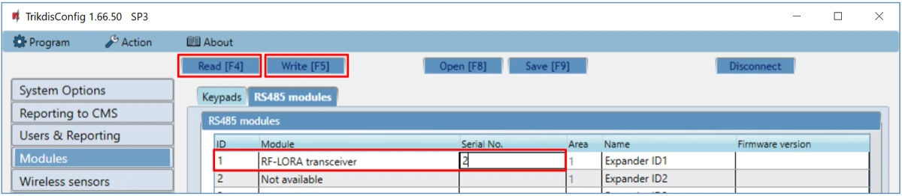

13. Vänta 1 minut.

14. Klicka på **Read [F4]**.

15. Firmwareversionen för ”**RF-LORA transceiver**” visas i fönstret ”**Modules**”**.**

16. Gå till fönstret ”**Wireless sensor**”.

17. Klicka på knappen ”**Learn sensors**”.

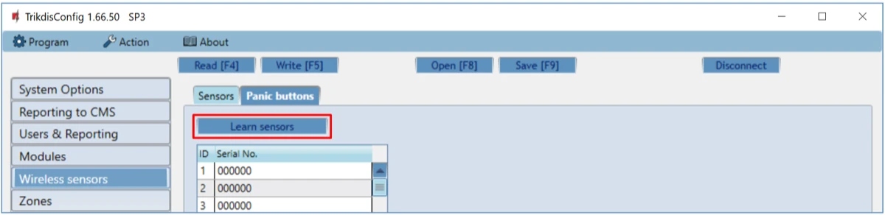

Alla trådlösa överfallsknappar kan läras in samtidigt.

Vid inlärning av överfallsknappar PB-LORA måste modulen *RF-LORA* vara minst 1 m från knapparna.

18. Lysdioden ”**DATA/TROUBLE**” på modulen RF-LORA börjar blinka rött/grönt.

19. Modulen RF-LORA går över i inlärningsläge. TrikdisConfig öppnar fönstret för inlärning av överfallsknappar.

20. Tryck kort på knappen ”**TAMP**” på kretskortet i PB-LORA.

21. Lysdioden ”**DATA/TROUBLE**” på modulen RF-LORA lyser grönt i några sekunder. Därefter fortsätter lysdioden ”**DATA/TROUBLE**” på modulen RF-LORA att blinka rött/grönt.

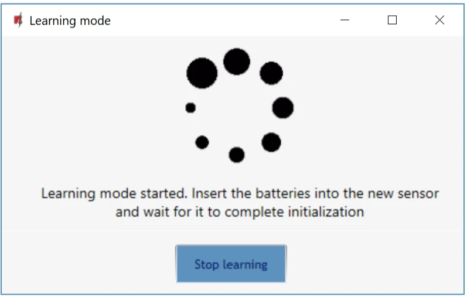

22. Efter några sekunder läggs överfallsknappen PB-LORA till i listan över enheter.

23. Numret i ”**UID**” måste stämma överens med serienumret för PB-LORA på etiketten på knappen.

24. Om du vill lägga till nästa överfallsknapp trycker du kort på knappen ”**TAMP**” på kretskortet.

25. Klicka på ”**Stop learning**” för att avsluta inlärningen av trådlösa överfallsknappar.

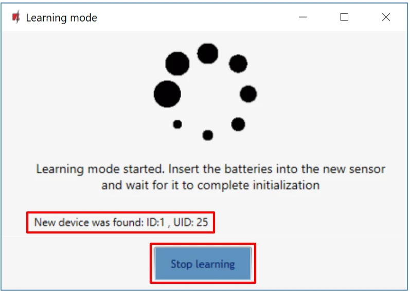

26. Klicka på ”**Yes**” för att skriva enheterna till centralapparaten ”FLEXi” SP3.

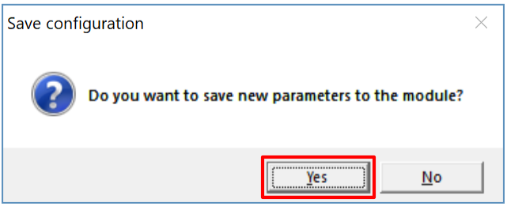

Vänta några minuter. Klicka på **Read [F4].**

TrikdisConfig visar en lista över inlärda trådlösa överfallsknappar i fönstret ”**Wireless**”. Fältet ”**Serial No.**” visar serienumret, som måste stämma överens med serienumret för överfallsknappen PB-LORA på kapslingens baksida.

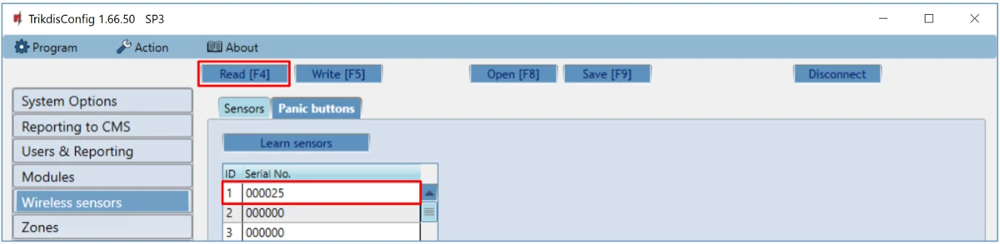

!!! note
    Ta bort trådlösa överfallsknappar PB-LORA ur minnet i ***”FLEXi”
    SP3***:
    
    1.  Starta ***TrikdisConfig**.*
    
    2.  Anslut ”FLEXi” SP3 till en dator med en USB Mini-B-kabel
        eller anslut till ”FLEXi” SP3 på distans. Klicka på knappen
        **Read [F4]**.
    
    3.  I TrikdisConfig, i fönstret ”**Wireless sensors**”,
        ange ”**0**” i fältet ”**Serial No.**” och klicka på **Write
        [F5]**. Den trådlösa överfallsknappen PB-LORA är nu borttagen ur
        minnet i ”FLEXi” SP3.
## Säkerhetskrav 

Den trådlösa överfallsknappen PB-LORA ska installeras och underhållas av behörig personal.

Läs den här manualen noggrant före installationen för att undvika misstag som kan leda till funktionsfel eller till och med skador på utrustningen.

Koppla alltid bort matningen innan du gör några elektriska anslutningar.

Ändringar, modifieringar eller reparationer som inte har godkänts av tillverkaren upphäver garantin.

Följ dina lokala bestämmelser för avfallssortering och släng inte utrustningen eller dess komponenter bland vanligt hushållsavfall.
