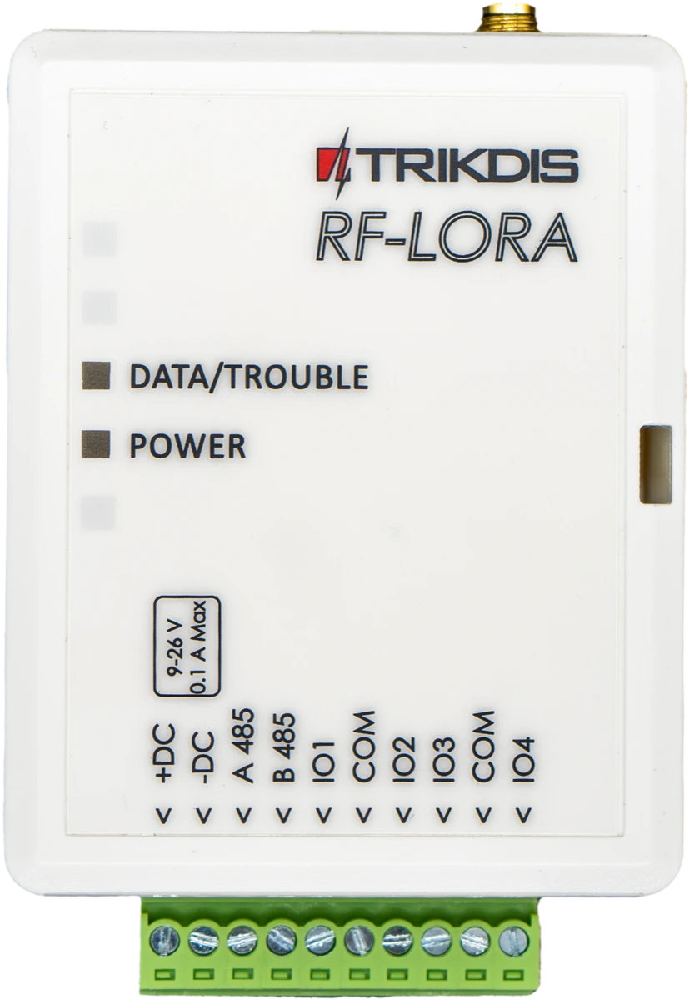
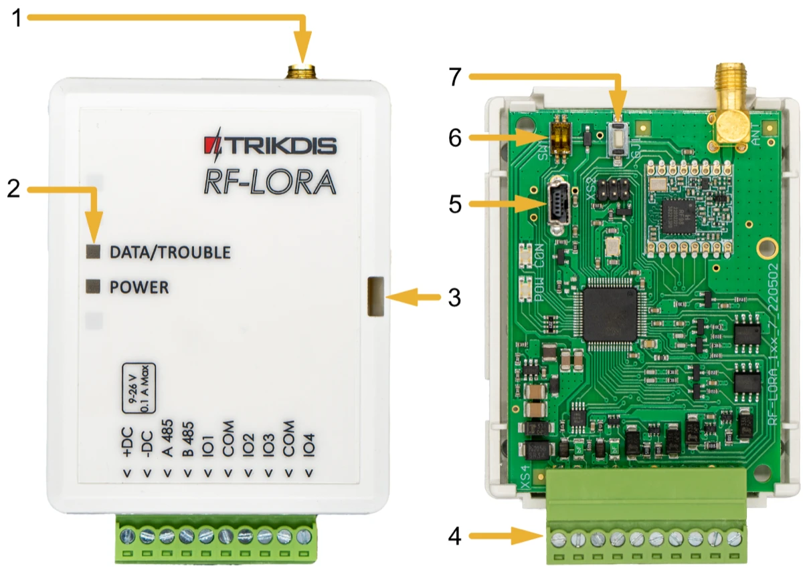
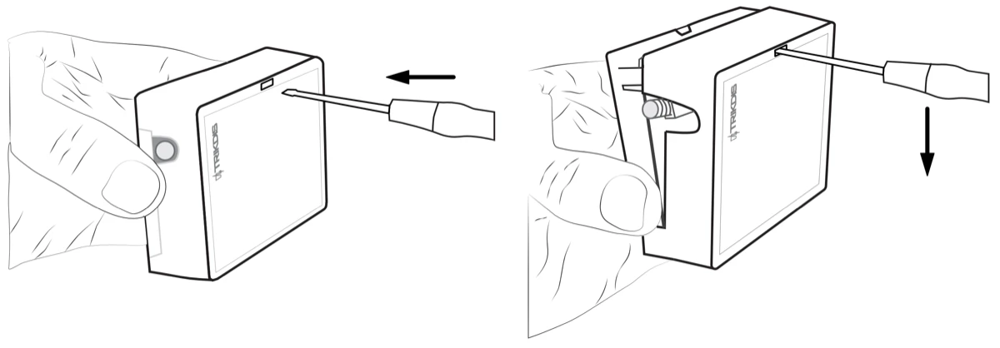
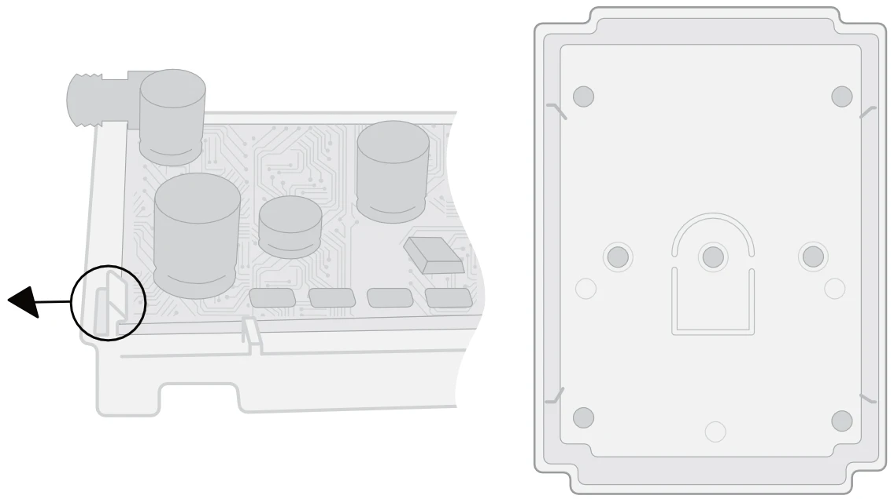
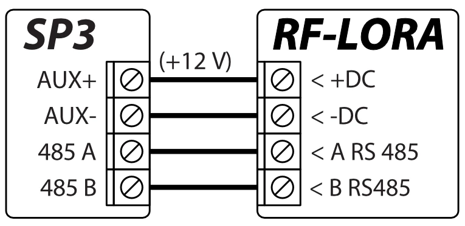
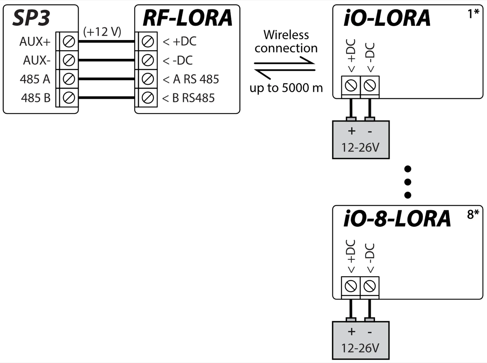
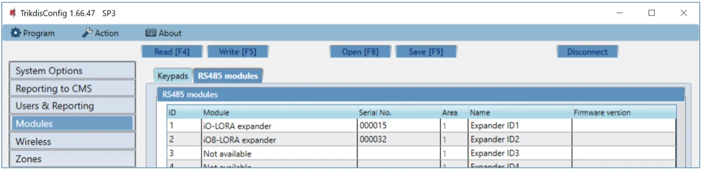
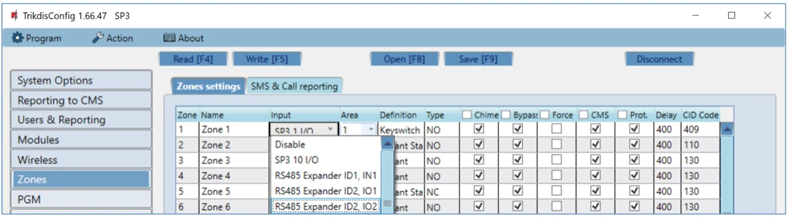
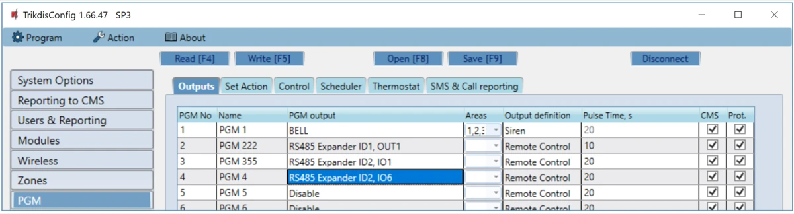

# Trådlös utbyggnadsmodul RF-LoRa

  

## Beskrivning

Radiotransceivern **RF-LORA** ökar tillsammans med de trådlösa utbyggnadsmodulerna iO-LORA och iO-8-LORA antalet ingångar och utgångar i centralapparaten ”FLEXi” SP3 med hjälp av dubbelriktad radiokommunikation.

Kompatibel med centralapparaten [SP3](../../control-panels/sp3/index.md) för inbrottslarm samt styrenheterna för port och dörr [GATOR Cellular](../../gate-controllers/gator/index.md) och [GATOR WiFi](../../gate-controllers/gator-wifi/index.md).
Upp till 8 LORA-moduler (iO-LORA, iO-8-LORA, PB-LORA) kan anslutas till centralapparaten ”FLEXi” SP3 med hjälp av radiotransceivern RF-LORA.

### Funktioner

**Kommunikation:**

- Trådlös räckvidd i fri sikt upp till 5000 m.

- En radiotransceiver *RF-LORA* kan anslutas till centralapparaten *”FLEXi” SP3*.

- Produkten levereras med en standardantenn som passar de flesta tillämpningar. <u>Om kommunikationen måste vara av hög kvalitet på största möjliga avstånd ska en antenn med högre förstärkning av radiosignalen användas (AX-ANT-KIT – 433 MHz, AX-ANT01S_SF – 868 MHz)</u>.

**Anslutning:**

- Radiotransceivern *RF-LORA* ansluts till centralapparaten *”FLEXi” SP3* via RS485-bussen.
### Specifikationer 

| Parameter | Beskrivning |
|----|----|
| Sändningsfrekvens | Utförande 8F: 867–869 MHz / utförande 4F: 433,3–434,7 MHz |
| Modulationstyp | LORA |
| Matningsspänning | 9–26 V DC |
| Strömförbrukning | Upp till 50 mA (vänteläge) / upp till 150 mA (kortvarigt, vid sändning) |
| Kryptering av meddelanden | Ja |
| Räckvidd i öppen miljö | Upp till 5000 m |
| Driftmiljö | Temperatur från –20 °C till +50 °C, relativ luftfuktighet upp till 80 % vid +20 °C |
| Mått | 62 × 82 × 25 mm |
| Vikt | 80 g |

### Utbyggnadsmodulens delar

1. SMA-kontakt för RF-antenn.
2. Lysindikatorer.
3. Öppningsspår på kapslingens framsida.
4. Plint för externa anslutningar.
5. USB Mini-B-kontakt för firmwareuppdatering.
6. DIP-switchen ”SW”.
7. Knappen ”DJ1” för att aktivera/avaktivera inlärningsläget för LORA-moduler.

!!! note "Inställningar för DIP-switchen 'SW'"
    1. Radiofrekvens (”OFF” - RF1; ”ON” - RF2). Används för att byta radiokanal om den aktuella kanalen är hårt belastad.
    2. Modulationstyp (”OFF” - snabb; ”ON” - långsam). Läget ”ON” ökar kommunikationsavståndet ungefär 2 gånger (beroende på omgivningen). Om förbindelsen är god i läget ”Off” rekommenderas det läget.

    **OBS!** I RF-LORA och övriga LORA-moduler måste lägena för switchen ”SW” vara desamma! Annars fungerar inte radiokommunikationen!

### Plintarnas funktion 

| Plint | Beskrivning                         |
|----------|-------------------------------------|
| +DC      | Matningsplint (9–26 V DC, plus)     |
| -DC      | Matningsplint (9–26 V DC, minus)    |
| A 485    | Plint A på bussen *RS485*           |
| B 485    | Plint B på bussen *RS485*           |
| IO1-IO4  | Används inte                        |
| COM      | Används inte                        |

### Lysdiodsindikering vid drift 

| Indikator | Ljussignal | Beskrivning |
|-----------|--------------|-------------|
| DATA/TROUBLE | Blinkar rött / fast rött sken | Kommunikationen med modulen är bruten |
| DATA/TROUBLE | Blinkar grönt/rött | Inlärningsläge för LORA-moduler |
| DATA/TROUBLE | Lyser grönt i 3 sekunder | LORA-modulen är redan inlärd (i inlärningsläge) |
| POWER | Släckt | Ingen matningsspänning |
| POWER | Blinkar grönt | Normal matningsspänning |
| POWER | Blinkar gult | Låg matningsspänning (≤11,5 V) |
| POWER | Fast gult sken | Ingen kommunikation med centralapparaten ”FLEXi” SP3 via RS485 |

## Kopplingsscheman 

### Montering 

1.  Ta bort locket.

2.  Ta ut kretskortet.

3.  Fäst kapslingens bottendel på önskad plats med skruvar.

4.  Sätt tillbaka kretskortet.

5.  Sätt tillbaka locket.

### Kopplingsschema för anslutning av radiotransceivern RF-LORA till centralapparaten ”FLEXi” SP3 

### Kopplingsscheman för anslutning av LORA-moduler 

## Konfiguration med TrikdisConfig

1.  En radiotransceiver RF-LORA måste vara ansluten till centralapparaten ”FLEXi” SP3.

2.  Slå på matningen till centralapparaten ”FLEXi” SP3.

3.  Slå på matningen till de trådlösa utbyggnadsmodulerna iO-LORA och/eller iO-8-LORA.

4.  Starta ***TrikdisConfig**.*

5.  Anslut ”FLEXi” SP3 till en dator med en USB Mini-B-kabel eller anslut till ”FLEXi” SP3 på distans.

6.  Klicka på knappen **Read [F4]** så att programmet läser de parametrar som är inställda i centralapparaten ”FLEXi” SP3. Om ett fönster för administratörskoden öppnas, ange den sexsiffriga administratörskoden.

7.  Välj ”**iO-LORA expander**” (”**iO-8-LORA expander**”) i listan ”**Modules**”.

8.  Ange iO-LORA-modulens (iO-8-LORA-modulens) serienummer i fältet ”**Serial No.**”.

9.  Ställ in expanderns ingång på fliken ”**Zones**”.

10. Konfigurera expanderns PGM-utgång på fliken ”**PGM**”.

11. Klicka på knappen **Write [F5]** när konfigurationen är klar.

12. Vänta tills uppdateringen är klar.

13. Klicka på knappen ”**Disconnect**” och koppla bort USB-kabeln.

14. Påverka ingångarna och koppla utgångarna för att testa enheten.

## Säkerhetskrav 

Inbrottslarmsmodulen ska installeras och underhållas av behörig personal.

Läs den här manualen noggrant före installationen för att undvika misstag som kan leda till funktionsfel eller till och med skador på utrustningen.

Koppla alltid bort matningen innan du gör några elektriska anslutningar.

Ändringar, modifieringar eller reparationer som inte har godkänts av tillverkaren upphäver garantin.

Följ dina lokala bestämmelser för avfallssortering och släng inte utrustningen eller dess komponenter bland vanligt hushållsavfall.
