# Trådlös radiotransceiver RF-S8

  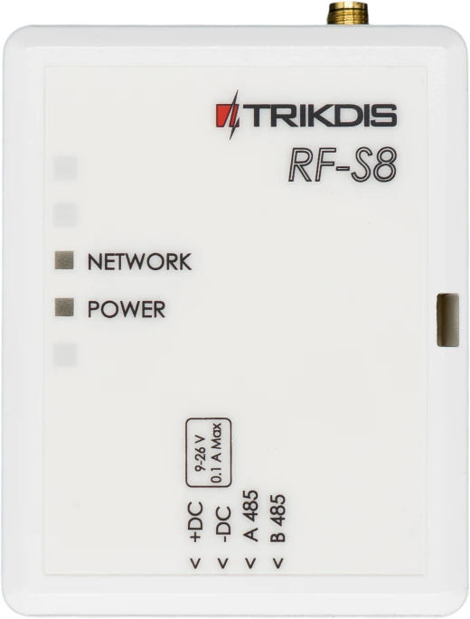

## Beskrivning 

Med radiotransceivern RF-S8 ansluten kan *”**FLEXi” SP3 arbeta med trådlösa ”S8***”-detektorer, sirener och fjärrkontroller.

Kompatibel med centralapparaten [SP3](../../control-panels/sp3/index.md) för inbrottslarm.

### Funktioner

**Kommunikation:**

- Trådlös räckvidd i fri sikt upp till 500 m.

- En radiotransceiver *RF-S8* kan anslutas till centralapparaten *”FLEXi” SP3*.

- Produkten levereras med en standardantenn som passar de flesta tillämpningar.

**Anslutning:**

- Radiotransceivern *RF-S8* ansluts till centralapparaten *”FLEXi” SP3* via RS485-bussen.
### Tekniska specifikationer 

| **Parameter** | **Beskrivning** |
|----|----|
| Matningsspänning [DC] | 9–26 V DC |
| Strömförbrukning | Upp till 50 mA (vänteläge) / upp till 100 mA (kortvarigt, vid sändning) |
| Radiofrekvens | 868 MHz |
| Radiosignalens styrka | 25 mW |
| Räckvidd | Upp till 500 m |
| Driftmiljö | Temperatur från -10 °C till +50 °C, relativ luftfuktighet 80 % vid +20 °C, ingen kondens. |
| Mått | 92 × 62 × 25 mm |
| Vikt | 0,08 kg |

### Radiotransceiverns delar 

1.  SMA-kontakt för RF-antenn.

2.  Lysindikatorer.

3.  Öppningsspår på kapslingens framsida.

4.  Plint för externa anslutningar.

5.  USB Mini-B-kontakt för firmwareuppdatering.

6.  Knapp för att slå på/stänga av inlärningsläget.

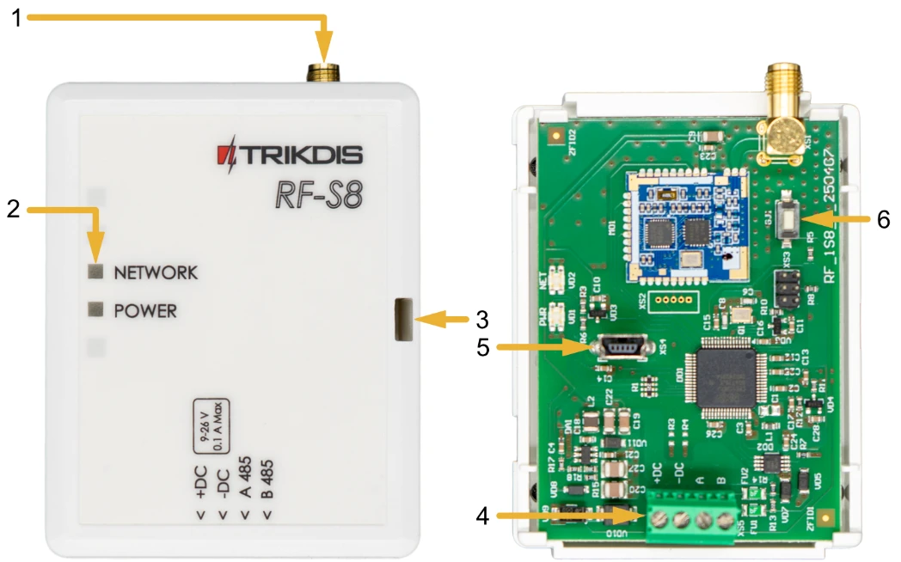

### Plintarnas funktion 

| **Plint** | **Beskrivning**                     |
|--------------|-------------------------------------|
| +DC          | Matningsplint (9–26 V DC, plus)     |
| -DC          | Matningsplint (9–26 V DC, minus)    |
| A 485        | Plint A på bussen *RS485*           |
| B 485        | Plint B på bussen *RS485*           |

### Lysdiodsindikering vid drift 

| Lysdiodsindikator | Ljussignal | Beskrivning |
|---------------|--------------|-------------|
| NETWORK | Blinkar grönt/rött | Inlärningsläge för detektorer |
| NETWORK | Lyser grönt i 5 sekunder | Detektorn är inlärd (i inlärningsläge) |
| POWER | Släckt | Ingen matningsspänning |
| POWER | Blinkar grönt | Matningsspänningen är normal |
| POWER | Blinkar gult | Matningsspänningen är låg (≤11,5 V). |
| POWER | Fast gult sken | Ingen kommunikation med centralapparaten via RS485 |

## Byte av centralapparatens firmware 

Firmwaren i centralapparaten ”FLEXi” SP3 måste bytas till revision 4 **SP3_xxx4\_0122.fw** (firmwareversion 1.22 eller högre), vilket krävs för att trådlösa ”**S8**”-detektorer ska fungera. Den trådlösa radiotransceivern RF-S8 måste vara ansluten till centralapparaten.

Gör så här för att byta firmware:

1.  Anslut radiotransceivern RF-S8 och ”FLEXi” SP3 enligt schemat.

2.  Slå på matningen till centralapparaten ”FLEXi” SP3.

3.  Starta ***TrikdisConfig**.*

4.  Anslut ”FLEXi” SP3 till en dator med en USB Mini-B-kabel.

5.  Öppna fönstret ”**Firmware**” i TrikdisConfig.

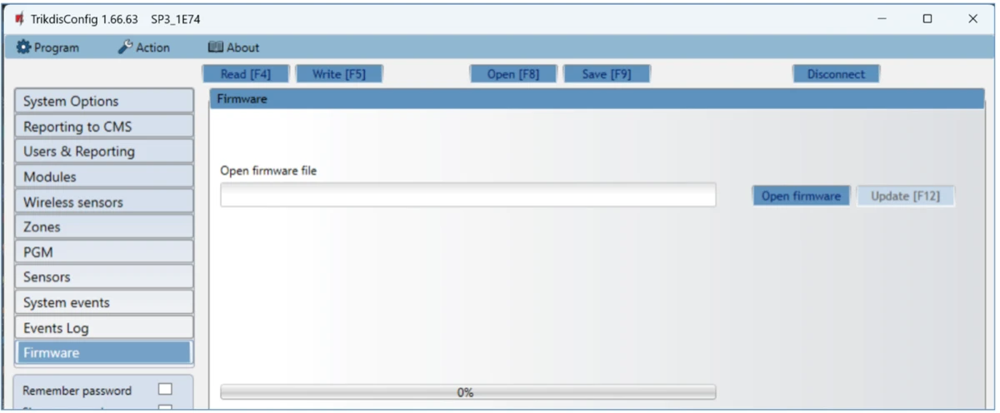

6.  Klicka på knappen ”**Open Firmware**” och välj firmwarefilen **SP3_xxx4\_0122.fw**.

7.  Klicka på knappen **Update [F12]**.

8.  Vänta tills uppdateringen är klar.

9.  Koppla bort USB Mini-B-kabeln.

10. Vänta 1 minut.

11. Anslut en USB Mini-B-kabel till ”FLEXi” SP3.

12. I TrikdisConfigs statusrad måste siffran 4 finnas i centralapparatens namn.

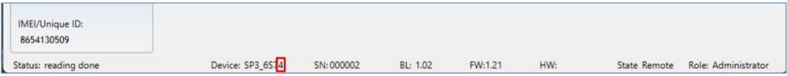

13. Listan över moduler ska visa ”**RF-S8 transceiver**” samt serienummer och firmwareversion. Om du ser firmwareversionen för RF-S8 kan du hoppa över steg 14–22.

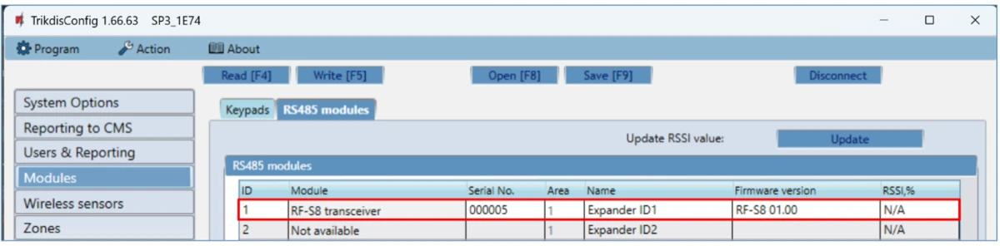

14. Om listan inte visar ”**RF-S8 transceiver**” måste du välja ”**RF-S8 transceiver**” i listan.

15. Ange RF-S8-modulens serienummer i fältet ”**Serial No.**”. Serienumret finns på enheten och på etiketten på förpackningen.

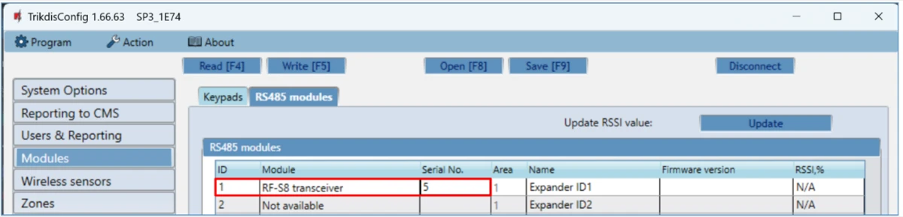

16. Klicka på **Write [F5]**.

17. Koppla bort USB Mini-B-kabeln.

18. Vänta 1 minut så att ”FLEXi” SP3 hinner lära in RF-S8.

19. Anslut en USB Mini-B-kabel till ”FLEXi” SP3.

20. Klicka på **Read [F4]**.

21. RF-S8:s firmwareversion visas i fönstret ”**Modules**”.

22. RF-S8-modulen är nu inlärd i ”FLEXi” SP3.

23. Koppla bort USB Mini-B-kabeln.

24. Klicka på ”**Disconnect**”.

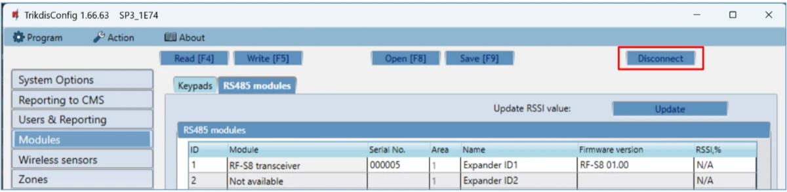

25. Vänta 1 minut.

## Inlärning av trådlösa detektorer 

### Inlärning av trådlösa detektorer på distans 

Anslut till centralapparaten ”FLEXi” SP3 på distans med TrikdisConfig.

!!! warning "Viktigt"
    Fjärrkonfigurering fungerar bara när ”FLEXi” SP3:

    1.  Ett aktiverat SIM-kort är isatt och PIN-koden är angiven eller
        avstängd.

    2.  Mobildata är aktiverad på SIM-kortet.

    3.  Molntjänsten Protegus måste vara aktiverad.

    4.  Matningen är påslagen (lysdioden ”**PWR**” måste blinka
        grönt).

    5.  Är ansluten till nätverket (lysdioden ”**NET**” måste lysa fast grönt och
        blinka gult).

!!! warning "Viktigt"
    **Trådlösa detektorer kan läras in i centralapparaten och likaså raderas ur den.
    <u>När inlärningen av trådlösa detektorer raderas får centralapparaten inte
    vara i inlärningsläge för trådlösa detektorer.</u> Innan trådlösa detektorer
    lärs in ska deras inlärning raderas ur centralapparaten.
    Tryck på inlärningsknappen och håll den intryckt i 5 sekunder. Släpp knappen
    när indikatorn blinkar grönt tre gånger. Den trådlösa detektorns
    inlärning raderas då ur centralapparaten** **Vi rekommenderar att du gör
    detta för alla trådlösa detektorer innan de lärs in.
    VIKTIGT: OM INLÄRNINGEN AV EN TRÅDLÖS DETEKTOR RADERAS AV MISSTAG
    FUNGERAR DEN INTE MED CENTRALAPPARATEN.**

Ange centralapparatens ”**IMEI/Unique ID**” i avsnittet ”**Remote access**”. Numret finns på enheten och på etiketten på förpackningen.

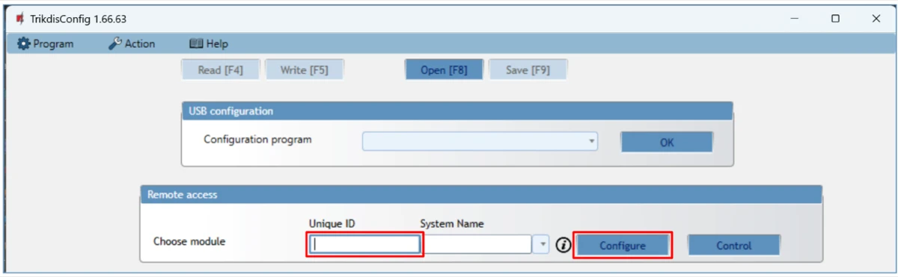

Klicka på ”**Configure**”.

Klicka på **Read [F4]** i det fönster som öppnas. Ange administratörs- eller installatörskoden om det behövs.

Gå till fönstret ”**Wireless sensors**”.

Klicka på knappen ”**Learn sensors**”.

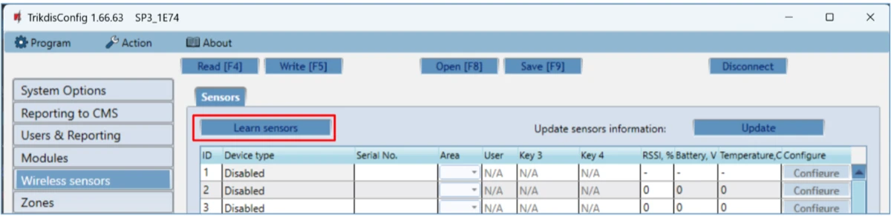

Alla trådlösa detektorer kan läras in samtidigt. Sätt i batterier i de trådlösa detektorerna (PIR, magnetkontakt, översvämningsdetektor, rökdetektor, siren).

**Vid inlärning av detektorer måste modulen *RF-S8* vara minst 1 m från detektorerna.**

1.  Lysdioden ”**NETWORK**” på modulen RF-S8 blinkar grönt/rött.

2.  Modulen RF-S8 går över i inlärningsläge. TrikdisConfig öppnar fönstret för inlärning av detektorer.

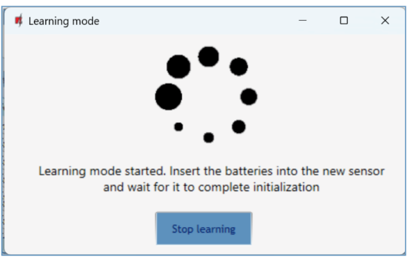

3.  Tryck på inlärningsknappen och håll den intryckt i 5 sekunder. Släpp knappen när indikatorn blinkar grönt fyra gånger.

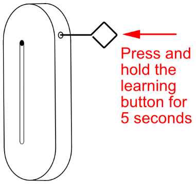

4.  På modulen RF-S8 lyser lysdioden ”**NETWORK**” grönt en kort stund (det betyder att detektorn är inlärd). Efter några sekunder börjar indikatorn ”**NETWORK**” blinka grönt/rött igen.

5.  TrikdisConfig öppnar ett nytt fönster där du måste ange ett ”**Zone Number**” och en ”**Zone Definition**” för den trådlösa detektorn.

6.  Klicka på ”**Save**”.

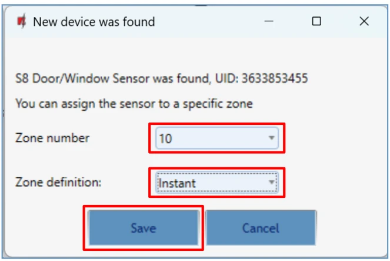

7.  Den trådlösa detektorn finns nu i listan över detektorer.

8.  Om du vill lägga till nästa detektor trycker du på inlärningsknappen på detektorn och gör inställningarna som beskrivs ovan.

9.  Klicka på ”**Stop learning**” för att avsluta inlärningen av trådlösa detektorer.

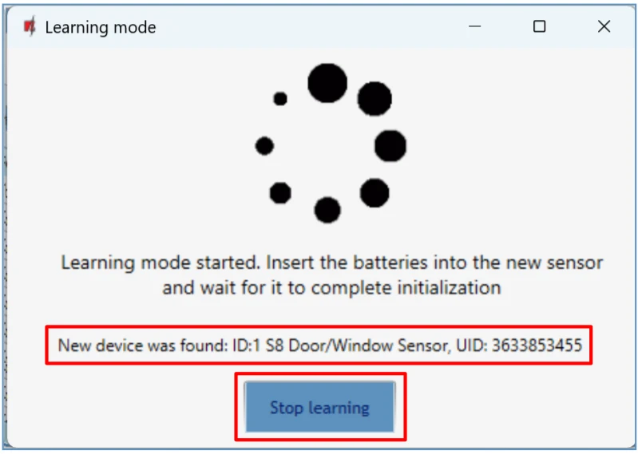

10. Klicka på ”**Yes**” för att skriva detektorerna till centralapparaten ”FLEXi” SP3, eller på ”**No**” om du vill justera parametrarna ytterligare.

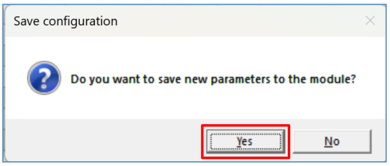

Vänta några minuter. Klicka på **Read [F4].**

TrikdisConfig visar en lista över inlärda trådlösa detektorer i fönstret ”**Wireless sensors**”. Fältet ”**Serial No.**” visar serienumret.

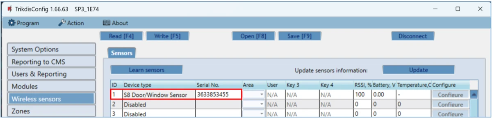

Kontrollera att detektorerna är rätt tilldelade centralapparatens ”**Zones**” (sektioner) och ”**Areas**” (områden) (fönstret ”**Zones**”).

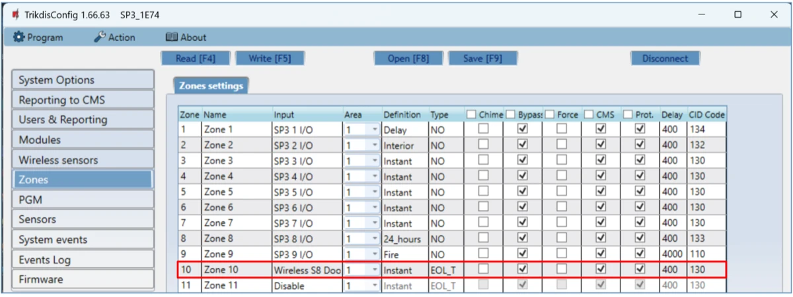

Om du ställer in sektionens ”**Type**” på EOL-T aktiveras sabotageövervakning av detektorn.

Tryck på **Write [F5]** när du har gjort ändringarna.

!!! note
    Ta bort trådlösa detektorer ur minnet i ”FLEXi” SP3:
    
    1.  Starta ***TrikdisConfig**.*
    
    2.  Anslut ”FLEXi” SP3 till en dator med en USB Mini-B-kabel
        eller anslut till ”FLEXi” SP3 på distans. Klicka på knappen
        **Read [F4]**.
    
    3.  I TrikdisConfig, i fönstret ”**Wireless sensors**”, i
        kolumnen ”**Device type**”, välj ”**Disabled**” i stället för den
        trådlösa detektor som ska tas bort och klicka på **Write [F5]**.
        Den trådlösa detektorn är nu borttagen ur minnet i ”FLEXi”
        SP3.
### Inlärning av trådlösa detektorer utan fjärråtkomst 

Alla trådlösa detektorer kan läras in samtidigt. Sätt i batterier i de trådlösa detektorerna (PIR, magnetkontakt, översvämningsdetektor, rökdetektor, siren). **Vid inlärning av detektorer måste modulen *RF-S8* vara minst 1 m från detektorerna.**

1.  Kontrollera att radiotransceivern RF-S8 är inlärd i centralapparaten ”FLEXi” SP3.

2.  Slå på matningen till centralapparaten ”FLEXi” SP3.

3.  Ta av locket från radiotransceivern RF-S8.

4.  Tryck på knappen ”**LEARN**” på modulen RF-S8 och håll den intryckt tills indikatorn ”**NETWORK**” börjar blinka grönt/rött.

5.  Släpp knappen ”**LEARN**”.

6.  Den blinkande indikatorn ”**NETWORK**” visar att RF-S8 är i inlärningsläge för trådlösa enheter.
7.  Tryck på inlärningsknappen och håll den intryckt i 5 sekunder. Släpp knappen när indikatorn blinkar grönt fyra gånger.

8.  På modulen RF-S8 lyser lysdioden ”**NETWORK**” grönt en kort stund (det betyder att detektorn är inlärd).

9.  Efter några sekunder börjar indikatorn ”**NETWORK**” blinka grönt/rött igen.

10. Om du vill lägga till nästa detektor trycker du på inlärningsknappen på detektorn.

11. Avsluta inlärningen av trådlösa detektorer genom att trycka på knappen ”**LEARN**” och hålla den intryckt tills indikatorn ”**NETWORK**” slutar blinka grönt/rött. Släpp knappen ”**LEARN**”. Radiotransceivern RF-S8 har lämnat inlärningsläget.

12. Anslut en USB Mini-B-kabel till ”FLEXi” SP3.

13. Starta TrikdisConfig. Klicka på knappen **Read [F4]**.

14. Fönstret ”**Wireless sensors**” i TrikdisConfig visar en lista över inlärda trådlösa enheter. Fältet ”**Serial No.**” visar detektorernas serienummer.

15. Kontrollera att detektorerna är rätt tilldelade centralapparatens ”**Zones**” (sektioner) och ”**Areas**” (områden) (fönstret ”**Zones**”).

16. Tryck på **Write [F5]** när du har gjort ändringarna.

17. De trådlösa detektorerna är inlärda.
