# Snabbinstallation av GATOR LTE och GATOR WiFi med iO4R

  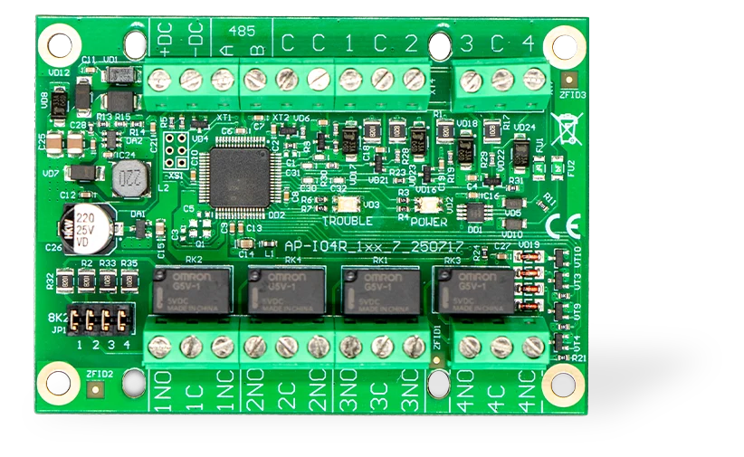

Korta anvisningar för inkoppling och programmering i Protegus2 när en utbyggnadsmodul iO4R ansluts till en styrenhet för port, GATOR LTE eller GATOR WiFi. Använd anvisningen tillsammans med de fullständiga manualerna för [GATOR](../gator/index.md) och [GATOR WiFi](../gator-wifi/index.md) för alla övriga installations- och konfigurationsinställningar.

iO4R används för avancerad övervakning av porten. Modulen ger övervakade bevakningsingångar för portens säkerhetsgivare och gör det möjligt för behörig personal att tillfälligt förbikoppla en givare när ett fel måste isoleras tills service kan utföras. Protegus2 räknar också hela öppnings- och stängningscykler för porten och varnar när det är dags för underhåll, så att installatörer kan ersätta oplanerade utryckningar med schemalagda servicebesök och återkommande underhållsavtal.

!!! caution "Försiktighet"
    Installation och service får endast utföras av behörig personal. Koppla bort nätspänningen och lågspänningsmatningen innan du drar ledningarna. Följ portautomatikens tillverkares säkerhetsanvisningar och gällande lokala elföreskrifter.

## Förutsättningar

- Styrenheten GATOR LTE eller GATOR WiFi finns tillgänglig för installation. Håll matningen frånkopplad under inkopplingen.
- iO4R-modulens serienummer.
- Protegus2-konto för larmbolag eller installatör samt styrenhetens IMEI / unika ID.
- Givare för portens läge ansluten till styrenhetens ingång för portläge.
- Portens säkerhetsgivare anslutna via iO4R, om de ska övervakas eller förbikopplas i Protegus2.

## Inkoppling

Anslut iO4R till styrenhetens RS485-buss och matningsplintar enligt bilden nedan.

!!! note "Obs!"
    Kopplingsschemat visar plintbeteckningarna på GATOR LTE. För GATOR WiFi använder du motsvarande plintar `+DC`, `-DC`, `A RS485` och `B RS485` enligt manualen för GATOR WiFi.

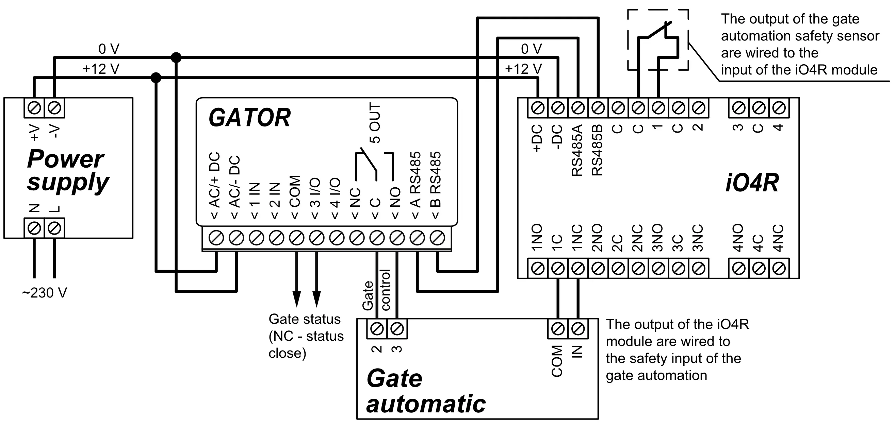

Modulen iO4R används för att förbikoppla felaktiga säkerhetsgivare i portautomatiken. När du förbikopplar defekta givare och aktiverar portmekanismen ska du alltid kontrollera att inga hinder finns inom portens rörelseområde. 
Portens säkerhetsgivare är kopplade till portautomatikens styrenhet via iO4R-modulen. Modulen har fyra oberoende kanaler med ingång och utgång. Varje ingångskanal hör ihop med motsvarande reläutgångskontakter enligt följande:

- Ingång 1 → utgång 1 (1 NO / 1 C / 1 NC).
- Ingång 2 → utgång 2 (2 NO / 2 C / 2 NC).
- Ingång 3 → utgång 3 (3 NO / 3 C / 3 NC).
- Ingång 4 → utgång 4 (4 NO / 4 C / 4 NC).

Använd `3 I/O` som ingång för portläge vid cykelräkning. En cykel räknas först när porten har öppnats helt och stängts helt.

!!! important "Viktigt"
    I övervakningsinställningarna i Protegus2 är `I/O 3` reserverad för portläge och cykelräkning. Tilldela den inte om. Ingångarna `IN1` och `IN2` är reserverade för Wiegand.

## Lägg till styrenheten och iO4R i Protegus2

Logga in i Protegus2 med kontot för larmbolag eller installatör och lägg sedan till styrenheten.

  

    <strong>Steg 1.</strong> Tryck på <strong>Add new system</strong>.
    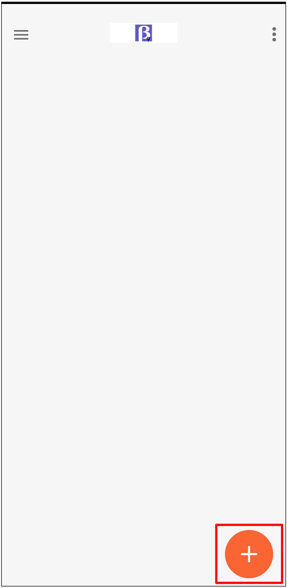
  

  

    <strong>Steg 2.</strong> Ange styrenhetens <strong>IMEI</strong> och tryck på <strong>Next</strong>.
    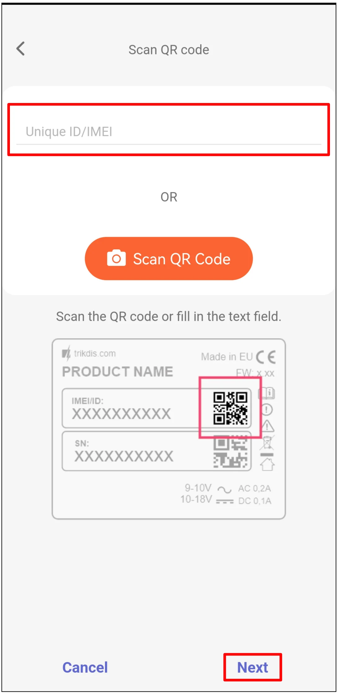
  

  

    <strong>Steg 3.</strong> Välj <strong>Advanced Gator Monitoring</strong> och tryck på <strong>Next</strong>.
    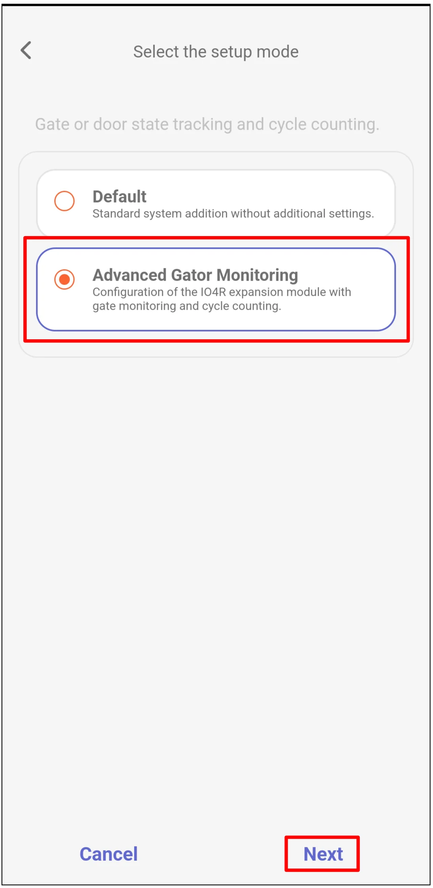
  

  

    <strong>Steg 4.</strong> Ange antal <strong>Cycles</strong> efter vilket underhåll krävs och tryck på <strong>Next</strong>.
    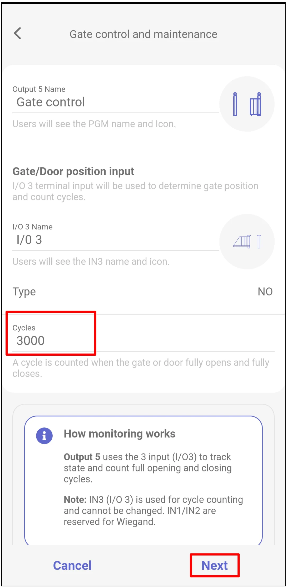
  

  

    <strong>Steg 5.</strong> Aktivera varje iO4R-utgång som är ansluten till en övervakad säkerhetsgivare eller statuskrets.
    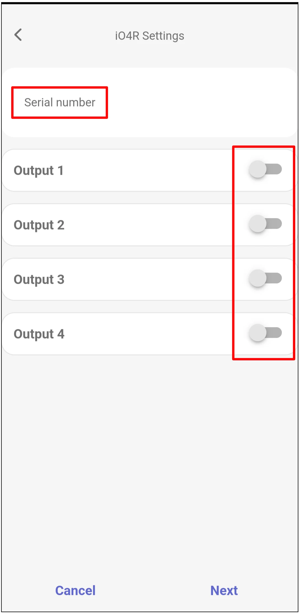
  

  

    <strong>Steg 6.</strong> Ange iO4R:s <strong>Serial number</strong> och tryck på <strong>OK</strong>.
    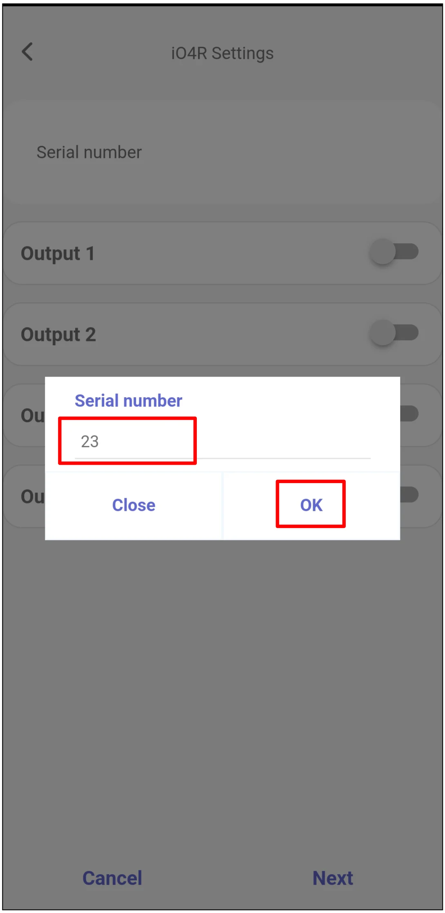
  

  

    <strong>Steg 7.</strong> För varje aktiverad utgång: ange namn och ikon, låt utgångens <strong>Type</strong> vara <strong>Guard</strong>, tilldela motsvarande iO4R-ingång och ställ in ingångens <strong>Type</strong> så att den stämmer med inkopplingen. I exemplet är ingångstypen <strong>NO</strong>. Tryck på <strong>Next</strong>.
    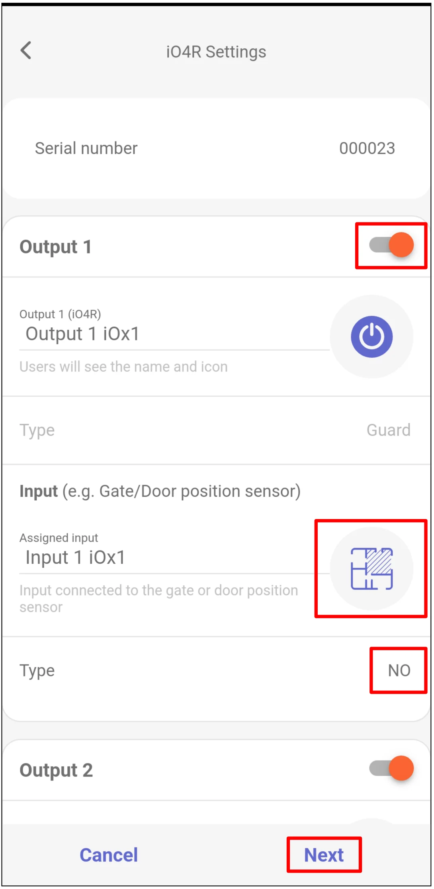
  

  

    <strong>Steg 8.</strong> Vänta medan Protegus2 skriver data.
    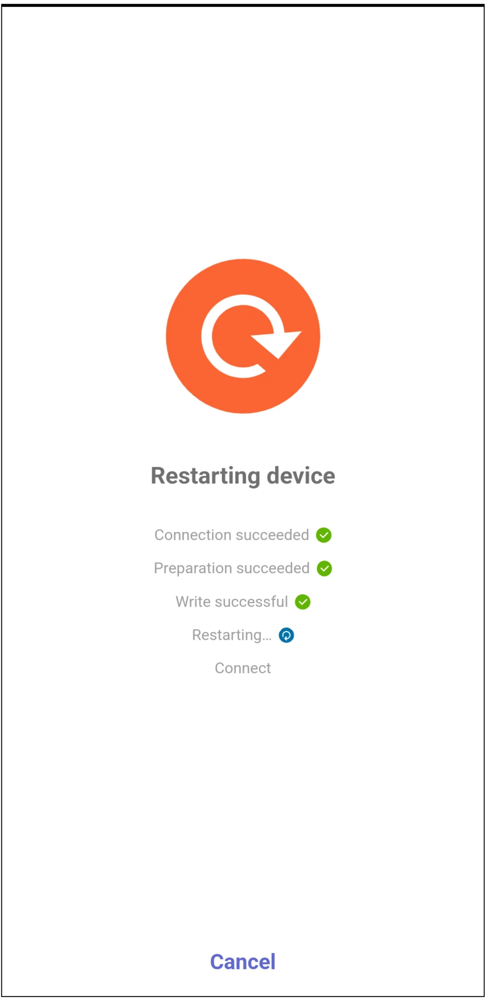
  

  

    <strong>Steg 9.</strong> Tryck på <strong>Next</strong>.
    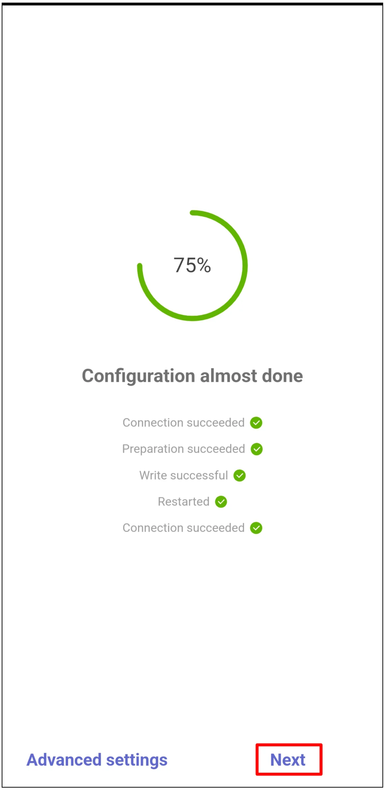
  

  

    <strong>Steg 10.</strong> Ange systemets <strong>Name</strong> och tryck på <strong>Next</strong>.
    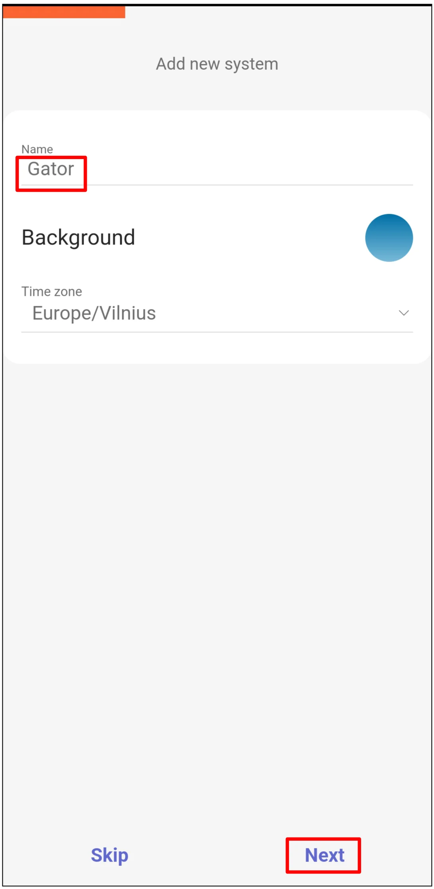
  

  

    <strong>Steg 11.</strong> Tryck på <strong>Skip</strong> om du inte vill lägga till användare nu.
    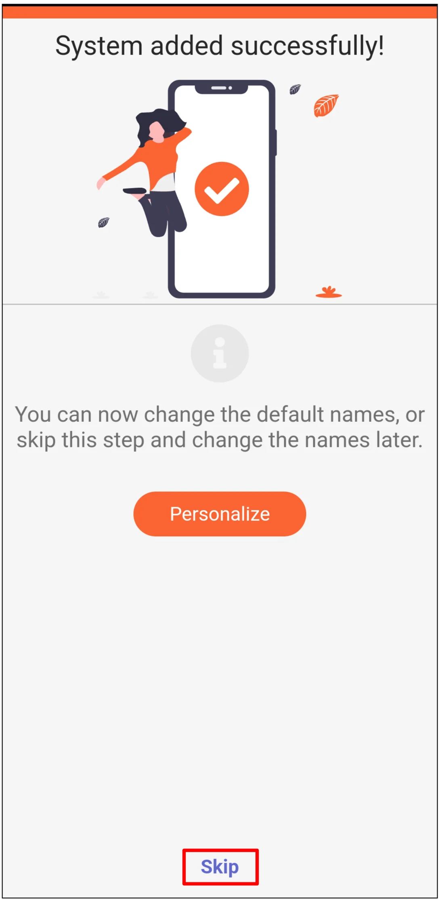
  

  

    <strong>Steg 12.</strong> Vänta ca 1 minut tills det är klart.
    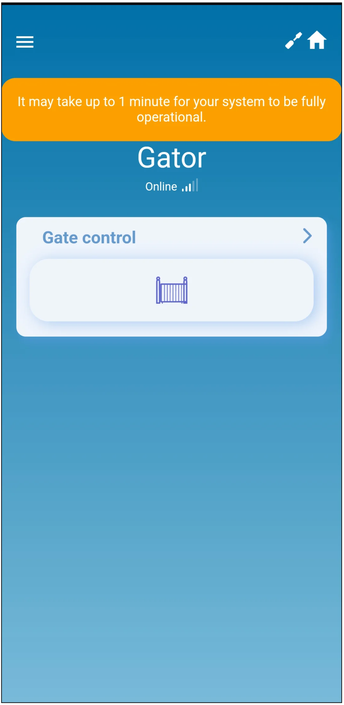
  

## Överför systemet till användaren

När inställningarna är klara överför du systemet till användarens Protegus2-konto.

  

    <strong>Steg 13.</strong> Tryck på <strong>Menu</strong>.
    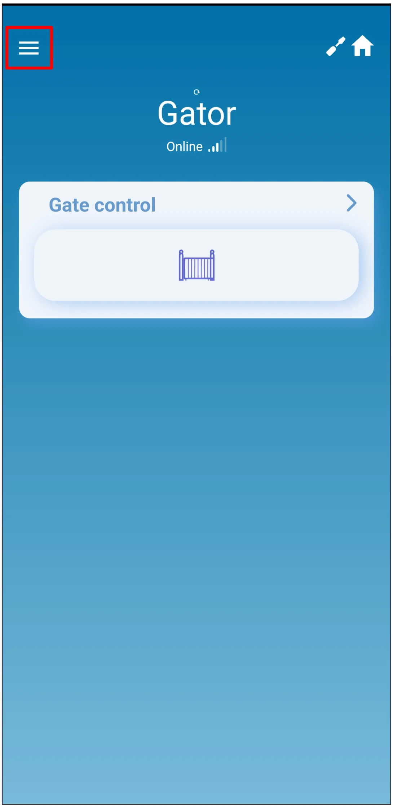
  

  

    <strong>Steg 14.</strong> Tryck på <strong>Settings</strong>.
    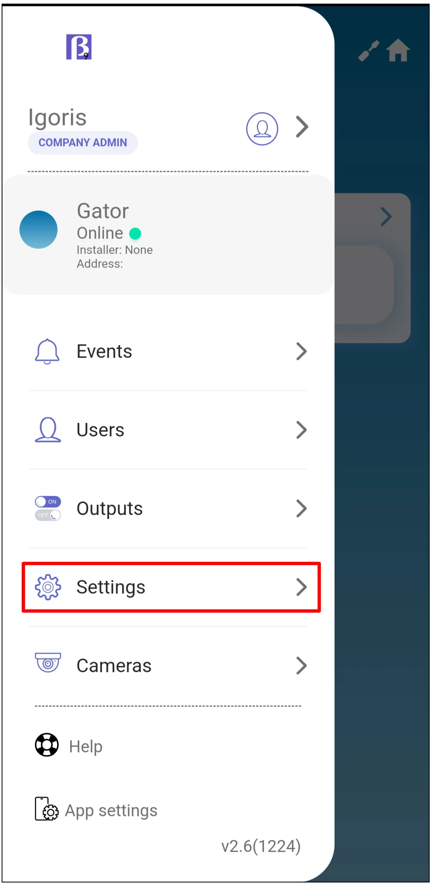
  

  

    <strong>Steg 15.</strong> Tryck på <strong>Transfer system</strong>.
    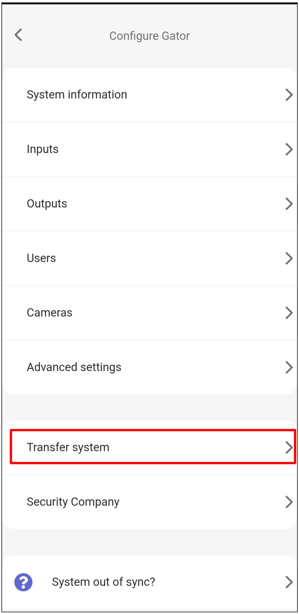
  

  

    <strong>Steg 16.</strong> Ange användarens e-postadress och tryck på <strong>Transfer</strong>.
    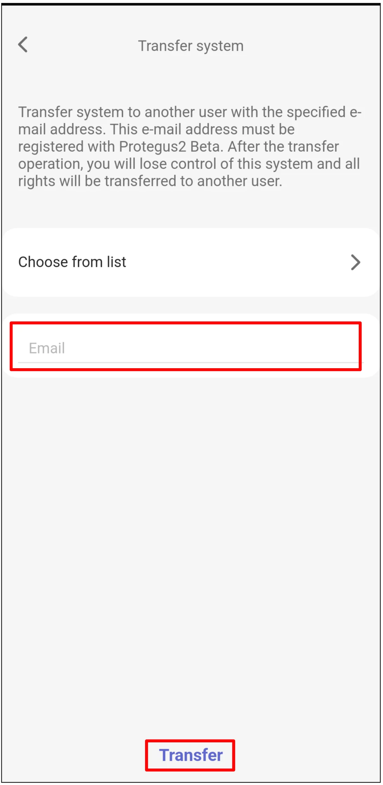
  

## Kontrollera övervakning och styrning av porten

Användaren måste logga in i Protegus2 med sitt konto efter överföringen.

!!! warning "Varning"
    Förbikoppling av en säkerhetsgivare i porten kan sätta skyddet ur funktion. Använd förbikoppling endast som en tillfällig, behörig serviceåtgärd och återställ givarens normala drift innan anläggningen tas i bruk igen.

  

    <strong>Steg 17.</strong> Tryck på <strong>Gate control</strong> för att se cykelräknaren.
    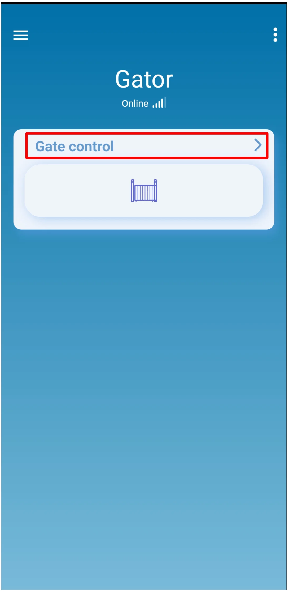
  

  

    <strong>Steg 18.</strong> Kontrollera <strong>Total cycles</strong> och <strong>Cycles to maintenance</strong>. Om behörig installatör behöver kontrollera säkerhetsgivarnas status trycker du på <strong>Input status</strong>.
    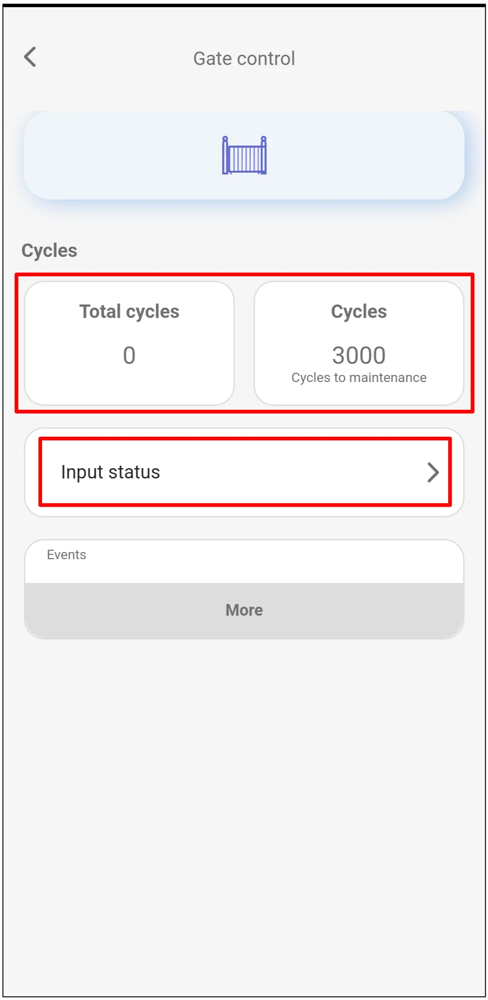
  

  

    <strong>Steg 19.</strong> Använd <strong>Input status / bypass</strong> endast när en säkerhetsgivare har kontrollerats och en tillfällig förbikoppling behövs.
    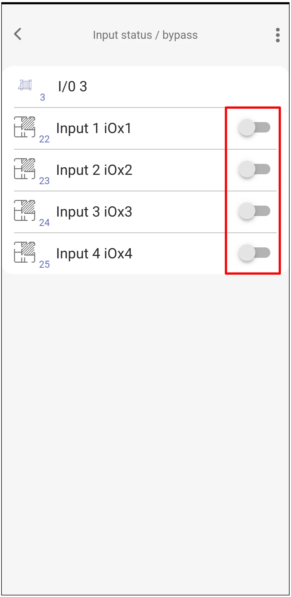
  

  

    <strong>Steg 20.</strong> Tryck på ikonen för portstyrning för att öppna porten.
    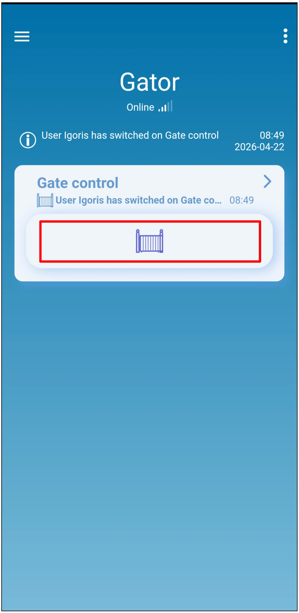
  

## Systemkontroll

1. Öppna och stäng porten helt och kontrollera att cykelräknaren ändras som förväntat.
2. Påverka varje övervakad iO4R-ingång och kontrollera att ingångens status ändras i Protegus2.
3. Testa ikonen för portstyrning och kontrollera att portautomatiken svarar som den ska.
