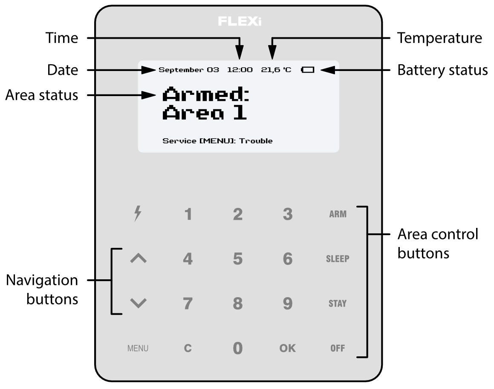

# FLEXi / knappsats SK-LCD TouchPad – kort användarguide

## Översikt över knappsatsen

> [!NOTE]
> Knappsatsen SK-LCD TouchPad för styrning av larmsystemet visar status för 64 sektioner och 8 områden. Knappsatsen SK-LCD TouchPad kan dessutom tilldelas ett eller flera önskade områden att styra (knappsatsens firmwareversion från FW:1.41, centralapparatens firmwareversion från FW:SP3_xxx4_0119. Knappsatsens firmwareversion visas om du trycker på **MENU** **5** **0**). Knappsatsen visar status för det tilldelade området och områdets sektioner.

## Tillkoppling / frånkoppling av larmsystemet

### Tillkoppla larmsystemet

Kontrollera att inget område är skadat.

1. Tryck på knappen **ARM**.

2. Ange **[Användarkod]**.

3. Om systemet bara har ett område hoppar du över steg 4 och 5.

4. Tryck på knapparna för de områden du vill styra.

5. Bekräfta valet genom att trycka på knappen **OK**.

6. Lämna lokalen inom utpasseringstiden.

Under nedräkningen av utpasseringstiden (**Exit Delay**) visas den återstående tiden på knappsatsen. När tillkopplingen är aktiv visas texten: **Armed: Area**.

### Frånkoppla larmsystemet

1. Tryck på knappen **OFF**.

2. Ange **[Användarkod]**.

3. Om systemet bara har ett område hoppar du över steg 4 och 5.

4. Tryck på knapparna för de områden du vill styra.

5. Bekräfta valet genom att trycka på knappen **OK**.

När larmet är frånkopplat visas texten **Disarmed: Area** i knappsatsens display.

> [!NOTE]
> Om du vill ändra ett områdes status till motsatsen räcker det att ange användarkoden och välja önskat område. Radera inmatade tecken eller kommandon genom att trycka på knappen **C**.

### Aktivera SLEEP-läge

(Lokalens skalskydd är tillkopplat. Rörelse inne i lokalen är tillåten. Om du öppnar ytterdörren utlöses larmet omedelbart):

1. Tryck på knappen **SLEEP**.

2. Ange **[Användarkod]**.

3. Om systemet bara har ett område hoppar du över steg 4 och 5.

4. Tryck på knappen för det område som ska tillkopplas.

5. Bekräfta valet genom att trycka på knappen **OK**.

6. SLEEP-läget slås på direkt, utan utpasseringstid.

7. Följande text visas i knappsatsens display: **Sleep: Area**.

### Aktivera STAY-läge

(Lokalens skalskydd är tillkopplat. Rörelse inne i lokalen är tillåten. När ytterdörren öppnas startar en fördröjning, och inom den tiden måste du frånkoppla larmet):

1. Tryck på knappen **STAY**.

2. Ange **[Användarkod]**.

3. Om systemet bara har ett område hoppar du över steg 4 och 5.

4. Tryck på knappen för det område som ska tillkopplas.

5. Bekräfta valet genom att trycka på knappen **OK**.

6. STAY-läget slås på direkt, utan utpasseringstid.

7. Följande text visas i knappsatsens display: **Stay: Area**.

## Nödknappar

### Skicka ett nödmeddelande till larmbolaget

- **Panic** (överfallslarm) – håll knapp **1** nedtryckt i 3 sekunder.

- **Medical Aid** (medicinsk hjälp) – håll knapp **4** nedtryckt i 3 sekunder.

- **Fire Service** (brandlarm) – håll knapp **7** nedtryckt i 3 sekunder.

## Justera ljusstyrka och indikeringsljud

### Justera knappsatsens ljusstyrka och indikeringsljud

1. Tryck på knappen **MENU**.

2. Tryck på knapp **5**.

3. Tryck på knapp **2** för att justera volymen och använd knapparna   för att ställa in önskad volym. Bekräfta valet genom att trycka på knappen **OK**.

4. Tryck på knapp **4** för att justera displayens ljusstyrka. Använd knapparna   för att ställa in önskad ljusstyrka. Bekräfta valet genom att trycka på knappen **OK**.

5. Tryck på knapp **3** för att justera knapparnas ljusstyrka. Använd knapparna   för att ställa in önskad ljusstyrka. Bekräfta valet genom att trycka på knappen **OK**.

## Ange eller ändra användar- eller masterkoder

### Lägga in en ny användarkod eller ändra en befintlig

1. Tryck på knappen .

2. Ange **[Administratörskod]** (förval: 123456).

3. Ange användarens tvåsiffriga löpnummer, t.ex. **02**.

4. Ange den 4-siffriga **[Användarkod]**.

5. Ange den 4-siffriga **[Användarkod]** en gång till.

6. Tryck på löpnumren för de områden som användaren ska styra.

7. Bekräfta valet genom att trycka på knappen **OK**.

8. Tryck på knappen **C** för att lämna läget.

## Återställning av tvåtrådiga branddetektorer (rökdetektorer)

### Återställa tvåtrådiga branddetektorer (rökdetektorer)

- Håll knappen  nedtryckt i 3 sekunder.

> [!NOTE]
> Tvåtrådiga branddetektorer återställs inte automatiskt efter att en brand har detekterats. De kan bara återställas manuellt.

## Tillfällig förbikoppling av sektionsbevakning (funktionen BYPASS)

### Aktivera funktionen BYPASS

1. Tryck på knappen **MENU**.

2. Tryck på knapp **3**.

3. Ange **[Användarkod]**.

4. Ange sektionens tvåsiffriga löpnummer för att avaktivera bevakningen av den. Om du vill avaktivera bevakningen av flera sektioner anger du de tvåsiffriga numren för dessa sektioner.

5. Bekräfta valet genom att trycka på knappen **OK**.

6. Knappsatsen lämnar läget för förbikoppling av sektioner.

### Avaktivera funktionen BYPASS

Gör på samma sätt som när du avaktiverar bevakningen av en enskild sektion.

## Radera användarkoder

### Radera en användarkod

1. Tryck på knappen .

2. Ange **[Administratörskod]** (förval: 123456).

3. Ange användarens tvåsiffriga löpnummer, t.ex. **02**.

4. Tryck på knappen **SLEEP**.

5. Tryck på knappen **C** för att lämna läget.
