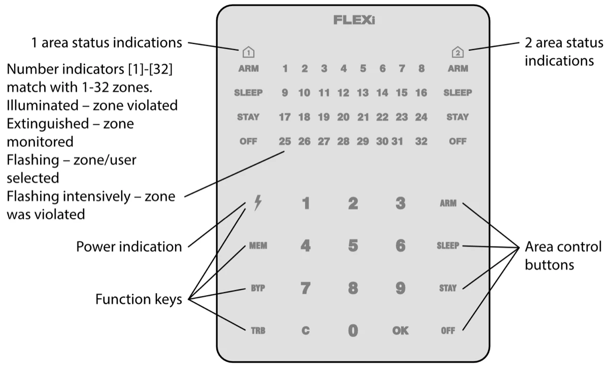

# FLEXi / knappsats SK-LED TouchPad – kort användarguide

## Översikt över knappsatsen

> [!NOTE]
> Knappsatsen SK-LED TouchPad för styrning av larmsystemet visar status för 32 sektioner och 2 områden. Knappsatsen SK-LED TouchPad kan dessutom tilldelas ett eller två önskade områden att styra (knappsatsens firmwareversion från FW:3.0, centralapparatens firmwareversion från FW:SP3_xxx4_0119). Knappsatsen visar status för det tilldelade området och områdets sektioner.

## Tillkoppling / frånkoppling av larmsystemet

### Tillkoppla larmsystemet

1. Kontrollera att ingen sektion är påverkad (ingen av sektionsindikeringarna lyser).

2. Ange användarkoden.

3. Välj knappen för det område som ska tillkopplas.

4. Tryck på knappen **OK**.

5. Lämna lokalen inom den fördröjda tiden.

När koden har angetts blinkar indikeringen ARM under utpasseringstiden.

### Frånkoppla larmsystemet

1. Tryck på knappen **OFF**.

2. Ange användarkoden.

3. Tryck på knappen för det område du vill frånkoppla.

4. Tryck på knappen **OK**.

När larmet är frånkopplat ska indikeringen OFF lysa, medan indikeringarna för tillkopplingslägena ska vara släckta.

### Aktivera SLEEP-läge

(Lokalens skalskydd är tillkopplat. Rörelse inne i lokalen är tillåten. Om du öppnar ytterdörren utlöses larmet omedelbart):

1. Tryck på knappen **SLEEP**.

2. Ange användarkoden.

3. Tryck på knappen för det område som ska tillkopplas.

4. Tryck på knappen **OK**.

5. SLEEP-läget slås på direkt, utan utpasseringstid.

Indikeringen SLEEP lyser när SLEEP-läget är på.

### Aktivera STAY-läge

(Lokalens skalskydd är tillkopplat. Rörelse inne i lokalen är tillåten. När ytterdörren öppnas startar en fördröjning, och inom den tiden måste du frånkoppla larmet):

1. Tryck på knappen **STAY**.

2. Ange användarkoden.

3. Tryck på knappen för det område som ska tillkopplas.

4. Tryck på knappen **OK**.

5. STAY-läget slås på direkt, utan utpasseringstid.

Indikeringen STAY lyser när STAY-läget är på.

> [!NOTE]
> Om du vill ändra ett områdes status till motsatsen räcker det att ange användarkoden och välja önskat område. Radera inmatade tecken eller kommandon genom att trycka på knappen .

## Nödknappar

### Skicka ett nödmeddelande till larmbolaget

- **Police** (polis) – håll knapp **1** nedtryckt i 3 sekunder.

- **Medical Aid** (medicinsk hjälp) – håll knapp **4** nedtryckt i 3 sekunder.

- **Fire Service** (brandlarm) – håll knapp **7** nedtryckt i 3 sekunder.

## Justera ljusstyrka och indikeringsljud

### Justera knappsatsens ljusstyrka och indikeringsljud

1. Håll knappen **C** nedtryckt i 3 sekunder.

2. Välj önskad ljusstyrka för sektionsindikeringen med knapparna **1** och **4**.

3. Välj önskad ljusstyrka för tangenterna på nedersta raden med knapparna **2** och **5**.

4. Välj önskad nivå för ljudindikeringen med knapparna **3** och **6**.

5. Med tangent **0** väljer du om knappsatsens lysdiodsindikering ska vara tänd eller släckt i viloläge. Tryck på **0**: om varannan lysdiodsindikering för sektionerna lyser är knappsatsens belysning släckt i viloläge, och om alla lysdiodsindikeringar för sektionerna lyser är knappsatsens belysning tänd i viloläge.

6. Tryck på knappen **C** igen för att spara inställningarna.

## Ange eller ändra användar- eller masterkoder

### Lägga in en ny användarkod eller ändra en befintlig

1. Tryck på knappen .

2. Ange *Master*-koden, förval – 1234. Sektionsindikeringarna för de användare vars koder redan är inlagda lyser och visar användarnas löpnummer.

3. Ange användarens tvåsiffriga löpnummer, t.ex. **02**.
> [!NOTE]
> Löpnumret för *Master*-koden är **01**.

4. Ange den nya användarkoden två gånger.

5. Tryck på löpnumren för de områden som användaren ska styra.

6. Tryck på knappen **OK**. Lämna läget genom att trycka på knappen **C** två gånger.

## Återställning av tvåtrådiga branddetektorer (rökdetektorer)

### Återställa tvåtrådiga branddetektorer (rökdetektorer)

- Håll knappen  nedtryckt i 3 sekunder.
> [!NOTE]
> Tvåtrådiga branddetektorer återställs inte automatiskt efter att en brand har detekterats. De kan bara återställas manuellt.

## Tillfällig förbikoppling av sektionsbevakning (funktionen BYPASS)

### Aktivera funktionen BYPASS

1. Tryck på knappen **BYP**.

2. Ange larmsystemets kod. Indikeringen **BYP** börjar blinka.

3. Ange sektionens tvåsiffriga löpnummer för att avaktivera bevakningen av den. Om du vill avaktivera bevakningen av flera sektioner anger du de tvåsiffriga numren för dessa sektioner.

4. Tryck på knappen **OK**. Indikeringen **BYP** börjar lysa med fast sken.

### Avaktivera funktionen BYPASS

Gör på samma sätt som när du avaktiverar bevakningen av en enskild sektion.

## Radera användarkoder

### Radera en användarkod

1. Tryck på knappen .

2. Ange *Master*-koden. Sektionsindikeringarna för de användare vars koder redan är inlagda lyser och visar användarnas löpnummer.

3. Ange användarens tvåsiffriga löpnummer, t.ex. **02**.

4. Tryck på knappen **SLEEP**. En ljudsignal hörs och knappen som visar löpnumret för användaren vars kod raderades ur minnet släcks.

5. Tryck på knappen **OK** två gånger.
