# FLEXi / knappsats SK-LCD button – kort användarguide

## Översikt över knappsatsen

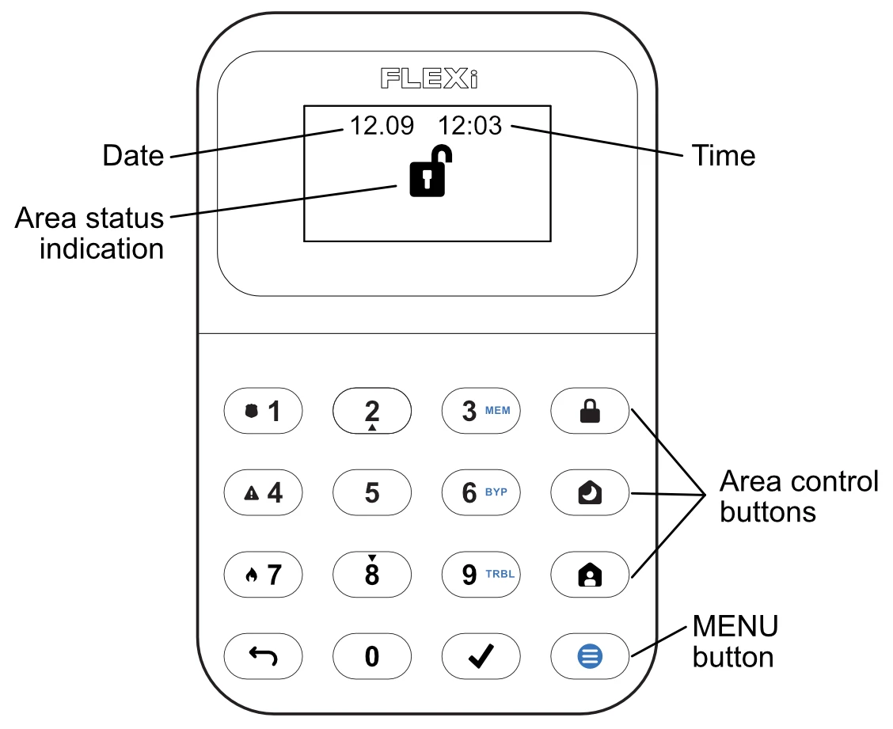

> [!NOTE]
> Knappsatsen ”SK-LCD button” för styrning av larmsystemet visar status för **64 sektioner och 8 områden**. Knappsatsen ”SK-LCD button” kan dessutom tilldelas ett eller flera önskade områden att styra (centralapparatens firmwareversion från FW: SP3_xxx4_0121). Knappsatsen visar status för det tilldelade området och områdets sektioner.

## Tillkoppling / frånkoppling av larmsystemet

### Tillkoppla larmsystemet

1. Kontrollera att ingen sektion är påverkad.

2. Tryck på knappen .

3. Ange användarkoden.

4. Välj knappen för det område som ska tillkopplas.

5. Tryck på knappen .

6. Lämna lokalen inom den fördröjda tiden.

När systemet är tillkopplat lyser symbolen 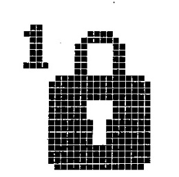.

### Frånkoppla larmsystemet

1. Ange användarkoden.

2. Tryck på knappen för det område du vill frånkoppla.

3. Tryck på knappen .

När larmet är frånkopplat ska symbolen 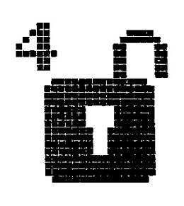 lysa.

### Aktivera SLEEP-läge

(Lokalens skalskydd är tillkopplat. Rörelse inne i lokalen är tillåten. Om du öppnar ytterdörren utlöses larmet omedelbart):

1. Tryck på knappen .

2. Ange användarkoden.

3. Tryck på knappen för det område som ska tillkopplas.

4. Tryck på knappen .

5. SLEEP-läget slås på direkt, utan utpasseringstid.

Symbolen 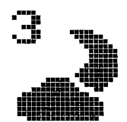 lyser när SLEEP-läget är på.

### Aktivera STAY-läge

(Lokalens skalskydd är tillkopplat. Rörelse inne i lokalen är tillåten. När ytterdörren öppnas startar en fördröjning, och inom den tiden måste du frånkoppla larmet):

1. Tryck på knappen .

2. Ange användarkoden.

3. Tryck på knappen för det område som ska tillkopplas.

4. Tryck på knappen .

5. STAY-läget slås på direkt, utan utpasseringstid.

Symbolen 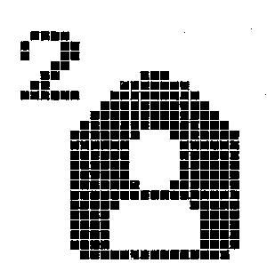 lyser när STAY-läget är på.

> [!NOTE]
> Om du vill ändra ett områdes status till motsatsen räcker det att ange användarkoden och välja önskat område. Radera inmatade tecken eller kommandon genom att trycka på knappen .

## Nödknappar

### Skicka ett nödmeddelande till larmbolaget

- **Police** (polis) – håll knapp **1** nedtryckt i 3 sekunder.

- **Medical Aid** (medicinsk hjälp) – håll knapp **4** nedtryckt i 3 sekunder.

- **Fire Service** (brandlarm) – håll knapp **7** nedtryckt i 3 sekunder.

## Justera ljusstyrka och indikeringsljud

### Ljusstyrka för knapparna

1. Tryck på knappen  och sedan på **5** **3**.

2. Välj önskad ljusstyrka för knapparnas bakgrundsbelysning med knapparna **2** och **8**.

3. Tryck på  för att spara det nya värdet.

### Ljusstyrka för LCD-displayen

4. Tryck på knappen  och sedan på **5** **2**.

5. Välj önskad ljusstyrka för sektionsindikeringen med knapparna **2** och **8**.

6. Tryck på  för att spara det nya värdet.

### Volym för knappsatsens knapptryckningar

7. Tryck på knappen  och sedan på **5** **1**.

8. Välj önskad nivå för ljudindikeringen med knapparna **2** och **8**.

9. Tryck på  för att spara det nya värdet.
> [!NOTE]
> Stäng av knappsatsens belysning i viloläge. Tryck på  och sedan på **5** **4**. Växla bakgrundsbelysningen för knappsatsens indikeringar i viloläge genom att trycka på **1** (belysning på) eller **2** (belysning av). Tryck på  för att spara det nya värdet.

## Ange eller ändra användar- eller masterkoder

### Lägga in en ny användarkod eller ändra en befintlig

1. Tryck på knappen  och sedan på **0**.

2. Ange **Master**-koden, förval – 1234.

3. Ange användarens tvåsiffriga löpnummer, t.ex. **02**.
> [!NOTE]
> Löpnumret för **Master**-koden är **01**.

4. Ange den nya användarkoden två gånger.

5. Tryck på löpnumren för de områden som användaren ska styra.

6. Tryck på knappen . Lämna läget genom att trycka på knappen .

## Återställning av branddetektorer (rökdetektorer)

### Återställa branddetektorer (rökdetektorer)

- Håll knappen  nedtryckt i 3 sekunder.
> [!NOTE]
> Branddetektorer (rökdetektorer) återställs inte automatiskt efter att en brand har detekterats. De kan bara återställas manuellt.

## Tillfällig förbikoppling av sektionsbevakning (funktionen BYPASS)

### Aktivera funktionen BYPASS

1. Tryck på knappen  och sedan på **6**.

2. Ange larmsystemets kod.

3. Ange sektionens tvåsiffriga löpnummer för att avaktivera bevakningen av den. Om du vill avaktivera bevakningen av flera sektioner anger du de tvåsiffriga numren för dessa sektioner.

4. Tryck på knappen . Symbolen 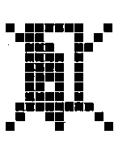 visas på LCD-displayen.

### Avaktivera funktionen BYPASS

Gör på samma sätt som när du avaktiverar bevakningen av en enskild sektion.

## Radera användarkoder

### Radera en användarkod

1. Tryck på knappen  och sedan på **0**.

2. Ange **Master**-koden.

3. Ange användarens tvåsiffriga löpnummer, t.ex. **02**.

4. Tryck på knappen . En ljudsignal hörs.

5. Tryck på knappen  för att lämna läget.

## Grafiska symboler

| Symbol | Beskrivning | Symbol | Beskrivning |
|---|---|---|---|
| 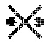 | Centralapparaten är inte ansluten | 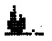 | Fel på brandslinga |
| 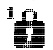 | Område 1 tillkopplat | 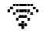 | Lista över nätverksfel |
| 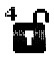 | Område 4 frånkopplat | 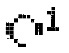 | Fel på larmcentral 1 (2) |
| 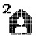 | Område 2 STAY |  | Fel på molntjänsten |
|  | Område 3 SLEEP |  | SIM-kortsfel |
| 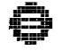 | MENU-knappen |  | Fel på SIM-kortets lösenord (PIN-kod) |
|  | Funktionsknappen ENTER | 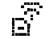 | Nätverksfel för SIM-kort |
| 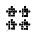 | Område |  | Wi-Fi-fel |
|  | Larm | 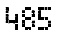 | Fel på RS485-gränssnittet |
|  | Brand |  | Fel på SIM-kort 2 |
| 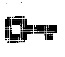 | Användarkod | 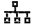 | LAN-fel |
| 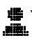 | Användare |  | Låg batterispänning i trådlös enhet |
| 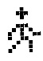 | In-/utpassering | 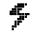 | Matningsfel |
| 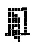 | Sektion öppen | 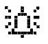 | Sirenfel |
| 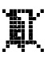 | Förbikoppling | 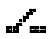 | Sabotagefel |
| 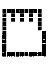 | Minne | 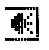 | Antimaskningsfel |
| 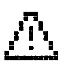 | Fel | 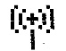 | Fel på trådlös enhet |
|  | Lista över systemfel | 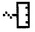 | Fel på utbyggnadsmodul |
|  | Nätfel | 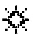 | Inställningar |
|  | Batterifel | 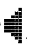 | Volym |
|  | Överström på AUX |  | Displayens ljusstyrka |
| 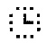 | Tiden är inte inställd |  | Knappsatsens ljusstyrka |
| 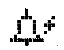 | Överström på sirenutgång | 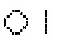 | Belysning i viloläge O-På / I-Av |
| 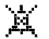 | Siren saknas | 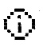 | Info |
