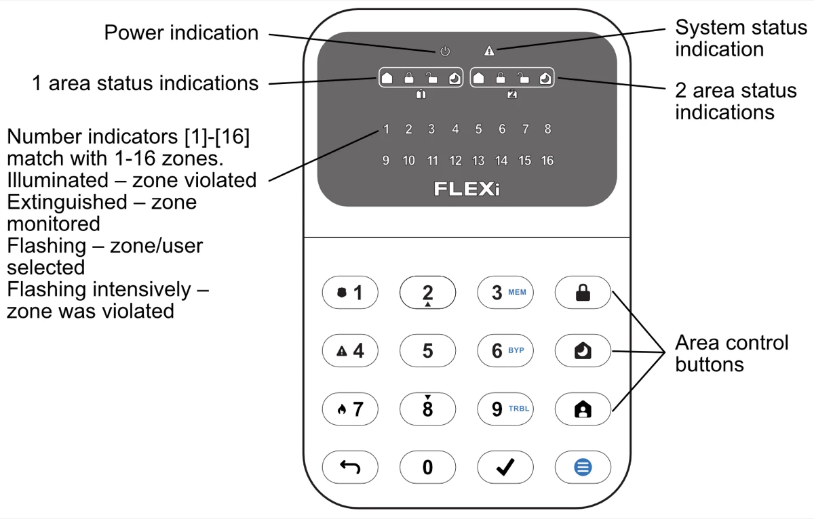

# FLEXi / knappsats SK-LED button – kort användarguide

## Översikt över knappsatsen

> [!NOTE]
> Knappsatsen ”SK-LED button” för styrning av larmsystemet visar status för 16 sektioner och 2 områden. Knappsatsen ”SK-LED button” kan dessutom tilldelas ett eller två önskade områden att styra (knappsatsens firmwareversion från FW:1.0, centralapparatens firmwareversion från FW:SP3_xxx4_0120). Knappsatsen visar status för det tilldelade området och områdets sektioner.

## Tillkoppling / frånkoppling av larmsystemet

### Tillkoppla larmsystemet

1. Kontrollera att ingen sektion är påverkad (ingen av sektionsindikeringarna lyser).

2. Tryck på knappen .

3. Ange användarkoden.

4. Välj knappen för det område som ska tillkopplas.

5. Tryck på knappen .

6. Lämna lokalen inom den fördröjda tiden.

När koden har angetts blinkar indikeringen  under utpasseringstiden. När systemet är tillkopplat lyser indikeringen .

### Frånkoppla larmsystemet

1. Ange användarkoden.

2. Tryck på knappen för det område du vill frånkoppla.

3. Tryck på knappen .

När larmet är frånkopplat ska indikeringen  lysa.

### Aktivera SLEEP-läge

(Lokalens skalskydd är tillkopplat. Rörelse inne i lokalen är tillåten. Om du öppnar ytterdörren utlöses larmet omedelbart):

1. Tryck på knappen .

2. Ange användarkoden.

3. Tryck på knappen för det område som ska tillkopplas.

4. Tryck på knappen .

5. SLEEP-läget slås på direkt, utan utpasseringstid.

Indikeringen  lyser när SLEEP-läget är på.

### Aktivera STAY-läge

(Lokalens skalskydd är tillkopplat. Rörelse inne i lokalen är tillåten. När ytterdörren öppnas startar en fördröjning, och inom den tiden måste du frånkoppla larmet):

1. Tryck på knappen .

2. Ange användarkoden.

3. Tryck på knappen för det område som ska tillkopplas.

4. Tryck på knappen .

5. STAY-läget slås på direkt, utan utpasseringstid.

Indikeringen  lyser när STAY-läget är på.

> [!NOTE]
> Om du vill ändra ett områdes status till motsatsen räcker det att ange användarkoden och välja önskat område. Radera inmatade tecken eller kommandon genom att trycka på knappen .

## Nödknappar

### Skicka ett nödmeddelande till larmbolaget

- **Police** (polis) – håll knapp **1** nedtryckt i 3 sekunder.

- **Medical Aid** (medicinsk hjälp) – håll knapp **4** nedtryckt i 3 sekunder.

- **Fire Service** (brandlarm) – håll knapp **7** nedtryckt i 3 sekunder.

## Justera ljusstyrka och indikeringsljud

### Ljusstyrka för knapparna

1. Tryck på knappen  och sedan på **1**.

2. Välj önskad ljusstyrka för knapparnas bakgrundsbelysning med knapparna **2** och **8**.

3. Tryck på  för att spara det nya värdet. Lämna läget genom att trycka på knappen .

### Ljusstyrka för sektionernas lysdiodsindikering

4. Tryck på knappen  och sedan på **4**.

5. Välj önskad ljusstyrka för sektionsindikeringen med knapparna **2** och **8**.

6. Tryck på  för att spara det nya värdet. Lämna läget genom att trycka på knappen .

### Volym för knappsatsens knapptryckningar

7. Tryck på knappen  och sedan på **7**.

8. Välj önskad nivå för ljudindikeringen med knapparna **2** och **8**.

9. Tryck på  för att spara det nya värdet. Lämna läget genom att trycka på knappen .
> [!NOTE]
> Stäng av knappsatsens belysning i viloläge. Tryck på  följt av **5** för att växla bakgrundsbelysningen för knappsatsens indikeringar i viloläge. Tryck på  för att spara det nya värdet. Lämna läget genom att trycka på knappen .

## Ange eller ändra användar- eller masterkoder

### Lägga in en ny användarkod eller ändra en befintlig

1. Tryck på knappen  och sedan på **0**.

2. Ange *Master*-koden, förval – 1234.

3. Ange användarens tvåsiffriga löpnummer, t.ex. **02**.
> [!NOTE]
> Löpnumret för *Master*-koden är **01**.

4. Ange den nya användarkoden två gånger.

5. Tryck på löpnumren för de områden som användaren ska styra.

6. Tryck på knappen . Lämna läget genom att trycka på knappen .

## Återställning av branddetektorer (rökdetektorer)

### Återställa branddetektorer (rökdetektorer)

- Håll knappen  nedtryckt i 3 sekunder.
> [!NOTE]
> Branddetektorer (rökdetektorer) återställs inte automatiskt efter att en brand har detekterats. De kan bara återställas manuellt.

## Tillfällig förbikoppling av sektionsbevakning (funktionen BYPASS)

### Aktivera funktionen BYPASS

1. Tryck på knappen  och sedan på **6**.

2. Ange larmsystemets kod. Indikeringen  börjar blinka grönt.

3. Ange sektionens tvåsiffriga löpnummer för att avaktivera bevakningen av den. Om du vill avaktivera bevakningen av flera sektioner anger du de tvåsiffriga numren för dessa sektioner.

4. Tryck på knappen . Indikeringen  börjar lysa grönt med fast sken.

### Avaktivera funktionen BYPASS

Gör på samma sätt som när du avaktiverar bevakningen av en enskild sektion.

## Radera användarkoder

### Radera en användarkod

1. Tryck på knappen  och sedan på **0**.

2. Ange *Master*-koden.

3. Ange användarens tvåsiffriga löpnummer, t.ex. **02**.

4. Tryck på knappen . En ljudsignal hörs och knappen som visar löpnumret för användaren vars kod raderades ur minnet släcks.

5. Tryck på knappen . Lämna läget genom att trycka på knappen .
