# IP/SMS-mottagare RL14

  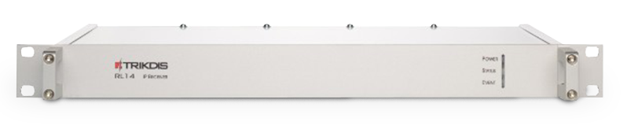

## Säkerhetskrav

IP/SMS-mottagaren RL14 är en elektrisk apparat och får därför endast installeras av behörig personal enligt den här manualen.

IP/SMS-mottagaren RL14 ska användas enligt den här manualen.

## Garanti

Enligt mottagarens bruksanvisning och allmänna bestämmelser för installation av elektrisk utrustning ger tillverkaren 24 månaders garanti på den installerade och använda produkten. Garantin gäller från det att köpeavtalet för produkten ingås, dvs. från utfärdandedatumet på fakturan eller kvittot.

## Om mottagaren

IP/SMS-mottagaren RL14 är avsedd för larmcentraler (CMS). Den tar emot meddelanden från Trikdis larmsändare, skickade med protokollen TCP/UDP eller som SMS. När mottagaren har bearbetat meddelandena skickar den vidare data till larmcentralens programvara via LAN eller porten RS232.

## Mottagarens funktioner

Mottagaren har en integrerad industridator med programvaran IPcom v4 som körs i operativsystemet Linux. Programvaran IPcom v4 bearbetar meddelandetrafik som tas emot via 1) mottagarens nätverkskort, 2) den integrerade SMS-mottagaren och 3) mottagarens inkommande RS232.

Nätverkskortet tar emot meddelanden som skickas med protokollen TCP/UDP. SMS-mottagaren tar emot meddelanden som skickas med Contact ID-koder. Porten RS232 tar emot Contact ID-koder i protokollet Sugard MRL-DG.

Mottagarens funktioner anges i licensen, som påverkar parametrarna i programvaran IPcomControl v4. Mottagarens parametrar ställs in vid konfigurering i IPcomControl v4, som måste vara installerat på en dator med MS Windows i samma nätverk som mottagaren.

Det finns flera kanaler för att ta emot meddelanden och flera portar för att överföra meddelanden till larmcentralens programvara. Kanalernas och portarnas funktioner och fysiska parametrar ställs in när mottagaren konfigureras.

**Mottagning av meddelanden:**

| Tar emot meddelanden med protokollen TCP/IP eller UDP/IP som skickas av TRIKDIS GPRS-larmsändare G10, G10C, G10T och G10D via GPRS och/eller SMS. / **Obs!** Ett SIM-kort i normal storlek från vald mobiloperatör måste sättas i den integrerade SMS-mottagarens SIM-kortplats för att meddelanden ska kunna tas emot via SMS. |
|----|
| Tar emot meddelanden med protokollen TCP/IP eller UDP/IP som skickas av TRIKDIS Ethernet-larmsändare E10, E10C och E10T via kabelanslutna internetnät. |
| Tar emot meddelanden med protokollen TCP/IP eller UDP/IP som skickas av TRIKDIS GPRS-larmsändare G10F och FireCom via GPRS och/eller SMS. / **Obs!** Ett SIM-kort i normal storlek från vald mobiloperatör måste sättas i den integrerade SMS-mottagarens SIM-kortplats för att meddelanden ska kunna tas emot via SMS. |
| Tar emot meddelanden med protokollen TCP/IP eller UDP/IP som skickas av TRIKDIS centralapparater CG3 och SP131 via GPRS och/eller SMS. / **Obs!** Ett SIM-kort i normal storlek från vald mobiloperatör måste sättas i den integrerade SMS-mottagarens SIM-kortplats för att meddelanden ska kunna tas emot via SMS. |
| Tar emot meddelanden med protokollet UDP/IP som skickas av TRIKDIS repeatrar RR-GSM och R-IP12. |
| Tar emot meddelanden som skickas av mottagare från andra tillverkare och som är anslutna till den inkommande RS232-porten. |

## Tekniska data

| Parameter | Beskrivning |
|-----------|-------------|
| Antal IP-larmsändare | Obegränsat |
| Antal mottagningskanaler | Den ursprungliga licensen medger två kanaler |
| Kommunikationsprotokoll | TCP/​UPD TRK-3, TRK-6, TRK-7 |
| Nätverkskortets fysiska port | RJ-45 (FastEthernet 10/​100) |
| Den integrerade SMS-mottagarens modem | GSM 850/​ 900/​ 1800/​ 1900 MHz |
| SIM-korttyp för den integrerade SMS-mottagaren | Standard, medföljer inte mottagaren |
| RS232-portarnas användning | Kan konfigureras som INGÅNG eller UTGÅNG för dataöverföring |
| Antal RS232-portar | 3 |
| Dataprotokoll för utgångar | Surgard MLR2-DG, Monas3 |
| RS232-portarnas fysiska typ | Hankontakt DB9 |
| Inställning av parametrar och övervakning av driften | Dator i samma nätverk med MS Windows 32/​64 bit Win7, Win8, Win8.1, Win10 och programvaran IPcomControl v4 |
| Antal arbetsplatser | Den ursprungliga licensen medger 2 arbetsplatser |
| Primär matning | 100–240 V (50/​60 Hz) AC-nät. /​ Växelström (max): 0,75 A/​115 V AC, 0,5 A/​230 V AC |
| Effekt | Upp till 60 W |
| Reservmatning | 12 V, kapacitet 18 Ah eller mer. Laddningsström upp till 900 mA. |
| Driftstemperatur | 0 °C till +55 °C |
| Mått | 19" 1U (450 x 50 x 320 mm) |
| Vikt | 2,1 kg |

## Utrustning

|                                                  |       |
|--------------------------------------------------|-------|
| IP/​SMS-mottagare RL14                             | 1 st. |
| Mobilantenn med magnetfot, kabellängd 2,5 m     | 1 st. |
| Nätkabel, 1,5 m                  | 1 st. |
| COM-kabel av nollmodemtyp (hon/hon), 1,8 m     | 1 st. |
| LAN-kabel, 5 m                    | 1 st. |
| CD med programvaran IPcomControl v4 och bruksanvisning | 1 st. |

## Mottagarens delar

### Framsida och lysdiodsindikering

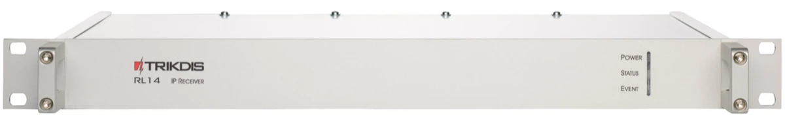

**Lysdiodsindikering**

| Indikering | Beskrivning |
|-----------|-------------|
| Power | Grönt sken när matningen är påslagen. |
| Status | Grönt sken när den fysiska anslutningen och protokollanslutningen mellan mottagaren och programvaran för meddelandeövervakning är uppkopplad. /​ Rött sken när den fysiska anslutningen och protokollanslutningen mellan mottagaren och programvaran för meddelandeövervakning har brutits. /​ Gult sken när den fysiska anslutningen och protokollanslutningen mellan mottagaren och programvaran för meddelandeövervakning är uppkopplad via några konfigurerade och aktiva portar men har brutits via de övriga. /​ Inget sken när mottagarens port inte är aktiv eller inte konfigurerad. |
| Event | Blått sken när ett meddelande överförs till programvaran för meddelandeövervakning. |

### Baksida och bakpanelens delar

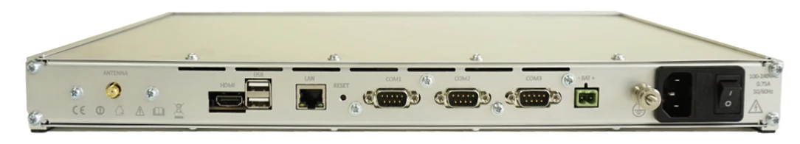

| Del | Beskrivning |
|---------|-------------|
| LAN | RJ45-kontakt för nätverkskortet. |
| COM1 | Första serieporten RS232, inställd som dataingång eller datautgång (hankontakt DB9). |
| COM2 | Andra serieporten RS232, inställd som dataingång eller datautgång (hankontakt DB9). |
| COM3 | Tredje serieporten RS232, inställd som dataingång eller datautgång (hankontakt DB9). |
| Reset | Mikrobrytare som återställer mottagarens nätverkskort till de förvalda IP-adresserna när den hålls intryckt i mer än 5 sekunder. |
| Antenna | Honkontakt av SMA-typ för mobilantennen till den integrerade SMS-mottagaren. |
| HDMI | HDMI-kontakt för bildskärm. |
| USB | USB-anslutning. |
|  | Anslutning för mottagarens jordning. |
| \- BAT + | Löstagbar kontakt för reservbatteriet (minst 18 Ah, 12 V). Batteriets tillstånd kan övervakas om det inte finns problem med matningen. Batteriets laddningsström: 900 mA. |
| 100-240VAC | Anslutning för nätkabel och strömbrytare O/​I. |

## Förbereda mottagaren för drift

> [!WARNING]
> Mottagaren stängs av helt först 2 minuter efter att matningen har slagits av!

1. Matningen måste vara avstängd när mottagaren förbereds för drift, dvs. 1) mottagarens nätkabel måste vara bortkopplad från elnätet och 2) mottagarens kontakt BAT, där reservbatteriet är anslutet, måste vara urkopplad.

2. Sätt i ett redan registrerat SIM-kort i normal storlek från vald operatör i mottagarens SIM-kortplats för SMS, så att SMS-meddelanden från Trikdis larmsändare kan tas emot.

3. Placera mottagaren på ett fast, rent och vågrätt underlag, skruva ur fästskruvarna och ta bort det övre locket. Sätt i SIM-kortet i SMS-mottagarens SIM-kortplats. Sätt tillbaka sido- och toppkåporna (se bilden nedan). Skruva fast det övre locket.

    *[Bild av SIM-kortplatsen – bilden finns inte i den digitala versionen, se den tryckta manualen]*

4. Montera mottagaren i ett 19-tums serverrack.

5. Skruva fast mobilantennen.

6. Förbered ett LAN enligt principschemat nedan:

    

7. Installera programvaran *IPcomControl v4* (se *Konfigurera mottagaren*) på den dator som ska användas för att konfigurera mottagaren RL14.

8. Ändra IP-adressen på den dator som ska användas för att konfigurera mottagaren RL14 till den som mottagarens tillverkare anger (se punkt A under avsnittet *Konfigurera mottagaren*).

9. Anslut mottagaren RL14 och den dator som ska användas för att ställa in mottagarens parametrar med en LAN-kabel.

10. Sätt nätkabelns kontakt i mottagarens 110–220 V-uttag och anslut kabeln till vägguttaget.

11. Slå på mottagarens matning, dvs. ställ strömbrytaren O/I på I. Matningen visas med den blå lysdioden Power. En ljudsignal visar att mottagaren är redo för konfigurering.

12. Konfigurera parametrarna för mottagaren RL14 **i följande ordning**:

    1. Ställ in nätverkskortets parametrar så att mottagaren kan arbeta i avsett LAN (se avsnittet *Ansluta till en ny mottagare*);
    2. Lägg till och beskriv de portar som meddelandetrafiken leds till i programvaran för meddelandeövervakning (se fliken *Outputs* under avsnittet *Konfigurera mottagaren*);
    3. Lägg till och beskriv de portar som meddelandetrafiken tas emot via (se flikarna *COM settings* och *Receivers* under avsnittet *Konfigurera mottagaren*);
    4. Lägg till och beskriv de programmerbara mottagare som leder den bearbetade meddelandetrafiken via portarna till programvaran för meddelandeövervakning (se fliken *Receiver* under avsnittet *Konfigurera mottagaren*);
    5. Lägg till och beskriv de användare som får logga in och utföra tilldelade uppgifter under mottagarens drift (se fliken *Users* under avsnittet *Konfigurera mottagaren*).

13. Koppla bort LAN-kabeln från mottagaren och datorn (om datorn inte tillhör LAN) när önskade parametrar är inställda.

14. Anslut mottagaren RL14 till datorn med programvaran för meddelandeövervakning.

    Om meddelandena ska överföras till programvaran för meddelandeövervakning via porten RS232: använd den medföljande RS232-kabeln för att ansluta den valda COM-utgången på mottagaren till datorn med programvaran.

    Om meddelandena ska överföras via LAN: anslut mottagaren, via nätverkskortets LAN-kontakt, till det lokala nätverk där servern med programvaran för meddelandeövervakning finns.

## Konfigurera mottagaren

Mottagaren RL14:s driftparametrar ställs in och redigeras med programvaran *IPcomControl v4* på en dator med MS Windows i samma LAN. Programvaran finns på den medföljande CD:n eller på [www.trikdis.lt](http://www.trikdis.lt). Installera programvaran *IPcomControl v4* på datorn.

### Ansluta till en ny mottagare och ställa in LAN-adresser

Nätverkskortets förvalda adresser:

| IP-adress  | 192.168.100.3   |
|-------------|-----------------|
| Port        | 55000           |
| Nätmask | 255.255.255.0   |
| Gateway     | 192.168.100.254 |

Information om hur du återställer fabriksinställningarna finns i avsnittet *Återställa förvalda parametrar*.

1. Datorn och mottagaren måste vara i samma nätverk för att mottagaren ska kunna konfigureras. Ändra adresserna på nätverkskortet i den dator som ska användas för att konfigurera mottagaren så att de stämmer med dem som anges i tabellen.

    

2. Anslut mottagaren och den dator som ska användas för att konfigurera mottagaren med en LAN-kabel.

3. Slå på huvudmatningen och vänta några sekunder tills en ljudsignal visar att mottagaren är påslagen.

4. Starta IPcomControl v4. Ange IP-adressen för mottagarens nätverkskort (förvald adress) och klicka på OK.

    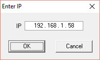

5. Ange användarnamnet (*administrator*) och lösenordet (*admin*) när du uppmanas. Klicka på Login.

    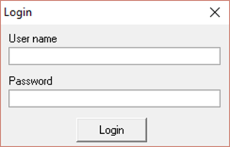

6. Välj fliken **Configure** i IPcomControl v4. Klicka på **Get**. Ange LAN-värdena i rutorna *Primary* IP, Subnet och Gateway för att ansluta mottagaren till nätverket. Klicka på **Set**.

    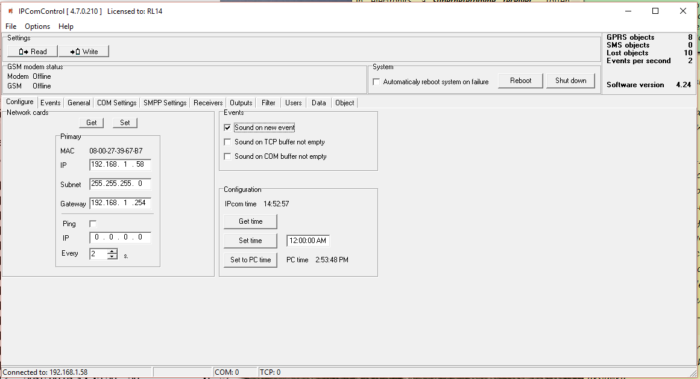

7. Mottagaren ska starta om automatiskt. Programvaran IPcomControl v4 stängs automatiskt. Mottagaren är nu redo för drift i LAN.

8. Koppla bort LAN-konfigurationskabeln från mottagaren och sätt i kabeln till det lokala nätverk vars adresser du just har ställt in.

9. Återställ adresserna på nätverkskortet i den dator som användes för att konfigurera mottagaren. Datorn kan nu användas i de nätverk den tidigare användes i.

### Ansluta till en mottagare i drift i LAN

En mottagare som är i drift i LAN konfigureras med programvaran IPcomControl v4 på en 32/64-bitars dator med MS Windows Win7/8/8.1/10. Flera datorer med IPcomControl v4 kan vara anslutna till mottagaren samtidigt. Antalet anslutningar begränsas av licensen, som du kan se genom att klicka på **Help** i IPcomControl v4.

1. Starta programvaran IPcomControl v4. Ange IP-adressen för nätverkskortet i mottagaren i LAN, t.ex. 195.15.184.138, när du uppmanas, och klicka på OK.

    

2. Ange användarnamnet (*administrator*) och lösenordet (*admin*) när du uppmanas. Klicka på Login.

    

3. Klicka på Read 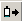 i det öppna fönstret i programvaran IPcomControl v4.

    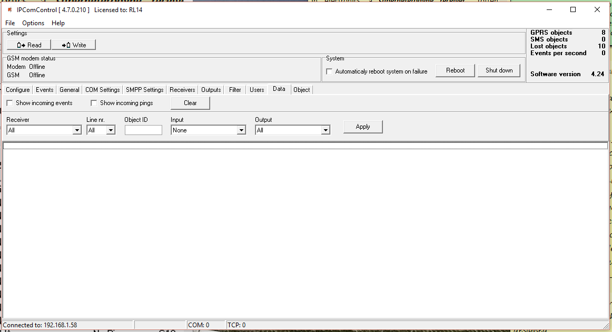

    | Element i användargränssnittet | Beskrivning |
    |------------|-------------|
    | Modem / GSM modem status | Status (offline/online) för den fysiska och programmerbara anslutningen till SMS-modemet GM15 Offline (mottagarhändelse **E/R 753**). GSM – status för SMS-modemet GM15:s anslutning till GSM-nätet (mottagarhändelse **E/R 751**). |
    | Antal flikar i programvaran | Kan variera beroende på de behörigheter som mottagarens administratör har gett. |
    | Automatisk och manuell omstart | Automatisk och manuell omstart (händelse **R 313**). |
    | Programvaruversion | Version av mottagarens programvara. |

## Beskrivning av flikarna

### Fliken Configure – fjärrserver, ljudsignaler och klocka

Här ställs IP-adressen för en fjärrserver in (för test av kommunikationskanalen), samt mottagarens ljudsignaler och klocka.

### Fliken Events – mottagarens händelselista

När en händelse i listan inträffar skapas ett meddelande som skickas till programvaran för meddelandeövervakning. Rapportering av oönskade händelser kan stängas av genom att avmarkera kryssrutan.

Vid konfigurering av en mottagare kan du ändra händelsekod, områdesnummer och sektion. För vissa meddelanden anges utgångskanalens identifiering automatiskt. En detaljerad lista över händelsemeddelanden och villkoren för att de genereras finns i avsnittet *Mottagarens händelsemeddelanden*.

### Fliken General – kontroll av GPRS- och GSM-kommunikation

### Fliken COM settings – COM-portarnas driftläge

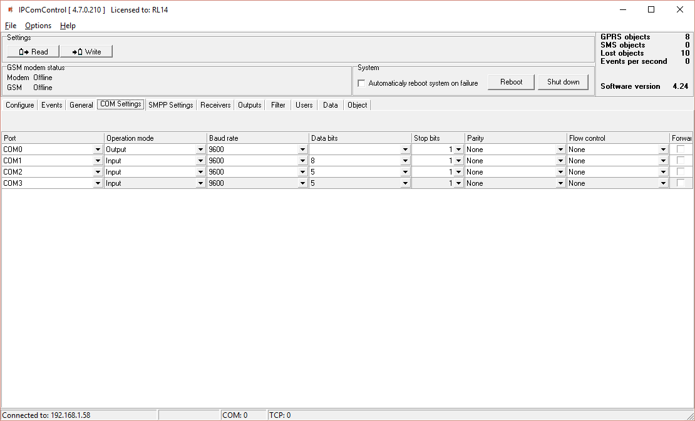

Portnamn:

- **COM0** – dataport för den integrerade SMS-mottagaren. Driftläget måste vara inställt på "Trikdis".
- **COM1…COM3** – mottagarens RS232-portar.
- **Card_1…Card_4** – mottagarens kortplatser.

### Fliken SMPP settings – SMS via TCP/IP

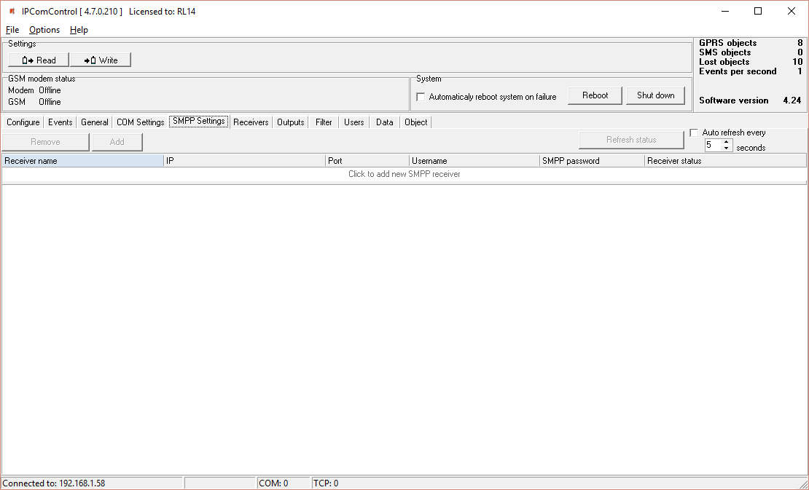

SMPP är ett protokoll för överföring av SMS över TCP/IP, dvs. det gör att SMS som skickas av Trikdis larmsändare kan tas emot via LAN i stället för via det integrerade SMS-modemet.

### Fliken Receivers – lägga till och konfigurera mottagare

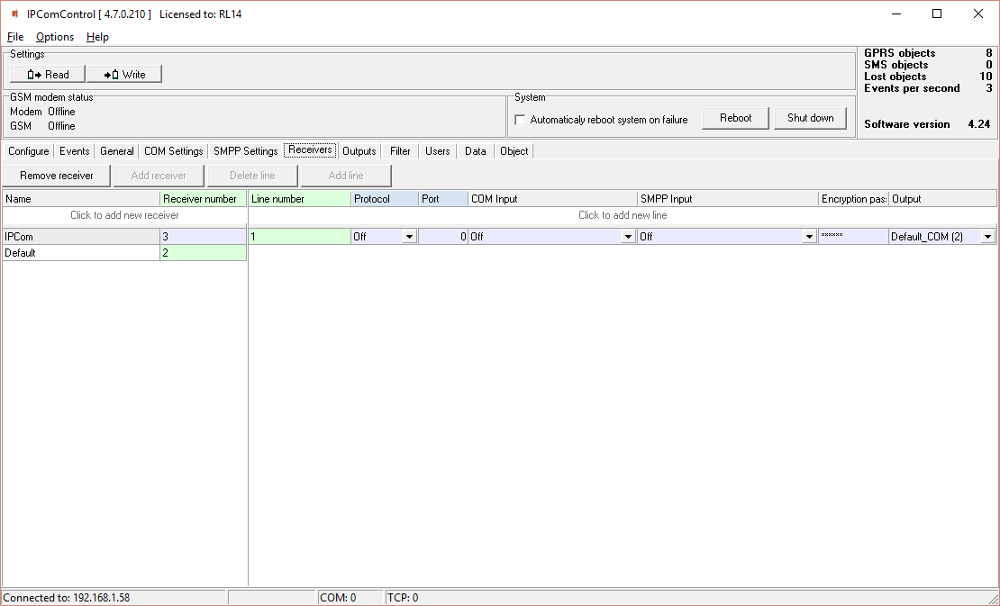

Alla händelser som anges på fliken "Events" tas emot från vald IPcom-kanal och styrs om till vald utgångsport. För att ta emot meddelanden som skickas från ett skyddat objekt med protokollen TCP/UDP måste en separat mottagningskanal skapas. Dataströmmen som tas emot i den här kanalen styrs om till vald utgångsport.

Parametrar för omstyrning av dataströmmen:

- **Line number** – ange linjenummer
- **Protocol** – ange protokoll för dataströmmen
- **Port** – ange ingångsport
- **COM input** – ange fysisk ingångsport
- **SMPP input** – ange parametrar för SMPP-servern
- **Encryption password** – ange en sexsiffrig krypteringsnyckel för den inkommande dataströmmen
- **Output** – ange utgångsport för dataströmmen, vars parametrar ställs in på fliken "Output"

### Fliken Outputs – styra meddelanden till larmcentralens programvara

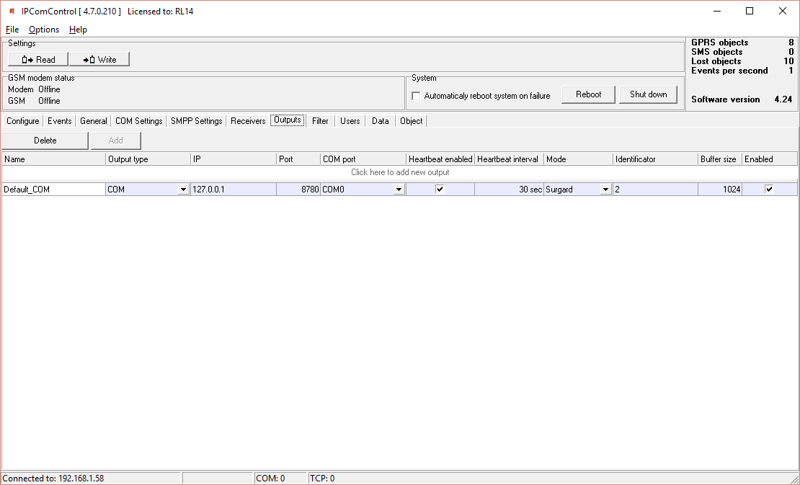

Utgångsparametrar för att skicka meddelanden till larmcentralens programvara:

- **Name** – ange portens namn
- **Output type** – ange anslutningstyp till larmcentralens programvara: TCP eller COM
- **IP** – ange larmcentralens IP-adress
- **Port / COM port** – ange utgångens portnummer
- **Heartbeat enabled** – aktivera pollning mot larmcentralens programvara
- **Heartbeat interval** – ange pollningsperioden
- **Mode** – ange meddelandenas protokoll
- **Identificator** – ange kanalens identifieringsnummer. Det gör att kanalen kan identifieras om anslutningen till den bryts.
- **Buffer size** – ange storleken på meddelandebufferten
- **Enable** – gör att den skapade kanalen fungerar.

### Fliken Filter – filtrering av meddelanden

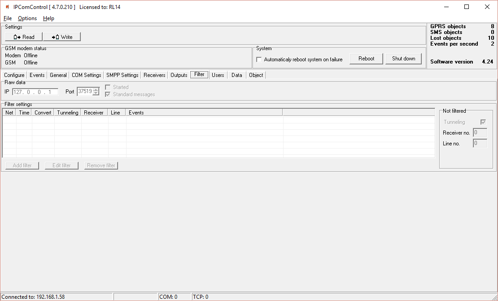

På fliken *Filter* kan du ange en IP-adress dit alla mottagna meddelanden dessutom skickas.

IP-adressen och portnumret som alla mottagna meddelanden ska skickas till anges i fältet *Raw data*. Meddelandena skickas utan bearbetning till den angivna IP-adressen när rutan [Started] är markerad. Meddelandena ändras enligt protokollet Contact ID när rutan [Standard messages] är markerad.

Parametrarna för filtrering av meddelanden anges i fältet *Filter settings*. Klicka på *Add filter* för att öppna fliken *Filter settings*. Ange reglerna för överföring av meddelanden till programvaran för meddelandeövervakning:

- Ange nätverksnumret i rutan *Network*. Endast meddelanden där mottagarnummer och nätverksnummer stämmer överens filtreras;
- Ange toleranstiden för samma signal (eller upprepade toleranssignaler) i rutan *Time*;
- Ange mottagarnumret som visas i det bearbetade meddelandet i rutan *Receiver no*;
- Ange mottagarens linjenummer som visas i det bearbetade meddelandet i rutan *Line no*;
- Markera rutan *Convert* för att ändra strukturen på filtrerade meddelanden;
- Markera rutan *Tunneling* för att behålla strukturen på filtrerade meddelanden;
- Ange särskilda händelsekoder som används för att ignorera meddelanden som sänds om i systemet RAS-2M i rutan *Events one per line*;
- Klicka på OK för att bekräfta de angivna värdena;
- Flera olika filter kan ställas in och användas.

Meddelandena överförs till programvaran för meddelandeövervakning med de mottagar- och linjenummer som anges på fliken *General* om rutan *Tunneling* är markerad i fältet *Not filtered*. Om rutan *Tunneling* inte är markerad överförs meddelandena med angivet mottagar- och linjenummer.

### Fliken Users – användarbehörigheter

Parametrar för användarbehörigheter:

- **User name** – ange användarnamnet
- **Password** – ange användarens lösenord
- **Settings** – behörighet att konfigurera mottagarens programvara IPcom.
- **Device info** – behörighet att se mottagarens information om objekt.
- **Remote configuration** – behörighet att fjärrkonfigurera larmsändaren och uppdatera dess firmware.
- **View events and objects** – behörighet att öppna flikarna Data och Objects i IPcomControl v4.
- **Set zone bypass** – behörighet att skicka styrkommandon till en Trikdis centralapparat som är installerad i ett skyddat objekt, för att aktivera eller avaktivera läget Zone bypass för en viss sektion.
- **Set PGM status** – behörighet att på distans ändra tillstånd för larmsändarens PGM-utgång.
- **Arm/Disarm system** – behörighet att skicka styrkommandon till en Trikdis centralapparat som är installerad i ett skyddat objekt, för att tillkoppla eller frånkoppla larmsystemet.
- **Perform Fire reset** – behörighet att skicka styrkommandon till en Trikdis centralapparat som är installerad i ett skyddat objekt, för att automatiskt återställa den anslutna rökdetektorn.
- **Assigned receivers** – ange de mottagare som användarbehörigheterna gäller för

Alternativ för användarbehörighet: **Enable** / **Disable** / **Read only**.

### Fliken Data – mottagna meddelanden

Mottagna meddelanden visas på fliken Data. Klicka på **Clear** för att radera alla poster.

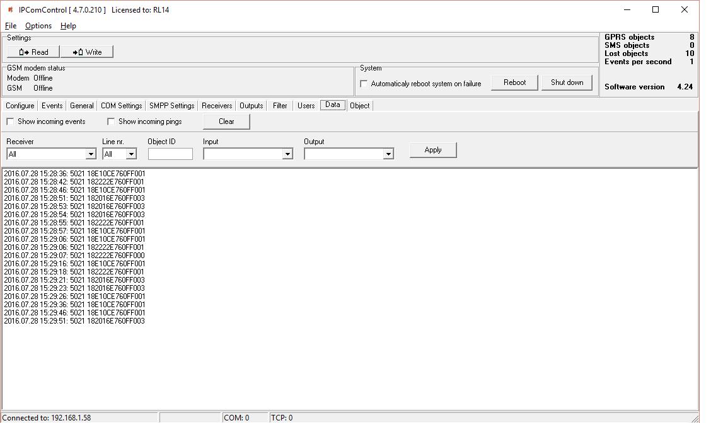

### Fliken Object – lista över registrerade objekt

Listan över registrerade objekt visas på fliken Object. Den innehåller:

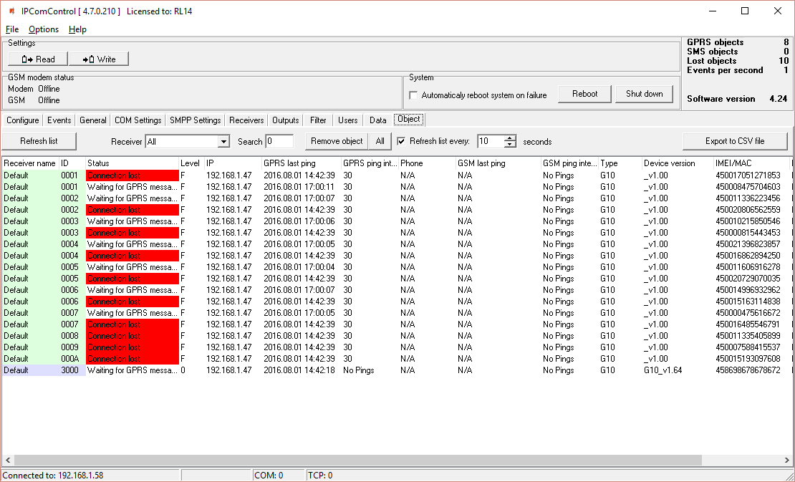

- **ID** – objektets nummer;
- **Status** – anslutningens status;
- **Level** – GSM-anslutningens signalstyrka;
- **IP** – larmsändarens adress;
- **GPRS last ping** – datum och tid för det senaste IP-meddelandet;
- **GPRS ping interval** – kontrollperiod för anslutningen i IP-kanalens meddelanden;
- **Phone** – abonnemangsnummer för larmsändarens SIM-kort;
- **GSM last ping** – datum och tid för det senaste meddelandet som togs emot via GSM;
- **GSM ping interval** – kontrollperiod för anslutningen i GSM-anslutningens meddelanden;
- **Type** – larmsändarens typ;
- **Device version** – larmsändarens programversion;
- **IMEI/MAC** – larmsändarens IMEI- eller MAC-nummer.

Använd funktionen **Search** för att hitta dataraden för önskat objekt. Använd funktionen **Remove object** för att ta bort en markerad rad ur listan. Med **Refresh list every: …… seconds** ställer du in listans uppdateringsperiod. Klicka på **Export to CSV file** för att skapa en lista över registrerade objekt (larmsändare) i en CSV-fil.

## Återställa förvalda parametrar

För att återställa nätverkskortets förvalda IP-adresser håller du RESET-brytaren intryckt tills en ljudsignal hörs.

## Mottagarens händelsemeddelanden

Mottagaren skapar och skickar ett meddelande till programvaran för meddelandeövervakning vid varje mottagarhändelse. Meddelandena skickas med inställda mottagar- och linjenummer och objektsidentifieringsnummer:

1. Mottaget från enheten på objektet, om händelsen hör till objektet.
2. 0000, om händelsen hör till allmänna funktionshändelser.

| Händelsens CID-kod | Händelsens namn / Object ID-nummer | Sektionsnummer | Villkor för att händelsemeddelandet ska genereras |
|----------------|-------------------------------|-------------|------------------------------------------|
| E301 | AC Power loss / 0000 Receiver ID | 000 | Nätspänningen bortfallen |
| R301 | AC Power restore / 0000 Receiver ID | 000 | Nätspänningen återställd |
| R305 | System started / 0000 Receiver ID | 000 | Systemet startat |
| E308 | System shutdown / 0000 Receiver ID | 000 | Systemet avstängt |
| E311 | Battery missing / 0000 Receiver ID | 000 | Batteri saknas |
| R311 | Battery connected / 0000 Receiver ID | 000 | Batteri anslutet |
| R313 | System rebooted / 0000 Receiver ID | ☑ | RESET intryckt eller omstart av programvaran |
| E330 | System peripheral trouble / Transmission module ID | Antal repeatrar | Fel på kringutrustning |
| E350 | Connection trouble / Transmission module ID | 000 | Anslutningsfel |
| R350 | Connection restore / Transmission module ID | 000 | Anslutningen återställd |
| E350 | Output connection trouble / 0000 Receiver ID | ☑ | Fel på utgångsanslutning |
| R350 | Output connection restore / 0000 Receiver ID | ☑ | Utgångsanslutningen återställd |
| E704 | Massive connection lost / 0000 Receiver ID | ☑ | Massivt bortfall av anslutningar |
| E712 | Receiver i/o error / 0000 Receiver ID | ☑ | I/O-fel |
| R712 | Receiver i/o restored / 0000 Receiver ID | ☑ | I/O återställd |
| E713 | Receiver no heart beat / 0000 Receiver ID | ☑ | Ingen heartbeat |
| R713 | Receiver heart beat restored / 0000 Receiver ID | ☑ | Heartbeat återställd |
| E714 | Receiver card unplugged / 0000 Receiver ID | ☑ | Kort urkopplat |
| R714 | Receiver card plugged in / 0000 Receiver ID | ☑ | Kort ikopplat |
| E732 | WAN ping timeout / 0000 Receiver ID | ☒ | WAN-ping har gått ut |
| R732 | WAN ping restored / 0000 Receiver ID | ☒ | WAN-ping återställd |
| E733 | WAN cable disconnected / 0000 Receiver ID | 000 | WAN-kabeln bortkopplad |
| R733 | WAN cable connected / 0000 Receiver ID | 000 | WAN-kabeln ansluten |
| E751 | GSM connection is offline / 0000 Receiver ID | 000 | GSM offline |
| R751 | GSM connection is online / 0000 Receiver ID | 000 | GSM online |
| E752 | Lost GSM connection | | |
| R752 | Restored GSM connection | | |
| E753 | Cellular modem no response / 0000 Receiver ID | 000 | Modemet svarar inte |
| R753 | Cellular modem responded / 0000 Receiver ID | 000 | Modemet har svarat |
| R754 | Massive GSM connection restore / 0000 Receiver ID | 000 | Massiv återställning av GSM-anslutningar |
| R755 | GSM receiver mode / Transmission module ID | ☑ | GSM-mottagarläge |
| E762 | Lost GPRS connection / Transmission module ID | ☑ | GPRS-anslutningen bruten |
| R762 | Restored GPRS connection / Transmission module ID | ☑ | GPRS-anslutningen återställd |
| R764 | Massive GPRS connection restore / 0000 Receiver ID | 000 | Massiv återställning av GPRS-anslutningar |

## Licensaktivering

Parametrarna i den ursprungliga licensen kan ändras (uppgraderas) genom att installera en ny licens. Gå till *Options → Activate product*, bläddra och välj licensfilen i formatet `.lic`.

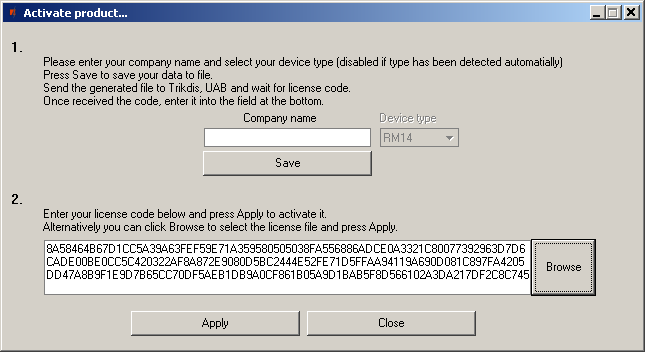

Klicka på knappen **Apply** för att installera den nya licensen.
