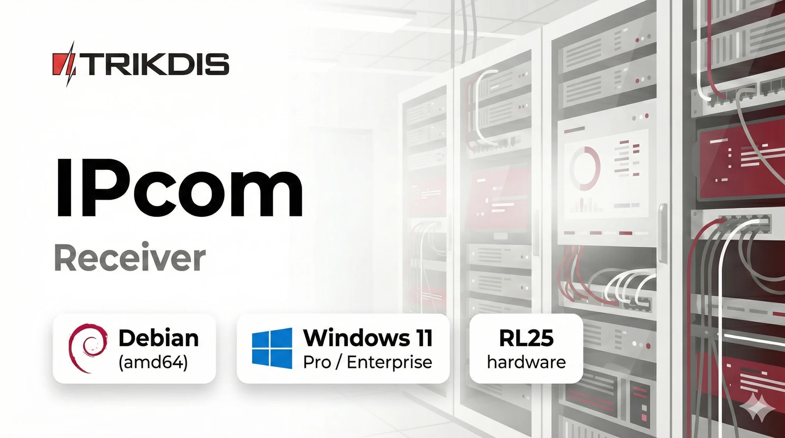

# IPCom v5, översikt över mottagaren

IPCom v5 är en mottagare som tar emot, bearbetar, vidarebefordrar och övervakar händelser från säkerhetssystem. Den har ett webbgränssnitt för drift och administration.

Utförandena nedan är samma produkt, IPCom v5, med olika driftsättning:

- Windows-installation
- Linux-installation (hårdvara eller virtuell maskin)
- RL25, mottagare som färdig hårdvara

## Driftsättningsvarianter

| Variant | Vad det innebär | Typisk användning |
| --- | --- | --- |
| Windows-installation | IPCom v5 installerat på Windows | Mindre miljöer eller miljöer med Windows i centrum |
| Linux-installation (hårdvara eller virtuell maskin) | IPCom v5 installerat på en Linux-server eller virtuell maskin | Skalbara driftsättningar och serverinfrastruktur |
| RL25, mottagare som färdig hårdvara | IPCom v5 på särskild RL25-hårdvara | Driftsättning som färdig enhet med förkonfigurerad Linux |

## Jämförelse av funktioner per driftsättning {#capability-comparison-by-deployment}

Funktionella skillnader mellan utförandena:

| Funktion | Windows-installation | Linux-installation (hårdvara eller virtuell maskin) | Linux-installation i RL25 |
| --- | --- | --- | --- |
| Antal övervakade enheter | Upp till 500 objekt (kan utökas) | Upp till 50 000 per 1 GB RAM | Upp till 50 000 per 1 GB RAM |
| Protegus 2-appen (vidarebefordran via mottagaren) | Nej | Ja | Ja |

`Relay via receiver` innebär att enheternas händelser och statusmeddelanden vidarebefordras till Protegus 2 via IPCom, och att åtgärder som stöds kan skickas tillbaka till enheterna via IPCom.

## Kapacitet och skalbarhet

IPCom upprätthåller en bestående TCP-session per enhet, som hålls vid liv med periodiska PING-signaler. Eftersom varje enhet har en enda långlivad anslutning motsvarar 1 000 enheter ungefär 1 000 samtidiga anslutningar. Det är en lätt belastning som ligger väl inom systemets gränser.

- Varje enhet använder en bestående TCP-session. En övervakning (watchdog) på serversidan upptäcker och rensar avbrutna sessioner.
- En enda IPCom-instans skalar till tiotusentals samtidiga enhetsanslutningar, och flera sådana servrar används i drift.
- På hanterade Linux-driftsättningar ställs operativsystemets gränser (filbeskrivare, socketbuffertar, anslutningsgränser) in med god marginal vid installationen, så vanliga antal enheter närmar sig aldrig någon resurs- eller systemgräns.

Referensdimensionering: som en snäv nedre gräns kan en enskild instans som övervakar upp till ca 30 000 enheter köras på 1 vCPU, 1 GB RAM och 20 GB disk. För produktionsdrift ska du använda de rekommenderade baslinjerna i [Maskinvarukrav](#4-maskinvarukrav) nedan, som ger marginal för loggar, databaser, säkerhetskopior och tillväxt.

## Maskinvarukrav

Använd dessa dimensioneringsunderlag när du planerar nya installationer.

### Linux-installation (hårdvara eller virtuell maskin)

Krav på Linux-plattformen:

- Linux-utförandet av IPCom v5 stöds endast på `amd64` (`x86_64`).
- Rekommenderat basoperativsystem är Debian Stable (`amd64`).
- Länkarna till Debian `netinst` pekar på den aktuella Stable-utgåvan och kan ändras över tid.
- Vid kontrollerade driftsättningar ska du ange exakt filnamn och version på Debian-ISO-filen i din dokumentation för utrullningen.
- Plattformar som inte är `amd64` (till exempel `arm64`/`aarch64`) stöds inte för Linux-driftsättning av IPCom v5.
- Om hårdvaran inte är `amd64` använder du ett alternativ som stöds, till exempel Windows-installation eller RL25-hårdvara.

| Driftsättningens storlek | RAM | Lagring |
| --- | --- | --- |
| Grunddriftsättning | 4 GB | 128 GB SSD |
| Stor objektbelastning (ca 100 000 objekt) | 8 GB | 128 GB SSD |
| Stor objektbelastning med databas aktiverad | 8 GB | 256 GB SSD för företagsbruk |

Anmärkningar:

- För driftsättningar med mycket databasarbete beror rekommendationen om 256 GB SSD för företagsbruk främst på livslängden (högre DWPD), inte bara på själva kapaciteten.
- Planera in extra ledigt diskutrymme för loggar, säkerhetskopior och filer för återställning vid uppdatering.

### Windows-installation

Lägsta rekommenderade specifikation:

- Windows 11 Pro eller Windows 11 Enterprise
- Processor med 2 kärnor
- 8 GB RAM
- 128 GB HDD/SSD (SSD att föredra)

### RL25, mottagare som färdig hårdvara

- RL25 levereras med SSD och RAM förmonterade.
- Använd RL25 när du vill ha en driftsättning som färdig enhet och förprovad hårdvara.

## Gemensamma funktioner (alla varianter)

### Grundläggande mottagning och styrning

- IP-mottagare, SMS-mottagare (valfri / GM14 / SMPP) och mottagning via RS232.
- Fjärrkonfigurering och fjärrstyrning av TRIKDIS-enheter.
- Övervakning, vidarebefordran av meddelanden och filtrering av radiomeddelanden.
- Hantering av mottagaren via webbsida (HTTP/HTTPS).

### Protokoll och integrationer

- Protokoll som stöds: Trikdis (TCP/UDP/COM/SMS).
- CMS-/automationsprotokoll: Split / Multi-Port Reporting.
- CMS-format: Ademco 685, Monas3, Surgard MLR2, MLR2000, SIA DC-09.
- Transporttyper för CMS/automation: TCP Client/Server, RS232, JSON, Webhook.
- SQL-databasgränssnitt och export av objektinformation.

### Gränssnitt och driftfunktioner

- Redigerbart användargränssnitt.
- Överstyrning av abonnentkod på mottagarnivå och visning av tillhörande abonnentkod (centralapparat).
- Möjlighet att ignorera primära meddelanden.
- Blockering av enheter via ID (planerad).
- Logg över ändringar av inställningar.
- Översiktspanel för mottagarens system.
- Fjärruppdatering.
- Användarlista med flera nivåer.

## Driftens omfattning

### Åtkomst och säkerhet

- Inloggning i webbläsare via IP-adress eller domän med val av port.
- Hanteringsgränssnitt via HTTP/HTTPS, där användning av SSL diskuteras för säker åtkomst.
- Användarlista, administratörskonto, tilldelning av roller samt kontroll av sessioner och token.

Stegvisa åtkomstsätt (webben och Windows-`.exe`) finns i [Åtkomst och inloggning](./ui/access-and-login.md).
Hur du skapar användare och hanterar lösenord, behörigheter (scopes) och token beskrivs i [fliken Users](./ui/screens/users.md).

Grundläggande driftsäkerhet:

- Begränsa åtkomsten till hanteringsgränssnittet med en tillåtelselista för nätverk eller VPN.
- Använd HTTPS med giltiga certifikat för alla administratörssessioner.
- Reservera `administrator` för nödfall och använd personliga konton med minsta möjliga behörighet i det dagliga arbetet.
- Byt inloggningsuppgifter och integrationshemligheter regelbundet.

### Övervakning och drift

- Panelvy över systemets och objektens tillstånd.
- Spårning av online/offline/ej spårade och händelsestatistik.
- Systemloggar och sessionsloggar för överblick över driften.

### Händelser, vidarebefordran och protokollhantering

- Hantering av händelselista med filtrerings- och sökfunktioner.
- Hantering av ping/PING-signaler för övervakning av anslutningen.
- Vidarebefordran och utgångar för flöden mot CMS/automation.

### Integration och data

- SQL-baserade driftdata och objektexport.
- Stöd för API och integration via JSON och webhook.

### Driftsättning och livscykel

- Driftsättning på Windows- och Linux-plattformar.
- Import och export av konfiguration samt arbetsflöden för fjärruppdatering.
- Licensiering och driftaspekter på serversidan.

## Snabbåtkomst

Använd de här sidorna som primära ingångar:

- Åtkomstsätt och felsökning: [Åtkomst och inloggning](./ui/access-and-login.md)
- Hur varje flik fungerar i drift: [fliken Status](./ui/screens/status.md) (och resten av `User interface`)
- Procedurer för användare och behörigheter: [fliken Users](./ui/screens/users.md)
