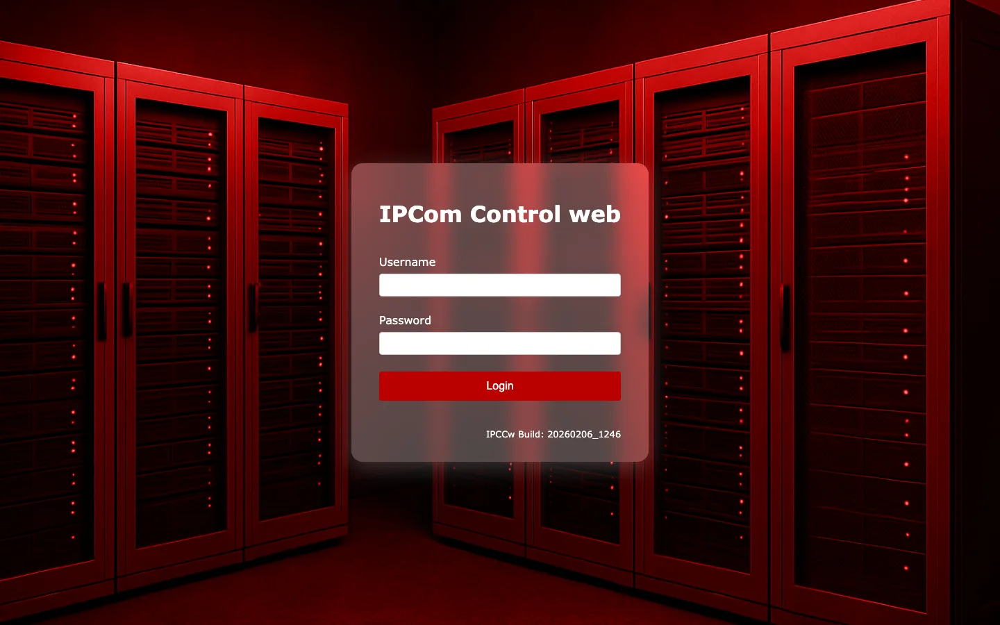

# Åtkomst och inloggning

**Syfte:** Förklara hur operatörer når IPCom5 Control och loggar in med de åtkomstsätt som stöds.

## Åtkomstsätt

- `Web access` finns för alla driftsättningsvarianter, via webbadress/domän i webbläsaren och hanteringsport.
- `Windows .exe access` finns i Windows-installationer och öppnar samma IPCom Control-miljö via Windows-klienten.

## Inloggning via webben

1. Öppna webbadressen till IPCom Control i en webbläsare (`http(s)://<host>:<port>`).
2. Kontrollera vilken instans och version som visas på inloggningssidan innan du anger dina inloggningsuppgifter.
3. Logga in med ditt användarkonto.
4. Kontrollera miljö och tillstånd i `Status` efter inloggningen.

## Inloggning med Windows-`.exe`

1. Starta IPCom Control-`.exe` från Windows-installationen.
2. Välj eller ange den mottagarinstans du vill nå (host/domän och port).
3. Logga in med dina inloggningsuppgifter för IPCom.
4. Kontrollera att du är på rätt instans med hjälp av sidhuvudet och sidfoten i `Status`.

## Säkerhetsgrund för åtkomst

- Använd HTTPS för hanteringsåtkomst när det är möjligt.
- Begränsa nåbarheten för hanteringsgränssnittet till betrodda nätverk (VPN, tillåtelselista, brandväggsregler).
- Reservera `administrator` för nödfall och använd personliga konton i det dagliga arbetet.
- Byt inloggningsuppgifter och integrationshemligheter regelbundet.

## Snabb felsökning

- `Cannot login`: kontrollera att host och port är rätt, kontots inloggningsuppgifter och kontots status i `Users`.
- `Wrong instance opened`: bekräfta instansnamnet i sidhuvudet samt host och användare i sidfoten i `Status`.
- `Session expires too quickly`: gå igenom tokeninställningarna och rollpolicyn i `Users`.
- `Unexpected build/version`: avbryt ändringarna och bekräfta driftsättningsmålet innan du fortsätter.

## Relaterade sidor

- Kontohantering: [fliken Users](./screens/users.md)
- Första kontrollen efter inloggning: [fliken Status](./screens/status.md)
