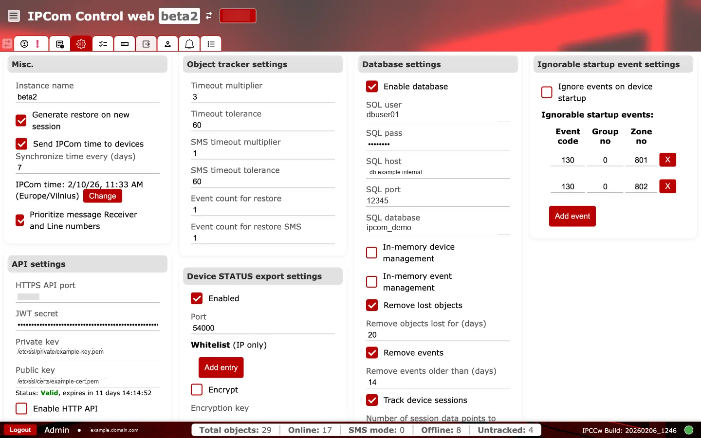
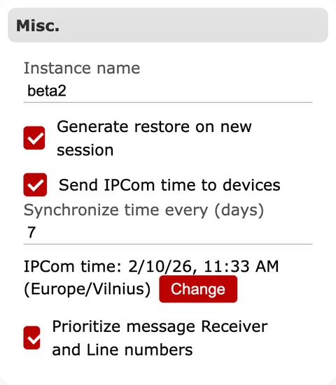
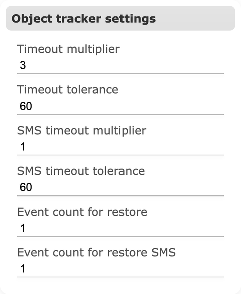
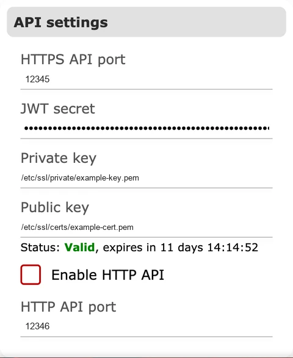
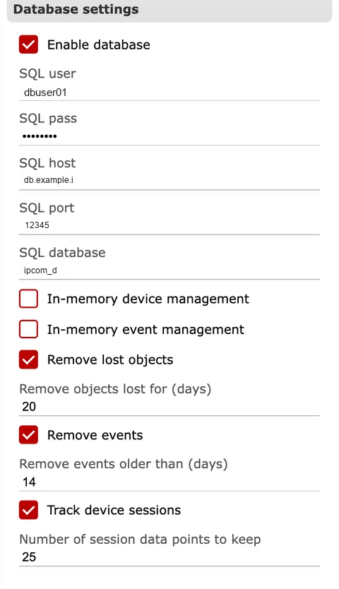
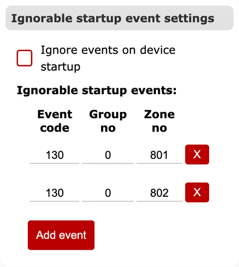

# General

**Syfte:** Konfigurera inställningar som gäller hela instansen och påverkar tidshållning, övervakning, databasens beteende, API-åtkomst och hanteringen av händelser vid start.

## När du använder den

- Vid första driftsättningen, för att ställa in identitet, tidssynkronisering, API och databasanslutning.
- När du justerar övervakning, lagringstid eller exportbeteende för driften.

## Avsnitt och varför de är viktiga {#general-sections}

### Misc.

Anger instansens namn och sessionsbeteenden. Instansnamnet visas i gränssnittet och hjälper operatörer att bekräfta att de arbetar på rätt mottagare. Alternativ som `Generate restore on new session` styr hur återställningshändelser skickas efter återanslutning, vilket påverkar efterföljande övervakning. Inställningarna för tidssynkronisering styr om IPCom skickar sin klocka till enheterna och hur ofta, vilket direkt påverkar händelsernas tidsstämplar.

**Driftkontroller och åtgärder:**

- Följ: `Send IPCom time to devices` och synkroniseringsintervallet. Varningssignal: tidsdrift mellan mottagaren och CMS.
- Följ: ändringar av instansnamnet. Varningssignal: operatörer väljer fel mottagare.
- Bekräfta: `instance_name` får inte vara tomt.
- Bekräfta: `synchronize_device_time_interval` måste vara större än `0`.

### Object tracker settings

Styr tidsinställningarna för övervakning av spårade enheter. Tidsgränsmultiplikatorer och toleranser avgör när en enhet anses vara offline. Separata SMS-värden gäller när enheter rapporterar via SMS. Antalet återställningshändelser styr när systemet skickar återställningsmeddelanden efter att en enhet har kommit tillbaka.

**Driftkontroller och åtgärder:**

- Följ: tidsgränsmultiplikatorer och toleranser. Varningssignal: falska offline-larm eller återställningsskurar.
- Bekräfta: `timeout_multiplier` och `sms_timeout_multiplier` måste vara `1..100`.
- Bekräfta: `timeout_tolerance` och `sms_timeout_tolerance` måste vara `0..3600`.
- Bekräfta: `event_count_for_restore` och `event_count_for_restore_sms` måste vara `1..10`.

### API settings

Anger HTTPS-åtkomst till API:et, port och hemligheter. Inställningarna styr hur externa system integreras med IPCom och måste hållas konsekventa med brandväggar och omvända proxyservrar. Certifikatstatusen för TLS i det här avsnittet hjälper dig att validera säker åtkomst.

Begränsa API-åtkomsten till betrodda nätverk för administration och integration.

**Driftkontroller och åtgärder:**

- Följ: `Enable HTTP API`, API-portar och TLS-status. Varningssignal: oväntat öppen hanteringsväg eller certifikatproblem.
- Bekräfta: `api_port` och `api_http_port` måste vara mellan `1` och `65535`.
- Bekräfta: `api_jwt_secret` måste vara exakt 64 tecken.
- Bekräfta: `private_key` och `public_key` får inte vara tomma och måste peka på giltiga PEM-filer.

### Database settings

Aktiverar SQL-databasen och konfigurerar anslutningsuppgifterna (användare, lösenord, host, port, databas). Alternativen för hantering av enheter och händelser i minnet styr vad som cachas och hur rensningen fungerar. Värdena för lagringstid i `Remove lost objects` och `Remove events` avgör hur länge data sparas innan de rensas, vilket påverkar lagringsutrymme och revisionsdjup.

**Driftkontroller och åtgärder:**

- Följ: `Enable database` och SQL-anslutningsfälten. Varningssignal: loggar och historik saknas efter omstart.
- Följ: värdena för lagringstid i `Remove lost objects` och `Remove events`. Varningssignal: data försvinner tidigare än policyn säger.
- Bekräfta: om databasen är aktiverad får `sqluser`, `sqlpass`, `sqlhost` och `sqldatabase` inte vara tomma.
- Bekräfta: `sqlport` måste vara `1..65535` (`0` gör att IPCom använder standardporten `3306`).
- Bekräfta: `remove_lost_objects_age` och `remove_events_age` måste vara `1..365` dagar.

### Ignorable startup event settings

Låter dig undertrycka vissa händelsekoder när en enhet startar. Det är användbart för att minska bruset vid massåteranslutningar eller schemalagt underhåll. Använd händelselistan för att lägga till eller ta bort koder som ska ignoreras.

**Driftkontroller och åtgärder:**

- Följ: `Ignore events on device startup` och undantagslistan. Varningssignal: kritiska startlarm når inte CMS.
- Bekräfta: `event_code <= 0xFFF`, `group_no <= 0xFF`, `zone_no <= 0xFFF`, och varje trippel måste vara unik.

## Ändringshantering

- Schemalägg ändringar av API, databas och lagringstid till underhållsfönster.
- Anteckna värdena före och efter samt förväntad påverkan, för revision och för att kunna gå tillbaka.
- Verifiera `Status`, `Logs` och destinationernas leveransvägar efter varje ändring.
- Ha en väg tillbaka redo för uppdateringar av databas och API.
