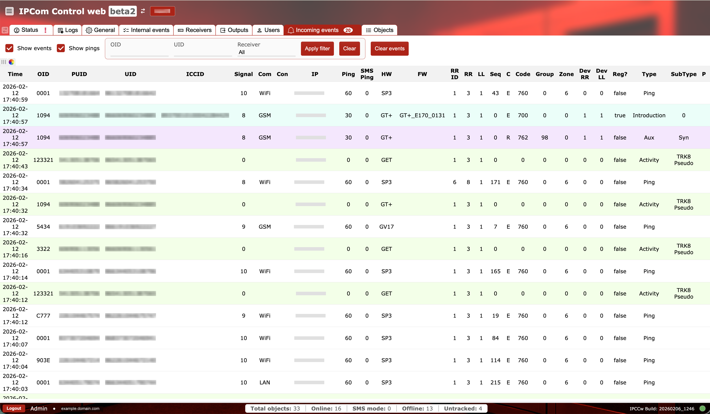
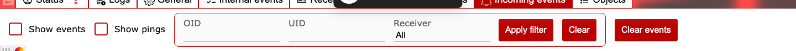

# Incoming events

**Syfte:** Följa inkommande händelser och pingar från enheter i realtid och filtrera dem per enhet eller mottagare.

## När du använder den

- När du vill kontrollera att enheterna skickar händelser.
- Vid felsökning av vidarebefordran, anslutningar eller avkodning av händelser.

## Avsnitt och varför de är viktiga

### Filters and actions {#incoming-events-filters}

- `Show events` och `Show pings` styr vilka meddelandetyper som visas.
- Filtren `OID`, `UID` och `Receiver` avgränsar flödet till en viss enhet eller instans.
- `Apply filter` uppdaterar vyn, `Clear` återställer filterfälten och `Clear events` rensar den aktuella listan.

Filter är nödvändiga för mottagare med stora volymer, där det inte går att bläddra i den råa strömmen.

### Incoming event table {#incoming-events-table}

Tabellen är bred och grupperad efter ändamål:

- Identifiering: `Time`, `OID`, `PUID`, `UID`, `ICCID` identifierar enheten.
- Anslutning: `Signal`, `Com` (kommunikationstyp), `Con` (protokoll), `IP`, `Ping`, `SMS Ping` visar transportens tillstånd.
- Enhetsversion: `HW` och `FW` hjälper dig att koppla beteende till hårdvaru- eller firmwareversioner.
- Vidarebefordran: `RR ID` (mottagar-ID), `RR` (mottagarnummer) och `LL` (linjenummer) visar sammanhanget för vidarebefordran. `Dev RR` och `Dev LL` är värden för vidarebefordran som enheten själv rapporterar. `Reg?` visar om händelsen är en registreringshändelse, inte enhetens aktuella tillstånd.
- Händelsens uppgifter: `Seq`, `C`, `Code`, `Group`, `Zone`, `Type`, `SubType`, `P` utgör händelsens innehåll.

Använd kolumnerna för att bekräfta att händelserna avkodas rätt och skickas vidare till avsedd utgång.
Fullständiga definitioner av fälten finns under `Glossary` i IPcom-navigeringen.

### Driftkontroller och åtgärder {#incoming-events-operational-checks}

Gör två snabba genomgångar vid incidentbedömning: se först till att vyn av flödet går att lita på och kontrollera sedan fälten för vidarebefordran och innehåll.

**Följ dessa under drift:**

- Filter som av misstag har lämnats aktivt. Varningssignal: operatörer missar händelser eftersom vyn är avgränsad.
- Avvikande `Time` och försenade rader. Varningssignal: latenstopp från enhet till mottagare.
- `RR/LL` som inte stämmer med förväntad väg för mottagaren. Varningssignal: händelser visas under fel sammanhang för vidarebefordran.
- Upprepade felaktiga kombinationer av `Code/Group/Zone`. Varningssignal: avvikelse vid avkodning/tolkning efter konfigurationsändringar.

**Bekräfta före användning i produktion:**

- `Clear` återställer tabellen till hela det förväntade flödet innan du gör en bred incidentbedömning.
- Identifieringsfälten (`OID`, `UID`, `PUID`) motsvarar kända objekt.
- Transportfälten (`Con`, `IP`, `Ping`, `SMS Ping`) stämmer med enhetens kommunikationssätt.
