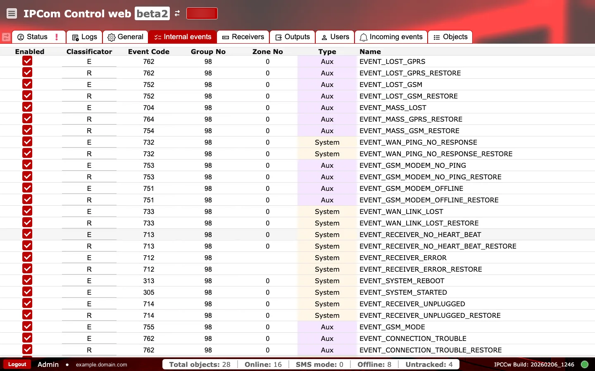
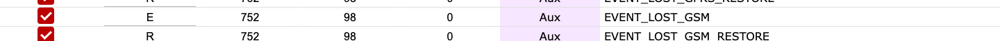

# Internal events

**Syfte:** Granska och styra systemgenererade händelser och de koder som skickas till efterföljande destinationer.

## När du använder den

- När du behöver koppla interna händelser till koder för CMS eller automation.
- När du behöver aktivera eller undertrycka vissa interna händelser.

## Avsnitt och varför de är viktiga

### Internal event list {#internal-events-list}

Varje rad definierar hur ett internt systemtillstånd återges i utgående meddelanden. Här anpassar du de interna händelsenamnen till de numeriska koder som din övervakningsplattform förväntar sig.

### Columns explained {#internal-events-columns}

- `Enabled`: om händelsen är aktiv (markerad) eller undertryckt.
- `Classificator`: händelsens klassificerare (till exempel `E` för händelse, `R` för återställning).
- `Event code`: numerisk kod som skickas i händelseutgången.
- `Group no` och `Zone no`: numeriska fält som används för att vidarebefordra till mottagarintegrationer.
- `Type`: kategori som `System` eller `Aux`.
- `Name`: intern händelsebeteckning (till exempel `EVENT_SYSTEM_STARTED`).

Om du inaktiverar händelser eller ändrar koder påverkas vidarebefordran och tolkningen av larm längre fram. Ändringarna bör därför samordnas med övervakningsplattformen.

### Driftkontroller och åtgärder {#internal-events-operational-checks}

Gör två snabba genomgångar efter varje ändring: följ först händelsernas beteende i efterföljande system och bekräfta sedan regelintegriteten i tabellen.

**Följ dessa under drift:**

- Reglage för aktiverad/inaktiverad som ändras oväntat. Varningssignal: interna larm slutar visas i efterföljande system.
- Händelsekoder som ändras oväntat efter uppdateringar. Varningssignal: CMS börjar avkoda interna händelser fel.
- `Type` som växlar mellan `System` och `Aux` utan ändringsbegäran. Varningssignal: fel klassificering längre fram.
- Parade regler för `E` (händelse) och `R` (återställning) som hamnar ur takt. Varningssignal: återställningshändelser saknas.

**Bekräfta före användning i produktion:**

- `classificator` är `E` (händelse) eller `R` (återställning).
- `event_code`, `group_no` och `zone_no` ligger inom tillåtna numeriska intervall.
- `name` är inte tomt.
- `type` är ett av de värden som stöds.
- Kodningen stämmer med CMS regler för tolkning innan du aktiverar den.
