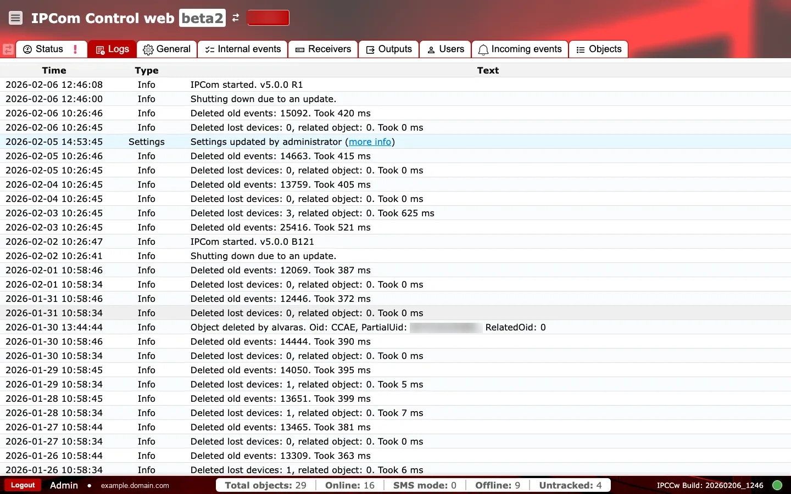

# Logs

**Syfte:** Ge ett revisionsspår över systemaktivitet och administrativa åtgärder för felsökning och uppföljning.

## När du använder den

- Efter konfigurationsändringar, för att bekräfta att de har tillämpats.
- Vid undersökning av omstarter, rensningsjobb eller oväntat beteende.

## Avsnitt och varför de är viktiga

### Log table {#logs-table}

Varje rad registrerar en system- eller administrationshändelse med tidsstämpel, typ och meddelande. Det är det första stället att bekräfta schemalagd rensning, uppgraderingar eller konfigurationsändringar. En del poster har en länk `more info` med utökade uppgifter som hjälper dig att se vad som ändrades och vem som startade det.

### Driftkontroller och åtgärder {#logs-operational-checks}

Gör två snabba genomgångar: följ först mönster i de senaste posterna och bekräfta sedan händelsernas metadata innan du eskalerar.

**Följ dessa under drift:**

- Upprepade `error`-poster inom korta tidsfönster. Varningssignal: återkommande instabilitet i transport eller tjänst.
- Täta poster av typen `Settings` utanför underhållsfönster. Varningssignal: obehöriga eller oavsiktliga ändringar.
- Aktören/källan i `more info` stämmer inte med förväntad operatör eller automationskonto. Varningssignal: oplanerade administrativa ändringar.

**Bekräfta före användning i produktion:**

- Etiketterna i `Type` är fortsatt konsekventa (`info`, `warning`, `error`, `settings`).
- Tidsstämplarna följer förväntad tidsordning för samma incidentförlopp.

## Checklista vid incident {#logs-incident-checklist}

- `Destination delivery failures`: leta efter upprepade anslutningsfel för utgångar och mönster av timeout.
- `Receiver ingest failures`: leta efter fel vid bindning eller start av lyssnare efter ändrade portar eller nätverk.
- `Auth and permission issues`: leta efter misslyckade inloggnings- och behörighetshändelser efter ändringar av konton eller token.
- `Backlog symptoms`: koppla rensnings- eller varningsposter till buffertillväxt i `Status`.
