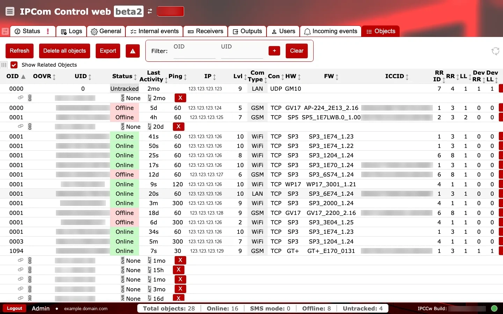
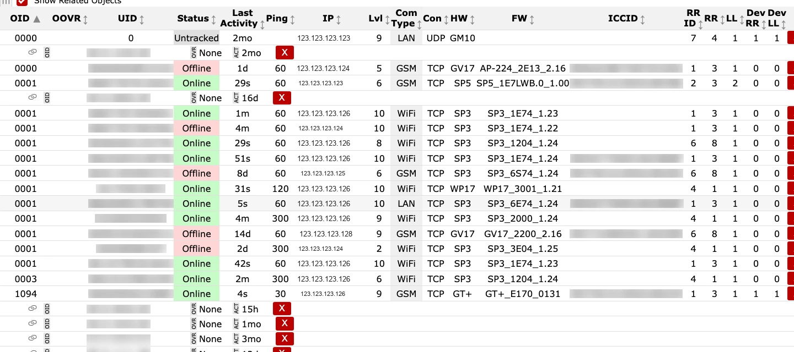

# Objects

**Syfte:** Granska och hantera listan över spårade objekt (enheter), deras status och anslutningsuppgifter.

## När du använder den

- När du söker efter en viss enhet eller kontrollerar dess online-status.
- När du exporterar enhetslistor eller granskar anslutningsproblem.

## Avsnitt och varför de är viktiga

### Actions and filters {#objects-actions-filters}

- `Refresh` läser in listan på nytt så att de senaste enhetstillstånden visas.
- `Delete all objects` tar bort alla objekt från listan och ska bara användas med uttryckligt godkännande.
- `Export` laddar ned den för tillfället filtrerade listan som en CSV-fil med semikolon som avgränsare, med namnet `objects.csv`, med en rad per enhet plus ytterligare rader för varje kanal och, när de visas, varje relaterat objekt. Värden omges av dubbla citattecken och booleska värden skrivs som `Yes`/`No`. Filen innehåller identifierare för objekt och enheter, så hantera och förvara den därefter.
- Filterfälten för `OID` och `UID` hjälper dig att avgränsa stora listor, med `+` för att tillämpa och `Clear` för att återställa.
- `Show Related Objects` utökar listan med relaterade poster.

### Object list table {#objects-object-list}

Viktiga kolumner är bland annat:

- Identifiering: `OID`, `UID` och `ICCID` identifierar enheten och SIM-kortet.
- Status: `Status` och `Last Activity` visar tillgänglighet och senast rapporterad tid.
- Anslutning: `Ping`, `IP`, `Lvl` (signalnivå), `Com Type` (GSM/WiFi/LAN) och `Con` (TCP/UDP) visar transportens tillstånd.
- Enhetsversion: `HW` och `FW` hjälper dig att koppla beteende till firmwarenivåer.
- Vidarebefordran: `RR ID` (mottagar-ID), `RR` (mottagarnummer) och `LL` (linjenummer) visar sammanhanget för vidarebefordran. `Dev RR` och `Dev LL` är värden för vidarebefordran som enheten själv rapporterar.
- `OOVR` är det överstyrda OID: ett alternativt objektnummer som ersätter objektets eget OID och används för att byta ut ett objekt mot den abonnentkod som larmcentralens programvara förväntar sig. Tomt eller `0` betyder att ingen överstyrning används.

Röda `X` i kolumnen `Ping` betyder vanligtvis att ingen ping har registrerats nyligen.
Fullständiga definitioner av fälten finns under `Glossary` i IPcom-navigeringen.

### Driftkontroller och åtgärder {#objects-operational-checks}

Gör två snabba genomgångar: följ först objektens tillståndssignaler över tid och jämför sedan tabellvärdena med förväntad vidarebefordran och förteckning.

**Följ dessa under drift:**

- Oavsiktliga destruktiva åtgärder (`Delete all objects`) under pågående drift. Varningssignal: förteckningen blir plötsligt tom.
- Kvarglömt filter. Varningssignal: förväntade enheter saknas i den aktuella vyn.
- Att `Status` och `Last Activity` inte stämmer överens. Varningssignal: ett objekt rapporteras som online men har en gammal tidsstämpel för aktivitet.
- Upprepade röda `X` i `Ping` inom samma transportgrupp. Varningssignal: kanalen eller vägen försämras.
- `OOVR`-värden som ändras oväntat. Varningssignal: ett objekt har kopplats om till en annan abonnentkod, så dess händelser kommer in under den koden i larmcentralens programvara.

**Bekräfta före användning i produktion:**

- `Refresh` används innan du tar ögonblicksbilder för incidentbedömning.
- Fälten för vidarebefordran (`RR ID`, `RR`, `LL`, `Dev RR`, `Dev LL`) stämmer med kopplingen mellan mottagare och utgång.
- Fälten för hårdvara och firmware (`HW`, `FW`) finns för de enhetstyper som förväntas vara hanterade.
