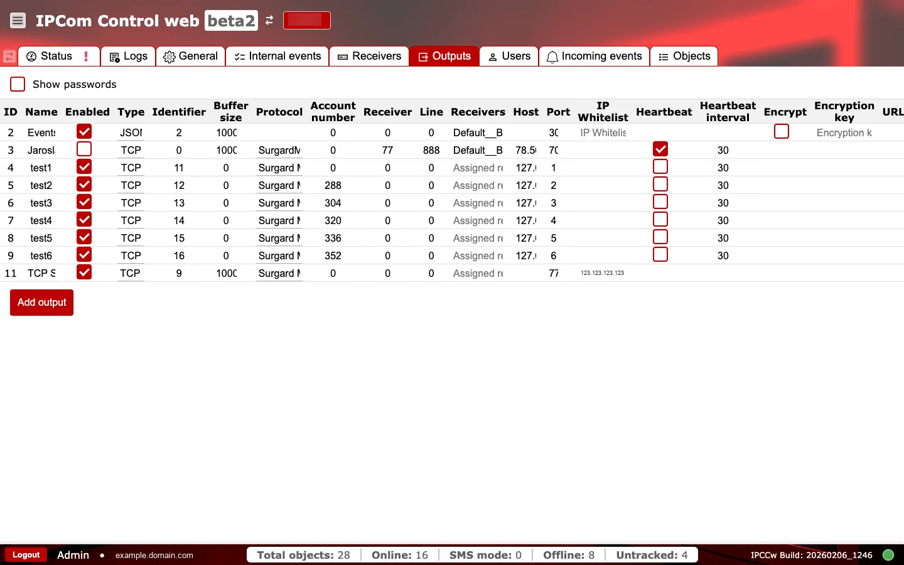

# Outputs

**Syfte:** Konfigurera utgångar som destinationer för leverans av händelser och för automationsintegrationer.

## När du använder den

- När du skapar eller uppdaterar vägar mot CMS eller automation.
- När du felsöker leverans till en viss destination.

## Avsnitt och varför de är viktiga

### Outputs table {#outputs-table}

Varje rad motsvarar en destination och dess konfiguration för vidarebefordran. Viktiga fält:

- `ID` och `Name`: identifierar utgången.
- `Enabled`: styr om händelser skickas till den här destinationen.
- `Type` och `Protocol`: beskriver utgångens transport.
- `Identifier` och `Account number`: identifierare för vidarebefordran som destinationssystemet förväntar sig.
- `Receiver` och `Line`: identifierare för vidarebefordran på mottagarsidan.
- `Receivers`: den mottagargrupp som är tilldelad den här utgången.
- `Host` och `Port`: fjärrdestinationens adress.
- `Buffer size`: gräns för kön per utgång, som används för att upptäcka flaskhalsar vid leverans.
- `Heartbeat` och `Heartbeat interval`: kontroller av anslutningens tillstånd.
- `Encrypt` och `Encryption key`: skyddar transporten när det behövs (API-baserade integrationer använder en nyckel med fast längd).
- `IP Whitelist`: tillåtelselista över källadresser som får ansluta. Finns bara för utgångarna `JSON Server` och `TCP Server`, där IPCom lyssnar efter en inkommande anslutning.
- `Filters`: filter för vidarebefordran av händelser som styr vilka händelser som skickas.

Tillgängliga alternativ för `Type`:

- `TCP`
- `COM Port`
- `JSON Server`
- `TCP Server`
- `Webhook`

Tillgängliga alternativ för `Protocol`:

- `Surgard MLR2`
- `Monas 3`
- `Surgard MLR2 8`
- `Surgard MLR2 No End`
- `Ademco 685`
- `Ademco 685 CID`
- `SurgardMRL2000 CID`
- `SIA DC-09`
- `Surgard MLR2 Line with Account`

Felkonfigurerade fält här är en vanlig orsak till att händelser inte levereras, så validera ändringarna mot destinationssystemets krav.

`Buffer size` är en gräns för kön per utgång. Hög eller växande köanvändning tyder på fördröjningar hos destinationen eller att protokollen inte stämmer överens, och kan leda till att larm levereras sent.

Vilka fält som används beror på protokoll och integration och måste stämma med den tolkningsprofil som CMS använder i din driftsättning.

Obs: om `buffer_size` är satt till `0` använder IPCom standardstorleken på kön, `1000` händelser.

### Add output {#outputs-add-output}

Använd `Add output` för att skapa en ny destination och ange identifierare för vidarebefordran och nätverksvärden.

### Driftkontroller och åtgärder {#outputs-operational-checks}

Gör två snabba genomgångar efter varje ändring: följ först beteendet under drift och bekräfta sedan konfigurationsuppgifterna innan du aktiverar leverans i produktion.

**Följ dessa under drift:**

- Växande `Buffer size` på aktiva utgångar. Varningssignal: kön töms inte medan enheterna fortsätter att generera händelser.
- Ändringar av slutpunkt eller protokoll utan samordnade ändringar i CMS. Varningssignal: leveransfel eller avkodningsfel.
- En utgång som aktiveras innan destinationen är redo. Varningssignal: omedelbar buffertillväxt och misslyckade anslutningsförsök.

**Bekräfta före användning i produktion:**

- Utgångens `id` är unikt och större än `0`, och `name` är inte tomt.
- `Type`, `Protocol` och `Identifier` stämmer med CMS integrationsprofil.
- `OID`, `Receiver number` och `Line` stämmer med den vidarebefordran som CMS förväntar sig.
- Om kryptering är aktiverad är `encryption_key` exakt `16` tecken lång.
- Utgångens `IP Whitelist` och policyn för `Host` stämmer med anvisningarna i `Networking and firewall`.
- Teckenuppsättning och teckenkodning för krypteringsnyckeln är överenskomna med ert integrationsteam.
- Beteendet för nya försök/fördröjning och för bestående köer är dokumenterat för din driftsättning.
- Kör kontrollerade testhändelser per protokoll innan du aktiverar i produktion.

## Driftrutiner {#outputs-operations-runbook}

- `Events not arriving at destination`: kontrollera `Enabled`, destinationens `Host`/`Port`, valt protokoll och kopplingen mellan mottagare och linje.
- `Frequent reconnects`: justera `Heartbeat interval`, kontrollera att nätverket är stabilt och bekräfta att destinationen godtar det konfigurerade protokollet.
- `Queue growth on one output`: inaktivera den problematiska utgången tillfälligt, rätta slutpunktsinställningarna, aktivera den igen och följ hur bufferten återhämtar sig.
- `Changes break delivery`: jämför med en fungerande utgång och gå tillbaka till de senaste stabila värdena innan du försöker igen.
