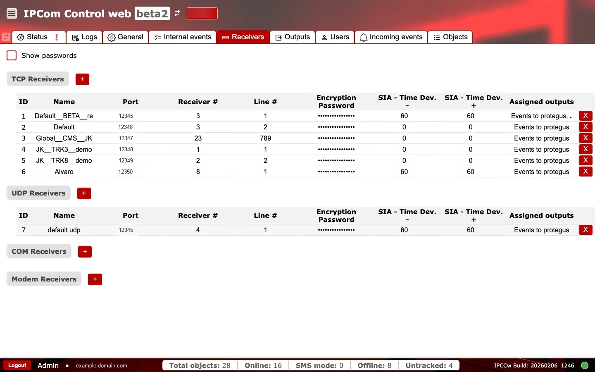
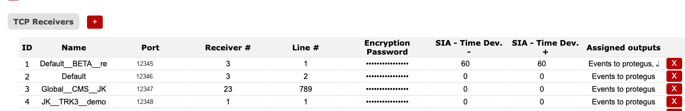
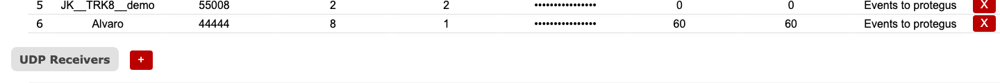
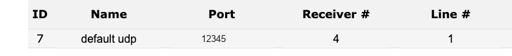
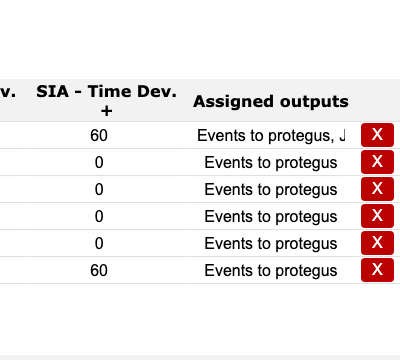

# Receivers

**Syfte:** Konfigurera mottagarnas slutpunkter (TCP, UDP, COM och Modem) som tar emot inkommande trafik från enheter och ange parametrar för vidarebefordran.

## När du använder den

- När du tar en ny mottagarslutpunkt i bruk eller ändrar lyssnarportar.
- När identifierare för vidarebefordran eller krypteringsinställningar ändras.

## Avsnitt och varför de är viktiga

### TCP Receivers {#receivers-tcp}

Definierar TCP-slutpunkter som lyssnar. `Port` styr var enheterna ansluter. `Receiver #` och `Line #` är identifierare för vidarebefordran som används av efterföljande system. `Encryption Password` skyddar krypterad trafik. Fälten `SIA - Time Dev.` anger gränser för tillåten tidsavvikelse i SIA-protokollet (negativ och positiv).

Använd en konsekvent koppling mellan mottagare och linje mot utgångarna och det som CMS förväntar sig.

**Driftkontroller och åtgärder:**

- Följ: aktiv mottagning som upphör efter en portändring. Varningssignal: sessionerna faller till noll i `Status`.
- Följ: ändrad koppling av linje/mottagare utan ändringskontroll hos CMS. Varningssignal: händelser hamnar hos fel kund eller i fel område.
- Bekräfta: TCP-portar måste vara `1..65535`.
- Bekräfta: TCP-portar måste vara unika bland TCP-mottagarna.
- Bekräfta: mottagarens `id` är unikt och större än `0`, och mottagarens `name` är inte tomt.
- Bekräfta: lösenordet för kryptering är exakt `6` eller `16` tecken långt.

### UDP Receivers {#receivers-udp}

Definierar UDP-slutpunkter som lyssnar. Använd det när enheter rapporterar via UDP. Fältens betydelse motsvarar TCP-mottagarnas, med samma identifierare för vidarebefordran.

**Driftkontroller och åtgärder:**

- Följ: UDP-paket som tas emot men inte stämmer med enheternas förväntade protokoll. Varningssignal: aktiva enheter visar inga händelser.
- Bekräfta: UDP-portar måste vara `1..65535`.
- Bekräfta: UDP-portar måste vara unika bland UDP-mottagarna.

### COM Receivers {#receivers-com}

Definierar seriella (RS232/COM) mottagare för lokala integrationer. De används vanligtvis när hårdvara eller äldre centralapparater rapporterar över seriella förbindelser.

**Driftkontroller och åtgärder:**

- Följ: COM-mottagare som är aktiverad men saknar fysisk seriell anslutning. Varningssignal: inga inkommande händelser från seriella centralapparater.
- Bekräfta: COM-mottagarens `port_id` hänvisar till en befintlig COM-terminal.

### Modem Receivers {#receivers-modem}

Definierar modembaserade mottagare för SMS eller trafik av typen uppringd förbindelse. Använd det när SMS- eller modemkanaler ingår i driftsättningen.

**Driftkontroller och åtgärder:**

- Följ: att modemmottagarens väg ständigt ändras under avbrott. Varningssignal: SMS-händelser saknas eller är försenade.
- Bekräfta: modemmottagarens `port_id` hänvisar till en befintlig COM-terminal.
- Bekräfta: lösenordet för modemkryptering är `6` eller `16` tecken långt.

### Assigned outputs och borttagning {#receivers-assigned-outputs}

Kolumnen `Assigned outputs` visar vilka utgångar som är kopplade till varje mottagare. Det röda `X` tar bort en mottagarpost, så använd det bara med uttryckligt godkännande.

**Driftkontroller och åtgärder:**

- Följ: mottagare som saknar tilldelade utgångar. Varningssignal: mottagningen fungerar men inget levereras vidare.
- Följ: oavsiktlig borttagning (`X`) under pågående drift. Varningssignal: en mottagare försvinner plötsligt.
- Bekräfta: varje aktiv mottagare har minst en avsedd koppling till en utgång.

## Nätverksanteckningar

- Flikarna för mottagare definierar inkommande slutpunkter (enhet -> IPCom).
- Flikarna för utgångar definierar utgående destinationer (IPCom -> CMS/automation).
- När du ändrar mottagarportar ska du uppdatera brandväggs- och NAT-reglerna innan du flyttar över produktionstrafik.
