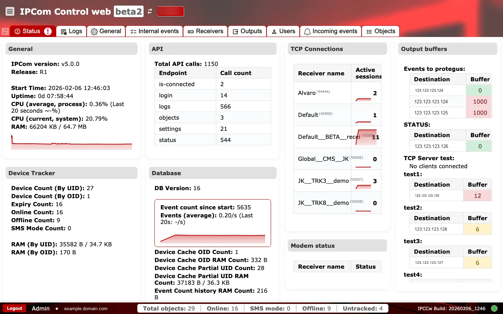
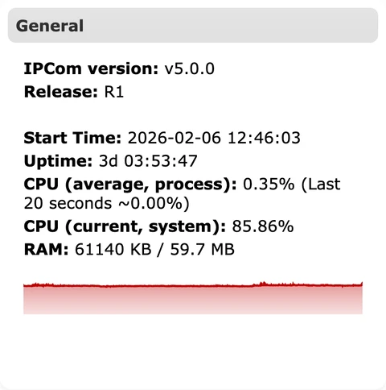
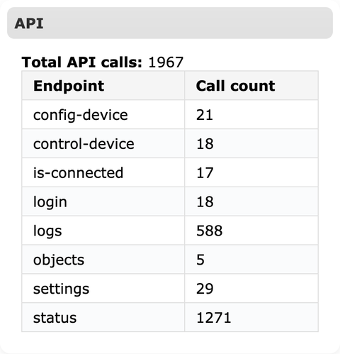
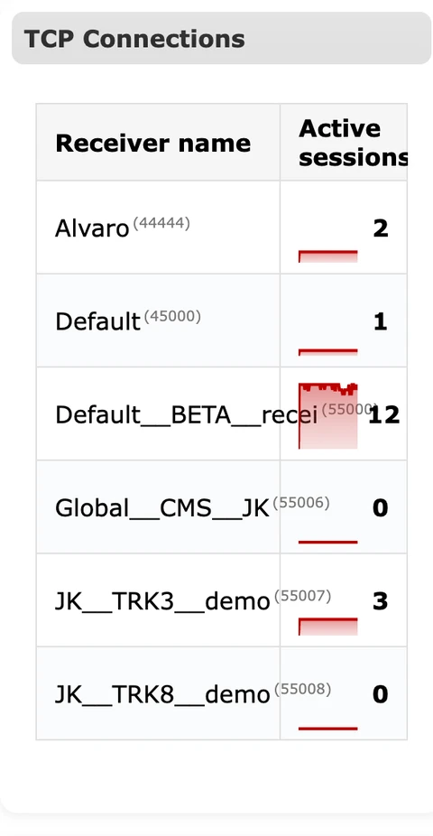
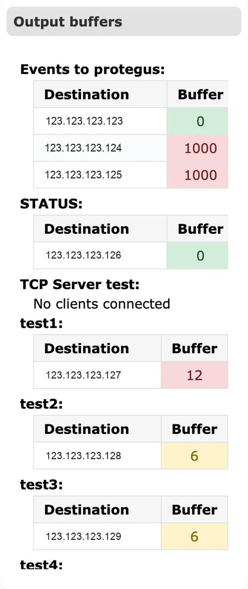
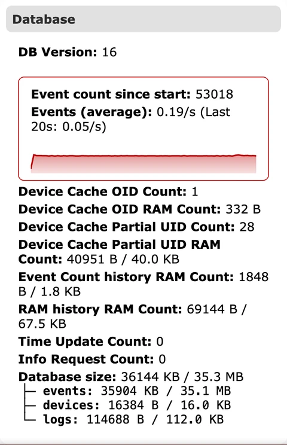

# Status

**Syfte:** Ge en levande driftöversikt över den valda IPCom-instansen, så att operatörer med en blick kan bekräfta tillstånd, genomströmning och anslutningar.

## När du använder den

- Efter inloggning, för att bekräfta instansens version, drifttid och allmänna tillstånd.
- Vid felsökning av leveransproblem, buffertköer eller avbrutna anslutningar.

## Avsnitt och varför de är viktiga

### Footer

- `Left block` visar utloggningsknappen, aktuell användare och ansluten host. Använd det för att bekräfta att du arbetar i rätt miljö och med rätt konto.  
  
- `Center block` visar övervakningsräknare (`Total objects`, `Online`, `SMS mode`, `Offline`, `Untracked`) för att snabbt kunna kontrollera läget före och efter en ändring.  
  
- `Right block` visar `IPCCw Build` och indikatorn för den levande anslutningen, för att bekräfta vilken version som körs och hur gränssnittets transport mår.  
  

### General

Visar IPCom-version och utgåva, starttid, drifttid, CPU-användning och RAM-användning. Värdena hjälper dig att bekräfta att mottagaren kör förväntad version och har tillräckligt med resurser för den aktuella belastningen. Trendlinjen för CPU gör det lätt att se toppar som kan ge längre fördröjning vid händelsehanteringen.

### API

Listar det totala antalet API-anrop per slutpunkt. Det är en snabb indikation på hur mycket externa integrationer eller åtgärder i gränssnittet belastar API:et. Plötsligt ökade `login`- eller `settings`-anrop kan tyda på automatisering eller felkonfigurerad avfrågning.

### TCP Connections

Visar aktiva sessioner per mottagare. Varje mottagarpost motsvarar en lyssnande slutpunkt med aktiva enhetsanslutningar. Ett plötsligt fall till noll pekar vanligtvis på problem i nätverket, brandväggen eller mottagaren.

### Output buffers

Visar köstorlekar per destination för händelser och statusuppdateringar. Buffertarna växer när IPCom inte hinner leverera meddelandena. Ihållande tillväxt tyder på anslutningsproblem mot destinationen eller för stora skurar som kräver att takten begränsas.

### Device Tracker

Sammanfattar antal enheter per UID/OID, status online eller offline, användning av SMS-läge och minnesanvändning för spårningen. Avsnittet hjälper dig att bedöma tillståndet för hela enhetsflottan och bekräfta att övervakningen av enheterna fungerar.

### Database

Visar databasens version och händelsestatistik, bland annat antal händelser sedan start och genomsnittlig händelsetakt. Trendlinjen hjälper dig att upptäcka minskad eller ökad aktivitet. Antalet cacheposter och RAM-användningen ger ledtrådar om datalagring eller skalningsbegränsningar.

### Modem status

Listar mottagarstatus för modembaserad trafik. Använd den när SMS- eller modemkanaler ingår i driftsättningen, för att kontrollera att modemmottagaren är aktiv.

### Connected users

Visar de inloggade sessionerna i gränssnittet för tillfället samt källans IP-adress och port. Det är användbart för att se samtidiga administratörssessioner och upptäcka oväntad åtkomst vid incidenthantering.

## Trender och diagram

De små röda trendgraferna under CPU och händelsestatistik visar förändringar i den senaste aktiviteten. Använd dem för att upptäcka toppar eller fall som kan behöva en närmare undersökning i loggarna eller i inkommande händelser.

## Driftrutiner {#status-operations-runbook}

- `Output buffer keeps increasing`: kontrollera att destinationen går att nå, att protokollet är kompatibelt och att inloggningsuppgifterna för utgången stämmer i `Outputs`.
- `Active sessions drop to 0`: kontrollera lyssnarportar och brandväggsregler i `Receivers` och undersök sedan nätverksvägarna från enheterna.
- `Average events suddenly drops`: bekräfta enheternas anslutning i `Objects` och kontrollera de senaste felen i `Logs`.
- `CPU or RAM spikes`: gå igenom de senaste konfigurationsändringarna, minska bruset i trafiken och kontrollera inställningarna för lagringstid i `General`.

### Driftkontroller och åtgärder {#status-operational-checks}

Gör två snabba genomgångar vid rutinövervakning: följ först de levande tillståndssignalerna och bekräfta sedan sessioner och gränssnittets tillstånd innan du eskalerar.

**Följ dessa under drift:**

- `CPU (current/system)` och `RAM`. Varningssignal: ihållande hög användning tillsammans med långsammare svar i gränssnittet eller API:et.
- `Active sessions` per mottagare. Varningssignal: abrupt fall till noll på aktiva mottagare.
- Trender för `Output buffer`. Varningssignal: ständig tillväxt i stället för att köerna töms.
- Räknarna `Online` / `Offline` / `Untracked`. Varningssignal: plötsligt växande offline-antal efter ändringar i nätverket eller konfigurationen.
- Trenden för `Events (average)`. Varningssignal: oväntat fall eller topp som inte förklaras av ett schema.
- Upprepade felmeddelanden (toasts) vid rutinåtgärder. Varningssignal: problem med bearbetning eller tillståndssynkronisering.

**Bekräfta före användning i produktion:**

- Texten i toast-meddelandet stämmer med åtgärden du just utförde.
- Miljöidentiteten i sidfoten (`user`, `host`, `build`) stämmer med den instans du avser.
