# Users

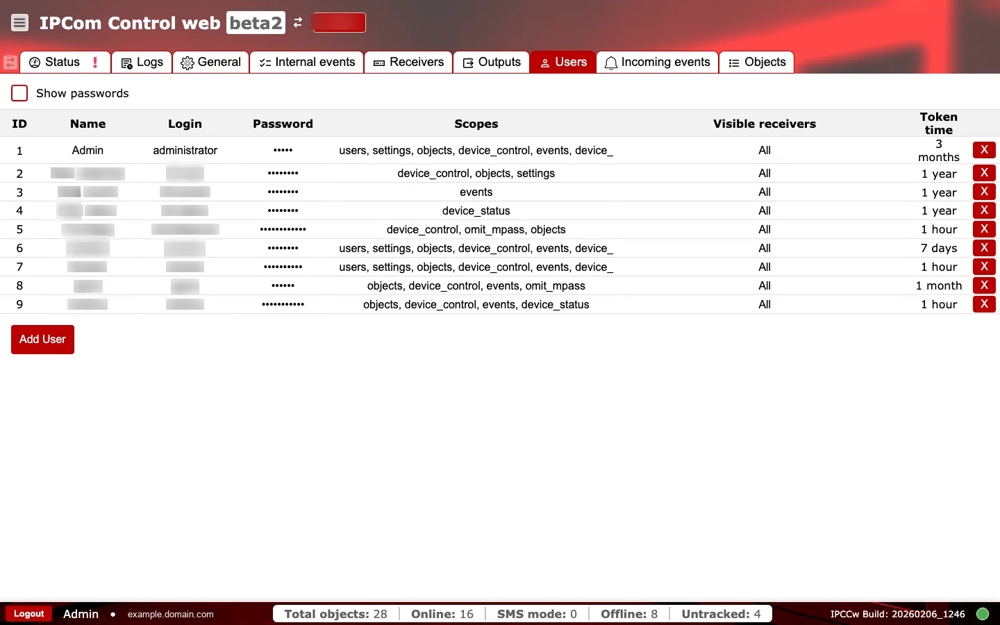

**Syfte:** Hantera användarkonton, behörigheter och vilka mottagare användarna ser.

## När du använder den

- När du lägger till eller tar bort operatörer.
- När du uppdaterar åtkomstbehörigheter eller mottagarsynlighet av säkerhetsskäl.

## Avsnitt och varför de är viktiga

### Users table {#users-table}

Varje rad motsvarar ett användarkonto.

- `ID`, `Name`, `Login`: identitetsfält som används vid revision och inloggning.
- `Password`: maskerat som standard.
- `Scopes`: behörigheter som användaren har fått (till exempel settings, events, objects). Begränsa behörigheterna för att minska risken.
- `Visible receivers`: vilka mottagarinstanser användaren kan nå.
- `Token time`: tokenets giltighetstid, som påverkar sessionernas livslängd och säkerhetsnivån.

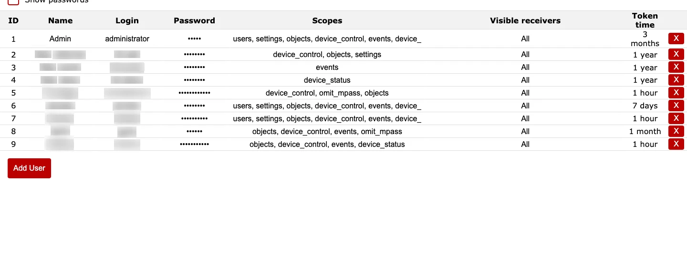

### Add User och borttagning {#users-add-remove}

Använd `Add User` för att skapa ett nytt konto. Det röda `X` tar bort en användare och ska bara användas med uttryckligt godkännande.

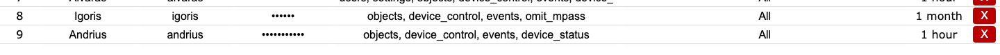

### Driftkontroller och åtgärder {#users-operational-checks}

Gör två snabba genomgångar när du ändrar konton: följ först aktuella risksignaler och bekräfta sedan att policyn efterlevs innan du lämnar över kontot.

**Följ dessa under drift:**

- Utökade behörigheter för befintliga konton. Varningssignal: användare får behörigheter för inställningar eller styrning som ligger utanför deras roll.
- För lång `Token time` på konton med utökade rättigheter. Varningssignal: ihållande sessioner med utökade rättigheter.
- Borttagna användare under pågående incidenthantering. Varningssignal: personal i tjänst förlorar plötsligt åtkomst.

**Bekräfta före användning i produktion:**

- De behörigheter som dokumenteras här är `users`, `settings`, `objects`, `device_control`, `events`, `omit_mpass`, `restart_services`, `turnoff_receiver`, `license`, `clear_output_buffers`, `update_firmware`, `restore_defaults` och `network_settings`. `network_settings` gäller bara RL25, se [RL25, mottagare som färdig hårdvara](../../rl25.md#network-settings).
- `token_time` ligger i intervallet `1..5,256,000` minuter.
- `id` är unikt och större än `0`, och `login` och `password` är inte tomma.
- Om `visible_receivers.all = false` är den anpassade mottagarlistan inte tom.
- Det nya kontots inloggning och förväntade behörighetsbeteende är verifierade innan du lämnar över inloggningsuppgifterna.
- Antalet användare ryms inom licensen.

## Vanliga procedurer

### Skapa en ny användare

1. Öppna fliken `Users` och välj `Add User`.
   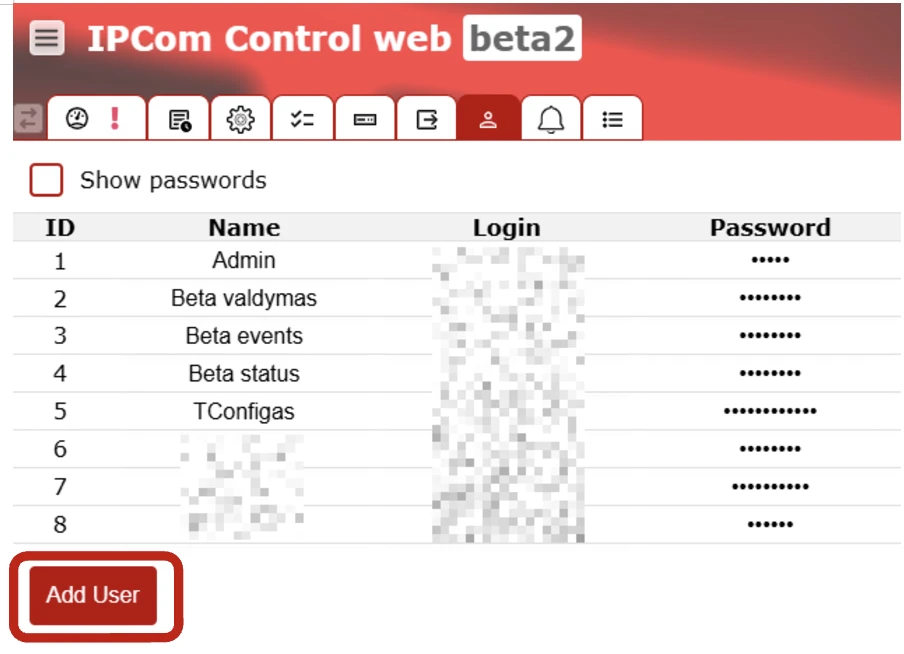
2. Fyll i kontots identitetsfält (`Name`, `Login`, lösenord).
   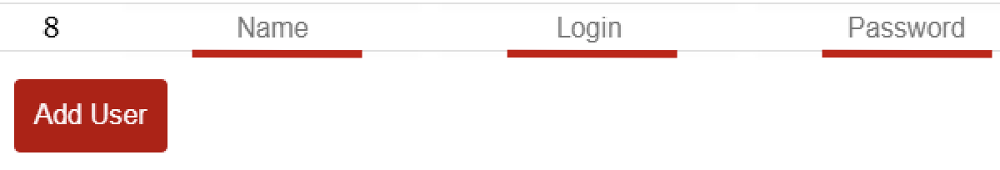
3. Tilldela de lägsta behörigheter (`Scopes`) som rollen kräver.
   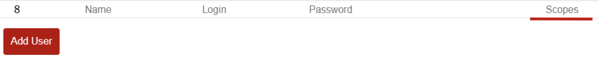
   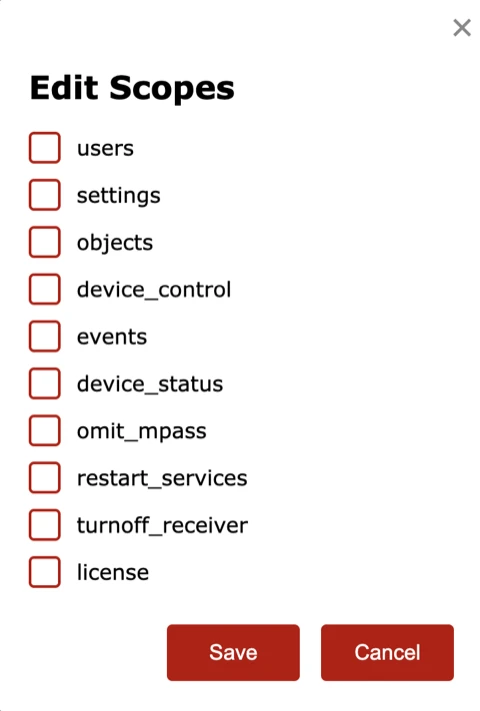
4. Ställ in `Visible receivers` på bara de instanser som behövs.
   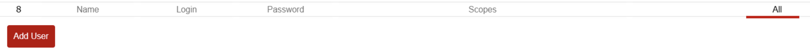
   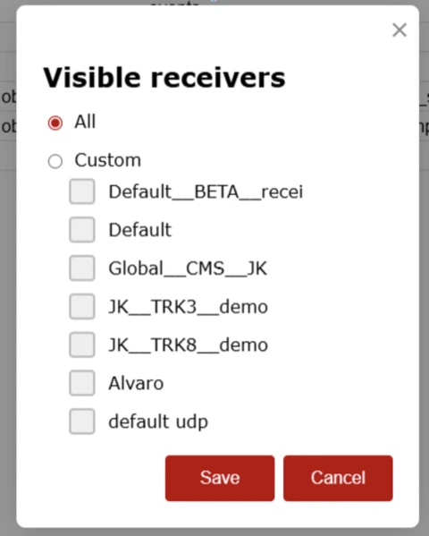
5. Ställ in `Token time` enligt säkerhetspolicyn.
   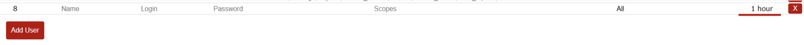
   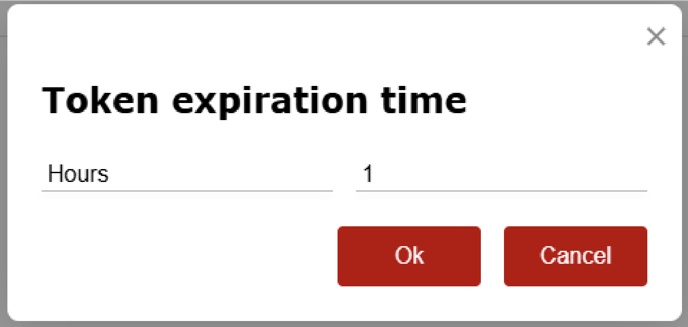
6. Spara inställningarna och kontrollera inloggningen med det nya kontot.
   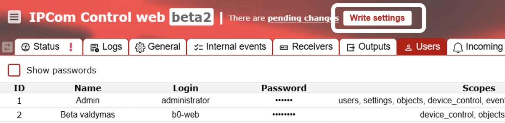

### Ändra en användares lösenord

1. Leta upp önskat konto i tabellen `Users`.
2. Aktivera visning av lösenord bara om det behövs för en kontrollerad verifiering.
   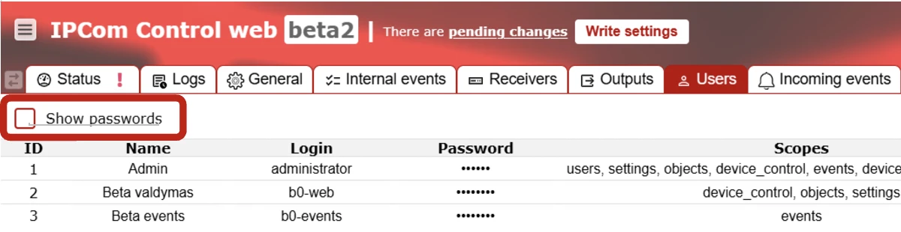
3. Uppdatera kontots lösenord och spara.
   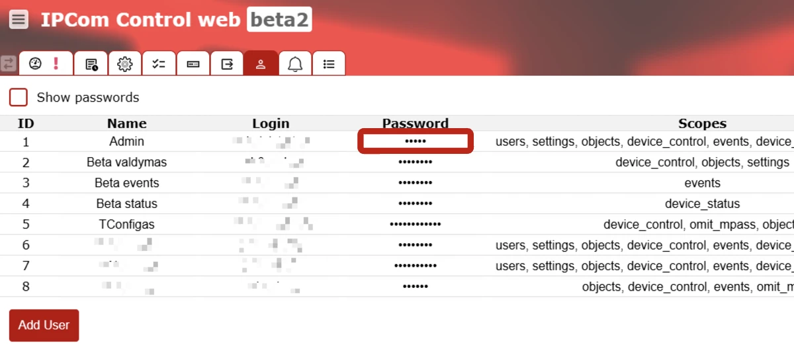
4. Bekräfta att användaren kan logga in med det nya lösenordet.
5. Avaktivera visning av lösenord efter verifieringen.

## Checklista för härdning

- Reservera `administrator` för nödfall och använd personliga konton i det dagliga arbetet.
- Tilldela minsta möjliga behörigheter (`Scopes`) per roll (övervakning, drift, integrationsadministratör).
- Begränsa `Visible receivers` så att användare bara ser de instanser de behöver.
- Ställ in kortare `Token time` för användare med utökade rättigheter och byt inloggningsuppgifter regelbundet.
- Ta bort föråldrade konton och verifiera ägare och roll med jämna mellanrum.
