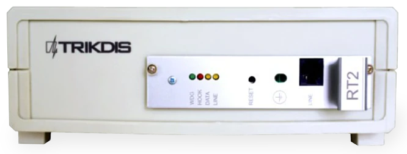
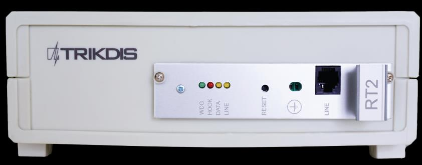
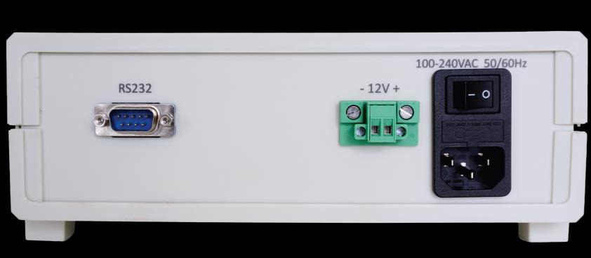
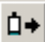
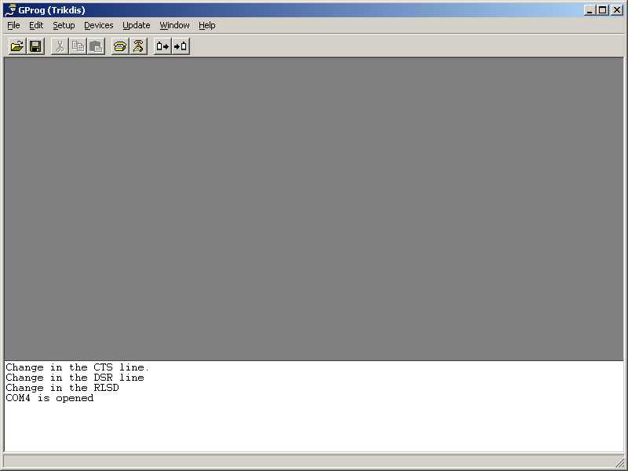
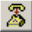
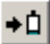
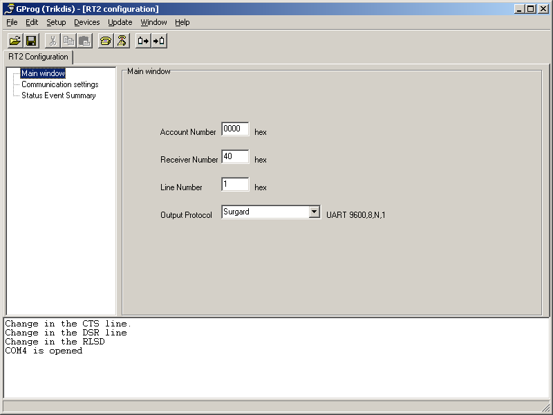
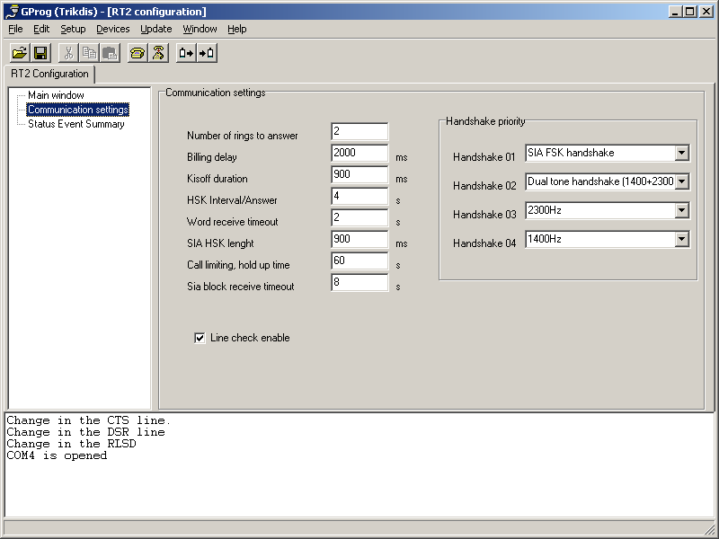
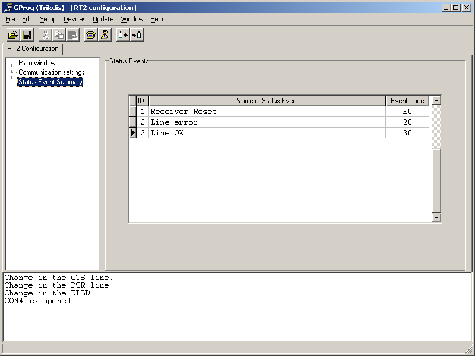

# Telefonlinjemottagare RTH2

  

## Om telefonlinjemottagaren

**Telefonlinjemottagaren RTH2** tar emot händelserapporter från centralapparatens telefonuppringare. De mottagna händelserna bearbetas och förs vidare till larmcentralens programvara.

!!! note
    På kundens begäran konfigurerar vi mottagaren med förinställda värden.

## Tekniska data

| Namn | Beskrivning |
|------|-------------|
| Kommunikationskanal | Telefonlinjer – tonval eller pulsval |
| Mottagningsformat | Contact ID, SIA, Ademco Express 4+2 med flera |
| Primär matning | 100–240 V (50/60 Hz) AC-nät |
| Dataportar RS232 | 1 x DB9 |
| Driftstemperatur | 0 °C till +55 °C |
| Mått | 225 x 235 x 115 mm |
| Vikt | 1,21 kg, med kablar |

### Teknik för mottagning av rapporter

| Namn | Beskrivning |
|------|-------------|
| 1. SIA-protokollformat | Standard SIA DC-03-1990.01 |
| 2. Contact ID | Standard SIA DC-05-1999.09 |
| 3. Ademco Express 4+2-format | Standard SIA DC-05-1999.09, 4+2-format med kontrollsumma – 4-siffrig abonnentkod, 2-siffrig händelsekod, 1-siffrig kontrollsumma |
| 4. Pulsprotokoll 3/1, 4/1, 4/2 som använder HSK-signaler på 2300 Hz | Arbetar med hastigheten 10...40 baud och använder HSK- och kissoff-signaler på 2300 Hz |
| 5. Pulsprotokoll 3/1, 4/1, 4/2 som använder HSK-signaler på 1400 Hz | Arbetar med hastigheten 10...40 baud och använder HSK- och kissoff-signaler på 1400 Hz |

## Leveransinnehåll

| Artikel | Antal |
|------|----------|
| Mottagare | 1 st. |
| Nätkabel, 1,5 m | 1 st. |
| RS232-nollmodemkabel, 1,8 m | 1 st. |

!!! note
    Kablarna *SPROG-1* eller *UP2* för programmering av mottagaren ingår inte.

## Matning

Mottagaren matas med växelström (AC). För att säkerställa oavbruten drift ska mottagaren anslutas till ett batteri på 12 V, 7 Ah, som ger reservdrift i 12 timmar.

## Mottagarens uppbyggnad

### Framsida

| Nr | Del |
|-----|---------|
| 1 | Lysdiodsindikering (lysdioderna WDG, HOOK, DATA och LINE) |
| 2 | Enhetens RESET-knapp |
| 3 | Jordanslutning |
| 4 | Kontakt – ingång för telefonlinje |

### Baksida

| Nr | Del |
|-----|---------|
| 5 | Dataport RS232 (utgång) |
| 6 | Anslutning för reservbatteri (-12V+) |
| 7 | Kontakt för nätkabel (100-240VAC 50/60Hz) och strömbrytare |

### Lysdiodsindikering

| Lysdiod | Funktion | Betydning |
|---------------|-----------|-------|
| **"LINE"** gul – telefonlinjens tillstånd | Släckt | Telefonlinjen är inte ansluten eller inte tillgänglig |
| **"HOOK"** röd – lur lyft | Lyser | Luren är lyft |
| **"DATA"** gul – datamottagning | Blinkar gult | Under datamottagning från en yttre enhet |
| **"WDG"** grön – matningens tillstånd | Blinkar korta pulser | Matningsspänningen i viloläge och under drift |

## Installation av systemet

### Installationsgång

!!! note
    1) Kablarna *SPROG-1* eller *UP2* för programmering av mottagaren medföljer inte mottagaren.
    2) För att ställa in parametrarna måste du installera programmet GProg2. Installationsfilen för GProg2 laddar du ned från [www.trikdis.com](https://www.trikdis.com/)

1. Om den mottagna enheten inte har förinställda driftparametrar ställer du in dem enligt beskrivningen under **Inställning av driftparametrar** nedan.
2. Anslut mottagaren till en dator med RS232-kabeln, så att händelser kan vidarebefordras till larmcentralens programvara.
3. Ställ in larmcentralens programvara så att den visar mottagarens meddelanden. Följ anvisningarna i programvarans dokumentation.
4. Anslut nätkabeln.
5. Slå på mottagaren. Mottagaren fungerar korrekt när lysdioden *"WDG"* blinkar.
6. Tryck på knappen RESET.
7. Kontrollera att larmcentralens programvara visar meddelanden från mottagaren RTH2.

Om inget har tagits emot: kontrollera lysdioden "Line", som ska lysa gult. Om den inte gör det, kontrollera anslutningarna igen. Om problemet kvarstår, kontrollera att driftparametrarna är rätt inställda eller kontakta teknisk support. Hur du kontrollerar och ändrar parametrarna beskrivs under **Ställa in driftparametrar för RTH2 med GProg2** nedan.

!!! note
    Den integrerade mottagarmodulen genererar servicemeddelanden, som anges i bilaga A.

## Inställning av driftparametrar

### Mottagarens driftparametrar

| Rubrik | Tillåtet intervall | Inställt värde |
|-------|-------------------|-----------|
| Antal signaler innan modulens lur lyfts | 1 – 8 | 2 |
| Övervakning av telefonlinjen på/av | aktiverad / avaktiverad | aktiverad |
| Tid från att luren lyfts till att HSK-signalen startar | 500 ms – 4000 ms | 2000 |
| Varaktighet för kissoff-signaler (och bekräftelse) | 500 ms – 8000 ms | 900 |
| Tid mellan HSK-signaler | 1 s – 16 s | 4 |
| Tillåten varaktighet för meddelandemottagning | 2 s – 16 s | 2 |
| Varaktighet för SIA HSK | 500 ms – 2000 ms | 900 |
| Gemensam tidsgräns för en enskild kommunikationssession | 15 s – 255 s | 60 s |
| Utgångsprotokoll | Surgard eller Radionics D6600 | Surgard |
| Tidsgräns för mottagning av SIA-block | 1 – 32 s | 8 s |
| HSK-ordning (prioritet mellan mottagningsprotokoll) – SIA FSK HSK | SIA FSK HSK | SIA FSK HSK |
| HSK-ordning – Dual tone HSK (1400+2300 Hz) | Dual tone HSK (1400+2300 Hz) | Dual tone HSK (1400+2300 Hz) |
| HSK-ordning – Puls 3/1, 4/1, 4/2 med 2300 Hz | 3/1, 4/1, 4/2 | 2300 Hz |
| HSK-ordning – Puls 3/1, 4/1, 4/2 med 1400 Hz | 3/1, 4/1, 4/2 | 1400 Hz |

### Ställa in driftparametrar för RTH2 med GProg2

Mottagarens parametrar kan ställas in med programmeraren *SPROG-1* eller *UP2* och programmet GProg2. Du kan också behöva installera en USB-drivrutin. GProg2 och USB-drivrutinerna finns på vår webbplats [www.trikdis.lt](https://www.trikdis.lt).

!!! note
    Programmet GProg2 ska installeras på en dator med operativsystemet MS *Windows* 2000/XP/Vista/Win 7.

#### Ansluta till datorn

1. Öppna RTH2:s kapsling och ta ut modulen (glöm inte att koppla bort reservbatteriet).
2. Anslut modulen till matningen.
3. Anslut modulen till en dator med programmeraren *SPROG-1* eller *UP2*.

#### Installera USB-drivrutinen

USB-drivrutinerna måste installeras på datorn. När modulen ansluts till en dator för första gången ska MS Windows öppna fönstret *Found New Hardware Wizard* för installation av USB-drivrutiner.

4. Ladda ned USB-drivrutinsfilen *\*.inf* för MS Windows från webbplatsen www.trikdis.lt.
5. Välj funktionen [*Yes, this time only*] i guiden och klicka på knappen [*Next*].
6. När fönstret *Please choose your search and installation options* öppnas klickar du på knappen [*Browse*] och väljer den plats där filen *\*.inf* sparades.
7. Följ guidens övriga anvisningar för att slutföra installationen av USB-drivrutinen.

#### Starta GProg2

8. Starta programmet genom att klicka på ikonen för GProg2 . Ange sedan den seriella porten (t.ex. COM3) i fönstret Settings.
9. Välj kommandot [*Devices*] i menyraden och välj RT2.
10. Klicka på ikonen  i verktygsfältet för att ansluta mottagaren.
11. Klicka på knappen  för att läsa de driftparametrar som lagras i enhetens interna minne.
12. När nedladdningen av data är klar visas fönstret *Configuration is received*.

#### Verktygsfältets ikoner

| Ikon | Funktion |
|------|----------|
|  **[Open]** | Öppna en sparad fil med filändelsen ".tcfg" |
|  **[Save]** | Spara de inställda parametrarna i en fil med filändelsen ".tcfg" |
|  **[Connect]** | Anslut till den seriella porten |
|  **[Disconnect]** | Koppla från den seriella porten |
|  **[Receive config]** | Läs enhetens parametrar |
|  **[Send config]** | Skriv de nya parametrarna till enhetens minne |
|  **[Generate configuration report]** | Skriv ut en rapport över de inställda parametrarna |

#### Ställa in parametrar

13. Ställ in protokollet Surgard i grenen *Main window*.
14. Vid behov kan du ändra parametrar i grenen *Communication settings*. De rekommenderade värdena finns under **Mottagarens driftparametrar** ovan.
15. Spara parametrarna genom att välja [*File/Write device*] i menyraden eller klicka på ikonen .
16. Om du vill spara de inställda parametrarna på datorn väljer du [*File/Save as*]. Filnamn och sparplats kan väljas fritt. Filen kan senare användas som mall för att konfigurera andra moduler.

## Bilaga A – Servicemeddelanden

Servicemeddelanden från telefonlinjemottagaren:

| Meddelande | Kod | Beskrivning |
|---------|------|-------------|
| COM TROUBLE | 05 | Kommunikationsfel mellan enheten och koncentratorn |
| COM RESTORE | 06 | Kommunikationen med koncentratorn har återställts |
| TEL LINE ERROR | 20 | Fel på telefonlinjen eller linjen frånkopplad |
| TEL LINE OK | 30 | Telefonlinjen har återställts |
| MODULE DISCONNECT | C0 | Enheten frånkopplad |
| MODULE CONNECT | C1 | Enheten ansluten |
| RECEIVER RESET | D0 | Mottagarens RESET-knapp har tryckts in |
