# Radiomottagarna R11 och R11U

<div style="text-align: center;">
  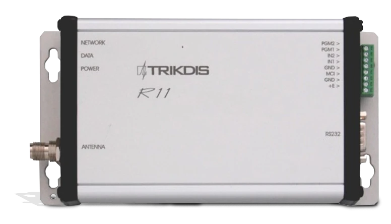
</div>

Radiomottagarna R11 och R11U ingår i radiolarmsystemet RAS-3. De tar emot och avkodar kodade meddelanden som sänds via radiokanal i VHF-bandet (R11) eller UHF-bandet (R11U). Mottagarna tar emot och avkodar signaler som sänds med kodningssystemet RAS-3.

## Funktion och viktiga egenskaper

Mottagaren R11 (R11U) är en superheterodynmottagare med dubbel omvandling och digital identifiering av den mottagna signalen. Den mottagna och identifierade signalen bearbetas och skickas vidare till utgången.

Bearbetningen av mottagna signaler sköts av en mikrokontroller. Den identifierar den sända signalen och bildar ett meddelande med fastställd form och struktur. Meddelandet filtreras och skickas med inställda attribut via serieporten till larmcentralens programvara eller till andra kompatibla överföringsmoduler. Mottagaren har filter som kan filtrera meddelanden efter:

- kodningssystemets delsystem;
- kommunikationsväg;
- följd av abonnentnummer;
- återkomsttid för samma meddelande.

Mottagaren mäter nivån på den mottagna signalen och registrerar kommunikationsvägen, och visar allt detta i utgångssignalen.

Mottagaren skapar servicemeddelanden och skickar dem till utgångarna. Servicemeddelandena kan visas i larmcentralens programvara eller skickas via kommunikationskanalen.

Mottagaren har en serieport, RS232, och information som tas emot via den kan skickas vidare via radiokanalen.

## Specifikationer

1. Radiomottagaren R11 arbetar i VHF-området 146–174 MHz.
2. Radiomottagaren R11U arbetar i UHF-området 430–470 MHz.
3. Mottagarens radiotekniska parametrar uppfyller kraven i standarden EN 300 113.
4. Känsligheten hos mottagarna R11 och R11U är minst 1 μV vid 80 % korrekt mottagna meddelanden. Övriga radiotekniska parametrar anges i tabell 1.
5. Mottagaren mäter styrkan på den mottagna signalen och hänför den till en viss nivå. Överensstämmelsen mellan nivå och signal anges i tabell 2.
6. Mottagna meddelanden skickas via serieporten RS232 till larmcentralens programvara eller via MCI-bussen till kompatibla överföringsenheter. Till larmcentralens programvara skickas de utgående meddelanden som anges i bilaga A. Bufferten för ej skickade meddelanden rymmer upp till de 300 senaste meddelandena. Parametrarna för datautbytet anges när mottagarens driftparametrar ställs in.
7. Mottagaren har två ingångar för oberoende meddelandesändning. Ingångstyp NC/NO/EOL=2,2 kΩ.
8. Mottagarna R11 och R11U matas med 12,6 V DC. Tillåtet spänningsområde är 11–15 V. Strömförbrukningen får inte överstiga 150 mA.
9. Mottagarna arbetar vid omgivningstemperatur från -10 °C till +55 °C och relativ luftfuktighet upp till 90 % vid +20 °C.
10. Mottagarmodulens yttermått är högst 200 × 110 × 38 mm.
11. Mottagarens vikt är högst 0,2 kg.

**Tabell 1.**

| Parameter | Värde |
|-----------|-------|
| Modulation | smalbandig frekvensmodulation |
| Deviation högst | ±3 kHz |
| Mottagarens ingångsresistans | 50 Ω |
| Kanalavstånd | 12,5 kHz |
| Fel vid inställning av arbetsfrekvens högst | ±200 Hz |
| Närkanalselektivitet minst | 60 dB |
| Spegelkanalselektivitet minst | 70 dB |
| Dataöverföringshastighet i radiokanalen | 2,4 kb/s |

**Tabell 2.**

| Nivå | Ingångsspänning μV | Signalstyrka, dBm | Nivå | Ingångsspänning μV | Signalstyrka, dBm |
|-------|------------------|----------------------|-------|------------------|----------------------|
| 0 | 1 | -107 | 8 | 40 | -75 |
| 1 | 1,585 | -103 | 9 | 63 | -71 |
| 2 | 2,5 | -99 | A | 100 | -67 |
| 3 | 4 | -95 | B | 158 | -63 |
| 4 | 6,3 | -91 | C | 250 | -59 |
| 5 | 10 | -87 | D | 400 | -55 |
| 6 | 16,85 | -83 | E | 630 | -51 |
| 7 | 25 | -79 | F | 1000 | -47 |

> [!NOTE]
> Dessa nivåer skiljer sig från nivåtabellen i systemet RAS-2M!

## Översikt och anslutningsschema

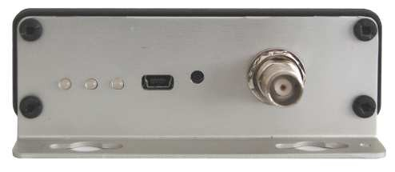

| Del | Beskrivning |
|---------|-------------|
| Indikeringar | Statuslysdioder på fronten |
| Antennport | Antennkontakt för radiofrekvens |
| Utgångsport RS232 | Seriell datautgång |
| MCI-buss | Kontakt för MCI-bussen |

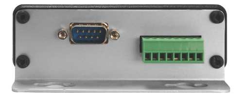

USB-porten och RESET-knappen sitter på baksidan. \* Plintarna för MCI-bussen beskrivs i tabell 3.

**Tabell 3.**

| Plint | Användning |
|----------|---------|
| PGM2 | Reserverad för framtida användning |
| PGM1 | Reserverad för framtida användning |
| IN2 | Ingång 2 (nätbortfall) |
| IN1 | Ingång 1 (sabotage) |
| GND | Gemensam ledare |
| MCI | MCI-buss |
| GND | Gemensam ledare för matningsanslutningen |
| +E | För anslutning av matningsspänningen +12,6 V |

## Indikeringar

Mottagarens drift visas med lysdioder. Hur indikeringarna fungerar anges i tabell 4.

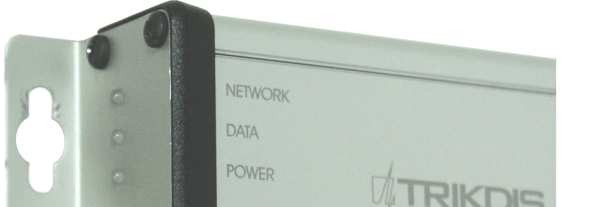

**Tabell 4.**

| Indikering | Funktion | Beskrivning |
|-----------|-----------|-------------|
| ”Network” | Blinkar grönt | Meddelande tas emot via radiokanalen |
| ”Network” | Lyser gult | Bakgrundsnivån i kommunikationskanalen är överskriden |
| ”Data” | Lyser grönt | Det finns ej skickade meddelanden |
| ”Data” | Lyser grönt och rött samtidigt | Utgångsbufferten är överfylld |
| ”Power” | Blinkar grönt | Matningsspänningen är tillräcklig |
| ”Power” | Blinkar gult | Matningsspänningen är låg (under 11,5 V) |
| ”Power” | Blinkar grönt och rött växelvis | Den enda USB-porten är ansluten för programmering |

## Förberedelse av mottagaren för drift

Förberedelserna sker i följande ordning:

1. Ställ in de driftparametrar som behövs. Radiomottagare levereras till användarna med inställningar som är gjorda enligt kraven i beställningen;
2. Installera mottagaren på avsedd plats;
3. Anslut antennen;
4. Anslut matningen och kringutrustningen (larmcentralens programvara eller överföringsmoduler);
5. Kontrollera att mottagaren fungerar.

## Inställning av driftparametrar

Driftparametrarna ställs in med programmet R11config v130226, med datorn och mottagaren anslutna till varandra med USB-kabel. Programmet kan användas och inställningarna ändras både när extern matning är påslagen och när mottagaren matas via USB-porten.

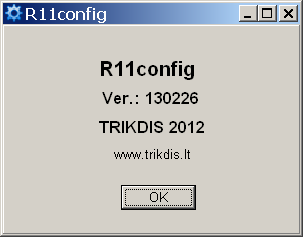

Starta programmet R11config. Då öppnas ett fönster där du gör följande:

1. Ange administratörslösenordet 1234 med datorns tangentbord och klicka på [Enter]

    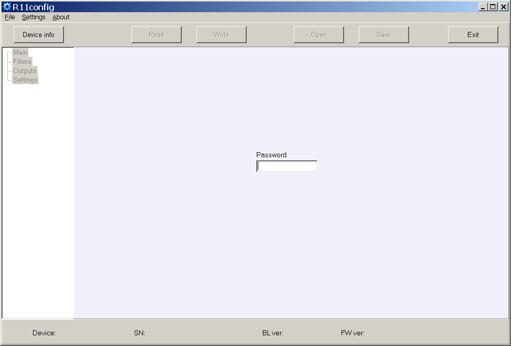

    Längst ned i fönstret visas utrustningstypen **Device**, serienumret **SN**, startladdarens version **BL ver.** och firmwareversionen **FW ver.**

    Om lösenordet inte är känt visas information om mottagarens typ och versionerna av programvara och firmware när du klickar på [Device info].

    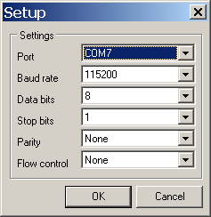 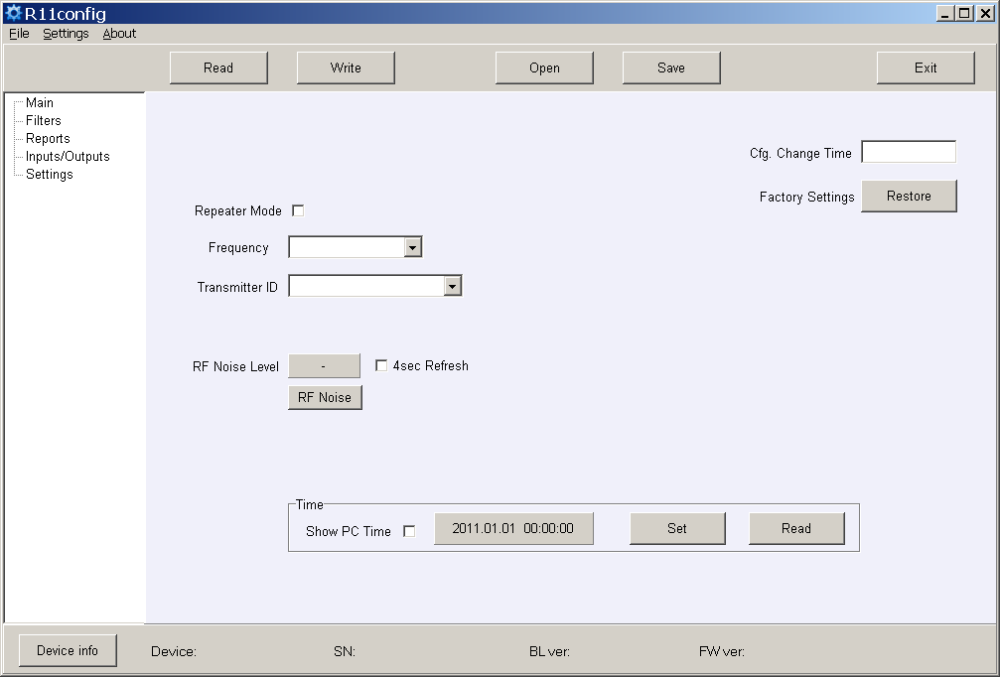

    Inställningarna för USB-porten finns i kolumnen **Settings**.

2. Läs mottagarens parametrar genom att klicka på [Read].

3. Ställ in (Repeater mode), (Frequency) och (Transmitter ID) i programgrenen **Main**. Om du väljer Account ID fördelas meddelandena efter sändarens objektnummer, om du väljer Transmitter SN efter sändarens serienummer och om du väljer Transmitter SN + Account ID efter båda numren.

    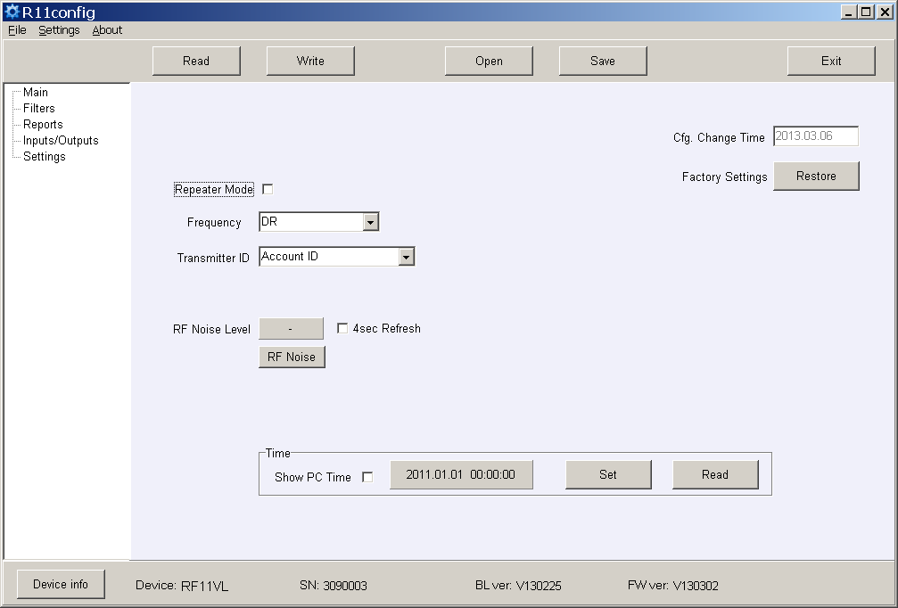

4. Ställ in de filterparametrar som behövs i programgrenen **Filters**.

    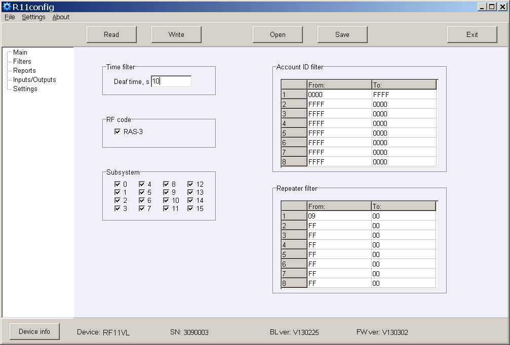

    - **Time filter** – spärrtid för samma meddelande;
    - **RF code** – markera kryssrutan för mottagning av meddelanden i kodningssystemet RAS-3;
    - **Subsystem** – markera kryssrutan för de delsystem som ska tas emot;
    - **Account ID filter** – följder av objektnummer som ska tas emot;
    - **Repeater filter** – följder av de repeaternummer som behövs.

5. Ställ in parametrarna för utgången till larmcentralens programvara eller överföringsmoduler i programgrenen **Reports**.

    a) När meddelanden skickas till larmcentralens programvara Monas MS:

    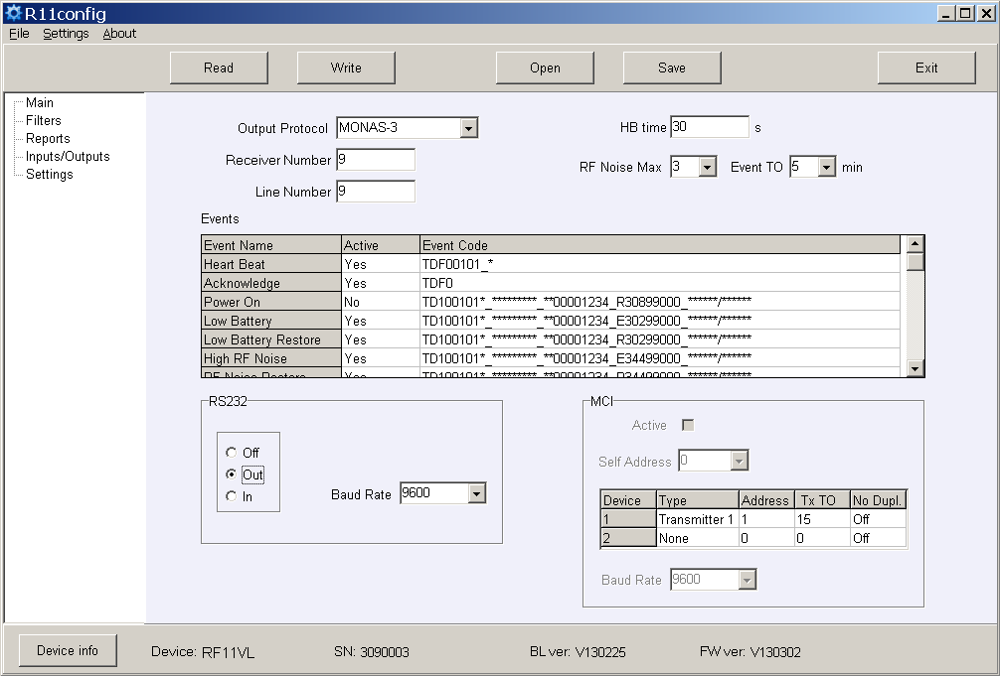

    Ställ in Out Protocol, Receiver Number och Line Number, HB time och Baud Rate för RS232.

    b) Ställ in vilka servicemeddelanden som ska skickas. Markera dem i kryssrutan **Active**. Ange det abonnentnummer som behövs för mottagarnumret och händelsekoderna. De rekommenderade händelsekoderna anges i bilaga B.

    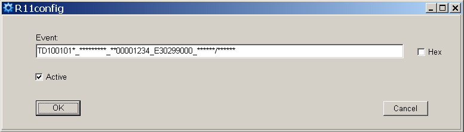

    c) När meddelanden skickas till överföringsmoduler (Repeater Mode):

    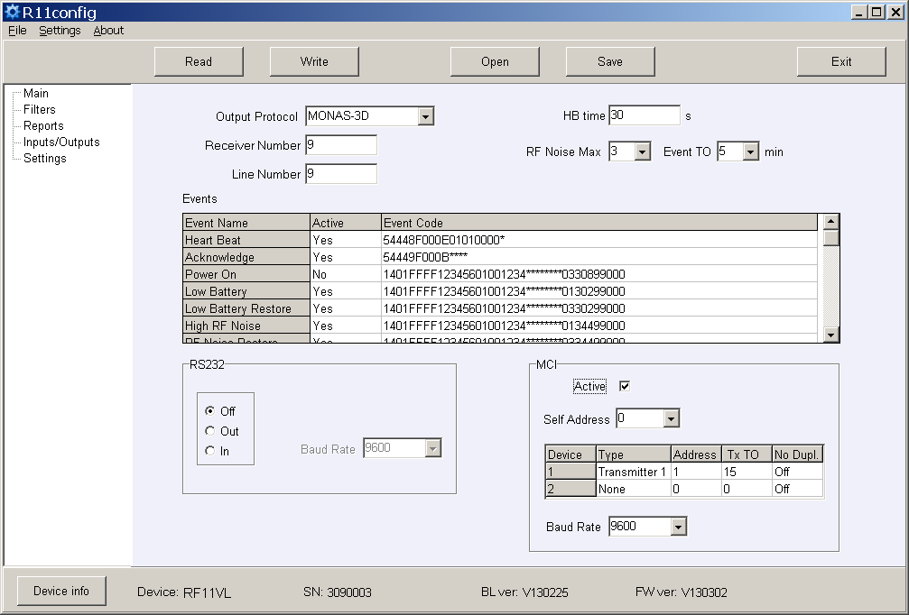

    Ställ in Out Protocol, Receiver Number och Line Number, markera kryssrutan **Active** för att aktivera MCI-bussen och ställ in Baud Rate. Ange Self Address; dess numeriska värde ska vara lägre än värdet för de överföringsmoduler som ansluts.

    d) Ange ordningen för överföringsmodulerna, adresserna, väntetiden på svar **Ack TO**, en eventuell sändningsfördröjning **Tx TO** samt om omsända meddelanden ska ignoreras, **No Dupl**.

    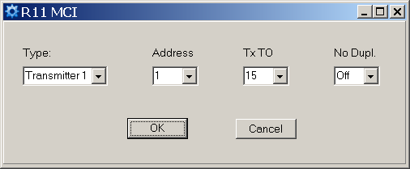

    Sändningsfördröjningen Tx TO används för att fördröja en sänd signal i radiosystemet. Det numeriska värdet är en multipel av 250 ms.

    Ignorering av omsända meddelanden, No Dupl., ska slås på när flera radiorepeatrar arbetar i systemet och antalet meddelanden som skickas via kanalen behöver minskas (löser problemet med belagd radiokanal).

6. Ställ in ingångarnas driftparametrar och händelsekoderna i programgrenen **Inputs/Outputs**.

    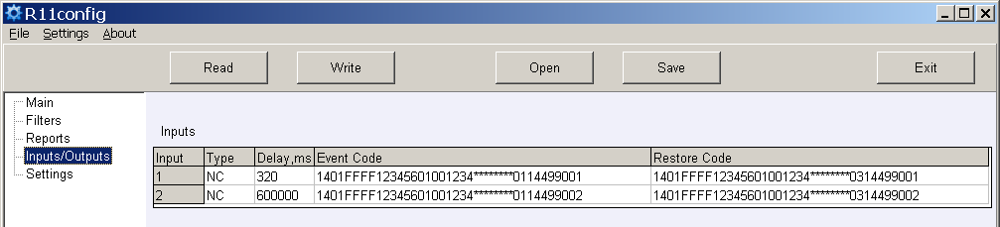

    - **Input Type** – ange ingångstyp;
    - **Delay** – ange ingångens svarstid;
    - **Event Code** – händelsekod och objektnummer som skickas när ingången aktiveras;
    - **Restore Code** – händelsekod och objektnummer som skickas när ingången återgår till viloläge.

    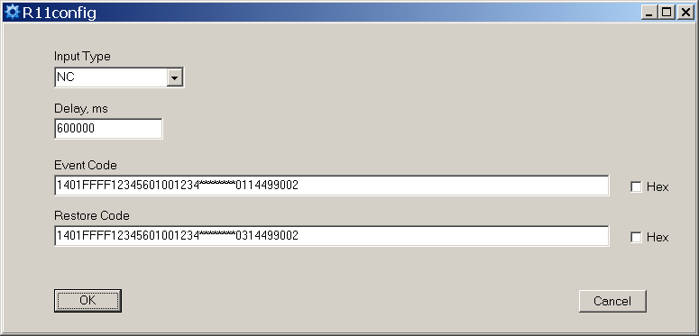

7. Nya frekvenser kan läggas till eller befintliga tas bort i programgrenen **Settings**.

    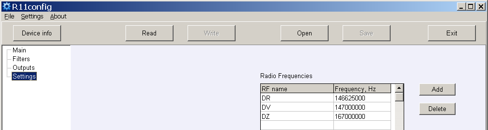

    Mottagarens inställningar kan sparas på en angiven plats i datorns minne genom att du klickar på knappen [Save], och sedan användas för att ställa in parametrarna i andra mottagare. Sparade inställningar öppnas genom att du klickar på [Open] och anger var de är lagrade.

    Klicka på [Exit] för att avsluta programmet.

## Bilaga A – Mottagarens utgångssignal i serieporten RS232

**a) När följande utgångsprotokoll Monas3 är inställt:**

```
TD1001017_***010532_3D025218_E13002027_120514/153241
```

där:

- `TD` – startsymbol
- `10` – meddelandetyp/undertyp (Contact ID)
- `01` – mottagarnummer 01
- `01` – linjenummer 01
- `7` – signalnivå 7
- `**` – repeaternummer (direkt mottagning)
- `*` – nivå i repeatern (ingen)
- `010532` – sändare nr 010532
- `3D` – meddelandenummer (från objekt nr 010532) 61 (3D hex)
- `025218` – delsystem 02 / Account ID 5218
- `E13002027` – Contact ID-data
- `12` – år 12, `05` – månad 05, `14` – dag 14
- `15` – timme 15, `32` – minut 32, `41` – sekund 41

**b) När följande utgångsprotokoll Surgard MLR2-DG är inställt:**

```
5011 181234E14401002
```

där:

- `5` – meddelandetyp
- `01` – mottagarnummer
- `1` – linjenummer
- `18` – protokolltyp
- `1234` – objektnummer
- `E` – CID-klassificerare
- `144` – CID-händelsekod
- `01` – CID-undergruppsnummer
- `002` – CID-händelseplats

## Bilaga B – Rekommenderade händelsekoder för servicemeddelanden

**Händelsekodsformat för R11:**

```
1401FFFF12345601001234********0330199000
```

där `1234` = objektnummer (8191), `03` = händelse/återställning, `301` = händelsekod, `99` = undergrupp, `000` = plats.

| Händelse | RAS-3D-kod | ECID | Anmärkning |
|-------|-------------|------|------|
| Power ON | 0330199000 | R301 99 000 | skicka inte |
| Low Battery | 0130299000 | E302 99 000 | skicka |
| Low Battery Restore | 0330299000 | R302 99 000 | skicka |
| High RF Noise | 0135599000 | E355 99 000 | skicka |
| RF Noise Restore | 0335599000 | R355 99 000 | skicka |
| Cfg. Change | 0362899000 | R628 99 000 | skicka |
| Time fault | 0170099000 | E700 99 000 | skicka inte |
| Time Set | 0370099000 | R700 99 000 | skicka inte |
| MCI Error | 0171299000 | E712 99 000 | skicka inte |
| MCI Restore | 0371299000 | R712 99 000 | skicka inte |
| RS232 Error | 0171399000 | E713 99 000 | skicka inte |
| RS232 Restore | 0371399000 | R713 99 000 | skicka inte |
| CRC Error | 0130799000 | E307 99 000 | skicka inte |
| Transmitter PING | — | E770 99 00X (x = nästa PING-period) | skicka inte |
