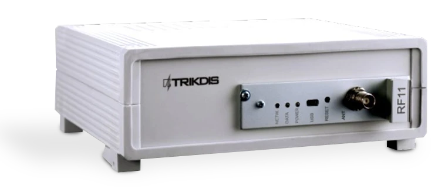
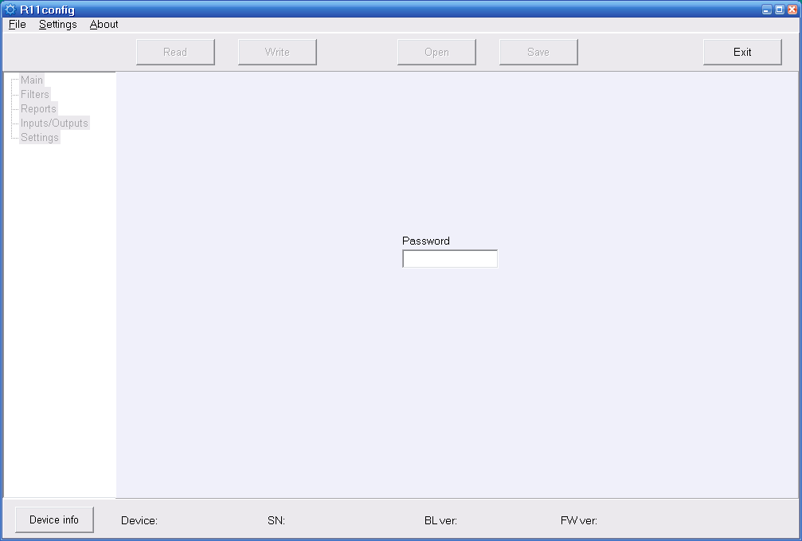
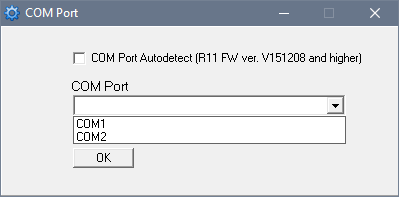
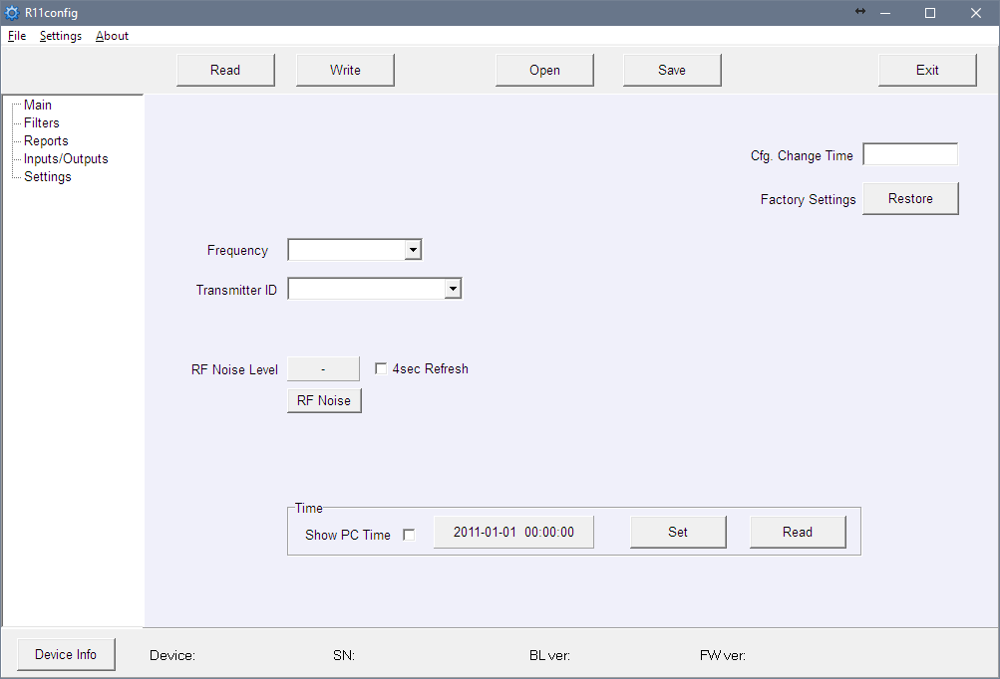
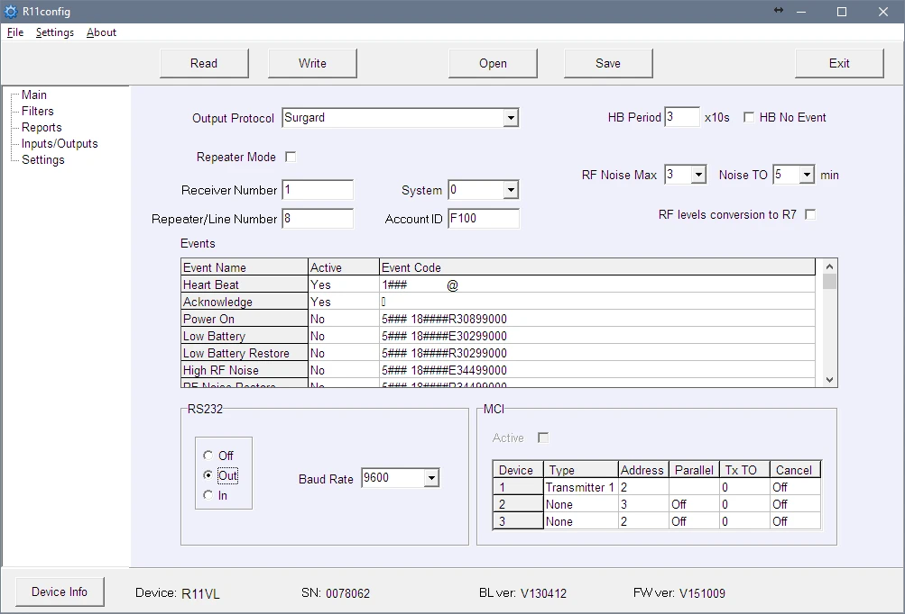
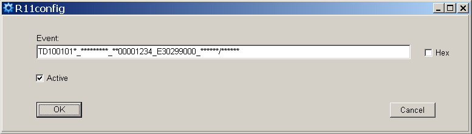
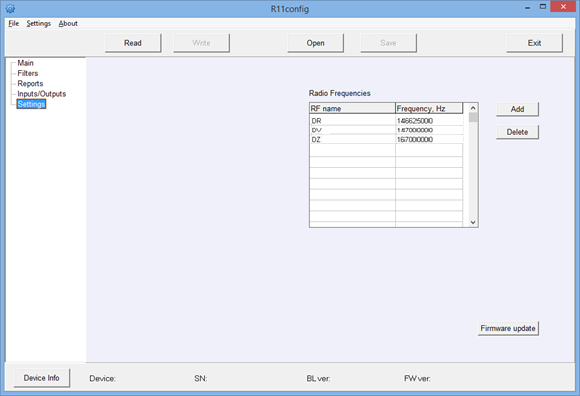

# Radiomottagaren RFH11

  

## Om radiomottagaren

**Radiomottagaren RFH11** är avsedd för mottagning av kodade radiomeddelanden i frekvensområdet VHF eller UHF. Den integrerade modulen fungerar med kodningssystemen RAS3, RAS2M, LARS, LARS1 och Milcol-D.

Mottagaren har programmerbara filter som kan filtrera meddelanden efter:

- tidsintervall mellan upprepade meddelanden
- kodningssystemets delsystem
- kommunikationsväg
- följd av abonnentnummer

> **Obs!** Vi konfigurerar mottagaren med förinställda inställningar på kundens begäran.

## Tekniska huvuddata

| Namn | Beskrivning |
|------|-------------|
| Frekvensområde | 146–174 MHz (VHF) eller 430–470 MHz (UHF) |
| Kanalavstånd | 12,5 kHz |
| Fel vid frekvensinställning | högst ± 200 Hz |
| Känslighet | minst 0,5 μV |
| Modulation | FFSK/FSK |
| Avkodade format | RAS-3, RAS-2M, LARS, LARS-1, Milcold-D |
| Utgångsformat | Monas3 och Surgard |
| Meddelandeminne | de 300 senast mottagna meddelandena |
| Primär matning | 100–240 V (50 / 60 Hz) växelspänning |
| Dataportar RS232 | 1 x DB9 |
| Driftstemperatur | 0 °C till +55 °C |
| Mått | 225 × 235 × 115 mm |
| Vikt | 1,21 kg, med kablar |

## Medföljande delar

| Del | Antal |
|------|----------|
| Mottagare | 1 st. |
| Nätkabel, 1,5 m | 1 st. |
| R232 nollmodemkabel, 1,8 m | 1 st. |

> **Obs!** *USB*-kabel för programmering av mottagaren ingår inte.

## Matning

Mottagaren matas med växelspänning (AC). För att säkerställa oavbruten drift bör mottagaren anslutas till ett 12 V / 7 Ah-batteri som ger reservdrift i 12 timmar.

## Mottagarens uppbyggnad

| Nr | Del | Nr | Del |
|-----|---------|-----|---------|
| 1 | Indikeringar | 5 | Dataport RS232 |
| 2 | USB-port | 6 | Anslutning för backupbatteri |
| 3 | RESET-knapp | 7 | Nätanslutning och på/av-knapp |
| 4 | Antennkontakt | | |

### Indikeringar

| Lysdiod | Funktion | Betydelse |
|---------------|-----------|-------|
| ”Power” | Blinkande grön lysdiod | Matningsspänningen är tillräcklig |
| ”Power” | Blinkande gul lysdiod | Matningsspänningen är låg (under 11,5 V) |
| ”Power” | Blinkar grönt och rött växelvis | Matningen kommer endast via USB (under pågående konfigurering) |
| ”Netw.” | Blinkande grön lysdiod | Meddelande tas emot |
| ”Netw.” | Lysande gul lysdiod | Brusnivån i radiokanalen är överskriden |
| ”Data” | Grön lysdiod | Det finns ej skickade meddelanden |
| ”Data” | Lyser grönt och rött samtidigt | Utgångsbufferten är överfylld |

## Systeminstallation

### Installationssteg

> **Obs!** För att ställa in parametrarna behövs programmet R11config. Be din distributör om programmet.

1. Om den mottagna enheten inte har förinställda driftparametrar, ställ in dem enligt beskrivningen i **Inställning av driftparametrar med R11config** nedan.
2. Anslut RFH11 till en dator med RS232-kabel för att skicka händelser till larmcentralens programvara.
3. Ställ in larmcentralens programvara så att den visar mottagarens meddelanden. Följ anvisningarna i programvarans dokumentation.
4. Anslut radioantennen till antennporten.
5. Anslut mottagaren till nätet med nätkabeln.
6. Slå på mottagaren. En blinkande grön lysdiod visar att mottagaren är ansluten till matning.
7. Kontrollera att larmcentralens programvara visar meddelanden från mottagaren RFH11.

**Om inget togs emot:** kontrollera färgen på lysdioden *”POWER”* och se till att alla matningsanslutningar är korrekt anslutna. Om problemet kvarstår, kontrollera att driftparametrarna är rätt inställda eller kontakta teknisk support.

### Inställning av driftparametrar med R11config

1. Anslut mottagaren till en dator med USB-kabel och starta programmet R11config (programmet får du av din distributör).

   1.1. Ange administratörslösenordet **1234** i det öppnade fönstret och klicka på [Enter].

> **Obs!** Om lösenordet inte är känt kan du se mottagarens typ och versionen av programvara/firmware genom att klicka på [Device info].

> **Obs!** **USB-drivrutiner måste vara installerade i datorn.** Om mottagaren ansluts till en dator för första gången ska MS Windows öppna fönstret *Found New Hardware Wizard* för installation av USB-drivrutiner. Hämta drivrutinsfilen *\*.inf* för din version av MS Windows från webbplatsen [http://www.trikdis.com/en/](http://www.trikdis.com/en/). Välj alternativet *Yes, this time only* i guiden och klicka på knappen *Next*. När fönstret *Please choose your search and installation options* öppnas, klicka på knappen *Browse* och välj den plats där filen *\*.inf* sparades. Följ guidens övriga anvisningar för att slutföra installationen av USB-drivrutinen.

2. Välj programkatalogen [Settings], sedan [COM port] i listan [COM Port] och välj därefter den port som modulen är ansluten till.

> **Obs!** Den specifika port som enheten är ansluten till visas först när enheten är korrekt ansluten.

**Inställningar i grenen Main:**

3. Läs mottagarens parametrar genom att klicka på [Read].
4. Ställ in [Frequency] och [Transmitter ID] i programgrenen Main.
5. I listan [Transmitter ID] kan du välja hur mottagaren ska identifiera sändaren:

   - **Account ID** – det programmerade Account ID-numret identifierar sändaren.
   - **Transmitter SN** – det unika serienumret identifierar sändaren.
   - **Transmitter SN + Account ID** – sändaren identifieras av båda numren (Transmitter SN och Account ID).

> **Obs!** Parametern [Transmitter ID] ska vara inställd på samma sätt i alla radiosändare.

**Inställningar i grenen Filters:**

- [Time filter] – tidsperiod under vilken samma meddelande avvisas (rekommenderad tid är 90 sekunder).
- [RF Coding/Subsystem Filter] – dubbelklicka i tabellen, välj de radiokodningssystem som behövs (RAS3, RAS2M, LARS, LARS1, Milcol-D) och markera de delsystem som ska tas emot.
- [Account ID filter] – ange intervall (From – To) för de sändar-Account ID-nummer som ska tas emot.
- [Repeater filter] – ange intervall (From – To) för de repeaternummer som ska tas emot.

**Inställningar i grenen Reports:**

Ställ in utgångsparametrarna för larmcentralens programvara eller överföringsmoduler:

6. Ställ in utgångsprotokoll:

   6.1. Om du använder larmcentralens programvara MonasMS, ställ in [Output protocol] på *Monas3*. I annat fall väljer du protokollet Surgard eller Ademco.

   6.2. Avmarkera [Repeater Mode].

   6.3. Ställ in följande nödvändiga parametrar: [Receiver Number], [Line number], [System], [Account ID], [HB Period] och [Baud Rate] för RS232.

7. Välj vilka servicemeddelanden som ska skickas:

   7.1. Dubbelklicka på raden i tabellen [Events]. Markera kryssrutan [Active] om händelsekoden ska skickas. De rekommenderade händelsekoderna anges i bilaga A.

**Inställningar i grenen Settings:**

8. Nya frekvenser kan läggas till eller befintliga tas bort. Frekvenserna blir sedan tillgängliga i grenen Main.

9. Alla inställningar kan sparas genom att du klickar på knappen [Save]. De kan sedan användas som mall för att konfigurera andra moduler. Öppna dem genom att klicka på [Open] och ange var de finns. Avsluta programmet genom att klicka på [Exit].

## Bilaga A – Rekommenderade händelsekoder för servicemeddelanden

Exempel på händelsekodens format:
`1401FFFF 12345601001234********03 301 99 000`

Där:

| Fält | Betydelse |
|-------|---------|
| 1234 | objektnummer |
| 03 | händelse/återställning |
| 301 | händelsekod |
| 99 | undergrupp |
| 000 | plats |

| Händelse | RAS-3D-kod | ECID-kod | Rekommendation |
|-------|-------------|-----------|----------------|
| Power ON | 0330199000 | R301 99 000 | skicka inte |
| Low Battery | 0130299000 | E302 99 000 | skicka |
| Low Battery Restore | 0330299000 | R302 99 000 | skicka |
| High RF Noise | 0135599000 | E355 99 000 | skicka |
| RF Noise Restore | 0335599000 | R355 99 000 | skicka |
| Cfg. Change | 0362899000 | R628 99 000 | skicka |
| Time fault | 0170099000 | E700 99 000 | skicka inte |
| Time Set | 0370099000 | R700 99 000 | skicka inte |
| MCI Error | 0171299000 | E712 99 000 | skicka inte |
| MCI Restore | 0371299000 | R712 99 000 | skicka inte |
| RS232 Error | 0171399000 | E713 99 000 | skicka inte |
| RS232 Restore | 0371399000 | R713 99 000 | skicka inte |
| CRC Error | 0130799000 | E307 99 000 | skicka inte |
| Transmitter PING | — | E770 99 00X (X = nästa PING-period) | skicka inte |
