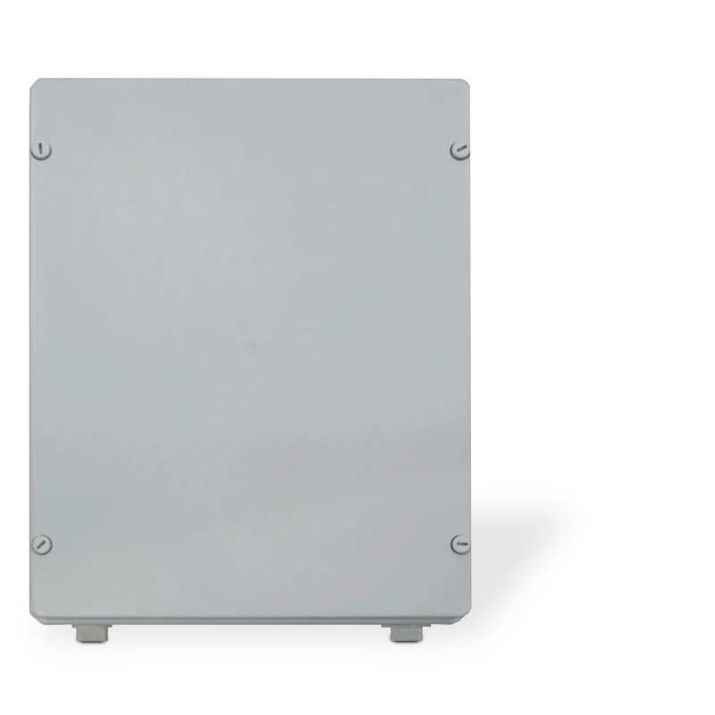
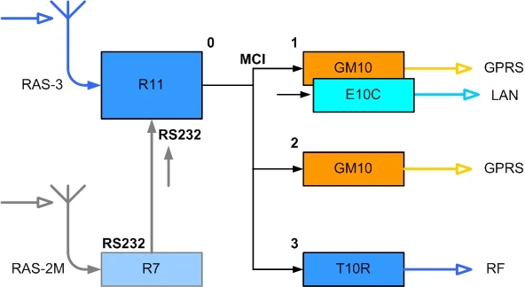

# Repeatern R-IP12

  

## Användningsområde

Repeatern R-IP12 är en multifunktionell enhet i meddelandeöverföringssystemet. Den är avsedd att vidarebefordra mottagna meddelanden till en gemensam larmcentral.

## Viktiga egenskaper

- Repeaterns konfiguration väljs utifrån den uppgift som ska lösas.
- Kanaler för kommunikation med larmcentralen kan väljas efter behov: GPRS / Ethernet / radio.
- Meddelanden skickas till larmcentralen via huvudkanalen eller backupkanalen.

## Tillämpning

Repeatern R-IP12 kan användas för att:

- vidarebefordra meddelanden från radiosändare via radiokanal;
- vidarebefordra meddelanden från radiosändare via IP-kanaler;
- vidarebefordra meddelanden från andra fjärranslutna mottagare via IP-kanaler.

## Funktionsprincip

Meddelanden som skickas från anläggningens utrustning tas emot av en radiomottagare eller kommer in i repeatern via serieporten RS232. De mottagna meddelandena filtreras och styrs till överföringsmodulerna enligt de parametrar som ställts in vid konfigurationen.

Överföringen till larmcentralen sker med en eller flera överföringsmoduler som arbetar via olika kommunikationskanaler. När ett meddelande har tagits emot skickar överföringsmodulen det via sin egen kommunikationskanal till larmcentralens utrustning. Meddelanden skickas i en angiven ordning, eller samtidigt om två (eller fler) överföringsmoduler används.

Repeaterns R-IP12 blockschema visas i figur 1.

*Fig. 1. Blockschema över repeatern R-IP12*

Möjliga utföranden och moduluppsättningar, framtagna med hänsyn till uppgiftens krav:

| Utförande | R11 | GM10 | E10C | T10R | R7 | Rx / Tx |
|--------|:---:|:----:|:----:|:----:|:--:|---------|
| Base_1 | + | + x2 | — | — | — | RAS-3 → GPRS |
| Base_2 | + | + | + | — | — | RAS-3 → GPRS + Ethernet |
| Radio_1 | + | — | — | + | — | RAS-3 → radio |
| Double radio_1 | + | + x2 | — | — | + | RAS-2M + RAS-3 → GPRS |
| Double radio_2 | + | + | + | — | + | RAS-2M + RAS-3 → GPRS + Ethernet |

!!! note "Obs!"
    De överföringsmoduler som behövs monteras i repeatern vid tillverkningen.

Grundutförandena sköter sändning av radiomeddelanden från övervakade anläggningar med kodningen i systemet RAS-3, och mottagning med radiomottagaren R11. Kretsarna för övervakning av repeaterns nätspänning, höljesskydd och antennomkopplare är också anslutna till dess ingångar.

Radioutförandet sköter sändning av radiomeddelanden från övervakade anläggningar med kodningen i systemet RAS-3, och mottagning med radiomottagaren R11. Meddelandena vidarebefordras av en ansluten radiosändare. Antennen är ansluten till sändaren under pågående sändning.

De utökade radioutförandena sköter sändning av radiomeddelanden från övervakade anläggningar med kodningarna RAS-2M, LARS och LARS1, och mottagning med radiomottagaren R11. Information från mottagaren R7 styrs till mottagaren R11 via serieporten RS232. Vid behov kan vilken annan meddelandemottagande enhet som helst anslutas till serieporten RS232 i stället för mottagaren R7.

Information från mottagaren R11 styrs via MCI-gränssnittet till överföringsmodulerna. Överföringsmodulen GM10 arbetar via GPRS-kanalen, modulen E10C via Ethernet-kanalen och sändaren T10R via radiokanalen. Kommunikationen med överföringsmodulerna övervakas hela tiden. Om kommunikationen med en överföringsmodul bryts skickas meddelandena via nästa modul.

Överföringsordningen anges vid konfigureringen av repeatern. Den enhet som anges som första enhet används först och skickar data. Om dataöverföringen via den första enheten misslyckas, eller om mottagaren R11 tidigare har upptäckt att kommunikationen via den första har brutits, skickas data via den andra enheten, och om även den misslyckas via den tredje kommunikationsmodulen. För valda enheter kan samtidig (parallell) sändning ställas in.

Kommunikationen med larmcentralens utrustning övervakas hela tiden när tvåvägsmoduler (GPRS och Ethernet) används. För det skickar överföringsmodulerna särskilda kommunikationstestmeddelanden, PING, som kontrolleras av larmcentralens IP-mottagare RL14, RM14 (eller annan liknande utrustning), som skickar tillbaka ett mottagningskvitto. Om kommunikationen bryts meddelar modulen mottagaren R11, som styr meddelandena till den andra fungerande modulen, och meddelandena skickas via en annan kommunikationskanal.

## Specifikationer

1. Repeatern R-IP12 tar emot radiomeddelanden som sänds med kodningssystemen RAS-3, RAS-2M, LARS och LARS1 (beroende på repeaterns konfiguration och mottagarens inställningar).

2. Mottagaren R11 i repeatern R-IP12 har serieporten RS232 för mottagning av meddelanden som sänds med protokollet Surgard MLR2-DG.

3. Mottagaren R11 i repeatern R-IP12 har fyra plintar som kan ställas in som ingång eller utgång: ingångstyp NO/NC, utgångstyp öppen kollektor OC, som kopplar likspänning upp till 30 V och ström upp till 0,1 A.

4. Repeatern är utrustad med överföringsmoduler som arbetar via olika kommunikationskanaler:

   - **T10R** är avsedd för vidarebefordran av radiomeddelanden via radiokanal. Enheten arbetar med kodningen RAS-3 och protokollet Monas-3D. Meddelandena kan tas emot av mottagarna R11 och RF11.
   - **GM10** är avsedd för vidarebefordran av meddelanden via GPRS-kanal. Den arbetar med protokollet UDP/IP och kodningen TRK_UDP. Meddelandena kan tas emot av mottagaren RL10 (eller annan liknande utrustning).
   - **E10C** är avsedd för vidarebefordran av meddelanden via Ethernet-kanal. Den arbetar med protokollet UDP/IP och kodningen TRK_UDP. Meddelandena kan tas emot av mottagaren RL10 (eller annan liknande utrustning).

   Tre olika överföringsmoduler kan monteras för att lösa olika uppgifter och passa olika utföranden.

5. Repeatern matas med växelspänning 230 V, frekvens 50±1 Hz. Effektförbrukning inom 60 W. Tillåtet spänningsområde 120–250 V.

6. Repeatern matas av ett 12 V backupbatteri på minst 7 Ah. Strömförbrukningen överstiger inte 1,8 A (vid största utförandet med tre överföringsmoduler och två mottagarmoduler). Tillåtet spänningsområde 10,5–13,8 V. Batteriet laddas automatiskt när nätspänning finns.

7. Repeatern fungerar och håller angivna parametrar vid omgivningstemperatur från -10 °C till +55 °C och relativ luftfuktighet upp till 90 % vid +20 °C.

8. Repeaterns yttermått är högst 310 × 390 × 130 mm. Vikt upp till 4 kg.

## Repeatern R-IP12: översikt och uppbyggnad

Alla delar av repeatern R-IP12 är monterade på en metallbas som sitter i ett plasthölje. Repeaterns R-IP12 utseende visas i figur 2.

Följande komponenter syns när frontluckan är borttagen:

- Mottagarmodulerna R11 och R7 (längst ned)
- Backupbatteri 12 V / 7 Ah
- Överföringsmodulerna GM10, E10C och T10R
- Givare för öppning av höljet
- Switchat nätaggregat
- Ingång för nätspänning
- Antennomkopplare

*Fig. 2. Repeatern R-IP12, översikt (frontluckan borttagen)*

!!! note "Obs!"
    Antalet monterade överförings- och mottagarmoduler kan variera beroende på valt utförande och den konfiguration som repeatern levereras med.

Höljets frontlucka har gångjärn och kan tas bort helt. I driftläge ska frontluckan vara stängd och dessutom fästas med fyra skruvar.

Alla anslutnings-, antenn- och matningskablar förs in i repeatern genom hålen i höljets undre del.

## Förberedelse av repeatern

Repeatern förbereds för försäljning och leverans till kund på följande sätt:

1. Välj utförande utifrån den aktuella uppgiften.
2. Montera ihop repeatern.
3. Konfigurera mottagarmodulerna och överföringsmodulerna enligt kraven.
4. Testa repeaterns funktion och ta fram leveransunderlaget.

!!! note "Obs!"
    Leveransunderlaget ska ange kundens uppgifter, repeaterns utförande och inställda parametrar för mottagarmodulerna och överföringsmodulerna.

## Konfigurering av repeatern

Repeaterns driftparametrar ställs in med programvara för parameterinställning för de enskilda delarna. Den detaljerade inställningen beskrivs i installationsmanualerna. Nedan anges de parametrar som krävs för att vidarebefordran ska fungera.

### 1. Inställning av parametrarna för mottagaren R11

Radiomottagaren R11 ställs in med programmet R11config. Följande ska anges:

- Repeaterläge, arbetsfrekvens, identifieringstyp
- Parametrar för meddelandefiltrering:
  - efter följd av ID-nummer
  - efter kodningssystem och delsystem
  - efter repeatrarnas interna nummer
  - spärrtid för samma signal (Deaf time)
- Utgångsprotokoll och utbytesparametrar, ordning för överföring till sändande moduler och/eller aktiverad mottagning via serieporten:
  - lista över meddelanden som skapas
  - mottagar-, linje-, delsystems- och ID-nummer som visas i meddelandet
  - utgångsprotokoll
  - aktiverad ingång, utbytesprotokoll och hastighet
  - arbetsordning för de anslutna överföringsmodulerna

### 2. Inställning av parametrarna för överföringsmodulen GM10

Överföringsmodulen GM10 ställs in med programmet G10config. Följande ska anges:

- Överföringsmodulens identifieringsparametrar:
  - överföringsmodulens ordningsnummer
  - överföringsmodulens ID

!!! note "Obs!"
    Två moduler får inte ha samma ordningsnummer.

- Adress till den mottagande enhet som meddelandena skickas till:
  - krypteringsnyckel
  - nätverksparametrar
  - mottagningsadress

### 3. Inställning av parametrarna för överföringsmodulen E10C

Överföringsmodulen E10C ställs in med programmet Econfig. Följande ska anges:

- Överföringsmodulens identifieringsparametrar:
  - överföringsmodulens ID
- Adress till den mottagande enhet som meddelandena skickas till:
  - överföringsmodulens kommunikationsprotokoll
  - parametrar för nätverk och mottagare (inkommande sändning)
  - parametrar för nätverk (utgående sändning)
  - lösenord
  - överföringsmodulens ordningsnummer
  - överföringsmodulens PING-tid

### 4. Inställning av parametrarna för radiosändaren T10R

Radiosändaren T10R ställs in med programmet T10config. Följande ska anges:

- Överföringsmodulens identifieringsparametrar, arbetsfrekvens och kodning, antal upprepningar av meddelandet:
  - kodningsprotokoll, modulens ID, delsystem, arbetsfrekvens och uteffekt
  - antal upprepningar av meddelandet i repeatern = 1
- Parametrar för MCI-gränssnittet och modulens ordningsnummer:
  - aktivera MCI, ordningsnummer och repeaterns interna nummer

### 5. Inställning av parametrarna för mottagaren R7

Radiomottagaren R7 ställs in med programmet Hyper Terminal. Följande ska anges:

- Angiven arbetsfrekvens, kodning och parametrar för meddelandefiltrering
- Utgångsprotokoll Surgard MLR2-DG
- Angivna mottagar- och linjenummer

!!! note "Obs!"
    Parametrarna för andra mottagande enheter ställs in med den utrustning som anges i installationsmanualerna för dessa enheter.

## Installation av repeatern

Plats för installation av mottagaren ska väljas med hänsyn till mottagarens ändamål, områdets terräng och storlek samt skyddet mot obehörigt intrång. Repeatern ska installeras i utrymmen som inte är bostäder, på platser med begränsad och svår åtkomst. Repeatern ska monteras på en lodrät vägg i ett rum (som får vara ouppvärmt).

För att undvika personskador (orsakade av värme eller nätspänning) och säkerställa tillförlitlig drift under lång tid ska säkerhetsföreskrifterna följas.

Den rekommenderade installationsordningen är följande:

1. Radioantenner ska monteras på 20–30 m höjd över marken och kabeln dras fram till repeatern. Det är lämpligt att använda separata antenner för mottagning och sändning. Använd koaxialkabel med låg dämpning mellan repeatern och antennen. Kabel av typ RG213 eller bättre rekommenderas. Res masten, montera antennen, anslut koaxialkabeln och kontrollera att antennen är anpassad till arbetsfrekvensen. Stående-vågförhållandet (SWR) ska inte vara högre än 1,5.

2. Fäst repeatern på den lodräta väggen. Placeringen av höljets monteringshål och måtten anges på enhetens förpackning. Repeatern fästs med fyra skruvar. Nätkablar och antennkablar ska anslutas först när repeatern är fastsatt.

3. Ta ut ingångssäkringen för mottagarens nätspänning och anslut nätspänningens ledare samt jordledaren till plintarna för växelspänning. Plintblockets plintar beskrivs i bilaga A. Fasledaren ska anslutas till den plint som skyddas av säkringen. Fäst nätkabeln noggrant.

4. Om GPRS-överföringsmoduler GM10 används, sätt i SIM-kort i dem. SIM-kortet och abonnemanget måste tillåta dataöverföring via GPRS-kanal med protokollet UDP. SIM-kortets PIN-kodsbegäran ska vara avstängd.

5. Om Ethernet-överföringsmoduler E10C används, anslut Ethernet-nätverkskabeln. De nätverksinställningar som ska användas ska redan vara kända och inlagda i modulerna.

6. Om radiosändaren T10R används, anslut antennkabeln till den centrala antennomkopplarens port (eller till sändarens antennport om separata antenner används för mottagning och sändning).

7. Sätt i det laddade batteriet och anslut den röda ledaren till batteripolen "+" och den svarta ledaren till batteripolen "−".

!!! note "Obs!"
    Indikeringarna för matning och funktion hos R-IP12-enheterna blinkar när matningen är påslagen.

8. Sätt i nätsäkringen för repeatern och slå på matningen från nätet.

När matningen slås på (eller när du trycker på RESET-knappen på mottagaren R11) kontrolleras statusen för mottagarens R11 ingångar och inledande meddelanden skickas. Inom 1–2 min skickas alla meddelanden och repeatern är redo att vidarebefordra meddelanden.

Vi rekommenderar att du ställer in aktuell tid i mottagaren R11.

## Test av kommunikationen

Kommunikationen med den gemensamma larmcentralen ska testas när repeatern är helt installerad. Gör så här:

1. Kontrollera att larmcentralen tar emot PING-meddelanden från GPRS- och Ethernet-överföringsmodulerna.
2. Kontrollera att larmcentralen tar emot meddelanden som skickas av radiosändaren.
3. Kontrollera att larmcentralen tar emot meddelanden när du trycker in och släpper repeaterns höljesskydd.
4. Skapa signaler från en separat anläggningssändare och kontrollera att de tas emot hos larmcentralen. Kontrollera alla tillgängliga kombinationer om repeatern tar emot signaler med flera kodningar eller frekvenser.

!!! note "Obs!"
    Samma meddelanden som sänds via olika kanaler skiljer sig åt och måste beskrivas korrekt i larmcentralens programvara.

Repeatern anses vara korrekt installerad om alla skickade meddelanden tas emot korrekt hos larmcentralen.

## Bilaga A – Plintarnas funktion i nätmatningsblocket

Kabeln för anslutning till växelströmsnätet måste vara dubbelisolerad, med ledare på minst 0,75 mm² area. Kabeln måste ha en grön-gul skyddsjordledare.

| Ledarens färg | Beskrivning |
|--------------|-------------|
| Gul / grön | Jordplint |
| Brun | Fasplint, växelströmsnät |
| Blå | Nollplint, växelströmsnät |
